***

## 2025.1

市联考出分，也是达到高三顶峰了...

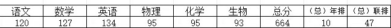

大概心里也知道自己是个什么水平了，心态放平了很多

过年放了四五天假，初三回去自习qwq

## 2025.4

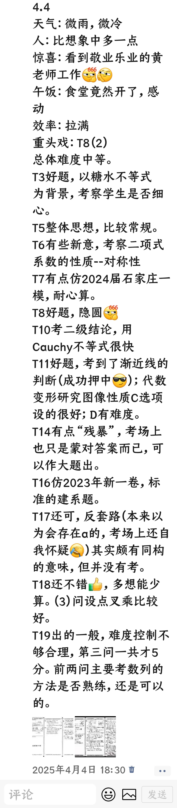

清明节放假，心理其实有点紧张，到教室做卷子ing。

## 2025.6

### 2025.6.5

开始搬空教室布置考场了...有点紧张，下完晚自习其实挺晚的了，不过约了和朋友去烈士公园散步，黑漆漆的公园里很静谧，颇为开心，压力也轻松了不少。

### 2025.6.7

紧张吗，虽然嘴上说的还好，但是大早上4：50醒来说不慌是假的...

语文考的很崩溃啊，现代文1怎么开始教种花了，还是半言半白的文字，读着很难受TwT.

下午数学考炸了，刚发卷子就感觉大事不妙，选填有几个设问方式比较新颖或者是最近练习的比较少，T5,T8,T11,T14,T17,看到T19直接欲哭无泪了，连大题干都没有，考三角函数真是炸裂，这种设题确实没有预料到。

选填做的不大好多选题T11卡死了，T10没敢赌...这就是人性的真实吧，

感觉卷子听新奇的，应该大家都比较炸，没有多想，老老实实准备英语去了

晚上下了大大大暴雨，听力练习一脸懵，幸好雨今天下完了，所有人都在庆幸...

### 2025.6.8

英语真服了啊，听力听的非常懵，不知道为啥感觉听不到答案，糊糊涂涂的，后面做的很顺心情还是不错的

下午物理比较开心，没遇到太多难题，整体考试节奏和平时训练差不多的，多选压轴题按部就班的算完了，实验一路畅通，T14比较明显的熟悉感，2021年的湖南卷压轴+2024年的广东卷压轴，最后组合场...有一点点难算，最后按照老师平时的建议懵了个根号三L了事。T15无语了，看到图形就知道这又在整活了，和2023年比较像都是椭圆，不过这个题总的来说没有特别考察椭圆的问题，前两问还是稳稳拿下，除了答案有点难算。

整体心态还是很好的。

### 2025.6.9

上午化学ez啊，可以说比往年湖南卷简单太多了，考出来大家都在笑。当时还在想这搞得怎么拉的开赋分分数。

生物略难吧，基因工程有几空不太稳，遗传倒是问题不大。

考完感觉挺轻松的，场面也是颇为壮观，全是欢呼声。

### 2025.6.10

考完不知道干什么了，emm

想着整理之前的笔记啥的，之前学校组织活动写过一点小文章，想试试去杂志社投稿，于是顺便初步学习了论文写作的步骤和格式。

### 2025.6.12

各科开始出答案了，有点崩溃...英语莫名其妙，反正至今觉得去年卷子出的有问题，两个阅读题答案不正确，直接亏死，语法填空也是考了一个有点冷门的win by，哎

物理对了一下答案，非常开心，应该是93-94分，就看T15最后一问会不会给1-2分步骤分了，

数学直接宕机，应该是当时还是有点紧张，错了第5题...真的应该是高考最大的遗憾了

### 2025.6.24

上午搞毕业典礼，考完了和朋友一起去签名墙签名来着。

中午朋友和原班级一起去聚餐去了，晚上出分，于是默默回家了，属实是颇为遗憾的事情...

晚上用新手机查分咯

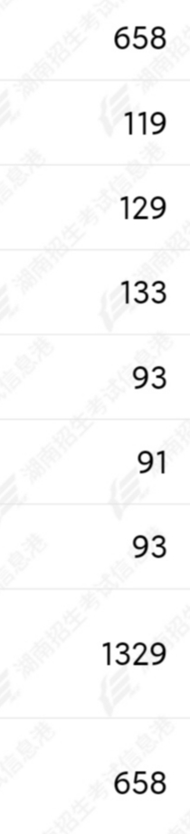

其实有点失落，比中考的巅峰差远了

不过好像也没啥好比的就是.jpg，总的来说和意料差不多吧，英语那两个goushi阅读题一错也就剩这个分数了，数学也是，错了第五题确实就这分，卷子是真的goushi，T11T19T18几乎没有区分度，T19还难改卷，真无语

物理和预估差不多，化学不知道哪里匡瓢了后来没去查答案，赋分有点低，语文平平常常，也就这水平。

### 2025.6-2025.7.2

总的来说还是很快调整好了心态，毕竟高考已经过去了，也没办法了，尘埃落定

各方打听消息，和好兄弟交流，之前对填志愿了解到还是比较少，搞得匆匆忙忙的，

如果英语和数学关键的10分没丢应该能去国科大的，当时面试分挺高的，反倒最后被高考成绩拉了后腿。

其实选专业也纠结了很久很久，最终还是放弃了纯数学专业（数学嘛，当个爱好好了），决定读工科，其实要读啥也没太想好，最后签了工科试验班，大一就留给我慢慢摸索兴趣吧。

## 2025.7

7月没有干什么太多事情...

之前很好的一个朋友后来一直没联系了，堵得慌，心情也是一落千丈

7.15开始帮表弟补课，也有一些出游计划，不过8月中旬才和好兄弟出去玩，也是慢慢准备ing

## 2025.8

### 8月初

8月出头终于搞完了补课内容，休息了若干天，实在是干不了啥，想起来小学玩的游戏，开始真正“休息”一番...也只是大量无聊的时光，尽量调节拥塞的心情。

### 8月中旬

终于和好朋友去江西了，去了庐山和龙虎山，还是开心了亿点点

### 8月底

准备开学ing，30日来学校报到了。

## 2025.9

### 2025.9.1-2025.9.20

无聊的军训时光...其实总的来说南京算不上很热很热，军训强度也不如高中军训强，但是确实时间很长，只能**拿不定积分打发时光.jpg**

### 2025.9.6

读网安的一个朋友发了一个题来，当时也不是很清楚xwx，懵懵懂懂的

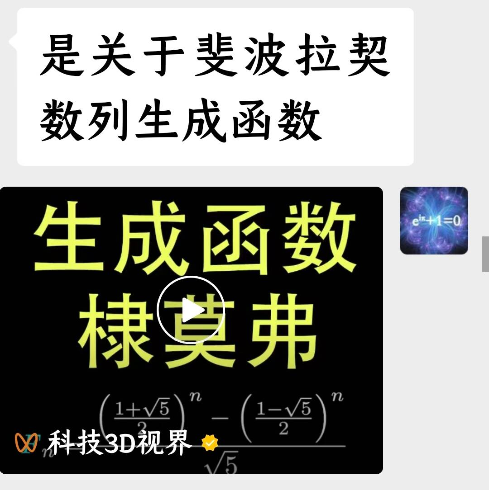

但是很有意思的是，平时喜欢看点小视频啥的，凭借这点积累确实直接把这个crypto的核心公式点出来了，不过当时真是啥也不会啊对编程的一些计算和思维都是0，和朋友研究了好一会，最后才解决。不过也就是这次邂逅，竟产生了巨大的影响。

### 2025.9.19

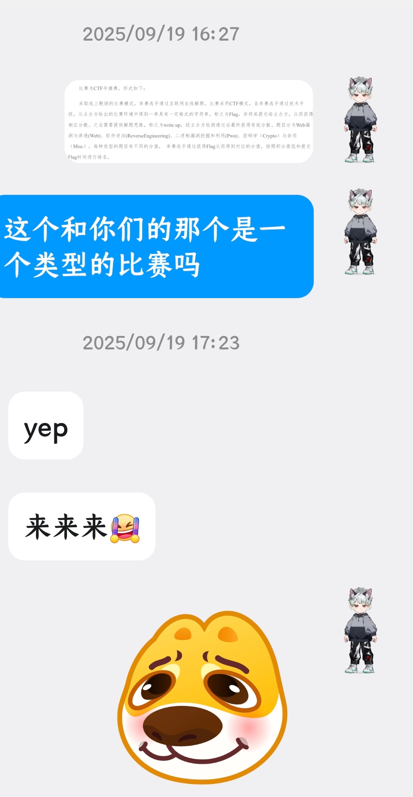

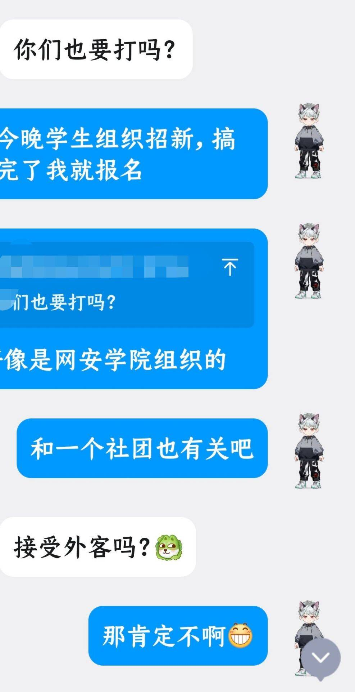

19号，就在军训结束前一天看到了比赛的通知，其实很早就发了不过刚刚才想起来，发现竟然是CTF，于是在cha师傅的怂恿下报名了，正式开启比赛之路，

### 2025.9.21

SUSCTF（新生赛）正式开赛了，认真比赛

一开始真是啥也不会，0基础这一块，只能慢慢拷打拷打AI，广泛搜索blog

### 2025.9.22

出了一个找石头的题，当时也不知道这是啥，下午没课，反正拿着手机在校园里转悠，不料正好看到了一个抱着电脑在转悠的同学，hh也是很快认出了都是在做题的，于是就认识了Rycbartbad师傅，后来成了很好的朋友，这一天还是很有意思的hhh

## 2025.10

### 2025.10.1

国庆假期，没回老家，一是因为有比赛嘛，二是因为来来回回的也有点麻烦而且路费不少，于是就直接在南京过节了。

晚上和在NJU的好朋友去园博园看烟花，还是很震撼滴hhhh

### 2025.10.1-2025.10.7

认真比赛、学习，pwn还是太恐怖了，第一次看栈的概念就看了半天qwq

3号和4号下午也是两校互访hhh，去NJU参观，也邀请好朋友来SEU玩，还是非常happy的。

6号中秋，白天去了江苏省美术馆看看画展，（别的景点人巨多，就没去了）。下午看了电影《刺杀小说家2》，还是超出了预期的，挺搞笑的xwx，反正平时看电影也没啥特定喜好，全靠朋友拉着一起看。

7号比赛结束力，最后成绩还是很不错滴（至少我当时这么觉得）

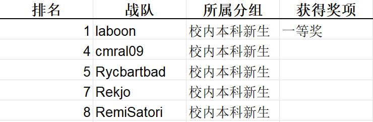

10.17号去领奖啦

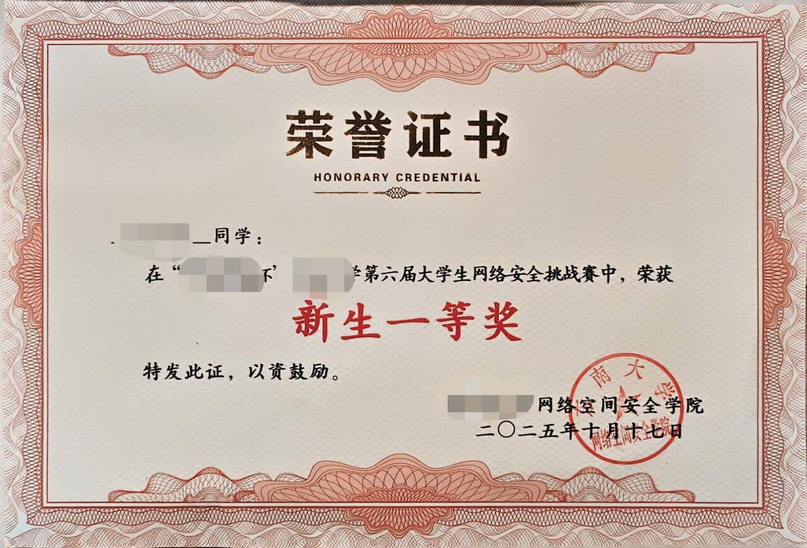

### 2025.10.17-2025.10.24

比完了有点没事情干，比较轻松（现在真是有点后悔，当时高代和C++都还比较简单，应该预习的xwx），于是被cha师傅拉着去GeekGame2025了，误入高端局，直接被薄纱。

真是诠释了一句话叫做签到题也不会，Data Matrix码也是大量搜索、询问AI之后才了解到，主打被薄纱。

人机题倒是可以用和SUSCTF一样的payload打通，密码拷打AI出了一个，misc出了一个编程类的题目。整体而言难度还是太大了，不适合纯新手。也是唯一一次没有写wp的比赛了。

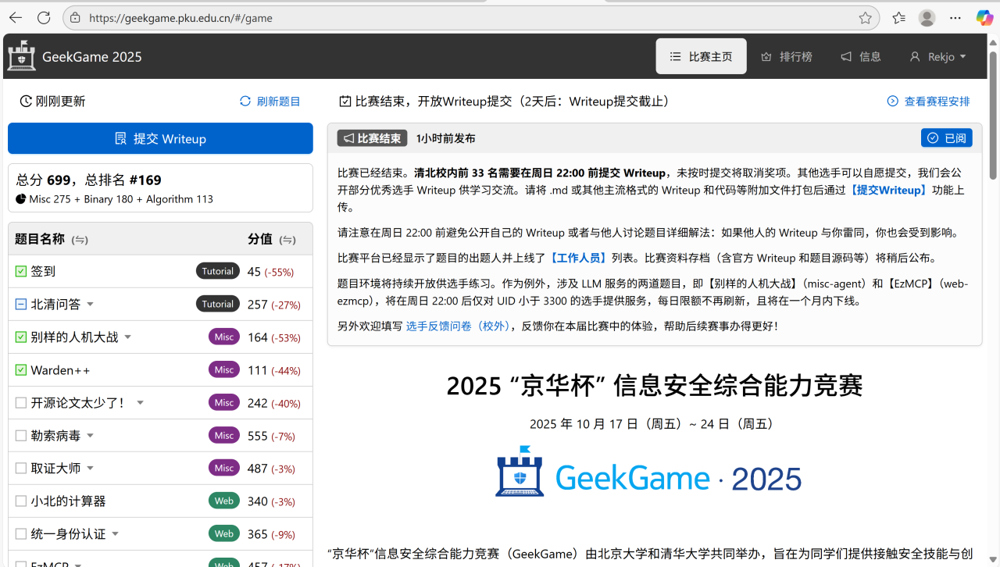

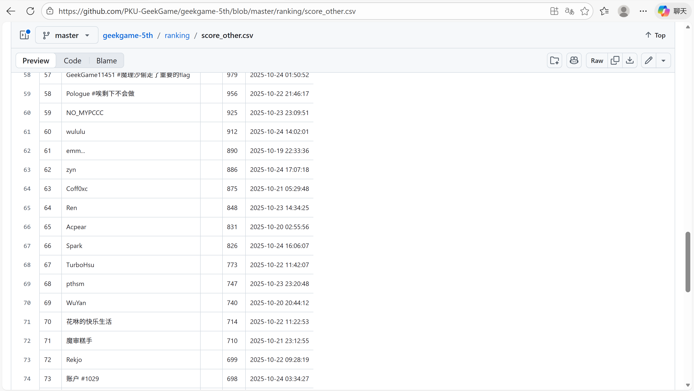

最后在校外榜排名第72，总榜第169。来年再战吧，这个确实做的很痛苦qwq。

### 2025.10.24-2025.11.24

紧密衔接这一块？

和cha师傅一起组队打GeekChallenge2025，非常激动hhh，学到了很多也成长了很多，比如misc初次接触了“传说中的”blockchain，crypto被Hensel奇特的解题思路所震撼，--当然最重要的还是确认了可能的新方向reverse，毕竟pwn真心难，web不想打，只能去re了

## 2025.11

### 2025.10.24-2025.11.24

主要任务就是在打GeekChallenge咯，其实还遇到了很多很多有意思的题目。

misc：第一次手动拼二维码呵呵，属实是拼尽全力了；字体隐写也很有意思，不太确定是不是要一点脑洞，但是在学长耐心的指导下还是自己想到了hhh；图片隐写有了一些基础认识，一开始连watermark是什么都不知道xwx；第一次解出blockchain的入门题目，也挺好玩的hhh；还有docx竟然是打包的zip，也是出乎意料

reverse：rust逆向，读代码有点头疼；去混淆倒是ai梭出来了，还有SMC，第一次遇到感觉很神奇；第一次手动去花，感觉很有意思；

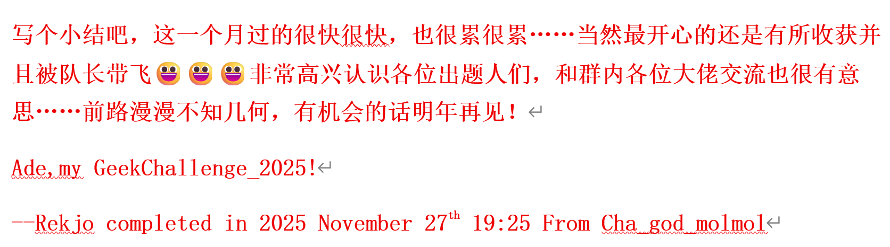

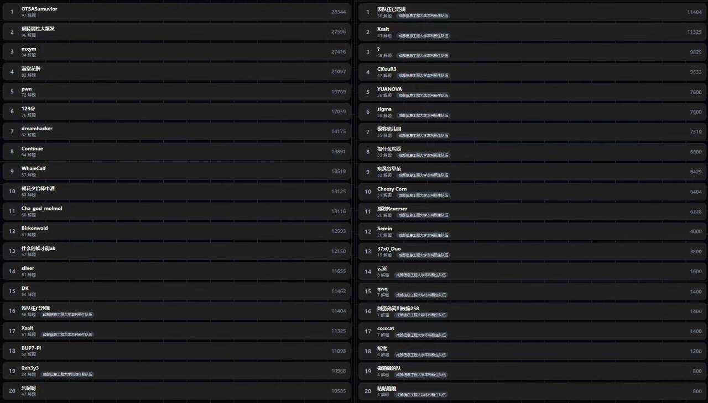

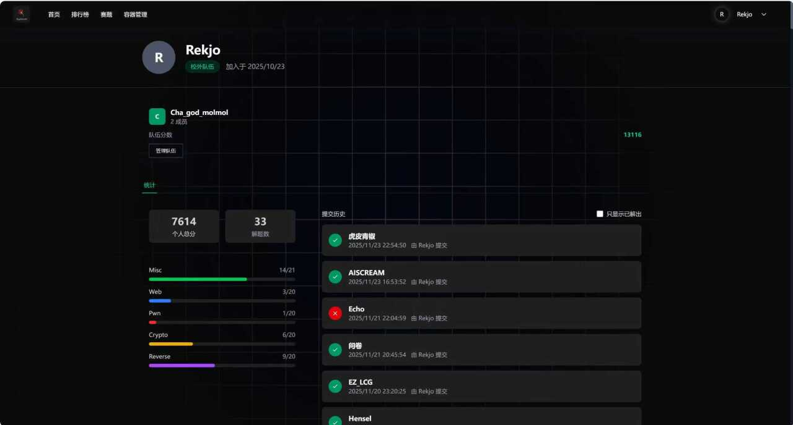

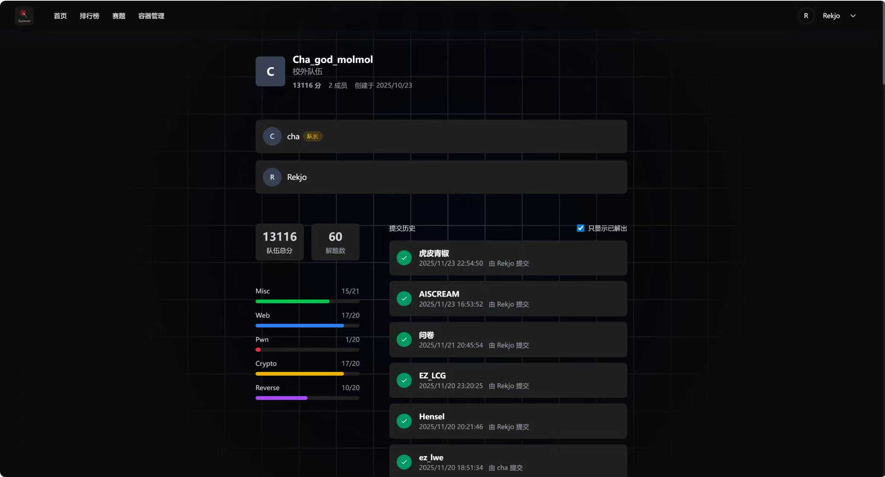

### 11月底

准备各类考试ing，尤其是四级...可恶的听力

国赛报名力。

## 2025.12

忙碌的一月

### 2025.12.1-2025.12.7

cha师傅邀我打ISCTF，虽然他后来没打，但是也是很重要的一个比赛。

实在是没想到cha师傅要和校队一起打，于是临时拉上Rycbartbad师傅一起参加了，当时其实挺忙的，我们俩也没花很多时间打。

最后也是成功拿下第47名，可惜离社会赛道的奖励圈差一点点，下次如果再喊一个师傅web/pwn都能起飞...

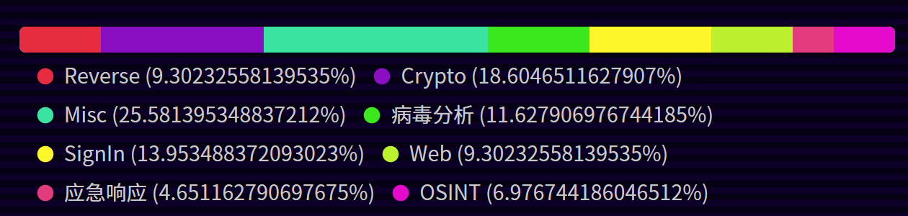

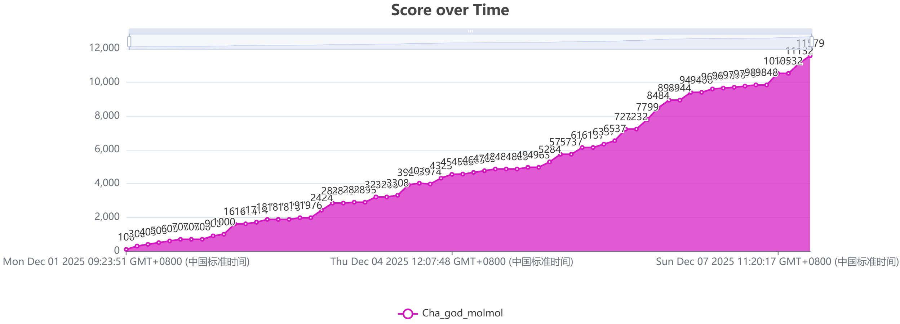

最重要的还是认识了很多师傅以及POFP战队，也是埋下了一个伏笔吧hhhh

### 2025.12.13

今年的四级考试和南京大屠杀国家公祭日重合了，不过好在没出什么岔子，顺利完成了四级考试。

### 12月初

Rycbartbad师傅也报名了国赛，可以一起并肩作战了

### 2025.12.13-2025.12.15

之前一直没时间，就临时打了一下0RAYS战队的CBCTF，也算是国赛前的训练了。

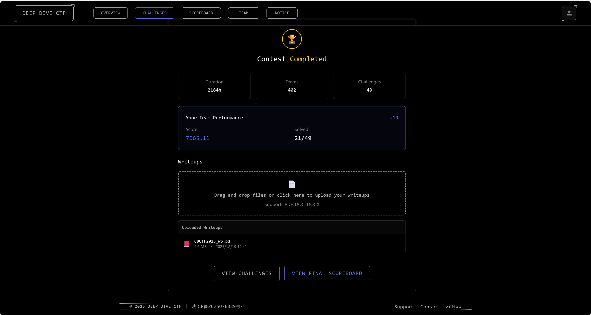

### 2025.12.19-2025.12.21

高强度训练这一块

打HKCERT，约了Rycbartbad师傅和cha师傅，感觉很高级嗷，第一次参加国际赛，才知道有discord这个东西。

第一天认真打了，没想到还拿血了，后面么...就缺席了一些

### 2025.12.20

打HKCERT打到一半突然AA哥发来橄榄枝，本来想拒绝毕竟国际赛还是太难了，不过AA哥说邀我去打TSG的脚盆鸡。而且可以拉我进mini POFP，于是答应了。

爆零是意料之中的事情，但是由此认识了更多的师傅还是很开森的xwx。

### 2025.12.21

HKCERT结束力

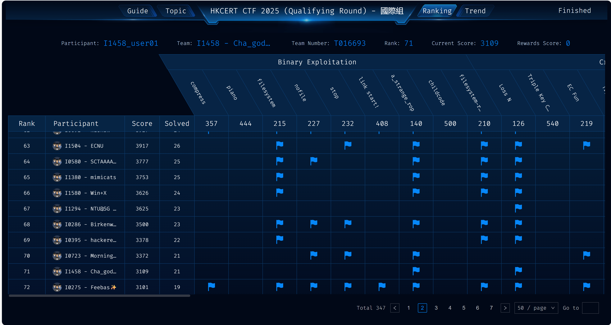

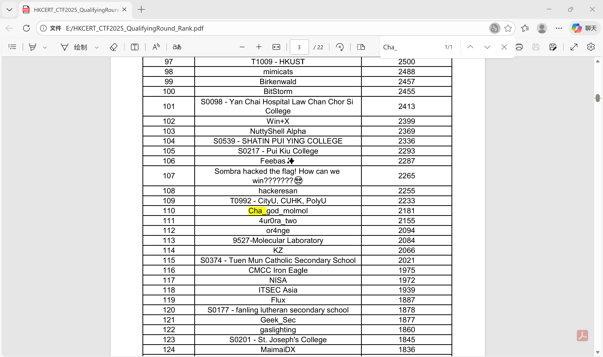

也很不容易了，在三人只是随便打打的情况下拿到这个分数。不管怎么说，也从这次国际赛收获了很多，至少对apk的解题熟悉了一些。不过主要是静态分析。

### 12月底

国赛和期末的压力逐渐来到...

### 2025.12.28

可谓这个学期最重要的比赛。早上很早就起床了，和Rycbartbad、laboon师傅赶到另一个校区参赛。老登们看起来心态还是很轻松的，都是踩点到hhh

上午的赛程很艰辛只能说，实在是卡的不行，只能先开始做安全知识问答了，只拿了290分（我以为大部分队伍都是满分的hhh），web手的进展不是很顺利，不过学长还是很尽力的在带我们，但是难度确实挺大的

Rycbartbad师傅挺...可怜的，今年的pwn出的格外变态，最后也是爆零而归...

上午做了一个密码学，然后老登点了KFChhh，中午还是吃了个汉堡。

总的来说氛围还挺独特的，偶尔交谈，大部分时间都是敲键盘的声音和风扇呼呼转hhh

下午进展不错，做了一个密码，费劲九牛二虎之力做出来了reverse的Eternum，不知道为啥只有50pts，不过成就感还是拉满。很可惜最后没做出来别的东西了，早知道去帮别的师傅做流量分析了xwx。

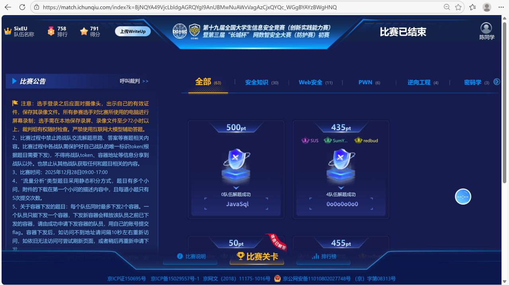

有点可惜，总的来说不适应国赛的风格，简直就是变态，不同的板块交叉融合，真是无语了

## 2026.1

### 2026.1.1-2026.1.21

时间很紧，要期末了，也是紧张的开始复习之旅了...强度其实不算很大，各科考试之间的时间间隙还是很足的，只是下半个学期确实没花太多时间学习，复习的相对仓促吧，最后没算筐大瓢吧，总绩点3.97，只可惜线代和C++差一点点满绩

### 2026.1.22

光速溜回老家，xwx

### 2026.1.23

经历了长时间的审核，ccb终于出成绩了，但是却给了我一个晴天霹雳...打击如此沉重，以至于当时近乎崩溃...

幸好有Rycbartbad和mini POFP认识的xiangrongyu师傅（真的很好awa）安慰和鼓励，终于以一个比较科学的心态看待这件事。

不管怎么说，一系列大赛即将来临，还是得振作起来！！！

### 2026.1.24-2026.1.26

第一次进军XCTF联赛，比赛比较正式，难度也是相当大，所以和xiangrongyu师傅一起组建了r(rekjo)x(xiangrongyu)战队，参加LilacCTF2026，也是新年第一战了。参加的队员还有各个比赛认识的师傅：Rycbartbad（SUSCTF），Yuki-U（RedQueen)，工一阵(furryCTF)，yyzm(mini POFP)，LuooU（ISCTF），laboon32（SUSCTF）。最后取得的战绩也是相当不错滴：

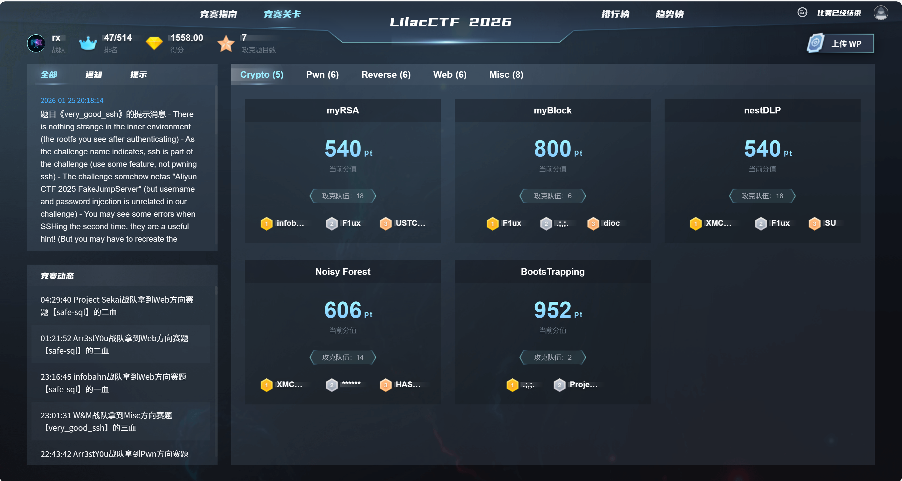

[Misc] Welcome 38pts --Rekjo

[Misc] Questionnaire 93pts --Rekjo

[Misc] Your GitHub, mine 196pts --yyzm

[Misc] Sky Is Ours 285pts --工一阵

[Reverse] ezPython 67pts --Rekjo

[Reverse] NineApple 370pts --Rekjo

[Reverse] JustROM 344pts --xiangrongyu

* 总分：1558pts
* 排名：47/514

### 2025.1.25-2025.1.31

最初呢还有别的师傅拉我去UniCTF，最后和LuooU师傅一起组队了，还有两位队友--yuyuan和pwnbaby。

比赛很难崩，感觉难度就比国赛低一丢丢，感觉分一个新生赛道的意义真不大，整体坐下来misc是没什么收获，reverse有一丢丢吧。

主要问题是难度感觉有点过大了，加上题量也大，不用AI根本做不完...最后大家合力之下，也是顺利拿到了疯狂星期四hhhh

好久没有获奖了.jpg

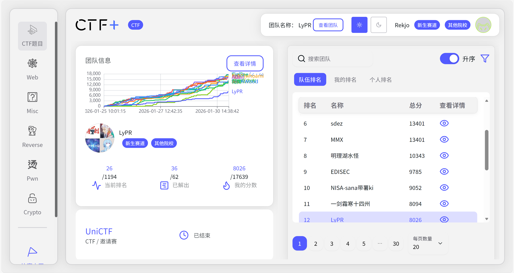

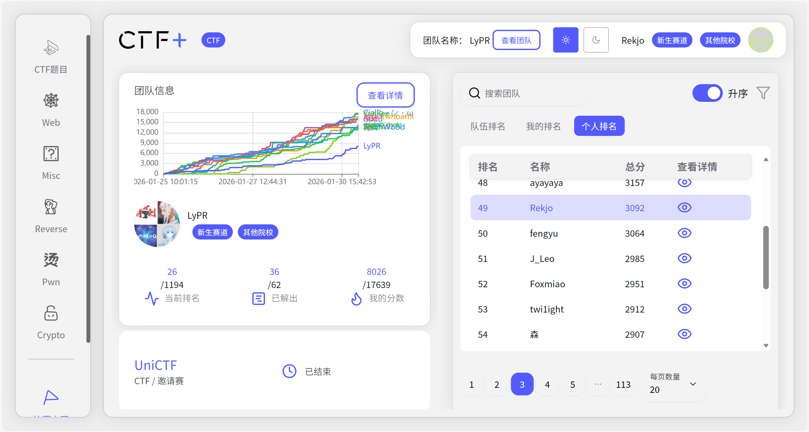

最后应该是有些师傅没写wp？反正拿下了新生赛道第五名，+188r:smile:

### 2026.1.30-2026.2.4

又和cha师傅一起并肩作战啦！嘻嘻

furryCTF2025，本来呢还有一个POFP的内部邀请赛，后来变成了公开赛，再后来AA哥的倡导下，白风同意了和POFP一起联赛，两个比赛合二为一了。

比赛也是有幸邀请到了H1mX1n师傅，pwn可以乱杀了hhhh

最后比赛也很顺利，POFP的题目虽然难度有点大但是确实学到了挺多，题目覆盖面也挺广，AI,blockchain,PPC,HardWare,Forenics,OSINT,mobile,misc,web,reverse,crypto,pwn.

最后呢还是有很多师傅不满意，不过我觉得还是办的很好的，趣味性也在线，就是八卦师傅能不能别出脑洞太大的题目了，真的做的很难受啊最后那个blackbox还是零解，第一的netcat也折在这道题上，差点就AK了。

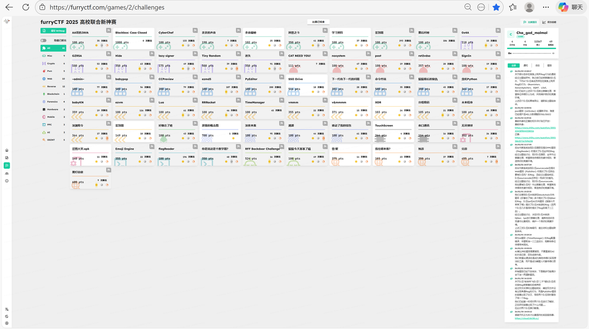

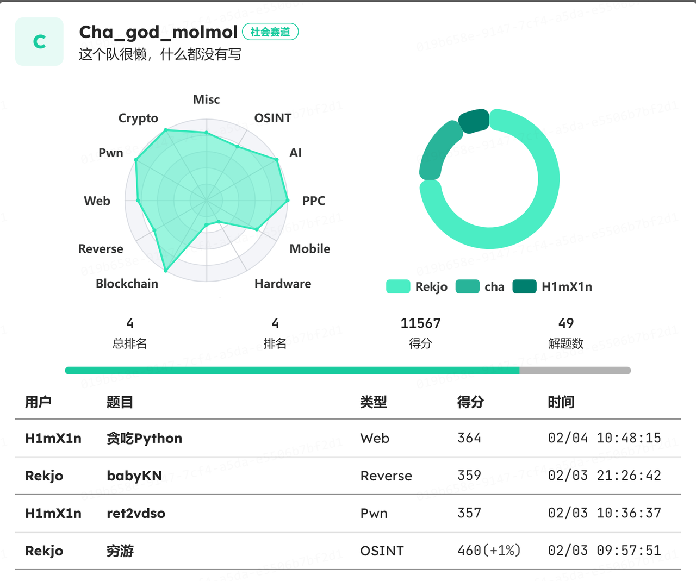

第三名由于没交wp，所以第四名的我们侥幸拿了三等奖hhh，也算是开开心心过年了

### 2026.2.4-2026.2.6

后面还有些比赛啦，比如hgame和shctf，不过只是作为简单的练习看看，放松放松呢

### 年前

吸取了上个学期的教训，开始预习数分下啦，对抽代比较感兴趣，决定在blog不定期更新学习日志hhh

## At Last

2025的回顾就到这啦，其实还是特别感谢各位朋友、师傅的鼓励和陪伴，成长了许多，也把自己从苦闷的心态解放了出来。

最后祝大家马年快乐，万事顺遂！

