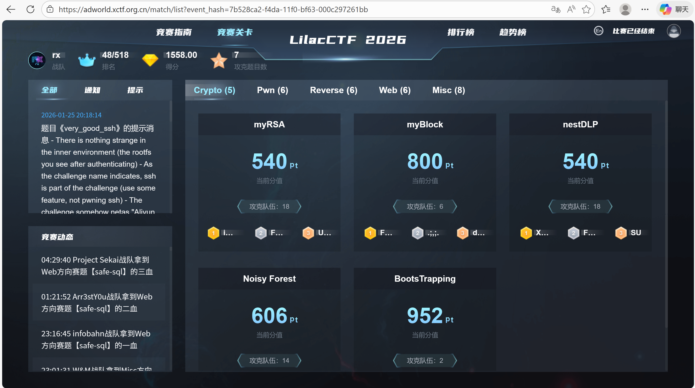
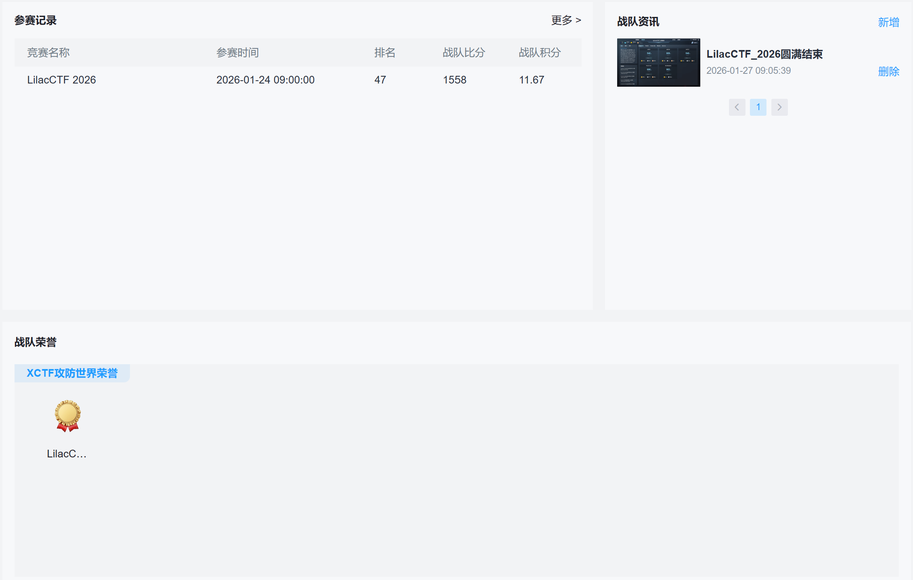
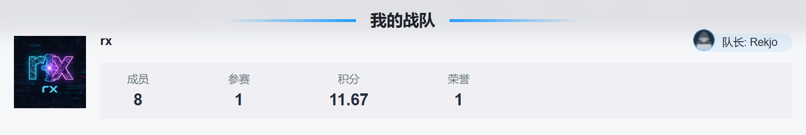

***


## Summary

第一次参加xctf联赛，和xiangrongyu师傅一起组建了一支临时战队rx，没想到战绩喜人







作为rx的首战还是打出了气势，各位师傅都辛苦了~可惜这次crypto没怎么做，ai忘用了，不然说不定能冲前30

继续努力喵！

以下是本人题解：


## Misc

### Welcome

```text
789c0540b10980400c5ce92442067849153bc1f278ae1031ad95b87bc8bba6c611df6925ec46076bc955f2e0056ccc773c7f03fb580c81
```

先转hex再zlib恢复

`LilacCTF{W3lc0M3_70_l1L4cc7F_g00D_LuCk}`


### Questionnaire

`LilacCTF{7h4nk_U_f0r_p4rt1cip4t1n9_L1l4cCTF_2026}`


## Reverse

### ezPython

直接干会出点问题，发现pyinstxtractor解包不完全，核心模块myalgo.pyc没出来，需要别的工具帮忙

```bash
pip install -U pyinstxtractor-ng
cd /mnt/e/ezpython/main.exe_extracted
python3 -m pyinstxtractor_ng PYZ-00.pyz
```

此时会报错，

环境把 当前目录里的 `struct.pyc` 当成了 `struct` 模块来导入了，导致 pyinstxtractor-ng `import struct` 时报：

```
bad magic number in 'struct': b'a\r\r\n'
```

因为目录里确实有个 `struct.pyc`，它覆盖了标准库的 `struct`。

切换到别的不含struct.pyc的目录仍然会报错，这里需要重新解包

```bash
cd /mnt/e/ezpython/
python3 -m pyinstxtractor_ng main.exe
```

此时`PYZ-00.pyz_extracted`不是空文件夹了

反编译还是在线吧，这里不知道为啥decompyle++有问题

```python
# Decompiled with PyLingual (https://pylingual.io)
# Internal filename: 'myalgo.py'
# Bytecode version: 3.9.0beta5 (3425)
# Source timestamp: 1970-01-01 00:00:00 UTC (0)

import dis
import struct
def MX(y, z, sum, k, p, e):
    return (z >> 5 ^ y >> 2) + (y << 3 ^ z << 4) ^ (sum ^ y) + (k[p & 3 ^ e] ^ z)
def btea(v, n, k):
    u32 = lambda x: x & 4294967295
    y = v[0]
    sum = 0
    DELTA = 1163219540
    if n > 1:
        z = v[n - 1]
        q = 6 + 52 // n
        while q > 0:
            q -= 1
            sum = u32(sum + DELTA)
            e = u32(sum >> 2) & 3
            p = 0
            while p < n - 1:
                y = v[p + 1]
                z = v[p] = u32(v[p] + MX(y, z, sum, k, p, e))
                p += 1
            y = v[0]
            z = v[n - 1] = u32(v[n - 1] + MX(y, z, sum, k, p, e))
        return True
    else:
        return False
if __name__ == '__main__':
    print('WOW')
# Decompiled with PyLingual (https://pylingual.io)
# Internal filename: 'main.py'
# Bytecode version: 3.9.0beta5 (3425)
# Source timestamp: 1970-01-01 00:00:00 UTC (0)

import struct
from crypto import *
from sys import *
import base64
import myalgo
welcome_msg = 'V2VsYzBtMyBUbyBUaGUgV29ybGQgb2YgTDFsYWMgPDM='
input_msg = ':i(G#8T&KiF<F_)F`JToCggs;'
right_msg = 'UmlnaHQsIGNvbmdyYXR1bGF0aW9ucyE='
wrong_msg = 'V3JvbmcgRmxhZyE='
print(b64decode(welcome_msg).decode())
flag = input(a85decode(input_msg).decode())
if not (flag.startswith('LilacCTF{') and flag.endswith('}') and (len(flag) == 26)):
    print(b64decode(wrong_msg).decode())
else:
    flag = flag[9:25]
    res = [761104570, 1033127419, 3729026053, 795718415]
    key = struct.unpack('<IIII', b'1111222233334444')
    input = list(struct.unpack('<IIII', flag.encode()))
    myalgo.btea(input, 4, key)
    if input[0] == res[0] and input[1] == res[1] and (input[2] == res[2]) and (input[3] == res[3]):
        print(b64decode(right_msg).decode())
    else:
        print(b64decode(wrong_msg).decode())
```

此时直接解密会得到乱码，莫名其妙，询问AI后发现crypto模块可能有疑点：

```python
# Decompiled with PyLingual (https://pylingual.io)
# Internal filename: 'crypto.py'
# Bytecode version: 3.9.0beta5 (3425)
# Source timestamp: 1970-01-01 00:00:00 UTC (0)

from types import CodeType
import dis
import sys
from myalgo import *
import re
import struct
import binascii
class RC4:
    def __init__(self, key: bytes):
        """\n        初始化 RC4 类\n        :param key: 密钥，字节类型\n        """
        self.key = key
        self.s = list(range(256))
        self._ksa()
    def _ksa(self):
        """\n        密钥调度算法 (Key Scheduling Algorithm, KSA)\n        """
        j = 0
        key_length = len(self.key)
        for i in range(256):
            j = (j + self.s[i] + self.key[i % key_length]) % 256
            self.s[i], self.s[j] = (self.s[j], self.s[i])
    def _prga(self):
        """\n        伪随机数生成算法 (Pseudo-Random Generation Algorithm, PRGA)\n        :yield: 生成的伪随机字节\n        """
        i = j = 0
        while True:
            i = (i + 1) % 256
            j = (j + self.s[i]) % 256
            self.s[i], self.s[j] = (self.s[j], self.s[i])
            yield self.s[(self.s[i] + self.s[j]) % 256]
    def encrypt(self, plaintext: bytes) -> bytes:
        """\n        加密明文\n        :param plaintext: 明文，字节类型\n        :return: 密文，字节类型\n        """
        keystream = self._prga()
        return bytes([p ^ next(keystream) for p in plaintext])
    def decrypt(self, ciphertext: bytes) -> bytes:
        """\n        解密密文\n        :param ciphertext: 密文，字节类型\n        :return: 明文，字节类型\n        """
        return self.encrypt(ciphertext)
class ArrangeSimpleDES:
    def __init__(self):
        self.ip = [58, 50, 42, 34, 26, 18, 10, 2, 60, 52, 44, 36, 28, 20, 12, 4, 62, 54, 46, 38, 30, 22, 14, 6, 64, 56, 48, 40, 32, 24, 16, 8, 57, 49, 41, 33, 25, 17, 9, 1, 59, 51, 43, 35, 27, 19, 11, 3, 61, 53, 45, 37, 29, 21, 13, 5, 63, 55, 47, 39, 31, 23, 15, 7]
        self.ip1 = [40, 8, 48, 16, 56, 24, 64, 32, 39, 7, 47, 15, 55, 23, 63, 31, 38, 6, 46, 14, 54, 22, 62, 30, 37, 5, 45, 13, 53, 21, 61, 29, 36, 4, 44, 12, 52, 20, 60, 28, 35, 3, 43, 11, 51, 19, 59, 27, 34, 2, 42, 10, 50, 18, 58, 26, 33, 1, 41, 9, 49, 17, 57, 25]
        self.E = [32, 1, 2, 3, 4, 5, 4, 5, 6, 7, 8, 9, 8, 9, 10, 11, 12, 13, 12, 13, 14, 15, 16, 17, 16, 17, 18, 19, 20, 21, 20, 21, 22, 23, 24, 25, 24, 25, 26, 27, 28, 29, 28, 29, 30, 31, 32, 1]
        self.P = [16, 7, 20, 21, 29, 12, 28, 17, 1, 15, 23, 26, 5, 18, 31, 10, 2, 8, 24, 14, 32, 27, 3, 9, 19, 13, 30, 6, 22, 11, 4, 25]
        self.K = '0111010001101000011010010111001101101001011100110110100101110110'
        self.k1 = [57, 49, 41, 33, 25, 17, 9, 1, 58, 50, 42, 34, 26, 18, 10, 2, 59, 51, 43, 35, 27, 19, 11, 3, 60, 52, 44, 36, 63, 55, 47, 39, 31, 23, 15, 7, 62, 54, 46, 38, 30, 22, 14, 6, 61, 53, 45, 37, 29, 21, 13, 5, 28, 20, 12, 4]
        self.k2 = [14, 17, 11, 24, 1, 5, 3, 28, 15, 6, 21, 10, 23, 19, 12, 4, 26, 8, 16, 7, 27, 20, 13, 2, 41, 52, 31, 37, 47, 55, 30, 40, 51, 45, 33, 48, 44, 49, 39, 56, 34, 53, 46, 42, 50, 36, 29, 32]
        self.k0 = [1, 1, 2, 2, 2, 2, 2, 2, 1, 2, 2, 2, 2, 2, 2, 1]
        self.S = [14, 4, 13, 1, 2, 15, 11, 8, 3, 10, 6, 12, 5, 9, 0, 7, 0, 15, 7, 4, 14, 2, 13, 1, 10, 6, 12, 11, 9, 4, 1, 14, 8, 3, 10, 5, 0, 15, 12, 8, 2, 4, 9, 14, 12, 5, 0, 14, 10, 6, 6, 4, 2, 1, 10, 6, 3, 11, 5, 1, 10, 14, 5, 6, 4, 2, 1, 13, 1, 10, 6, 3, 11, 6, 4, 2, 1, 13, 3, 8, 10, 6, 1, 11]
    def __substitution(self, table: str, self_table: list) -> str:
        """\n        :param table: 需要进行置换的列表,是一个01字符串\n        :param self_table: 置换表，在__init__中初始化了\n        :return: 返回置换后的01字符串\n        """
        sub_result = ''
        for i in self_table:
            sub_result += table[i - 1]
        return sub_result
    def str2bin(self, string: str) -> str:
        """\n        将明文转为二进制字符串:\n        :param string: 任意字符串\n        :return:二进制字符串\n        """
        plaintext_list = list(bytes(string, 'utf8'))
        result = []
        for num in plaintext_list:
            result.append(bin(num)[2:].zfill(8))
        return ''.join(result)
    def bin2str(self, binary: str) -> str:
        """\n        二进制字符串转成字符串\n        :param binary:\n        :return:\n        """
        list_bin = [binary[i:i + 8] for i in range(0, len(binary), 8)]
        list_int = []
        for b in list_bin:
            list_int.append(int(b, 2))
        result = bytes(list_int).decode()
        return result
    def __bin2int(self, binary: str) -> list:
        """\n        由于加密之后的二进制无法直接转成字符，有不可见字符在，utf8可能无法解码，所以需要将二进制字符串每8位转成int型号列表，用于转成bytes再转hex\n        :param binary: 二进制字符串\n        :return: int型列表\n        """
        list_bin = [binary[i:i + 8] for i in range(0, len(binary), 8)]
        list_int = []
        for b in list_bin:
            list_int.append(int(b, 2))
        return list_int
    def __int2bin(self, list_int: list) -> str:
        result = []
        for num in list_int:
            result.append(bin(num)[2:].zfill(8))
        return ''.join(result)
    def __get_block_list(self, binary: str) -> list:
        """\n        对明文二进制串进行切分，每64位为一块，DES加密以64位为一组进行加密的\n        :type binary: 二进制串\n        """
        len_binary = len(binary)
        if len_binary % 64!= 0:
            binary_block = binary + '0' * (64 - len_binary % 64)
            return [binary_block[i:i + 64] for i in range(0, len(binary_block), 64)]
        else:
            return [binary[j:j + 64] for j in range(0, len(binary), 64)]
    def modify_secretkey(self):
        """\n        修改默认密钥函数\n        :return: None\n        """
        print('当前二进制形式密钥为:{}'.format(self.K))
        print('当前字符串形式密钥为：{}'.format(self.bin2str(self.K)))
        newkey = input('输入新的密钥（长度为8）：')
        if len(newkey)!= 8:
            print('密钥长度不符合，请重新输入：')
            self.modify_secretkey()
        else:
            bin_key = self.str2bin(newkey)
            self.K = bin_key
            print('当前二进制形式密钥为:{}'.format(self.K))
    def __f_funtion(self, right: str, key: str):
        """\n        :param right: 明文二进制的字符串加密过程的右半段\n        :param key: 当前轮数的密钥\n        :return: 进行E扩展，与key异或操作，S盒操作后返回32位01字符串\n        """
        e_result = self.__substitution(right, self.E)
        xor_result = self.__xor_function(e_result, key)
        s_result = self.__s_box(xor_result)
        p_result = self.__substitution(s_result, self.P)
        return p_result
    def __get_key_list(self):
        """\n        :return: 返回加密过程中16轮的子密钥\n        """
        key = self.__substitution(self.K, self.k1)
        left_key = key[0:28]
        right_key = key[28:56]
        keys = []
        for i in range(1, 17):
            move = self.k0[i - 1]
            move_left = left_key[move:28] + left_key[0:move]
            move_right = right_key[move:28] + right_key[0:move]
            left_key = move_left
            right_key = move_right
            move_key = left_key + right_key
            ki = self.__substitution(move_key, self.k2)
            keys.append(ki)
        return keys
    def __xor_function(self, xor1: str, xor2: str):
        """\n        :param xor1: 01字符串\n        :param xor2: 01字符串\n        :return: 异或操作返回的结果\n        """
        size = len(xor1)
        result = ''
        for i in range(0, size):
            result += '0' if xor1[i] == xor2[i] else '1'
        return result
    def __s_box(self, xor_result: str):
        """\n        :param xor_result: 48位01字符串\n        :return: 返回32位01字符串\n        """
        result = ''
        for i in range(0, 8):
            block = xor_result[i * 6:(i + 1) * 6]
            line = int(block[0] + block[5], 2)
            colmn = int(block[1:5], 2)
            res = bin(self.S[i][line * 16 + colmn])[2:]
            if len(res) < 4:
                res = '0' * (4 - len(res)) + res
            result += res
        return result
    def __iteration(self, bin_plaintext: str, key_list: list):
        """\n        :param bin_plaintext: 01字符串，64位\n        :param key_list: 密钥列表，共16个\n        :return: 进行F函数以及和left异或操作之后的字符串\n        """
        left = bin_plaintext[0:32]
        right = bin_plaintext[32:64]
        for i in range(0, 16):
            next_lift = right
            f_result = self.__f_funtion(right, key_list[i])
            next_right = self.__xor_function(left, f_result)
            left = next_lift
            right = next_right
        bin_plaintext_result = left + right
        return bin_plaintext_result[32:] + bin_plaintext_result[:32]
    def encode(self, plaintext):
        """\n        :param plaintext: 明文字符串\n        :return: 密文字符串\n        """
        bin_plaintext = self.str2bin(plaintext)
        bin_plaintext_block = self.__get_block_list(bin_plaintext)
        ciphertext_bin_list = []
        key_list = self.__get_key_list()
        for block in bin_plaintext_block:
            sub_ip = self.__substitution(block, self.ip)
            ite_result = self.__iteration(sub_ip, key_list)
            sub_ip1 = self.__substitution(ite_result, self.ip1)
            ciphertext_bin_list.append(sub_ip1)
        ciphertext_bin = ''.join(ciphertext_bin_list)
        result = self.__bin2int(ciphertext_bin)
        return bytes(result).hex().upper()
    def decode(self, ciphertext):
        """\n        :param ciphertext: 密文字符串\n        :return: 明文字符串\n        """
        b_ciphertext = binascii.a2b_hex(ciphertext)
        bin_ciphertext = self.__int2bin(list(b_ciphertext))
        bin_plaintext_list = []
        key_list = self.__get_key_list()
        key_list = key_list[::(-1)]
        bin_ciphertext_block = [bin_ciphertext[i:i + 64] for i in range(0, len(bin_ciphertext), 64)]
        for block in bin_ciphertext_block:
            sub_ip = self.__substitution(block, self.ip)
            ite = self.__iteration(sub_ip, key_list)
            sub_ip1 = self.__substitution(ite, self.ip1)
            bin_plaintext_list.append(sub_ip1)
        bin_plaintext = ''.join(bin_plaintext_list).replace('00000000', '')
        return self.bin2str(bin_plaintext)
_a85chars = None
_a85chars2 = None
_A85START = b'<~'
_A85END = b'~>'
bytes_types = (bytes, bytearray)
def _bytes_from_decode_data(s):
    if isinstance(s, str):
        try:
            return s.encode('ascii')
        except UnicodeEncodeError:
            raise ValueError('string argument should contain only ASCII characters')
    else:
        if isinstance(s, bytes_types):
            return s
        else:
            try:
                return memoryview(s).tobytes()
            except TypeError:
                raise TypeError('argument should be a bytes-like object or ASCII string, not %r' % s.__class__.__name__) from None
def b64decode(s, altchars=None, validate=False):
    """Decode the Base64 encoded bytes-like object or ASCII string s.\n\n    Optional altchars must be a bytes-like object or ASCII string of length 2\n    which specifies the alternative alphabet used instead of the \'+\' and \'/\'\n    characters.\n\n    The result is returned as a bytes object.  A binascii.Error is raised if\n    s is incorrectly padded.\n\n    If validate is False (the default), characters that are neither in the\n    normal base-64 alphabet nor the alternative alphabet are discarded prior\n    to the padding check.  If validate is True, these non-alphabet characters\n    in the input result in a binascii.Error.\n    """
    s = _bytes_from_decode_data(s)
    if altchars is not None:
        altchars = _bytes_from_decode_data(altchars)
        assert len(altchars) == 2, repr(altchars)
        s = s.translate(bytes.maketrans(altchars, b'+/'))
    if validate and (not re.fullmatch(b'[A-Za-z0-9+/]*={0,2}', s)):
        raise binascii.Error('Non-base64 digit found')
    else:
        return binascii.a2b_base64(s)
def a85decode(b, *, foldspaces=False, adobe=False, ignorechars=b' \t\n\r\x0b'):
    # irreducible cflow, using cdg fallback
    """\n    """
    b = _bytes_from_decode_data(b)
    if adobe:
        if not b.endswith(_A85END):
            raise ValueError('Ascii85 encoded byte sequences must end with {!r}'.format(_A85END))
        else:
            if b.startswith(_A85START):
                b = b[2:(-2)]
            else:
                b = b[:(-2)]
    packI = struct.Struct('!I').pack
    decoded = []
    decoded_append = decoded.append
    curr = []
    curr_append = curr.append
    curr_clear = curr.clear
    for x in b + b'uuuu':
        if 33 <= x <= 117:
                curr_append(x)
                if len(curr) == 5:
                    acc = 0
                    for x in curr:
                        acc = 85 * acc + (x - 33)
                    try:
                        decoded_append(packI(acc))
                    except struct.error:
                        raise ValueError('Ascii85 overflow') from None
                    curr_clear()
                if x == 122:
                    if curr:
                        raise ValueError('z inside Ascii85 5-tuple')
                    else:
                        decoded_append(b'\x00\x00\x00\x00')
                else:
                    if foldspaces and x == 121:
                        if curr:
                            raise ValueError('y inside Ascii85 5-tuple')
                        else:
                            decoded_append(b'    ')
                    else:
                        if x in ignorechars:
                            continue
                        else:
                            raise ValueError('Non-Ascii85 digit found: %c' % x)
    payload = MX.__code__.co_code
    magic_code1 = b'?'
    magic_code2 = b'>'
    payload = payload[:4] + magic_code2 + payload[5:10] + magic_code1 + payload[11:18] + magic_code2 + payload[19:24] + magic_code1 + payload[25:]
    payload = payload[:3] + b'\x03' + payload[4:9] + b'\x01' + payload[10:17] + b'\x04' + payload[18:23] + b'\x02' + payload[24:]
    fn_code = MX.__code__
    MX.__code__ = CodeType(int(fn_code.co_argcount), int(fn_code.co_posonlyargcount), int(fn_code.co_kwonlyargcount), int(fn_code.co_nlocals), int(fn_code.co_stacksize), payload, fn_code.co_consts, fn_code.co_names, fn_code.co_varnames, fn_code.co_filename, fn_code.co_name, int(fn_code.co_firstlineno), fn_code.co_lnotab, fn_code.co_freevars, fn_code.co_cellvars)
    result = b''.join(decoded)
    padding = 4 - len(curr)
    if padding:
        result = result[:-padding]
    return result
def chacha20_decrypt(key, counter, nonce, ciphertext):
    return chacha20_encrypt(key, counter, nonce, ciphertext)
def chacha20_encrypt(key, counter, nonce, plaintext):
    byte_length = len(plaintext)
    full_blocks = byte_length // 64
    remainder_bytes = byte_length % 64
    encrypted_message = b''
    for i in range(full_blocks):
        key_stream = serialize(chacha20_block(key, counter + i, nonce))
        plaintext_block = plaintext[i * 64:i * 64 + 64]
        encrypted_block = [plaintext_block[j] ^ key_stream[j] for j in range(64)]
        encrypted_message += bytes(encrypted_block)
    if remainder_bytes!= 0:
        key_stream = serialize(chacha20_block(key, counter + full_blocks, nonce))
        plaintext_block = plaintext[full_blocks * 64:byte_length]
        encrypted_block = [plaintext_block[j] ^ key_stream[j] for j in range(remainder_bytes)]
        encrypted_message += bytes(encrypted_block)
    return encrypted_message
def chacha20_block(key, counter, nonce):
    BLOCK_CONSTANTS = [1634760805, 857760878, 2036477234, 1797285236]
    init_state = BLOCK_CONSTANTS + key + [counter] + nonce
    current_state = init_state[:]
    for i in range(10):
        inner_block(current_state)
    for i in range(16):
        current_state[i] = add_32(current_state[i], init_state[i])
    return current_state
def inner_block(state):
    quarterround(state, 0, 4, 8, 12)
    quarterround(state, 1, 5, 9, 13)
    quarterround(state, 2, 6, 10, 14)
    quarterround(state, 3, 7, 11, 15)
    quarterround(state, 0, 5, 10, 15)
    quarterround(state, 1, 6, 11, 12)
    quarterround(state, 2, 7, 8, 13)
    quarterround(state, 3, 4, 9, 14)
def xor_32(x, y):
    return (x ^ y) & 4294967295
def add_32(x, y):
    return x + y & 4294967295
def rot_l32(x, n):
    return (x << n | x >> 32 - n) & 4294967295
def quarterround(state, i1, i2, i3, i4):
    a = state[i1]
    b = state[i2]
    c = state[i3]
    d = state[i4]
    a = add_32(a, b)
    d = xor_32(d, a)
    d = rot_l32(d, 16)
    c = add_32(c, d)
    b = xor_32(b, c)
    b = rot_l32(b, 12)
    a = add_32(a, b)
    d = xor_32(d, a)
    d = rot_l32(d, 8)
    c = add_32(c, d)
    b = xor_32(b, c)
    b = rot_l32(b, 7)
    state[i1] = a
    state[i2] = b
    state[i3] = c
    state[i4] = d
def serialize(block):
    return b''.join([word.to_bytes(4, 'little') for word in block])
def encrypt(v, k):
    v0 = v[0]
    v1 = v[1]
    key0, key1, key2, key3 = (k[0], k[1], k[2], k[3])
    sum = 0
    delta = 2654435769
    for _ in range(32):
        sum = sum + delta & 4294967295
        v0 = v0 + ((v1 << 3) + key0 ^ v1 + sum ^ (v1 >> 4) + key1 ^ 596) & 4294967295
        v1 = v1 + ((v0 << 3) + key2 ^ v0 + sum ^ (v0 >> 4) + key3 ^ 2310) & 4294967295
    return (v0, v1)
def decrypt(v, k):
    v0 = v[0]
    v1 = v[1]
    key0, key1, key2, key3 = (k[0], k[1], k[2], k[3])
    sum = 3337565984
    delta = 2654435769
    for _ in range(32):
        v1 = v1 - ((v0 << 3) + key2 ^ v0 + sum ^ (v0 >> 4) + key3 ^ 2310) & 4294967295
        v0 = v0 - ((v1 << 3) + key0 ^ v1 + sum ^ (v1 >> 4) + key1 ^ 596) & 4294967295
        sum = sum - delta & 4294967295
    return (v0, v1)
def encrypt_all(v, k):
    encrypted = []
    for i in range(0, len(v), 2):
        encrypted.extend(encrypt(v[i:i + 2], k))
    return encrypted
def decrypt_all(v, k):
    decrypted = []
    for i in range(0, len(v), 2):
        decrypted.extend(decrypt(v[i:i + 2], k))
    return decrypted
```

发现：`a85decode()` 会在运行时篡改 `myalgo.MX` 的字节码

即大名鼎鼎的**`SMC`**

由于是python3.12的电脑环境，直接搞会出问题，这里使用了docker容器

```bash
cd /mnt/e/ezpython
mkdir tmp
cp main.exe_extracted/PYZ-00.pyz_extracted/myalgo.pyc tmp/myalgo.pyc
cp main.exe_extracted/PYZ-00.pyz_extracted/crypto.pyc tmp/crypto.pyc
cat > tmp/1.py <<'PY'
import struct
import myalgo
import crypto

# 触发 patch：必须调用 crypto.a85decode，且用题目里的 input_msg
input_msg = ':i(G#8T&KiF<F_)F`JToCggs;'
crypto.a85decode(input_msg)   # 目的仅仅是让它 patch myalgo.MX.__code__

DELTA = 1163219540
def u32(x): return x & 0xffffffff

def dec(v, k):
    n = len(v)
    rounds = 6 + 52 // n
    s = u32(rounds * DELTA)
    y = v[0]
    for _ in range(rounds):
        e = (s >> 2) & 3
        for p in range(n-1, 0, -1):
            z = v[p-1]
            y = v[p] = u32(v[p] - myalgo.MX(y, z, s, k, p, e))
        z = v[n-1]
        y = v[0] = u32(v[0] - myalgo.MX(y, z, s, k, 0, e))
        s = u32(s - DELTA)
    return v

res = [761104570, 1033127419, 0xDE446C05, 795718415]
key = struct.unpack("<4I", b"1111222233334444")
PY

docker run --rm -v /mnt/e/ezpython/tmp:/work -w /work python:3.9 python 1.py
```

`LilacCTF{e@sy_Pyth0n_SMC!}`


### NineApple

macOS逆向，动态运行应该没招了

ida打开strings窗口,可以看到**Right! flag is**，交叉引用溯源到sub_100006D08函数

丢给AI分析

```text
从这段“主函数”(实际上像是一次“提交/确认”按钮触发的 handler)里，可以把整个校验逻辑还原成非常清晰的高层流程。先把它翻译成接近 Swift 的伪代码，再告诉你要拿到 flag 还缺哪两块数据、去哪里挖。
```

PS:我理解有误，这只是一个验证函数，一开始分析的时候看到了比较误以为是主函数了

(A) 把用户当前输入的点序列转成字符串 pattern

开头用 Published.subscript.getter 取出一个 [Int]（很像 3x3 九宫格/9点解锁的路径点序列，点编号是 0..8）。

随后循环里对每个 Int 做了 +1，再转字符串并 join：

```swift
let arr: [Int] = self.<某个Published属性>
let parts = arr.map { String($0 + 1) }     // 注意这里 +1
let pattern = parts.joined(separator: "")  // 得到类似 "13978" 这种
```

也就是说：输入点序列 [0,2,8] 会变成 "139"。

(B) 记录一个 current_key 到 key_all

接着它把 self.current_key（UInt64）追加进 self.key_all：

```swift
self.key_all.append(self.current_key)  // current_key 是某处计算出来的 UInt64
```

关键点：current_key 的计算不在本函数里，而是在你画路径/点按时的别的函数里完成的（这就是后面“缺的数据之一”）。

(C) 提示“Keep Going!”并推进状态

你看到的常量：

0x696F47207065654B + 0x...676E21 => ASCII 就是 "Keep Going!"

它会 current_idx += 1，并把 current_key = 0、weight_idx = 0 清零，为下一轮准备。

(D) 用 pattern 反查字典 map_list，拼接 current_flag

这段最关键：

它遍历一个 Swift Dictionary（看起来就是标准 Swift Dictionary 的 bitset/桶遍历），对每个 entry 做：

entry.value 与 pattern 比较（_stringCompareWithSmolCheck）

若相等，把 entry.key append 到 current_flag（一个 String）

高层就是：

```swift
for (k, v) in self.map_list {      // [String: String]
    if v == pattern {
        self.current_flag += k     // 注意 append 的是 key
    }
}
print(self.current_flag)
```

所以 map_list 的结构是：

value：形如 "13978" 的路径字符串

key：要拼进 flag 的字符/片段（可能是单字符，也可能是多字符）

(E) 到达最后一步后，做终检：key_all 必须等于 target_all

它判断：

```swift
if self.current_idx != self.target_all.count {
    return
}
print("start_check")
```

然后逐项比对：

```swift
var mismatch = false
for i in 0..<key_all.count {
    if key_all[i] != target_all[i] { mismatch = true }
}
```

mismatch -> 设置失败提示字符串（常量在 0x800000010000AB20）

全部匹配 -> 走成功分支：

成功分支里有：

```swift
let prefix = <__TEXT 上的常量字符串 at 0x...AB40>  // 长度 0x10
let msg = prefix + self.current_flag
Published.message = msg
```

也就是说 最终输出形如：prefix + current_flag。prefix 很可能就是 "flag{" 或 "flag{...}" 之类（需要把 AB40 那个字符串 dump 出来确认）。

这函数本身已经把“flag 的生成方式”暴露完了，但还缺两块“静态数据/算法”：

1. `target_all` 的内容（期望的 UInt64 序列） 决定你要通过校验必须生成哪些 `current_key`。
2. `current_key` 是如何由你画的路径计算出来的（算法/权重表） 因为本函数只负责把 `current_key` 记录进 `key_all`，并不计算它。你必须去找“写 `LockViewModel.current_key` 的地方”。

寻找*OBJC_IVAR*__TtC4Nine13LockViewModel.target_all@PAGE进行交叉引用，定位到了sub_100006258函数，分析知这是一个初始化函数。

`unk_1000104C0` 里有 39 个元素

dump一下

```text
[+] Dump 0x100010390 - 0x1000104BF (304 bytes) :
[0x0000000000000000, 0x0000000000000000, 0x0000000000000021, 0x0000000000000042, 0x00000003662EC5C7, 0x0000000DF874E97B, 0x0000000363E04557, 0x00000005323B1E9F, 0x0000000FEB8EB893, 0x00000005DDA09E1A, 0x00000002F54D66F8, 0x0000000614334409, 0x00000007CF63FBCB, 0x0000001300247ED5, 0x00000005323B1E9F, 0x000000120F9110E0, 0x000000142C26EEB9, 0x0000001300247ED5, 0x0000000363E04557, 0x00000002F54D66F8, 0x0000000363E04557, 0x00000005323B1E9F, 0x0000000FEB8EB893, 0x0000001300247ED5, 0x00000003657F857E, 0x00000002F54D66F8, 0x0000000B5CAEAA39, 0x000000059FCA402D, 0x0000001300247ED5, 0x000000053D695A3D, 0x0000000614334409, 0x0000000B5A6029C9, 0x0000001300247ED5, 0x000000035144E3ED, 0x0000000E0DE893EF, 0x0000000B68637605, 0x00000003985A2F56, 0x0000000000000000] 
[+] Dump 0x1000104C0 - 0x1000109BF (1280 bytes) :
[0x00000000, 0x00000000, 0x00000000, 0x00000000, 0x00000027, 0x00000000, 0x0000004E, 0x00000000, 0x0000004C, 0x00000000, 0x00000000, 0xE1000000, 0x38373431, 0x00000000, 0x00000000, 0xE4000000, 0x00000069, 0x00000000, 0x00000000, 0xE1000000, 0x00323835, 0x00000000, 0x00000000, 0xE3000000, 0x0000006C, 0x00000000, 0x00000000, 0xE1000000, 0x00373431, 0x00000000, 0x00000000, 0xE3000000, 0x00000061, 0x00000000, 0x00000000, 0xE1000000, 0x37343132, 0x00393538, 0x00000000, 0xE7000000, 0x00000063, 0x00000000, 0x00000000, 0xE1000000, 0x39383536, 0x00000000, 0x00000000, 0xE4000000, 0x0000007B, 0x00000000, 0x00000000, 0xE1000000, 0x00383432, 0x00000000, 0x00000000, 0xE3000000, 0x00000031, 0x00000000, 0x00000000, 0xE1000000, 0x38353231, 0x00003937, 0x00000000, 0xE6000000, 0x00000030, 0x00000000, 0x00000000, 0xE1000000, 0x37383532, 0x00333134, 0x00000000, 0xE7000000, 0x00000053, 0x00000000, 0x00000000, 0xE1000000, 0x34313233, 0x38393635, 0x00000037, 0xE9000000, 0x0000005F, 0x00000000, 0x00000000, 0xE1000000, 0x00393837, 0x00000000, 0x00000000, 0xE3000000, 0x0000002F, 0x00000000, 0x00000000, 0xE1000000, 0x00003732, 0x00000000, 0x00000000, 0xE2000000, 0x0000005C, 0x00000000, 0x00000000, 0xE1000000, 0x00003831, 0x00000000, 0x00000000, 0xE2000000, 0x0000004E, 0x00000000, 0x00000000, 0xE1000000, 0x35313437, 0x00333639, 0x00000000, 0xE7000000, 0x00000064, 0x00000000, 0x00000000, 0xE1000000, 0x34353238, 0x00003937, 0x00000000, 0xE6000000, 0x00000077, 0x00000000, 0x00000000, 0xE1000000, 0x35373431, 0x00333639, 0x00000000, 0xE7000000, 0x0000006E, 0x00000000, 0x00000000, 0xE1000000, 0x38353734, 0x00000000, 0x00000000, 0xE4000000, 0x00000033, 0x00000000, 0x00000000, 0xE1000000, 0x39353332, 0x00000038, 0x00000000, 0xE5000000, 0x00000066, 0x00000000, 0x00000000, 0xE1000000, 0x34373132, 0x00000035, 0x00000000, 0xE5000000, 0x00000072, 0x00000000, 0x00000000, 0xE1000000, 0x00353734, 0x00000000, 0x00000000, 0xE3000000, 0x00000079, 0x00000000, 0x00000000, 0xE1000000, 0x35323431, 0x00000037, 0x00000000, 0xE5000000, 0x0000006F, 0x00000000, 0x00000000, 0xE1000000, 0x34373835, 0x00000036, 0x00000000, 0xE5000000, 0x00000075, 0x00000000, 0x00000000, 0xE1000000, 0x36383734, 0x00000039, 0x00000000, 0xE5000000, 0x0000007D, 0x00000000, 0x00000000, 0xE1000000, 0x00373531, 0x00000000, 0x00000000, 0xE3000000, 0x00000032, 0x00000000, 0x00000000, 0xE1000000, 0x34353231, 0x00003837, 0x00000000, 0xE6000000, 0x00000034, 0x00000000, 0x00000000, 0xE1000000, 0x32353431, 0x00000038, 0x00000000, 0xE5000000, 0x00000035, 0x00000000, 0x00000000, 0xE1000000, 0x35343132, 0x00003738, 0x00000000, 0xE6000000, 0x00000036, 0x00000000, 0x00000000, 0xE1000000, 0x37383534, 0x00003231, 0x00000000, 0xE6000000, 0x00000037, 0x00000000, 0x00000000, 0xE1000000, 0x38333231, 0x00000000, 0x00000000, 0xE4000000, 0x00000039, 0x00000000, 0x00000000, 0xE1000000, 0x32333938, 0x00003635, 0x00000000, 0xE6000000, 0x00000041, 0x00000000, 0x00000000, 0xE1000000, 0x36323437, 0x00000039, 0x00000000, 0xE5000000, 0x00000047, 0x00000000, 0x00000000, 0xE1000000, 0x37343233, 0x35363938, 0x00000000, 0xE8000000, 0x00000056, 0x00000000, 0x00000000, 0xE1000000, 0x00333831, 0x00000000, 0x00000000, 0xE3000000, 0x00000054, 0x00000000, 0x00000000, 0xE1000000, 0x35323331, 0x00000038, 0x00000000, 0xE5000000, 0x00000050, 0x00000000, 0x00000000, 0xE1000000, 0x31323534, 0x00000037, 0x00000000, 0xE5000000, 0x0000004D, 0x00000000, 0x00000000, 0xE1000000, 0x38313437, 0x00393633, 0x00000000, 0xE7000000, 0x00000057, 0x00000000, 0x00000000, 0xE1000000, 0x32373431, 0x00333639, 0x00000000, 0xE7000000, 0x00000051, 0x00000000, 0x00000000, 0xE1000000, 0x38363234, 0x00000039, 0x00000000, 0xE5000000, 0x00000048, 0x00000000, 0x00000000, 0xE1000000, 0x35343731, 0x00393336, 0x00000000, 0xE7000000, 0x0000004B, 0x00000000, 0x00000000, 0xE1000000, 0x31373432, 0x00000038, 0x00000000, 0xE5000000]
```

得到

```text
target_all[0..32] =
[
  0x00000003662EC5C7,
  0x0000000DF874E97B,
  0x0000000363E04557,
  0x00000005323B1E9F,
  0x0000000FEB8EB893,
  0x00000005DDA09E1A,
  0x00000002F54D66F8,
  0x0000000614334409,
  0x00000007CF63FBCB,
  0x0000001300247ED5,
  0x00000005323B1E9F,
  0x000000120F9110E0,
  0x000000142C26EEB9,
  0x0000001300247ED5,
  0x0000000363E04557,
  0x00000002F54D66F8,
  0x0000000363E04557,
  0x00000005323B1E9F,
  0x0000000FEB8EB893,
  0x0000001300247ED5,
  0x00000003657F857E,
  0x00000002F54D66F8,
  0x0000000B5CAEAA39,
  0x000000059FCA402D,
  0x0000001300247ED5,
  0x000000053D695A3D,
  0x0000000614334409,
  0x0000000B5A6029C9,
  0x0000001300247ED5,
  0x000000035144E3ED,
  0x0000000E0DE893EF,
  0x0000000B68637605,
  0x00000003985A2F56
]
"1478"      -> "L"
"582"       -> "i"
"147"       -> "l"
"2147859"   -> "a"
"6589"      -> "c"
"248"       -> "{"
"125879"    -> "1"
"2587413"   -> "0"
"321456987" -> "S"
"789"       -> "_"
"27"        -> "/"
"18"        -> "\"
"7415963"   -> "N"
"825479"    -> "d"
"1475963"   -> "w"
"4758"      -> "n"
"23598"     -> "3"
"21745"     -> "f"
"475"       -> "r"
"14257"     -> "y"
"58746"     -> "o"
"47869"     -> "u"
"157"       -> "}"
"125478"    -> "2"
"14528"     -> "4"
"214587"    -> "5"
"458712"    -> "6"
"1238"      -> "7"
"893256"    -> "9"
"74269"     -> "A"
"32478965"  -> "G"
"183"       -> "V"
"13258"     -> "T"
"45217"     -> "P"
"7418369"   -> "M"
"1472963"   -> "W"
"42689"     -> "Q"
"1745639"   -> "H"
"24718"     -> "K"
```

然后是weight

```text
[+] Dump 0x100010320 - 0x10001038F (112 bytes) :
[0x00000000, 0x00000000, 0x00000000, 0x00000000, 0x00000009, 0x00000000, 0x00000012, 0x00000000, 0x75B6F7FF, 0x00000002, 0x3479E9FF, 0x00000000, 0x040960C4, 0x00000000, 0x0049D00E, 0x00000000, 0x0004EBBC, 0x00000000, 0x00004EBB, 0x00000000, 0x000004A1, 0x00000000, 0x00000041, 0x00000000, 0x00000003, 0x00000000, 0x00000000, 0x00000000]
```

重新按 UInt64（8字节）格式来排列从 `0x100010338` 开始的数据（假设 `0x100010338` 是第一个元素地址）：

十六进制从第 9 个 32 位值开始（因为前面 8 个 32 位值 = 前 0x20 字节 header）：

组合成 64 位（小端）：

```text
weigght = 
[
  0x275B6F7FF,
  0x3479E9FF,
  0x40960C4,
  0x49D00E,
  0x4EBBC,
  0x4EBB,
  0x4A1,
  0x41,
  0x3
]
```

最后根据`sub_1000069A4`函数找到current_key的生成算法

```php
weight = [
    0x275B6F7FF,
    0x3479E9FF,
    0x40960C4,
    0x49D00E,
    0x4EBBC,
    0x4EBB,
    0x4A1,
    0x41,
    0x3
]

# 定义所有图案
patterns = [
    "1478", "582", "147", "2147859", "6589", "248", "125879", "2587413", "321456987",
    "789", "27", "18", "7415963", "825479", "1475963", "4758", "23598", "21745",
    "475", "14257", "58746", "47869", "157", "125478", "14528", "214587", "458712",
    "1238", "893256", "74269", "32478965", "183", "13258", "45217", "7418369",
    "1472963", "42689", "1745639", "24718"
]

map_list = {
    "1478": "L", "582": "i", "147": "l", "2147859": "a", "6589": "c",
    "248": "{", "125879": "1", "2587413": "0", "321456987": "S",
    "789": "_", "27": "/", "18": "\\", "7415963": "N", "825479": "d",
    "1475963": "w", "4758": "n", "23598": "3", "21745": "f",
    "475": "r", "14257": "y", "58746": "o", "47869": "u",
    "157": "}", "125478": "2", "14528": "4", "214587": "5",
    "458712": "6", "1238": "7", "893256": "9", "74269": "A",
    "32478965": "G", "183": "V", "13258": "T", "45217": "P",
    "7418369": "M", "1472963": "W", "42689": "Q", "1745639": "H",
    "24718": "K"
}

target_all = [
    0x00000003662EC5C7, 0x0000000DF874E97B, 0x0000000363E04557, 0x00000005323B1E9F,
    0x0000000FEB8EB893, 0x00000005DDA09E1A, 0x00000002F54D66F8, 0x0000000614334409,
    0x00000007CF63FBCB, 0x0000001300247ED5, 0x00000005323B1E9F, 0x000000120F9110E0,
    0x000000142C26EEB9, 0x0000001300247ED5, 0x0000000363E04557, 0x00000002F54D66F8,
    0x0000000363E04557, 0x00000005323B1E9F, 0x0000000FEB8EB893, 0x0000001300247ED5,
    0x00000003657F857E, 0x00000002F54D66F8, 0x0000000B5CAEAA39, 0x000000059FCA402D,
    0x0000001300247ED5, 0x000000053D695A3D, 0x0000000614334409, 0x0000000B5A6029C9,
    0x0000001300247ED5, 0x000000035144E3ED, 0x0000000E0DE893EF, 0x0000000B68637605,
    0x00000003985A2F56
]

# 计算 current_key 的函数
def compute_key(pattern_str):
    pattern_digits = [int(ch) for ch in pattern_str]
    key = 0
    for i, digit in enumerate(pattern_digits):
        key = (key + weight[i] * digit) & 0xFFFFFFFFFFFFFFFF
    return key

# 计算所有图案对应的 key
pattern_to_key = {}
for p in patterns:
    pattern_to_key[p] = compute_key(p)

# 创建 key 到 pattern 的反向映射（可能会有多个 pattern 对应同一个 key）
key_to_pattern = {}
for p, k in pattern_to_key.items():
    if k in key_to_pattern:
        key_to_pattern[k].append(p)
    else:
        key_to_pattern[k] = [p]

# 按 target_all 顺序查找 pattern 并获取字符
flag_chars = []
for target in target_all:
    # 确保 target 是整数类型
    target_int = target
    if target_int in key_to_pattern:
        # 可能有多个 pattern 对应同一个 key，但通常只有一个
        # 这里取第一个
        pattern = key_to_pattern[target_int][0]
        char = map_list[pattern]
        flag_chars.append(char)
    else:
        # 如果没有找到，标记为问号
        flag_chars.append('?')

# 拼接 flag
flag = ''.join(flag_chars)
print("Flag:", flag)

# 输出计算出的 key 值，用于调试
print("\nPattern -> Key 映射:")
for p, k in sorted(pattern_to_key.items(), key=lambda x: x[1]):
    print(f'{p}: {k:016X}')
    
# 检查是否有重复的 key
print("\n重复的 key 检查:")
for k, ps in key_to_pattern.items():
    if len(ps) > 1:
        print(f'Key {k:016X} 对应多个 pattern: {ps}')
```

`Lilac{10S_aNd_l1lac_w1n3_f0r_you}`

