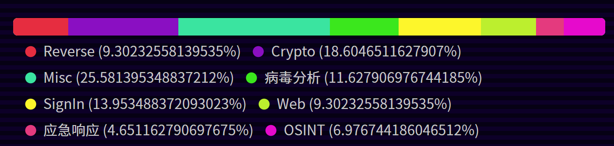
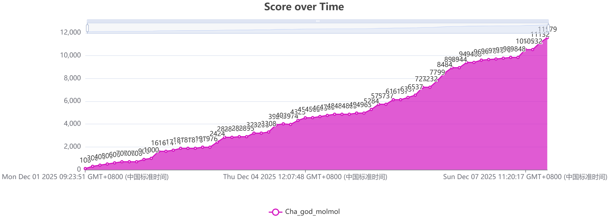
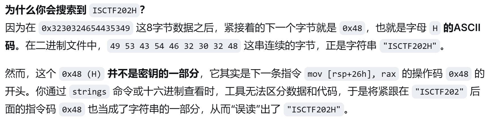
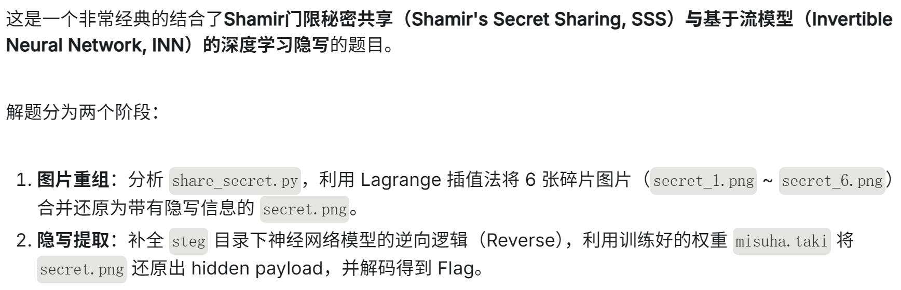
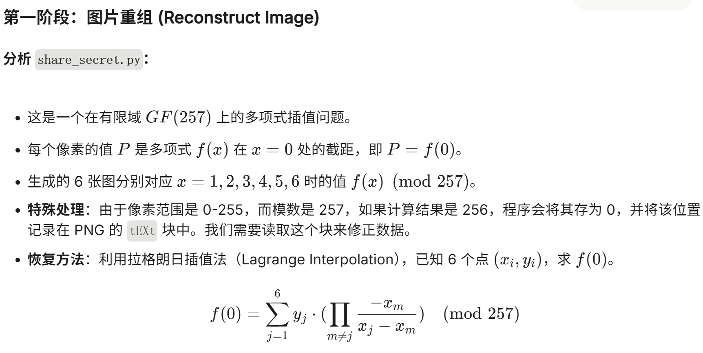
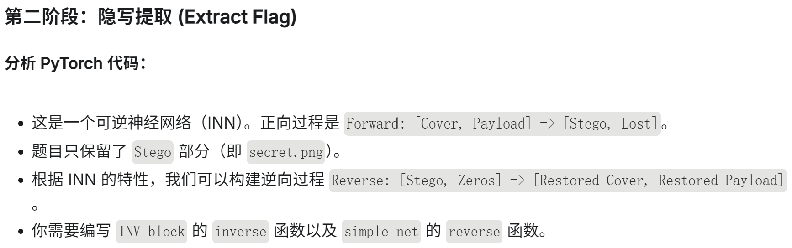
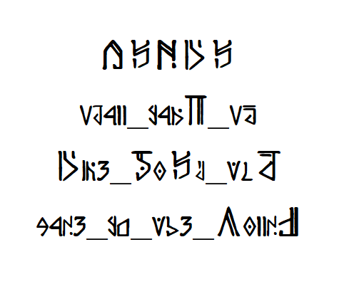
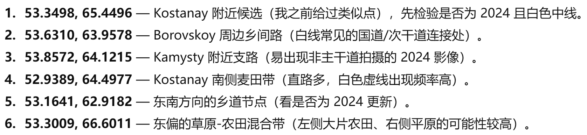

***

本次比赛和Rycbartbad师傅一起打了第47名，感觉还是很不错的

加个pwn佬、web佬能起飞






说明 由于本人web和病毒分析纯ai做法，没有实际价值，不在wp中赘述

### **Reverse**

比赛体量太大，重心没放在reverse上，个人仅做了两个题。

+ ELF

  > 这个elf有点奇怪呢

[ ^附件]:main.zip

```bash
└─# file main
main: ELF 64-bit LSB executable, x86-64, version 1 (SYSV), dynamically linked, interpreter /lib64/ld-linux-x86-64.so.2, for GNU/Linux 3.2.0, BuildID[sha1]=f5e4eb9bd95f0a14f41d1ef1a6f8ee703c85a059, stripped
```

file一下，stripped被剥离了符号表，果然打开ida啥也不是

strings检查发现爆出很多"python"字符串，是**PyInstaller打包的Python程序**

用特定脚本解包

```bash
wget https://raw.githubusercontent.com/extremecoders-re/pyinstxtractor/master/pyinstxtractor.py
python3 pyinstxtractor.py main
```

反编译,注意不同python版本需要选择不同的工具。

3.1-3.9 uncompyle6

```bash
uncompyle6 -o main.pyc main.py
```

3.7-3.9 decompyle3

```bash
decompyle3 main.pyc > main.py
```

3.1+ or 3.10+

```bash
cd pycdc
cmake .
make
./pycdc ../main.pyc > main.py
```

本题用pycdc得到main.py

```python
# Source Generated with Decompyle++
# File: main.pyc (Python 3.10)

import base64
import hashlib
import random
flag = '8d13c398b72151b1dad78762553dbbd59dba9b0b2330b03b401ea4f2a6d4731d479220fe900b520f6b4753667fe1cdf9eff8d3b833a0013c4083fa1ad27d056486702bda245f3c1aa0fbf84b237d8f2dec9a80791fe66625adfe3669419a104cbb67293eaada20f79cebf69d84d326025dd35dec09a2c97ad838efa5beba9e72'
YourInput = input('Please input your flag:')
enc = ''
if len(YourInput) != 24:
    print('Length Wrong!!!')
    exit(0)

def Rep(hash_data):
    random.seed(161)
    result = list(hash_data)
    for i in range(len(result) - 1, 0, -1):
        swap_index = random.randint(0, i)
        result[i] = result[swap_index]
        result[swap_index] = result[i]
    return ''.join(result)

for i in range(len(YourInput) // 3):
    c2b = base64.b64encode(YourInput[i * 3:(i + 1) * 3].encode('utf-8'))
    hash = hashlib.md5(c2b).hexdigest()
    enc += Rep(hash)
if enc == flag:
    print('Your are win!!!')
    return None
None('Your are lose!!!')
```

加密流程：

1.24字节的flag分成8组，每组base64加密变为4字节

2.计算hex的md5

3.每组调用rep函数加密

rep函数是**Fisher-Yates 洗牌算法**的逆序版本[洗牌算法（Shuffle Algorithm）Fisher-Yates 洗牌算法详细解读-CSDN博客](https://blog.csdn.net/m0_61840987/article/details/143226112)

由于seed=161已知，洗牌的过程可以复现出来。每组三字节，爆破即可

```python
import base64
import hashlib
import random
import itertools

flag = '8d13c398b72151b1dad78762553dbbd59dba9b0b2330b03b401ea4f2a6d4731d479220fe900b520f6b4753667fe1cdf9eff8d3b833a0013c4083fa1ad27d056486702bda245f3c1aa0fbf84b237d8f2dec9a80791fe66625adfe3669419a104cbb67293eaada20f79cebf69d84d326025dd35dec09a2c97ad838efa5beba9e72'

def Rep(hash_data, reverse=False):
    random.seed(161)
    result = list(hash_data)
    n = len(result)
    
    # 记录正向交换序列
    swaps = []
    for i in range(n - 1, 0, -1):
        swap_index = random.randint(0, i)
        swaps.append((i, swap_index))
    
    if reverse:
        # 逆向执行交换
        for i, swap_index in reversed(swaps):
            result[i], result[swap_index] = result[swap_index], result[i]
    else:
        # 正向执行交换
        for i, swap_index in swaps:
            result[i], result[swap_index] = result[swap_index], result[i]
    
    return ''.join(result)

# 1. 分割flag为8组
groups = [flag[i*32:(i+1)*32] for i in range(8)]
print("分组:")
for i, g in enumerate(groups):
    print(f"组{i}: {g}")

# 2. 对每组逆向Rep得到原始MD5
original_md5s = []
for g in groups:
    original_md5 = Rep(g, reverse=True)
    original_md5s.append(original_md5)
    print(f"逆向Rep后: {original_md5}")

# 3. 爆破所有可能的3字节输入
def find_original_text(md5_target):

    for i in range(256*256*256):  # 3字节所有可能
        # 生成3字节
        b = bytes([
            (i >> 16) & 0xFF,
            (i >> 8) & 0xFF,
            i & 0xFF
        ])
        # Base64编码
        b64 = base64.b64encode(b)
        # 计算MD5
        md5 = hashlib.md5(b64).hexdigest()
        if md5 == md5_target:
            return b.decode('latin-1')  # 可能不是ASCII
    return None

# 4. 逐个爆破
flag_parts = []
for i, md5_target in enumerate(original_md5s):
    print(f"\n爆破第{i}组...")
    found = find_original_text(md5_target)
    if found:
        flag_parts.append(found)
        print(f"找到: {found}")
    else:
        print(f"未找到匹配的3字节")

# 5. 拼接flag
if len(flag_parts) == 8:
    final_flag = ''.join(flag_parts)
    print(f"\nFlag: {final_flag}")
else:
    print("未能找到所有部分")
```

**ISCTF{NO7_3x3_i5_3Lf!!!}**


+ ezpy

  > 这是什么库？没见过呢

[ ^附件]:ezpy.zip

strings检查发现了python痕迹，pyinstaller打包

同样，用脚本解包,pycdc反编译失败了

```bash
└─# decompyle3 ezpy.pyc > ezpy_decompiled.py

# Unsupported bytecode in file ezpy.pyc
# Unsupported Python version, 3.13.0, for decompilation
```

3.13太新了，pycdc失败

Rycbartbad师傅先做了此题，说有花指令，看看花指令什么情况。

```python
#!/usr/bin/env python3
import dis
import marshal
import struct

def analyze_obfuscation(filename):
    with open(filename, 'rb') as f:
        # 跳过可能的头部
        data = f.read()
        
    # 尝试在不同偏移加载
    for offset in range(0, min(500, len(data)), 4):
        try:
            code = marshal.loads(data[offset:])
            print(f"✓ 成功在偏移 {offset} 处加载代码对象")
            print(f"  代码长度: {len(code.co_code)} 字节")
            
            # 查看字节码模式
            bytecode = code.co_code
            print(f"  前100字节: {bytecode[:100].hex()}")
            
            # 统计操作码频率
            from collections import Counter
            opcodes = [bytecode[i] for i in range(0, len(bytecode), 2) if i < len(bytecode)]
            freq = Counter(opcodes)
            print(f"  常见操作码: {freq.most_common(10)}")
            
            # 查找可能的NOP（0x09）或其他花指令
            nop_count = sum(1 for b in bytecode if b == 0x09)
            if nop_count > 0:
                print(f"  发现 {nop_count} 个NOP指令（可能为花指令）")
            
            # 尝试反汇编
            print("\n  尝试反汇编（可能失败）:")
            try:
                dis.dis(code)
            except Exception as e:
                print(f"  反汇编失败: {e}")
            
            break
            
        except Exception as e:
            continue

analyze_obfuscation('ezpy.pyc')
```

发现在开头有一个nop。可以去，也可以不管直接看字节码：

```python
#!/usr/bin/env python3
import marshal
import dis

with open('ezpy.pyc', 'rb') as f:
    data = f.read()

# 加载主模块
code = marshal.loads(data[16:])

# 查找main函数的代码对象
for const in code.co_consts:
    if hasattr(const, 'co_code'):  # 是一个代码对象
        print(f"\n=== 函数: {const.co_name} ===")
        print(f"文件: {const.co_filename}, 行: {const.co_firstlineno}")
        
        # 反汇编这个函数
        dis.dis(const)
        
        # 如果有字符串常量，显示它们
        print("\n常量:")
        for i, c in enumerate(const.co_consts):
            if isinstance(c, str):
                print(f"  [{i}] {repr(c)}")
            elif isinstance(c, bytes):
                print(f"  [{i}] bytes: {c[:50]}{'...' if len(c) > 50 else ''}")
```

```bash
└─# python3 1.py

=== 函数: main ===
文件: ezpy.py, 行: 8
  8           RESUME                   0

  9           LOAD_GLOBAL              1 (input + NULL)
              LOAD_CONST               1 ('Please input your flag: ')
              CALL                     1
              LOAD_ATTR                3 (strip + NULL|self)
              CALL                     0
              STORE_FAST               0 (user_input)

 11           LOAD_GLOBAL              5 (check + NULL)
              LOAD_FAST                0 (user_input)
              CALL                     1
              TO_BOOL
              POP_JUMP_IF_FALSE       12 (to L1)

 12           LOAD_GLOBAL              7 (print + NULL)
              LOAD_CONST               2 ('Correct!')
              CALL                     1
              POP_TOP
              RETURN_CONST             0 (None)

 14   L1:     LOAD_GLOBAL              7 (print + NULL)
              LOAD_CONST               3 ('Wrong!')
              CALL                     1
              POP_TOP
              RETURN_CONST             0 (None)

常量:
  [1] 'Please input your flag: '
  [2] 'Correct!'
  [3] 'Wrong!'
--------------------------------------------------
```

逻辑基本清楚。

接下来可以用strings搜索

```bash
# strings mypy.cp313-win_amd64.pyd
```

可以找到以下字符串

ISCTF202H    RC4 flag checker module    check    Check if the flag is correct    

可以看到可能只进行了RC4加密，密钥是ISCTF202H。但是密钥明显不正常，可以猜到应该是ISCTF2025，接下来找密文

ida打开mypy.cp313-win_amd64.pyd

懒得看函数了，直接手动找data段

```asm
.rdata:000000036F4D4007 aRc4FlagChecker db 'RC4 flag checker module',0
.rdata:000000036F4D4007                                         ; DATA XREF: .data:000000036F4D3050↑o
.rdata:000000036F4D401F aCheck          db 'check',0            ; DATA XREF: .data:off_36F4D30A0↑o
.rdata:000000036F4D4025 aCheckIfTheFlag db 'Check if the flag is correct',0
.rdata:000000036F4D4025                                         ; DATA XREF: .data:000000036F4D30B8↑o
.rdata:000000036F4D4042                 align 10h
.rdata:000000036F4D4050 unk_36F4D4050   db  1Dh                 ; DATA XREF: sub_36F4D1519+C2↑o
.rdata:000000036F4D4051                 db 0D5h
.rdata:000000036F4D4052                 db  38h ; 8
.rdata:000000036F4D4053                 db  33h ; 3
.rdata:000000036F4D4054                 db 0AFh
.rdata:000000036F4D4055                 db 0B5h
.rdata:000000036F4D4056                 db  51h ; Q
.rdata:000000036F4D4057                 db 0F3h
.rdata:000000036F4D4058                 db  2Ch ; ,
.rdata:000000036F4D4059                 db  6Bh ; k
.rdata:000000036F4D405A                 db  6Eh ; n
.rdata:000000036F4D405B                 db 0FEh
.rdata:000000036F4D405C                 db  41h ; A
.rdata:000000036F4D405D                 db  24h ; $
.rdata:000000036F4D405E                 db  43h ; C
.rdata:000000036F4D405F                 db 0D2h
.rdata:000000036F4D4060                 db  71h ; q
.rdata:000000036F4D4061                 db 0CFh
.rdata:000000036F4D4062                 db 0A4h
.rdata:000000036F4D4063                 db  4Ch ; L
.rdata:000000036F4D4064                 db 0E3h
.rdata:000000036F4D4065                 db  9Ah
.rdata:000000036F4D4066                 db  9Ah
.rdata:000000036F4D4067                 db 0B5h
.rdata:000000036F4D4068                 db  31h ; 1
.rdata:000000036F4D4069                 db    0
.rdata:000000036F4D406A                 db    0
.rdata:000000036F4D406B                 db    0
.rdata:000000036F4D406C                 db    0
.rdata:000000036F4D406D                 db    0
.rdata:000000036F4D406E                 db    0
.rdata:000000036F4D406F                 db    0
.rdata:000000036F4D4070                 db    0
.rdata:000000036F4D4071                 db    0
.rdata:000000036F4D4072                 db    0
.rdata:000000036F4D4073                 db    0
.rdata:000000036F4D4074                 db    0
.rdata:000000036F4D4075                 db    0
.rdata:000000036F4D4076                 db    0
.rdata:000000036F4D4077                 db    0
.rdata:000000036F4D4078                 db    0
.rdata:000000036F4D4079                 db    0
.rdata:000000036F4D407A                 db    0
.rdata:000000036F4D407B                 db    0
.rdata:000000036F4D407C                 db    0
.rdata:000000036F4D407D                 db    0
.rdata:000000036F4D407E                 db    0
.rdata:000000036F4D407F                 db    0
```

可以看到大概率从4D4050开始的都是密文

```python
#!/usr/bin/env python3
def rc4(key, data):
    """RC4算法实现"""
    S = list(range(256))
    j = 0
    for i in range(256):
        j = (j + S[i] + key[i % len(key)]) % 256
        S[i], S[j] = S[j], S[i]
    
    i = j = 0
    result = bytearray()
    for char in data:
        i = (i + 1) % 256
        j = (j + S[i]) % 256
        S[i], S[j] = S[j], S[i]
        k = S[(S[i] + S[j]) % 256]
        result.append(char ^ k)
    return bytes(result)

# 正确的密文（25字节，直到0x31，后面的0是填充）
ciphertext = bytes([
    0x1D, 0xD5, 0x38, 0x33, 0xAF, 0xB5, 0x51, 0xF3,
    0x2C, 0x6B, 0x6E, 0xFE, 0x41, 0x24, 0x43, 0xD2,
    0x71, 0xCF, 0xA4, 0x4C, 0xE3, 0x9A, 0x9A, 0xB5,
    0x31
])

keys = ["ISCTF2025"]

for key_str in keys:
    key = key_str.encode()
    decrypted = rc4(key, ciphertext)
    
    print(f"\n密钥: '{key_str}'")
    print(f"解密结果: {repr(decrypted)}")
    
    # 尝试解码为字符串
    try:
        # 先尝试ASCII
        ascii_text = decrypted.decode('ascii', errors='ignore').strip()
        if ascii_text and any(c.isprintable() for c in ascii_text):
            print(f"ASCII文本: {ascii_text}")
        
        # 尝试UTF-8
        utf8_text = decrypted.decode('utf-8', errors='ignore').strip()
        if utf8_text and utf8_text != ascii_text:
            print(f"UTF-8文本: {utf8_text}")
    except:
        pass
```

得到**ISCTF{Y0U_GE7_7HE_PYD!!!}**


那ISCTF202H是怎么回事呢？

IDA手动找数字5，找到的结果如下:

```text
.text:000000036F4D1535                 mov     word ptr [rsp+158h+var_132+8], 35h ; '5'
```

所在函数反编译的结果：

```c
__m128i *__fastcall sub_36F4D1519(__int64 a1, __int64 a2)
{
  char *v2; // rsi
  __m128i *v3; // rbx
  __m128i *v5; // rax
  unsigned int v6; // eax
  __int64 v7; // rax
  char v8[274]; // [rsp+26h] [rbp-132h] BYREF
  char *Str; // [rsp+138h] [rbp-20h] BYREF

  strcpy(v8, "ISCTF2025");
  if ( !(unsigned int)PyArg_ParseTuple(a2, &unk_36F4D4000, &Str) )
    return 0;
  v2 = Str;
  v3 = (__m128i *)Py_FalseStruct;
  if ( (unsigned int)strlen(Str) == 25 )
  {
    v5 = (__m128i *)malloc(0x19u);
    v3 = v5;
    if ( v5 )
    {
      *v5 = _mm_loadu_si128((const __m128i *)v2);
      *(__m128i *)((char *)v5 + 9) = _mm_loadu_si128((const __m128i *)(v2 + 9));
      v6 = strlen(v8);
      sub_36F4D1430(&v8[10], v8, v6);
      sub_36F4D149C(&v8[10], v3, 25);
      v7 = 0;
      while ( v3->m128i_i8[v7] == byte_36F4D4050[v7] )
      {
        if ( ++v7 == 25 )
        {
          free(v3);
          return (__m128i *)Py_TrueStruct;
        }
      }
      free(v3);
      return (__m128i *)Py_FalseStruct;
    }
    else
    {
      PyErr_NoMemory();
    }
  }
  return v3;
}
```

在Hex试图可见

```text
000000036F4D1520  01 00 00 48 89 D1 48 B8  49 53 43 54 46 32 30 32  ...H....ISCTF202
000000036F4D1530  48 89 44 24 26 66 C7 44  24 2E 35 00 4C 8D 84 24  H.D$&f..$.5.L..$
```




### **Crypto**

+ 沉迷数学的小蓝鲨

  > 小蓝鲨最近沉迷于椭圆曲线，但是有一个椭圆曲线问题它始终做不出来，据说它广泛应用于区块链技术。如果你可以帮助小蓝鲨解决这个问题，它将会给予你丰厚的报酬。
  >
  > Hint1:你验证过基点 G 真的在曲线上吗？(这只是个ez题，别想太复杂）
  > Hint2:G是这条曲线上的冒牌货，但代数运算不在乎，因为计算机可不是数学家

[ ^附件]:task.zip

```python
y² = x³ + 3x + 27 (mod p)

Q(0xa61ae2f42348f8b84e4b8271ee8ce3f19d7760330ef6a5f6ec992430dccdc167, 0x8a3ceb15b94ee7c6ce435147f31ca8028d1dd07a986711966980f7de20490080)

k= ?

最终flag请将解出k值的16进制转换为32位md5以ISCTF{}包裹提交
```

信息过少，p，G都不知道，于是猜想是secp256k1固定参数

根据Hint1，b=27是假的，需要重新找到一个b'

k不大，**在小范围内搜索才能跑的出来是关键**

```python
import hashlib
from sage.all import *

# secp256k1 参数
p = 0xFFFFFFFFFFFFFFFFFFFFFFFFFFFFFFFFFFFFFFFFFFFFFFFFFFFFFFFEFFFFFC2F
Fp = GF(p)

Gx = 0x79BE667EF9DCBBAC55A06295CE870B07029BFCDB2DCE28D959F2815B16F81798
Gy = 0x483ADA7726A3C4655DA4FBFC0E1108A8FD17B448A68554199C47D08FFB10D4B8

Qx = 0xa61ae2f42348f8b84e4b8271ee8ce3f19d7760330ef6a5f6ec992430dccdc167
Qy = 0x8a3ceb15b94ee7c6ce435147f31ca8028d1dd07a986711966980f7de20490080

# 由于 G 不在 y² = x³ + 3x + 27 上，我们需要找到真正的 b
b = (Fp(Gy)**2 - (Fp(Gx)**3 + 3*Fp(Gx)))
print(f"b = {b}")

# 构建曲线
E = EllipticCurve(Fp, [3, b])
G_pt = E(Gx, Gy)
Q_pt = E(Qx, Qy)

# 检查曲线阶
order = E.order()
print(f"阶分解: {factor(order)}")

# 由于 k 不大，直接搜索小范围
found = False
for k in range(1, 1000000):
    if k * G_pt == Q_pt:
        print(f"找到 k = {k}")
        found = True
        break
        
k_hex = hex(k)[2:]
print(f"hex(k) = {k_hex}")

md5 = hashlib.md5(k_hex.encode()).hexdigest()
print(f"\nFlag: ISCTF{{{md5}}}")
```

```bash
(sagemath) ┌──(root㉿LAPTOP-BMERJF8L)-[/mnt/c/users/rekjo/desktop]
└─# sage ecc.sage
b = 66385389407800359838405813331870212727788158969948345552414605934650319155613
阶分解: 2 * 3^2 * 7 * 53 * 4733 * 17669 * 42437 * 4885840951767371464006724254428399138698319915522809195449609
找到 k = 954761
hex(k) = e9189

Flag: ISCTF{43896099feea21a3d5804863075e1aaa}
```

**ISCTF{43896099feea21a3d5804863075e1aaa}**


+ 小蓝鲨的费马谜题

  > 小蓝鲨在一次网络探险中发现了一个神秘的加密系统。他发现这个系统好像使用了费马小定理来保护重要信息，但是又好像不太一样。小蓝鲨设法截获了系统的加密输出，但不知道如何解密，你可以帮帮它吗？

[ ^附件]:task.zip

```python
import random
import math

p = get_prime(1024)
q = get_prime(1024)
n = p * q
e = 65537

m = bytes_to_long(flag)
c = pow(m, e, n)

bases = get_primes_up_to(100)

hints = []
for i in range(len(bases)):
    for j in range(i+1, len(bases)):
        hint_value = (pow(bases[i], p-1, n) + pow(bases[j], p-1, n)) % n
        hints.append((bases[i], bases[j], hint_value))
'''
n = 16926747183730811445521182287631871095235807124637325096660759361996155369993998745638293862726267741890840654094794027600177564948819372030933079291097084177091863985749240756085243654442374722882507015343515827787141307909182820013354070321738405810257107651857739607060274549412692517140259717346170524920540888050323066988108836911975466603073034433831887208978130406742714302940264702874305095602623379177353873347208751721068498690917932776984190598143704567665475161453335629659200748786648288309401513856740323455946901312988841290917666732077747457081355853722832166331501779601157719722291598787710746917947
e = 65537
c = 7135669888508993283998887257526185813831780208680788333332044930342125381561919830084088631920301623909949443002073193381401761901398826719665411432016217400457613545308262831975564456231165114091904748808206330488231569773162745696602366468753664188261933014198218922459715972876740957260132243927549037840265753282534565674280908439875550179801788711737901632349136780584007599655055605772651127003711138512998683145763743839326460319440186099818507078433271291685194944254795690424327192625258701835654639832285402990995662846426561789508331799972329711410217802657682842382105869446853207634070295959281375484933

Hints (format: base1, base2, hint_value):
Hint 1: 11, 41, 403072318395713195475880235840306655046644537786837658466183670390322357403650602210882802453171853452
Hint 2: 73, 7, 3401877351823051464833008106697922874740843547186522246399577691648145322938787488999079423405760696040635223407580102549819096176975820017380148265275786281647240647714533261221890310813882987089721138616513427711006945061727486708277298401545762448776593105730005387022319319199166969225690343981500127626848336242187816071435842118963634505746771844269484845077330851526393327015758760003053231670737896550596266539249975891234238005583184203089180325261872944167834576158878843510707348603774425827560724587546720860765943393963597645881666559247252842017499263265738255716811999328445725902262302532911214255949
Hint 3: 59, 73, 695583691945177012011155613294846891840015729899504980764916686517371703553347581254163445300367305365949600797847620946823894152274689248119430670857791635723385692575931740078475490085973951317953049329486264578815530286784178680687403627415153526425715193114420845091853572366108176759184115038228886689580295865909953096284457818874267153151571968297454864850732608316298813594124020007025412733770104355236849081247730461956131749267446455113813284775308663385548094921945410215359273656658830019785099633226412843434625002115741084636776823289994271249660745143685585443820708578849162449717982725541307852715
Hint 4: 53, 17, 971645701575323882519635342913625889703399294086
Hint 5: 17, 53, 15015015166119321293244100074414416277924832658329700344653519929879563546652512240571777007009139132526751717913688831473249036114283479537249767699902565862566840754892319936718933957878788242522102884592375092063435348463420495622162622111752797419564087812071877456034189172928466087325995711799494559632348117577986369270044265839851198529901138826760234172452522279821372814789053868333623123766583799003287221335420456780264904184548645200345715153696373219687248029519611142514212181449677795769427641367964609639782220743835161725500332507591502818244881229659746207461229056486960160782643424330243354078694
Hint 6: 59, 19, 4427802296687944448870952484227318
Hint 7: 19, 43, 19174465169354813231681320402781559275699092043658101294284851123118510716279410
Hint 8: 23, 31, 6031706827842456717715236244872427215835819411314168938820265741988730625387931647610750902952789928566569174296650515449892611198040938188209413722806254050103019879240215344570043498312370280623702924998835728624935413985841142180365335178468710734638030582183503463305813229510689954065159041592316788178873050291779739508108222965509434291492950189742558594400755699777715854046635146464467729949201239668741264832027750549876625288984575624485894153879412247669943493660233937543961086506015000295606199222800612415043850877838520358081044378561877650595040905680464898635661677396546195369907960492865630959945
Hint 9: 73, 31, 14201978515584496685882877364621713654579319459919970854066889531106363038011334520524797899491133943665135480301300406440254472658620428164578914318059588912647092994632856690
Hint 10: 31, 3, 17761887753093897979823770061456102763834352
Hint 11: 13, 5, 4150700388609705807509972385476068337626559497757356803399419065000783917890225153250286903799441660433187538279583874523190497602462150199426414868861228792088666515397312761673326022980940385774334828394940770351447957541072690963220641780722897399543555486513918873014494692941882646929202605685305683969151271831603708612223260616432695010847067252877343217676963276876850265407927146383572955861063428706012170676831524971272198283920333900403902257748241220365118645448662797961778388544299359695919130547938351588261698392641490575786350259413542725944665834486513968924860904668074607650304874723425230270137
Hint 12: 59, 53, 2093308535564899860358544644764036388478107502010763064242342417957960952425000274395405300689532194265342136032111944045432326085818281844400947666782274940461183395046865284971635536544260910022728631047126094710543502860882170401987674931187922422766222327719930375318976698721098197543008758760603140658147997152753438270623866111022164350986375651437321309108736011279113592001916870502347116720151257306071411569096876275005515839079136440506703094781753301521917670413306257490297241974169467740732230454155267623129991881695623072243477621355484939295049508367225410929080326109567111654067945546042372106278
Hint 13: 11, 89, 5773679028890369456276328097218681131210336197851484718484213121094699090839722641329327818066934448088431288328288112007488949292271360565624555172295051667285077138864510745740214905953043079468933679191715551224964421931824712984605682049449568976492220103844351216496482668448767237697296740468431846671505265143619239976063901580555986558904470931013978569579237148514276178765419852198637961774494186181747458089405228411950572658310072067499489988259824774767508198451267875000556446298608250644009748818937568123418528009187811944967998576518784004540892824519032050506460017670585483238226301820712571645579
Hint 14: 59, 19, 10974757986236006288348468568336947121923978268025782618680419380484847824293845383379274809628633982884248524866285416869994466804493799071019695089232140692475376148645650118342055726520583120333882910989811592931370723715884717392658914626279560914541425986351478710240862377226197891323537525676367683258652280225895980668977840969537035757009985713502197856706880646989184201990423727195172560560704893733494792945340405983958264929760613990510042281137251536502371683060105493456566203202995676363796508260438545252515574493473542492715179349497866152824132141129238032807684278789579870873990631709515352502373
Hint 15: 11, 59, 8286765915642893643722267671556930668422080363489440619486004330134849571178036674986475802754804260626759450923775241201472288503107728483612582960417838690160802
Hint 16: 3, 83, 8670564904343374156075891784422797917915847070310520984332279769504164524019002920437878667712734918407503893528964609388615752378009668179394550543334742880513288696193899579334352041612737521648871122300770732109991958777364103317237896209222739571605930423722098331428587046952745581887767018125449661836385756401767146216848185513274686419811084754784129338190887685792489185844961970682436930953762662159256843649680197802836233628748219421311091068027884246286801955132580168006746385788553263325371239064547214943270463799271582693307097866515323559640081377472410365311796667103389327125755510398234792960539
Hint 17: 47, 71, 15189655529337297599070621327692775647472437654342284733419279459044091245709484592008784236836038238199431339530080798833863694019082099360867975411468181802365883838048650755521947739185044832121750278668725458779161264572106488221158049174704002405104694045711051726668876267794954827804265584531526809688162851528267958117474561865081871142026481602702358611977383838840467216409782013973906761226139903245114056975231832568083538564658843330419770362826462102622789108069389249602641189148715388059622341376715417265924644704691316367196722599195793773962428198040205512616444509750834973953022693785550802266112
Hint 18: 19, 29, 14661046810005357468594301664850836437610256328712330874381003343699942748425302158171105550644727048051206458117828772075144383589551129619743654527620413132286889305278690645291359466534057249273843187124449541437587033949823571613090619667989912739101162245067852658322665279694710401800444138141346856093835079283227374648099624120782619771322472623630789096431414534527222485118949515372622085183912510018177895906649522504991475861146404995703763107816964209369487501529056212864220862713277632632268594192926804994930950930762255940853728034617285828125545163750399143037606327606535126251763073693473953686744
Hint 19: 11, 89, 13357214564583644951510034650716277516325510600111365531856471059002907497767937445827192806732793166523983315887101899445087845542550038342480500237151465231405685422545530090065005109607310864977025325103465672450850540379234341279749113886947539400845321822481006994262700375964062063857363515290494376286961284725864589465065587339836635723085250544188242927462327068925005089561746960078398647971113589281563663689024296134195815738058179266887469473137997216792436310641839801585271790331365746442208348676200753457562160444740691258422882276851839616144554731981681550535123108350101531030525324694963994545288
Hint 20: 13, 19, 9015439113692415723812039454602636203717179069784080604236209577969030957184510380132987544909218798262905505307236620420364723156896628015021747981816896133290154232921264396063118665954041870382404950626337554885082880595372492300185559547705412727112020773895391734178675568118417294113429562448849544338564697858353479059676992341239979279973948191000090925611122966827392226766571948922617345703402518639464697367975459916964712370264229447747875703346922955116402649868815187647332682627727429521327349380558524025434437065348919358179886784373948470464530596295968257196117932806673623409596232224263656709447
Hint 21: 17, 89, 1232624071183606371752171179827692250773859330394635710762162149851456772281037111827897119725547063233395640472176481922500789994068941245743063373416785659254352015310032922118348550975562
Hint 22: 67, 83, 1126066176169173986258375138688137558142264839106063302940880092042502490911057016254959754435510429411384392032847908273635563612047472121950839934733905729015943917767915064618640585969621038467420076188953203812632416692873236731402216410500667938438399832227071790611412372173974174687603713326333791754140419675029772154828193139783484205710539042656417324250808919494712510406268629862104562237889399268931862879343990757365436458551497886263701914349819002099339457690106946122543529626710290881457346334759953170142024757161589525394691005814751979092184245953191693247075620270045838678527511170972567753351
Hint 23: 41, 97, 15061728396574720128871454281806425283902878531290205263072044930084328354647716799950058691868870125292816458036423472349601649870044904984377004711678761714808846252355372756850495640148784156530292575757175420916873271609977179541391067607437946628688811886889502712607514447458904992024279765998865875618672417318528806259694052202283848620150531327490085874935926140164888318138777816635210686133434879564761574366090585467327313351792501721900090022412568322566880308204689579089754113916523137219409702840025596606460438071507115794360457519041650146002247978792944063933568992230154174930543323173071240960636
Hint 24: 7, 23, 107006904423598033367949136709476534616
Hint 25: 79, 47, 11094334665560612802457947914579705831928780165312070004861180761238832002874428458670163845939464475999733253092738012391076484871479088986479536610030564639805718143084622127711215172458485326388902083413575454799106868355391943732802994224342313418146481622340282330554260946195940723120836406549666330792363893799020720281135898034922255022048435484533585962047978284629786026663018345757890693521562666203031553493103945295693195640052093415731503407816366337336182698796883001653465915740746118519384260984893835094879165736186434278489286286227662273545663256993867922180157248380291757381125272120891684062194
Hint 26: 59, 73, 4064264878148785166802093462858575465400091342645180541176126645875623098033551060982695656331190143572426766578696362147717218779335361493125256534627342192680373626652482508115615860816250319187188097915962706304133850035098343668277834974105321147191342624944627482006284223163704828843061145141268544104282644658022010819808655796239544272048394743182820455393255285941665799519906799024432739271653191031181064778284104887384076188431552852025837101339257686236262365247791750207700069395619856622961279534162976795147959769683692604340368460731405668330115156114576764572051491629821619308816381773343755003534
Hint 27: 67, 37, 13951782965760049234481961368802553800278133941697263631552649243302664977209715848353709633491008434674270268090076527067844931388512019333805006404853566312201157392447713057698715800623288234051899693554210937852453814575305705182660789018065999222430838475037429354174069134372859946362529872754325135924297601113491133129277121309644377255711296412090554983403167436585565758988120192517511808267055408632606896756685326534561420410005038161122481109870042764517919065341900975187982359357007105413042469550052322588976438466403370644683889314221651454587673986716491269580073476431119104550125907982617819198239
Hint 28: 71, 31, 14592451107942406172703460352000704126425716661469483183610425663886284772375260143470595014699236417504356417924516247683378564032172689094243907515271202472795378941272772693424353756938883720892780719870429492112844354792067076527090697208293397879373413452057503440196643066732299886678533556377726500394447831070628632364135576812382061688937462189566815186722078015421531935330987991868677259308976254080329342447669466494877857082494259824027412023017042305976083947770306599290459206333751309651343338718031684134413354721116695889173022783305688553309591139544114673672159391172663588390812561345603404875445
Hint 29: 61, 37, 150312118586919145020616357224172487248862369450901081305248777087453651799298780184965167114015639778324633934952775965666791061680751287444693564273797597220185626300049938
Hint 30: 47, 89, 5435525789990781146665058968159824543197878249058619814486157180575648579639831493916004219973973832266296536703517577992770
Hint 31: 23, 47, 16103071775810171711924674905790805963818714309292465098237116772593040021211622298924186932004880334851627830206994635151992140064405277570483377357957039009351094902151630023493150975576584876244834021621269645929479405478143057020268612485343670663377970673925984030126760947109176763636955974818654880191024493408598053751276065135442200582652319408920748644591450674320233708025358524648197707659990862662361862539842868417063320792767415984991601751165223638123837341091365974671765054733794332399697028713963544373254318631595083356458002718583341127602790857490164278343070475882464426640213476914415482369850
Hint 32: 29, 5, 13149325842021723251134510511729784479095642778506166091034934686556554381120350749714138697288609601129918017821541343485285067285202422145639363694603240119439803374916552440509169187395808575353190466385753062164445875730603626277916455911345416839502129509688066724158296752117066013823226052016786749548019509350864881585069802037870118674424466298682508091272797804735861773714128160193020313575834557745724129735757517340056227714959610755715392915985854554070909168057367535004631491240072926342019254725105436116655974774609052713231818128446311960013765270122065871739363402131985754839033491581530499347992
Hint 33: 89, 47, 630043523370452187379224662747648830902214688021486477430843243593080113724992705480996062907676256037302619160067814028518895461989971281884155808829193898017336
Hint 34: 19, 59, 5312300113767710347282768227082829679387523215214639151760217349511385597102767288546324009076948101196442028352053632460946433171294574346446379257281949909272350819311609431501573807000878460778313626108872598317920103278246614995180550162481588759079785633301645095994306260526442257399195256822168763040046685053639779110740308012206330181637380011462498603874585251040951562533555627840386291011622732627801692079226133918094516784934996032323522126557227339640405344352939596441336679652918394074410690904621730980459695004938137633444530118011543020946033976566969594506053598637256025269420788063085529221486
Hint 35: 59, 3, 13338480097536050870847065134681408887393061870891194580910295898171005379071202538125320488322264936939611934926773854147441861842696082224910493485968940453414962504999277326912024770737526865763322593711772391102570024742439366641421857370464779798305027785021436688758138471130400190763565033556147205447698037378616533728663507465789889356211004747849498360714349678453175418183091908832867382402195272783569030789904261178845317149753713695808383033170623145131434242158410724256492198680651336056844232593215970896169424430059260906555229446741538286239350780216208715553935143523165464773688871774009588738407
Hint 36: 67, 2, 8256928556897492704838762552986750294374712035464071847912955091323033935694693535736594865997626239305042785518308139569682623007419575794366667620985270619928978345775201291927479777879409352040290541010779775363393802966114845982777093715738330158248145557248971011553853095404328553837691636026735523457849132602891079774484964955413419103753159331087739019434888120001297351898315190776895144785024767468167340726846414096469818750219466508467856583779003457862584610836846910059997868710036273917335512342095635575374346404071250572917845292452258621324256922950179010754476790644241744968537946791784277331172
Hint 37: 11, 89, 469829525495433863398701036274262995240821686827512278740409156383771339857992568557981522
Hint 38: 53, 17, 15381013223078846537731461466880636394199540595403435401138127547481863401431466372374802606225281410197388364722944495843405467862781503434970989158584650159590980399087359088118746163629618532987297413548047215179053477589410157484215376788161320381404390190467326828317085039705167675630596365709188985681649747552770255068423205419746730136649403555515290098619746175600947097893366036430479763751257652595334352418296864541247999321025232348500763810371215286305853572498789766256531460974011022731922336715523379552064525311328532274496963226072015892784253991084576242734695083889820166631064731394426574244137
Hint 39: 59, 3, 8639902842024035953048638563768315927624671856924547112209526883962456853052089935252707927468432895933170836045185383394096573378220873632433306851623471094895240704466661122788392467144892335530991171751297377896525529639348516066396938968040587426508605861054726429454030686327018745441753930983556245291730653368996527050046737903050080495173995563726990564829713815768651787483101363848070083858443766098560638337868296111441788798574965477355431173836128839250967090465226610709666720508328978510631834435136772497463531551713080290889081436462800389414847971067210139076388894646477223534324245688231308651402
Hint 40: 71, 2, 35228394523315997738820412922291535639435039748226420541446858967158850258697393757215146296389518178994242807247547892971367759083443187781159
Hint 41: 71, 89, 6240983929786483220051416467719053988488038641934890929981073832233939427834145472336915358758745943895354212032680367743535480193473825955326802869864352912264819240397323037315537988324410288546472301626890591739573348191915387074878814318018257079325106269383242877918486075024690767741729879076813581842036944498326059102754583317760100647490256432861228914984872474683425397073112462956198249407553140398404673370857128292911829788563089759423977978816627360219756198454057710015406165962422617662704219899517474510659197047034325834333381214858621450033089047323717051044225354940003754145032127292424992011101
Hint 42: 41, 11, 6984059054701243194406577182995741240436897138602476775543220094645161472633895356320870691493565356230021817198695018272393666667370608977208110764253393769787442206738887651454907864559105056199727308147026476795306714769493199003447522266774033773324562270207374768320253619068701592065984601594887388312013493599257403722865953095442171057100657271578293280686338908523864018983343500587769033822586560003572736592272152317739316444108939218480574158527171198620726886917802598591993658035939705289787249746288650701612275221097113840902054486416966701593345265607809381111897049158093808534604642731640119152868
Hint 43: 13, 29, 9610425425501485449537748361164652677158792621032292104946727266655594704290554003044377640635938997615382559405839696633456524257520749570798069876408676921921508491566094310451535812726509625559772552216775984034994654686077581771306574807821000988687494843385541833458873739204271564568689723925761973189708592881482846646426280049739796580929850941981882154358359008000707906221459919505725630791914755910838899191924833300609856950819107362413681305294507489838444421285910012653866140490877420620551310798317895506704520509435554786438387597440096937627702835916143794698887778982888695219967982245649746655470
Hint 44: 47, 97, 794708560552308405126546731517428100557886745717835758758542380710685584
Hint 45: 3, 41, 4366286865897405386543255708293800522386204706169307328366554555364884083859171277798722946451756634920858627299532823660480318239049230750988476049477513092520844569149267106332990711387926038335306437738094725423916554317517443566123618496555545533680705744831228568422251969382492688050958971980479679805428102801749764130245809570484750989852311926567073592760547445916703018635471776441628270869914109919847570929937108398744190319099944135878164624117925789234408527770792315261913666378047301366117348007407689729553121872429672477943763065031289363375897860958687532065443830782060680953252171706108298186067
Hint 46: 53, 13, 16599275744410550408933364882313950383421717117863259063696626313760940800128182804380262220526496674159136503269710326208644142632589833265263673629452996345476574747374747172655476596826644020872255782962700686562762713813009141052898954099526049199438330249525172937305118217295550996402876461138835393788249817466964132570303998739392864522160381559518796827917831858448710285259754350691301608261901046038810797165013301247129220438986641677769203536623610901604156282036632560795746698128751128683870700853339493839501889121028640592461819470558005091594236201609522690232023400257649767388230656904982965702400
Hint 47: 61, 83, 9953189432255063894070711778963178970743198121753649081719130469512753806047549503962109442976714615255038871181051195512724207218843889262884288045589566753004137388059340730864662203711021106738767094228552897493653199240432249671119014845998208040396103544771523200759949973732641979644934204944350638114647371917538547803820215871447465362042956264048360078551647879310238285850657470764222027085496193016418088396386760643015475367197907378932626248164269818716905644542858090723472987968554892684192736976050169896444520698548656309379499864809652240244453616286236722509397142224233180948147011605558427902848
Hint 48: 47, 73, 11137871466581047781242984634852964336706264103460602528475970728553465644713327296350923627071860721778412789236714773697433892321959279504008377433584604885817319604115996426320874382244073671694322092160768350159529231732048447670177579115854882538413223938721279445190025525651472499343624011272214336778696111400347742318222789215043195711269360705507743463500549755479755775737105743290208621332589467304719937369513194207595213182980370357559166180993485168866418076474829491707312908665547905615295104716814273672708222960604034067248688735024594069804630472429600684961470444745009128678939204098625367015452
Hint 49: 37, 43, 8547801237237556680245447121357531340087815887730999035326630934574339083867172461996679202294604204246415617087303468869638590371489396511890451394149215396045103967365422720335104673107126428846330142015210956274026922065251671248521248406703003517010268831048835400375497130725745344823402860499648204664008236488552255035422928921490487905318800334939525030207122862220895298568207554924706494486709790089585773581447139024819366484617067643862923821174578132381404045225537724922355917737191443476738183156619271477344846716060997041706765920488392521346954370234605596534371205052913391651084238833069263785246
Hint 50: 89, 7, 10398214245820233588167072072340460997067473220261572021578267549114000461324485988447437613040475809210011162256875428799327091235990171928216379105895288609773032862919523980293555963618323001564571973363418294497086861386518673361280706598614868452173330762143105775824076992409365806017218778102139861298703673447295670293191397994589110648541822608470022190616048229374246581750506635166699349805517119679503917519913987281318125804952325118589261418014369477837522696543190827291142488222603361805610512683583242709234195072960764001035300916480662591147878968245702960413084896858751962028377013605141587432900

Your goal: recover the flag by factoring n using the hints!
'''
```


$$
\begin{gather}
we\ know\ that\ H=b_i^{p-1}+b_j^{p-1}\ (mod\ n) \\
because\ n=p*q \\
so\ H \equiv (b_i^{p-1}+b_j^{p-1})\ (mod\ p) \\
and\ according\ to\ Fermat's\ Little\ Theorom\ H \equiv 2\ (mod\ p) \\
so\ we\ reach\ the\ conclusion\ p|(H-2) \\
notice\ that\ p|n \\
so\ we\ can\ get\ p\ from\ :\ p=gcd(H-2,n) \\
then\ we\ get\ q=n//p
\end{gather}
$$


```python
import math
from Crypto.Util.number import long_to_bytes, inverse

n = 16926747183730811445521182287631871095235807124637325096660759361996155369993998745638293862726267741890840654094794027600177564948819372030933079291097084177091863985749240756085243654442374722882507015343515827787141307909182820013354070321738405810257107651857739607060274549412692517140259717346170524920540888050323066988108836911975466603073034433831887208978130406742714302940264702874305095602623379177353873347208751721068498690917932776984190598143704567665475161453335629659200748786648288309401513856740323455946901312988841290917666732077747457081355853722832166331501779601157719722291598787710746917947
e = 65537
c = 7135669888508993283998887257526185813831780208680788333332044930342125381561919830084088631920301623909949443002073193381401761901398826719665411432016217400457613545308262831975564456231165114091904748808206330488231569773162745696602366468753664188261933014198218922459715972876740957260132243927549037840265753282534565674280908439875550179801788711737901632349136780584007599655055605772651127003711138512998683145763743839326460319440186099818507078433271291685194944254795690424327192625258701835654639832285402990995662846426561789508331799972329711410217802657682842382105869446853207634070295959281375484933

hints_text = """
Hint 1: 11, 41, 403072318395713195475880235840306655046644537786837658466183670390322357403650602210882802453171853452
Hint 2: 73, 7, 3401877351823051464833008106697922874740843547186522246399577691648145322938787488999079423405760696040635223407580102549819096176975820017380148265275786281647240647714533261221890310813882987089721138616513427711006945061727486708277298401545762448776593105730005387022319319199166969225690343981500127626848336242187816071435842118963634505746771844269484845077330851526393327015758760003053231670737896550596266539249975891234238005583184203089180325261872944167834576158878843510707348603774425827560724587546720860765943393963597645881666559247252842017499263265738255716811999328445725902262302532911214255949
Hint 3: 59, 73, 695583691945177012011155613294846891840015729899504980764916686517371703553347581254163445300367305365949600797847620946823894152274689248119430670857791635723385692575931740078475490085973951317953049329486264578815530286784178680687403627415153526425715193114420845091853572366108176759184115038228886689580295865909953096284457818874267153151571968297454864850732608316298813594124020007025412733770104355236849081247730461956131749267446455113813284775308663385548094921945410215359273656658830019785099633226412843434625002115741084636776823289994271249660745143685585443820708578849162449717982725541307852715
Hint 4: 53, 17, 971645701575323882519635342913625889703399294086
Hint 5: 17, 53, 15015015166119321293244100074414416277924832658329700344653519929879563546652512240571777007009139132526751717913688831473249036114283479537249767699902565862566840754892319936718933957878788242522102884592375092063435348463420495622162622111752797419564087812071877456034189172928466087325995711799494559632348117577986369270044265839851198529901138826760234172452522279821372814789053868333623123766583799003287221335420456780264904184548645200345715153696373219687248029519611142514212181449677795769427641367964609639782220743835161725500332507591502818244881229659746207461229056486960160782643424330243354078694
Hint 6: 59, 19, 4427802296687944448870952484227318
Hint 7: 19, 43, 19174465169354813231681320402781559275699092043658101294284851123118510716279410
Hint 8: 23, 31, 6031706827842456717715236244872427215835819411314168938820265741988730625387931647610750902952789928566569174296650515449892611198040938188209413722806254050103019879240215344570043498312370280623702924998835728624935413985841142180365335178468710734638030582183503463305813229510689954065159041592316788178873050291779739508108222965509434291492950189742558594400755699777715854046635146464467729949201239668741264832027750549876625288984575624485894153879412247669943493660233937543961086506015000295606199222800612415043850877838520358081044378561877650595040905680464898635661677396546195369907960492865630959945
Hint 9: 73, 31, 14201978515584496685882877364621713654579319459919970854066889531106363038011334520524797899491133943665135480301300406440254472658620428164578914318059588912647092994632856690
Hint 10: 31, 3, 17761887753093897979823770061456102763834352
Hint 11: 13, 5, 4150700388609705807509972385476068337626559497757356803399419065000783917890225153250286903799441660433187538279583874523190497602462150199426414868861228792088666515397312761673326022980940385774334828394940770351447957541072690963220641780722897399543555486513918873014494692941882646929202605685305683969151271831603708612223260616432695010847067252877343217676963276876850265407927146383572955861063428706012170676831524971272198283920333900403902257748241220365118645448662797961778388544299359695919130547938351588261698392641490575786350259413542725944665834486513968924860904668074607650304874723425230270137
Hint 12: 59, 53, 2093308535564899860358544644764036388478107502010763064242342417957960952425000274395405300689532194265342136032111944045432326085818281844400947666782274940461183395046865284971635536544260910022728631047126094710543502860882170401987674931187922422766222327719930375318976698721098197543008758760603140658147997152753438270623866111022164350986375651437321309108736011279113592001916870502347116720151257306071411569096876275005515839079136440506703094781753301521917670413306257490297241974169467740732230454155267623129991881695623072243477621355484939295049508367225410929080326109567111654067945546042372106278
Hint 13: 11, 89, 5773679028890369456276328097218681131210336197851484718484213121094699090839722641329327818066934448088431288328288112007488949292271360565624555172295051667285077138864510745740214905953043079468933679191715551224964421931824712984605682049449568976492220103844351216496482668448767237697296740468431846671505265143619239976063901580555986558904470931013978569579237148514276178765419852198637961774494186181747458089405228411950572658310072067499489988259824774767508198451267875000556446298608250644009748818937568123418528009187811944967998576518784004540892824519032050506460017670585483238226301820712571645579
Hint 14: 59, 19, 10974757986236006288348468568336947121923978268025782618680419380484847824293845383379274809628633982884248524866285416869994466804493799071019695089232140692475376148645650118342055726520583120333882910989811592931370723715884717392658914626279560914541425986351478710240862377226197891323537525676367683258652280225895980668977840969537035757009985713502197856706880646989184201990423727195172560560704893733494792945340405983958264929760613990510042281137251536502371683060105493456566203202995676363796508260438545252515574493473542492715179349497866152824132141129238032807684278789579870873990631709515352502373
Hint 15: 11, 59, 8286765915642893643722267671556930668422080363489440619486004330134849571178036674986475802754804260626759450923775241201472288503107728483612582960417838690160802
Hint 16: 3, 83, 8670564904343374156075891784422797917915847070310520984332279769504164524019002920437878667712734918407503893528964609388615752378009668179394550543334742880513288696193899579334352041612737521648871122300770732109991958777364103317237896209222739571605930423722098331428587046952745581887767018125449661836385756401767146216848185513274686419811084754784129338190887685792489185844961970682436930953762662159256843649680197802836233628748219421311091068027884246286801955132580168006746385788553263325371239064547214943270463799271582693307097866515323559640081377472410365311796667103389327125755510398234792960539
Hint 17: 47, 71, 15189655529337297599070621327692775647472437654342284733419279459044091245709484592008784236836038238199431339530080798833863694019082099360867975411468181802365883838048650755521947739185044832121750278668725458779161264572106488221158049174704002405104694045711051726668876267794954827804265584531526809688162851528267958117474561865081871142026481602702358611977383838840467216409782013973906761226139903245114056975231832568083538564658843330419770362826462102622789108069389249602641189148715388059622341376715417265924644704691316367196722599195793773962428198040205512616444509750834973953022693785550802266112
Hint 18: 19, 29, 14661046810005357468594301664850836437610256328712330874381003343699942748425302158171105550644727048051206458117828772075144383589551129619743654527620413132286889305278690645291359466534057249273843187124449541437587033949823571613090619667989912739101162245067852658322665279694710401800444138141346856093835079283227374648099624120782619771322472623630789096431414534527222485118949515372622085183912510018177895906649522504991475861146404995703763107816964209369487501529056212864220862713277632632268594192926804994930950930762255940853728034617285828125545163750399143037606327606535126251763073693473953686744
Hint 19: 11, 89, 13357214564583644951510034650716277516325510600111365531856471059002907497767937445827192806732793166523983315887101899445087845542550038342480500237151465231405685422545530090065005109607310864977025325103465672450850540379234341279749113886947539400845321822481006994262700375964062063857363515290494376286961284725864589465065587339836635723085250544188242927462327068925005089561746960078398647971113589281563663689024296134195815738058179266887469473137997216792436310641839801585271790331365746442208348676200753457562160444740691258422882276851839616144554731981681550535123108350101531030525324694963994545288
Hint 20: 13, 19, 9015439113692415723812039454602636203717179069784080604236209577969030957184510380132987544909218798262905505307236620420364723156896628015021747981816896133290154232921264396063118665954041870382404950626337554885082880595372492300185559547705412727112020773895391734178675568118417294113429562448849544338564697858353479059676992341239979279973948191000090925611122966827392226766571948922617345703402518639464697367975459916964712370264229447747875703346922955116402649868815187647332682627727429521327349380558524025434437065348919358179886784373948470464530596295968257196117932806673623409596232224263656709447
Hint 21: 17, 89, 1232624071183606371752171179827692250773859330394635710762162149851456772281037111827897119725547063233395640472176481922500789994068941245743063373416785659254352015310032922118348550975562
Hint 22: 67, 83, 1126066176169173986258375138688137558142264839106063302940880092042502490911057016254959754435510429411384392032847908273635563612047472121950839934733905729015943917767915064618640585969621038467420076188953203812632416692873236731402216410500667938438399832227071790611412372173974174687603713326333791754140419675029772154828193139783484205710539042656417324250808919494712510406268629862104562237889399268931862879343990757365436458551497886263701914349819002099339457690106946122543529626710290881457346334759953170142024757161589525394691005814751979092184245953191693247075620270045838678527511170972567753351
Hint 23: 41, 97, 15061728396574720128871454281806425283902878531290205263072044930084328354647716799950058691868870125292816458036423472349601649870044904984377004711678761714808846252355372756850495640148784156530292575757175420916873271609977179541391067607437946628688811886889502712607514447458904992024279765998865875618672417318528806259694052202283848620150531327490085874935926140164888318138777816635210686133434879564761574366090585467327313351792501721900090022412568322566880308204689579089754113916523137219409702840025596606460438071507115794360457519041650146002247978792944063933568992230154174930543323173071240960636
Hint 24: 7, 23, 107006904423598033367949136709476534616
Hint 25: 79, 47, 11094334665560612802457947914579705831928780165312070004861180761238832002874428458670163845939464475999733253092738012391076484871479088986479536610030564639805718143084622127711215172458485326388902083413575454799106868355391943732802994224342313418146481622340282330554260946195940723120836406549666330792363893799020720281135898034922255022048435484533585962047978284629786026663018345757890693521562666203031553493103945295693195640052093415731503407816366337336182698796883001653465915740746118519384260984893835094879165736186434278489286286227662273545663256993867922180157248380291757381125272120891684062194
Hint 26: 59, 73, 4064264878148785166802093462858575465400091342645180541176126645875623098033551060982695656331190143572426766578696362147717218779335361493125256534627342192680373626652482508115615860816250319187188097915962706304133850035098343668277834974105321147191342624944627482006284223163704828843061145141268544104282644658022010819808655796239544272048394743182820455393255285941665799519906799024432739271653191031181064778284104887384076188431552852025837101339257686236262365247791750207700069395619856622961279534162976795147959769683692604340368460731405668330115156114576764572051491629821619308816381773343755003534
Hint 27: 67, 37, 13951782965760049234481961368802553800278133941697263631552649243302664977209715848353709633491008434674270268090076527067844931388512019333805006404853566312201157392447713057698715800623288234051899693554210937852453814575305705182660789018065999222430838475037429354174069134372859946362529872754325135924297601113491133129277121309644377255711296412090554983403167436585565758988120192517511808267055408632606896756685326534561420410005038161122481109870042764517919065341900975187982359357007105413042469550052322588976438466403370644683889314221651454587673986716491269580073476431119104550125907982617819198239
Hint 28: 71, 31, 14592451107942406172703460352000704126425716661469483183610425663886284772375260143470595014699236417504356417924516247683378564032172689094243907515271202472795378941272772693424353756938883720892780719870429492112844354792067076527090697208293397879373413452057503440196643066732299886678533556377726500394447831070628632364135576812382061688937462189566815186722078015421531935330987991868677259308976254080329342447669466494877857082494259824027412023017042305976083947770306599290459206333751309651343338718031684134413354721116695889173022783305688553309591139544114673672159391172663588390812561345603404875445
Hint 29: 61, 37, 150312118586919145020616357224172487248862369450901081305248777087453651799298780184965167114015639778324633934952775965666791061680751287444693564273797597220185626300049938
Hint 30: 47, 89, 5435525789990781146665058968159824543197878249058619814486157180575648579639831493916004219973973832266296536703517577992770
Hint 31: 23, 47, 16103071775810171711924674905790805963818714309292465098237116772593040021211622298924186932004880334851627830206994635151992140064405277570483377357957039009351094902151630023493150975576584876244834021621269645929479405478143057020268612485343670663377970673925984030126760947109176763636955974818654880191024493408598053751276065135442200582652319408920748644591450674320233708025358524648197707659990862662361862539842868417063320792767415984991601751165223638123837341091365974671765054733794332399697028713963544373254318631595083356458002718583341127602790857490164278343070475882464426640213476914415482369850
Hint 32: 29, 5, 13149325842021723251134510511729784479095642778506166091034934686556554381120350749714138697288609601129918017821541343485285067285202422145639363694603240119439803374916552440509169187395808575353190466385753062164445875730603626277916455911345416839502129509688066724158296752117066013823226052016786749548019509350864881585069802037870118674424466298682508091272797804735861773714128160193020313575834557745724129735757517340056227714959610755715392915985854554070909168057367535004631491240072926342019254725105436116655974774609052713231818128446311960013765270122065871739363402131985754839033491581530499347992
Hint 33: 89, 47, 630043523370452187379224662747648830902214688021486477430843243593080113724992705480996062907676256037302619160067814028518895461989971281884155808829193898017336
Hint 34: 19, 59, 5312300113767710347282768227082829679387523215214639151760217349511385597102767288546324009076948101196442028352053632460946433171294574346446379257281949909272350819311609431501573807000878460778313626108872598317920103278246614995180550162481588759079785633301645095994306260526442257399195256822168763040046685053639779110740308012206330181637380011462498603874585251040951562533555627840386291011622732627801692079226133918094516784934996032323522126557227339640405344352939596441336679652918394074410690904621730980459695004938137633444530118011543020946033976566969594506053598637256025269420788063085529221486
Hint 35: 59, 3, 13338480097536050870847065134681408887393061870891194580910295898171005379071202538125320488322264936939611934926773854147441861842696082224910493485968940453414962504999277326912024770737526865763322593711772391102570024742439366641421857370464779798305027785021436688758138471130400190763565033556147205447698037378616533728663507465789889356211004747849498360714349678453175418183091908832867382402195272783569030789904261178845317149753713695808383033170623145131434242158410724256492198680651336056844232593215970896169424430059260906555229446741538286239350780216208715553935143523165464773688871774009588738407
Hint 36: 67, 2, 8256928556897492704838762552986750294374712035464071847912955091323033935694693535736594865997626239305042785518308139569682623007419575794366667620985270619928978345775201291927479777879409352040290541010779775363393802966114845982777093715738330158248145557248971011553853095404328553837691636026735523457849132602891079774484964955413419103753159331087739019434888120001297351898315190776895144785024767468167340726846414096469818750219466508467856583779003457862584610836846910059997868710036273917335512342095635575374346404071250572917845292452258621324256922950179010754476790644241744968537946791784277331172
Hint 37: 11, 89, 469829525495433863398701036274262995240821686827512278740409156383771339857992568557981522
Hint 38: 53, 17, 15381013223078846537731461466880636394199540595403435401138127547481863401431466372374802606225281410197388364722944495843405467862781503434970989158584650159590980399087359088118746163629618532987297413548047215179053477589410157484215376788161320381404390190467326828317085039705167675630596365709188985681649747552770255068423205419746730136649403555515290098619746175600947097893366036430479763751257652595334352418296864541247999321025232348500763810371215286305853572498789766256531460974011022731922336715523379552064525311328532274496963226072015892784253991084576242734695083889820166631064731394426574244137
Hint 39: 59, 3, 8639902842024035953048638563768315927624671856924547112209526883962456853052089935252707927468432895933170836045185383394096573378220873632433306851623471094895240704466661122788392467144892335530991171751297377896525529639348516066396938968040587426508605861054726429454030686327018745441753930983556245291730653368996527050046737903050080495173995563726990564829713815768651787483101363848070083858443766098560638337868296111441788798574965477355431173836128839250967090465226610709666720508328978510631834435136772497463531551713080290889081436462800389414847971067210139076388894646477223534324245688231308651402
Hint 40: 71, 2, 35228394523315997738820412922291535639435039748226420541446858967158850258697393757215146296389518178994242807247547892971367759083443187781159
Hint 41: 71, 89, 6240983929786483220051416467719053988488038641934890929981073832233939427834145472336915358758745943895354212032680367743535480193473825955326802869864352912264819240397323037315537988324410288546472301626890591739573348191915387074878814318018257079325106269383242877918486075024690767741729879076813581842036944498326059102754583317760100647490256432861228914984872474683425397073112462956198249407553140398404673370857128292911829788563089759423977978816627360219756198454057710015406165962422617662704219899517474510659197047034325834333381214858621450033089047323717051044225354940003754145032127292424992011101
Hint 42: 41, 11, 6984059054701243194406577182995741240436897138602476775543220094645161472633895356320870691493565356230021817198695018272393666667370608977208110764253393769787442206738887651454907864559105056199727308147026476795306714769493199003447522266774033773324562270207374768320253619068701592065984601594887388312013493599257403722865953095442171057100657271578293280686338908523864018983343500587769033822586560003572736592272152317739316444108939218480574158527171198620726886917802598591993658035939705289787249746288650701612275221097113840902054486416966701593345265607809381111897049158093808534604642731640119152868
Hint 43: 13, 29, 9610425425501485449537748361164652677158792621032292104946727266655594704290554003044377640635938997615382559405839696633456524257520749570798069876408676921921508491566094310451535812726509625559772552216775984034994654686077581771306574807821000988687494843385541833458873739204271564568689723925761973189708592881482846646426280049739796580929850941981882154358359008000707906221459919505725630791914755910838899191924833300609856950819107362413681305294507489838444421285910012653866140490877420620551310798317895506704520509435554786438387597440096937627702835916143794698887778982888695219967982245649746655470
Hint 44: 47, 97, 794708560552308405126546731517428100557886745717835758758542380710685584
Hint 45: 3, 41, 4366286865897405386543255708293800522386204706169307328366554555364884083859171277798722946451756634920858627299532823660480318239049230750988476049477513092520844569149267106332990711387926038335306437738094725423916554317517443566123618496555545533680705744831228568422251969382492688050958971980479679805428102801749764130245809570484750989852311926567073592760547445916703018635471776441628270869914109919847570929937108398744190319099944135878164624117925789234408527770792315261913666378047301366117348007407689729553121872429672477943763065031289363375897860958687532065443830782060680953252171706108298186067
Hint 46: 53, 13, 16599275744410550408933364882313950383421717117863259063696626313760940800128182804380262220526496674159136503269710326208644142632589833265263673629452996345476574747374747172655476596826644020872255782962700686562762713813009141052898954099526049199438330249525172937305118217295550996402876461138835393788249817466964132570303998739392864522160381559518796827917831858448710285259754350691301608261901046038810797165013301247129220438986641677769203536623610901604156282036632560795746698128751128683870700853339493839501889121028640592461819470558005091594236201609522690232023400257649767388230656904982965702400
Hint 47: 61, 83, 9953189432255063894070711778963178970743198121753649081719130469512753806047549503962109442976714615255038871181051195512724207218843889262884288045589566753004137388059340730864662203711021106738767094228552897493653199240432249671119014845998208040396103544771523200759949973732641979644934204944350638114647371917538547803820215871447465362042956264048360078551647879310238285850657470764222027085496193016418088396386760643015475367197907378932626248164269818716905644542858090723472987968554892684192736976050169896444520698548656309379499864809652240244453616286236722509397142224233180948147011605558427902848
Hint 48: 47, 73, 11137871466581047781242984634852964336706264103460602528475970728553465644713327296350923627071860721778412789236714773697433892321959279504008377433584604885817319604115996426320874382244073671694322092160768350159529231732048447670177579115854882538413223938721279445190025525651472499343624011272214336778696111400347742318222789215043195711269360705507743463500549755479755775737105743290208621332589467304719937369513194207595213182980370357559166180993485168866418076474829491707312908665547905615295104716814273672708222960604034067248688735024594069804630472429600684961470444745009128678939204098625367015452
Hint 49: 37, 43, 8547801237237556680245447121357531340087815887730999035326630934574339083867172461996679202294604204246415617087303468869638590371489396511890451394149215396045103967365422720335104673107126428846330142015210956274026922065251671248521248406703003517010268831048835400375497130725745344823402860499648204664008236488552255035422928921490487905318800334939525030207122862220895298568207554924706494486709790089585773581447139024819366484617067643862923821174578132381404045225537724922355917737191443476738183156619271477344846716060997041706765920488392521346954370234605596534371205052913391651084238833069263785246
Hint 50: 89, 7, 10398214245820233588167072072340460997067473220261572021578267549114000461324485988447437613040475809210011162256875428799327091235990171928216379105895288609773032862919523980293555963618323001564571973363418294497086861386518673361280706598614868452173330762143105775824076992409365806017218778102139861298703673447295670293191397994589110648541822608470022190616048229374246581750506635166699349805517119679503917519913987281318125804952325118589261418014369477837522696543190827291142488222603361805610512683583242709234195072960764001035300916480662591147878968245702960413084896858751962028377013605141587432900
"""

def solve():

    lines = hints_text.strip().split('\n')
    
    for line in lines:
        line = line.strip()
        if not line:
            continue
            
        try:
            # 解析格式: "Hint 1: 11, 41, 4030..."
            if ':' not in line: continue
            
            content = line.split(':', 1)[1]
            parts = content.split(',')
            
            hint_val = int(parts[2].strip())
            
            # 计算 p = gcd(hint_value - 2, n)
            p = math.gcd(hint_val - 2, n)
            
            if p > 1 and p < n:
                print(f"[+] Success! Found factor p from {line.split(':')[0]}")
                
                q = n // p

                phi = (p - 1) * (q - 1)
                d = inverse(e, phi)
                
                m = pow(c, d, n)
                flag = long_to_bytes(m)
                
                print(f"\n[+] Flag: {flag.decode(errors='ignore')}")
                return

        except Exception as err:
            continue

if __name__ == "__main__":
    solve()
```

得到**ISCTF{M0dIFi3D_f3RM47_7H30r3m_I5_fUn_8U7_h4rD3r!}**

实际上这题只需要一个hint即可恢复出素数p？


+ 小蓝鲨的密码箱

  > 小蓝鲨有一个神秘的black-box，里面藏着它最珍贵的秘密。小蓝鲨告诉我们，只有知道密码箱的运算逻辑，你才能知道它的秘密。

这题比较传奇，误打误撞做对了

密码黑盒，要求输入a,b,c和明文

既然是黑盒那就试试看，明文设为A，经过几次尝试发现：

1.a,b,c!=0

2.a,c允许是负数

在测试数字1的时候密文始终输出来是00，a=b=1,c=-2的时候输出：

密文:
00
Flag:
00 00 00 -1 -1 00 -1 00 -1 00 00 00 -1 -1 00 -1 -1 00 00 00 -1 -1 00 -1 00 -1 -1 00 00 00 00 00 00 -1 00 -1 -1 -1 -1 00 -1 -1 00

于是莫名其妙的试了一下a=1, b=1, c=2147483648：

密文:
42
Flag:

4a 54 44 55 47 7c 39 36 39 66 38 38 35 37 2e 31 31 32 3a 2e 35 31 62 65 2e 63 37 38 64 2e 32 36 3a 63 62 67 39 35 63 36 63 39 7e

事实上42是66的十进制表示，所以每个字节凯撒移位1即可得到**ISCTF{858e7746-0019-40ad-b67c-159baf84b5b8}**


+ baby_math

  > 死去的记忆突然被唤醒了

[ ^附件]:baby_math.py

```python
from Crypto.Util.number import bytes_to_long

print(len(flag)) 
R = RealField(1000)
a,b = bytes_to_long(flag[:len(flag)//2]),bytes_to_long(flag[len(flag)//2:])
x   = R(0.75872961153339387563860550178464795474547887323678173252494265684893323654606628651427151866818730100357590296863274236719073684620030717141521941211167282170567424114270941542016135979438271439047194028943997508126389603529160316379547558098144713802870753946485296790294770557302303874143106908193100)
 
enc = a*cos(x)+b*sin(x) 

#1.24839978408728580181183027675785982784764821592156892598136000363397267152291738689909414790691435938223032351375697399608345468567445269769342300325192248438038963977207296241971217955178443170598629648414706345216797043374408541203167719396818925953801387623884200901703606288664141375049626635852e52
```

这个题是真没想到和LLL有关，AI梭的


$$
\begin{gather}
a⋅cos(x)+b⋅sin(x)≈enc \\
we\ need\ to\ find\ a,b\ let\ a·cos(x)+b·sin(x)-enc≈0 \\
\end{gather}
$$


$$
M = 
\begin{pmatrix}
1 & 0 & \lfloor K\cdot\cos(x) \rceil \\
0 & 1 & \lfloor K\cdot\sin(x) \rceil \\
0 & 0 & \lfloor K\cdot\text{enc} \rceil
\end{pmatrix}
$$


$$
v=(a,b,⌊K(acosx+bsinx)⌋−⌊K⋅enc⌉)≈(a,b,0)
$$


```python
from sage.all import *
from Crypto.Util.number import long_to_bytes

x_str = "0.75872961153339387563860550178464795474547887323678173252494265684893323654606628651427151866818730100357590296863274236719073684620030717141521941211167282170567424114270941542016135979438271439047194028943997508126389603529160316379547558098144713802870753946485296790294770557302303874143106908193100"
enc_str = "1.24839978408728580181183027675785982784764821592156892598136000363397267152291738689909414790691435938223032351375697399608345468567445269769342300325192248438038963977207296241971217955178443170598629648414706345216797043374408541203167719396818925953801387623884200901703606288664141375049626635852e52"

# 2. 设置高精度环境
# 题目中使用了 RealField(1000)，我们需要匹配这个精度
R = RealField(1000)
x = R(x_str)
enc = R(enc_str)

# 3. 构造格 (Lattice)
# 目标方程: a * cos(x) + b * sin(x) - enc ≈ 0
# 放大因子 K。由于输入精度约为 1000 bits (300 digits)，我们设置 K 接近这个精度。
K = 10**300 

M = Matrix(ZZ, [
    [1, 0, round(K * cos(x))],
    [0, 1, round(K * sin(x))],
    [0, 0, round(K * enc)]
])

# 4. LLL 格归约
print("Running LLL...")
M_reduced = M.LLL()

# 5. 提取结果
# LLL 归约后的矩阵第一行通常就是最短向量
print("Checking rows for flag...")

for row in M_reduced:

    a_cand = abs(row[0])
    b_cand = abs(row[1])
    
    # 简单的过滤：a 和 b 不应为 0
    if a_cand == 0 or b_cand == 0:
        continue
        
    try:
        # 尝试转换为字节
        part1 = long_to_bytes(Integer(a_cand))
        part2 = long_to_bytes(Integer(b_cand))
        
        flag_cand = part1 + part2
        
        if b'ISCTF{' in flag_cand:
            print(f"Found Candidate: {flag_cand}")
            break
    except Exception as e:
        continue
```

**ISCTF{164a3221-7306-4024-88c3-4ef557b86895}**


+ 小蓝鲨的RSA密文

  > "小蓝鲨是海洋数学天才，它最近正在深耕RSA领域。你嗤之以鼻，心想RSA不是最基础的密码学知识吗？于是你信誓旦旦的跑到小蓝鲨面前告诉它你已经完全掌握了RSA，并宣称所有的RSA题目你都能做出来。 小蓝鲨意味深长的看了你一眼，并出了一道RSA来考考你。现在，该你向它证明你的实力了。"

[ ^附件]:RSA.zip

```python
import json, secrets
from Crypto.Util.number import getPrime, bytes_to_long
from Crypto.Cipher import AES
from Crypto.Util.Padding import pad

e = 3
N = getPrime(512) * getPrime(512)

a2_high = a2 >> LOW_BITS

aes_key = secrets.token_bytes(16)
m = bytes_to_long(aes_key)

f = a2 * (m * m) + a1 * m + a0

c = (pow(m, e) + f) % N

iv = secrets.token_bytes(16)
cipher = AES.new(aes_key, AES.MODE_CBC, iv=iv)
ct = cipher.encrypt(pad(FLAG, 16))
'''
N = 121288600621198389662246479277632294800423697823363188896668775456771641807233781416525282234787873435904747571468452950479817935684848143651716343606633656969395065588423982440884464542428742861388200306417822228591316703916504170245990423925894477848679490979364923848426643149659758241239900845544537886777
c = 3756824985347508967549776773725045773059311839370527149219720084008312247164501688241698562854942756369420003479117
a2_high = 9012778
LOW_BITS = 16
a1 = 621315
a0 = 452775142
iv = bf38e64bb5c1b069a07b7d1d046a9010
ct = 8966006c4724faf53883b56a1a8a08ee17b1535e1657c16b3b129ee2d2e389744c943014eb774cd24a5d0f7ad140276fdec72eb985b6de67b8e4674b0bcdc4a5
'''
```

翻译一下


$$
\begin{gather}
assume\ FLAG=P \\
f=a2*m^2+a1*m+a0 \\
c=(m^e+f)\ mod\ n \\
so\ c=(m^3+a2*m^2+a1*m+a0)\ mod\ n \\
P'=pad(P)=P_1'||P_2'||...||P_n' \\
C_0=iv \\
C_i=AES_K(P_i'\ xor\ C_{i-1}) \\
ct=C_1||C_2||...||C_n \\
\\
a2high=a2>>16 \\
\end{gather}
$$


先爆破a2再恢复m


$$
\begin{gather}
x∈[0,1,...,2^{16}-1] \\
a2=a2high<<16+x \\
c=m^3+a2*m^2+a1*m+a0 \\
define\ h(m)=m^3+a2*m^2+a1*m+a0-c \\
we\ need\ to\ find\ m\ let\ h(m)=0 \\
\end{gather}
$$


可以使用二分法找到m。注意！m不是明文哦，m=long_to_bytes(aes_key)


$$
\begin{gather}
aes-key=bytes(m) \\
ct=C_1||C_2||...||C_n \\
P_1'=AES_K^{-1}(C_1)\ xor\ iv \\
P_i'=AES_K^{-1}(C_i)\ xor\ C_{i-1} \\
P'=P_1'||P_2'||...||P_n' \\
FLAG=P=unpad(P')\\
\end{gather}
$$


```python
from Crypto.Util.number import long_to_bytes
from Crypto.Cipher import AES
from Crypto.Util.Padding import unpad
import binascii

c = 3756824985347508967549776773725045773059311839370527149219720084008312247164501688241698562854942756369420003479117
a2_high = 9012778
LOW_BITS = 16
a1 = 621315
a0 = 452775142
iv_hex = "bf38e64bb5c1b069a07b7d1d046a9010"
ct_hex = "8966006c4724faf53883b56a1a8a08ee17b1535e1657c16b3b129ee2d2e389744c943014eb774cd24a5d0f7ad140276fdec72eb985b6de67b8e4674b0bcdc4a5"

iv = binascii.unhexlify(iv_hex)
ct = binascii.unhexlify(ct_hex)

def solve_m():

    low = 0
    high = 1 << 128

    for x in range(1 << LOW_BITS):
        # Reconstruct potential a2
        a2 = (a2_high << LOW_BITS) + x

        target = c

        l, r = low, high
        found = False
        m_candidate = 0
        
        while l <= r:
            mid = (l + r) // 2
            val = mid**3 + a2 * mid**2 + a1 * mid + a0
            
            if val == target:
                return mid
            elif val < target:
                l = mid + 1
            else:
                r = mid - 1
    return None

print("Searching for m...")
m = solve_m()

if m:
    print(f"Found m: {m}")
    key = long_to_bytes(m)
    
    # Decrypt
    try:
        cipher = AES.new(key, AES.MODE_CBC, iv=iv)
        flag = unpad(cipher.decrypt(ct), 16)
        print("Flag:", flag.decode())
    except Exception as e:
        print("Decryption failed:", e)
else:
    print("Failed to find m.")
```

**ISCTF{i7_533M5_Lik3_You_R34lLy_UNd3R574nd_Polinomials_4nD_RSA}**


+ 小蓝鲨的LFSR系统

  > "小蓝鲨是海洋情报局的新晋密码专家，它设计了一个基于LFSR的流密码系统来加密机密信息。这个系统看起来简单高效，但小蓝鲨不知道的是，LFSR在某些情况下可能存在安全隐患。 一天，小蓝鲨的加密系统被神秘的黑客组织""深海幽灵""入侵，他们截获了一段加密信息。作为海洋安全部门的成员，你需要分析这个加密系统，找出潜在的弱点，并解密被截获的信息。"

[ ^附件]:LFSR.zip

```python
import secrets
import binascii

def simple_lfsr_encrypt(plaintext, init_state):
    mask = [random.randint(0,1) for _ in range(128)]
    
    state = init_state.copy()
    for _ in range(256):
        feedback = sum(state[i] & mask[i] for i in range(128)) % 2
        state.append(feedback)
    
    key = bytes(int(''.join(str(bit) for bit in mask[i*8:(i+1)*8]), 2) 
               for i in range(16))
    
    keystream = (key * (len(plaintext)//16 + 1))[:len(plaintext)]
    return bytes(p ^ k for p, k in zip(plaintext, keystream)), mask
'''
initState = [0, 1, 0, 1, 1, 0, 0, 1, 1, 0, 0, 0, 0, 1, 0, 0, 1, 0, 0, 0, 1, 1, 1, 0, 0, 1, 1, 0, 1, 1, 0, 1, 0, 0, 1, 0, 1, 0, 1, 0, 0, 1, 0, 1, 1, 0, 1, 0, 1, 1, 1, 1, 1, 1, 1, 1, 0, 1, 1, 0, 1, 0, 0, 1, 1, 0, 1, 0, 1, 0, 0, 0, 0, 0, 1, 1, 0, 1, 0, 1, 0, 0, 0, 1, 1, 1, 1, 1, 1, 1, 0, 1, 1, 0, 1, 0, 1, 0, 0, 1, 1, 1, 1, 0, 0, 1, 1, 1, 1, 0, 1, 0, 1, 1, 0, 1, 0, 0, 0, 0, 0, 0, 1, 1, 0, 1, 0, 0]
outputState = [0, 0, 0, 1, 1, 0, 0, 0, 0, 0, 1, 0, 1, 0, 0, 1, 0, 0, 1, 1, 1, 1, 0, 1, 1, 1, 0, 0, 0, 1, 1, 0, 0, 1, 0, 0, 0, 1, 0, 1, 1, 1, 1, 1, 0, 1, 1, 0, 0, 1, 0, 1, 0, 1, 1, 0, 1, 1, 1, 0, 1, 1, 0, 0, 1, 0, 0, 0, 0, 1, 1, 0, 0, 0, 0, 0, 1, 0, 1, 1, 0, 1, 1, 0, 1, 0, 0, 0, 0, 1, 0, 0, 0, 0, 1, 0, 0, 0, 0, 0, 0, 0, 0, 0, 1, 1, 1, 1, 0, 0, 1, 0, 0, 1, 1, 0, 1, 1, 0, 1, 1, 0, 0, 0, 0, 0, 1, 1, 0, 0, 0, 0, 1, 1, 1, 1, 1, 0, 1, 0, 0, 0, 1, 1, 0, 0, 0, 1, 1, 0, 1, 0, 0, 0, 0, 0, 0, 0, 0, 0, 1, 1, 1, 0, 0, 1, 1, 0, 0, 1, 1, 1, 0, 1, 1, 1, 1, 0, 0, 0, 1, 0, 0, 0, 1, 0, 0, 1, 0, 1, 1, 0, 0, 0, 1, 0, 1, 0, 0, 1, 1, 1, 0, 0, 0, 1, 0, 1, 1, 1, 0, 1, 1, 0, 0, 1, 1, 0, 0, 1, 0, 0, 1, 0, 1, 0, 0, 1, 0, 0, 0, 0, 0, 1, 1, 1, 0, 1, 0, 0, 0, 1, 0, 1, 0, 1, 1, 1, 0, 1, 1, 0, 0, 0, 0, 1]
ciphertext = '4b3be165a0a0edd67ca8f143884826725107fd42d6a6'
'''
```

有点像测信道攻击


$$
\begin{gather}
initState=(s_1,s_2,...,s_{128}) \\
outputState=(s_{129},s_{130},...,s_{383}) \\
let\ K=(K_0,K_1,...,K_{15}) \\
\\
encrypt\ process: \\
s_{n+128}=xor_{i=0}^{127}{(mask[i]·s_{n+i})}(for\ n\ from\ 0\ to\ 255) \\
K_j=\sum_{k=0}^{15}{(mask[8j+k]*2^{7-k})}(for\ j\ from\ 0\ to\ 15) \\
notice\ keystream=(K_0,K_1,...,K_{15},K_0,K_1,...) \\
ciphertext_i=plaintext_i\ xor\ K_{i\ mod\ 16} \\ 
\\
decrypt\ process: \\
let\ stream=(s_1,s_2,...,s_{384}) \\
so\ stream=initState||outputState \\
define\ matrix\ A: A_{n,i}=s_{n+i}\\
define\ matrix\ M: M=(mask[0],mask[1],...,mask[127])^T \\
define\ matrix\ B: B=(s_{128},s_{129},...,s{383})\\
so\ A·M=B \\
After\ we\ get\ M,we\ know\ mask[i]\ and\ we\ can\ get\ keystream \\
plaintext_i=ciphertext_i\ xor\ K_{i\ mod\ 16} \\
\end{gather}
$$


```python
import binascii

# 1. 数据
initState = [0, 1, 0, 1, 1, 0, 0, 1, 1, 0, 0, 0, 0, 1, 0, 0, 1, 0, 0, 0, 1, 1, 1, 0, 0, 1, 1, 0, 1, 1, 0, 1, 0, 0, 1, 0, 1, 0, 1, 0, 0, 1, 0, 1, 1, 0, 1, 0, 1, 1, 1, 1, 1, 1, 1, 1, 0, 1, 1, 0, 1, 0, 0, 1, 1, 0, 1, 0, 1, 0, 0, 0, 0, 0, 1, 1, 0, 1, 0, 1, 0, 0, 0, 1, 1, 1, 1, 1, 1, 1, 0, 1, 1, 0, 1, 0, 1, 0, 0, 1, 1, 1, 1, 0, 0, 1, 1, 1, 1, 0, 1, 0, 1, 1, 0, 1, 0, 0, 0, 0, 0, 0, 1, 1, 0, 1, 0, 0]
outputState = [0, 0, 0, 1, 1, 0, 0, 0, 0, 0, 1, 0, 1, 0, 0, 1, 0, 0, 1, 1, 1, 1, 0, 1, 1, 1, 0, 0, 0, 1, 1, 0, 0, 1, 0, 0, 0, 1, 0, 1, 1, 1, 1, 1, 0, 1, 1, 0, 0, 1, 0, 1, 0, 1, 1, 0, 1, 1, 1, 0, 1, 1, 0, 0, 1, 0, 0, 0, 0, 1, 1, 0, 0, 0, 0, 0, 1, 0, 1, 1, 0, 1, 1, 0, 1, 0, 0, 0, 0, 1, 0, 0, 0, 0, 1, 0, 0, 0, 0, 0, 0, 0, 0, 0, 1, 1, 1, 1, 0, 0, 1, 0, 0, 1, 1, 0, 1, 1, 0, 1, 1, 0, 0, 0, 0, 0, 1, 1, 0, 0, 0, 0, 1, 1, 1, 1, 1, 0, 1, 0, 0, 0, 1, 1, 0, 0, 0, 1, 1, 0, 1, 0, 0, 0, 0, 0, 0, 0, 0, 0, 1, 1, 1, 0, 0, 1, 1, 0, 0, 1, 1, 1, 0, 1, 1, 1, 1, 0, 0, 0, 1, 0, 0, 0, 1, 0, 0, 1, 0, 1, 1, 0, 0, 0, 1, 0, 1, 0, 0, 1, 1, 1, 0, 0, 0, 1, 0, 1, 1, 1, 0, 1, 1, 0, 0, 1, 1, 0, 0, 1, 0, 0, 1, 0, 1, 0, 0, 1, 0, 0, 0, 0, 0, 1, 1, 1, 0, 1, 0, 0, 0, 1, 0, 1, 0, 1, 1, 1, 0, 1, 1, 0, 0, 0, 0, 1]
ciphertext_hex = '4b3be165a0a0edd67ca8f143884826725107fd42d6a6'

# 2. 求解 Mask (高斯消元法)

def solve_mask(init, output):
    
    stream = init + output
    N = 128
    
    # 构建增广矩阵 (Augmented Matrix)
    # 每一行代表一个方程： Sum(stream[i+j] * mask[j]) = stream[i+N]
    # Matrix A 的大小为 128x128，向量 b 的大小为 128
    # 我们只需要前128个方程就足以求解（假设线性无关）
    
    matrix = []
    for i in range(N):
        # 系数行：stream[i] 到 stream[i+127]
        row = stream[i : i+N]
        # 目标值：stream[i+128]
        target = stream[i+N]
        # 将目标值附加到行末，方便处理
        matrix.append(row + [target])

    # 高斯消元 (GF(2))
    pivot_row = 0
    for col in range(N):
        if pivot_row >= N:
            break
            
        # 寻找当前列为1的行（主元）
        if matrix[pivot_row][col] == 0:
            for i in range(pivot_row + 1, N):
                if matrix[i][col] == 1:
                    matrix[pivot_row], matrix[i] = matrix[i], matrix[pivot_row]
                    break
            else:
                # 这一列全是0，无法作为主元，继续下一列
                continue
        
        # 用主元行消除其他行的当前列
        for i in range(N):
            if i != pivot_row and matrix[i][col] == 1:
                # 行异或
                for j in range(col, N + 1):
                    matrix[i][j] ^= matrix[pivot_row][j]
        
        pivot_row += 1

    # 提取解
    mask = [0] * N
    for i in range(N):
        # 矩阵现在应该是单位矩阵形式，最后一列是解
        # 检查主元位置
        if matrix[i][i] == 1:
            mask[i] = matrix[i][N]
    
    return mask

recovered_mask = solve_mask(initState, outputState)
print(f"[-] Mask recovered. First 16 bits: {recovered_mask[:16]}")

# 3. 恢复 Key 并解密
key = bytes(int(''.join(str(bit) for bit in recovered_mask[i*8:(i+1)*8]), 2) 
           for i in range(16))

print(f"[-] Key recovered: {key}")

ciphertext = binascii.unhexlify(ciphertext_hex)

keystream = (key * (len(ciphertext)//16 + 1))[:len(ciphertext)]

# 异或解密
plaintext = bytes(p ^ k for p, k in zip(ciphertext, keystream))

print(f"\n{plaintext.decode(errors='ignore')}")
```

**ISCTF{lf5R_jUst_So_s0}**


+ Power_tower

  > 你知道拓展欧拉定理吗

[ ^附件]:Power_tower.py

```python
from Crypto.Util.number import *
import random
from numpy import number

m = b'ISCTF{****************}'
flag = bytes_to_long(m)
n = getPrime(256)
t = getPrime(63)
l = pow(2,pow(2,t),n)
c = flag ^ l
print(t)
print(n)
print(c)
'''
t = 6039738711082505929
n = 107502945843251244337535082460697583639357473016005252008262865481138355040617
c = 114092817888610184061306568177474033648737936326143099257250807529088213565247
'''
```


$$
\begin{gather}
l\equiv2^{2^t}\ (mod\ n) \\
c=flag\ xor\ l \\
\end{gather}
$$


需要提防的是，1.2 ^ (2 ^ t)太大，直接跑跑不出来 2.n是伪素数，实际上给的是光滑数

结合提示，扩展欧拉定理


$$
\begin{gather}
First,factor(n) \\
\phi(n)=\prod_{i=1}^{?}{p_n} \\
because\ obviously\ gcd(2,n)=1 \\
so\ 2^{2^t}\ mod\ n\ \equiv 2^{2^t\ mod\ \phi(n)}\ mod\ n \\
then\ flag=c\ xor\ l \\
\end{gather}
$$


```python
import requests
from Crypto.Util.number import long_to_bytes

t = 6039738711082505929
n = 107502945843251244337535082460697583639357473016005252008262865481138355040617
c = 114092817888610184061306568177474033648737936326143099257250807529088213565247

def solve():

    factors_data = []
    try:
        api_url = f"http://factordb.com/api?query={n}"
        r = requests.get(api_url, timeout=10)
        data = r.json()
        factors_data = data['factors'] 
    except:
        return

    # 计算 phi(n)
    phi = 1
    for item in factors_data:
        p_val = int(item[0])
        e_val = int(item[1])
        phi *= (p_val - 1) * (p_val ** (e_val - 1))

    # 计算 l = 2^(2^t) mod n
    exponent = pow(2, t, phi)
    
    l = pow(2, exponent, n)
    
    m = int(c) ^ int(l) 
    
    flag = long_to_bytes(m)
    print(f"\n{flag}")

if __name__ == '__main__':
    solve()
```

**ISCTF{Euler_1s_v3ry|useful!!!!!}**


+ easy_RSA

  > 我们的爱情像欧拉函数φ(n)——无限趋近却永远达不到n的完美互质，最终只剩周期性的怀念在模n的世界里循环证明

[ ^附件]:easy_RSA.py

```python
from Crypto.Util.number import *

p = getPrime(1024)
q = getPrime(1024)
N = p*q
e = 65537

msg = bytes_to_long(b"ISCTF{dummy_flag}")
ct1 = pow(msg, e, N)
ct2 = pow(msg, p+q, N)

print(f"{N = }")
print(f"{ct1 = }")
print(f"{ct2 = }")
"""
N = 17630258257080557797062320474423515967705950026415012912087655679315479168903980901728425140787005046038000068414269936806478828260848859753400786557270120330760791255046985114127285672634413513991988895166115794242018674042563788348381567565190146278040811257757119090296478610798393944581870309373529884950663990485525646200034220648901490835962964029936321155200390798215987316069871958913773199197073860062515329879288106446016695204426001393566351524023857332978260894409698596465474214898402707157933326431896629025197964209580991821222557663589475589423032130993456522178540455360695933336455068507071827928617
ct1 = 5961639119243884817956362325106436035547108981120248145301572089585639543543496627985540773185452108709958107818159430835510386993354596106366458898765597405461225798615020342640056386757104855709899089816838805631480329264128349465229327090721088394549641366346516133008681155817222994359616737681983784274513555455340301061302815102944083173679173923728968671113926376296481298323500774419099682647601977970777260084799036306508597807029122276595080580483336115458713338522372181732208078117809553781889555191883178157241590455408910096212697893247529197116309329028589569527960811338838624831855672463438531266455
ct2 = 11792054298654397865983651507912282632831471680334312509918945120797862876661899077559686851237832931501121869814783150387308320349940383857026679141830402807715397332316601439614741315278033853646418275632174160816784618982743834204997402866931295619202826633629690164429512723957241072421663170829944076753483616865208617479794763412611604625495201470161813033934476868949612651276104339747165276204945125001274777134529491152840672010010940034503257315555511274325831684793040209224816879778725612468542758777428888563266233284958660088175139114166433501743740034567850893745466521144371670962121062992082312948789
"""
```

这题和一般RSA有啥区别呢？


$$
\begin{gather}
ct1=m^e\ mod\ n \\
but\ ct2=m^{p+q}\ mod\ n\ is\ dangerous \\
p+q=N+1-\phi(n) \\
so\ ct2=m^{N+1-\phi(n)}\ mod\ n \\
if\ (most\ likely)\ gcd(m,n)=1 \\
ct2=m^{n+1}·m^{-\phi(n)}\ =m^{n+1}·(m^{\phi(n)})^{-1}\ mod\ n \\
so\ ct2\equiv m^{n+1}\ mod\ n\ \ \ \ \ \ \ \ \ \ \ \ \ \ \ ***(1) \\
if\ (maybe)\ gcd(n,e+1)=1 \\
then\ we\ notice\ that\ m=m^1=m^{u·e+v·(n+1)}\ mod\ n  \ \ \ \ \ \ \ \ \ \ \ \ \ \ ***(2) \\
m=(m^e)^u·(m^{n+1})^v \equiv ct1^u·ct2^v\ mod\ n 
\end{gather}
$$


式（1）用到了欧拉定理（Euler Theorem）；式（2）用到了裴蜀定理（Bézout's Lemma）。如果g!=1，求解会很困难。

解出u,v需用扩展欧几里得算法，用gmpy2库

```python
import gmpy2
from Crypto.Util.number import long_to_bytes

N = 17630258257080557797062320474423515967705950026415012912087655679315479168903980901728425140787005046038000068414269936806478828260848859753400786557270120330760791255046985114127285672634413513991988895166115794242018674042563788348381567565190146278040811257757119090296478610798393944581870309373529884950663990485525646200034220648901490835962964029936321155200390798215987316069871958913773199197073860062515329879288106446016695204426001393566351524023857332978260894409698596465474214898402707157933326431896629025197964209580991821222557663589475589423032130993456522178540455360695933336455068507071827928617
ct1 = 5961639119243884817956362325106436035547108981120248145301572089585639543543496627985540773185452108709958107818159430835510386993354596106366458898765597405461225798615020342640056386757104855709899089816838805631480329264128349465229327090721088394549641366346516133008681155817222994359616737681983784274513555455340301061302815102944083173679173923728968671113926376296481298323500774419099682647601977970777260084799036306508597807029122276595080580483336115458713338522372181732208078117809553781889555191883178157241590455408910096212697893247529197116309329028589569527960811338838624831855672463438531266455
ct2 = 11792054298654397865983651507912282632831471680334312509918945120797862876661899077559686851237832931501121869814783150387308320349940383857026679141830402807715397332316601439614741315278033853646418275632174160816784618982743834204997402866931295619202826633629690164429512723957241072421663170829944076753483616865208617479794763412611604625495201470161813033934476868949612651276104339747165276204945125001274777134529491152840672010010940034503257315555511274325831684793040209224816879778725612468542758777428888563266233284958660088175139114166433501743740034567850893745466521144371670962121062992082312948789
e = 65537

e1 = e
e2 = N + 1 

g, u, v = gmpy2.gcdext(e1, e2)

if g == 1:
    # gmpy2.powmod 支持负数指数，会自动计算模逆
    m = (gmpy2.powmod(ct1, u, N) * gmpy2.powmod(ct2, v, N)) % N
    
    flag = long_to_bytes(m)
    print(f"Flag: {flag.decode()}")
else:
    print("Error: GCD is not 1")
```

加个小备注:

```python
import math
g = math.gcd(a, b)  # 求解a,b的最大公因数

# gmpy2
import gmpy2
g, s, t = gmpy2.gcdext(u, v)  # 返回 gcd 和系数u,v 用于扩展欧几里得算法
```

**ISCTF{Congratulations_you_master_Mathematical_ability}**


### **misc**

+ ez_disk

  >xx警方在翻斗小区抓捕了嫌疑人，并扣押了电脑里一个奇怪的虚拟磁盘，里面藏了犯罪嫌疑人的奇妙资料，运用所学尝试破解吧。
  >
  >Hint:蓝鲨警局的阿sir说提取检材时末尾好像多了点东西

[ ^附件]:ez_disk.vmdk

vmware尝试打开报错，然后卡了很久，试错的时候无意间发现7z可以打开。把oops！！where is passwd？.rar可以直接拖到E盘

需要密码，尝试ARCHPR爆破，试了很久。

能力不够，竟然很久都没有发现其实有一个倒置的jpg文件



FF D8 FF 记住了！

于是把数据提取出来再逆过来

```python
with open('ez_disk.vmdk', 'rb') as f:
    data = f.read()
    
tail_data = data[-50000:]

# 反转字节顺序
reversed_data = tail_data[::-1]

# 保存为 JPEG
with open('reversed.jpg', 'wb') as f:
    f.write(reversed_data)
```

成功是成功了，然后各种隐写冲冲冲,stegsolve,steghide,exiftool，......全部失败

最终想起来之前string搜索看到的hint：**all these bytes below must be useful**



看到了ftc，确信要把以下全部反转

全选保存为新文件然后用之前的脚本即可，但是大量出现在jpg结束之后的不可见字符是啥情况？半信半疑的时候喂给了AI

竟然是：那些 `‌`、`‍`、`‬`、`` 是 **Unicode 零宽度字符**的乱码显示

豁然开朗，和jpg无关

```python
import re

hex_data = """
E6 9C AC E9 A2 98 E6 98 AF E4 B8 80 E9 81 93 E7 AD BE E5 88 B0 E9 A2 98 E2 80 8C E2 80 8C E2 80 8C E2 80 8C E2 80 8D EF BB BF E2 80 8D E2 80 8C EF BC 8C E2 80 8C E2 80 8C E2 80 8C E2 80 8C E2 80 8D E2 80 AC E2 80 AC E2 80 8C E7 9C 9F E7 AD BE E5 88 B0 E9 A2 98 EF BC 8C E4 B8 8D E9 AA 97 E4 BD A0 E2 80 8C E2 80 8C E2 80 8C E2 80 8C E2 80 8D E2 80 AC E2 80 AC E2 80 8D EF BC 8C E9 AA 97 E4 BD A0 E6 89 93 E4 B8 80 E8 BE 88 E5 AD 90 63 74 66 0A E6 9C AC E9 A2 98 E6 98 AF E4 B8 80 E9 81 93 E7 AD BE E5 88 B0 E9 A2 98 E2 80 8C E2 80 8C E2 80 8C E2 80 8C E2 80 8D EF BB BF E2 80 8C EF BB BF EF BC 8C E7 9C 9F E7 AD BE E5 88 B0 E9 A2 98 EF BC 8C E4 B8 8D E9 AA 97 E4 BD A0 EF BC 8C E9 AA 97 E4 BD A0 E6 89 93 E4 B8 80 E8 BE 88 E5 AD 90 E2 80 8C E2 80 8C E2 80 8C E2 80 8C E2 80 8D E2 80 8D EF BB BF EF BB BF 63 74 66 0A E6 9C AC E9 A2 98 E6 98 AF E4 B8 80 E9 81 93 E7 AD BE E5 88 B0 E9 A2 98 E2 80 8C E2 80 8C E2 80 8C E2 80 8C E2 80 8D EF BB BF E2 80 8C E2 80 8C EF BC 8C E7 9C 9F E7 AD BE E5 88 B0 E9 A2 98 E2 80 8C E2 80 8C E2 80 8C E2 80 8C E2 80 8D E2 80 8C E2 80 8C E2 80 8C EF BC 8C E4 B8 8D E9 AA 97 E4 BD A0 EF BC 8C E9 AA 97 E4 BD A0 E6 89 93 E4 B8 80 E8 BE 88 E5 AD 90 E2 80 8C E2 80 8C E2 80 8C E2 80 8C E2 80 8D EF BB BF E2 80 8C EF BB BF E2 80 8C E2 80 8C E2 80 8C E2 80 8C E2 80 8D EF BB BF E2 80 8C EF BB BF E2 80 8C E2 80 8C E2 80 8C E2 80 8C E2 80 8D EF BB BF E2 80 8D EF BB BF 63 74 66 E2 80 8C E2 80 8C E2 80 8C E2 80 8C E2 80 8C EF BB BF E2 80 8C E2 80 8C 0A E6 9C AC E9 A2 98 E6 98 AF E4 B8 80 E9 81 93 E7 AD BE E5 88 B0 E9 A2 98 EF BC 8C E2 80 8C E2 80 8C E2 80 8C E2 80 8C E2 80 8D EF BB BF E2 80 8C E2 80 AC E7 9C 9F E7 AD BE E5 88 B0 E9 A2 98 EF BC 8C E4 B8 8D E9 AA 97 E4 BD A0 EF BC 8C E9 AA 97 E4 BD A0 E6 89 93 E4 B8 80 E8 BE 88 E5 AD 90 63 74 66 E2 80 8C E2 80 8C E2 80 8C E2 80 8C E2 80 8D E2 80 AC E2 80 8D E2 80 8C 0A E6 9C AC E9 A2 98 E6 98 AF E4 B8 80 E9 81 93 E7 AD BE E5 88 B0 E9 A2 98 EF BC 8C E7 9C 9F E7 AD BE E5 88 B0 E9 A2 98 E2 80 8C E2 80 8C E2 80 8C E2 80 8C E2 80 8D E2 80 8D EF BB BF EF BB BF EF BC 8C E2 80 8C E2 80 8C E2 80 8C E2 80 8C E2 80 8D EF BB BF E2 80 8D E2 80 8C E4 B8 8D E9 AA 97 E4 BD A0 E2 80 8C E2 80 8C E2 80 8C E2 80 8C E2 80 8D E2 80 AC E2 80 AC E2 80 8C EF BC 8C E9 AA 97 E4 BD A0 E6 89 93 E4 B8 80 E8 BE 88 E5 AD 90 63 74 66 0A E6 9C AC E9 A2 98 E6 98 AF E4 B8 80 E9 81 93 E7 AD BE E5 88 B0 E9 A2 98 E2 80 8C E2 80 8C E2 80 8C E2 80 8C E2 80 8D E2 80 AC E2 80 8C E2 80 8D EF BC 8C E7 9C 9F E7 AD BE E5 88 B0 E9 A2 98 EF BC 8C E4 B8 8D E9 AA 97 E4 BD A0 EF BC 8C E2 80 8C E2 80 8C E2 80 8C E2 80 8C E2 80 8C EF BB BF E2 80 8D EF BB BF E9 AA 97 E4 BD A0 E6 89 93 E4 B8 80 E8 BE 88 E5 AD 90 63 74 66 0A E6 9C AC E9 A2 98 E6 98 AF E4 B8 80 E9 81 93 E7 AD BE E5 88 B0 E9 A2 98 EF BC 8C E2 80 8C E2 80 8C E2 80 8C E2 80 8C E2 80 8D E2 80 8D EF BB BF EF BB BF E7 9C 9F E7 AD BE E5 88 B0 E9 A2 98 EF BC 8C E2 80 8C E2 80 8C E2 80 8C E2 80 8C E2 80 8C EF BB BF E2 80 AC E2 80 8D E2 80 8C E2 80 8C E2 80 8C E2 80 8C E2 80 8D E2 80 AC EF BB BF EF BB BF E4 B8 8D E9 AA 97 E4 BD A0 EF BC 8C E2 80 8C E2 80 8C E2 80 8C E2 80 8C E2 80 8D EF BB BF E2 80 8D E2 80 8D E9 AA 97 E4 BD A0 E6 89 93 E4 B8 80 E8 BE 88 E5 AD 90 63 74 66 0A E6 9C AC E9 A2 98 E6 98 AF E4 B8 80 E9 81 93 E7 AD BE E5 88 B0 E9 A2 98 E2 80 8C E2 80 8C E2 80 8C E2 80 8C E2 80 8D E2 80 8D EF BB BF EF BB BF E2 80 8C E2 80 8C E2 80 8C E2 80 8C E2 80 8D E2 80 AC E2 80 8C EF BB BF EF BC 8C E7 9C 9F E7 AD BE E5 88 B0 E9 A2 98 EF BC 8C E4 B8 8D E9 AA 97 E4 BD A0 EF BC 8C E2 80 8C E2 80 8C E2 80 8C E2 80 8C E2 80 8D E2 80 AC E2 80 8C E2 80 8D E9 AA 97 E4 BD A0 E6 89 93 E4 B8 80 E8 BE 88 E5 AD 90 63 74 66 E2 80 8C E2 80 8C E2 80 8C E2 80 8C E2 80 8D E2 80 8C EF BB BF E2 80 AC 0A E2 80 8C E2 80 8C E2 80 8C E2 80 8C E2 80 8D E2 80 8D EF BB BF EF BB BF E6 9C AC E9 A2 98 E6 98 AF E4 B8 80 E9 81 93 E7 AD BE E5 88 B0 E9 A2 98 E2 80 8C E2 80 8C E2 80 8C E2 80 8C E2 80 8D E2 80 AC EF BB BF E2 80 AC EF BC 8C E7 9C 9F E7 AD BE E5 88 B0 E9 A2 98 EF BC 8C E2 80 8C E2 80 8C E2 80 8C E2 80 8C E2 80 8C EF BB BF E2 80 8C E2 80 8C E4 B8 8D E9 AA 97 E4 BD A0 E2 80 8C E2 80 8C E2 80 8C E2 80 8C E2 80 8D EF BB BF E2 80 8D E2 80 8C EF BC 8C E9 AA 97 E4 BD A0 E6 89 93 E4 B8 80 E8 BE 88 E5 AD 90 63 74 66 0A E6 9C AC E9 A2 98 E6 98 AF E4 B8 80 E9 81 93 E7 AD BE E5 88 B0 E9 A2 98 EF BC 8C E2 80 8C E2 80 8C E2 80 8C E2 80 8C E2 80 8C E2 80 AC E2 80 8C E2 80 8C E7 9C 9F E7 AD BE E5 88 B0 E9 A2 98 E2 80 8C E2 80 8C E2 80 8C E2 80 8C E2 80 8D E2 80 8D EF BB BF EF BB BF EF BC 8C E2 80 8C E2 80 8C E2 80 8C E2 80 8C E2 80 8D E2 80 AC E2 80 8C E2 80 AC E2 80 8C E2 80 8C E2 80 8C E2 80 8C E2 80 8D EF BB BF E2 80 8C E2 80 AC E2 80 8C E2 80 8C E2 80 8C E2 80 8C E2 80 8D EF BB BF E2 80 8D E2 80 8D E2 80 8C E2 80 8C E2 80 8C E2 80 8C E2 80 8D EF BB BF E2 80 8D E2 80 8C E4 B8 8D E9 AA 97 E4 BD A0 E2 80 8C E2 80 8C E2 80 8C E2 80 8C E2 80 8C EF BB BF E2 80 8C EF BB BF EF BC 8C E2 80 8C E2 80 8C E2 80 8C E2 80 8C E2 80 8D E2 80 8D EF BB BF EF BB BF E9 AA 97 E4 BD A0 E6 89 93 E4 B8 80 E8 BE 88 E5 AD 90 E2 80 8C E2 80 8C E2 80 8C E2 80 8C E2 80 8D E2 80 8C E2 80 8D E2 80 AC 63 74 66 0A E2 80 8C E2 80 8C E2 80 8C E2 80 8C E2 80 8D E2 80 AC EF BB BF EF BB BF E6 9C AC E9 A2 98 E6 98 AF E4 B8 80 E9 81 93 E7 AD BE E5 88 B0 E9 A2 98 EF BC 8C E7 9C 9F E7 AD BE E5 88 B0 E9 A2 98 EF BC 8C E4 B8 8D E9 AA 97 E4 BD A0 EF BC 8C E9 AA 97 E4 BD A0 E6 89 93 E4 B8 80 E8 BE 88 E5 AD 90 63 74 66 0A E2 80 8C E2 80 8C E2 80 8C E2 80 8C E2 80 8D EF BB BF E2 80 8C E2 80 AC E6 9C AC E9 A2 98 E6 98 AF E4 B8 80 E9 81 93 E7 AD BE E5 88 B0 E9 A2 98 E2 80 8C E2 80 8C E2 80 8C E2 80 8C E2 80 8D E2 80 AC E2 80 8C EF BB BF EF BC 8C E2 80 8C E2 80 8C E2 80 8C E2 80 8C E2 80 8C EF BB BF E2 80 8C EF BB BF E7 9C 9F E7 AD BE E5 88 B0 E9 A2 98 EF BC 8C E2 80 8C E2 80 8C E2 80 8C E2 80 8C E2 80 8D E2 80 8D EF BB BF EF BB BF E2 80 8C E2 80 8C E2 80 8C E2 80 8C E2 80 8D E2 80 AC E2 80 AC E2 80 8C E2 80 8C E2 80 8C E2 80 8C E2 80 8C E2 80 8D E2 80 AC E2 80 AC E2 80 8C E2 80 8C E2 80 8C E2 80 8C E2 80 8C E2 80 8D E2 80 AC E2 80 AC E2 80 8C E4 B8 8D E9 AA 97 E4 BD A0 EF BC 8C E9 AA 97 E4 BD A0 E6 89 93 E4 B8 80 E8 BE 88 E5 AD 90 63 74 66 E2 80 8C E2 80 8C E2 80 8C E2 80 8C E2 80 8D E2 80 AC E2 80 AC E2 80 8C 0A E2 80 8C E2 80 8C E2 80 8C E2 80 8C E2 80 8D E2 80 AC E2 80 AC E2 80 8C E6 9C AC E9 A2 98 E6 98 AF E4 B8 80 E9 81 93 E7 AD BE E5 88 B0 E9 A2 98 EF BC 8C E2 80 8C E2 80 8C E2 80 8C E2 80 8C E2 80 8D E2 80 AC E2 80 AC E2 80 8C E7 9C 9F E7 AD BE E5 88 B0 E9 A2 98 EF BC 8C E2 80 8C E2 80 8C E2 80 8C E2 80 8C E2 80 8D E2 80 AC E2 80 AC E2 80 8C E4 B8 8D E9 AA 97 E4 BD A0 EF BC 8C E9 AA 97 E4 BD A0 E6 89 93 E4 B8 80 E8 BE 88 E5 AD 90 E2 80 8C E2 80 8C E2 80 8C E2 80 8C E2 80 8D E2 80 AC E2 80 AC E2 80 8C 63 74 66 E2 80 8C E2 80 8C E2 80 8C E2 80 8C E2 80 8D E2 80 AC E2 80 AC E2 80 8C 0A E2 80 8C E2 80 8C E2 80 8C E2 80 8C E2 80 8D E2 80 AC E2 80 AC E2 80 8C E6 9C AC E9 A2 98 E6 98 AF E4 B8 80 E9 81 93 E7 AD BE E5 88 B0 E9 A2 98 EF BC 8C E2 80 8C E2 80 8C E2 80 8C E2 80 8C E2 80 8D E2 80 AC E2 80 AC E2 80 8C E7 9C 9F E7 AD BE E5 88 B0 E9 A2 98 EF BC 8C E4 B8 8D E9 AA 97 E4 BD A0 E2 80 8C E2 80 8C E2 80 8C E2 80 8C E2 80 8D E2 80 AC E2 80 AC E2 80 8C EF BC 8C E2 80 8C E2 80 8C E2 80 8C E2 80 8C E2 80 8D E2 80 AC E2 80 AC E2 80 8C E9 AA 97 E4 BD A0 E6 89 93 E4 B8 80 E8 BE 88 E5 AD 90 63 74 66 E2 80 8C E2 80 8C E2 80 8C E2 80 8C E2 80 8D E2 80 AC E2 80 AC E2 80 8C 0A E6 9C AC E9 A2 98 E6 98 AF E4 B8 80 E9 81 93 E7 AD BE E5 88 B0 E9 A2 98 EF BC 8C E7 9C 9F E7 AD BE E5 88 B0 E9 A2 98 E2 80 8C E2 80 8C E2 80 8C E2 80 8C E2 80 8D E2 80 AC E2 80 8C E2 80 8D EF BC 8C E4 B8 8D E9 AA 97 E4 BD A0 E2 80 8C E2 80 8C E2 80 8C E2 80 8C E2 80 8D E2 80 8C E2 80 AC E2 80 8C E2 80 8C E2 80 8C E2 80 8C E2 80 8C E2 80 8D E2 80 AC E2 80 8C E2 80 8D EF BC 8C E9 AA 97 E4 BD A0 E6 89 93 E4 B8 80 E8 BE 88 E5 AD 90 63 74 66 E2 80 8C E2 80 8C E2 80 8C E2 80 8C E2 80 8D E2 80 AC E2 80 8C E2 80 8D 0A E2 80 8C E2 80 8C E2 80 8C E2 80 8C E2 80 8D E2 80 8D EF BB BF EF BB BF E6 9C AC E9 A2 98 E6 98 AF E4 B8 80 E9 81 93 E7 AD BE E5 88 B0 E9 A2 98 EF BC 8C E7 9C 9F E7 AD BE E5 88 B0 E9 A2 98 E2 80 8C E2 80 8C E2 80 8C E2 80 8C E2 80 8D E2 80 AC EF BB BF E2 80 AC EF BC 8C E4 B8 8D E9 AA 97 E4 BD A0 EF BC 8C E9 AA 97 E4 BD A0 E6 89 93 E4 B8 80 E8 BE 88 E5 AD 90 63 74 66 E2 80 8C E2 80 8C E2 80 8C E2 80 8C E2 80 8D E2 80 AC EF BB BF EF BB BF E2 80 8C E2 80 8C E2 80 8C E2 80 8C E2 80 8C EF BB BF E2 80 8C E2 80 8C 0A E6 9C AC E9 A2 98 E6 98 AF E4 B8 80 E9 81 93 E7 AD BE E5 88 B0 E9 A2 98 EF BC 8C E7 9C 9F E7 AD BE E5 88 B0 E9 A2 98 EF BC 8C E2 80 8C E2 80 8C E2 80 8C E2 80 8C E2 80 8D E2 80 AC E2 80 8C E2 80 AC E4 B8 8D E9 AA 97 E4 BD A0 EF BC 8C E9 AA 97 E4 BD A0 E6 89 93 E4 B8 80 E8 BE 88 E5 AD 90 63 74 66 0A
"""

# 清理十六进制
clean_hex = re.sub(r'[^0-9A-Fa-f]', '', hex_data)

try:
    bytes_data = bytes.fromhex(clean_hex)
except ValueError as e:
    print(f"十六进制转换错误: {e}")
    exit()

try:
    full_text = bytes_data.decode('utf-8')
    print(f"UTF-8解码成功，总字符数: {len(full_text)}")
    
    # 保存到UTF-8文件
    with open("decoded_utf8.txt", "w", encoding="utf-8", errors="ignore") as f:
        f.write(full_text)
    print("已保存UTF-8文本到: decoded_utf8.txt")
    
    # 显示预览（前2000字符）
    print(full_text[:2000])
    
except UnicodeDecodeError:
    print("UTF-8解码失败，尝试Latin-1解码...")
    try:
        full_text = bytes_data.decode('latin-1')
        with open("decoded_latin1.txt", "w", encoding="utf-8", errors="ignore") as f:
            f.write(full_text)
        print("\n预览:", full_text[:2000])
    except:
        print("解码失败")

print("完成！")
```

把得到的文本全部复制到[Unicode Steganography with Zero-Width Characters](https://330k.github.io/misc_tools/unicode_steganography.html)解码

```text
this_p@ssw0rd_tha7_9ou_caN_n0t _brut3_Forc3_hhhhhhhhhhhhhhaHaa_no0b
```

我真裂开了，这么长的密码我爆破个der

打开rar即可。**ISCTF{320303e2-5c6a-489a-bcd3-e96a69a3eefc}**


+ 消失的flag

  > "咦？我flag呢，我不是输出了么？
  >
  > 用户名：qyy
  >
  > 无密码"

nc容器，啥也没有，怀疑清屏

ssh连接并打印出清屏前的指令

```bash
ssh qyy@challenge.bluesharkinfo.com -p 28892 | cat -v
```

得到**ISCTF{9b39f3d8-3c8d-4655-b8bd-69f44ad21e87}**


+ 冲刺！偷摸零！

  > 小蓝鲨的实训作业......但似乎漏洞百出？（Flag有两段）
  >
  > Hint:jar包里的东西也要看一眼

[ ^附件]:DashTomorin.zip

此题对新手颇有难度，这次对java程序也熟悉了不少

run-1.0-SNAPSHOT-jar-with-dependencies.jar 可以直接解压

看到了ctf.db直接点进去看看，乱码，搜索ISCTF可得到正确flag的前半段**ISCTF{Tom0R1_Dash**

剩下的肯定是动态运行程序了

可以吃掉所有伤害快速结束游戏


于是游戏结束肯定是关键。下载https://github.com/java-decompiler/jd-gui/releases/download/v1.6.6/jd-gui-1.6.6-min.jar

```bash
java -jar jd-gui-1.6.6-min.jar
```

实现java反编译

打开文件，找到com.qf.run.GameOverView即可

```java
package com.qf.run;

import com.qf.pojo.Person;
import java.awt.Color;
import java.awt.event.ActionEvent;
import java.awt.event.ActionListener;
import javax.swing.JButton;
import javax.swing.JFrame;
import javax.swing.JLabel;

public class GameOverView extends JFrame implements ActionListener {
  JLabel scoreJLabel = null;
  
  JButton againJButton = null;
  
  JButton exitJButton = null;
  
  JLabel hint1JLabel = null;
  
  public GameOverView(Person person) {
    byte[] encrypted = { 
        5, 20, 7, 1, 103, 111, 10, 18, 32, 18, 
        32, 10, 18, 20, 18, 20, 116, 116, 40 };
    byte key = 85;
    byte[] decrypted = new byte[encrypted.length];
    for (int i = 0; i < encrypted.length; i++)
      decrypted[i] = (byte)(encrypted[i] ^ key); 
    String secret = new String(decrypted);
    this.scoreJLabel = new JLabel();
    this.scoreJLabel.setText("\t" + person.getScore());
    this.scoreJLabel.setForeground(Color.ORANGE);
    this.scoreJLabel.setSize(200, 20);
    this.scoreJLabel.setLocation(120, 30);
    add(this.scoreJLabel);
    this.againJButton = new JButton(");
    this.againJButton.setSize(100, 20);
    this.againJButton.setLocation(80, 150);
    this.againJButton.addActionListener(this);
    add(this.againJButton);
    this.exitJButton = new JButton();
    this.exitJButton.setSize(100, 20);
    this.exitJButton.setLocation(200, 150);
    this.exitJButton.setText(");
    this.exitJButton.addActionListener(this);
    add(this.exitJButton);
    this.hint1JLabel = new JLabel();
    this.hint1JLabel.setText("\n);
    this.hint1JLabel.setForeground(Color.ORANGE);
    this.hint1JLabel.setSize(200, 20);
    this.hint1JLabel.setLocation(120, 50);
    add(this.hint1JLabel);
    BackGroundImage backGroundImage = new BackGroundImage("/image/pp.png");
    backGroundImage.setSize(393, 208);
    add(backGroundImage);
    setSize(393, 208);
    setLocation(750, 300);
    setTitle("GAME OVER!!!");
    setUndecorated(true);
    setVisible(true);
  }
  
  public void actionPerformed(ActionEvent e) {
    if (e.getSource().equals(this.againJButton)) {
      setVisible(false);
      dispose();
      Thread thread = new Thread(new LoadingView());
      thread.start();
    } 
    if (e.getSource().equals(this.exitJButton))
      System.exit(0); 
  }
}
```

固定密钥异或，可以秒

```python
enc = [5, 20, 7, 1, 103, 111, 10, 18, 32, 18, 32, 10, 18, 20, 18, 20, 116, 116, 40]
key = 85
dec = [b ^ key for b in enc]
print(''.join(chr(b) for b in dec))
```

得到：PART2:_GuGu_GAGA!!}

所以**ISCTF{Tom0R1_Dash_GuGu_GAGA!!}**


+ Image_is_all_you_need

  >你需要懂点AI和密码学

[ ^附件]:Image_is_all_you_need.zip

感觉此题颇难，超出能力范围。全程AI

share_secret.py

```python
import time
import numpy as np
import png
import os
import math
from PIL import Image
from Crypto.Util.number import *

def preprocessing(path):
    img = Image.open(path)        
    data = np.asarray(img)         
    return data.flatten(), data.shape 

def insert_text_chunk(src_png, dst_png, text):
    reader = png.Reader(filename=src_png)     
    chunks = reader.chunks()                   
    chunk_list = list(chunks)                  
    chunk_item = tuple([b'tEXt', text])        

    index = 1                               
    chunk_list.insert(index, chunk_item)   

    with open(dst_png, 'wb') as dst_file:      
        png.write_chunks(dst_file, chunk_list)

def read_text_chunk(src_png, index=1):
    reader = png.Reader(filename=src_png)    
    chunks = reader.chunks()                 
    chunk_list = list(chunks)                
    img_extra = chunk_list[index][1].decode() 
    img_extra = eval(img_extra)           
    return img_extra                      

def polynomial(img, n, r):
    num_pixels = img.shape[0]                  
    coefficients = np.random.randint(low=0, high=257, size=(num_pixels, r - 1)) 
    secret_imgs = []                          
    imgs_extra = []                             
    for i in range(1, n + 1):                 
        base = np.array([i ** j for j in range(1, r)]) 
        base = np.matmul(coefficients, base)    

        secret_img = (img + base) % 257         

        indices = np.where(secret_img == 256)[0] 
        img_extra = indices.tolist()            
        secret_img[indices] = 0                 

        secret_imgs.append(secret_img)          
        imgs_extra.append(img_extra)          
    return np.array(secret_imgs), imgs_extra    

def format_size(size_bytes):
    if size_bytes == 0:
        return "0B"
    size_names = ("B", "KB", "MB", "GB", "TB", "PB", "EB", "ZB", "YB") 
    i = int(math.floor(math.log(size_bytes, 1024))) 
    p = math.pow(1024, i)                           
    s = round(size_bytes / p, 2)                     
    return f"{s} {size_names[i]}"                    

def get_file_size(file_path):
    try:
        size = os.path.getsize(file_path)   
        return format_size(size)            
    except OSError as e:
        return f"Error: {e}"               

def main():

    image_path = "secret.png"  
    n = 6  
    r = ?  
    
    start_time = time.time()
    print("\n=== Starting image encoding process ===")

    if r > n:
        print("Error: Threshold 'r' cannot be greater than the total number 'n' of shares")
        return

    img_flattened, shape = preprocessing(image_path) 
    secret_imgs, imgs_extra = polynomial(img_flattened, n=n, r=r) 
    to_save = secret_imgs.reshape(n, *shape)
    
    for i, img in enumerate(to_save):       
        secret_img_path = f"secret_{i + 1}.png"
        Image.fromarray(img.astype(np.uint8)).save(secret_img_path) 
        img_extra = str(list((imgs_extra[i]))).encode() 
        insert_text_chunk(secret_img_path, secret_img_path, img_extra) 
        size = get_file_size(secret_img_path) 
        print(f"{secret_img_path} saved.", size)

    end_time = time.time()
    print("=== Image encoding completed. Time elapsed: {:.2f} seconds ===".format(end_time - start_time))

if __name__ == "__main__":
    main()
```

/steg目录下的若干文件：

model.py:

```python
import torch.nn as nn
import torch
from net import simple_net


class Model(nn.Module):
    def __init__(self,cuda=True):
        super(Model, self).__init__()
        self.model = simple_net()
        if cuda:
            self.model.cuda()
        # init_model(self)

    def forward(self, x):
        out = self.model(x)
        return out


def init_model(mod):
    for key, param in mod.named_parameters():
        split = key.split('.')
        if param.requires_grad:
            param.data = 0.01 * torch.randn(param.data.shape).cuda()
            if split[-2] == 'conv5':
                param.data.fill_(0.)
```

net.py:

```python
from model import *
from block import INV_block


class simple_net(nn.Module):

    def __init__(self):
        super(simple_net, self).__init__()
        self.inv1 = INV_block()
        self.inv2 = INV_block()
        self.inv3 = INV_block()
        self.inv4 = INV_block()
        self.inv5 = INV_block()
        self.inv6 = INV_block()
        self.inv7 = INV_block()
        self.inv8 = INV_block()

    def forward(self, x):

        out = self.inv1(x)
        out = self.inv2(out)
        out = self.inv3(out)
        out = self.inv4(out)
        out = self.inv5(out)
        out = self.inv6(out)
        out = self.inv7(out)
        out = self.inv8(out)
        return out
```

utils.py:

```python
import torch.nn as nn
import torch.nn.init as init
import torch
import numpy as np
import math
from reedsolo import RSCodec
import zlib

rs = RSCodec(128)

def initialize_weights(net_l, scale=1):
    if not isinstance(net_l, list):
        net_l = [net_l]
    for net in net_l:
        for m in net.modules():
            if isinstance(m, nn.Conv2d):
                init.kaiming_normal_(m.weight, a=0, mode='fan_in')
                m.weight.data *= scale  # for residual block
                if m.bias is not None:
                    m.bias.data.zero_()
            elif isinstance(m, nn.Linear):
                init.kaiming_normal_(m.weight, a=0, mode='fan_in')
                m.weight.data *= scale
                if m.bias is not None:
                    m.bias.data.zero_()
            elif isinstance(m, nn.BatchNorm2d):
                init.constant_(m.weight, 1)
                init.constant_(m.bias.data, 0.0)
    
class IWT(nn.Module):
    def __init__(self):
        super(IWT, self).__init__()
        self.requires_grad = False

    def forward(self, x):
        r = 2
        in_batch, in_channel, in_height, in_width = x.size()
        #print([in_batch, in_channel, in_height, in_width])
        out_batch, out_channel, out_height, out_width = in_batch, int(
            in_channel / (r ** 2)), r * in_height, r * in_width
        x1 = x[:, 0:out_channel, :, :] / 2
        x2 = x[:, out_channel:out_channel * 2, :, :] / 2
        x3 = x[:, out_channel * 2:out_channel * 3, :, :] / 2
        x4 = x[:, out_channel * 3:out_channel * 4, :, :] / 2


        h = torch.zeros([out_batch, out_channel, out_height, out_width]).float().cuda()

        h[:, :, 0::2, 0::2] = x1 - x2 - x3 + x4
        h[:, :, 1::2, 0::2] = x1 - x2 + x3 - x4
        h[:, :, 0::2, 1::2] = x1 + x2 - x3 - x4
        h[:, :, 1::2, 1::2] = x1 + x2 + x3 + x4

        return h
class DWT(nn.Module):
    def __init__(self):
        super(DWT, self).__init__()
        self.requires_grad = False

    def forward(self, x):
        x01 = x[:, :, 0::2, :] / 2
        x02 = x[:, :, 1::2, :] / 2
        x1 = x01[:, :, :, 0::2]
        x2 = x02[:, :, :, 0::2]
        x3 = x01[:, :, :, 1::2]
        x4 = x02[:, :, :, 1::2]
        x_LL = x1 + x2 + x3 + x4
        x_HL = -x1 - x2 + x3 + x4
        x_LH = -x1 + x2 - x3 + x4
        x_HH = x1 - x2 - x3 + x4
        return torch.cat((x_LL, x_HL, x_LH, x_HH), 1)
    
def random_data(cover,device):
    return torch.zeros(cover.size(), device=device).random_(0, 2)

def auxiliary_variable(shape):
    noise = torch.zeros(shape).cuda()
    for i in range(noise.shape[0]):
        noise[i] = torch.randn(noise[i].shape).cuda()

    return noise

def computePSNR(origin,pred):
    origin = np.array(origin)
    origin = origin.astype(np.float32)
    pred = np.array(pred)
    pred = pred.astype(np.float32)
    mse = np.mean((origin/1.0 - pred/1.0) ** 2 )
    if mse < 1.0e-10:
      return 100
    return 10 * math.log10(255.0**2/mse)

def make_payload(width, height, depth, text, batch = 1):
    message = text_to_bits(text) + [0] * 32

    payload = message
    while len(payload) < batch * width * height * depth:
        payload += message

    
    payload = payload[:batch * width * height * depth]
    return torch.FloatTensor(payload).view(batch, depth, height, width)

def text_to_bits(text):
    return bytearray_to_bits(text_to_bytearray(text))

def bytearray_to_bits(x):
    result = []
    for i in x:
        bits = bin(i)[2:]
        bits = '00000000'[len(bits):] + bits
        result.extend([int(b) for b in bits])

    return result

def text_to_bytearray(text):
    assert isinstance(text, str), "expected a string"
    x = zlib.compress(text.encode("utf-8"))
    x = rs.encode(bytearray(x))

    return x

def bits_to_bytearray(bits):
    ints = []
    bits = np.array(bits)
    bits = 0 + bits
    bits = bits = bits.tolist()
    for b in range(len(bits) // 8):
        byte = bits[b * 8:(b + 1) * 8]
        ints.append(int(''.join([str(bit) for bit in byte]), 2))
    return bytearray(ints)

def bytearray_to_text(x):
    try:
        text = rs.decode(x)
        text = zlib.decompress(text[0])
            
        return text.decode("utf-8")
    except BaseException:
        return False
```

block.py:

```python
import torch
import torch.nn as nn
from utils import initialize_weights

# Dense connection
class ResidualDenseBlock_out(nn.Module):
    def __init__(self, bias=True):
        super(ResidualDenseBlock_out, self).__init__()     
        self.channel = 12
        self.hidden_size = 32   
        self.conv1 = nn.Conv2d(self.channel, self.hidden_size, 3, 1, 1, bias=bias)
        self.conv2 = nn.Conv2d(self.channel + self.hidden_size, self.hidden_size, 3, 1, 1, bias=bias)
        self.conv3 = nn.Conv2d(self.channel + 2 * self.hidden_size, self.hidden_size, 3, 1, 1, bias=bias)
        self.conv4 = nn.Conv2d(self.channel + 3 * self.hidden_size, self.hidden_size, 3, 1, 1, bias=bias)
        self.conv5 = nn.Conv2d(self.channel + 4 * self.hidden_size, self.channel, 3, 1, 1, bias=bias)
        self.lrelu = nn.LeakyReLU(inplace=True)
        # initialization
        initialize_weights([self.conv5], 0.)

    def forward(self, x):
        x1 = self.lrelu(self.conv1(x))
        x2 = self.lrelu(self.conv2(torch.cat((x, x1), 1)))
        x3 = self.lrelu(self.conv3(torch.cat((x, x1, x2), 1)))
        x4 = self.lrelu(self.conv4(torch.cat((x, x1, x2, x3), 1)))
        x5 = self.conv5(torch.cat((x, x1, x2, x3, x4), 1))
        return x5

class INV_block(nn.Module):
    def __init__(self, clamp=2.0):
        super().__init__()
        
        self.channels = 3
        self.clamp = clamp
        # ρ
        self.r = ResidualDenseBlock_out()
        # η
        self.y = ResidualDenseBlock_out()
        # φ
        self.f = ResidualDenseBlock_out()

    def e(self, s):
        return torch.exp(self.clamp * 2 * (torch.sigmoid(s) - 0.5))

    def forward(self, x):
        x1, x2 = (x.narrow(1, 0, self.channels*4),
                  x.narrow(1, self.channels*4, self.channels*4))

        t2 = self.f(x2)
        y1 = x1 + t2
        s1, t1 = self.r(y1), self.y(y1)
        y2 = self.e(s1) * x2 + t1

        return torch.cat((y1, y2), 1)
```

main.py:

```python
import torch
from model import Model
from utils import DWT, IWT, make_payload, auxiliary_variable, bits_to_bytearray, bytearray_to_text
import torchvision
from PIL import Image
import torchvision.transforms as T

transform_test = T.Compose([
    T.ToTensor(),
])

def load(name):
    state_dicts = torch.load(name)
    network_state_dict = {k: v for k, v in state_dicts['net'].items() if 'tmp_var' not in k}
    simple_net.load_state_dict(network_state_dict)

def transform2tensor(img):
    img = Image.open(img)
    img = img.convert('RGB')
    img = img.resize((600, 450)) 
    return transform_test(img).unsqueeze(0).to(device)

def encode(cover, text):
    cover = transform2tensor(cover)
    B, C, H, W = cover.size()       
    payload = make_payload(W, H, C, text, B)
    payload = payload.to(device)
    cover_input = dwt(cover)
    payload_input = dwt(payload)        
    input_img = torch.cat([cover_input, payload_input], dim=1)

    with torch.no_grad(): 
        output = simple_net(input_img)
    
    del input_img  
    torch.cuda.empty_cache()  

    output_steg = output.narrow(1, 0, 4 * 3)
    output_img = iwt(output_steg)
    torchvision.utils.save_image(output_img, './secret.png')

if __name__ == '__main__':
    simple_net = Model()
    load('misuha.taki')
    simple_net.eval()

    dwt = DWT()
    iwt = IWT()
    
    device = torch.device("cuda:0" if torch.cuda.is_available() else "cpu")
    
    text = r'flag{there_is_flag}'
    steg = r'./secret.png'
    cover = './xxx.png'
    encode(cover, text)
```







```python
import os
import torch
import torch.nn as nn
import torch.nn.init as init
import numpy as np
import png
from PIL import Image
import torchvision.transforms as T
import zlib
from reedsolo import RSCodec, ReedSolomonError

# ================= PART 1: 图片重组 (SSS Reconstruct) =================

def get_lagrange_coeffs(n=6, modulus=257):
    coeffs = []
    x = list(range(1, n + 1))
    for j in range(n):
        x_j = x[j]
        numerator = 1
        denominator = 1
        for m in range(n):
            if m == j:
                continue
            x_m = x[m]
            numerator = (numerator * (-x_m)) % modulus
            denominator = (denominator * (x_j - x_m)) % modulus
        inv_denominator = pow(denominator, -1, modulus)
        coeff = (numerator * inv_denominator) % modulus
        coeffs.append(coeff)
    return coeffs

def read_text_chunk_fix(src_png):
    """读取PNG的tEXt块获取值为256的像素索引"""
    indices = []
    try:
        reader = png.Reader(filename=src_png)
        # 必须把 chunks 转为 list 才能遍历
        chunks = list(reader.chunks())
        for chunk_type, chunk_data in chunks:
            if chunk_type == b'tEXt':
                try:
                    # chunk_data 通常包含 keyword + \x00 + text，或者根据写入方式只有 text
                    # 我们尝试解码并寻找列表格式 "[...]"
                    data_str = chunk_data.decode('latin-1')
                    if "[" in data_str and "]" in data_str:
                        start = data_str.find('[')
                        end = data_str.rfind(']') + 1
                        list_str = data_str[start:end]
                        found = eval(list_str)
                        if isinstance(found, list):
                            indices = found
                            break
                except:
                    continue
    except Exception as e:
        print(f"[-] Warning: Failed to parse chunks in {src_png}: {e}")
    
    return indices

def reconstruct_image():
    print("[*] Starting Image Reconstruction (Shamir Secret Sharing)...")
    n = 6
    modulus = 257
    coeffs = get_lagrange_coeffs(n, modulus)
    
    if not os.path.exists("secret_1.png"):
        print("[-] secret_1.png not found.")
        return None

    # 获取尺寸
    img1 = Image.open("secret_1.png")
    img1_arr = np.asarray(img1)
    flat_len = img1_arr.size
    original_shape = img1_arr.shape
    
    # shares 容器
    shares = np.zeros((n, flat_len), dtype=np.int32)
    
    for i in range(n):
        fname = f"secret_{i+1}.png"
        if not os.path.exists(fname):
            print(f"[-] Missing {fname}")
            return None
            
        img = Image.open(fname)
        data = np.asarray(img).flatten().astype(np.int32)
        
        # 修正 256
        extra_indices = read_text_chunk_fix(fname)
        if extra_indices:
            # 过滤越界索引
            valid_indices = [idx for idx in extra_indices if idx < flat_len]
            data[valid_indices] = 256
            
        shares[i] = data
        if len(extra_indices) > 0:
            print(f"    Loaded {fname}: fixed {len(extra_indices)} pixels (256 values).")
        else:
            print(f"    Loaded {fname}: no extra pixels found.")

    print("[*] Calculating interpolation...")
    reconstructed = np.zeros(flat_len, dtype=np.int32)
    for i in range(n):
        term = (shares[i] * coeffs[i]) % modulus
        reconstructed = (reconstructed + term) % modulus
        
    if np.any(reconstructed > 255):
        print("[-] Warning: Some pixels > 255 after reconstruction. Clipping.")
        reconstructed = np.clip(reconstructed, 0, 255)
        
    reconstructed = reconstructed.astype(np.uint8).reshape(original_shape)
    save_path = "secret_restored.png"
    Image.fromarray(reconstructed).save(save_path)
    print(f"[+] Reconstructed image saved to {save_path}")
    return save_path

# ================= PART 2: 深度学习模型 =================

class ResidualDenseBlock_out(nn.Module):
    def __init__(self, bias=True):
        super(ResidualDenseBlock_out, self).__init__()
        self.channel = 12
        self.hidden_size = 32
        self.conv1 = nn.Conv2d(self.channel, self.hidden_size, 3, 1, 1, bias=bias)
        self.conv2 = nn.Conv2d(self.channel + self.hidden_size, self.hidden_size, 3, 1, 1, bias=bias)
        self.conv3 = nn.Conv2d(self.channel + 2 * self.hidden_size, self.hidden_size, 3, 1, 1, bias=bias)
        self.conv4 = nn.Conv2d(self.channel + 3 * self.hidden_size, self.hidden_size, 3, 1, 1, bias=bias)
        self.conv5 = nn.Conv2d(self.channel + 4 * self.hidden_size, self.channel, 3, 1, 1, bias=bias)
        self.lrelu = nn.LeakyReLU(inplace=True)

    def forward(self, x):
        x1 = self.lrelu(self.conv1(x))
        x2 = self.lrelu(self.conv2(torch.cat((x, x1), 1)))
        x3 = self.lrelu(self.conv3(torch.cat((x, x1, x2), 1)))
        x4 = self.lrelu(self.conv4(torch.cat((x, x1, x2, x3), 1)))
        x5 = self.conv5(torch.cat((x, x1, x2, x3, x4), 1))
        return x5

class INV_block(nn.Module):
    def __init__(self, clamp=2.0):
        super().__init__()
        self.channels = 3
        self.clamp = clamp
        self.r = ResidualDenseBlock_out()
        self.y = ResidualDenseBlock_out()
        self.f = ResidualDenseBlock_out()

    def e(self, s):
        return torch.exp(self.clamp * 2 * (torch.sigmoid(s) - 0.5))

    def forward(self, x):
        x1, x2 = x.narrow(1, 0, self.channels*4), x.narrow(1, self.channels*4, self.channels*4)
        t2 = self.f(x2)
        y1 = x1 + t2
        s1, t1 = self.r(y1), self.y(y1)
        y2 = self.e(s1) * x2 + t1
        return torch.cat((y1, y2), 1)

    def inverse(self, x):
        y1, y2 = x.narrow(1, 0, self.channels*4), x.narrow(1, self.channels*4, self.channels*4)
        s1, t1 = self.r(y1), self.y(y1)
        x2 = (y2 - t1) / self.e(s1)
        t2 = self.f(x2)
        x1 = y1 - t2
        return torch.cat((x1, x2), 1)

class simple_net(nn.Module):
    def __init__(self):
        super(simple_net, self).__init__()
        self.inv1 = INV_block()
        self.inv2 = INV_block()
        self.inv3 = INV_block()
        self.inv4 = INV_block()
        self.inv5 = INV_block()
        self.inv6 = INV_block()
        self.inv7 = INV_block()
        self.inv8 = INV_block()

    def forward(self, x):
        out = self.inv1(x)
        out = self.inv2(out)
        out = self.inv3(out)
        out = self.inv4(out)
        out = self.inv5(out)
        out = self.inv6(out)
        out = self.inv7(out)
        out = self.inv8(out)
        return out
    
    def reverse(self, x):
        out = self.inv8.inverse(x)
        out = self.inv7.inverse(out)
        out = self.inv6.inverse(out)
        out = self.inv5.inverse(out)
        out = self.inv4.inverse(out)
        out = self.inv3.inverse(out)
        out = self.inv2.inverse(out)
        out = self.inv1.inverse(out)
        return out

class DWT(nn.Module):
    def __init__(self):
        super(DWT, self).__init__()
        self.requires_grad = False

    def forward(self, x):
        x01 = x[:, :, 0::2, :] / 2
        x02 = x[:, :, 1::2, :] / 2
        x1 = x01[:, :, :, 0::2]
        x2 = x02[:, :, :, 0::2]
        x3 = x01[:, :, :, 1::2]
        x4 = x02[:, :, :, 1::2]
        x_LL = x1 + x2 + x3 + x4
        x_HL = -x1 - x2 + x3 + x4
        x_LH = -x1 + x2 - x3 + x4
        x_HH = x1 - x2 - x3 + x4
        return torch.cat((x_LL, x_HL, x_LH, x_HH), 1)

class IWT(nn.Module):
    def __init__(self):
        super(IWT, self).__init__()
        self.requires_grad = False

    def forward(self, x):
        r = 2
        in_batch, in_channel, in_height, in_width = x.size()
        out_batch, out_channel, out_height, out_width = in_batch, int(
            in_channel / (r ** 2)), r * in_height, r * in_width
        x1 = x[:, 0:out_channel, :, :] / 2
        x2 = x[:, out_channel:out_channel * 2, :, :] / 2
        x3 = x[:, out_channel * 2:out_channel * 3, :, :] / 2
        x4 = x[:, out_channel * 3:out_channel * 4, :, :] / 2

        h = torch.zeros([out_batch, out_channel, out_height, out_width]).float().to(x.device)

        h[:, :, 0::2, 0::2] = x1 - x2 - x3 + x4
        h[:, :, 1::2, 0::2] = x1 - x2 + x3 - x4
        h[:, :, 0::2, 1::2] = x1 + x2 - x3 - x4
        h[:, :, 1::2, 1::2] = x1 + x2 + x3 + x4
        return h

# ================= PART 3: Payload 解码与爆破 =================

def decode_payload(model, img_path):
    print(f"[*] Decoding payload from {img_path}...")
    device = torch.device("cuda:0" if torch.cuda.is_available() else "cpu")
    
    # 读取和预处理
    img = Image.open(img_path).convert('RGB')
    img = img.resize((600, 450)) 
    transform = T.Compose([T.ToTensor()])
    steg_tensor = transform(img).unsqueeze(0).to(device)
    
    dwt = DWT().to(device)
    iwt = IWT().to(device)
    
    # 逆向推理
    steg_dwt = dwt(steg_tensor)
    z_tensor = torch.zeros_like(steg_dwt).to(device)
    inp_rev = torch.cat((steg_dwt, z_tensor), dim=1)
    
    with torch.no_grad():
        out_rev = model.reverse(inp_rev)
    
    # 提取 payload 通道
    payload_dwt = out_rev.narrow(1, 12, 12)
    payload_img_tensor = iwt(payload_dwt)
    
    # 转换为比特流
    payload_flat = payload_img_tensor.view(-1).cpu().numpy()
    bits = (payload_flat > 0.5).astype(int).tolist()
    
    print(f"[*] Extracted {len(bits)} bits. Converting to bytearray...")
    
    byte_buffer = []
    # 仅处理前 2000 个字节足够了，因为 Flag 通常很短
    limit_bytes = 2000 
    for b in range(min(len(bits) // 8, limit_bytes)):
        byte_bits = bits[b * 8:(b + 1) * 8]
        byte_val = int(''.join([str(bit) for bit in byte_bits]), 2)
        byte_buffer.append(byte_val)
    
    data = bytearray(byte_buffer)
    
    print("[*] Brute-forcing RS message length (assuming msg at start)...")
    
    rs = RSCodec(128) # nsym = 128
    
    # 爆破长度：从 nsym + 1 开始尝试
    # 假设消息长度在 1 到 200 字节之间，所以总长度在 129 到 328 之间
    found_flag = False
    
    for length in range(130, 500):
        try:
            candidate = data[:length]
            # 尝试 RS 解码
            decoded = rs.decode(candidate)[0]
            
            # 尝试 Zlib 解压
            try:
                text = zlib.decompress(decoded)
                print(f"\n[SUCCESS] Found valid message at length {length}!")
                print(f"Content: {text}")
                
                try:
                    flag_str = text.decode('utf-8')
                    print(f"Flag: {flag_str}")
                    if "flag{" in flag_str:
                        found_flag = True
                        break
                except:
                    print(f"Raw decrypted: {text}")
            except zlib.error:
                # RS check passed but zlib failed
                pass
                
        except (ReedSolomonError, ValueError):
            continue
            
    if not found_flag:
        print("[-] Brute-force finished without finding 'flag{'. Check the raw content above if any success.")

def main():
    # 1. 恢复图片
    restored_img = reconstruct_image()
    if not restored_img:
        return

    # 2. 加载模型
    device = torch.device("cuda:0" if torch.cuda.is_available() else "cpu")
    model = simple_net().to(device)
    
    possible_paths = ['steg/misuha.taki', 'misuha.taki', '../misuha.taki']
    model_path = None
    for p in possible_paths:
        if os.path.exists(p):
            model_path = p
            break
            
    if model_path:
        print(f"[*] Loading model from {model_path}...")
        try:
            state_dicts = torch.load(model_path, map_location=device)
            if 'net' in state_dicts:
                raw_state_dict = state_dicts['net']
            else:
                raw_state_dict = state_dicts
            
            new_state_dict = {}
            for k, v in raw_state_dict.items():
                if 'tmp_var' in k:
                    continue
                new_key = k
                if new_key.startswith('model.'):
                    new_key = new_key[6:]
                new_state_dict[new_key] = v
                
            model.load_state_dict(new_state_dict)
            model.eval()
            print("[+] Model loaded successfully.")
        except Exception as e:
            print(f"[-] Error loading model: {e}")
            return
    else:
        print("[-] Model file (misuha.taki) not found.")
        return

    # 3. 解码
    decode_payload(model, restored_img)

if __name__ == '__main__':
    main()
```

得到flag{Sh4r3_S3reCTTt_wiTh_Ai_H@@@@}，**ISCTF{Sh4r3_S3reCTTt_wiTh_Ai_H@@@@}**


+ 爱玩游戏的小蓝鲨

  > 小蓝鲨说 它将永远追随刻律德菈
  >
  > Hint:换行也应该带个下划线，刻律德拉是凯撒但这里不是凯撒。

[ ^附件]:task.zip

很明显像素，还原成二维图像即可。

一共192318行，分解一下质因式即可

```python
import re
from PIL import Image

# 读取数据
pixels = []
with open('1.txt', 'r') as f:
    for line in f:
        line = line.strip()
        if not line:
            continue
        # 去除括号
        line = line.replace('(', '').replace(')', '')
        parts = line.split(',')
        if len(parts) == 3:
            r, g, b = map(int, parts)
            pixels.append((r, g, b))

N = len(pixels)
print(f"总像素数: {N}")

# 候选 (width, height)
candidates = [(482, 399), (399, 482)]

for w, h in candidates:
    if w * h != N:
        print(f"尺寸 {w}x{h} 不匹配总像素")
        continue
    print(f"尝试尺寸: {w}x{h}")
    img = Image.new('RGB', (w, h))
    idx = 0
    for y in range(h):
        for x in range(w):
            img.putpixel((x, y), pixels[idx])
            idx += 1
    img.save(f'flag_{w}x{h}.png')
    print(f"保存为 flag_{w}x{h}.png")
```



一下子也不晓得是什么游戏的文字，交给Rycbartbad，找到了星穹铁道里面的翁法罗斯文字

手动翻译得到QKEMK{al4t_k4nT_auMm3_U0Kv_yzV94e3_kg_yp3_O0teI}

明显是Vigenere，密钥是ISCTF：ISCTF{st4r_r4iL_isTh3_M0St_fuN94m3_in_th3_W0rlD}

补一下漏掉的下划线**ISCTF{st4r_r4iL_is_Th3_M0St_fuN_94m3_in_th3_W0rlD}**


+ 美丽的风景照

  > 做题做累了吧，来看看风景吧！
  >
  > Hint1:按照彩虹颜色排序试试看
  >
  > Hint2:这照片里的古建筑上怎么写个明光大正”“那是正大光明，古风都是倒着来的

附件:zip

简单file发现zip，直接改后缀解压，得到一张gif，字符串肉眼可见，随便找个网站extracted就行，随波逐流也可

轻松得到jqW2 ZXw8T 7HLo8 6yRWh Dg2C 98Mz 3CaEK

不像是base64，比较像base58，试了都失败了

Hint1给出后重排，可以得到jqW2Dg2C7HLo86yRWh3CaEKZXw8T98Mz，解码还是错误

Hint2给出以后实在是无语了，继续重排2WqjC2gD7HLo86yRWhKEaC3ZXw8T98Mz，注意别忘了青花瓷也是“古代”。

base58解码得到**ISCTF{H0w_834u71fu1!!!}**


+ 小蓝鲨的千层FLAG

  > "如果你愿一层一层一层地剥开我的 Zip 你会发现，你会流泪—— 埋在最深处 8+4 的真正奥秘……"
  >
  > Hint:可参考资料：https://www.freebuf.com/articles/network/255145.html

[ ^附件]: flagggg999.zip

本来想抢血的，但无奈写脚本能力太差，花了很久时间

嵌套压缩包，HxD打开，文件末尾写了密码。试着手动解压一次，规律都一样，只是数字-1，那就循环解压缩了

```python
import re
import os
import subprocess

prefix = "flagggg"
start_n = 999

password_pattern = re.compile(rb"The password is ([\x21-\x7e]+)")


def get_password_from_zip(path):
    """从 ZIP 尾部附加数据解析密码"""
    with open(path, "rb") as f:
        data = f.read()
    matches = list(password_pattern.finditer(data))
    if not matches:
        return None
    return matches[-1].group(1)  # bytes

def extract_with_7z(zip_path, out_path, password):

    cmd = [
        "7z", "x", zip_path,
        f"-p{password.decode()}",
        f"-o.",         # 输出到当前目录
        "-y"            # 自动覆盖
    ]

    print(f"[+] 调用: {' '.join(cmd)}")

    # 执行 7z
    result = subprocess.run(cmd, capture_output=True)

    # 检查错误
    if result.returncode != 0:
        print(result.stdout.decode(errors='ignore'))
        print(result.stderr.decode(errors='ignore'))
        return False

    if os.path.exists(out_path):
        return True

    # 若内部文件不是预期名字，尝试找刚解出的文件
    files = [f for f in os.listdir(".") if f.endswith(".zip")]
    if files:
        os.rename(files[0], out_path)
        return True

    return False

def main():
    for n in range(start_n, 0, -1):
        in_file = f"{prefix}{n:03d}.zip"
        out_file = f"{prefix}{(n-1):03d}.zip"

        print(f"\n=== 处理 {in_file} ===")

        if not os.path.exists(in_file):
            print(f"[!] 文件不存在：{in_file}")
            return

        pwd = get_password_from_zip(in_file)
        if pwd is None:
            print("[!] 找不到密码！")
            return

        print(f"[+] 提取到密码: {pwd.decode(errors='ignore')}")

        ok = extract_with_7z(in_file, out_file, pwd)
        if not ok:
            print("[!] 7z 解压失败")
            return

        print(f"[+] 输出: {out_file}")

if __name__ == "__main__":
    main()
```

得到了flagggg000.zip，然后又是flagggg99.zip，手动解压出flagggg99.zip，脚本基本上同上

```python
import re
import subprocess
import os

current_file = "flagggg99.zip"

pwd_re = re.compile(rb"The password is ([0-9A-Fa-f]+)")

# 解析文件名中的数字
name_re = re.compile(r"flagggg(\d+)\.zip")

while True:
    print(f"[+] 当前 ZIP: {current_file}")

    # 读密码
    with open(current_file, "rb") as f:
        data = f.read()

    m = pwd_re.search(data)

    password = m.group(1).decode()
    print("[+] 解析到密码:", password)

    # 解压
    cmd = ["7z", "x", f"-p{password}", current_file, "-y"]
    proc = subprocess.run(cmd, stdout=subprocess.PIPE, stderr=subprocess.PIPE, text=True)

    if proc.returncode != 0:
        print("[!] 解压失败！")
        print(proc.stdout)
        print(proc.stderr)
        break

    # 匹配文件名
    m2 = name_re.fullmatch(current_file)
    if not m2:
        print("[!] 文件名不符合 flagggg<数字>.zip 格式")
        break

    num = int(m2.group(1))
    next_num = num - 1
    # 下一层文件名（自动匹配数字长度）
    next_file = f"flagggg{next_num}.zip"

    if not os.path.exists(next_file):
        print("[+] 未找到下一层：", next_file)
        print("[+] 可能已经全部解完！")
        break

    print("[+] 解压得到下一层:", next_file)
    current_file = next_file
```

解压到flagggg3.zip，出题人开始玩心眼子了:The password is... wait, I forgot! But you must know what's inside, right?

查看Hint，提示已知明文攻击。bkcrack

这一块我还没完全掌握，没有成功。交给了Rycbartbad解出，复现后的正确命令行如下：

```bash
(base) ┌──(root㉿LAPTOP-BMERJF8L)-[/mnt/e/99]
└─# echo -n "flagggg1.zip" > plain
./bkcrack.exe -C flagggg3.zip -c flagggg2.zip -p plain -o 30 -x 0 504B0304
bkcrack 1.8.0 - 2025-08-18
[22:28:11] Z reduction using 4 bytes of known plaintext
100.0 % (4 / 4)
[22:28:11] Attack on 1388313 Z values at index 37
Keys: ae0c4b27 66c21cba b9a7958f
10.1 % (139941 / 1388313)
Found a solution. Stopping.
You may resume the attack with the option: --continue-attack 139941
[22:29:19] Keys
ae0c4b27 66c21cba b9a7958f

(base) ┌──(root㉿LAPTOP-BMERJF8L)-[/mnt/e/99]
└─# ./bkcrack.exe -C flagggg3.zip -c flagggg2.zip -k ae0c4b27 66c21cba b9a7958f -d flagggg2_decrypted.zip
bkcrack 1.8.0 - 2025-08-18
[22:32:50] Writing deciphered data flagggg2_decrypted.zip
Wrote deciphered data (not compressed).
```

要进攻flagggg2.zip把它弄出来，需要的是flagggg2.zip的明文即flagggg1.zip和50 4B 03 04

成功后得到flagggg2_decrypted.zip，剩下的没有密码，手动解压即可

得到flagggg.txt，**ISCTF{3f165c87-c0d4-4903-9c47-3a8d3b9c83df}**


+ 星髓宝盒

  > "什么什么什么，，，你竟然不知道什么是星髓宝盒！！！
  >
  > 星髓宝盒里的flag是只能留给优秀学生的奖励，优秀学生自会知道它的咒语！！！"

[ ^附件]:zip

改后缀解压，得到星髓宝盒.png，pngcheck，发现有多余数据且binwalk分离失败

```bash
foremost 1.png
```

foremost分离，提取出来了一个zip，再直接解压

真-星髓宝盒.zip需要密码，flag应该就在里面。查看你是优秀学生吗.txt，明显0宽隐写

https://330k.github.io/misc_tools/unicode_steganography.html

要多积累几个网站，这次碰到的就是双重隐写

[文本隐水印](https://www.guofei.site/pictures_for_blog/app/text_watermark/v1.html)在这个网站成功去掉第一层零宽字符：‌‌‌‌‌

‍‍‌‌‌‌‍‬‌‬‌‌‌‌‌‌‬‌‌‌‌‌‬‍‌‌‌‌‌‬‌‌‌‌‌‍‬‍‍‌‌‌‌‌‍‬‌‌‌‌‌‬‌‌‌‌‌‌‌‌‌‌‌‌‍‬你虽然能走到这一步‌‌‌‌‌‬‍‌‌‌‌‌‌‌‌‌‌‌‌‌‬‌‌‌‌‌‌‌‌‌‌‌‌‬‍‌‌‌‌‌‍‬‌‌‌‌‍‬‍‍‌‌‌‌‌‬‍‌‌‌‌‌‌‌‌‌‌‌‌‍‌‌‌‌‌‍‬‌‌‌‌‌‍‌‌‌‌‌‍‍‌‌‌‌‌‍‬‌‌‌‌‍‬‍‌‌‌‌‌‌‌，‌‌‌‌‍‬‌‬‌‌‌‌‌‍‍‌‌‌‌‌‬‌但还不是优秀学生哦‌‌‌‌‍‬‍‍‌‌‌‌‍‬‌，‌‌‌‌‌‍‌flag是专属于优秀学生的奖励，优秀学生自会知道他的咒语

但是第二层又失败了，此时在https://330k.github.io/misc_tools/unicode_steganography.html又成功去掉了第二层

得到5b298e6836902096e9316756d3b58ec4

直接作为密码失败了，感觉像是md5，才想起来还有一个jpg没用上

```bash
(base) ┌──(root㉿LAPTOP-BMERJF8L)-[/mnt/e/baobao/output/zip/00001795]
└─# exiftool 星髓宝盒.jpg
ExifTool Version Number         : 13.25
File Name                       : 星髓宝盒.jpg
Directory                       : .
File Size                       : 286 kB
File Modification Date/Time     : 2025:09:11 20:00:50+08:00
File Access Date/Time           : 2025:12:09 14:59:17+08:00
File Inode Change Date/Time     : 2025:12:09 14:57:13+08:00
File Permissions                : -rwxrwxrwx
File Type                       : JPEG
File Type Extension             : jpg
MIME Type                       : image/jpeg
JFIF Version                    : 1.01
Resolution Unit                 : inches
X Resolution                    : 96
Y Resolution                    : 96
Exif Byte Order                 : Big-endian (Motorola, MM)
Artist                          : 来杯冰美式！
XP Comment                      : https://www.somd5.com/
XP Author                       : 来杯冰美式！
Padding                         : (Binary data 234 bytes, use -b option to extract)
About                           : uuid:faf5bdd5-ba3d-11da-ad31-d33d75182f1b
Creator                         : 来杯冰美式！
Image Width                     : 1024
Image Height                    : 576
Encoding Process                : Baseline DCT, Huffman coding
Bits Per Sample                 : 8
Color Components                : 3
Y Cb Cr Sub Sampling            : YCbCr4:2:0 (2 2)
Image Size                      : 1024x576
Megapixels                      : 0.590
```

exif数据发现一个网站https://www.somd5.com/

解密得到!!!@@@###123，难怪ARCHPR试了半天失败了，这密码当然爆破不出

解压得到flag.txt:**ISCTF{1e7553787953e74113be4edfe8ca0e59}**


+ 阿利维亚的传说

  > 你知道阿利维亚的传说吗

[ ^附件]:zip

解压得到png和docx，docx必考改zip解压

先看看png有什么异常，pngcheck有附加数据，binwalk分离出zip，直接解压需要密码，尝试爆破

ARCHPR秒出8652，得到

谕言3:
T=FMfr
R=iytY
U=nGFo
E=diou

看起来是第三段，FindMyGiftForYou

试一下zsteg，得到明显base64:6LCV6KiAMjoKVz1Ib2VpaApIPW91VGdvCmw9cE1oaGkKTD1lYWV0YwpFPVlrckNl

解密得到

谕言2:
W=Hoeih
H=ouTgo
l=pMhhi
L=eaetc
E=YkrCe

第二段是HopeYouMakeTherightChoice(注意r小写，做题时候没注意)

回看docx，先直接打开看看，提示（解出的每段flag后面加_,类似于flag1_flag2_flag3），那就找找flag1

改字体颜色没发现异常，解压查看，后面的交给Rycbartbad师傅了

/word下找到documents.xml，得到

谕言1:

V=Dortt

A=otuTa

N=NTsin

得到DoNotTrustTitan

**ISCTF{DoNotTrustTitan_HopeYouMakeTherightChoice_FindMyGiftForYou}**


+ 湖心亭看雪

  > 张岱在“雪”景中有感而发

[ ^附件]:snow.zip

看眼题干基本上就知道是snow隐写

点开py，

```python
a = b'*********' #这个东西你以后要用到
b = b'blueshark' 
c = bytes([x ^ y for x, y in zip(a, b)])
print(c.hex())
#c = 53591611155a51405e
```

解个密

```python
c = bytes([83, 89, 22, 17, 21, 90, 81, 64, 94])
b = bytes([98, 108, 117, 101, 115, 104, 97, 114, 107])
a = bytes([x ^ y for x, y in zip(c, b)])
print(a)
```

得到**15ctf2025**

接下来看看jpg什么情况，exiftool全部正常，binwalk和foremost全部失效

拉进010editor看看，发现最后多了数据

14 00 09 00，补上50 4B 03 04保存为zip

加密了，输入15ctf2025解密得到txt

snow解密即可，密钥猜想仍是15ctf2025

```bash
./SNOW.exe -C -p "15ctf2025" flag.txt
```

**ISCTF{y0U_H4v3_kN0wn_Wh4t_15_Sn0w!!!}**


### **OSINT**

+ OSINT-1,OSINT-2，纯图寻题，Google识图即可，精确位置手动调一调

+ OSINT-3 

  这题就比较传奇了，把图片喂给AI，感觉明显不是中国，一开始试过乌克兰、白俄罗斯、美国。很早Grok就怀疑是在哈萨克斯坦，但是不是优先项。试了几次之后ChatGPT怀疑是在哈萨克斯坦，才找到正确方向。

  

  信息点1：左侧的大片麦田，而且连绵不绝

  信息点2：地上的车道分隔线是白色的

  

  信息点2可以排除大部分国家如America，有的国家大部分地方Google街景没有覆盖，可直接排除

  如果仔细观察，图片里面是有水印的，2024Google，所以在地图里面也可以根据水印快速排除

  

  第一处，点进去查看公路，环视一下感觉稳了，就沿着公路一直找，最后还是找到了

  一开始一直无法精确定位，后来想到可以借助途中左侧的一棵树，大致是西偏北30°，锁定了精确位置。

  **ISCTF{immorally.misusing.began}**54.32161512496924, 65.7630826261645


### **SIGNIN**

+ OSINT-4

  > 本题是放在SIGNIN类别下的OSINT主题的MISC类型的题，没有隐写，没有图寻。
  >
  > OSINT系列通用靶机地址（请勿攻击平台）： 
  >
  > https://osint.imxbt.cn/
  > https://osint-isctf.aristore.top/

[ ^附件]:attachment.png

反复强调不是图寻,毕竟那张图上面随便标一个点，what3words的差别会巨大

很奇怪的是明明有附件，还给了OSINT网址，再联想到**勇敢者的游戏**，

是的，flag就是写在OSINT网站上的示例flag:ISCTF{like.crazy.thursdays}

不放心可以点开地图查查，确实是这儿


+ 老朋友、老朋友们和新朋友们

  > 。题的GALF到签取获ISCTF2025送发台后号众公息信鲨蓝向道一出会定肯年今FTCSI说里群在常们西东老

关注，发送5202FTCSI.**ISCTF{0nce_M0re_With_Feeling_And_The_J0urney_C0ntinues!!}**


+ 小蓝鲨的RC4系统

  > 送都送了，再给一个。

[ ^附件]:RC4.zip

```python
import hashlib

class StreamCipher:
    def __init__(self, key):
    
        self.S = list(range(256))
        self.i = 0
        self.j = 0
        
        j = 0
        key_bytes = self._key_to_bytes(key)
        for i in range(256):
            j = (j + self.S[i] + key_bytes[i % len(key_bytes)]) % 256
            self.S[i], self.S[j] = self.S[j], self.S[i]
    
    def _key_to_bytes(self, key):
        
        if isinstance(key, str):
            return hashlib.sha256(key.encode()).digest()
        elif isinstance(key, bytes):
            return hashlib.sha256(key).digest()
    
    def _prga(self):
        
        self.i = (self.i + 1) % 256
        self.j = (self.j + self.S[self.i]) % 256
        self.S[self.i], self.S[self.j] = self.S[self.j], self.S[self.i]
        K = self.S[(self.S[self.i] + self.S[self.j]) % 256]
        return K
    
    def crypt(self, data):
        
        if isinstance(data, str):
            data = data.encode('utf-8')
        
        result = bytearray()
        for byte in data:
            key_byte = self._prga()
            result.append(byte ^ key_byte)
        
        return bytes(result)

def encrypt_string(text, key):
    
    cipher = StreamCipher(key)
    encrypted = cipher.crypt(text)
    return encrypted.hex()

#ISCTF2025
#ba19a7116763ba8ba1c236c6bdc30187dcc8afb28c8fa5f266763880b74f5fff915613718f4d19c3baf4bbe24bd57303ce103d
```

```python
import hashlib

class RC4Cipher:
    def __init__(self, key):
        self.S = list(range(256))
        self.i = 0
        self.j = 0
        
        # 密钥调度算法（KSA）
        key_bytes = self._key_to_bytes(key)
        j = 0
        for i in range(256):
            j = (j + self.S[i] + key_bytes[i % len(key_bytes)]) % 256
            self.S[i], self.S[j] = self.S[j], self.S[i]
    
    def _key_to_bytes(self, key):
        """
        将密钥转换为字节
        """
        if isinstance(key, str):
            return hashlib.sha256(key.encode()).digest()
        elif isinstance(key, bytes):
            return hashlib.sha256(key).digest()
        else:
            raise ValueError("密钥必须是字符串或字节")
    
    def _prga(self):
        """
        伪随机生成算法，生成密钥流字节
        """
        self.i = (self.i + 1) % 256
        self.j = (self.j + self.S[self.i]) % 256
        self.S[self.i], self.S[self.j] = self.S[self.j], self.S[self.i]
        K = self.S[(self.S[self.i] + self.S[self.j]) % 256]
        return K
    
    def crypt(self, data):
        if isinstance(data, str):
            data = data.encode('utf-8')
        elif isinstance(data, str) and data.startswith('0x'):

            data = bytes.fromhex(data.replace('0x', ''))
        
        result = bytearray()
        for byte in data:
            key_byte = self._prga()
            result.append(byte ^ key_byte)
        
        return bytes(result)

def decrypt_rc4(ciphertext_hex, key):

    cipher = RC4Cipher(key)
    ciphertext_bytes = bytes.fromhex(ciphertext_hex)
    plaintext_bytes = cipher.crypt(ciphertext_bytes)
    return plaintext_bytes

def try_decrypt(ciphertext_hex, key):

    try:
        result = decrypt_rc4(ciphertext_hex, key)
        
        try:
            decoded_text = result.decode('utf-8')
            print(f"解密结果(UTF-8): {decoded_text}")
        except UnicodeDecodeError:
            print(f"解密结果(hex): {result.hex()}")
        
        print("ASCII可打印字符:")
        ascii_chars = ''.join(chr(b) if 32 <= b <= 126 else '.' for b in result)
        print(ascii_chars)
        
        return result
    except Exception as e:
        print(f"解密失败: {e}")
        return None

# 主程序
if __name__ == "__main__":

    key = "ISCTF2025"
    ciphertext_hex = "ba19a7116763ba8ba1c236c6bdc30187dcc8afb28c8fa5f266763880b74f5fff915613718f4d19c3baf4bbe24bd57303ce103d"

    plaintext = try_decrypt(ciphertext_hex, key)
    
    print(f"密文字节数: {len(bytes.fromhex(ciphertext_hex))}")
    
    # 显示密钥的SHA-256哈希
    key_hash = hashlib.sha256(key.encode()).digest()
    print(f"密钥SHA-256哈希: {key_hash.hex()}")
```

**ISCTF{Welcome_to_ISCTF_&_this_is_a_secret_with_RC4}**


+ 我去，Flag是真的！？

  随便交，可惜没找到彩蛋

  **ISCTF{我要投递简历加入蓝鲨信息!}**


+ What a crazy day!! 之勇敢者的游戏

  hint-50pts，但是你很勇敢，得到了349pts**ISCTF{7hank_you_&_now_you_can_win_3v3n_mor3!!}**


### **应急响应**

+ hacker

  > hacker在数据库的某个后台写入了很多的垃圾用户(注册)，请提交其IP。 Flag使用ISCTF{}包裹。

[ ^附件]:hacker.zip

hacker.pcapng拖到wireshark，http.request.uri contains "/register.php"过滤，于是**ISCTF{192.168.37.177}**

这题一开始flag设置错误了，导致结果一直不对


+ 奇怪的shell文件

  > 小张同学是某安全团队的成员，负责公司服务器的日常安全检查。某天，他发现在一台关键业务服务器上存在异常行为，他的目标分析webshell连接工具，请提交工具名称作为flag以完成此次事件响应任务。 Flag使用ISCTF{}包裹。
  >
  > 附件下载： https://pan.baidu.com/s/1qQ1l-JncSGlDQdNqv3XjRw?pwd=gzei
  >
  > https://pan.baidu.com/s/1qQ1l-JncSGlDQdNqv3XjRw?pwd=gzei

喂ai盲猜ISCTF{Behinder}，侥幸二血


