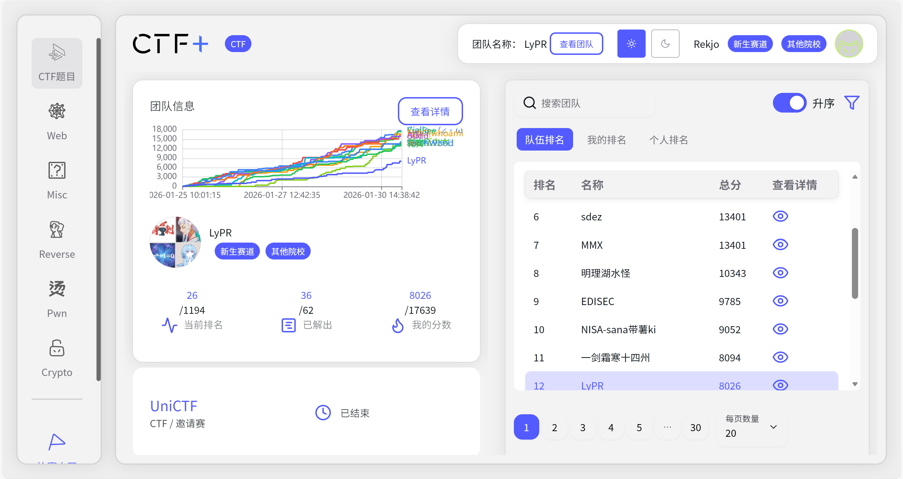
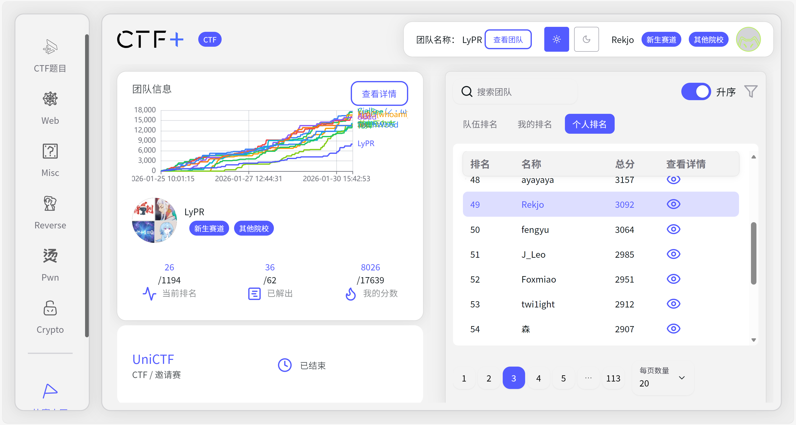

***


## Summary

新神赛，我真不知道设置新生赛道何意味

全是老登，幸好队友带飞，不然寄了

成绩还没出，能不能吃KFC看天意了

目前团队总榜第26，新生赛道第12，个人榜第49





## Misc

### Welcome

`UniCTF{He110_Uni}`


### 工厂应急流量分析

任务 1：谁把阀门打开了？

2.00 分

找到 Modbus 打开阀门指令的相关信息。

提交格式：flag{0xtransaction_id_0xfunction_code_0xcoil_address}

```bash
tshark -r 简单协议学习.pcap -Y "modbus.func_code == 5" -T pdml | head -200
```

正确的字段名：

- `mbtcp.trans_id` - Transaction Identifier
- `modbus.func_code` - Function Code
- `modbus.reference_num` - Reference Number (线圈地址)
- `modbus.data` - Data (ff00表示开启)

```bash
tshark -r 简单协议学习.pcap -Y "modbus.func_code == 5 and modbus.data == ff00" -T fields \
  -e mbtcp.trans_id -e modbus.func_code -e modbus.reference_num
15437   5       21
```

转16进制即`flag{0x3c4d_0x05_0x0015}`

任务 2：被读取的 NodeId

2.00 分

找到通过 OPC UA 协议读取的 NodeId。

提交格式：flag{ns=X;s=Path/To/Node}

```bash
tshark -r 简单协议学习.pcap -T fields -e tcp.payload | xxd -r -p | strings | grep -i "readrequest" | head -10
flag{ns=2;s=Valve/Status}
```

任务 3：控制站域名解析结果

2.00 分

找出控制站域名 ctrlws.factory.local 的解析 IP。

提交格式：flag{IP地址}

```bash
tshark -r 简单协议学习.pcap -Y "dns.qry.name == ctrlws.factory.local" -T fields \
  -e dns.a -e dns.aaaa
```

其实也可以从下面题干猜出来

```
flag{192.168.1.10}
```

任务 4：连接建立时间

2.00 分

确定SCADA（源：192.168.1.5）到控制站（目的：192.168.1.10）上首个成功发起的时间点(UTC)。

提交格式：flag{YYYY-MM-DDTHH:MM:SSZ}

```bash
tshark -r 简单协议学习.pcap -Y "ip.src == 192.168.1.5 and ip.dst == 192.168.1.10" -T fields \
  -e frame.time_utc -e tcp.flags | head -10
2025-03-15T09:30:00.360000000Z  0x0018
2025-03-15T09:30:00.609999000Z  0x0018
2025-03-15T09:30:01.079999000Z  0x0002
2025-03-15T09:30:01.099999000Z  0x0010
2025-03-15T09:30:01.399999000Z  0x0018
2025-03-15T09:30:02.029998000Z
```

第三个包：`2025-03-15T09:30:01.079999000Z`，标志`0x0002` (这是SYN包！)

格式化可得flag

```
flag{2025-03-15T09:30:01Z}
```

任务 5：HTTP 请求痕迹

2.00 分

提取 SCADA 对控制站发起的 HTTP 请求的 Host 与 URI。

提交格式：flag{Host_URI}

```bash
tshark -r 简单协议学习.pcap -Y "http.request and ip.src == 192.168.1.5 and ip.dst == 192.168.1.10" -T fields \
  -e http.host -e http.request.uri
flag{ctrlws.factory.local_/api/status}
```

任务 6：ICMP Echo Request 序列号

2.00 分

攻击者（192.168.1.100）对控制站发起了 ICMP Echo Request（ping）。找出该 ICMP 请求的序列号（Sequence Number）。

提交格式：flag{0x序列号}

```bash
tshark -r 简单协议学习.pcap -Y "icmp.type == 8 and ip.src == 192.168.1.100 and ip.dst == 192.168.1.10" -T fields \-e icmp.seq
```

这一问感觉出的有点小问题，卡了一下

得到291（10），16进制是123，但是需要补0。这点一开始想不到，问AI

```
flag{0x0123}
```

任务 7：SNMP Get 请求的 OID

2.00 分

SCADA 对控制站发起了 SNMP Get 请求。找出该请求查询的 OID（Object Identifier）。

提交格式：flag{OID}

```bash
tshark -r 简单协议学习.pcap -Y 'ip.src == 192.168.1.5 and ip.dst == 192.168.1.10 and frame contains "GetRequest"' -T fields \
  -e data.data | xxd -r -p | grep -o "OID=[^;]*" | head -5
flag{1.3.6.1.2.1.1.5.0}
```

得到flag:

`UniCTF{base64_misc_ctf_Ahiz_1955f495-c57f-4403-9147-0322281e40d6}`


### Cube God

#### Method Explanation

1. **State Representation**: The cube state is modeled as a tuple of 24 characters (stickers 'U', 'D', 'F', 'B', 'L', 'R'). This handles the indistinguishable nature of identical stickers automatically.
2. **Move Simulation**: We pre-calculate permutation tables (`TRANS_TABLE`) using integer indices (0-23) to represent how positions move. We then use these tables to shuffle the sticker colors efficiently.
3. **Bidirectional Search**:
   1. **Precomputation**: We generate a lookup table (`SOLVED_BALL`) of all states within 6 moves of the solved state.
   2. **Online Search**: For each round, we search up to 5 moves from the scrambled state. If we hit a state in `SOLVED_BALL`, we combine the paths to form the solution.
4. **Hidden Face Reconstruction**: The challenge hides one face. We calculate which stickers are missing (since there are exactly 4 of each color). We try all permutations of these missing stickers to fill the hidden face, checking against valid corner constraints (e.g., a corner cannot have both 'U' and 'D') to find the valid physical state.

```python
import socket
import sys
import time
import itertools
from collections import deque

# --- Configuration ---
HOST = 'nc1.ctfplus.cn'
PORT = 40536
PRECOMPUTE_DEPTH = 6  # Table depth (from solved)
SEARCH_DEPTH = 5      # Search depth (from scramble)
# Total coverage: 11 moves

# --- Cube Model & Constants ---

FACES_LIST = "UDFBLR"

# Map (Face, Row, Col) -> Index 0-23
IDX_MAP = {}
REV_MAP = {}
idx_counter = 0
for f in FACES_LIST:
    for r in range(2):
        for c in range(2):
            IDX_MAP[(f, r, c)] = idx_counter
            REV_MAP[idx_counter] = (f, r, c)
            idx_counter += 1

# Solved State (Canonical Colors)
# ('U','U','U','U', 'D','D','D','D', ...)
SOLVED_STATE_COLORS = []
for f in FACES_LIST:
    SOLVED_STATE_COLORS.extend([f] * 4)
SOLVED_STATE_COLORS = tuple(SOLVED_STATE_COLORS)

# Solved State (Indices) - Used to generate transition table
SOLVED_STATE_INDICES = tuple(range(24))

# Valid Corner Logic (Standard Color Scheme)
OPPOSITES = [{'U', 'D'}, {'F', 'B'}, {'L', 'R'}]

# Indices constituting the 8 corners
CORNERS = [
    # ULF
    (IDX_MAP[('U',1,0)], IDX_MAP[('L',0,1)], IDX_MAP[('F',0,0)]),
    # URF
    (IDX_MAP[('U',1,1)], IDX_MAP[('R',0,0)], IDX_MAP[('F',0,1)]),
    # ULB
    (IDX_MAP[('U',0,0)], IDX_MAP[('L',0,0)], IDX_MAP[('B',0,1)]),
    # URB
    (IDX_MAP[('U',0,1)], IDX_MAP[('R',0,1)], IDX_MAP[('B',0,0)]),
    # DLF
    (IDX_MAP[('D',0,0)], IDX_MAP[('L',1,1)], IDX_MAP[('F',1,0)]),
    # DRF
    (IDX_MAP[('D',0,1)], IDX_MAP[('R',1,0)], IDX_MAP[('F',1,1)]),
    # DLB
    (IDX_MAP[('D',1,0)], IDX_MAP[('L',1,0)], IDX_MAP[('B',1,1)]),
    # DRB
    (IDX_MAP[('D',1,1)], IDX_MAP[('R',1,1)], IDX_MAP[('B',1,0)]),
]

def is_valid_corner(faces_set):
    """Check if a set of stickers can form a valid corner piece."""
    for pair in OPPOSITES:
        if pair.issubset(faces_set):
            return False
    return True

# --- Simulation Logic ---

class CubeSim:
    def __init__(self, state_tuple):
        self.state = list(state_tuple)
        
    def _get_row(self, face, row):
        base = IDX_MAP[(face, row, 0)]
        return [self.state[base], self.state[base+1]]

    def _set_row(self, face, row, vals):
        base = IDX_MAP[(face, row, 0)]
        self.state[base] = vals[0]
        self.state[base+1] = vals[1]

    def _get_col(self, face, col):
        return [self.state[IDX_MAP[(face, 0, col)]], self.state[IDX_MAP[(face, 1, col)]]]

    def _set_col(self, face, col, vals):
        self.state[IDX_MAP[(face, 0, col)]] = vals[0]
        self.state[IDX_MAP[(face, 1, col)]] = vals[1]
    
    def _rotate_face_cw(self, face):
        i00 = IDX_MAP[(face,0,0)]; i01 = IDX_MAP[(face,0,1)]
        i10 = IDX_MAP[(face,1,0)]; i11 = IDX_MAP[(face,1,1)]
        v00, v01, v10, v11 = self.state[i00], self.state[i01], self.state[i10], self.state[i11]
        self.state[i00], self.state[i01], self.state[i10], self.state[i11] = v10, v00, v11, v01

    def _rotate_face_ccw(self, face):
        i00 = IDX_MAP[(face,0,0)]; i01 = IDX_MAP[(face,0,1)]
        i10 = IDX_MAP[(face,1,0)]; i11 = IDX_MAP[(face,1,1)]
        v00, v01, v10, v11 = self.state[i00], self.state[i01], self.state[i10], self.state[i11]
        self.state[i00], self.state[i01], self.state[i10], self.state[i11] = v01, v11, v00, v10

    # Moves implemented exactly as in challenge
    def move_U(self, prime=False):
        if prime:
            self._rotate_face_ccw("U")
            t = self._get_row("F", 0)
            self._set_row("F", 0, self._get_row("L", 0))
            self._set_row("L", 0, self._get_row("B", 0))
            self._set_row("B", 0, self._get_row("R", 0))
            self._set_row("R", 0, t)
        else:
            self._rotate_face_cw("U")
            t = self._get_row("F", 0)
            self._set_row("F", 0, self._get_row("R", 0))
            self._set_row("R", 0, self._get_row("B", 0))
            self._set_row("B", 0, self._get_row("L", 0))
            self._set_row("L", 0, t)

    def move_D(self, prime=False):
        if prime:
            self._rotate_face_ccw("D")
            t = self._get_row("F", 1)
            self._set_row("F", 1, self._get_row("R", 1))
            self._set_row("R", 1, self._get_row("B", 1))
            self._set_row("B", 1, self._get_row("L", 1))
            self._set_row("L", 1, t)
        else:
            self._rotate_face_cw("D")
            t = self._get_row("F", 1)
            self._set_row("F", 1, self._get_row("L", 1))
            self._set_row("L", 1, self._get_row("B", 1))
            self._set_row("B", 1, self._get_row("R", 1))
            self._set_row("R", 1, t)

    def move_F(self, prime=False):
        if prime:
            self._rotate_face_ccw("F")
            t = self._get_row("U", 1)
            self._set_row("U", 1, self._get_col("R", 0))
            self._set_col("R", 0, self._get_row("D", 0)[::-1])
            self._set_row("D", 0, self._get_col("L", 1))
            self._set_col("L", 1, t[::-1])
        else:
            self._rotate_face_cw("F")
            t = self._get_row("U", 1)
            self._set_row("U", 1, self._get_col("L", 1)[::-1])
            self._set_col("L", 1, self._get_row("D", 0))
            self._set_row("D", 0, self._get_col("R", 0)[::-1])
            self._set_col("R", 0, t)

    def move_B(self, prime=False):
        if prime:
            self._rotate_face_ccw("B")
            t = self._get_row("U", 0)
            self._set_row("U", 0, self._get_col("L", 0)[::-1])
            self._set_col("L", 0, self._get_row("D", 1))
            self._set_row("D", 1, self._get_col("R", 1)[::-1])
            self._set_col("R", 1, t)
        else:
            self._rotate_face_cw("B")
            t = self._get_row("U", 0)
            self._set_row("U", 0, self._get_col("R", 1))
            self._set_col("R", 1, self._get_row("D", 1)[::-1])
            self._set_row("D", 1, self._get_col("L", 0))
            self._set_col("L", 0, t[::-1])

    def move_L(self, prime=False):
        if prime:
            self._rotate_face_ccw("L")
            t = self._get_col("U", 0)
            self._set_col("U", 0, self._get_col("F", 0))
            self._set_col("F", 0, self._get_col("D", 0))
            self._set_col("D", 0, self._get_col("B", 1)[::-1])
            self._set_col("B", 1, t[::-1])
        else:
            self._rotate_face_cw("L")
            t = self._get_col("U", 0)
            self._set_col("U", 0, self._get_col("B", 1)[::-1])
            self._set_col("B", 1, self._get_col("D", 0)[::-1])
            self._set_col("D", 0, self._get_col("F", 0))
            self._set_col("F", 0, t)

    def move_R(self, prime=False):
        if prime:
            self._rotate_face_ccw("R")
            t = self._get_col("U", 1)
            self._set_col("U", 1, self._get_col("B", 0)[::-1])
            self._set_col("B", 0, self._get_col("D", 1)[::-1])
            self._set_col("D", 1, self._get_col("F", 1))
            self._set_col("F", 1, t)
        else:
            self._rotate_face_cw("R")
            t = self._get_col("U", 1)
            self._set_col("U", 1, self._get_col("F", 1))
            self._set_col("F", 1, self._get_col("D", 1))
            self._set_col("D", 1, self._get_col("B", 0)[::-1])
            self._set_col("B", 0, t[::-1])

    def apply_move(self, move):
        func = getattr(self, f"move_{move[0]}")
        prime = "'" in move
        double = "2" in move
        func(prime)
        if double:
            func(prime)
        return tuple(self.state)

MOVE_NAMES = []
for f in "UDFBLR":
    MOVE_NAMES.extend([f, f+"'", f+"2"])

# --- Precomputation ---

TRANS_TABLE = {}
# Generate integer permutation maps for speed
for m in MOVE_NAMES:
    sim = CubeSim(SOLVED_STATE_INDICES)
    perm = sim.apply_move(m)
    TRANS_TABLE[m] = perm

def fast_apply(state_tuple, move):
    """Apply move to a color tuple using precomputed index permutation."""
    perm = TRANS_TABLE[move]
    return tuple(state_tuple[perm[i]] for i in range(24))

SOLVED_BALL = {}

def precompute():
    print("Generating lookup table (Depth 6)... this may take 10-20 seconds.")
    start_node = SOLVED_STATE_COLORS
    SOLVED_BALL[start_node] = ""
    
    current_layer = {start_node: ""}
    FACE_ID = {c: i for i, c in enumerate("UDFBLR")}
    
    for depth in range(1, PRECOMPUTE_DEPTH + 1):
        next_layer = {}
        for state, path in current_layer.items():
            last_face_idx = -1
            if path:
                last_move = path.split()[-1]
                last_face_idx = FACE_ID[last_move[0]]
            
            for move in MOVE_NAMES:
                face_char = move[0]
                face_idx = FACE_ID[face_char]
                
                # Pruning: No immediate reverse or same face
                if face_idx == last_face_idx: continue
                
                # Pruning: Commutative moves (enforce order)
                # Pairs: U(0)-D(1), F(2)-B(3), L(4)-R(5)
                # If current < last in a commutative pair, skip.
                # Valid: U, D; Invalid: D, U
                if (last_face_idx, face_idx) in [(1,0), (3,2), (5,4)]:
                    continue
                
                new_state = fast_apply(state, move)
                if new_state not in SOLVED_BALL:
                    new_path = path + " " + move if path else move
                    SOLVED_BALL[new_state] = new_path
                    next_layer[new_state] = new_path
        
        print(f"Depth {depth}: {len(next_layer)} new states. Total: {len(SOLVED_BALL)}")
        current_layer = next_layer

def invert_path(path_str):
    if not path_str: return ""
    moves = path_str.split()
    invs = []
    for m in reversed(moves):
        if m.endswith("2"):
            invs.append(m)
        elif m.endswith("'"):
            invs.append(m[:-1])
        else:
            invs.append(m + "'")
    return " ".join(invs)

# --- Solver Core ---

def solve_round(faces_dict):
    # 1. Identify Missing Face
    all_faces = set(FACES_LIST)
    present_faces = set(faces_dict.keys())
    hidden_face = list(all_faces - present_faces)[0]
    
    # 2. Identify Missing Stickers
    counts = {k: 0 for k in FACES_LIST}
    for f in present_faces:
        for r in range(2):
            for c in range(2):
                counts[faces_dict[f][r][c]] += 1
                
    missing_chars = []
    for k in FACES_LIST:
        needed = 4 - counts[k]
        missing_chars.extend([k] * needed)
    
    # 3. Generate Valid State Candidates
    # Get indices for hidden face
    h_idxs = [IDX_MAP[(hidden_face, r, c)] for r in range(2) for c in range(2)]
    
    # Create base state with None for hidden
    base_state = [None] * 24
    for f in present_faces:
        for r in range(2):
            for c in range(2):
                base_state[IDX_MAP[(f,r,c)]] = faces_dict[f][r][c]
    
    candidates = set(itertools.permutations(missing_chars))
    valid_states = []
    
    for perm in candidates:
        curr_state = list(base_state)
        for i, val in enumerate(perm):
            curr_state[h_idxs[i]] = val
        
        # Validate Corner Pieces
        valid = True
        for c_indices in CORNERS:
            s = {curr_state[idx] for idx in c_indices}
            if not is_valid_corner(s):
                valid = False
                break
        
        if valid:
            valid_states.append(tuple(curr_state))
    
    if not valid_states:
        return None

    # 4. Search
    FACE_ID = {c: i for i, c in enumerate("UDFBLR")}
    
    # Check candidates against lookup table first (0 moves from valid state)
    for vs in valid_states:
        if vs in SOLVED_BALL:
            return invert_path(SOLVED_BALL[vs])
            
    # BFS from valid candidates
    queue = deque()
    visited = set()
    for vs in valid_states:
        queue.append((vs, ""))
        visited.add(vs)
    
    for depth in range(1, SEARCH_DEPTH + 1):
        next_queue = deque()
        while queue:
            state, path = queue.popleft()
            
            last_face_idx = -1
            if path:
                last_move = path.split()[-1]
                last_face_idx = FACE_ID[last_move[0]]
            
            for move in MOVE_NAMES:
                face_idx = FACE_ID[move[0]]
                if face_idx == last_face_idx: continue
                if (last_face_idx, face_idx) in [(1,0), (3,2), (5,4)]: continue
                
                ns = fast_apply(state, move)
                if ns in visited: continue
                visited.add(ns)
                
                new_path = path + " " + move if path else move
                
                # Check intersection
                if ns in SOLVED_BALL:
                    rem_path = invert_path(SOLVED_BALL[ns])
                    full = new_path + " " + rem_path if rem_path else new_path
                    return full.strip()
                
                next_queue.append((ns, new_path))
        queue = next_queue
    
    return None

def parse_cube(text):
    lines = text.splitlines()
    faces = {}
    i = 0
    while i < len(lines):
        line = lines[i].strip()
        if line.startswith("Face"):
            face = line.split()[1][0]
            row1 = lines[i+2].strip("| ").split()
            row2 = lines[i+3].strip("| ").split()
            faces[face] = [row1, row2]
            i += 5
        else:
            i += 1
    return faces

def main():
    # 1. Generate Table
    precompute()
    
    # 2. Connect
    s = socket.socket(socket.AF_INET, socket.SOCK_STREAM)
    try:
        s.connect((HOST, PORT))
    except Exception as e:
        print(f"Connection failed: {e}")
        return

    buffer = ""
    
    while True:
        try:
            chunk = s.recv(4096).decode()
            if not chunk: break
            buffer += chunk
            
            if "FLAG" in buffer:
                print(buffer)
                break
            
            if "[?] Enter your solution:" in buffer:
                # Extract the last round text
                parts = buffer.split("=== Round")
                current_round_text = parts[-1]
                
                print(f"Solving round...", end=" ")
                faces = parse_cube(current_round_text)
                sol = solve_round(faces)
                
                if sol is None:
                    print("Failed!")
                    sol = ""
                else:
                    print(f"Moves: {len(sol.split())}")
                
                s.sendall((sol + "\n").encode())
                buffer = "" # Flush processed buffer
        except KeyboardInterrupt:
            break
        except Exception as e:
            print(f"Error: {e}")
            break

if __name__ == "__main__":
    main()
```

`UniCTF{G0dZzzz_NuM63r_1s_3lEv3N_But_uR_C0d3_i5_D1v1n3_GG1981288629137313792}`


### 总裁四比特,这能玩？

过于阴险了

可以发现jpg有点大，结束后跟了一大坨数据，binwalk和foremost可以搞出两张一模一样的png

这俩纯混淆视线，真正关键的是，**不难发现，jpg里面有2个89504E47，但是有3个png文件尾**

经过计算手动提取一下

```text
dd if=比特.jpg of=128.bin bs=1 skip=1725696 count=1494653
```

提取出来的128.bin啥也不是，但是俗话说的好，**attention is all you need**，**不难发现每两个字节分别取高4位再拼起来可以得到zip**

```python
def pack_high_nibbles(input_file, output_file):
    with open(input_file, 'rb') as f:
        data = f.read()

    if len(data) % 2 != 0:
        print(f"警告: 输入文件字节数为奇数 ({len(data)})，最后一个字节将被忽略。")
        data = data[:-1]  # 丢弃最后一个字节

    output_bytes = bytearray()
    for i in range(0, len(data), 2):
        b1 = data[i]
        b2 = data[i + 1]
        high1 = (b1 >> 4) & 0x0F   # 第一个字节的高4位
        high2 = (b2 >> 4) & 0x0F   # 第二个字节的高4位
        new_byte = (high1 << 4) | high2
        output_bytes.append(new_byte)

    with open(output_file, 'wb') as f:
        f.write(output_bytes)

if __name__ == "__main__":
    import sys
    if len(sys.argv) != 3:
        print("用法: python3 pack_nibbles.py <输入文件> <输出文件>")
        sys.exit(1)

    pack_high_nibbles(sys.argv[1], sys.argv[2])
    print(f"finished.")
```

得到zip解压，发现是png，结尾还有一个zip

解压可得flag

`UniCTF{Y0u_4r3_4_6r347_h4ck3r_!}`


### Silent Resolver

直接提取字符串

```bash
strings traffic.pcapng
```

可以发现

```text
00012wgczzoor4hic6nzn2a44nloyy4qk4jb4utekjorf37cc4ob4wd.a1b2c3d4.exfil.unictf.local
00002kbfqgbauaaaaacaajbsskxfwamzbcoaaaaadmaaaaaeaaaaamz.a1b2c3d4.exfil.unictf.local
00022klrsjqwy4n6pgcxiz5zvjthsrcpxgbgdddqpgzhc4mrofgxaka.a1b2c3d4.exfil.unictf.local
00032cqjmaqefadcqaaaaaiabegkjk4wybteejyaaaaanqaaaaaqaaa.a1b2c3d4.exfil.unictf.local
00042aaaaaaaaaaaaaaeaaeaaaaaamzwgczzoor4hiuclaudaaaaaaa.a1b2c3d4.exfil.unictf.local
0005.aqaaiagyaaaac6aaaaaaaa.a1b2c3d4.exfil.unictf.local
```

提取一下base32

```text
kbfqgbauaaaaacaajbsskxfwamzbcoaaaaadmaaaaaeaaaaamzwgczzoor4hic6nzn2a44nloyy4qk4jb4utekjorf37cc4ob4wdklrsjqwy4n6pgcxiz5zvjthsrcpxgbgdddqpgzhc4mrofgxakacqjmaqefadcqaaaaaiabegkjk4wybteejyaaaaanqaaaaaqaaaaaaaaaaaaaaaaaeaaeaaaaaamzwgczzoor4hiuclaudaaaaaaaaqaaiagyaaaac6aaaaaaaa
```

解码发现是PK开头，转hex

```text
50 4b 03 04 14 00 00 00 08 00 48 65 25 5c b6 03 32 11 38 00 00 00 36 00 00 00 08 00 00 00 66 6c 61 67 2e 74 78 74 0b cd cb 74 0e 71 ab 76 31 c8 2b 89 0f 29 32 29 2e 89 77 f1 0b 8e 0f 2c 35 2e 32 4c 2d 8e 37 cf 30 ae 8c f7 35 4c cf 28 89 f7 30 4c 31 8e 0f 36 4e 2e 32 2e 29 ae 05 00 50 4b 01 02 14 03 14 00 00 00 08 00 48 65 25 5c b6 03 32 11 38 00 00 00 36 00 00 00 08 00 00 00 00 00 00 00 00 00 00 00 80 01 00 00 00 00 66 6c 61 67 2e 74 78 74 50 4b 05 06 00 00 00 00 01 00 01 00 36 00 00 00 5e 00 00 00 00 00
```

保存为zip解压即可

`UniCTF{D0nt_Tr4st_DNS_Qu3r1es_7h3y_M1ght_H1d3_S3cr3ts}`


### Sign in

打开附件发现是Serpent.dat，问AI发现是一种算法

显然dat的hex值是密文：

```text
32E393BB9463840159017E9912FCD4D06138D9EEFF5153A42837C4565C4297D4
```

找了一下没看到密钥，想起来回去看看压缩包，结尾发现`U2VjcmV0S2V5`,base64解码得到`SecretKey`

 [http://serpent.online-domain-tools.com/](https://www.google.com/url?sa=E&q=http%3A%2F%2Fserpent.online-domain-tools.com%2F)

解密即可

`UniCTF{Serpentine_Secrets}`


### 截取的线索

图片是摩斯密码

```
_Great_to01}
```

**RinDSA|W6dlkbXsob**是异或结果，密钥其实就是文件名7

`UniCTF{P1ckle_the_Great_to01}`


## Crypto

### Subgroup-Weaver

```python
from pwn import *
from Crypto.Util.number import long_to_bytes

HOST = 'nc1.ctfplus.cn'
PORT = 17172

context.log_level = 'info'
io = remote(HOST, PORT)

# 增加样本数量以提高准确率 ---
SAMPLE_COUNT = 1000
samples = []

print(f"[*] Collecting {SAMPLE_COUNT} samples (this may take a few seconds)...")

try:
    for i in range(SAMPLE_COUNT):
        # 接收提示符
        io.recvuntil(b'> ')
        # 发送 '1' 获取下一个随机数
        io.sendline(b'1')
        
        # 读取数字
        line = io.recvline().strip()
        # 有时候网络延迟可能导致读取到空行或非数字，做个简单的容错
        if not line:
            line = io.recvline().strip()
            
        val = int(line)
        samples.append(val)
        
        # 显示进度条
        if i % 50 == 0:
            print(f"[*] Progress: {i}/{SAMPLE_COUNT}")

    print("[*] Samples collected. Analyzing bits...")

    recovered_key_int = 0
    key_length_bits = 64 * 8  # 512 bits

    for i in range(key_length_bits):
        ones_count = 0
        for sample in samples:
            # 检查第 i 位是否为 1
            if (sample >> i) & 1:
                ones_count += 1
                
        # 统计原理：
        # Mask每一位是1的概率 = 4/7 (约57%)
        # 如果 Key位是0: 观测值 = Mask => 1的频率 > 50%
        # 如果 Key位是1: 观测值 = ~Mask => 1的频率 < 50%
        
        if ones_count < (SAMPLE_COUNT / 2):
            recovered_key_int |= (1 << i)

    # 转换为 Hex 字符串
    key_bytes = long_to_bytes(recovered_key_int)
    # 补齐长度到64字节
    if len(key_bytes) < 64:
        key_bytes = key_bytes.rjust(64, b'\x00')
        
    key_hex = key_bytes.hex()
    print(f"[*] Calculated Key: {key_hex}")

    # 发送 Key
    io.recvuntil(b'> ')
    io.sendline(key_hex.encode())

    # 尝试直接读取 Flag
    response = io.recvall(timeout=2).decode(errors='ignore')
    if "Uni" in response or "flag" in response:
        print("\n[+] SUCCESS! Here is the response:\n")
        print(response)
    else:
        print("[-] Failed to get flag directly. Verify key manually or try again.")
        print("Server response:", response)

except Exception as e:
    print(f"[-] Error: {e}")
    io.interactive()
```


### subgroup_dlp

借助**CRT**解决

```python
# solve.sage
from sage.all import *
from Crypto.Util.number import long_to_bytes

g = Integer(7)
n = Integer(20416580311348568104958456290409800602076453150746674606637172527592736894552749500299570715851384304673805100612931000268540860237227126141075427447627491168)
c = Integer(8195229101228793312160531614487746122056220479081491148455134171051226604632289610379779462628287749120056961207013231802759766535835599450864667728106141697)

proof.arithmetic(False)

# -------------------------
# General CRT (works even if moduli not coprime, if consistent)
# -------------------------
def crt_general(a1, m1, a2, m2):
    a1, m1, a2, m2 = Integer(a1), Integer(m1), Integer(a2), Integer(m2)
    d = gcd(m1, m2)
    if (a2 - a1) % d != 0:
        raise ValueError("Inconsistent congruences")
    m1p = m1 // d
    m2p = m2 // d
    rhs = (a2 - a1) // d
    inv = inverse_mod(m1p % m2p, m2p)
    t = (rhs * inv) % m2p
    x = a1 + m1 * t
    M = lcm(m1, m2)
    return (x % M, M)

def combine_congruences(congs):
    x, M = congs[0]
    for a, m in congs[1:]:
        x, M = crt_general(x, M, a, m)
    return x, M

def looks_like_flag(bb: bytes) -> bool:
    return bb.startswith(b"UniCTF{") and (b"}" in bb)

# -------------------------
# Factor n
# -------------------------
fac = factor(n)
print("[*] factor(n) =", fac)

congs = []

# -------------------------
# Small prime powers: 2^5, 3^2
# -------------------------
for pe in [Integer(32), Integer(9)]:
    R = Zmod(pe)
    base = R(g)
    target = R(c)
    ord_b = base.multiplicative_order()
    m_mod = discrete_log(target, base, ord=ord_b, operation='*')
    congs.append((Integer(m_mod), Integer(ord_b)))
    print(f"[*] mod {pe}: ord(base)={ord_b}, m ≡ {m_mod} (mod {ord_b})")

# -------------------------
# Prime modulus: 10711086940911733573
# -------------------------
p1 = Integer(10711086940911733573)
R1 = Zmod(p1)
base1 = R1(g)
target1 = R1(c)
ord1 = base1.multiplicative_order()
print(f"[*] mod {p1}: ord(base)={ord1}")
m1 = discrete_log(target1, base1, ord=ord1, operation='*')
congs.append((Integer(m1), Integer(ord1)))
print(f"    -> m ≡ {m1} (mod {ord1})")

# -------------------------
# Prime modulus: 9888549588625...
# -------------------------
p2 = Integer(988854958862525695246052320176260067587096611000882853771819829938377275059)
R2 = Zmod(p2)
base2 = R2(g)
target2 = R2(c)
ord2 = base2.multiplicative_order()
print(f"[*] mod {p2}: ord(base)={ord2}")
m2 = discrete_log(target2, base2, ord=ord2, operation='*')
congs.append((Integer(m2), Integer(ord2)))
print(f"    -> m ≡ {m2} (mod {ord2})")

# -------------------------
# Critical part: p^3 where p=188455199626845780197
# Use projection to Teichmüller part + p-adic log for principal units.
# -------------------------
p = Integer(188455199626845780197)
k = 3
pk = p**k
print(f"[*] handling prime power {p}^{k} via projection + p-adic log")

# (1) Teich part (mod p-1 or divisor): solve in GF(p)^*
Fp = GF(p)
aFp = Fp(g)
bFp = Fp(c)
ord_teich = aFp.multiplicative_order()
x0 = discrete_log(bFp, aFp, ord=ord_teich, operation='*')
print(f"    Teich part: m ≡ {x0} (mod {ord_teich})")

# (2) projection omega(x) = x^(p^(k-1)) mod p^k (kills principal unit part)
Rk = Zmod(pk)
A = Rk(g)
B = Rk(c)

omegaA = A**(p**(k-1))
omegaB = B**(p**(k-1))

uA = A * omegaA.inverse_of_unit()   # should be in 1 + pZ/(p^k)Z
uB = B * omegaB.inverse_of_unit()

uA_int = Integer(uA.lift()) % pk
uB_int = Integer(uB.lift()) % pk

# sanity: should be 1 mod p
if uA_int % p != 1 or uB_int % p != 1:
    print("[!] Warning: principal units not 1 mod p after lift (unexpected). Trying to normalize...")
    uA_int = (uA_int % pk)
    uB_int = (uB_int % pk)
    # still proceed; Qp constructor may still accept, but log needs 1 mod p

# p-adic log to get m mod p^(k-1)
K = Qp(p, prec=k+8)  # a bit more precision
uA_p = K(uA_int)
uB_p = K(uB_int)

# If log complains in your environment, increase precision or ensure 1 mod p above.
la = uA_p.log()
lb = uB_p.log()
x1 = lb / la
x1_int = Integer(x1.lift()) % (p**(k-1))
print(f"    Unit part:  m ≡ {x1_int} (mod {p**(k-1)})")

# (3) combine for this prime power: m ≡ x0 (mod ord_teich), m ≡ x1 (mod p^(k-1))
m_pk, mod_pk = crt_general(Integer(x0), Integer(ord_teich), Integer(x1_int), Integer(p**(k-1)))
print(f"    Combined for p^3 constraint: m ≡ {m_pk} (mod {mod_pk})")

congs.append((m_pk, mod_pk))

# -------------------------
# Combine all congruences
# -------------------------
m0, M = combine_congruences(congs)
print("[*] Combined all: m ≡", m0, "(mod", M, ")")

# -------------------------
# Search for the actual m that decodes to UniCTF{...} and verifies pow
# -------------------------
found = None
for t in range(0, 300000):
    m = m0 + t*M
    bb = long_to_bytes(int(m))
    if looks_like_flag(bb):
        if pow(g, m, n) == c:
            found = (m, bb, t)
            break

if not found:
    print("[!] Not found in range. Increase t upper bound (e.g. 2_000_000).")
else:
    m, bb, t = found
    print("[+] Found t =", t)
    print("[+] flag bytes =", bb)
    print("[+] printable  =", bb.rstrip(b"\x00"))
```

`UniCTF{Th1s_DLP_probl3m_i5_v3ry_s1mpl3_f0r_y0u!!!}`


### NTRU

```yaml
import itertools

# 参数初始化
N = 31
p = 257
q = 12289
h = [9603, 11838, 1242, 5868, 12249, 3130, 3722, 5910, 5879, 7672, 1119, 339, 10748, 7310, 6370, 9353, 10589, 10739, 10213, 2560, 5132, 4889, 11292, 2649, 2556, 8037, 3146, 9533, 11563, 1554, 304]
c = [91, 11459, 932, 4345, 12153, 9504, 5147, 7268, 2493, 8891, 8712, 5785, 11608, 7683, 11327, 8453, 10380, 6004, 7849, 1622, 6154, 10369, 10278, 769, 11676, 11492, 4564, 5445, 10909, 11502, 12216]

def solve():
    print("正在搜索 r...")
    indices = list(range(N))
    
    for pos in itertools.combinations(indices, 4):
    
        for signs in itertools.product([-1, 1], repeat=4):

            rh0 = 0
            for i in range(4):
                rh0 = (rh0 + signs[i] * h[(0 - pos[i]) % N]) % q
            
            if (c[0] - rh0) % q == ord('U'):
            
                rh = [0] * N
                for i in range(4):
                    p_idx, s = pos[i], signs[i]
                    for j in range(N):
                        rh[(p_idx + j) % N] = (rh[(p_idx + j) % N] + s * h[j]) % q
                
                m = [(c[k] - rh[k]) % q for k in range(N)]
                
                # 检查是否全为可打印字符或 0
                if all(32 <= x <= 126 or x == 0 for x in m):
                    flag = "".join(chr(x) for x in m if x != 0)
                    return flag
    return None

if __name__ == "__main__":
    result = solve()
    if result:
        print(f"{result}")
    else:
        print("failed.")
```

`UniCTF{pa3sw0rd_1s_ch2rmin3}`


### Subgroup-Choreographer

#### 1.从 `T` 构造阿贝尔群加法 `+`

对拟群 `*`（即 `T`）定义左右除法：

- 左除：a\c=ba\backslash c = ba\c=b 使得 a∗b=ca*b=ca∗b=c
- 右除：c/b=ac / b = ac/b=a 使得 a∗b=ca*b=ca∗b=c

然后取任意固定元 eee（这里取 `e=0`），定义：

x+y=(x/e)∗(e\y)x + y = (x/e) * (e\backslash y)x+y=(x/e)∗(e\y)

可以验证这是一个 **交换结合** 的阿贝尔群（本题里同构于 Z4×Z4\mathbb{Z}_4 \times \mathbb{Z}_4Z4×Z4）。

#### 2.将 `*` 写成仿射形式

在该 `+` 下枚举常数并约束同态条件，可唯一确定：

x∗y=φ(x)+ψ(y)+kx * y = \varphi(x) + \psi(y) + kx∗y=φ(x)+ψ(y)+k

（本题里常数项对应的群元素是固定的。）

#### 3.证明并利用 `D` 的可分解性

因为 `*` 是“φ(x)+ψ(y)+k\varphi(x)+\psi(y)+kφ(x)+ψ(y)+k”这种**对两边可分离相加**的结构，而 `D` 的构造只是在不同维度上做 `reduce/roll` 和 `g(u,v)=(((u*v)*u)*v)` 这种组合，所以最终仍满足：

D(A,B)=F(A)+G(B)+CD(A,B)=F(A)+G(B)+CD(A,B)=F(A)+G(B)+C

其中 C=D(0,0)C=D(0,0)C=D(0,0)，并且 F(A)=D(A,0)−CF(A)=D(A,0)-CF(A)=D(A,0)−C，G(B)=D(0,B)−CG(B)=D(0,B)-CG(B)=D(0,B)−C。

于是公开的

- p1=D(c,k)p1 = D(c,k)p1=D(c,k)
- p2=D(k,q)p2 = D(k,q)p2=D(k,q)

就变成线性方程：

G(k)=p1−F(c)−C,G(q)=p2−F(k)−CG(k)=p1 - F(c) - C,\quad G(q)=p2 - F(k) - CG(k)=p1−F(c)−C,G(q)=p2−F(k)−C

#### 4.求逆得到 `k`、`q`

`G` 是群自同态（可逆线性变换），在 Z4\mathbb{Z}_4Z4 模上可通过构造其矩阵表示并做模 4 高斯消元求解。恢复 `k,q` 后即可按原脚本算：

key=SHA256(str(sk))key = \text{SHA256}(\text{str}(sk))key=SHA256(str(sk))

再用 AES-CTR 解密得到 flag。

```python
import hashlib
import numpy as np
from functools import reduce
from Crypto.Cipher import AES

T = np.array([
    [13, 7, 11, 5, 10, 14, 15, 0, 3, 12, 6, 9, 2, 1, 8, 4],
    [11, 12, 13, 4, 14, 10, 3, 2, 15, 7, 8, 1, 0, 9, 6, 5],
    [12, 11, 7, 6, 3, 15, 14, 9, 10, 13, 5, 0, 1, 2, 4, 8],
    [10, 15, 14, 1, 7, 12, 13, 5, 11, 3, 2, 6, 4, 8, 0, 9],
    [1, 0, 9, 3, 8, 6, 5, 12, 4, 2, 10, 13, 7, 11, 14, 15],
    [2, 9, 0, 10, 4, 5, 6, 13, 8, 1, 3, 12, 11, 7, 15, 14],
    [9, 2, 1, 15, 6, 8, 4, 7, 5, 0, 14, 11, 12, 13, 10, 3],
    [6, 4, 8, 13, 2, 0, 9, 15, 1, 5, 12, 14, 3, 10, 7, 11],
    [0, 1, 2, 14, 5, 4, 8, 11, 6, 9, 15, 7, 13, 12, 3, 10],
    [7, 13, 12, 8, 15, 3, 10, 1, 14, 11, 4, 2, 9, 0, 5, 6],
    [15, 10, 3, 0, 13, 11, 7, 8, 12, 14, 9, 4, 6, 5, 1, 2],
    [4, 6, 5, 7, 9, 1, 2, 10, 0, 8, 11, 3, 14, 15, 13, 12],
    [5, 8, 4, 12, 1, 9, 0, 14, 2, 6, 13, 15, 10, 3, 11, 7],
    [8, 5, 6, 11, 0, 2, 1, 3, 9, 4, 7, 10, 15, 14, 12, 13],
    [14, 3, 10, 9, 12, 7, 11, 4, 13, 15, 0, 8, 5, 6, 2, 1],
    [3, 14, 15, 2, 11, 13, 12, 6, 7, 10, 1, 5, 8, 4, 9, 0],
], dtype=np.uint8)

f = lambda a, b: T[a, b]


def g(u, v, op):
    return op(op(op(u, v), u), v)


def tr(A, B, L, op):
    res = []
    for i in range(L):
        u = reduce(op, np.roll(A, -i, 0))
        v = reduce(op, np.roll(B, -i, 0))
        res.append(g(u, v, op))
    return np.array(res, dtype=np.uint8)


op_b = lambda a, b: tr(a, b, 16, f)
op_v = lambda a, b: tr(a, b, 6, op_b)
D = lambda a, b: tr(a, b, 2, op_v)


def H(msg: bytes) -> np.ndarray:
    d = hashlib.shake_256(msg).digest(96)
    b = np.frombuffer(d, dtype=np.uint8)
    return np.stack([b >> 4, b & 15], 1).reshape(2, 6, 16).astype(np.uint8)


# ----------------------------
# Instance from prompt (paste)
# ----------------------------
msg = b"Let's dance the waltz together"

sig = np.array([
    [[14, 8, 0, 5, 5, 1, 12, 12, 6, 10, 4, 7, 3, 10, 11, 1],
     [11, 14, 11, 12, 3, 8, 2, 3, 14, 13, 1, 5, 12, 10, 2, 12],
     [11, 0, 3, 11, 6, 14, 9, 10, 10, 15, 12, 2, 1, 1, 4, 7],
     [8, 1, 9, 9, 2, 10, 7, 2, 14, 13, 0, 7, 7, 14, 12, 2],
     [11, 4, 10, 1, 3, 15, 3, 2, 10, 0, 4, 7, 15, 4, 6, 10],
     [10, 10, 11, 6, 15, 10, 6, 12, 10, 12, 5, 13, 14, 6, 8, 10]],
    [[7, 9, 13, 11, 12, 14, 11, 10, 14, 8, 5, 4, 4, 8, 2, 3],
     [5, 15, 1, 10, 5, 15, 8, 7, 13, 8, 10, 5, 2, 0, 1, 9],
     [0, 3, 6, 1, 2, 14, 1, 1, 8, 15, 14, 0, 1, 6, 3, 12],
     [15, 8, 0, 10, 12, 13, 3, 5, 13, 9, 7, 13, 3, 3, 13, 14],
     [1, 6, 3, 14, 15, 12, 10, 0, 10, 15, 0, 0, 9, 3, 9, 2],
     [1, 9, 9, 4, 6, 8, 4, 8, 14, 14, 10, 3, 6, 4, 13, 14]],
], dtype=np.uint8)

c = np.array([
    [[12, 13, 11, 1, 5, 15, 5, 10, 5, 7, 4, 10, 7, 6, 6, 1],
     [3, 15, 1, 7, 11, 0, 1, 1, 12, 6, 3, 1, 5, 13, 0, 0],
     [4, 1, 7, 14, 3, 10, 14, 13, 13, 15, 11, 2, 8, 6, 3, 14],
     [15, 4, 3, 3, 6, 10, 14, 10, 7, 1, 10, 12, 1, 11, 6, 3],
     [1, 7, 11, 5, 7, 0, 6, 11, 14, 3, 5, 4, 4, 1, 5, 4],
     [4, 7, 9, 9, 13, 0, 14, 11, 8, 13, 15, 14, 12, 13, 15, 6]],
    [[2, 8, 6, 3, 13, 10, 2, 15, 3, 6, 13, 10, 3, 13, 6, 0],
     [4, 4, 10, 14, 8, 11, 15, 6, 2, 10, 14, 6, 2, 15, 9, 7],
     [13, 1, 10, 8, 8, 4, 9, 0, 3, 1, 9, 4, 11, 1, 12, 6],
     [8, 4, 2, 1, 14, 4, 1, 15, 14, 0, 15, 3, 1, 14, 0, 11],
     [13, 0, 12, 15, 10, 4, 7, 14, 1, 14, 14, 4, 5, 3, 14, 1],
     [13, 6, 5, 13, 5, 11, 5, 0, 15, 9, 0, 8, 7, 8, 4, 11]],
], dtype=np.uint8)

p1 = np.array([
    [[13, 10, 9, 9, 10, 11, 8, 11, 14, 9, 15, 12, 10, 13, 15, 14],
     [13, 0, 8, 12, 11, 8, 8, 12, 0, 1, 3, 10, 4, 5, 5, 15],
     [7, 12, 0, 11, 1, 8, 6, 9, 3, 3, 14, 3, 7, 7, 0, 11],
     [3, 1, 3, 9, 9, 5, 3, 14, 5, 15, 13, 13, 12, 9, 3, 15],
     [0, 12, 0, 15, 9, 6, 14, 2, 6, 2, 9, 0, 7, 5, 5, 13],
     [3, 3, 3, 0, 1, 5, 9, 1, 1, 3, 0, 11, 5, 12, 3, 13]],
    [[3, 9, 13, 15, 10, 8, 6, 10, 1, 4, 10, 7, 5, 15, 5, 7],
     [6, 15, 14, 15, 2, 12, 14, 4, 2, 9, 2, 10, 13, 2, 14, 6],
     [11, 4, 4, 3, 11, 12, 15, 0, 12, 5, 13, 9, 5, 15, 14, 3],
     [13, 1, 15, 10, 4, 10, 0, 6, 3, 8, 6, 4, 1, 2, 4, 12],
     [5, 4, 5, 12, 1, 13, 14, 10, 10, 13, 2, 6, 13, 1, 11, 9],
     [13, 14, 13, 2, 14, 3, 2, 6, 4, 10, 13, 2, 14, 15, 0, 5]],
], dtype=np.uint8)

p2 = np.array([
    [[0, 6, 0, 14, 5, 2, 5, 10, 7, 6, 12, 8, 4, 6, 11, 11],
     [14, 5, 6, 1, 3, 1, 12, 5, 10, 8, 1, 6, 13, 4, 0, 0],
     [0, 4, 4, 9, 13, 2, 0, 15, 2, 5, 3, 8, 6, 2, 14, 14],
     [9, 5, 8, 5, 1, 0, 1, 3, 8, 0, 5, 12, 4, 15, 4, 14],
     [6, 13, 0, 0, 2, 3, 4, 1, 5, 12, 15, 7, 10, 15, 1, 1],
     [0, 4, 0, 7, 4, 15, 2, 12, 9, 14, 1, 5, 14, 12, 3, 4]],
    [[2, 10, 15, 6, 13, 1, 11, 12, 11, 11, 6, 5, 9, 1, 15, 15],
     [10, 11, 6, 7, 14, 9, 7, 11, 6, 3, 10, 13, 14, 8, 10, 11],
     [9, 1, 0, 13, 4, 2, 6, 1, 7, 12, 10, 15, 14, 4, 4, 6],
     [3, 14, 0, 2, 1, 2, 0, 9, 3, 4, 1, 12, 6, 6, 3, 10],
     [1, 6, 7, 13, 12, 8, 1, 11, 5, 10, 15, 15, 0, 9, 10, 8],
     [3, 8, 6, 1, 0, 0, 3, 6, 1, 6, 5, 1, 13, 6, 10, 6]],
], dtype=np.uint8)

cipher = bytes.fromhex(
    "94bf70dd92da8687781892a98025a5e1"
    "b713103455beeef4fedfa61c5b3fde1a"
    "70d1a5e841c7718928d49c3bf561ce13"
    "541ae61bc484f77a"
)


# ----------------------------
# Attack utilities
# ----------------------------
def build_plus_group_from_medial_quasigroup():
    # Build division for f
    invL = np.empty((16, 16), dtype=np.uint8)  # invL[a,c]=b s.t. f(a,b)=c
    invR = np.empty((16, 16), dtype=np.uint8)  # invR[b,c]=a s.t. f(a,b)=c
    for a in range(16):
        for b in range(16):
            cc = int(f(a, b))
            invL[a, cc] = b
            invR[b, cc] = a

    def ldiv(a, c):  # a \ c
        return int(invL[a, c])

    def rdiv(c, b):  # c / b
        return int(invR[b, c])

    # Construct + via x+y = (x/e)* (e\y), start from e=0 and then find actual identity
    e0 = 0

    def add_raw(x, y):
        return int(f(rdiv(x, e0), ldiv(e0, y)))

    plus = np.array([[add_raw(x, y) for y in range(16)] for x in range(16)], dtype=np.uint8)

    # Find identity in this plus-table
    eid = None
    for x in range(16):
        if all(plus[x, y] == y and plus[y, x] == y for y in range(16)):
            eid = x
            break
    if eid is None:
        raise ValueError("No identity found in constructed + table")

    # Inverses under +
    inv = np.empty(16, dtype=np.uint8)
    for x in range(16):
        for y in range(16):
            if plus[x, y] == eid:
                inv[x] = y
                break

    return plus, inv, eid


def solve_mod4(A: np.ndarray, b: np.ndarray) -> np.ndarray:
    """
    Solve A x = b over Z4, assuming A is invertible over Z4.
    Uses Gauss-Jordan with row+column swaps and unit pivots (1 or 3).
    """
    A = (A.copy() % 4).astype(np.int64)
    b = (b.copy() % 4).astype(np.int64)
    n = A.shape[0]
    perm = np.arange(n, dtype=np.int64)
    inv_unit = {1: 1, 3: 3}

    row = 0
    for col in range(n):
        pivot = None
        for r in range(row, n):
            for c in range(col, n):
                if A[r, c] in (1, 3):
                    pivot = (r, c)
                    break
            if pivot:
                break
        if pivot is None:
            continue

        r, c = pivot

        if r != row:
            A[[row, r], :] = A[[r, row], :]
            b[[row, r]] = b[[r, row]]
        if c != col:
            A[:, [col, c]] = A[:, [c, col]]
            perm[[col, c]] = perm[[c, col]]

        pv = int(A[row, col])
        mul = inv_unit[pv]
        if mul != 1:
            A[row, :] = (A[row, :] * mul) % 4
            b[row] = (b[row] * mul) % 4

        for r2 in range(n):
            if r2 == row:
                continue
            factor = int(A[r2, col])
            if factor == 0:
                continue
            A[r2, :] = (A[r2, :] - factor * A[row, :]) % 4
            b[r2] = (b[r2] - factor * b[row]) % 4

        row += 1
        if row == n:
            break

    x_perm = b
    x = np.zeros(n, dtype=np.int64)
    for j in range(n):
        x[perm[j]] = x_perm[j]
    return x % 4


def main():
    plus, inv, eid = build_plus_group_from_medial_quasigroup()

    plus_tbl = plus.astype(np.uint8)
    neg_tbl = inv.astype(np.uint8)

    def t_add(A, B):
        return plus_tbl[A, B]

    def t_sub(A, B):
        return plus_tbl[A, neg_tbl[B]]

    # Build Z4^2 coordinate system automatically (group is Z4 x Z4 here)
    def add(a, b):
        return int(plus_tbl[a, b])

    def order(x):
        cur = eid
        for n in range(1, 33):
            cur = add(cur, x)
            if cur == eid:
                return n
        return None

    # find generators (g1,g2) s.t. <g1,g2> = whole group
    def subgroup(g1, g2):
        S = set()
        for a in range(4):
            for b in range(4):
                cur = eid
                for _ in range(a):
                    cur = add(cur, g1)
                for _ in range(b):
                    cur = add(cur, g2)
                S.add(cur)
        return S

    g1 = g2 = None
    for a in range(16):
        if order(a) != 4:
            continue
        for b in range(16):
            if order(b) != 4:
                continue
            if len(subgroup(a, b)) == 16:
                g1, g2 = a, b
                break
        if g1 is not None:
            break
    if g1 is None:
        raise ValueError("Could not find Z4xZ4 generators")

    # element -> (u,v) in Z4^2
    phi = {}
    invphi = {}
    for u in range(4):
        for v in range(4):
            cur = eid
            for _ in range(u):
                cur = add(cur, g1)
            for _ in range(v):
                cur = add(cur, g2)
            phi[cur] = (u, v)
            invphi[(u, v)] = cur

    coord = np.array([phi[i] for i in range(16)], dtype=np.int64)  # 16x2
    invphi_arr = np.empty((4, 4), dtype=np.uint8)
    for (u, v), el in invphi.items():
        invphi_arr[u, v] = el

    def enc_tensor_batch(A):  # A: (2,6,16,B)
        flat = A.reshape(-1, A.shape[-1])  # (192,B)
        uv = coord[flat]  # (192,B,2)
        return uv.transpose(0, 2, 1).reshape(-1, A.shape[-1]) % 4  # (384,B)

    def dec_tensor(vec384):
        vec384 = (np.array(vec384, dtype=np.int64) % 4).reshape(-1, 2)  # (192,2)
        flat = invphi_arr[vec384[:, 0], vec384[:, 1]]
        return flat.reshape(2, 6, 16).astype(np.uint8)

    # Affine decomposition of D over (+) on big direct sum
    Z = np.full((2, 6, 16), eid, dtype=np.uint8)
    C0 = D(Z, Z)

    def LA_single(A):
        return t_sub(D(A, Z), C0)

    def MB_batch(B):  # B: (2,6,16,BATCH)
        return t_sub(D(Z[..., None], B), C0[..., None])

    # Build MB matrix (384x384) in batches
    ncoords = 2 * 6 * 16
    n = 2 * ncoords
    pos = [(i, j, k) for i in range(2) for j in range(6) for k in range(16)]
    basis_el_u = np.uint8(invphi_arr[1, 0])  # (1,0)
    basis_el_v = np.uint8(invphi_arr[0, 1])  # (0,1)

    def build_MB_matrix_batched(batch_cols=48):
        M = np.zeros((n, n), dtype=np.int64)
        col = 0
        while col < n:
            bsize = min(batch_cols, n - col)
            B = np.full((2, 6, 16, bsize), eid, dtype=np.uint8)
            for t in range(bsize):
                idx = (col + t) // 2
                which = (col + t) % 2
                i, j, k = pos[idx]
                B[i, j, k, t] = basis_el_u if which == 0 else basis_el_v
            out = MB_batch(B)  # (2,6,16,bsize)
            M[:, col:col + bsize] = enc_tensor_batch(out)
            col += bsize
        return M

    M = build_MB_matrix_batched(batch_cols=48)

    # Recover k from: MB(k) = p1 - LA(c) - C0
    rhs_k = t_sub(t_sub(p1, LA_single(c)), C0)
    y_k = enc_tensor_batch(rhs_k[..., None])[:, 0]
    x_k = solve_mod4(M, y_k)
    k = dec_tensor(x_k)
    assert np.array_equal(D(c, k), p1)

    # Recover q from: MB(q) = sig - LA(H(msg)) - C0
    Hm = H(msg)
    rhs_q = t_sub(t_sub(sig, LA_single(Hm)), C0)
    y_q = enc_tensor_batch(rhs_q[..., None])[:, 0]
    x_q = solve_mod4(M, y_q)
    q = dec_tensor(x_q)
    assert np.array_equal(D(Hm, q), sig)
    assert np.array_equal(D(k, q), p2)

    # Decrypt
    sk = {"c": c, "k": k, "q": q}  # insertion order must match original
    key = hashlib.sha256(str(sk).encode()).digest()
    pt = AES.new(key, AES.MODE_CTR, nonce=b"Choreographer").decrypt(cipher)
    print(pt.decode(errors="replace"))


if __name__ == "__main__":
    main()
```

`UniCTF{H1st0ry_f_N0n_Ass0c1at1v3_Waltz_d7a5c5cf9563ef1c}`


### Subgroup-Spirit

```python
import z3
from hashlib import sha1

# 1. 题目提供的常量表和函数
SR = [
    0x63,0x7C,0x77,0x7B,0xF2,0x6B,0x6F,0xC5,0x30,0x01,0x67,0x2B,0xFE,0xD7,0xAB,0x76,
    0xCA,0x82,0xC9,0x7D,0xFA,0x59,0x47,0xF0,0xAD,0xD4,0xA2,0xAF,0x9C,0xA4,0x72,0xC0,
    0xB7,0xFD,0x93,0x26,0x36,0x3F,0xF7,0xCC,0x34,0xA5,0xE5,0xF1,0x71,0xD8,0x31,0x15,
    0x04,0xC7,0x23,0xC3,0x18,0x96,0x05,0x9A,0x07,0x12,0x80,0xE2,0xEB,0x27,0xB2,0x75,
    0x09,0x83,0x2C,0x1A,0x1B,0x6E,0x5A,0xA0,0x52,0x3B,0xD6,0xB3,0x29,0xE3,0x2F,0x84,
    0x53,0xD1,0x00,0xED,0x20,0xFC,0xB1,0x5B,0x6A,0xCB,0xBE,0x39,0x4A,0x4C,0x58,0xCF,
    0xD0,0xEF,0xAA,0xFB,0x43,0x4D,0x33,0x85,0x45,0xF9,0x02,0x7F,0x50,0x3C,0x9F,0xA8,
    0x51,0xA3,0x40,0x8F,0x92,0x9D,0x38,0xF5,0xBC,0xB6,0xDA,0x21,0x10,0xFF,0xF3,0xD2,
    0xCD,0x0C,0x13,0xEC,0x5F,0x97,0x44,0x17,0xC4,0xA7,0x7E,0x3D,0x64,0x5D,0x19,0x73,
    0x60,0x81,0x4F,0xDC,0x22,0x2A,0x90,0x88,0x46,0xEE,0xB8,0x14,0xDE,0x5E,0x0B,0xDB,
    0xE0,0x32,0x3A,0x0A,0x49,0x06,0x24,0x5C,0xC2,0xD3,0xAC,0x62,0x91,0x95,0xE4,0x79,
    0xE7,0xC8,0x37,0x6D,0x8D,0xD5,0x4E,0xA9,0x6C,0x56,0xF4,0xEA,0x65,0x7A,0xAE,0x08,
    0xBA,0x78,0x25,0x2E,0x1C,0xA6,0xB4,0xC6,0xE8,0xDD,0x74,0x1F,0x4B,0xBD,0x8B,0x8A,
    0x70,0x3E,0xB5,0x66,0x48,0x03,0xF6,0x0E,0x61,0x35,0x57,0xB9,0x86,0xC1,0x1D,0x9E,
    0xE1,0xF8,0x98,0x11,0x69,0xD9,0x8E,0x94,0x9B,0x1E,0x87,0xE9,0xCE,0x55,0x28,0xDF,
    0x8C,0xA1,0x89,0x0D,0xBF,0xE6,0x42,0x68,0x41,0x99,0x2D,0x0F,0xB0,0x54,0xBB,0x16
]

SQ = [
    0x25,0x24,0x73,0x67,0xD7,0xAE,0x5C,0x30,0xA4,0xEE,0x6E,0xCB,0x7D,0xB5,0x82,0xDB,
    0xE4,0x8E,0x48,0x49,0x4F,0x5D,0x6A,0x78,0x70,0x88,0xE8,0x5F,0x5E,0x84,0x65,0xE2,
    0xD8,0xE9,0xCC,0xED,0x40,0x2F,0x11,0x28,0x57,0xD2,0xAC,0xE3,0x4A,0x15,0x1B,0xB9,
    0xB2,0x80,0x85,0xA6,0x2E,0x02,0x47,0x29,0x07,0x4B,0x0E,0xC1,0x51,0xAA,0x89,0xD4,
    0xCA,0x01,0x46,0xB3,0xEF,0xDD,0x44,0x7B,0xC2,0x7F,0xBE,0xC3,0x9F,0x20,0x4C,0x64,
    0x83,0xA2,0x68,0x42,0x13,0xB4,0x41,0xCD,0xBA,0xC6,0xBB,0x6D,0x4D,0x71,0x21,0xF4,
    0x8D,0xB0,0xE5,0x93,0xFE,0x8F,0xE6,0xCF,0x43,0x45,0x31,0x22,0x37,0x36,0x96,0xFA,
    0xBC,0x0F,0x08,0x52,0x1D,0x55,0x1A,0xC5,0x4E,0x23,0x69,0x7A,0x92,0xFF,0x5B,0x5A,
    0xEB,0x9A,0x1C,0xA9,0xD1,0x7E,0x0D,0xFC,0x50,0x8A,0xB6,0x62,0xF5,0x0A,0xF8,0xDC,
    0x03,0x3C,0x0C,0x39,0xF1,0xB8,0xF3,0x3D,0xF2,0xD5,0x97,0x66,0x81,0x32,0xA0,0x00,
    0x06,0xCE,0xF6,0xEA,0xB7,0x17,0xF7,0x8C,0x79,0xD6,0xA7,0xBF,0x8B,0x3F,0x1F,0x53,
    0x63,0x75,0x35,0x2C,0x60,0xFD,0x27,0xD3,0x94,0xA5,0x7C,0xA1,0x05,0x58,0x2D,0xBD,
    0xD9,0xC7,0xAF,0x6B,0x54,0x0B,0xE0,0x38,0x04,0xC8,0x9D,0xE7,0x14,0xB1,0x87,0x9C,
    0xDF,0x6F,0xF9,0xDA,0x2A,0xC4,0x59,0x16,0x74,0x91,0xAB,0x26,0x61,0x76,0x34,0x2B,
    0xAD,0x99,0xFB,0x72,0xEC,0x33,0x12,0xDE,0x98,0x3B,0xC0,0x9B,0x3E,0x18,0x10,0x3A,
    0x56,0xE1,0x77,0xC9,0x1E,0x9E,0x95,0xA3,0x90,0x19,0xA8,0x6C,0x09,0xD0,0xF0,0x86
]

# 计算 MUL_A 和 DIV_A 表
def _mulx(v: int, c: int) -> int:
    r = ((v << 1) & 0xFF)
    if v & 0x80: r ^= c
    return r
def _mulx_pow(v: int, i: int, c: int) -> int:
    for _ in range(i): v = _mulx(v, c)
    return v
def _mul_alpha_u32(c: int) -> int:
    b0 = _mulx_pow(c, 23, 0xA9); b1 = _mulx_pow(c, 245, 0xA9); b2 = _mulx_pow(c, 48, 0xA9); b3 = _mulx_pow(c, 239, 0xA9)
    return (b0 << 24) | (b1 << 16) | (b2 << 8) | b3
def _div_alpha_u32(c: int) -> int:
    b0 = _mulx_pow(c, 16, 0xA9); b1 = _mulx_pow(c, 39, 0xA9); b2 = _mulx_pow(c, 6, 0xA9); b3 = _mulx_pow(c, 64, 0xA9)
    return (b0 << 24) | (b1 << 16) | (b2 << 8) | b3
MUL_A = [_mul_alpha_u32(i) for i in range(256)]
DIV_A = [_div_alpha_u32(i) for i in range(256)]

# 2. 数据
msg = b'\x94\x1d\xbb\xec:\xb8\xc8\x0f|\x02\xb9\xa3z,\xbb\\\xfa\xe7f\x1c8\xf9\xb32\xbb-&\xb8e\xb5\xcc\xa6\x87\xe0-f=\xednfMB\xbe\xfe\x82\xd4\x88\x12Ax\x00}\x8e\x03\xdc\xaa\x98\xe9f2\rX\xefa'
cipher = b'\xffd\xd4\xe4\xd3\xa8\xd9aO:d\x9br\xfeE\x91\x9f\x8c\x8dd\x90\xbf\xf4\xcas\xa5\x9d<vY\xe8j\x17\xc9[i\xb3o\x97\xc7\xbc\xa8hO\xfdN=s\x02l\x17\xac\x87\xdc\xfc\xc5\x03\xc5\xb9X\xbb\xd5\xfa\xec'
leak_vals = [2637400652, 2716391721, 759061621, 531369159, 1650717698, 564069224, 3524479012, 2926837343, 203119206, 2581689712]

# 计算真实密钥流 Words
ks = bytes(a ^ b for a, b in zip(msg, cipher))
real_z = [int.from_bytes(ks[i:i+4], 'big') for i in range(0, len(ks), 4)]

# 3. Z3 求解器设置
solver = z3.Solver()

# 将常量表加载到 Z3 Array 以提高效率
MulA_Z3 = z3.Array('MulA', z3.BitVecSort(8), z3.BitVecSort(32))
DivA_Z3 = z3.Array('DivA', z3.BitVecSort(8), z3.BitVecSort(32))
SR_Z3 = z3.Array('SR', z3.BitVecSort(8), z3.BitVecSort(8))
SQ_Z3 = z3.Array('SQ', z3.BitVecSort(8), z3.BitVecSort(8))

for i in range(256):
    solver.add(MulA_Z3[i] == MUL_A[i])
    solver.add(DivA_Z3[i] == DIV_A[i])
    solver.add(SR_Z3[i] == SR[i])
    solver.add(SQ_Z3[i] == SQ[i])

# 初始化状态变量 (ctx0)
s_init = [z3.BitVec(f's_{i}', 32) for i in range(16)]
r1_init = z3.BitVec('r1', 32)
r2_init = z3.BitVec('r2', 32)
r3_init = z3.BitVec('r3', 32)

curr_s = s_init[:]
curr_r1 = r1_init
curr_r2 = r2_init
curr_r3 = r3_init

# Z3 辅助函数
def z3_mulx(v, c):
    # v 是 8-bit, 模拟 _mulx 逻辑
    r = (v << 1)
    is_high = (v & 0x80) != 0
    return z3.If(is_high, r ^ c, r)

def z3_s_transform(w, box, rc):
    # 分割 32-bit 为 4 字节
    w0, w1, w2, w3 = z3.Extract(31, 24, w), z3.Extract(23, 16, w), z3.Extract(15, 8, w), z3.Extract(7, 0, w)
    # 查表
    a0, a1, a2, a3 = box[w0], box[w1], box[w2], box[w3]
    # 计算
    x0, x1, x2, x3 = z3_mulx(a0, rc), z3_mulx(a1, rc), z3_mulx(a2, rc), z3_mulx(a3, rc)
    # 重组
    r0 = x0 ^ a1 ^ a2 ^ x3 ^ a3
    r1 = x0 ^ a0 ^ x1 ^ a2 ^ a3
    r2 = a0 ^ x1 ^ a1 ^ x2 ^ a3
    r3 = a0 ^ a1 ^ x2 ^ a2 ^ x3
    return z3.Concat(r0, r1, r2, r3)

def z3_lfsr(st):
    s0 = st[0]
    s2 = st[2]
    s11 = st[11]
    s0_h = z3.Extract(31, 24, s0)
    s11_l = z3.Extract(7, 0, s11)
    # 模拟 v = ((s0 << 8) & 0xFFFFFFFF) ^ self.mul_a[(s0 >> 24) & 0xFF] ^ s2 ^ (s11 >> 8) ^ self.div_a[s11 & 0xFF]
    # 注意 Z3 BitVec 算术是自动模 2^n 的，所以 << 8 自动溢出截断
    # s11 >> 8 用 LShR 进行逻辑右移
    v = (s0 << 8) ^ MulA_Z3[s0_h] ^ s2 ^ z3.LShR(s11, 8) ^ DivA_Z3[s11_l]
    return st[1:] + [v]

# 4. 符号化模拟执行
# 循环范围覆盖所有 Leak 涉及的时间点 (最大 index 8, range(9))
for t in range(9):
    # 根据题目描述，snaps[t] 是在 keystream_word 产生输出前捕获的
    # 因此这里直接添加约束
    
    # 映射 leaks
    # leak = [snaps[2]["R1"], snaps[2]["R2"], snaps[2]["R3"], snaps[2]["s"], 
    #         snaps[3]["s"], snaps[6]["s"], snaps[7]["s"], snaps[8]["s"], 
    #         snaps[5]["R1"], snaps[7]["R1"]]
    if t == 2:
        solver.add(curr_r1 == leak_vals[0])
        solver.add(curr_r2 == leak_vals[1])
        solver.add(curr_r3 == leak_vals[2])
        solver.add(curr_s[0] == leak_vals[3])
    elif t == 3: solver.add(curr_s[0] == leak_vals[4])
    elif t == 6: solver.add(curr_s[0] == leak_vals[5])
    elif t == 7: 
        solver.add(curr_s[0] == leak_vals[6])
        solver.add(curr_r1 == leak_vals[9])
    elif t == 8: solver.add(curr_s[0] == leak_vals[7])
    elif t == 5: solver.add(curr_r1 == leak_vals[8])

    # FSM 更新逻辑
    # F = _u32(self.s[15] + self.r1) ^ self.r2
    F = (curr_s[15] + curr_r1) ^ curr_r2
    # r = _u32(self.r2 + (self.r3 ^ self.s[5]))
    r = curr_r2 + (curr_r3 ^ curr_s[5])
    
    nr3 = z3_s_transform(curr_r2, SQ_Z3, 0x69)
    nr2 = z3_s_transform(curr_r1, SR_Z3, 0x1B)
    nr1 = r
    
    # 输出 z
    z = F ^ curr_s[0]
    
    # 核心约束：符号执行产生的 z 必须等于实际计算出的密钥流
    solver.add(z == real_z[t])
    
    # 更新状态变量
    curr_r1, curr_r2, curr_r3 = nr1, nr2, nr3
    
    # LFSR 时钟逻辑：由 实际值 real_z[t] 控制 (非符号化控制流)
    clock_count = 2 if (real_z[t] & 1) else 1
    for _ in range(clock_count):
        curr_s = z3_lfsr(curr_s)

# 5. 检查并获取结果
if solver.check() == z3.sat:
    m = solver.model()
    
    # 题目要求: 'UniCTF{' + sha1(state_bytes).hexdigest() + '}'
    # state_bytes = b"".join(x.to_bytes(4, "big") for x in ctx0.s[::-1]) + ...
    
    res_bytes = b""
    # s 倒序
    for x in s_init[::-1]:
        val = m[x].as_long()
        res_bytes += val.to_bytes(4, 'big')
    
    # r1, r2, r3
    res_bytes += m[r1_init].as_long().to_bytes(4, 'big')
    res_bytes += m[r2_init].as_long().to_bytes(4, 'big')
    res_bytes += m[r3_init].as_long().to_bytes(4, 'big')
    
    flag = "UniCTF{" + sha1(res_bytes).hexdigest() + "}"
    print(flag)
else:
    print("No solution found.")
```

`UniCTF{19e4235fc574ba94f4822c4b3bf03741ecfc0940}`


## Reverse

### r_png

在strings定位到"[!] key 必须是 4 位数字，比如 0123\n"。交叉引用溯源到**sub_16A40**函数，发现是RC4。

虽然魔改但是仍然是对称密码，直接再次加密即可。

爆破密码：

```python
import subprocess
import tempfile
from pathlib import Path

PNG_MAGIC = b"\x89PNG\r\n\x1a\n"
PREFIX_LEN = 64

HERE = Path(__file__).resolve().parent
ENC_BIN = HERE / "enc"
CIPH = HERE / "flagpngenc"

def run_enc(inp: Path, key: str) -> Path:
    outp = Path(str(inp) + ".rc4")
    if outp.exists():
        outp.unlink()
    subprocess.run([str(ENC_BIN), str(inp), key], check=True,
                   stdout=subprocess.DEVNULL, stderr=subprocess.DEVNULL)
    return outp

def main():
    if not ENC_BIN.exists():
        raise SystemExit(f"[-] 找不到 enc: {ENC_BIN}")
    # 确保可执行
    try:
        subprocess.run([str(ENC_BIN)], stdout=subprocess.DEVNULL, stderr=subprocess.DEVNULL)
    except PermissionError:
        raise SystemExit("[-] enc 没有可执行权限：chmod +x enc")
    except FileNotFoundError:
        raise SystemExit("[-] 运行 enc 失败（路径不对或解释器缺失）")

    if not CIPH.exists():
        raise SystemExit(f"[-] 找不到密文文件: {CIPH}")

    prefix = CIPH.read_bytes()[:PREFIX_LEN]

    found = None
    with tempfile.TemporaryDirectory() as td:
        td = Path(td)
        prefix_file = td / "prefix.bin"
        prefix_file.write_bytes(prefix)

        for k in range(10000):
            key = f"{k:04d}"
            outp = run_enc(prefix_file, key)
            head = outp.read_bytes()
            outp.unlink(missing_ok=True)

            if head.startswith(PNG_MAGIC):
                found = key
                break

    if not found:
        raise SystemExit("failed.")

    print(f"key = {found}")
    full_out = run_enc(CIPH, found)
    print(f"output:{full_out}")

if __name__ == "__main__":
    main()
```

破解出密码是7999。输出文件改后缀即可。

`unictf{325799799302}`


### Strange_py

先解包

```bash
python3 -m pyinstxtractor_ng encrypt.exe
```

反正是线上赛，pylingual反编译算了，得到encrypt.py

```python
# Decompiled with PyLingual (https://pylingual.io)
# Internal filename: 'encrypt.py'
# Bytecode version: 3.9.0beta5 (3425)
# Source timestamp: 1970-01-01 00:00:00 UTC (0)

global file_path
global file_data
import tkinter as tk
from tkinter import filedialog, messagebox
from os import path
file_data = None
file_path = None
def select_file():
    """选择文件并读取字节数据流"""
    global file_path
    global file_data
    file_path = filedialog.askopenfilename(title='选择加密的文件', filetypes=[('所有文件', '*.*'), ('文本文件', '*.txt'), ('二进制文件', '*.bin')])
    if not file_path:
        messagebox.showinfo('提示', '未选择任何文件')
        return None
    try:
        with open(file_path, 'rb') as f:
            file_data = f.read()
            if len(file_data) % 8!= 0:
                file_data += b'\x00' * (8 - len(file_data))
        messagebox.showinfo('成功', f'已读取文件：{path.basename(file_path)}\n文件大小：{len(file_data)} 字节')
    except Exception as e:
        messagebox.showerror('错误', f'读取文件失败：{str(e)}')
        file_data = None
        file_path = None
def encrypt_and_export():
    """加密数据并导出文件"""
    if file_data is None:
        messagebox.showwarning('警告', '请先选择并读取需要加密的文件')
        return None
    else:
        try:
            from tea import encoded
            encrypted_data = encoded(file_data)
            save_path = filedialog.asksaveasfilename(title='选择保存位置', defaultextension='.enc', filetypes=[('加密文件', '*.enc'), ('所有文件', '*.*')])
            if not save_path:
                messagebox.showinfo('提示', '取消保存')
                return
            else:
                with open(save_path, 'wb') as f:
                    f.write(encrypted_data)
            messagebox.showinfo('成功', f'加密文件已保存至：{save_path}')
        except ImportError:
            messagebox.showerror('错误', '未找到tea.py文件或其中的encoded函数')
        except Exception as e:
            messagebox.showerror('错误', f'加密或保存失败：{str(e)}')
root = tk.Tk()
root.title('文件加密工具')
root.geometry('400x200')
btn_select = tk.Button(root, text='选择加密的文件', command=select_file, width=20, height=2)
btn_select.pack(pady=20)
btn_encrypt = tk.Button(root, text='加密导出', command=encrypt_and_export, width=20, height=2)
btn_encrypt.pack(pady=10)
root.mainloop()
```

由于from tea import encoded，在E:\Strange_Py\Py\Strange_Py\encrypt.exe_extracted\PYZ.pyz_extracted下找到了tea.pyc，反编译

```python
# Decompiled with PyLingual (https://pylingual.io)
# Internal filename: 'tea.py'
# Bytecode version: 3.9.0beta5 (3425)
# Source timestamp: 1970-01-01 00:00:00 UTC (0)

from ctypes import c_uint32
import sys
from os import path
def get_base_path():
    """获取程序运行的基准路径（适配开发/打包环境）"""
    if hasattr(sys, '_MEIPASS'):
        base_dir = sys._MEIPASS
    else:
        base_dir = path.abspath(path.dirname(__file__))
    return base_dir
base_path = get_base_path()
sys.path.insert(0, base_path)
try:
    from Eencrypt import *
except ImportError as e:
    raise ImportError('导入错误')
def encoded(data):
    data = refill(data)
    data = [i for i in data]
    rand = randint1(16)
    k = bytes(rand)
    key = join1(rand)
    key = by(key)
    bt = b''
    for i in range(0, len(data), 8):
        rand = randint1(8)
        n2 = bytes(rand)
        text = xor(data[i:i + 8], rand)
        enc = [int(text[:len(text) // 2], 16), int(text[len(text) // 2:], 16)]
        plaintext = []
        for i in range(0, len(enc), 2):
            cs = 50
            vi = 305419896
            v0 = c_uint32(enc[i])
            v1 = c_uint32(enc[i + 1])
            v = c_uint32(0)
            for j in range(cs):
                v.value = v.value - vi & 4294967295
                temp_sum_v_v1 = v.value + v1.value & 4294967295
                temp_key1_v1_shift = key[1] + (v1.value >> 5) & 4294967295
                temp_key0_16v1 = key[0] + (v1.value << 4) & 4294967295
                temp_v0_update = temp_sum_v_v1 ^ temp_key1_v1_shift ^ temp_key0_16v1
                v0.value = v0.value + temp_v0_update & 4294967295
                temp_sum_v_v0 = v.value + v0.value & 4294967295
                temp_key3_v0_shift = key[3] - (v0.value >> 5) & 4294967295
                temp_key2_16v0 = key[2] + (v0.value << 4) & 4294967295
                temp_v1_update = temp_sum_v_v0 ^ temp_key3_v0_shift ^ temp_key2_16v0
                v1.value = v1.value + temp_v1_update & 4294967295
            enc[i] = v0.value
            enc[i + 1] = v1.value
            plaintext.extend([enc[i], enc[i + 1]])
        plaintext = byte(join1(plaintext, 8))
        bt = bt + bytes(plaintext) + n2
    return encryption(bt, k)
```

从from Eencrypt import *发现还得继续找，结果E:\Strange_Py\Strange_Py\encrypt.exe_extracted只找到了Eencrypt.cp39-win_amd64.pyd

ida打开看看，反汇编窗口发现是upx段，需要脱壳，是标准壳

脱壳之后继续反编译，在strings窗口按照里面使用的各种函数一个个搜就行了

```python
import argparse
import re
from typing import Optional, Tuple

MASK = 0xFFFFFFFF
ROUNDS = 50
DELTA = 305419896  # 0x12345678, 与 tea.py 中 vi 一致

def tea_decrypt_block(c8: bytes, key_words) -> bytes:
    """
    逆向 tea.py 里的 50 轮“变种 TEA”：
      加密：v 从 0 开始，每轮 v = (v - DELTA) & MASK，然后更新 v0、v1（都是 + update）
      解密：从 v = (-ROUNDS*DELTA) 开始，逆序还原，每轮先还原 v1 再还原 v0，然后 v = (v + DELTA)
    输入: 8字节密文（对应 tea.py 的 bytes(plaintext) 那8字节）
    输出: 8字节（仍是 xor 之后的块，下一步要再和 n2 异或回去）
    """
    if len(c8) != 8:
        raise ValueError("c8 must be 8 bytes")

    v0 = int.from_bytes(c8[:4], "big")
    v1 = int.from_bytes(c8[4:], "big")

    # 加密每轮先 v -= DELTA；50轮结束 v == (-50*DELTA) mod 2^32
    v = (-ROUNDS * DELTA) & MASK

    k0, k1, k2, k3 = key_words

    for _ in range(ROUNDS):
        # 还原 v1（注意：加密中 v1 使用的是“更新后的 v0”）
        temp_sum_v_v0 = (v + v0) & MASK
        temp_key3_v0_shift = (k3 - (v0 >> 5)) & MASK
        temp_key2_16v0 = (k2 + ((v0 << 4) & MASK)) & MASK
        temp_v1_update = temp_sum_v_v0 ^ temp_key3_v0_shift ^ temp_key2_16v0
        v1 = (v1 - temp_v1_update) & MASK

        # 还原 v0（加密中 v0 使用的是“未更新前的 v1”，也就是我们刚还原出来的 v1）
        temp_sum_v_v1 = (v + v1) & MASK
        temp_key1_v1_shift = (k1 + (v1 >> 5)) & MASK
        temp_key0_16v1 = (k0 + ((v1 << 4) & MASK)) & MASK
        temp_v0_update = temp_sum_v_v1 ^ temp_key1_v1_shift ^ temp_key0_16v1
        v0 = (v0 - temp_v0_update) & MASK

        # 逆向 v 演化
        v = (v + DELTA) & MASK

    return v0.to_bytes(4, "big") + v1.to_bytes(4, "big")

def decode_bt(bt: bytes, k: bytes) -> bytes:
    """
    bt 每 16 字节 = 8 字节 TEA 输出 + 8 字节 n2
    解密：对每块做 tea_decrypt_block 得到 xored，再与 n2 异或还原明文 8 字节
    """
    if len(k) != 16:
        raise ValueError("k must be 16 bytes")
    if len(bt) % 16 != 0:
        raise ValueError("bt length must be multiple of 16")

    key_words = [int.from_bytes(k[i * 4:(i + 1) * 4], "big") for i in range(4)]

    out = bytearray()
    for off in range(0, len(bt), 16):
        c8 = bt[off:off + 8]
        n2 = bt[off + 8:off + 16]
        xored = tea_decrypt_block(c8, key_words)
        out.extend(a ^ b for a, b in zip(xored, n2))
    return bytes(out)

def score_plain(p: bytes) -> float:
    """
    用启发式挑最可能的切分：
    - 明文出现 flag{...} 权重最高
    - 其次可打印字符比例、常见文件头
    """
    if not p:
        return -1e9

    s = 0.0
    if b"flag{" in p or b"FLAG{" in p:
        s += 5000.0

    # 常见文件头
    magics = [b"\x89PNG\r\n\x1a\n", b"PK\x03\x04", b"%PDF", b"\x7fELF", b"MZ", b"GIF87a", b"GIF89a"]
    if any(p.startswith(m) for m in magics):
        s += 500.0

    # 可打印比例（前 4KB）
    head = p[:4096]
    printable = sum(1 for b in head if b in (9, 10, 13) or 32 <= b < 127)
    s += (printable / max(1, len(head))) * 50.0

    # 末尾 0x00 padding “合理性”
    tz = len(p) - len(p.rstrip(b"\x00"))
    s += min(tz, 128) / 8.0
    return s

def split_heuristic(cipher: bytes, max_tag_len: int) -> Tuple[bytes, bytes, bytes]:
    n = len(cipher)
    upper = min(max_tag_len, n - 16)

    best = None  # (score, bt, k, tag, plain)
    for tag_len in range(0, upper + 1):
        bt_len = n - 16 - tag_len
        if bt_len <= 0 or (bt_len % 16) != 0:
            continue
        bt = cipher[:bt_len]
        k = cipher[bt_len:bt_len + 16]
        tag = cipher[bt_len + 16:]
        try:
            plain = decode_bt(bt, k)
        except Exception:
            continue
        sc = score_plain(plain)
        if best is None or sc > best[0]:
            best = (sc, bt, k, tag, plain)

    if best is None:
        raise RuntimeError("No valid split found. Increase --max-tag-len or check file integrity.")
    return best[1], best[2], best[3]

def extract_flag(plain: bytes) -> Optional[str]:
    m = re.search(rb"(flag\{[^}\r\n]{1,200}\})", plain, flags=re.IGNORECASE)
    if not m:
        return None
    try:
        return m.group(1).decode("utf-8", errors="strict")
    except Exception:
        return m.group(1).decode("latin-1", errors="replace")

def main():
    ap = argparse.ArgumentParser()
    ap.add_argument("inp", help="encrypted file (.enc)")
    ap.add_argument("--out", default="decrypted.bin", help="output decrypted file")
    ap.add_argument("--max-tag-len", type=int, default=4096, help="max tag length to scan (default 4096)")
    ap.add_argument("--rstrip-zero", action="store_true", help="strip trailing 0x00 padding")
    args = ap.parse_args()

    with open(args.inp, "rb") as f:
        cipher = f.read()

    bt, k, tag = split_heuristic(cipher, args.max_tag_len)
    method = "heuristic"

    plain = decode_bt(bt, k)
    if args.rstrip_zero:
        plain = plain.rstrip(b"\x00")

    with open(args.out, "wb") as f:
        f.write(plain)

    flag = extract_flag(plain)

    print(f"[+] split method   : {method}")
    print(f"[+] plaintext wrote: {args.out} ({len(plain)} bytes)")
    if flag:
        print(f"{flag}")
    else:
        print("failed.")

if __name__ == "__main__":
    main()
```

跑一跑脚本

```bash
(base) ┌──(rekjo㉿LAPTOP-BMERJF8L)-[/mnt/e/strange_py/strange_py]
└─$ python3 1.py flag.enc --out plain.bin --rstrip-zero
[+] split method   : heuristic
[+] cipher length  : 109549
[+] plaintext wrote: plain.bin (54753 bytes)
[!] flag{...} not found in plaintext. Check output file type and adjust parameters.

(base) ┌──(rekjo㉿LAPTOP-BMERJF8L)-[/mnt/e/strange_py/strange_py]
└─$ file plain.bin
plain.bin: PE32+ executable for MS Windows 5.02 (console), x86-64, 15 sections

(base) ┌──(rekjo㉿LAPTOP-BMERJF8L)-[/mnt/e/strange_py/strange_py]
└─$ ./plain.bin
记得第一个Hello, World!吗
printf("Unictf{W0OL!!!_Y0uh@Ve_fOuNd_mE}")
```

`Unictf{W0OL!!!_Y0uh@Ve_fOuNd_mE}`


### d4yDAY_UP

解压apk，在/assets目录找到game.arcd和game.arci

flag是3，需要解密才能得到ljbc

搜索可以发现密钥`aQj8CScgNP4VsfXK`

```python
find -name "*.so" -print0 | xargs -0 -n1 sh -c 'echo "== $0 =="; strings -a "$0" | grep -E "^.{16}$" '
== ./libUniCTF.so ==
AAsset_getBuffer
ALooper_removeFd
AAsset_getLength
__stack_chk_fail
_ZTISt9bad_alloc
luaL_checknumber
lua_setmetatable
lua_pushcclosure
glDeleteTextures
lua_getmetatable
lua_pushvfstring
luaL_checkoption
lua_gethookcount
luaL_loadbufferx
LZ4_createStream
LZ4_initStreamHC
LZ4_freeStreamHC
eglCreateContext
oggpack_readinit
vorbis_dsp_clear
floor0_free_info
floor1_free_info
ogg_page_version
ogg_page_packets
ogg_sync_destroy
ogg_page_release
ogg_sync_pageout
ogg_stream_clear
ogg_stream_reset
mdct_shift_right
vorbis_info_init
ov_pcm_seek_page
_ZTISt9exception
_ZTISt9type_info
_ZTVSt9bad_alloc
_ZTVSt9exception
_ZTSSt9exception
_ZTSSt9bad_alloc
_ZTVSt9type_info
_ZTSSt9type_info
DispatchMessages
JOINT_TYPE_FIXED
request_velocity
get_window_width
id-at-postalCode
load_dynamically
box@(%f, %f, %f)
collisionobjectc
sprite_trim_mode
get_world_vector
CAMELLIA-128-CCM
%sObject Signing
android/os/Build
INVALID_RESOURCE
VorbisDecoderStb
sprite.subpixels
CreateComponents
Collection proxy
%s/%llu.texturec
CreateVertexData
glBindBufferBase
TryCompileShader
BUFFER_DEPTH_BIT
%s.%s (size: %d)
id-at-commonName
LIVEUPDATE_INVAL
getSavedRegister
bootstrap.render
EASING_INOUTBACK
coordinate_space
font_render_mode
CAMELLIA-192-CCM
INVALID_RESPONSE
java/util/Locale
buffer too small
set_inner_radius
EASING_OUTINCIRC
cTFASTC_4x4_RGBA
m_entryCount > 0
set_stencil_mask
color_attachment
rmtp_ScriptCount
VALUE_TYPE_UINT8
get_texture_info
RGB_PVRTC_4BPPV1
OpenGLReadPixels
bit_offset < 112
stack traceback:
UpdateRenderData
glossinessFactor
Unknown error %d
MakeTextureImage
JOINT_TYPE_HINGE
ORTHO_MODE_FIXED
get_mesh_enabled
get_local_vector
packed <= 0xFFFF
ALPHA_MODE_BLEND
sprite.max_count
VERSION_MISMATCH
angular_velocity
collectionproxyc
RGB_PVRTC_2BPPV1
CAMELLIA-256-ECB
JobThreadProcess
sound.use_thread
is_music_playing
spine_node_child
get_local_center
*pCur_ofs <= 128
has_transmission
=(debug command)
Subject Alt Name
CAMELLIA-256-CBC
invalid filename
!req->m_Resource
aQj8CScgNP4VsfXK
vertex_attribute
platform_profile
cTFPVRTC1_4_RGBA
set_aspect_ratio
attenuationColor
CAMELLIA-128-CBC
HANDSHAKE_FAILED
set_texture_data
display.high_dpi
Reference chain:
RenderBatchLocal
VALUE_TYPE_INT16
get_text_metrics
JOINT_TYPE_WHEEL
spine_scene_desc
request_ray_cast
cache_cell_width
GetParticleCount
clearcoatTexture
()Ljava/io/File;
rmtp_GuiTextures
OpenSL error: %d
VALUE_TYPE_INT32
VALUE_TYPE_INT64
play_particle_fx
stop_particle_fx
{ ... } --[[%p]]
BLEND_MODE_ALPHA
thicknessTexture
CAMELLIA-192-ECB
CAMELLIA-256-CCM
GL_OUT_OF_MEMORY
BindComputeImage
set_stencil_func
display_profiles
INSTANCE_CONTEXT
resume_rendering
id-kp-clientAuth
clipping_visible
udp{unconnected}
emissiveStrength
EASING_INOUTCIRC
first->m_Enabled
max_motor_torque
TriggerCallbacks
get_aspect_ratio
DeleteCollection
RenderBatchWorld
FORMAT_LUMINANCE
No camera found.
occlusionTexture
%s    dNSName :
GOScriptInstance
EASING_OUTINBACK
OUT_OF_RESOURCES
m_jointCount > 0
BUFFER_COLOR_BIT
CAMELLIA-192-CBC
CAMELLIA-128-GCM
EGL_CONTEXT_LOST
DoDeleteInstance
EASING_INOUTEXPO
# sounds playing
PushTriggerEvent
disable_material
MODE_MULTI_LAYER
0123456789abcdef
/* GNU ld script
RSA with SHA-384
file open failed
level.Size() > 0
EASING_INOUTQUAD
EASING_INELASTIC
Collision object
job_context != 0
adjust_reference
stack traceback:
BLEND_FACTOR_ONE
getWindowManager
../src/sound.cpp
m_End >= m_Front
EASING_OUTINSINE
OpenGLSetSampler
OpenGLSetScissor
OpenGLNewTexture
cTFETC2_EAC_RG11
STATE_ALPHA_TEST
img_n+1 == out_n
set_render_order
EASING_OUTINQUAD
trigger_response
OpenGLSetTexture
0123456789ABCDEF
EMITTER_TYPE_BOX
id-kp-serverAuth
RSA with SHA-256
  %s:%s#%s (url)
EASING_OUTBOUNCE
resource_binding
set_mesh_enabled
STATE_DEPTH_TEST
extra_characters
state_index != 0
%s:%d failed: %d
file seek failed
No such node: %s
/proc/self/smaps
HiddenInputField
EASING_INOUTSINE
ModelRenderBatch
GL_INVALID_VALUE
PARTICLE_KEY_RED
CAMELLIA-192-GCM
file stat failed
# Lua references
params.m_Context
compression_type
get_world_center
ip-multicast-ttl
sheenColorFactor
file read failed
EASING_OUTINEXPO
invalid metadata
config_file != 0
particle_fx_desc
vector too large
render_resources
uniqueIdentifier
RSA with SHA-224
CAMELLIA-128-ECB
reinterpret_cast
rmtp_GOInstances
chunked_transfer
b2IsValid(ratio)
dispatch_compute
get_connectivity
baseColorTexture
res == RESULT_OK
Domain component
RSA with SHA-512
get_inner_radius
RESULT_UNDEFINED
background_color
collision_groups
max_texture_size
inherit_velocity
%s%-18s: %d bits
set_outer_bounds
get_outer_bounds
get_scale_vector
texture_profiles
solveConstraints
vertex_constants
CAMELLIA-256-GCM
custom_type != 0
fragment_program
m_Diff >= -m_Top
cancel_animation
unknown register
UpdateTransforms
p == entry->data
RenderScript: %p
PushDDFNoDecoder
SIZE_MODE_MANUAL
# messages/frame
, max_pathlen=%d
activityState=%d
AEIMQUY]aeimquy}
expand 32-byte k
__PhysicsContext
###,#3:AHOV]dkry
fgFG&noNO.vwVW6~

__script_context
loop in gettable
loop in settable
malformed number
no loop to break
invalid zip mode
header not found
cannot open file
invalid argument
$3zl?H&o%$zp3x&x
8dB-:lC-'\@-<tA-
`i`8aia8bib8qiq8
nio8mim8oiq8pih8
import argparse, pathlib, struct, re

MAGIC_LJ = b"\x1bLJ"

def u32be(b, off): return struct.unpack_from(">I", b, off)[0]

def read_uleb(data, off):
    val=0; shift=0
    while True:
        b=data[off]; off+=1
        val |= (b & 0x7f) << shift
        if b < 0x80: return val, off
        shift += 7

# --- XTEA (encrypt counter block) for CTR ---
def xtea_enc_block(v0, v1, key_words, rounds=32):
    delta=0x9E3779B9; s=0
    for _ in range(rounds):
        v0 = (v0 + (((v1<<4 ^ v1>>5) + v1) ^ (s + key_words[s & 3]))) & 0xffffffff
        s  = (s + delta) & 0xffffffff
        v1 = (v1 + (((v0<<4 ^ v0>>5) + v0) ^ (s + key_words[(s>>11) & 3]))) & 0xffffffff
    return v0, v1

def xtea_ctr_crypt(data: bytes, key16: bytes, initial_counter=0):
    key16 = key16.ljust(16, b"\0")[:16]
    k = [struct.unpack(">I", key16[i*4:(i+1)*4])[0] for i in range(4)]
    out = bytearray()
    ctr = initial_counter
    for i in range(0, len(data), 8):
        blk = data[i:i+8]
        ctr_bytes = ctr.to_bytes(8, "big")
        v0, v1 = struct.unpack(">II", ctr_bytes)
        e0, e1 = xtea_enc_block(v0, v1, k)
        stream = struct.pack(">II", e0, e1)
        out += bytes([blk[j] ^ stream[j] for j in range(len(blk))])
        ctr += 1
    return bytes(out)

# --- LZ4 *block* decompress (Defold 常用 block，不是 frame) ---
def lz4_block_decompress(src: bytes):
    i=0; out=bytearray(); n=len(src)
    while i<n:
        token = src[i]; i+=1
        lit_len = token >> 4
        if lit_len == 15:
            while True:
                s = src[i]; i+=1
                lit_len += s
                if s != 255: break
        out += src[i:i+lit_len]; i += lit_len
        if i >= n: break
        offset = src[i] | (src[i+1]<<8); i += 2
        match_len = token & 0x0f
        if match_len == 15:
            while True:
                s = src[i]; i+=1
                match_len += s
                if s != 255: break
        match_len += 4
        start = len(out) - offset
        for _ in range(match_len):
            out.append(out[start]); start += 1
    return bytes(out)

def extract_chunkname(blob: bytes, start: int):
    off = start + 3
    ver = blob[off]; flags = blob[off+1]; off += 2
    nlen, off = read_uleb(blob, off)
    name = blob[off:off+nlen]
    return ver, flags, name.decode("latin1", errors="replace")

def main():
    ap = argparse.ArgumentParser()
    ap.add_argument("--arci", required=True)
    ap.add_argument("--arcd", required=True)
    ap.add_argument("--key", default="", help="16-byte key for XTEA-CTR (ASCII). Needed if flags=3 exist.")
    ap.add_argument("--out", default="extracted_ljbc")
    args = ap.parse_args()

    arci = pathlib.Path(args.arci).read_bytes()
    arcd = pathlib.Path(args.arcd).read_bytes()
    outd = pathlib.Path(args.out)
    outd.mkdir(parents=True, exist_ok=True)

    num = u32be(arci, 16)
    entries_off = u32be(arci, 20)

    key = args.key.encode() if args.key else None

    hits = 0
    for idx in range(num):
        base = entries_off + idx*16
        o  = u32be(arci, base+0)
        us = u32be(arci, base+4)
        cs = u32be(arci, base+8)
        fl = u32be(arci, base+12)
        if cs in (0, 0xFFFFFFFF): 
            continue
        if o + cs > len(arcd):
            continue

        blob = arcd[o:o+cs]

        # flags 常见：2= LZ4；3= XTEA-CTR + LZ4
        if fl == 3:
            if not key:
                continue  # 没 key 先跳过（否则解不出）
            blob = xtea_ctr_crypt(blob, key, 0)

        if fl in (2, 3):
            try:
                blob = lz4_block_decompress(blob)
            except Exception:
                # 有的资源不是 lz4 block（少见），失败就跳过
                continue

        # 在“解密/解压后的 blob”里找 LuaJIT chunk
        for m in re.finditer(re.escape(MAGIC_LJ), blob):
            s = m.start()
            try:
                ver, f2, name = extract_chunkname(blob, s)
            except Exception:
                continue

            if "main/flag_validator.lua" in name:
                (outd / "flag_validator.ljbc").write_bytes(blob[s:])
                print(f"[+] flag_validator.ljbc <= entry {idx} flags={fl} name={name}")
                hits += 1

            if "main/main_druid.gui_script" in name:
                (outd / "main_gui_script.ljbc").write_bytes(blob[s:])
                print(f"[+] main_gui_script.ljbc <= entry {idx} flags={fl} name={name}")
                hits += 1

    print(f"[+] done, hits={hits}, out={outd.resolve()}")

if __name__ == "__main__":
    main()
```

得到flag_validator.ljbc.chunk0.trim和main_gui_script.ljbc.chunk0.trim

去https://github.com/marsinator358/luajit-decompiler-v2/releases/tag/Mar_24_2024下载特定的反编译器

反编译可得flag_validator.ljbc.chunk0.trim.lua和main_gui_script.ljbc.chunk0.trim.lua

```lua
-- chunkname: @main/flag_validator.lua

local flag_validator = {}

local function band(a, b)
        local result = 0
        local bitval = 1

        while a > 0 and b > 0 do
                if a % 2 == 1 and b % 2 == 1 then
                        result = result + bitval
                end

                bitval = bitval * 2
                a = math.floor(a / 2)
                b = math.floor(b / 2)
        end

        return result
end

local function bor(a, b)
        local result = 0
        local bitval = 1

        while a > 0 or b > 0 do
                if a % 2 == 1 or b % 2 == 1 then
                        result = result + bitval
                end

                bitval = bitval * 2
                a = math.floor(a / 2)
                b = math.floor(b / 2)
        end

        return result
end

local function bxor(a, b)
        local result = 0
        local bitval = 1

        while a > 0 or b > 0 do
                if a % 2 == 1 ~= (b % 2 == 1) then
                        result = result + bitval
                end

                bitval = bitval * 2
                a = math.floor(a / 2)
                b = math.floor(b / 2)
        end

        return result
end

local function bnot(x)
        return 4294967295 - x
end

local function lshift(x, n)
        return x * 2^n % 4294967296
end

local function rshift(x, n)
        return math.floor(x / 2^n)
end

local function rol32(x, r)
        x = x % 4294967296

        local shifted = x * 2^r % 4294967296
        local overflow = math.floor(x / 2^(32 - r))

        return (shifted + overflow) % 4294967296
end

local function ror32(x, r)
        x = x % 4294967296

        local shifted = math.floor(x / 2^r)
        local overflow = x * 2^(32 - r) % 4294967296

        return (shifted + overflow) % 4294967296
end

local function fnv1a32(data)
        local h = 2166136261

        for i = 1, #data do
                local b = string.byte(data, i)

                h = bxor(h, b)
                h = h * 16777619 % 4294967296
        end

        return h
end

local function mix64(x)
        local const1 = 1.14007148193232e+19
        local const2 = 1.3787848793156545e+19
        local const3 = 1.0723151780598845e+19

        x = (x + const1) % 1.8446744073709552e+19
        x = bxor(x, rshift(x, 30)) * const2 % 1.8446744073709552e+19
        x = bxor(x, rshift(x, 27)) * const3 % 1.8446744073709552e+19

        return bxor(x, rshift(x, 31)) % 1.8446744073709552e+19
end

local function get_u64_at_pos(str, offset)
        local result = 0
        local size = #str
        local remaining = size - (offset - 1)

        for i = 0, math.min(7, remaining - 1) do
                local pos = offset + i

                if pos <= #str then
                        local byte_val = string.byte(str, pos)

                        result = result + byte_val * 2^(i * 8)
                else
                        break
                end
        end

        if remaining < 8 then
                result = result + size % 256 * 7.205759403792794e+16
        end

        return result % 1.8446744073709552e+19
end

local function hash64_keyed(data, k0, k1)
        local v0 = mix64(bxor(k0, 8.31798731922233e+18))
        local v1 = mix64(bxor(k1, 7.237128888997147e+18))
        local v2 = mix64(bxor(k0, 7.816392313619707e+18))
        local v3 = mix64(bxor(k1, 8.38722025515466e+18))
        local p = 1
        local n = #data

        while n - p + 1 >= 8 do
                local m = get_u64_at_pos(data, p)

                v3 = bxor(v3, m)

                for round = 1, 2 do
                        v0 = (v0 + v1) % 1.8446744073709552e+19
                        v1 = bxor(rol32(band(v1, 4294967295), 5), band(v0, 4294967295)) % 1.8446744073709552e+19
                        v0 = (lshift(v0, 32) + rshift(v0, 32)) % 1.8446744073709552e+19
                        v2 = (v2 + v3) % 1.8446744073709552e+19
                        v3 = bxor(rol32(band(v3, 4294967295), 8), band(v2, 4294967295)) % 1.8446744073709552e+19
                        v2 = (lshift(v2, 32) + rshift(v2, 32)) % 1.8446744073709552e+19
                        v0 = (v0 + v3) % 1.8446744073709552e+19
                        v3 = bxor(rol32(band(v3, 4294967295), 13), band(v0, 4294967295)) % 1.8446744073709552e+19
                        v0 = (lshift(v0, 32) + rshift(v0, 32)) % 1.8446744073709552e+19
                        v2 = (v2 + v1) % 1.8446744073709552e+19
                        v1 = bxor(rol32(band(v1, 4294967295), 16), band(v2, 4294967295)) % 1.8446744073709552e+19
                        v2 = (lshift(v2, 32) + rshift(v2, 32)) % 1.8446744073709552e+19
                end

                v0 = bxor(v0, m)
                p = p + 8
        end

        local last = #data % 256 * 7.205759403792794e+16 % 1.8446744073709552e+19
        local tail_start = p

        while tail_start <= #data do
                local b = string.byte(data, tail_start) % 256

                last = last + b * 2^((tail_start - p) * 8)
                tail_start = tail_start + 1
        end

        v3 = bxor(v3, last)

        for round = 1, 2 do
                v0 = (v0 + v1) % 1.8446744073709552e+19
                v1 = bxor(rol32(band(v1, 4294967295), 5), band(v0, 4294967295)) % 1.8446744073709552e+19
                v0 = (lshift(v0, 32) + rshift(v0, 32)) % 1.8446744073709552e+19
                v2 = (v2 + v3) % 1.8446744073709552e+19
                v3 = bxor(rol32(band(v3, 4294967295), 8), band(v2, 4294967295)) % 1.8446744073709552e+19
                v2 = (lshift(v2, 32) + rshift(v2, 32)) % 1.8446744073709552e+19
                v0 = (v0 + v3) % 1.8446744073709552e+19
                v3 = bxor(rol32(band(v3, 4294967295), 13), band(v0, 4294967295)) % 1.8446744073709552e+19
                v0 = (lshift(v0, 32) + rshift(v0, 32)) % 1.8446744073709552e+19
                v2 = (v2 + v1) % 1.8446744073709552e+19
                v1 = bxor(rol32(band(v1, 4294967295), 16), band(v2, 4294967295)) % 1.8446744073709552e+19
                v2 = (lshift(v2, 32) + rshift(v2, 32)) % 1.8446744073709552e+19
        end

        v0 = bxor(v0, last)
        v2 = bxor(v2, 255)

        for round = 1, 4 do
                v0 = (v0 + v1) % 1.8446744073709552e+19
                v1 = bxor(rol32(band(v1, 4294967295), 5), band(v0, 4294967295)) % 1.8446744073709552e+19
                v0 = (lshift(v0, 32) + rshift(v0, 32)) % 1.8446744073709552e+19
                v2 = (v2 + v3) % 1.8446744073709552e+19
                v3 = bxor(rol32(band(v3, 4294967295), 8), band(v2, 4294967295)) % 1.8446744073709552e+19
                v2 = (lshift(v2, 32) + rshift(v2, 32)) % 1.8446744073709552e+19
                v0 = (v0 + v3) % 1.8446744073709552e+19
                v3 = bxor(rol32(band(v3, 4294967295), 13), band(v0, 4294967295)) % 1.8446744073709552e+19
                v0 = (lshift(v0, 32) + rshift(v0, 32)) % 1.8446744073709552e+19
                v2 = (v2 + v1) % 1.8446744073709552e+19
                v1 = bxor(rol32(band(v1, 4294967295), 16), band(v2, 4294967295)) % 1.8446744073709552e+19
                v2 = (lshift(v2, 32) + rshift(v2, 32)) % 1.8446744073709552e+19
        end

        return bxor(bxor(bxor(v0, v1), v2), v3) % 1.8446744073709552e+19
end

local function qround(a, b, c, d)
        a = (a + b) % 4294967296
        d = bxor(d, a)
        d = rol32(d, 16)
        c = (c + d) % 4294967296
        b = bxor(b, c)
        b = rol32(b, 12)
        a = (a + b) % 4294967296
        d = bxor(d, (a + 2135587861) % 4294967296)
        d = rol32(d, 8)
        c = (c + d) % 4294967296
        b = bxor(b, bxor(c, 2654435769) % 4294967296)
        b = rol32(b, 7)

        return a, b, c, d
end

local function block_keystream(state)
        local x = {}

        for i = 1, 16 do
                x[i] = state[i]
        end

        for i = 0, 9 do
                x[1], x[5], x[9], x[13] = qround(x[1], x[5], x[9], x[13])
                x[2], x[6], x[10], x[14] = qround(x[2], x[6], x[10], x[14])
                x[3], x[7], x[11], x[15] = qround(x[3], x[7], x[11], x[15])
                x[4], x[8], x[12], x[16] = qround(x[4], x[8], x[12], x[16])
                x[1], x[6], x[11], x[16] = qround(x[1], x[6], x[11], x[16])
                x[2], x[7], x[12], x[13] = qround(x[2], x[7], x[12], x[13])
                x[3], x[8], x[13], x[14] = qround(x[3], x[8], x[13], x[14])
                x[4], x[9], x[14], x[15] = qround(x[4], x[9], x[14], x[15])

                local idx1 = i * 3 % 16 + 1
                local idx2 = i * 7 % 16 + 1

                x[idx1] = bxor(x[idx1], (x[idx2] + 3518319154) % 4294967296)

                local idx3 = i * 5 % 16 + 1

                x[idx3] = ror32(x[idx3], (i + 3) % 32)
        end

        local out_words = {}

        for i = 1, 16 do
                out_words[i] = (x[i] + state[i]) % 4294967296
        end

        local out = ""

        for i = 1, 16 do
                local word = out_words[i]

                out = out .. string.char(word % 256, math.floor(word / 256) % 256, math.floor(word / 65536) % 256, math.floor(word / 16777216) % 256)
        end

        state[13] = (state[13] + 1) % 4294967296

        if state[13] == 0 then
                state[14] = (state[14] + 1) % 4294967296
        end

        return out
end

local function derive_state(username)
        local a = {
                2748510656,
                2065294423,
                3237998097,
                324508639,
                4276994270,
                195935983,
                826366246,
                655894552
        }
        local b = {
                286331153,
                572662306,
                858993459,
                1145324612,
                1431655765,
                1717986918,
                2004318071,
                2290649224
        }
        local k = {}

        for i = 1, 8 do
                k[i] = bxor(a[i], rol32(b[i], i % 32)) % 4294967296
        end

        local uh = fnv1a32(username)
        local salt = bxor(2654435769, rol32(uh, 7)) % 4294967296
        local s = {}

        for i = 1, 16 do
                s[i] = 0
        end

        s[1] = bxor(1634760805, (k[1] + salt) % 4294967296) % 4294967296
        s[2] = bxor(857760878, bxor(k[2], rol32(salt, 5))) % 4294967296
        s[3] = bxor(2036477234, (k[3] + ror32(salt, 11)) % 4294967296) % 4294967296
        s[4] = bxor(1797285236, bxor(k[4], salt * 3 % 4294967296)) % 4294967296
        s[5] = bxor(k[1], uh) % 4294967296
        s[6] = (k[2] + rol32(uh, 3)) % 4294967296
        s[7] = bxor(k[3], rol32(uh, 13)) % 4294967296
        s[8] = (k[4] + ror32(uh, 9)) % 4294967296
        s[9] = bxor(k[5], (uh + 324508639) % 4294967296) % 4294967296
        s[10] = (k[6] + bxor(uh, 610839776)) % 4294967296
        s[11] = bxor(k[7], rol32(uh, 1)) % 4294967296
        s[12] = (k[8] + ror32(uh, 2)) % 4294967296
        s[13] = 0
        s[14] = 0

        local n0 = mix64(uh % 4294967296 * 4294967296 + salt)
        local n1 = mix64(salt % 4294967296 * 4294967296 + uh)

        s[15] = n0 % 4294967296
        s[16] = math.floor(n1 / 4294967296) % 4294967296

        return s
end

local function stream_xor(state, data)
        local out = {}
        local off = 1

        while off <= #data do
                local ks = block_keystream(state)
                local take = math.min(64, #data - off + 1)

                for i = 1, take do
                        local data_byte = string.byte(data, off + i - 1)
                        local ks_byte = string.byte(ks, i)

                        table.insert(out, string.char(bxor(data_byte, ks_byte)))
                end

                off = off + take
        end

        return table.concat(out)
end

local function encrypt(plaintext, username)
        local state = derive_state(username)
        local c = stream_xor(state, plaintext)
        local k0 = state[5] % 4294967296 * 4294967296 + state[6] % 4294967296
        local k1 = state[7] % 4294967296 * 4294967296 + state[8] % 4294967296
        local tag = hash64_keyed(plaintext, k0, k1)
        local result = c

        for i = 1, 8 do
                local byte_val = math.floor(tag / 2^((i - 1) * 8)) % 256

                result = result .. string.char(byte_val)
        end

        return result
end

local function to_hex_string(bytes)
        local hex_chars = {}

        for i = 1, #bytes do
                local byte_val = string.byte(bytes, i)

                table.insert(hex_chars, string.format("%02x", byte_val))
        end

        return table.concat(hex_chars)
end

local HARD_CODED_CIPHERTEXT = "YOUR_PRECOMPUTED_CIPHERTEXT_HEX"

function flag_validator.validate(input_flag)
        local username = "Unictf"
        local encrypted_result = encrypt(input_flag, username)
        local encrypted_hex = to_hex_string(encrypted_result)

        return encrypted_hex == HARD_CODED_CIPHERTEXT
end

function flag_validator.set_precomputed_ciphertext(ciphertext_hex)
        HARD_CODED_CIPHERTEXT = ciphertext_hex
end

function flag_validator.get_precomputed_ciphertext()
        return HARD_CODED_CIPHERTEXT
end

return flag_validator
-- chunkname: @main/main_druid.gui_script

local druid = require("druid.druid")
local validator = require("main.flag_validator")

validator.set_precomputed_ciphertext("80c2e2cc337d7a7129f854e5ba2548599f029fd1dfc42d2d2d2d00000000")

function init(self)
        msg.post(".", "acquire_input_focus")

        self.druid = druid.new(self)
        self.input_field = self.druid:new_input("input_field_btn", "input_field_tx")
        self.validate_button = self.druid:new_button("validate_button", function(self)
                local input_text = self.input_field:get_text()
                local is_correct = validator.validate(input_text)

                if self.result_text then
                        if is_correct then
                                self.result_text:set_text("True")
                                self.result_text:set_color(vmath.vector4(0, 1, 0, 1))
                        else
                                self.result_text:set_text("Wrong")
                                self.result_text:set_color(vmath.vector4(1, 0, 0, 1))
                        end
                end
        end)
        self.result_text = self.druid:new_text("result_output")
end

function final(self)
        self.druid:final()
end

function update(self, dt)
        self.druid:update(dt)
end

function on_message(self, message_id, message, sender)
        self.druid:on_message(message_id, message, sender)
end

function on_input(self, action_id, action)
        return self.druid:on_input(action_id, action)
end
import re, math
from pathlib import Path

FV = "flag_validator.ljbc.chunk0.trim.lua"
MG = "main_gui_script.ljbc.chunk0.trim.lua"

fv = Path(FV).read_text(encoding="utf-8", errors="replace")
mg = Path(MG).read_text(encoding="utf-8", errors="replace")

cipher_hex = re.search(r'set_precomputed_ciphertext\("([0-9a-f]+)"\)', mg).group(1)
cipher = bytes.fromhex(cipher_hex)

MOD32 = 4294967296.0
MOD64 = 1.8446744073709552e+19

def band(a,b):
    r=0.0; bit=1.0
    while a>0 and b>0:
        if (a%2==1) and (b%2==1): r += bit
        bit *= 2.0
        a = math.floor(a/2.0); b = math.floor(b/2.0)
    return r

def bxor(a,b):
    r=0.0; bit=1.0
    while a>0 or b>0:
        if ((a%2==1) != (b%2==1)): r += bit
        bit *= 2.0
        a = math.floor(a/2.0); b = math.floor(b/2.0)
    return r

def lshift(x,n): return (x * (2.0**n)) % MOD32
def rshift(x,n): return math.floor(x / (2.0**n))

def rol32(x,r):
    x = x % MOD32
    shifted = (x * (2.0**r)) % MOD32
    overflow = math.floor(x / (2.0**(32-r)))
    return (shifted + overflow) % MOD32

def ror32(x,r):
    x = x % MOD32
    shifted = math.floor(x / (2.0**r))
    overflow = (x * (2.0**(32-r))) % MOD32
    return (shifted + overflow) % MOD32

def fnv1a32(s: str):
    h=2166136261.0
    for b in s.encode():
        h = bxor(h, float(b))
        h = (h * 16777619.0) % MOD32
    return h

def mix64(x):
    const1 = 1.14007148193232e+19
    const2 = 1.3787848793156545e+19
    const3 = 1.0723151780598845e+19
    x = (x + const1) % MOD64
    x = (bxor(x, rshift(x, 30)) * const2) % MOD64
    x = (bxor(x, rshift(x, 27)) * const3) % MOD64
    return bxor(x, rshift(x, 31)) % MOD64

def qround(a,b,c,d):
    a=(a+b)%MOD32
    d=rol32(bxor(d,a),16)
    c=(c+d)%MOD32
    b=rol32(bxor(b,c),12)
    a=(a+b)%MOD32
    d=rol32(bxor(d,(a+2135587861.0)%MOD32),8)
    c=(c+d)%MOD32
    b=rol32(bxor(b, (bxor(c,2654435769.0)%MOD32)),7)
    return a,b,c,d

def block_keystream(state):
    x = state.copy()
    for i in range(10):
        x[1],x[5],x[9],x[13]   = qround(x[1],x[5],x[9],x[13])
        x[2],x[6],x[10],x[14]  = qround(x[2],x[6],x[10],x[14])
        x[3],x[7],x[11],x[15]  = qround(x[3],x[7],x[11],x[15])
        x[4],x[8],x[12],x[16]  = qround(x[4],x[8],x[12],x[16])
        x[1],x[6],x[11],x[16]  = qround(x[1],x[6],x[11],x[16])
        x[2],x[7],x[12],x[13]  = qround(x[2],x[7],x[12],x[13])
        x[3],x[8],x[13],x[14]  = qround(x[3],x[8],x[13],x[14])
        x[4],x[9],x[14],x[15]  = qround(x[4],x[9],x[14],x[15])

        idx1=(i*3)%16 + 1
        idx2=(i*7)%16 + 1
        x[idx1] = bxor(x[idx1], (x[idx2] + 3518319154.0) % MOD32)
        idx3=(i*5)%16 + 1
        x[idx3] = ror32(x[idx3], (i+3)%32)

    out = bytearray()
    for i in range(1,17):
        w = int((x[i] + state[i]) % MOD32) & 0xffffffff
        out += bytes([w & 255, (w>>8)&255, (w>>16)&255, (w>>24)&255])

    state[13] = (state[13] + 1.0) % MOD32
    if state[13] == 0.0:
        state[14] = (state[14] + 1.0) % MOD32
    return bytes(out)

def derive_state(username: str):
    a=[None,2748510656.0,2065294423.0,3237998097.0,324508639.0,4276994270.0,195935983.0,826366246.0,655894552.0]
    b=[None,286331153.0,572662306.0,858993459.0,1145324612.0,1431655765.0,1717986918.0,2004318071.0,2290649224.0]
    k=[None]+[0.0]*8
    for i in range(1,9):
        k[i] = bxor(a[i], rol32(b[i], i % 32)) % MOD32

    uh = fnv1a32(username)
    salt = bxor(2654435769.0, rol32(uh, 7)) % MOD32

    s=[0.0]*17
    s[1]  = bxor(1634760805.0, (k[1] + salt) % MOD32) % MOD32
    s[2]  = bxor(857760878.0, bxor(k[2], rol32(salt, 5))) % MOD32
    s[3]  = bxor(2036477234.0, (k[3] + ror32(salt, 11)) % MOD32) % MOD32
    s[4]  = bxor(1797285236.0, bxor(k[4], (salt * 3.0) % MOD32)) % MOD32
    s[5]  = bxor(k[1], uh) % MOD32
    s[6]  = (k[2] + rol32(uh, 3)) % MOD32
    s[7]  = bxor(k[3], rol32(uh, 13)) % MOD32
    s[8]  = (k[4] + ror32(uh, 9)) % MOD32
    s[9]  = bxor(k[5], (uh + 324508639.0) % MOD32) % MOD32
    s[10] = (k[6] + bxor(uh, 610839776.0)) % MOD32
    s[11] = bxor(k[7], rol32(uh, 1)) % MOD32
    s[12] = (k[8] + ror32(uh, 2)) % MOD32
    s[13] = 0.0
    s[14] = 0.0

    n0 = mix64((uh % MOD32) * MOD32 + salt)
    n1 = mix64((salt % MOD32) * MOD32 + uh)
    s[15] = n0 % MOD32
    s[16] = math.floor(n1 / MOD32) % MOD32
    return s

def stream_xor(state, data: bytes):
    out=bytearray()
    off=0
    while off < len(data):
        ks = block_keystream(state)
        take = min(64, len(data)-off)
        for i in range(take):
            out.append(int(bxor(float(data[off+i]), float(ks[i]))) & 255)
        off += take
    return bytes(out)

username = "Unictf"
body = cipher[:-8]  # 去掉末尾 8 字节 tag
pt = stream_xor(derive_state(username), body)
print(pt.decode("utf-8"))
```

可得flag:`UniCtf{0@Y_D4y_UuPppp}`


