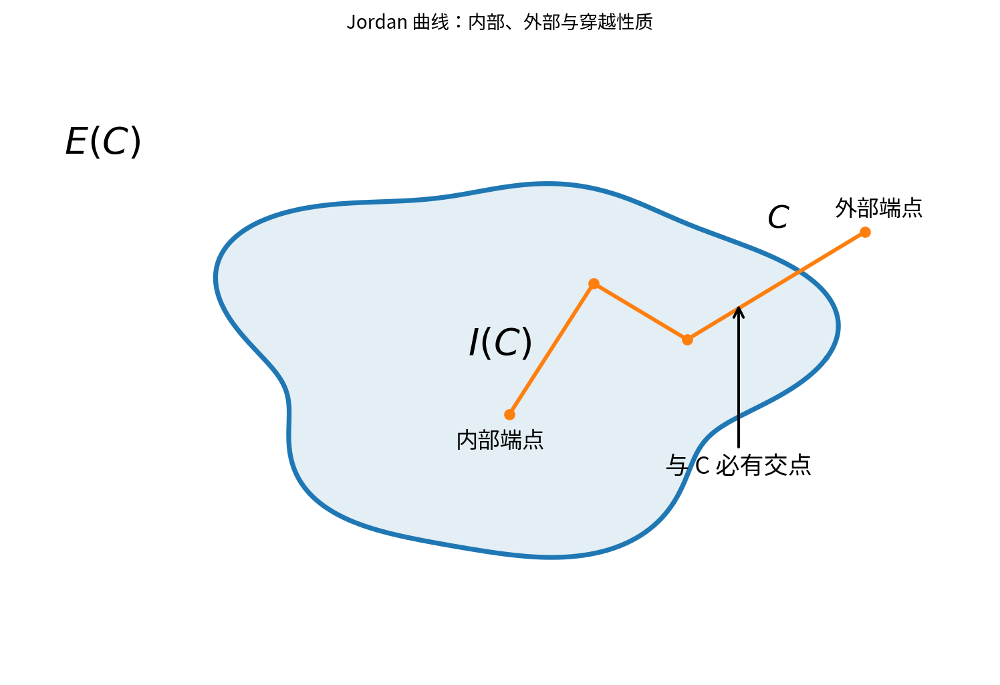
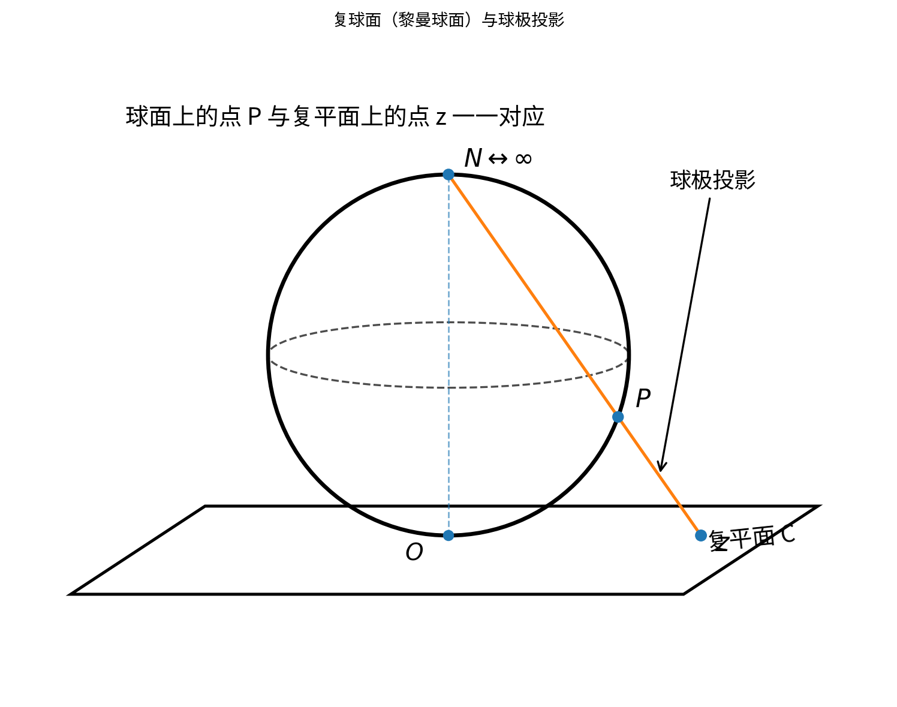

## 1.1 复数

### 复平面

设 $z=x+iy\longrightarrow(x,y)$，$(x,y)$ 称为 $z$ 的**实数对形式**。

$x$ 轴、$y$ 轴分别对应**实轴**、**虚轴**。

复平面 $\mathbb C$：**“数 = 点”**。

### 模

$\overrightarrow{Oz}=x+iy$，$|\overrightarrow{Oz}|=r=\sqrt{x^2+y^2}$。

因此

$$
\begin{cases}
-|z|\leq \operatorname{Re}z\leq |z|,\\
-|z|\leq \operatorname{Im}z\leq |z|.
\end{cases}
$$

且

$$
\begin{cases}
|z_1+z_2+\cdots+z_n|\leq |z_1|+|z_2|+\cdots+|z_n|,\\
\bigl||z_1|-|z_2|\bigr|\leq |z_1-z_2|.
\end{cases}
$$

### 辐角

$$
\tan\theta=\frac{y}{x},\qquad
\theta=\operatorname{Arg}z=\arg z+2k\pi,\quad k\in\mathbb Z.
$$

当 $\arg z\in(-\pi,\pi]$ 时，称为**辐角主值**。

$z=0$ 时，**辐角无定义**。

当 $z\neq 0$ 时，

$$
\arg z=
\begin{cases}
\arctan\dfrac{y}{x}, & x>0,\\[6pt]
\dfrac{\pi}{2}, & x=0\text{ 且 }y>0,\\[6pt]
\arctan\dfrac{y}{x}+\pi, & x<0\text{ 且 }y\geq 0,\\[6pt]
\arctan\dfrac{y}{x}-\pi, & x<0\text{ 且 }y<0,\\[6pt]
-\dfrac{\pi}{2}, & x=0\text{ 且 }y<0.
\end{cases}
$$

### 欧拉公式与指数形式

$$
z=r(\cos\theta+i\sin\theta).
$$

当 $r=1$ 时，$z$ 称为**单位复数**。

$$
z=re^{i\theta}
\quad\Longrightarrow\quad
z=|z|e^{i\arg z}.
$$

### 性质

$$
|z_1z_2|=|z_1||z_2|,
\qquad
\frac{|z_1|}{|z_2|}=\left|\frac{z_1}{z_2}\right|\quad(z_2\neq 0).
$$

$$
\operatorname{Arg}(z_1z_2)=\operatorname{Arg}z_1+\operatorname{Arg}z_2,
$$

$$
\operatorname{Arg}\frac{z_1}{z_2}=\operatorname{Arg}z_1-\operatorname{Arg}z_2.
$$

若 $z_1=r_1e^{i\theta_1}$，$z_2=r_2e^{i\theta_2}$，则

$$
z_1z_2=r_1r_2e^{i(\theta_1+\theta_2)}.
$$

令 $r_2=1$，则 $z_1z_2=r_1e^{i(\theta_1+\theta_2)}$，**即向量旋转**。

### 棣莫弗公式（de Moivre）

$$
(\cos\theta+i\sin\theta)^n
=\cos n\theta+i\sin n\theta.
$$

### 解方程 $w^n=z$

其中 $n\geq 2$，$n\in\mathbb N$。

设 $z=re^{i\theta}$，$w=\rho e^{i\varphi}$，则

$$
\rho^ne^{in\varphi}=re^{i\theta},
$$

所以

$$
\begin{cases}
\rho^n=r,\\
n\varphi=\theta+2k\pi,
\end{cases}
\qquad\Longrightarrow\qquad
\begin{cases}
\rho=\sqrt[n]{r},\\[4pt]
\varphi=\dfrac{\theta+2k\pi}{n}.
\end{cases}
$$

因此，$z$ 的 $n$ 次方根为

$$
w_k
=\sqrt[n]{r}\,e^{i\frac{\theta+2k\pi}{n}}
=e^{i\frac{2k\pi}{n}}\sqrt[n]{r}\,e^{i\frac{\theta}{n}},
\qquad k=0,1,2,\ldots,n-1.
$$

$e^{i\frac{2k\pi}{n}}$ 是 $1$ 的 $n$ 个 $n$ 次方根，记为 $1,\omega,\omega^2,\ldots,\omega^{n-1}$。

并且

$$
\begin{cases}
1+\omega+\omega^2+\cdots+\omega^{n-1}=0,\\
\omega^n=1.
\end{cases}
$$

> **例 1.9：求 $\sqrt[3]{-8}$**

解：

$$
-8=8(\cos\pi+i\sin\pi).
$$

因此

$$
(\sqrt[3]{-8})_k
=\sqrt[3]{8}
\left(
\cos\frac{\pi+2k\pi}{3}
+i\sin\frac{\pi+2k\pi}{3}
\right),
\qquad k=0,1,2.
$$

当 $k=0$ 时，

$$
(\sqrt[3]{-8})_0=1+\sqrt3i.
$$

当 $k=1$ 时，

$$
(\sqrt[3]{-8})_1=-2.
$$

当 $k=2$ 时，

$$
(\sqrt[3]{-8})_2=1-\sqrt3i.
$$

> **例 1.10：解方程 $(1+z)^5=(1-z)^5$**

解：设 $w=\dfrac{1+z}{1-z}$，则 $w^5=1$，$w$ 为 $1$ 的五次方根。

$w=e^{i\alpha}$，其中 $\alpha=\dfrac{2k\pi}{5}$，$k=0,1,2,3,4$。

于是

$$
\begin{aligned}
z
&=\frac{w-1}{w+1}
=\frac{e^{i\alpha}-1}{e^{i\alpha}+1}\\
&=\frac{\cos\alpha+i\sin\alpha-1}
{\cos\alpha+i\sin\alpha+1}\\
&=\frac{
\sin\frac\alpha2\left(-\sin\frac\alpha2+i\cos\frac\alpha2\right)
}{
\cos\frac\alpha2\left(\cos\frac\alpha2+i\sin\frac\alpha2\right)
}\\
&=\tan\frac\alpha2\,
\frac{e^{i(\frac\pi2+\frac\alpha2)}}{e^{i\frac\alpha2}}
=i\tan\frac\alpha2.
\end{aligned}
$$

因此原方程的根为

$$
z_0=0,
\quad z_1=i\tan\frac\pi5,
\quad z_2=i\tan\frac{2\pi}{5},
\quad z_3=i\tan\frac{3\pi}{5},
\quad z_4=i\tan\frac{4\pi}{5}.
$$

### 共轭复数

$$
\overline{\overline z}=z,
\qquad
\overline{z_1\pm z_2}=\overline{z_1}\pm\overline{z_2},
$$

$$
\overline{z_1z_2}=\overline{z_1}\,\overline{z_2},
\qquad
\overline{\frac{z_1}{z_2}}
=\frac{\overline{z_1}}{\overline{z_2}}
\quad(z_2\neq 0).
$$

$$
|z|^2=z\overline z,
\qquad
\operatorname{Re}z=\frac{z+\overline z}{2},
\qquad
\operatorname{Im}z=\frac{z-\overline z}{2i}.
$$

> **例 1.16**
>
> 求证：三个复数 $z_1,z_2,z_3$ 成为一个等边三角形三个顶点的充要条件是
>
> $$
> z_1^2+z_2^2+z_3^2
> =z_1z_2+z_2z_3+z_3z_1.
> $$

证明：$\triangle z_1z_2z_3$ 是等边三角形的充要条件为，将 $\overrightarrow{z_1z_2}$ 绕 $z_1$ 旋转 $\pm\dfrac\pi3$ 得 $\overrightarrow{z_1z_3}$，即
$$
(z_3-z_1)=(z_2-z_1)e^{\pm\frac\pi3 i}.
$$

即

$$
\frac{z_3-z_1}{z_2-z_1}
=\frac12\pm\frac{\sqrt3}{2}i.
$$

因此

$$
\left(
\frac{z_3-z_1}{z_2-z_1}-\frac12
\right)^2
=\frac34,
$$

从而

$$
z_1^2+z_2^2+z_3^2
=z_1z_2+z_2z_3+z_3z_1.
$$

## 1.2 复平面上的点集

### 1.2.1 平面点集

1. 由 $|z-z_0|<\rho$ 所确定的平面点集，称为点 $z_0$ 的 **$\rho$ 邻域**，记为 $N_\rho(z_0)$。

   $0<|z-z_0|<\rho$ 即 $z_0$ 的**去心 $\rho$ 邻域**，记为 $N_\rho(z_0)\setminus\{z_0\}$。

2. **考虑点集 $E$：**

   若平面上一点 $z_0$（不必属于 $E$）的任意邻域都有 $E$ 的无穷多个点，则称 $z_0$ 为 $E$ 的**聚点**。

   若 $z_0$ 属于 $E$ 但不是 $E$ 的聚点，则称 $z_0$ 为 $E$ 的**孤立点**。

   若 $z_0$ 不属于 $E$，又非 $E$ 的聚点，则称为 $E$ 的**外点**。

3. 点集 $E$ 的所有聚点所成集合记为 $E'$。

4. 若 $E'\subseteq E$，则称 $E$ 为**闭集**。

   若点集 $E$ 的点 $z_0$ 有一邻域全含于 $E$ 内，称 $z_0$ 为 $E$ 的**内点**。

   若点集 $E$ 的点皆为内点，则称 $E$ 为**开集**。

   若在点 $z_0$ 的任意邻域内，同时有属于点集 $E$ 和不属于 $E$ 的点，则称 $z_0$ 为 $E$ 的**边界点**。

   点集 $E$ 的边界点的全体所组成的点集称为 $E$ 的**边界**，记为 $\partial E$。

   点集 $E$ 的孤立点也是 $E$ 的边界点。

5. 若

   $$
   \exists M>0,\quad \text{s.t.}\quad \forall z\in E,\ |z|\leq M,
   $$

   则称 $E$ 为**有界集**，否则为**无界集**。

### 1.2.2 区域与 Jordan 曲线

1. $D$ 称为**区域**，如果：

   1. $D$ 非空；
   2. $D$ 是开集；
   3. $D$ 中任意两点可用全在 $D$ 中的折线连接。

2. 区域 $D$ 及其边界 $C$ 称为**闭域**，记为 $\overline D=D+C$。

> **例 1.18：试证点集 $E$ 的边界是闭集，即 $(\partial E)'\subseteq\partial E$**

证：设 $z_0$ 为 $\partial E$ 的聚点。对任意 $\varepsilon>0$，存在 $z\neq z_0$，使得

$$
z\in N_\varepsilon(z_0),
\qquad z\in\partial E.
$$

在 $N_\varepsilon(z_0)$ 内能画出以 $z$ 为圆心、充分小半径的圆。由 $z\in\partial E$ 可见，在此圆内属于 $E$ 和不属于 $E$ 的点都存在，于是在 $N_\varepsilon(z_0)$ 内属于 $E$ 的点和不属于 $E$ 的点都存在，故 $z_0\in\partial E$。

因此，$\partial E$ **是闭集**。

3. 设 $x(t),y(t)$ 是实变量 $t$ 的两个实函数，在闭区间 $[\alpha,\beta]$ 上连续，则由

   $$
   z=x(t)+iy(t),\qquad \alpha\leq t\leq\beta
   $$

   所决定的点集 $C$，称为 $z$ 平面上的一条**连续曲线**。$z(\alpha),z(\beta)$ 是曲线的**起点**和**终点**。

   对满足

   $$
   \alpha<t_1<\beta,
   \qquad
   \alpha\leq t_2\leq\beta,
   \qquad
   t_1\neq t_2
   $$

   且 $z(t_1)=z(t_2)$ 的点，称为此曲线的**重点**。

4. 没有重点的连续曲线称为**简单曲线**或 **Jordan 曲线**。

   $z(\alpha)=z(\beta)$ 的简单曲线称为**简单闭曲线**。

5. 设连续弧 $AB$ 的参数方程为

   $$
   z=z(t),\qquad \alpha\leq t\leq\beta.
   $$

   任取实数列

   $$
   \{t_n\}:\quad
   \alpha=t_0<t_1<t_2<\cdots<t_{n-1}<t_n=\beta,
   $$

   折线弧的长度为

   $$
   l_n=\sum_{j=1}^{n}|z(t_j)-z(t_{j-1})|.
   $$

   若对于所有的数列 $\{t_n\}$，$l_n$ 有上界，则称弧 $AB$ 为**可求长的**，其上确界

   $$
   L=\sup l_n
   $$

   称为弧 $AB$ 的**长度**。

6. 简单闭曲线

   $$
   C:\quad z=x(t)+iy(t),\qquad \alpha\leq t\leq\beta
   $$

   在 $\alpha<t<\beta$ 上，$x'(t),y'(t)$ 存在、连续且不全为 $0$，则称 $C$ 为**光滑曲线**。

   特别地，若

   $$
   x'(\alpha)=x'(\beta),
   \qquad
   y'(\alpha)=y'(\beta),
   $$

   则称 $C$ 为**光滑闭曲线**。光滑曲线有连续可转动的切线。

   注：$x'(\alpha),y'(\alpha)$ 为右导数，$x'(\beta),y'(\beta)$ 为左导数。

7. 有限条光滑曲线衔接而成的连续曲线称为**逐段光滑曲线**。

8. 逐段光滑曲线必是可求长曲线；简单曲线不一定可求长。

> **例 1.24**

简单曲线 $\Gamma$ 的参数方程为

$$
\begin{cases}
x(t)=t,\\[4pt]
y(t)=
\begin{cases}
t\sin\dfrac1t, & t\neq 0,\\[6pt]
0, & t=0,
\end{cases}
\end{cases}
\qquad 0\leq t\leq 1.
$$

取

$$
A_n\left(
\frac{1}{2n\pi+\frac\pi2},
\frac{1}{2n\pi+\frac\pi2}
\right),
\qquad
B_n\left(\frac{1}{2n\pi},0\right),
$$

皆为 $\Gamma$ 上的点。

$$
\begin{aligned}
A_nB_n
&=\sqrt{
\left(
\frac{1}{2n\pi+\frac\pi2}-\frac{1}{2n\pi}
\right)^2
+
\left(
\frac{1}{2n\pi+\frac\pi2}-0
\right)^2
}\\
&>\frac{1}{\left(2n+\frac12\right)\pi}
>\frac{1}{2(n+1)\pi}.
\end{aligned}
$$

级数

$$
\sum_{n=1}^{\infty}\frac{1}{2(n+1)\pi}
$$

发散，所以

$$
\sum_{n=1}^{\infty}A_nB_n
$$

也发散。

故简单曲线 $\Gamma$ **是不可求长的**。

### **定理 1.1（Jordan 定理）**

任一简单闭曲线 $C$ 将 $z$ 平面唯一分成 $C$、$I(C)$ 和 $E(C)$ 三个点集：

1. 三个点集**彼此不交**；
2. $I(C)$ 是一个有界区域，称为 $C$ 的**内部**；
3. $E(C)$ 是一个无界区域，称为 $C$ 的**外部**；
4. 若简单折线 $P$ 的一个端点属于 $I(C)$，另一个端点属于 $E(C)$，则 $P$ 与 $C$ **必有交点**。

9. 设 $D$ 为复平面上的区域。若在 $D$ 内任意一条简单闭曲线，其内部仍全含于 $D$，则称 $D$ 为**单连通区域**；否则称为**多连通区域**。

10. 所含不止一个点的闭集 $E$，如果不能划分为两个无公共点的非空闭集，则称 $E$ 为**连续点集**。

    若区域 $D$ 的边界是互不相交的 $n$ 个连续点集，则称 $D$ 为 **$n$ 连通区域**。

## 1.3 复变函数

设 $E\subset\mathbb C$。对任意 $z\in E$，有唯一的 $w$ 与 $z$ 对应，则称在 $E$ 上确定了一个**单值函数** $w=f(z)$（$z\in E$）。

若有多个 $w$ 与 $z$ 对应，则为**多值函数**。

$E$ 称为 $w=f(z)$ 的**定义域**，$w$ 值的全体所成集合 $M$ 称为 $w=f(z)$ 的**值域**。

> **例 1.25**

下列是**单值函数**：$w=|z|$，$w=\overline z$，$w=z^2$，$w=\dfrac{z+1}{z-1}$（$z\neq 1$）。

下列是**多值函数**：$w=\sqrt[n]{z}$，$w=\ln z$，$w=\operatorname{Arg}z$（$z\neq 0$）。

设 $z=x+iy$，$w=u+iv$，则

$$
w=u(x,y)+iv(x,y),
$$

其中 $u(x,y)$ 与 $v(x,y)$ 是二元实函数。

若 $z=re^{i\theta}$，则 $w=P(r,\theta)+iQ(r,\theta)$。

$w=f(z)$ 给出从 $z$ 平面到 $w$ 平面的一个对应关系。$w=f(z)$ 称作 $z$ 的**像点**，$z$ 称作 $w$ 的**原像**。因此，像点与原像可能不止一个。

若

$$
\forall z\in E,
\quad
\exists w\in F,
\quad
\text{s.t.}\quad
w=f(z),
$$

则称 $w=f(z)$ 把 $E$ **变入** $F$（即 $f(E)\subseteq F$），或称 $w=f(z)$ 是从 $E$ 到 $F$ 的变换。

若 $f(E)\subseteq F$，且

$$
\forall w\in F,
\quad
\exists z\in E,
\quad
\text{s.t.}\quad
w=f(z),
$$

则称 $w=f(z)$ 把 $E$ **映成** $F$（即 $f(E)=F$），或称 $w=f(z)$ 是从 $E$ 到 $F$ 的**满变换**。

若 $w=f(z)$ 是从 $E$ 到 $F$ 的满变换，则

$$
z=f^{-1}(w)
$$

称为 $w=f(z)$ 的**反函数**或**逆变换**。

> **例 1.28**
>
> 设 $w=z^2$，试问把 $z$ 平面上的下列曲线分别变为 $w$ 平面上的何种曲线？
>
> 1. $x^2+y^2=4$，其中 $x>0,y>0$；
> 2. $\theta=\dfrac\pi3$，即 $y=\sqrt3x$；
> 3. $x^2-y^2=4$。

解：设

$$
z=x+iy=r(\cos\theta+i\sin\theta),
$$

$$
w=u+iv=R(\cos\varphi+i\sin\varphi).
$$

于是

$$
u=x^2-y^2,
\qquad
v=2xy,
\qquad
R=r^2,
\qquad
\varphi=2\theta.
$$

1. $r=2$，则 $R=4$，$\varphi=2\theta\in(0,\pi)$，变为

   $$
   u^2+v^2=16,
   \qquad v>0.
   $$

2. $\varphi=2\theta=\dfrac{2\pi}{3}$，变为射线 $\varphi=\dfrac{2\pi}{3}$。

   $\arg z=\dfrac\pi3$ 与 $\arg z=\dfrac{4\pi}{3}$ 下的两条射线，均满足

   $$
   \arg w=\frac{2\pi}{3},
   \qquad
   \arg w=\frac{8\pi}{3}
   =\frac{2\pi}{3}\pmod{2\pi}.
   $$

3. 

   $$
   w=4+2xyi,
   $$

   因此 $u=4$，变为直线 $u=4$。

### 复变函数的极限

设 $f(z)$ 在 $E$ 上有定义，$z_0$ 为 $E$ 的聚点。若存在 $w_0\in\mathbb C$，使得

$$
\forall\varepsilon>0,
\quad
\exists\delta>0,
\quad
0<|z-z_0|<\delta,
\quad z\in E,
$$

都有

$$
|f(z)-w_0|<\varepsilon,
$$

则称 $f(z)$ 沿 $E$ 于 $z_0$ **有极限** $w_0$，并记为

$$
\lim_{\substack{z\to z_0\\z\in E}}f(z)=w_0.
$$

注：

$$
\lim_{\substack{z\to z_0\\z\in E}}f(z)
$$

与 $z$ 趋于 $z_0$ 的方式无关。

若

$$
f(z)=u(x,y)+iv(x,y),
\qquad
z_0=x_0+iy_0,
\qquad
w_0=u_0+iv_0,
$$

则

$$
\lim_{\substack{z\to z_0\\z\in E}}f(z)=w_0
$$

等价于

$$
\begin{cases}
\displaystyle
\lim_{(x,y)\to(x_0,y_0)}u(x,y)=u_0,\\[8pt]
\displaystyle
\lim_{(x,y)\to(x_0,y_0)}v(x,y)=v_0.
\end{cases}
$$

$\mathbb C$ 上的极限就是 $\mathbb R^2$ 上向量值函数的极限。

其他性质同一元函数。

> **例 1.29**
>
> 证明
>
> $$
> f(z)=\frac{z}{\overline z}\quad(z\neq 0)
> $$
>
> 当 $z\to 0$ 时极限不存在。

证：令

$$
z=x+iy,
\qquad
f(z)=u+iv.
$$

则

$$
u=\frac{x^2-y^2}{x^2+y^2},
\qquad
v=\frac{2xy}{x^2+y^2}.
$$

沿 $y=kx$，

$$
\lim_{\substack{x\to 0\\y=kx}}v(x,y)
=\lim_{x\to 0}
\frac{2x\cdot kx}{x^2+(kx)^2}
=\frac{2k}{1+k^2}.
$$

因此

$$
\lim_{(x,y)\to(x_0,y_0)}v(x,y)
$$

不存在，故

$$
\lim_{z\to z_0}f(z)
$$

不存在。

> **例 1.30**
> $$
> f(z)=\frac{1}{2i}
> \left(
> \frac{z}{\overline z}-\frac{\overline z}{z}
> \right),
> \qquad z\neq 0.
> $$

有
$$
f(z)=\frac{1}{2i}\left(e^{2i\theta}-e^{-2i\theta}\right)
=\sin 2\theta.
$$

因此

$$
\lim_{z\to 0}f(z)=\lim_{z\to 0}\sin 2\theta.
$$

当 $\theta=0$ 时，

$$
\lim_{z\to 0}f(z)=0.
$$

当 $\theta=\dfrac\pi4$ 时，

$$
\lim_{z\to 0}f(z)=1.
$$

所以

$$
\lim_{z\to 0}f(z)
$$

不存在。

### 连续

若 $f(z)$ 在 $E$ 上各点均连续，则称 $f(z)$ 在 $E$ 上**连续**。

> **例 1.31**
>
> 若
>
> $$
> \lim_{z\to z_0}f(z)=\eta,
> $$
>
> 则 $f(z)$ 在点 $z_0$ 的某一去心邻域内有界。

> **例 1.32**
>
> 设 $f(z)$ 在点 $z_0$ 连续，且 $f(z_0)\neq 0$。试证 $f(z)$ 在点 $z_0$ 的某一邻域内恒不为 $0$。

证：

$$
\forall\varepsilon>0,
\quad
\exists\delta>0,
\quad
|z-z_0|<\delta,
$$

使得

$$
|f(z)-f(z_0)|<\varepsilon.
$$

取

$$
\varepsilon=\frac12|f(z_0)|,
$$

则

$$
|f(z)|>|f(z_0)|-\varepsilon
=\frac12|f(z_0)|>0.
$$

因此 $f(z)$ 在 $N_\delta(z_0)$ 内恒不为 $0$。

### **定理：Bolzano–Weierstrass 定理**

每一个有界无穷点集，至少有一个聚点。

### **定理：闭集套定理**

设无穷闭集列 $\{F_n\}$ 至少一个为有界，且

$$
\overline{F_n}\supseteq\overline{F_{n+1}},
\qquad
\lim_{n\to\infty}d(\overline{F_n})=0,
$$

则仅有唯一一点

$$
z_0\in\overline{F_n}.
$$

### **定理：Heine–Borel 覆盖定理**

设有界闭集 $E$ 的每一点 $z$ 都是圆 $K_z$ 的圆心，则 $\{K_z\}$ 中必有有限个圆把 $E$ 覆盖住，即 $E$ 的每一点至少属于这有限个圆中的一个。

### 有界闭集 $E$ 上的连续函数 $f(z)$

1. 存在 $M>0$，使得

   $$
   |f(z)|\leq M.
   $$

2. 存在 $z_1,z_2\in E$，使得

   $$
   |f(z_2)|\leq |f(z)|\leq |f(z_1)|.
   $$

3. 对任意 $\varepsilon>0$，存在 $\delta>0$，使得只要

   $$
   |z_1-z_2|<\delta,
   $$

   就有

   $$
   |f(z_1)-f(z_2)|<\varepsilon.
   $$

## 1.4 复球面与无穷远点

$O$：南极，$N$：北极。

$z$ 与复球面上的点 $P$ 相对应，因此“$\infty$”与复球面的 $N$ 点相对应。

$$
\mathbb C_\infty=\mathbb C+\{\infty\},
$$

称作**扩充复平面**。

**无意义的运算：** $\infty\pm\infty$，$0\cdot\infty$，$\dfrac{\infty}{\infty}$，$\dfrac00$。

$$
\frac{\infty}{a}=\infty,
\qquad
\frac{a}{\infty}=0,
\qquad
\infty\pm a=a\pm\infty=\infty.
$$

$$
\infty\cdot b=b\infty=\infty,
\qquad
\frac b0=\infty,
\qquad
\infty\cdot\infty=\infty.
$$

$\infty$ 无实部、虚部、$\arg$，且

$$
|\infty|=+\infty.
$$

$$
N_\varepsilon(\infty)\longrightarrow \text{球盖}.
$$

### 广义连续

对于

$$
\lim_{z\to z_0}f(z)=f(z_0),
$$

若 $z_0$、$f(z_0)$ 之一或同时取 $\infty$，则称 $f(z)$ 在 $z_0$ **广义连续**。

例如，对于 $z_0=\infty$ 且 $f(\infty)\neq\infty$ 时，

$$
\lim_{z\to\infty}f(z)=f(\infty)
$$

等价于：

$$
\forall\varepsilon>0,
\quad
\exists\delta>0,
$$

只要

$$
|z|>\frac1\delta,
$$

就有

$$
|f(z)-f(\infty)|<\varepsilon.
$$

