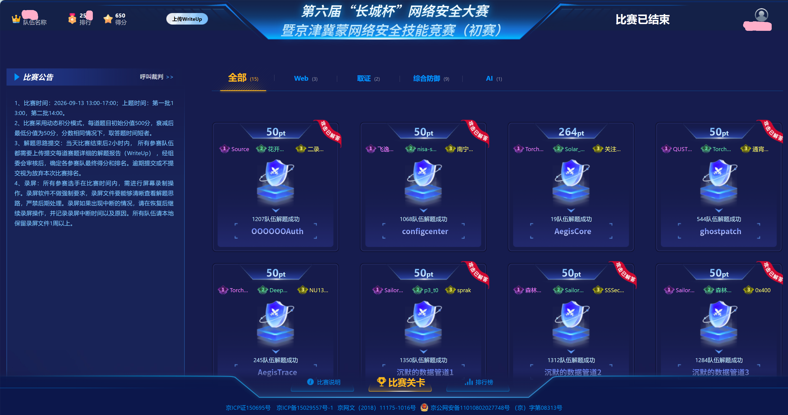

by cha



感谢带飞的两位师傅

主要完成的工作就是取证1的前半部分，虽然题出的不咋地但是还是能学到点知识的。就附这个题的wp了

## GhostPatch

观察流量可以发现主要存在 `8888` 和 `9999` 两个服务端口。

过滤：

```text
tcp.port == 8888
```

追踪 TCP 流，可以看到 `FGT/0.9` 明文协议，其中泄露了新版 `FGT/1.0` 的协议说明。关键信息如下：

```text
FGT/1.0 (port 9999)

shared = B^a = A^b mod p
K = SHA-256(shared)[:16]

RC4 with K, one independent stream per direction

frame:
  [u16be length][rc4(frame)]

01 GET
02 META
03 DATA
04 END
06 LIST
07 SHELL
09 CIN
0A COUT
```

因此后续重点分析 `9999`。

过滤：

```text
tcp.port == 9999
```

追踪 TCP 流，握手部分为明文：

```text
FGT/1.0 READY p=8348d41a7225 g=5
FGT/1.0 HELLO 3709a1d52d1d
FGT/1.0 OK d90673c26b
```

得到：

```python
p = 0x8348d41a7225
g = 5
A = 0x3709a1d52d1d
B = 0xd90673c26b
```

### 破解 DH

`p` 很小，且：

```text
p - 1
= 2^2 × 3 × 41 × 71 × 73 × 79 × 83 × 89 × 97
```

`p-1` 为光滑数，可以直接求离散对数：

```python
from sympy import discrete_log
import hashlib

p = 0x8348d41a7225
g = 5
A = 0x3709a1d52d1d
B = 0xd90673c26b

a = discrete_log(p, A, g)
shared = pow(B, a, p)

shared_bytes = shared.to_bytes(
    (shared.bit_length() + 7) // 8, "big"
)
key = hashlib.sha256(shared_bytes).digest()[:16]

print("a =", a)
print("shared =", hex(shared))
print("key =", key.hex())
```

得到：

```text
a = 8357903120266
shared = 0x75901cbea117
key = b75ad015fa6436b6dd6479dcb9c660b4
```

### RC4 解密

协议注明：

```text
RC4 with K, one independent stream per direction
```

因此 `Client → Server` 和 `Server → Client` 必须分别维护 RC4 状态。

在 Wireshark 的 `Follow TCP Stream` 中分别导出两个方向的 Raw 数据，例如：

```text
c2s.bin
s2c.bin
```

握手明文结束后的帧格式为：

```text
[u16be length][RC4 ciphertext]
```

标准 RC4：

```python
class RC4:
    def __init__(self, key):
        self.S = list(range(256))
        j = 0

        for i in range(256):
            j = (j + self.S[i] + key[i % len(key)]) & 0xff
            self.S[i], self.S[j] = self.S[j], self.S[i]

        self.i = 0
        self.j = 0

    def crypt(self, data):
        out = bytearray()

        for x in data:
            self.i = (self.i + 1) & 0xff
            self.j = (self.j + self.S[self.i]) & 0xff
            self.S[self.i], self.S[self.j] = \
                self.S[self.j], self.S[self.i]

            k = self.S[
                (self.S[self.i] + self.S[self.j]) & 0xff
            ]
            out.append(x ^ k)

        return bytes(out)


def decrypt_frames(data, offset, key):
    rc4 = RC4(key)
    frames = []

    while offset + 2 <= len(data):
        length = int.from_bytes(data[offset:offset + 2], "big")
        offset += 2

        ciphertext = data[offset:offset + length]
        offset += length

        frames.append(rc4.crypt(ciphertext))

    return frames
```

注意：**同一方向的所有 frame 共用一个 RC4 状态，不能逐帧重新初始化。**

解密客户端请求后，可以看到：

```text
LIST
GET notes.txt
GET checksum.txt
GET fw_v2.bin
GET libc.so.6
GET ld-linux-x86-64.so.2
SHELL
...
```

由此确认需要恢复：

```text
notes.txt
checksum.txt
fw_v2.bin
libc.so.6
ld-linux-x86-64.so.2
```

### 文件重组

服务端文件传输使用：

```text
02 META
03 DATA
04 END
```

结构如下：

```text
META:
01 byte   type
08 bytes  file size
32 bytes  SHA-256
02 bytes  filename length
N bytes   filename

DATA:
01 byte   type
04 bytes  sequence number
04 bytes  data length
N bytes   data

END:
01 byte   type
32 bytes  SHA-256
```

`DATA` 帧并不保证按顺序出现，因此必须根据 `sequence number` 重排。

恢复逻辑：

```python
import hashlib

current = None

for frame in frames:
    t = frame[0]

    if t == 0x02:
        size = int.from_bytes(frame[1:9], "big")
        sha256 = frame[9:41]

        name_len = int.from_bytes(frame[41:43], "big")
        name = frame[43:43 + name_len].decode()

        current = {
            "name": name,
            "size": size,
            "sha256": sha256,
            "chunks": {}
        }

    elif t == 0x03 and current:
        seq = int.from_bytes(frame[1:5], "big")
        length = int.from_bytes(frame[5:9], "big")
        current["chunks"][seq] = frame[9:9 + length]

    elif t == 0x04 and current:
        data = b"".join(
            current["chunks"][i]
            for i in sorted(current["chunks"])
        )

        data = data[:current["size"]]

        assert hashlib.sha256(data).digest() == current["sha256"]

        with open(current["name"], "wb") as f:
            f.write(data)

        print("[+] recovered:", current["name"])
        current = None
```

最终成功恢复：

```text
notes.txt
checksum.txt
fw_v2.bin
libc.so.6
ld-linux-x86-64.so.2
```

恢复出的主要文件 SHA-256 为：

```text
fw_v2.bin
0f9b3ce7363a988f72dc46812d21d061123045f3521e12289c12fc7405c9629c

libc.so.6
8db37cf3f2169f59a0f07ef1fea308c35656668c64c8ff294e1860f4121eb161

ld-linux-x86-64.so.2
cd4df4f3c7b83673d61189bf2eaebd33ca4f2853ab9772b8a25e025ef99b1e81

notes.txt
d2e5441746107d0fd94a3638e1a016fac62be82874f781069548033eda5dfa36
```

至此完成加密流量解密及文件恢复。

