很久没有发过blog了。今晚是C++的期中考试，考完还剩非常意难平......想起来浏览器这个尘封数月的角落，于是决定写点什么。


## 做题感受

大哥到底叫啥你倒是说清楚啊

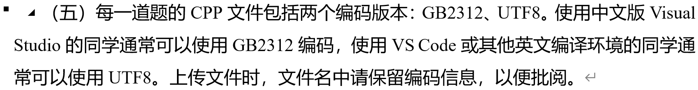

废话是真多啊，你文件都写好了宏定义了还写这么多东西干啥啊不累吗

考生都看傻了

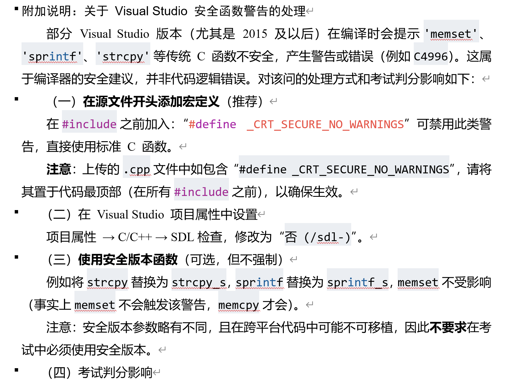

我还以为是啥

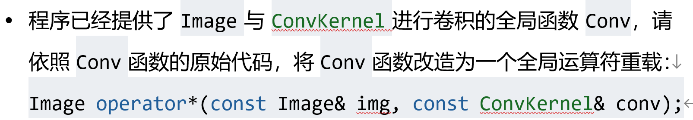

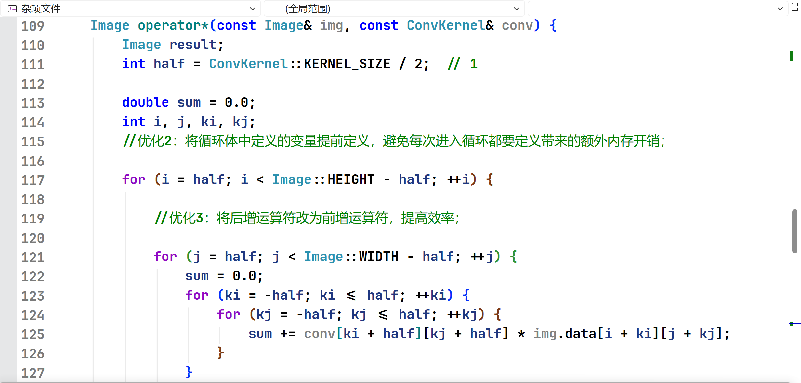

不是哥们，这不是CV就完了吗？

重载的意义在哪里？？？

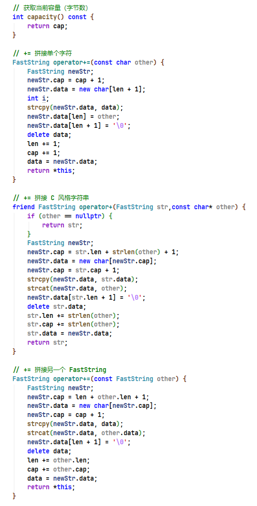

（写的有点慌乱...我知道是一坨...)

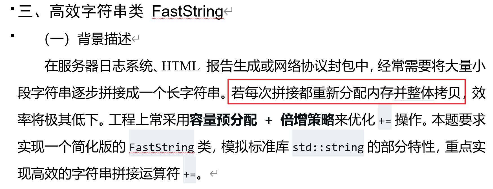

确实是没审好题

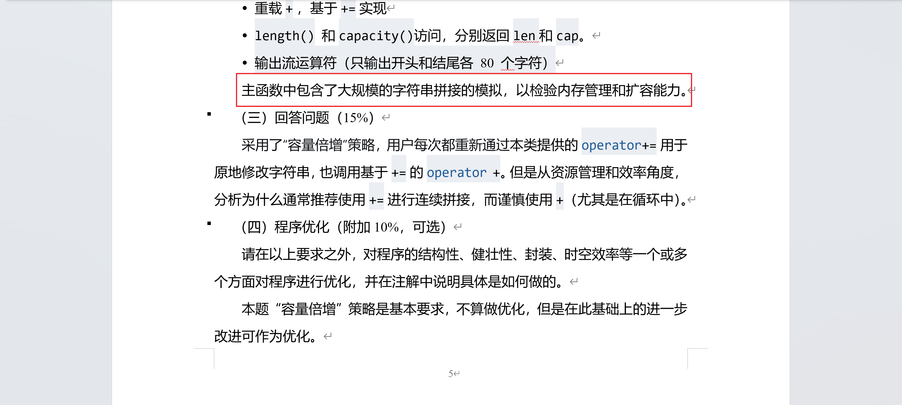

但是写到一半真的被你这句话误导过

以为自己的思路是对的


（笨笨rekjo喜欢先写有思路的比如=，+=，所以直到考试最后几分钟才开始写这个最重要的函数......

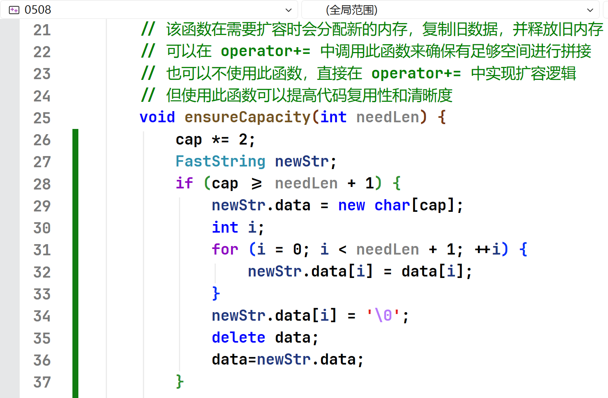

（几分钟写的一丁点，也是一坨...dsz别笑话了┭┮﹏┭┮）


## 证据

考完也是非常难过......不过和朋友讨论的过程中意外发现这次考试疑似是AI出题

举证如下：

### 例子1

常用AI的应该都懂...====是什么不用多说了吧？

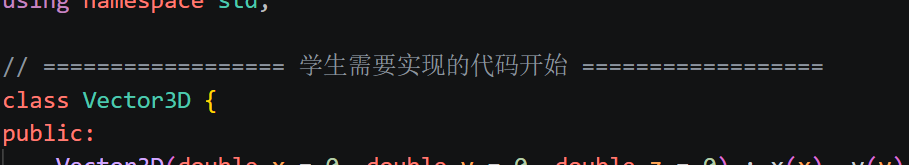

### 例子2

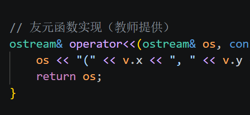

明显的就是第三方的口吻。

出题的时候不会专门给自己加一个（）进行注释吧？

### 例子3

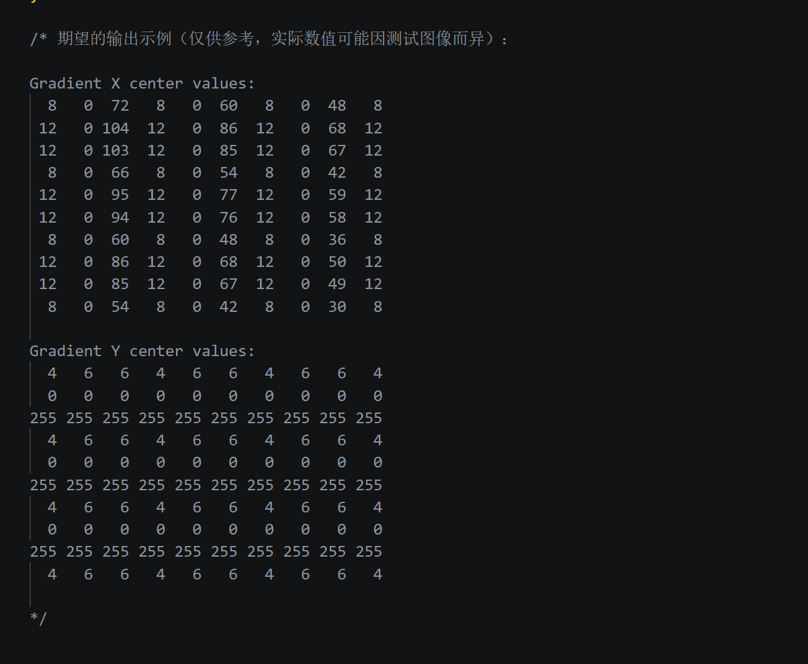

《仅供参考，实际数值可能因测试图像而异》

### 例子4

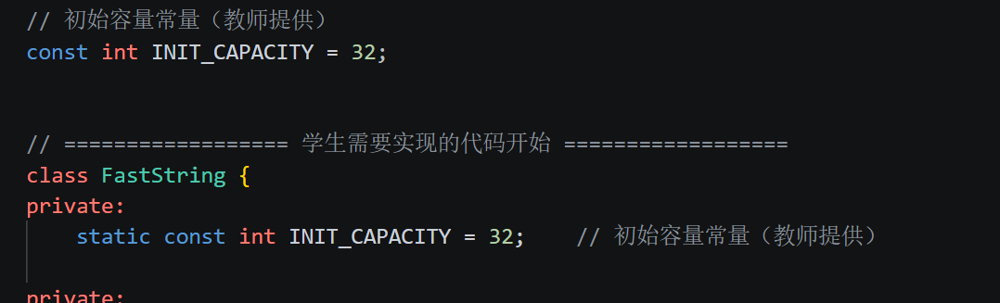

讲真的考场上给我脑子宕机了

真的花了很久在想这是什么意思🤯

### 例子5

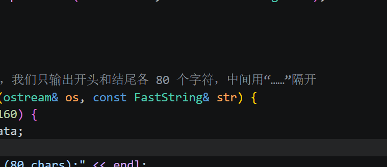

“......”经过考后研究，很可能是ANSI编码下的0x85

一般打不出来。

### 例子6


《推荐》

《可选，但不强制》

没记错的话，这是GPT风味吧？

### 例子7

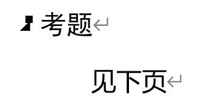

这张神了

我不知道考题在下一页吗🤔

### 例子8（疑似）


一般而言office默认是等线，WPS好像是宋体

这个字体有点罕见。有可能是生成的

### 例子9

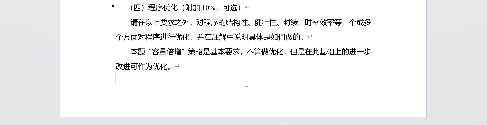

大哥我知道是附加题的

多点分谁不想要呢~**《可选》😂**

### 例子10

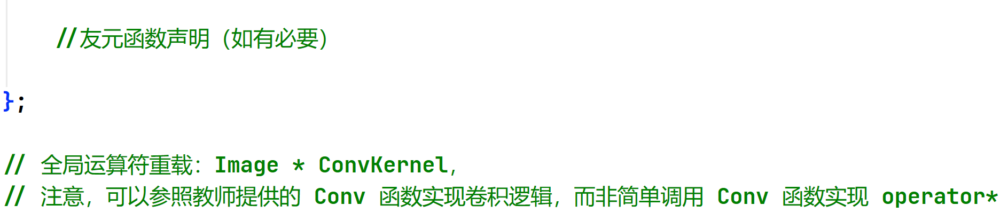

《如有必要》

《注意》

DDDD

### 例子11

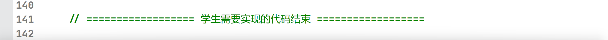

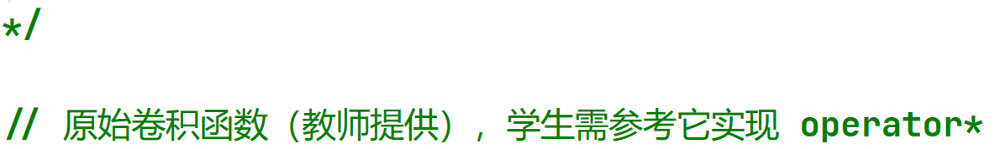

同例子2

## 后记

实在是有些难受，考完后顺手做了一些基础取证...也大概知道是哪位老师出的题了

其实AI出题本无可厚非，老师们的时间很紧也都能理解

但是希望的是，出题之后能不能做一些检查？最基本的检查？

**这么多例子里面有很多是考试时候对本人产生了实际困扰的。**说实话：

+ 我代码怎么命名啊？

+ 关于老式strcpy等函数的报错处理：给的文字非常之多但是基本都是废话，因为给的代码里面已经做过了处理。但这么多文字不可能不看吧？万一里面有重要信息呢？

+ 获取行数、列数的成员函数getRows()、getRows()，都直接返回KERNEL_SIZE。两个getRows()是不小心打错了也能理解，但是你这直接返回KERNEL_SIZE何意味呢？KERNEL_SIZE一个static const int，这函数除了浪费一点点学生的时间之外，还有什么用？
+  将Conv函数改造为一个全局运算符重载：这又是何意味？CV解题完全不能理解意义在哪里。第三题那么多重载，用得着第二题还来一个重载吗？？？

+ 主函数中包含了大规模的字符串拼接的模拟，以检验内存管理和扩容能力。暂时没看懂这句话。考试时候写了一堆new delete我还以为自己是对的

+ 仅供参考，实际数值可能因测试图像而异：给的数据到底是对的还是不对的？考生怎么检验？

+ ```c++
  // 初始容量常量（教师提供）
  const int INIT_CAPACITY = 32;
  
  
  // ================== 学生需要实现的代码开始 ==================
  class FastString {
  private:
  	static const int INIT_CAPACITY = 32;	// 初始容量常量（教师提供）
```

  我真的以为这是什么高级特性...思考了一分钟没看懂要表达什么

+ ```text
  // 私有辅助：确保容量足够存放 needLen+1 个字符，并实现容量倍增策略
  // 该函数在需要扩容时会分配新的内存，复制旧数据，并释放旧内存
  // 可以在 operator+= 中调用此函数来确保有足够空间进行拼接
  // 也可以不使用此函数，直接在 operator+= 中实现扩容逻辑
  // 但使用此函数可以提高代码复用性和清晰度
  ```

  这描述多少有点啰嗦和混乱了。表意能不能清楚点

+ 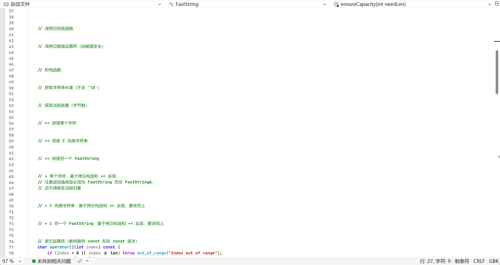

这么多注释，真的不会感到窒息感吗？？？


我知道那位老师是不大可能看到的，也只是发一些牢骚了。

希望期末考试的时候自己能多一些冷静，多一些分析，加油吧~

