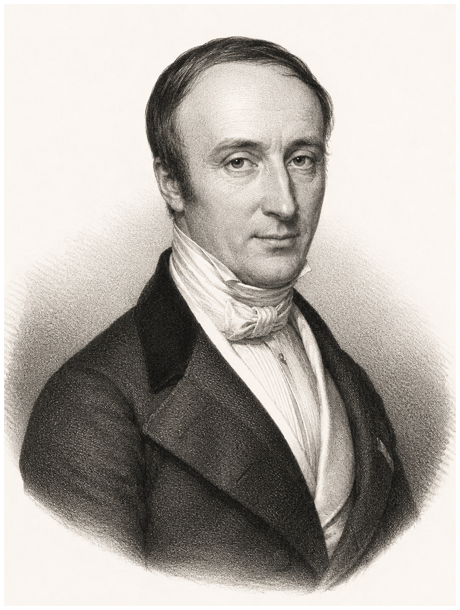
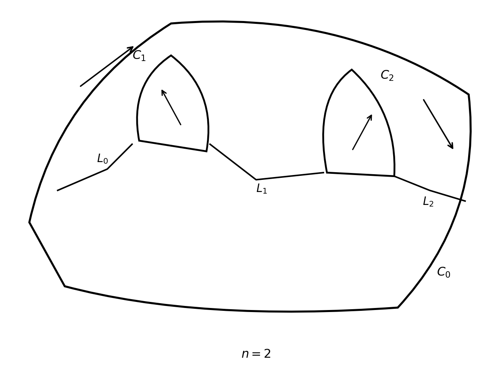

## 柯西积分定理

学习定理之前先来膜拜一下大神

> **柯西生平**
>
> Augustin-Louis Cauchy（奥古斯丁-路易·柯西，1789—1857）是法国数学家、物理学家与工程师，现代分析与复变函数论的重要奠基人之一。他生于巴黎，先后就读于巴黎综合理工学院与桥梁道路学院，早年曾从事工程工作，后转向数学研究。柯西系统推动了分析学的严格化，给出了极限、连续、收敛等概念的精确定义，并建立了大量以他名字命名的重要结果，例如柯西积分定理、柯西积分公式、柯西收敛准则等。他在级数、微分方程、群论与数学物理中也有深远影响，一生发表论文极多，是 19 世纪最重要的数学家之一。

> **柯西积分定理** 设 $f(z)$ 在平面上的**单连通区域** $D$ 内解析，$C$ 为 $D$ 内任一周线，则
> $$
> \int_C f(z)\,dz=0.
> $$
> 

（好吧，插一段数学史

事实上，柯西提出此定理时所定义的解析性要求 $f'(z)$ 也是连续的，这种情形下rekjo也能证明出柯西积分定理...通过**多元实函数积分的Green公式**和**Cauchy-Riemann方程**可以直接推导出来。

后来法国数学家古尔萨发现定理条件可以弱化，即他证明出了更强的定理，不需要 $f'(z)$ 连续的条件，结论仍热成立。）

> **古尔萨生平**
>
> 古尔萨（Édouard Jean-Baptiste Goursat，1858年5月21日—1936年11月25日），法国数学家。生于法国洛特省兰萨茨（Langeac），卒于巴黎。1876年就学于巴黎高等师范学校，1881年获理学博士学位，1897年任巴黎大学教授。1919年当选为法国科学院院士，曾任法国数学会主席。
> 他的主要工作领域是二阶偏微分方程以及解析函数理论。古尔萨发展了基于特征性质的偏微分方程分类，并提出了沿特征线给定边界条件的微分方程积分问题（古尔萨问题）。1900年在《关于柯西解析函数的一般定义》一文中改进了柯西解析函数的定义，用更优的方法证明了柯西定理。他还对偏微分方程中存在性定理的证明做了改进，在超椭圆积分、不变量理论和曲面理论等方面得到大量成果。他编著的《数学分析教程》曾多次印刷，并被译为多国（包括中国）文字，被广泛采用为高校教材。其中文译本《解析数学讲义》最早于1930年代出版，后续亦有再版。

---

+ **推论 1** 设 $f(z)$ 在平面上的**单连通区域** $D$ 内解析，若 $C$ 为 $D$ 内任一闭曲线（不必是简单的），则

$$
\int_C f(z)\,dz=0.
$$

+ **推论 2** 设 $f(z)$ 在平面上的**单连通区域** $D$ 内解析，若 $f(z)$ 在单连通区域 $D$ 内解析，则积分与路径无关。

因此，固定 $D$ 内一点 $z_0$ 时，可以定义一个变上限积分函数

$$
F(z)=\int_{z_0}^{z}f(\zeta)\,d\zeta.
$$

> **定理** $F(z)$ 是 $D$ 内的解析函数，且 $F'(z)=f(z)$。

**证明** 对 $D$ 内任一点 $z$，作一个小圆，在小圆内取 $z+\Delta z$（$\Delta z\ne 0$）。则
$$
\frac{F(z+\Delta z)-F(z)}{\Delta z}
=\frac1{\Delta z}\int_{z}^{z+\Delta z}f(\zeta)\,d\zeta.
$$

于是

$$
\frac{F(z+\Delta z)-F(z)}{\Delta z}-f(z)
=\frac1{\Delta z}\int_z^{z+\Delta z}[f(\zeta)-f(z)]\,d\zeta.
$$

由 $f(z)$ 的连续性知：对任意 $\varepsilon>0$，存在 $\delta>0$，当 $|z-\zeta|<\delta$ 时，有 $|f(\zeta)-f(z)|<\varepsilon$。于是当 $|\Delta z|<\delta$ 时，

$$
\left|\frac{F(z+\Delta z)-F(z)}{\Delta z}-f(z)\right|
\le \frac1{|\Delta z|}\int_z^{z+\Delta z}|f(\zeta)-f(z)|\,|d\zeta|
\le \frac{1}{\left|\Delta z\right|}*\varepsilon\left|\Delta z\right|=\varepsilon.
$$

故

$$
\lim_{\Delta z\to 0}\frac{F(z+\Delta z)-F(z)}{\Delta z}=f(z),
$$

即 $F'(z)=f(z)$（$z\in D$）。

**注** 实际上，我们在上述证明中得到更强结论：

> 若 $f(z)$ 在单连通区域内连续，且 $\int_C f(\zeta)\,d\zeta$ 与积分路径 $C$ 无关，则
> $$
> F(z)=\int_{z_0}^{z}f(\zeta)\,d\zeta
> $$
>
> 在 $D$ 内解析，且 $F'(z)=f(z)$。

设 $\Phi'(z)=f(z)$，则 $\Phi(z)$ 为 $f(z)$ 的一个**原函数**，并且

$$
\Phi(z)=\int_{z_0}^{z}f(\zeta)\,d\zeta+C.
$$

于是有

> **定理**
> $$
> \int_{z_0}^{z}f(\zeta)\,d\zeta=\Phi(z)-\Phi(z_0).
> $$

> **例 3.9** 试沿区域 $\operatorname{Im}z\ge 0$、$\operatorname{Re}z\ge 0$ 内的圆弧 $|z|=1$，求
> $$
> \int_1^i \frac{\ln(1+z)}{1+z}\,dz.
> $$
> 

**解** 由原函数
$$
\int \frac{\ln(1+z)}{1+z}\,dz=\frac12\bigl(\ln(1+z)\bigr)^2,
$$

可得

$$
\int_1^i \frac{\ln(1+z)}{1+z}\,dz
=\frac12\bigl(\ln(1+z)\bigr)^2\Big|_1^i
=\frac12\bigl(\ln^2(1+i)-\ln^2 2\bigr).
$$

$\ln(1+i)=\ln\sqrt2+i\pi/4=\dfrac12\ln 2+i\dfrac\pi4$，从而

$$
\int_1^i \frac{\ln(1+z)}{1+z}\,dz
=-\frac38\ln^2 2-\frac{\pi^2}{32}+\frac{\pi\ln 2}{8}i.
$$

## 推广的柯西积分定理

> 1. 设 $C$ 是一条周线，$D$ 为 $C$ 的内部。若 $f(z)$ 在闭区域 $\overline D=D\cup C$ 上解析，则
>
> $$
> \int_C f(z)\,dz=0.
> $$
>
> 2. 设 $C$ 是一条周线，$D$ 为 $C$ 的内部。若 $f(z)$ 在 $D$ 内解析，并且连续到 $C$ 上，则仍有
>
> $$
> \int_C f(z)\,dz=0.
> $$

> **例 3.10**
>
> (1) $\displaystyle \int_{|z|=r}\ln(1+z)\,dz$（$0<r<1$）
>
> (2) $\displaystyle \int_C \frac1{z^2}\,dz$，其中 $C$ 为右半圆周：$|z|=3$，$\operatorname{Re}z\ge 0$，起点为 $-3i$，终点为 $3i$
>
> (3) $\displaystyle \int_{|z-1|=1}\sqrt z\,dz$，其中 $\sqrt z$ 取经过 $z=1$ 时值为 $-1$ 的那一支

**解**

(1) $\ln(1+z)$ 的支点为 $-1,\infty$。当 $0<r<1$ 时，闭圆 $|z|\le r$ 内不含支点，所以 $\ln(1+z)$ 在该圆内单值解析，故

$$
\int_{|z|=r}\ln(1+z)\,dz=0.
$$

(2) 函数 $1/z^2$ 在 $\operatorname{Re}z\ge 0$ 且 $|z|\le 3$ 的区域内解析，因此可用原函数 $-1/z$ 计算：

$$
\int_C \frac1{z^2}\,dz=-\frac1z\Big|_{-3i}^{3i}=\frac23 i.
$$

(3) $\sqrt z$ 的支点为 $0,\infty$。由于圆盘 $|z-1|<1$ 不包含 $0$，故所取这一支的 $\sqrt z$ 在圆周及其内部单值解析，因而

$$
\int_{|z-1|=1}\sqrt z\,dz=0.
$$

## 复周线与多连通情形

**定义（复周线）** 设有 $n+1$ 条周线 $C_0,C_1,\ldots,C_n$，其中 $C_1,C_2,\ldots,C_n$ 每一条都在其余各条的外部，而它们又全都在 $C_0$ 的内部。在 $C_0$ 的内部同时又在 $C_1,C_2,\ldots,C_n$ 的外部的点集，构成一个有界的复连通区域（$n+1$ 连通区域）$D$，以 $C_0,C_1,\ldots,C_n$ 为它的边界。记区域 $D$ 的边界为复周线
$$
C=C_0+C_1^-+C_2^-+\cdots+C_n^-.
$$

> **定理** 设 $D$ 是由复周线 $C=C_0+C_1^-+C_2^-+\cdots+C_n^-$ 所围成的有界 $(n+1)$ 连通区域，函数 $f(z)$ 在 $D$ 内解析，并在 $\overline D=D\cup C$ 上连续，则
> $$
> \int_C f(z)\,dz=0.
> $$
>
> 即
>
> $$
> \int_{C_0}f(z)\,dz+\int_{C_1^-}f(z)\,dz+\cdots+\int_{C_n^-}f(z)\,dz=0,
> $$
>
> 或
>
> $$
> \int_{C_0}f(z)\,dz=\int_{C_1}f(z)\,dz+\int_{C_2}f(z)\,dz+\cdots+\int_{C_n}f(z)\,dz.
> $$

**证明** 取 $n+1$ 条互不相交且各自在内部（端点除外）的光滑弧 $L_0,L_1,\ldots,L_n$ 作为割线，用它们依次把 $C_0,C_1,\ldots,C_n$ 连接起来。将 $D$ 沿割线割开后，可分为两个单连通区域，其边界记为 $\Gamma_1,\Gamma_2$。由单连通情形的柯西积分定理，有

$$
\int_{\Gamma_1}f(z)\,dz=0,\qquad \int_{\Gamma_2}f(z)\,dz=0.
$$

两式相加，割线部分因方向相反而抵消，于是得到

$$
\int_C f(z)\,dz=0.
$$

> **例 3.11** 设 $a$ 为周线 $C$ 内一点，则
> $$
> \int_C \frac{dz}{(z-a)^n}=
> \begin{cases}
> 0, & n\ne 1,\ n\in\mathbb Z,\\
> 2\pi i, & n=1.
> \end{cases}
> $$

**证明** 以 $a$ 为圆心作小圆周 $C'$：$|z-a|=\varepsilon$，使它全部落在 $C$ 的内部。可知
$$
\int_C \frac{dz}{(z-a)^n}=\int_{C'} \frac{dz}{(z-a)^n}.
$$

由例 3.2 结论即证。

> **例 3.12** 计算
> $$
> \int_\Gamma \frac{2z-1}{z^2-z}\,dz,
> $$
> 其中 $\Gamma$ 为包含圆周 $|z|=1$ 的任意正向简单闭曲线

**解** 注意到
$$
\frac{2z-1}{z^2-z}=\frac1z+\frac1{z-1}.
$$

由于 $0,1$ 两点都在 $\Gamma$ 的内部，故

$$
\int_\Gamma \frac{2z-1}{z^2-z}\,dz
=\int_\Gamma \frac1z\,dz+\int_\Gamma \frac1{z-1}\,dz
=2\pi i+2\pi i=4\pi i.
$$

## 多连通区域内的不定积分

> **例 3.13** 证明
> $$
> \int_1^z \frac{d\zeta}{\zeta}=\operatorname{Ln} z
> \qquad (z\in G,\ z\ne 0,\infty),
> $$
> 其中积分路径是不经过原点、连接 $1$ 和 $z$ 的任意逐段光滑曲线。

**证明** 设 $G$ 是多连通区域。考虑积分路径 $\gamma$，沿正方向或负方向绕原点若干周，路径 $l$ 则不绕原点。因此
$$
\int_1^z \frac{d\zeta}{\zeta}
=\int_l \frac{d\zeta}{\zeta}+n\int_\gamma \frac{d\zeta}{\zeta}
=\ln z+2n\pi i
\qquad (n=0,\pm1,\pm2,\ldots).
$$

这正是多值对数的全体分支，因此

$$
\int_1^z \frac{d\zeta}{\zeta}=\operatorname{Ln} z.
$$

**注** 多连通区域内的变上限积分并不总是表示多值解析函数。
例如
$$
\int_1^z \frac1{\zeta^2}\,d\zeta
=\int_l \frac1{\zeta^2}\,d\zeta+n\int_\gamma \frac1{\zeta^2}\,d\zeta
=-\frac1\zeta\Big|_1^z+n\cdot 0
=-\frac1z+1.
$$

因此

$$
\int_1^z \frac1{\zeta^2}\,d\zeta=-\frac1z+1,
$$

这是一个**单值解析函数**。

