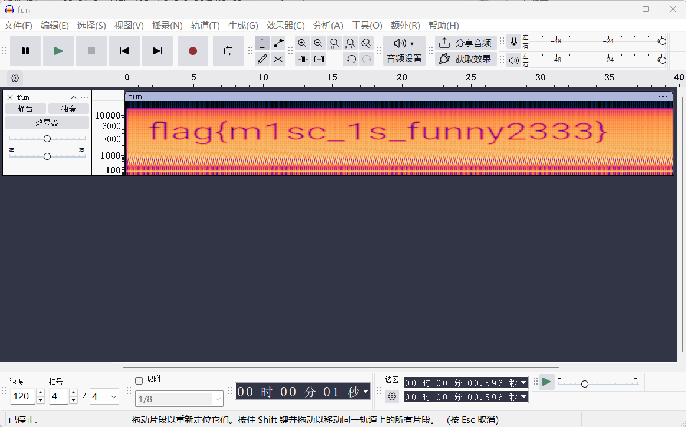
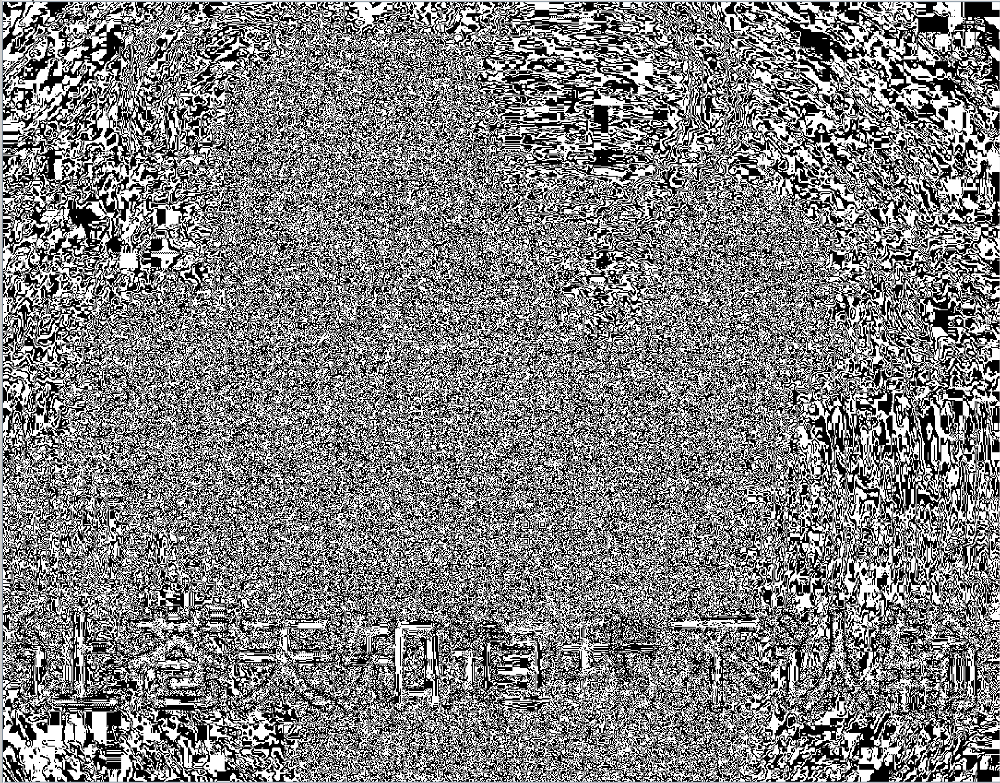

***


## Steganography

### Banmabanma

> flag格式为flag{xxxx}

[ ^附件]:f018351ca6c64ceb8a98c9da9f29c9cd.rar

检查一下png,没啥问题，看着像条码，结合斑马的提示

[Barcode Reader. Free Online Web Application](https://online-barcode-reader.inliteresearch.com/)

扫码得到FLAG IS TENSHINE 提交`flag{TENSHINE}`

附：可以用clearimage demo选择open sample file 扫码，但是要自己框定范围，需要试错


### 适合作为桌面

[ ^附件]:1573d940d9bb47a083da6db70ffbffe0.rar

打开图片有点黑


常规检查都没问题，说能作为桌面，于是试了反色


看到左上角的二维码，于是stegsolve查看，扫描了正确的二维码得到：

```text
03F30D0A79CB05586300000000000000000100000040000000730D0000006400008400005A000064010053280200000063000000000300000016000000430000007378000000640100640200640300640400640500640600640700640300640800640900640A00640600640B00640A00640700640800640C00640C00640D00640E00640900640F006716007D00006410007D0100781E007C0000445D16007D02007C01007400007C0200830100377D0100715500577C010047486400005328110000004E6966000000696C00000069610000006967000000697B000000693300000069380000006935000000693700000069300000006932000000693400000069310000006965000000697D000000740000000028010000007403000000636872280300000074030000007374727404000000666C6167740100000069280000000028000000007304000000312E7079520300000001000000730A0000000001480106010D0114014E280100000052030000002800000000280000000028000000007304000000312E707974080000003C6D6F64756C653E010000007300000000
```

考验数据的敏感度，直接逆hex大概率不对，这么多00更像是文件的填充字符。ai怀疑是pyc字节码

```python
import marshal
import dis
import struct

hex_data = "03F30D0A79CB05586300000000000000000100000040000000730D0000006400008400005A000064010053280200000063000000000300000016000000430000007378000000640100640200640300640400640500640600640700640300640800640900640A00640600640B00640A00640700640800640C00640C00640D00640E00640900640F006716007D00006410007D0100781E007C0000445D16007D02007C01007400007C0200830100377D0100715500577C010047486400005328110000004E6966000000696C00000069610000006967000000697B000000693300000069380000006935000000693700000069300000006932000000693400000069310000006965000000697D000000740000000028010000007403000000636872280300000074030000007374727404000000666C6167740100000069280000000028000000007304000000312E7079520300000001000000730A0000000001480106010D0114014E280100000052030000002800000000280000000028000000007304000000312E707974080000003C6D6F64756C653E010000007300000000"

# 转换为二进制
data = bytes.fromhex(hex_data)

# 跳过魔数（4字节）
code_data = data[4:]  # 去掉 03F30D0A

try:
    code_obj = marshal.loads(code_data)
    print("反编译结果:")
    dis.dis(code_obj)
except:
    print("标准 marshal 失败，尝试跳过更多头部...")
    code_obj = marshal.loads(data[16:])  # 跳过魔数+时间戳+文件大小等
    dis.dis(code_obj)
```

反编译成功，

```python
#!/usr/bin/env python
# visit https://tool.lu/pyc/ for more information
# Version: Python 2.7


def flag():
    str = [
        102,
        108,
        97,
        103,
        123,
        51,
        56,
        97,
        53,
        55,
        48,
        51,
        50,
        48,
        56,
        53,
        52,
        52,
        49,
        101,
        55,
        125]
    flag = ''
    for i in str:
        flag += chr(i)
    
    print flag
```

```python
str_list = [102, 108, 97, 103, 123, 51, 56, 97, 53, 55, 48, 51, 50, 48, 56, 53, 52, 52, 49, 101, 55, 125]
flag = ''.join(chr(i) for i in str_list)
print(flag)
```

得到`flag{38a57032085441e7}`

附：也可先把数据保存为1.pyc，上传至[python反编译 - 在线工具](https://tool.lu/pyc/)反编译


### pure_color

[ ^附件]:1457ba9a15f944ae8520e024f72bf7a6.png

纯白图片，但是在stegsolve在blue plane0发现黑色的flag

`flag{true_steganographers_doesnt_need_any_tools}`


### 2017_Dating_in_Singapore

> 01081522291516170310172431-050607132027262728-0102030209162330-02091623020310090910172423-02010814222930-0605041118252627-0203040310172431-0102030108152229151617-04050604111825181920-0108152229303124171003-261912052028211407-04051213192625

[ ^附件]:4f03a908b9bc44e880d9c0371de35366.zip

解压发现是一份日历，可见是日历隐写

画一下，`HITB{CTFFUN}`


### Training-Stegano-1

> 这是我能想到的最基础的图片隐写术

[ ^附件]:2e5e19744c644912928eddc882f3b0b9.bmp

看到1kb的附件还是挺懵的，strings一下

```bash
┌──(root㉿LAPTOP-BMERJF8L)-[/mnt/e]
└─# strings 2e5e19744c644912928eddc882f3b0b9.bmp
Look what the hex-edit revealed: passwd:steganoI
```

flag即`steganoI`


### can_has_stdio?

[ ^附件]:eb9acff236eb498b9e4d747fb67f86b9.zip

解压，misc50拖进HxD好像啥也不是，看到文件后面可以确认是brainfuck编码

notepad打开，全部复制，随波逐流一把梭

`flag{esolangs_for_fun_and_profit}`


### Erik-Baleog-and-Olaf

[ ^附件]:a020007e78914bb1a7a17cbf68e2c5d1.zip

这题有点水平

010editor发现是png，改一下格式

pngcheck没有发现异常，exiftool发现信息：

```bash
┌──(root㉿LAPTOP-BMERJF8L)-[/mnt/e/a020007e78914bb1a7a17cbf68e2c5d1]
└─# exiftool stego100.png
ExifTool Version Number         : 13.36
File Name                       : stego100.png
Directory                       : .
File Size                       : 27 kB
File Modification Date/Time     : 2026:01:02 21:47:07+08:00
File Access Date/Time           : 2026:01:02 21:47:43+08:00
File Inode Change Date/Time     : 2026:01:02 21:47:21+08:00
File Permissions                : -rwxrwxrwx
File Type                       : PNG
File Type Extension             : png
MIME Type                       : image/png
Image Width                     : 640
Image Height                    : 480
Bit Depth                       : 8
Color Type                      : RGB
Compression                     : Deflate/Inflate
Filter                          : Adaptive
Interlace                       : Noninterlaced
Warning                         : [minor] Text/EXIF chunk(s) found after PNG IDAT (may be ignored by some readers)
Hint                            : http://i.imgur.com/22kUrzm.png
Image Size                      : 640x480
Megapixels                      : 0.307
```

http://i.imgur.com/22kUrzm.png 打开可以下载一张和这个图片看起来一样的图片

但是二者显然不一样，大小不同。stegsolve可以发现，stego100.png里面在blue1通道有一个很小的二维码，且直接截图反色扫码失败；下载的图片则没有

这里需要对两张图片异或

```python
from PIL import Image

img1 = Image.open("stego100.png").convert('RGB')
img2 = Image.open("1.png").convert('RGB')

# 确保尺寸相同
assert img1.size == img2.size

# 创建一个新的图片用于存放结果
result_img = Image.new('RGB', img1.size)

# 遍历每个像素进行异或操作
for x in range(img1.width):
    for y in range(img1.height):
        pixel1 = img1.getpixel((x, y))
        pixel2 = img2.getpixel((x, y))
        
        # 异或操作：对R, G, B每个通道分别进行异或
        xor_pixel = tuple(p1 ^ p2 for p1, p2 in zip(pixel1, pixel2))
        
        # 将结果像素放入新图
        result_img.putpixel((x, y), xor_pixel)

result_img.save('xor.png')
```

得到的图片需要反色处理，不过伟大的随波逐流能直接扫

`flag{#justdiffit}`


### János-the-Ripper

[ ^附件]:310085c4315841b1b784b4803ff7e4c1.zip

misc100打开便知是zip，加密，且尝试发现不是伪加密

7z可以看到是zipcrypto，容易陷入bkcrack的误区

在此之前还是应该先试一下爆破/猜密码。numbers.txt和rockyou.txt都失败了，最后试了一试暴力破解2-6位，密码是**fish**

`flag{ev3n::y0u::bru7us?!}`

注：复盘时发现，**János-the-Ripper**实际上是John-the-ripper（暴力破解软件）。**János**是匈牙利语。


### Test-flag-please-ignore

[ ^附件]:2f572adcaa5447feb8cc8c50969cd57d.zip

HxD打开，发现只是一串hex

cyberchef解码即可

`flag{hello_world}`


### hong

[ ^附件]:3fce1ffa2af0438f82c38e321d3d3032.rar

解压，hong.mp3直接拖进audacity竟然报错了？

foremost一波，分理出jpg狂喜

在其中一张可可爱爱的图片下方写着flag明文

`BCTF{cute&fat_cats_does_not_like_drinking}`


### misc_pic_again

> flag = `hctf{[a-zA-Z0-9~]*}`

[ ^附件]:719af25af2ca4707972c6ae57060238e.png

pngcheck和exiftool没发现有效信息

```bash
┌──(rekjo㉿LAPTOP-BMERJF8L)-[/mnt/e]
└─$ zsteg 719af25af2ca4707972c6ae57060238e.png
imagedata           .. text: "$$$,,,!!!"
b1,g,lsb,xy         .. file: TeX font metric data (\034,\225\370lC\231`\034\247*\003\233\205\0200?\222+\365T\376\027\022o{\373\325\373\336\014\275]\207t\200\013{\3730/\376X\2269R\232\3368\317\013\177\260\036\373$\314\004_4\321\345G\231Dn\005\230\230\335\331\305_\317\217\262)\311\311\265\360\262-\336X\204\300\251\2612\023<\247m7\313\237\213\253\336\357\305S\277;\2356\014<\362\244\312\266\227\016\264\304\0200\235\200Y\316\357r;\321)
b1,rgb,lsb,xy       .. file: Zip archive data, at least v2.0 to extract, compression method=deflate
b2,g,lsb,xy         .. text: "A@qs{cZ;"
b2,rgb,msb,xy       .. file: OpenPGP Public Key
b3,rgb,lsb,xy       .. text: "Kd\"Yl*\\6"
b4,r,lsb,xy         .. file: Targa image data (0) 256 x 1 x 16 - 1-bit alpha "\021\020\020\021\001\020"
b4,g,lsb,xy         .. text: "DDTDDD\"\"DE\"0ED\"3vgtEgfffDC2  "
b4,g,msb,xy         .. text: "\"\"*\"\"\"DD\""
b4,b,lsb,xy         .. text: "vUDDD\"# "
b4,bgr,msb,xy       .. file: OpenPGP Secret Key
```

zsteg识别出zip

```bash
zsteg -E "b1,rgb,lsb,xy" 719af25af2ca4707972c6ae57060238e.png > hidden.zip
```

解压，得到一个名字是**1**的elf

直接strings吧

```bash
strings 1 | grep "hctf"
```

得到`hctf{scxdc3tok3yb0ard4g41n~~~}`


### reverseMe

[ ^附件]:021b62817d7f439aab5338ea63fe1b4b.jpg

直接水平反转即可。也可以手动提取

`flag{4f7548f93c7bef1dc6a0542cf04e796e}`


### hit-the-core

[ ^附件]:8deb5f0c2cd84143807b6175f58d6f3f.core

file一下没有异常，strings搜索

发现极其可疑密文

`cvqAeqacLtqazEigwiXobxrCrtuiTzahfFreqc{bnjrKwgk83kgd43j85ePgb_e_rwqr7fvbmHjklo3tews_hmkogooyf0vbnk0ii87Drfgh_n kiwutfb0ghk9ro987k5tfb_hjiouo087ptfcv}`

这里还是见识的相对比较少，栅栏密码。随波逐流一把梭，注意根据语义筛选出正确的flag。

`ALEXCTF{K33P_7H3_g00D_w0rk_up}`


### glance-50

[ ^附件]:9266eadf353d4ada94ededaeb96d0c50.gif

gif,每一帧极其细，随波逐流先分帧，然后横向拼接

一把梭还是太好用了::smile:

`TWCTF{Bliss by Charles O'Rear}`


### normal_png

[ ^附件]:7171426a9b4646aba1db92b1fbc083f5.png

```bash
┌──(rekjo㉿LAPTOP-BMERJF8L)-[/mnt/e]
└─$ pngcheck 7171426a9b4646aba1db92b1fbc083f5.png
7171426a9b4646aba1db92b1fbc083f5.png  CRC error in chunk IHDR (computed fbe7c429, expected 36b4f5fd)
ERROR: 7171426a9b4646aba1db92b1fbc083f5.png
```

立马联想到宽高错误。随波逐流加高发现flag

`flag{B8B68DD7007B1E406F3DF624440D31E0}`


### Aesop_secret

[ ^附件]:f732347c6bad47f1ac715cf67a3f4532.zip

随波逐流分解gif,HxD发现文件末尾隐藏了数据

`U2FsdGVkX19QwGkcgD0fTjZxgijRzQOGbCWALh4sRDec2w6xsY/ux53Vuj/AMZBDJ87qyZL5kAf1fmAH4Oe13Iu435bfRBuZgHpnRjTBn5+xsDHONiR3t0+Oa8yG/tOKJMNUauedvMyN4v4QKiFunw==`

直接base64是不行滴，拼接一下分离的png，发现是**ISCC**

可以直接用这个网站：https://tu.sioe.cn/gj/fenjie/会自动拼接

根据题干想到AES，https://www.sojson.com/encrypt_aes.html可以解密

注意需要两次解码

`flag{DugUpADiamondADeepDarkMine}`


### a_good_idea

> 汤姆有个好主意

[ ^附件]:96378111f32f49d09f691870f1268799.zip

看到两张图都不用说啥了，和`Erik-Baleog-and-Olaf`一样的脚本

得到xor.png，一坨黑，于是拖进stegsolve看看，在red0有很清晰的二维码，扫就行

`NCTF{m1sc_1s_very_funny!!!}`


### Ditf

[ ^附件]:e02c9de40be145dba6baa80ef1d270ba.png

养成好习惯，先检查

```bash
┌──(rekjo㉿LAPTOP-BMERJF8L)-[/mnt/e]
└─$ pngcheck e02c9de40be145dba6baa80ef1d270ba.png
e02c9de40be145dba6baa80ef1d270ba.png  CRC error in chunk IHDR (computed 7ebcdb1a, expected 38165a34)
ERROR: e02c9de40be145dba6baa80ef1d270ba.png
```

随波逐流加高，发现下面隐藏了一个字符串`StRe1izia`,大概率是压缩包密码

不难发现png的大小是偏大的

```bash
foremost e02c9de40be145dba6baa80ef1d270ba.png
```

分理出rar，7z解压，得到Ditf

只有1kb，于是直接notepad打开，一眼字符串`ZmxhZ3tPel80bmRfSGlyMF9sb3YzX0ZvcjN2ZXJ9`

`flag{Oz_4nd_Hir0_lov3_For3ver}`


### miss_01

> miss

[ ^附件]:83c91c0a-d47b-439c-b2e3-9e96f74f9e6.zip

这题可能是misc_1里面最难的一道了.

拿到zip需要解密，不妨试一下伪加密，修改一下

可以解压出/omisc，下有omisc.docx和fun.zip

打开docx，映入眼帘的是

```text
U2FsdGVkX194m4B5HqBSGYPLTS4bywdKDJh13lrSj/OcwgSAoHBw9X/p2IdEtGx7
EdJFR6rcjyPA+M+aKLZvqE7h7EBFA5LyHYk/5Cns4LV02vM7Dk+T70FlWOlJ3XeA
9pJwFdAWzeN/0A74u+hLG/oLF1g3djo77yVTCBCs0r7khTOWahv0SYR33tHSq3Yz
JGTBS1Zsj2i/sGC8tTnNfsLl0SQ2JeTJhP/aNU2LmPVTyc3y4kTx+ysw8vasHwen
WoBXFtOe2WkorJOCrqdQ8Qqd78TzZ0jRMv6MJO2ytUy/3mebHU9LAlWKFluNEh5t
/cUVvtigLS6PquYRX5ziEx52HDkW+WgfRnum/AregLJ4c4f6AvG2gBjHVKO6sGEi
uh59jcyN1SvsQEvXd7cOD/KWZjE5gqVGUJqXyhauqWPVYUlcuHH6abtQwNuDb+jZ
xMg5QaDzwPhpGRly7NhKU5OgCdhdK17TX7z2/RuNYj6pyfRYNZmQdOFl9B28+law
KO8l5b18WF5JV6chou7riwwDLqQrKMDjUUKZUtdMn0ReDQbR8reeqw/u+Lkyhl6w
+222QWgQ2yRd2dhHb1kqNncUInAEqTPNKRBnia8F/+FycBv+KAwCFPwx9oNTFBYN
4EJL/RjiXEkkSCnyH48VynuuOeX2uNlAti214mCbWWH+pxLn4PHIWf3JK819kiDc
jqyQ5y3v+EUEr9Sb1WVwiITDW5XtzVP+Yr/IJ0ikl41zMu9BAQPermoa8hZJdE8m
b3oSet+pAM7PtnyI7FGJ5Ynkpq05AiJMrN+UgV0E/ELc0UhWw3O0c4u+eYtQkzu/
9+UCRy1Fi+QWFlO3cuWBA4GMGTE1FHWnqnZ683FwrM5bcb6TTu3/Q5sppFmqNrOX
+ctx5b5xiYeSZ8XFI2ks6L7aFrQYu833GiERnIiZEX8vFqjdnD+tcuQ6Zg9Z7oxh
ATDP9H5d1e9IaxwOA/fDP0qvdKJ+OS5OPljnboywCPp7QqFHZfyC7d2GIraadSOL
+eIwfavCqgfGwpWMW5H359IKZASi/HexzEcYrA7OZ8GzSxO9Lmk/ea4BD4JD2law
EIiDE7yhJApimzJ4IG8EMXFn/rOM3O2PkuSTKFsXu7/XZ3ozAJsPun5RJcMuUFXQ
X++DqXqe6Kbo/hEKwHETq0VbL6qEKkQKf5ce3i6tuZG8OqqPsye0Ku5D2LREqqGG
ysshULZWmvlx4u2FUtj4Xg==
```

直接base64？并不行，你只怕把出题人想简单了::angry:

在文件栏右键选择显示，勾选隐藏文字可以发现

```text
waoootu.epj,nv o
www.verymuch.net
```

其中`waoootu.epj,nv o`是Hill密码，www.verymuch.net打开没什么线索，怀疑是Hill密码的密钥

超出随波逐流的能力了::rage:https://demo2.yunser.com/crypto/hill/

解码得到**love and peaceee**，肯定是密钥

注意到长字符串开头是**U2FsdGVkX1**,是rabbit加密的特征

https://www.sojson.com/encrypt_rabbit.html

解码可得

```text
LR2TMNLCGBOHKNDGGVRFY5JWGZTDAXDVMZTDCYK4OU4GCZRYLR2TSNTCHBOHKNJUMM4VY5JVGBSTOXDVHE3DIZC4OU2TIM3ELR2TQYLGHBOHKOJWGQYFY5JWGQ3DSXDVHE3GEOC4OU2TAZJXLR2TOZRTMROHKOBVME4VY5JVGRQTIXDVHAYDEOC4OU4GCZRYLR2TSNTCHBOHKNRRGY3VY5JVHA2WKXDVHAZDOMS4OU2WGMDBLR2TKNDDHFOHKODGMU3FY5JYMFSTMXDVG5QTOYK4OU3DENBQLR2TSNRUMROHKNRSGEYVY5JVMZTDKXDVHE3GEOC4OU3TSNJXLR2TQYLFGZOHKNLGMY2VY5JVGRRTSXDVHE3DIMC4OU2TMYRULR2TKNDDHFOHKNJWMM4VY5JUMZSWKXDVGU4TGN24OU4TMM3GLR2TMY3FGJOHKOBSG4ZFY5JYGM4GCXDVGVRGGMS4OU4GCZJWLR2TKOBVMVOHKNJUHEZFY5JYGM4GCXDVG43TGZK4OU3DEMJRLR2TKNDDHFOHKNRSGQYFY5JUMYYGMXDVHAYDKZK4OU4DKYJZLR2TSNTCHBOHKNRRGBSFY5JZGVRWIXDVGU2DGNS4OU3DENBQLR2TIZTFMVOHKNRWGJTFY5JYGI3TEXDVGY2DMOK4OU4GCMZWLR2TKNTCGROHKNJUMM4VY5JZHA2TQXDVGYYTAZC4OU2TIYZZLR2TKMZXGNOHKNDGMVSVY5JVGRRTSXDVG5QTOYK4OU4DOMLDLR2TSNRUGBOHKNJWMM4VY5JUMYYGMXDVGVTGMNK4OU2TIYZZLR2TMNBWHFOHKNJUMM4VY5JUMVQTMXDVHAZTQYK4OU2TIYZZLR2TONZTMVOHKNJUME2FY5JVHE4DEXDVHE4DKOC4OU2TSOBS
```

明显是base32，随波逐流

```text
\u65b0\u4f5b\u66f0\uff1a\u8af8\u96b8\u54c9\u50e7\u964d\u543d\u8af8\u9640\u6469\u96b8\u50e7\u7f3d\u85a9\u54a4\u8028\u8af8\u96b8\u6167\u585e\u8272\u5c0a\u54c9\u8fe6\u8ae6\u7a7a\u6240\u964d\u6211\u5ff5\u96b8\u7957\u8ae6\u5ff5\u54c9\u9640\u56b4\u54c9\u56c9\u4fee\u5937\u963f\u6ce2\u8272\u838a\u5bc2\u8ae6\u585e\u5492\u838a\u773e\u6211\u54c9\u6240\u4f0f\u805e\u85a9\u96b8\u610d\u95cd\u5436\u6240\u4fee\u662f\u8272\u6469\u8a36\u56b4\u54c9\u9858\u610d\u54c9\u5373\u4fee\u54c9\u7a7a\u871c\u9640\u56c9\u4f0f\u5ff5\u54c9\u6469\u54c9\u4ea6\u838a\u54c9\u773e\u54a4\u5982\u9858\u5982
```

unicode转一下

```text
新佛曰：諸隸哉僧降吽諸陀摩隸僧缽薩咤耨諸隸慧塞色尊哉迦諦空所降我念隸祗諦念哉陀嚴哉囉修夷阿波色莊寂諦塞咒莊眾我哉所伏聞薩隸愍闍吶所修是色摩訶嚴哉願愍哉即修哉空蜜陀囉伏念哉摩哉亦莊哉眾咤如願如
```

**新与佛论禅**，目前好像已经失传了，暂未找到

旧wp显示解密结果是**Live beautifully, dream passionately, love completely.**

正如一位佬所言，`福尔摩斯说过:当你排除掉了所有的不可能性,不管剩下的是什么,无论多么难以置信,那都是真相!那么这个就是音频文件的解压密码！`

(忘说了，直接解压fun.zip发现报错，fun.zip并不是伪加密，需要还原回去)

解压音频，看看频谱



`flag{m1sc_1s_funny2333}`


### 津门杯2021-m1

[ ^附件]:ed74302c-8759-4a3d-b435-18c2a5789d6a.zip

解压发现bmp，strings搜索到大量字符串，grep{}也无果

```bash
┌──(rekjo㉿LAPTOP-BMERJF8L)-[/mnt/e]
└─$ zsteg txt.bmp
imagedata           .. text: "xpcxpcyqdyqdzrezre{sf{sf{sf|tg|tg}uh}uh}uh}uh}uh~vi~vi"
b3,lsb,bY           .. file: MIPSEB Ucode
b4,msb,bY           .. file: SVr3 curses screen image, big-endian
b4,r,lsb,xY         .. text: "\"\"\"3DDDUVfwvffwx"
b4,r,msb,xY         .. text: "UUUU3333"
b4,g,lsb,xY         .. text: "\"34EUUfw"
b4,g,msb,xY         .. text: "j\"\"\"\"ffffff"
b4,b,lsb,xY         .. text: "\"#33DEUUDD33DDDUffg"
b4,b,msb,xY         .. text: ["U" repeated 12 times]
```

比较有迷惑性的是zsteg，但事实上这个**xpcxpcyqdyqdzrezre{sf{sf{sf|tg|tg}uh}uh}uh}uh}uh~vi~vi**真就啥也不是，可能是防ai/py的

bmp格式非常细腻，stegsolve看一下，勾选三个0，发现了base64字符串，可以保存为bin然后再notepad打开

**ZmxhZ3tsNURHcUYxcFB6T2IyTFU5MTlMTWFCWVM1QjFHMDFGRH0=**

解码得到`flag{l5DGqF1pPzOb2LU919LMaBYS5B1G01FD}`


### running

[ ^附件]:b2391358-3276-4716-bfda-a03f47d47f62.zip

此题颇有难度，下载下来电脑给出风险警告，疑似木马（释放文件）

实际上是一个自解压程序，点击程序运行发现是自动打开了一个docx文件

对于自动释放文件的考虑直接foremost/binwalk？分理出png和zip

png没什么用处，zip继续解压得到了docx，没什么用，和一个run.exe的文件

这个大概率是真正的exe,继续点击运行，发现释放了一个tif

```bash
(base) ┌──(rekjo㉿LAPTOP-BMERJF8L)-[/mnt/e/b2391358-3276-4716-bfda-a03f47d47f62/output/zip]
└─$ file tif
tif: TIFF image data, little-endian, direntries=23, width=650, height=598, bps=290, compression=LZW, PhotometricInterpretation=RGB, orientation=upper-left
```

把后缀改成tif，发现有个黑色方块，在ps中可以移除

后面露出来了提示

```python
flag{i}
if(i%2==0)
[i]+=1;
else
[i]-=1:
```

看起来是一个生成flag的函数，需要密钥

strings搜索tif，发现在结尾的字符串**njCp1HJBPLVTxcMhUHDPwE7mPW**

```python
key=b"njCp1HJBPLVTxcMhUHDPwE7mPW"

flag="flag{"

for i in range(len(key)):
    if i % 2==0:
        c=key[i]
        c-=1
        flag+=chr(c)

    else:
        c=key[i]
        c+=1
        flag+=chr(c)

flag+="}"
print (flag)
```

`flag{mkBq0IICOMUUwdLiTICQvF6nOX}`


### misc2-1

[ ^附件]:a5d52942-1ca8-40d4-8749-8d29e17d125b.zip

打开jpg报错，010editor发现文件头就有问题

E1 FF D8 FF ，被倒置了。尝试每四位倒置回复jpg

```python
def fix_reversed_file(input_file, output_file):
    with open(input_file, 'rb') as f:
        data = f.read()

    fixed_data = b''
    for i in range(0, len(data), 4):
        chunk = data[i:i+4]
        fixed_data += chunk[::-1]  # 反转这4个字节
    
    with open(output_file, 'wb') as f:
        f.write(fixed_data)
    print(f"修复后的文件保存为: {output_file}")

fix_reversed_file('task_flag.jpg', 'fixed_flag.jpg')
```

修复后即可得到`flag{F098996689560BBB1B566EBC10D5E564}`


### Let_gods_know

> 让苍天知道，你不认输？

[ ^附件]:328c5ece-db0e-4d11-86f7-286deb0255c9.zip

个人认为misc最狗的一道，没有之一

attention is all you need



**不难发现**藏了二维码


随波逐流自动解码**flag{Ok@y!G0d_know5_n0w}**


### 碎纸机11


[ ^附件]:38b60c95-9e96-4129-8620-baf0b943a2c9.rar

本题的碎片直接拼得不到正确结果，参见https://blog.csdn.net/2402_87950092/article/details/149462146。需要根据图片的时间进行排序

```python
from PIL import Image
import os
 
# 定义要拼接的文件夹路径
folder_path = './images'
# 获取文件夹中所有的图片文件名，按修改时间进行升序排序
image_files = sorted(filter(lambda f: f.endswith('.jpg') or f.endswith('.png'), os.listdir(folder_path)),
                     key=lambda f: os.path.getmtime(os.path.join(folder_path, f)))
# 计算拼接后的图片宽度和高度
widths, heights = zip(*(Image.open(os.path.join(folder_path, img)).size for img in image_files))
total_width = sum(widths)
max_height = max(heights)
# 创建一个新的空白图片，宽度为拼接后的图片宽度，高度为最高图片的高度
new_image = Image.new('RGB', (total_width, max_height))
# 将要拼接的图片粘贴到新的空白图片上
x_offset = 0
for img in image_files:
    new_image.paste(Image.open(os.path.join(folder_path, img)), (x_offset, 0))
    x_offset += Image.open(os.path.join(folder_path, img)).size[0]
# 保存拼接后的图片
new_image.save('out.png')
```

`flag{You Can Repair A Picture From Splices Baesd On Entropy}`


### 1-misc

此题有点问题

不过需要掌握的是，用winrar可以看到出题人留下的**中文**注释，16进制编辑器只能看英文吧。


### Encode

> 套娃？

[ ^附件]:95c2898e-4c1f-4f28-a3d2-89df084e652c.zip

```text
4O595954494Q32515046324757595N534R52415653334357474R4N575955544R4O5N4Q46434S4O59474253464Q5N444R4Q51334557524O5N4S424944473542554O595N44534O324R49565746515532464O49345649564O464R4R494543504N35
```

看起来不是特别有规律。拷打AI得出可能是ROT13

得到

```text
4B595954494D32515046324757595A534E52415653334357474E4A575955544E4B5A4D46434F4B59474253464D5A444E4D51334557524B5A4F424944473542554B595A44534B324E49565746515532464B49345649564B464E4E494543504A35
```

随波逐流一把梭，cyberchef也可

```text
[解码4次] Base16 -> Base32 -> Base64 -> Base85
混合解码结果:flag{W0w_y0u_c4n_rea11y_enc0d1ng!}
```

`flag{W0w_y0u_c4n_rea11y_enc0d1ng!}`

此题还是有些难度的


### Check

[ ^附件]:6686092e-372f-4fe6-b1bd-512d934e2360.zip

zsteg发现html实体编码

```bash
(base) ┌──(rekjo㉿LAPTOP-BMERJF8L)-[/mnt/e]
└─$ zsteg check.png
b1,r,lsb,xy         .. text: "CbBbBbCbFbBbFbGbGbGbBbCbGbGbGbCbCbBbFbCbCbGbGbCbCbGbFbCbCbG"
b1,rgb,lsb,xy       .. text: "&#x66;&#x6c;&#x61;&#x67;&#x7b;&#x68;&#x30;&#x77;&#x5f;&#x34;&#x62;&#x6f;&#x75;&#x54;&#x5f;&#x65;&#x6e;&#x63;&#x30;&#x64;&#x65;&#x5f;&#x34;&#x6e;&#x64;&#x5f;&#x70;&#x6e;&#x47;&#x7d;m"
b1,bgr,lsb,xy       .. /home/rekjo/.local/share/gem/ruby/3.3.0/gems/zsteg-0.2.13/lib/zsteg/checker/wbstego.rb:41:in `to_s': stack level too deep (SystemStackError)
        from /home/rekjo/.local/share/gem/ruby/3.3.0/gems/iostruct-0.5.0/lib/iostruct.rb:180:in `inspect'
        from /home/rekjo/.local/share/gem/ruby/3.3.0/gems/zsteg-0.2.13/lib/zsteg/checker/wbstego.rb:41:in `to_s'
        from /home/rekjo/.local/share/gem/ruby/3.3.0/gems/iostruct-0.5.0/lib/iostruct.rb:180:in `inspect'
        from /home/rekjo/.local/share/gem/ruby/3.3.0/gems/zsteg-0.2.13/lib/zsteg/checker/wbstego.rb:41:in `to_s'
        from /home/rekjo/.local/share/gem/ruby/3.3.0/gems/iostruct-0.5.0/lib/iostruct.rb:180:in `inspect'
        from /home/rekjo/.local/share/gem/ruby/3.3.0/gems/zsteg-0.2.13/lib/zsteg/checker/wbstego.rb:41:in `to_s'
        from /home/rekjo/.local/share/gem/ruby/3.3.0/gems/iostruct-0.5.0/lib/iostruct.rb:180:in `inspect'
        from /home/rekjo/.local/share/gem/ruby/3.3.0/gems/zsteg-0.2.13/lib/zsteg/checker/wbstego.rb:41:in `to_s'
         ... 10906 levels...
        from /home/rekjo/.local/share/gem/ruby/3.3.0/gems/zsteg-0.2.13/lib/zsteg.rb:26:in `run'
        from /home/rekjo/.local/share/gem/ruby/3.3.0/gems/zsteg-0.2.13/bin/zsteg:8:in `<top (required)>'
        from /home/rekjo/.local/share/gem/ruby/3.3.0/bin/zsteg:25:in `load'
        from /home/rekjo/.local/share/gem/ruby/3.3.0/bin/zsteg:25:in `<main>'
```

```python
import html
encoded = "&#x66;&#x6c;&#x61;&#x67;&#x7b;&#x68;&#x30;&#x77;&#x5f;&#x34;&#x62;&#x6f;&#x75;&#x54;&#x5f;&#x65;&#x6e;&#x63;&#x30;&#x64;&#x65;&#x5f;&#x34;&#x6e;&#x64;&#x5f;&#x70;&#x6e;&#x47;&#x7d;"
decoded = html.unescape(encoded)
print(decoded)
```

`flag{h0w_4bouT_enc0de_4nd_pnG}`


### fakezip

[ ^附件]:0cb6f418-26ab-40ec-86db-ec7134b27e67.zip

根据题目名字，大概率伪加密，改了就行

png可见`flag{39281de6-fe64-11ea-adc1-0242ac120002}`


### nice_bgm

> 我拿出自己的私密音乐来和你分享，一起享受快乐吧

[ ^附件]:261bcd79-9efd-440e-9caa-2035e3721630.zip

请参考https://blog.csdn.net/2402_87950092/article/details/149462146


### 看雪看雪看雪

此题有点问题


### 时间刺客！

> 时间不站在你那边

[ ^附件]:1c606f8f-372c-4519-8303-1a901c87934b.zip

4张jpg，并没什么大用处。注意到时间戳比较离谱，自动提取/image目录下所有文件的时间戳

```python
import os
img_dir = os.listdir('./image')
time_stamp_list = []
flag = ""

for image_name in img_dir:
    
    time_stamp = int(int(int(os.path.getmtime('image/'+image_name)*(10**9)) %
                        (2**64-1)) / (10**9))
    str_time_stamp = str(time_stamp)
    print(str_time_stamp)
    
    ascii_code = ""
    for i in range(len(str_time_stamp)):
        ascii_code += str_time_stamp[i]
        
        if int(ascii_code) > 127:
            ascii_code = ascii_code[:len(ascii_code) - 1]
            flag += chr(int(ascii_code))
            ascii_code = ""
            ascii_code += str_time_stamp[i]
        else:
            if i == len(str_time_stamp)-1:
                flag += chr(int(ascii_code))

print(flag)
```

注意一定是**Windows运行~**别问我为什么要劝你

（否则你可能会在WSL里面卡死半个小时）

`flag{T1m3_f1ie5}`


### steg没有py

> 注意flag大小写哦

[ ^附件]:114fa796-3c68-473c-b54d-da56266c74d3.zip

stegpy，新隐写工具++

感觉工具有问题，没复现出来


### 来自银河的信号

> alien把秘密藏在了这段音频中。

[ ^附件]:b8da3211-2dcc-4464-bfcc-e09a935b095a.zip

板子题，比较老套了

参考https://blog.csdn.net/2402_87950092/article/details/149462146


### [简单] 简单的base编码

> 你懂base编码吗?

[ ^附件]:58b29b7f-4dee-4a75-8067-a68cd3728e42.zip

疑似嘲讽

```text
Vm0wd2QyUXlVWGxWV0d4V1YwZDRWMVl3WkRSV01WbDNXa1JTVjAxV2JETlhhMUpUVmpBeFYySkVUbGhoTVVwVVZtcEJlRll5U2tWVWJHaG9UVlZ3VlZadGNFSmxSbGw1VTJ0V1ZXSkhhRzlVVmxaM1ZsWmFjVkZ0UmxSTmJFcEpWbTEwYTFkSFNrZGpTRUpYWVRGd2FGcFdXbUZrUlRGVlZXeFNUbUY2UlRGV2EyUXdZekpHYzFOdVVtaFNlbXhXVm1wT1QwMHhjRlpYYlVaclVqQTFSMWRyV2xOVWJVcEdZMFZ3VjJKVVJYZFdha1pYWkVaT2MxZHNhR2xTTW1oWlYxZDRiMkl5Vm5OVmJGWlRZbFZhY1ZadGRHRk5SbFowWlVaT1ZXSlZjRWRaTUZaM1ZqSktWVkpZWkZwV1JWcHlWVEJhVDJOc2NFaGpSazVYVWpOb2IxWnRNWGRVTVZWNFUxaG9hbEpzY0ZsWmJGWmhZMnhXY1ZGVVJsTk5XRUpIVmpKNFQxWlhTa2RqUm14aFUwaENTRlpxUm1GU2JVbDZXa1prYUdFeGNHOVdha0poVkRKT2RGSnJhR2hTYXpWeldXeG9iMWRHV25STldHUlZUVlpHTTFSVmFHOWhiRXB6WTBac1dtSkdXbWhaTW5oWFkxWkdWVkpzVGs1V2JGa3hWa1phVTFVeFduSk5XRXBxVWxkNGFGVXdhRU5UUmxweFVtMUdVMkpWYkRaWGExcHJZVWRGZUdOSE9WZGhhMHBvVmtSS1QyUkdTbkpoUjJoVFlYcFdlbGRYZUc5aU1XUkhWMjVTVGxkSFVsWlVWbHBIVFRGU1ZtRkhPV2hpUlhCNldUQmFjMWR0U2tkWGJXaGFUVlp3YUZwRlpGTlRSa3B5VGxaT2FWSnRPVE5XTW5oWFlqSkZlRmRZWkU1V1ZscFVXV3RrVTFsV1VsWlhiVVpPVFZad2VGVXlkREJXTVZweVkwWndXR0V4Y0ROV2FrWkxWakpPU1dKR1pGZFNWWEJ2Vm10U1MxUXlUWGxVYTFwb1VqTkNWRmxZY0ZkWFZscFlZMFU1YVUxcmJEUldNV2h2V1ZaS1IxTnNaRlZXYkZwNlZHeGFZVmRGTlZaUFZtaFRUVWhDU2xac1pEUmpNV1IwVTJ0a1dHSlhhR0ZVVnpWdlYwWnNObEpzWkdwaVNFSklXVlZrYzFVd01IaFNhbHBYWVd0dmQxWlVSbFpsUm1SMVUyczFXRkpZUW5oV1Z6QjRZakZaZUZWc2FFOVdhelZQVkZaYWQyVkdWWGxrUkVKWFRWWndlVmt3V25kWFIwVjRZMFJPVjJGcldreFdha3BQVTFkS1IxcEdaRk5XV0VKMlZtMTBVMU14VVhsVVdHeFZZVEZ3YjFWcVRrTldSbXhaWTBaa1dGWnNjRmxaTUZVMVlWVXhjbUpFVWxkTlYyaDJWMVphUzFJeFRuTmFSbFpYWWtad05sWkhlR0ZaVm1SR1RsWmFVRlp0YUZSVVZXaERVMnhhYzFwRVVtcE5WMUl3VlRKMGIyRkdTbk5UYkdoVlZsWndNMVpyV21GalZrNXlXa1pPYVZKcmNEWldhMk40WXpGVmVWTnVTbFJpVlZwWVZGYzFiMWRHWkZkWGJFcHNVbTFTZWxsVldsTmhWa3AxVVd4d1YySllVbGhhUkVaYVpVZEtTVk5zYUdoTk1VcFZWbGN4TkdReVZrZFdiR1JvVW5wc2IxUldXbmRsYkZsNVkwVmtWMDFFUmpGWlZXUnZWMnhhV0ZWclpHRldWMUpRVldwS1MxSXlSa2hoUlRWWFltdEtNbFp0TVRCVk1VMTRWVmhzVm1FeVVsWlpiWFIzWVVaV2RHVkZkR3BTYkhCNFZUSXdOV0pIU2toVmJHeGhWbGROTVZsV1ZYaFhSbFp5WVVaa1RtRnNXbFZXYTJRMFdWWktjMVJ1VG1oU2JGcFlXV3RhV2sxR1draGtSMFphVm0xU1NWWlhkRzloTVVwMFZXczVWMkZyV2t4Vk1uaHJWakZhZEZKdGNFNVdNVWwzVmxSS01HRXhaRWhUYkdob1VqQmFWbFp0ZUhkTk1XeFdWMjVrVTJKSVFrZFVNVlUxWVZaS1dWRllaRmhpUmxwb1ZrUktSMVl4VW5KWGJGSnBWbFp3V1ZaR1l6RmlNV1JIWWtoR1ZHRXhjSE5WYlRGVFYyeGtjbFpVUmxkTlZuQjZXVEJhVjFkR1duTlRhMmhoVWtWYVlWcFZaRXRUVms1ellVZG9UazFWY0ZkV2JHTjRUa2RSZVZaclpGZFhSM2h5VldwQ1lXTkdWblJsU0dSc1lrWnNOVnBWYUd0WFJrbDNWbXBTV2sxSGFFeFdNbmhoVjBaV2NscEhSbGRXTVVwUlZsZHdTMU14U1hsU2EyaG9VbFJXV0ZsdGRFdE5iRnAwVFZSQ1ZrMVZNVFJXVm1oelZsWmtTR1ZHV2xwV1JWb3pXVlZhVjJOV1RuUlBWbVJUWWtWd1dsWkhlR3BPVjBWNVUydGthbEpYYUZoWmJGSkNUVlphV0dNemFGaFNiRnA2V1ZWYWExUnNXWGxoUkVwWFRWWndhRlY2UmtwbFJsSjFWbXhLYVZKc2NGbFdSbEpIVXpBMWMxZHJhR3RTTUZwWldXeGFZVk5XVm5Sa1J6bFdVbXhzTlZsVmFFTldiVXBJWVVWU1ZXSllhSEpXYkZwSFpFWktkR05GTlZkTlZXd3pWbXhTUzAxSFNYbFNhMlJVWW1zMVZWbHJaRzlXYkZwelYyNWtUazFXY0hsV01qRkhZV3hhY21ORVJsaGhNWEJRVm1wS1JtVkhUa1ZXYkdSVFVsWndlVmRZY0VkV2JWRjNUVlZzYVZJeWFGUlpiR2h2VjFaa1dHVkhPVkpOVmtwSVZsYzFTMWRIU2taalNFNVdZbFJHVkZwWGVITldiR1J6Vkcxb1UxWkZXalpXVkVreFlqRlplRmRxV2xKWFIyaFhWbXRXWVZsV2NGWlhiWFJyVm10d2VsWnRNVzlVYkVwSFYyMUdWMkpIVGpSVWEyUlNaVlphY2xwR1pHbGlSWEI1VmxkMFYxTXlTWGhpUm14cVVsZFNjMVp0ZUV0bGJGcDBUbFU1V0ZJd2NFaFpNRnB2VjJzeFNHRkZlRmROYm1ob1ZqQmFWMk5zY0VoU2JHUlhUVlZ3VWxac1VrTmhNVWw0VTFoc1UyRXlhSEJWYlhNeFkwWnNWVkZ1WkU1aVJuQXdWRlpTUTFack1WWk5WRkpYVm0xb2VsWnNXbXRUUjFaSFYyeHdWMUpXYjNwWFZsWmhWakpPVjFSdVVsQldiVkpVV1d0V2QxZHNXa2hsUjNCUFZqQldOVlV5ZEd0aGJFcFlZVVpvV21KR1NrTlVWbHBoVjBkTmVtRkdhRk5pUm5BMlYxWldZV0V4VW5OWFdHeG9Va1Z3V0ZsWGRFdGpiRlkyVW0xMFYwMVdjREZWTW5oRFZqSktTVkZ1WkZkaGEwcG9WWHBCTVdNeFpISmFSbHBvVFd4S1dGWkdaSHBsUlRWSFYxaHNUMVpyTlc5VVZsWjNUVVphV0U1VlRsZE5hM0JKV1ZWV1UxWlhTa2RqU0VwWFlrWndTRnBGV2t0a1IwNUdUbFprVGxaWGQzcFdiWGhUVXpBeFNGSllhR0ZTVjJoVldXdGtiMkl4Vm5GUmJVWlhZa1p3TUZwVmFHdFVhekZaVVd4c1lWWlhhRXhaYTFwaFZsWktjMXBHYUdoTldFSlJWMVphWVZNeVRuUlVhMVpZWWtkU2NGVnFRVEJOUm1SWlkwVmtWMkpXUmpOVVZsWnpZVVpLY2s1WE9WcGhNbWhFVmpGYWExWXhjRVZSYlhScFZtdFpNRlpxU2pSV01WVjVVMnRrYWxORk5WZFpiRkpIVmtaU1YxZHNXbXhXTURReVZXMTRiMVV5UlhwUmJVWlhWbTFSTUZwRVJscGxWazV6WWtaYWFWSXlhRzlXVjNSWFdWZE9jMVp1UmxSaE0xSlZWbTE0UzAxR2JGWlhhemxwVWpCd1dsbFZXa2RXTWtWNFkwZG9XRlp0VWxOYVZscGhZMnh3UjFwSGJHbFNXRUpSVm0weE5HRXhWWGhYYms1V1lrZG9jbFV3WkZOV1JsSlhXa1JDVGsxV2JEVlViR1F3VjBaS2NtSkVUbGRpV0VKVVZqSnplRk5IUmtoaFJtUm9ZVE5DU1ZkVVNYaFVNVXAwVm10a1dHRjZWbGhaYlhSTFUyeFplV1JIUm1oTlZURTBWVEZvYjJGc1NsaFZiV2hXWWxoTmVGWXdXbHBrTVZweVpFVTFhVkp1UVhkV1JscFRVVEZhY2sxV1drNVdSa3BZVm0weGIyVnNXbk5YYlhSVVVqRmFTRll5ZUhkV01VcFhZak53V0Zac1dtaFdha3BQVmpGU2RWVnNRbGRpVmtwVlYxZDBWMlF4WkhOWGEyaHNVak5DVUZacVFsZE9WbFY1WkVkMGFHSkZjRmxaVlZwdlYyMUtSMU5yVGxWV2JIQm9WakJrVG1WdFJrZGhSazVwVW01Qk1sWXhXbGRaVjBWNFZXNU9XRmRIZUc5VmExWjNWMFpTVjFkdVpHaFNiRmt5VlcxMGQySkdTbk5UYWtaWFlsaG9URmxXV2t0ak1rNUhZa1pvVjAweFNqSldWbEpIWVRGWmVGcElTbUZTYkhCdlZGZDRTMWRHV2tkWGJVWnJUVVJHU0ZadE5WTmhNVW8yWWtaa1ZtSllhSHBVYkZwelZtMUdSbFJzWkdsV1dFSktWMVpXVjFReGJGZFRhMXBZWWxkb1lWcFhkR0ZOTVZaelYyeGthMUl3TlVkVWJGcHJWR3hhV0dRemNGZGlXR2hVVlhwQmVGTkdTbGxoUjBaVFZqSm9WbGRYZEd0aU1rbDRWbTVHVW1KVldsaFphMXAzVFVad1ZtRkhkRlZoZWtaWVdUQm9jMVl3TVhGU2EyaGFWak5vYUZreU1VOVNWa1owVW14T1YwMVZXWHBXYlhoVFV6RktkRlp1VGxOaVIzaG9WVzB4YjJOR1ZuUmxTR1JwVFZkU1dGWlhkREJWTURGWVZXdG9WazF1YUhwWFZscEtaV3hHYzFWc1pHaGhlbFl5Vm1wR1lXRXhaRWhXYTJoUVZtdHdUMVp0ZEhkVFZtUlZVVzFHYVUxcldqQldiVFZMVjBkS1NHRkdXbGRpVkVaVVZtdGFkMWRIVmtsVWJHUnBVakZLTmxaclkzaGlNVmw1VWxod1VsZEhhRmhXYlRGU1RVWndSVkpzY0d4V2F6VjZXV3RhWVdGV1NYbGhSemxYVmpOU1dGZFdaRTlqTVZwMVVteFNhRTB4U2xaV2JURTBVekF4UjJKR1dsaGhlbXhZVkZaYWQxTkdXWGxOVldSWFRXdHdTVlpIY0ZOV1YwVjVWV3hPWVZac2NHaFpNbmgzVWpGd1NHSkhiRk5YUlVreFZtMTRVMUV5UlhoV1dHeFZZVEpTV0ZsdGRHRlZNV3gwVFZaT1dGSnNTbGhXTWpWUFZERmFkVkZyWkZwV1ZsVXhWakJhU21ReVRrWmhSbkJPVW01Q01sWnFTbnBsUms1SVVtdG9hRkp0VW05WlZFNURVMVprVlZOWWFGVk5WWEF3Vm0xMGExZEhSalpXYkdoYVlsaFNURlV5ZUZwbFYxSklVbTFvVGxaVVJUQldWRVp2WWpKR2MxTnNhRlppVjJoWFdXeG9UbVZHV1hkWGJIQnJUVlp3ZVZwRlZURmhWa3AxVVZoa1YxSnNjRlJWVkVaaFkyc3hWMWRyTlZkU2EzQlpWbTB3ZUdJeVZuTlhiazVZWWxoU1ZWVnFSbUZUUmxsNVpVaGtWMDFWY0ZoWmFrNTNWMFpaZWxGcmFGZGhhM0JRVm1wR1YyUldUbk5XYld4VFRWVndWbFl4WkRSaU1rbDRZa1prWVZKc1dsTlpiRlpoWWpGU1YxcEdUbFJTYkd3MVZHeFZOV0ZIU2taalJFSmhWbGRTU0Zac1dtRldNazVIV2taV1YySklRalpXYlhCSFdWWmtXRkpyWkdoU2F6VndWVzAxUWsxc1dYaFhiR1JhVmpCV05GWlhOVTlYUm1SSVpVYzVWbUV4V2pOV01GcFRWakZrZFZwSGFGTmlSbXQ1VmxjeE1HUXlTa2RUYms1VVlXdGFXRmxzYUc5VVJteFhWMnQwYWsxck5VaFphMXB2VmpBd2VGTnFTbGRXYkVwSVdWUkdXbVZHY0VsVGJVWlRZa2hDZGxaR1pEUlRNV1JIVjJ0a1dHSlZXbkpVVlZKSFUwWmFkRTVXVG1oTlZXOHlXV3RhYTFadFNsbGhSRTVWVmxad2VsWnRlR3RqTVZKellVZHNWMWRGU2twV01WSkRWakExUjFkdVNrNVhSbHB2VlRCV2QxZEdiRmhrUjBab1VtNUNSMVl5ZERCaE1VbDNUbFZrVldKR2NISldSM2hoVjBkUmVtTkdaR2xYUjJoVlZsaHdRbVZHVGtkVGJHeG9VakJhVkZacVNtOVdiR1JZWkVkMGFVMXJiRFJXYlRWSFZXMUtWbGRzYUZwaE1YQXpWRlZhZDFadFJraGtSbFpvWld0YVlWWldaRFJqTVd4WFYyeG9hRkpZYUdGWlZFWjNXVlp3VmxkdGRHcGlWWEJKVlcxNFQxWXdNVlpYV0hCWFlsaG9WRlY2Umt0a1JscDFWR3hPYVZJemFHOVdWekI0WWpKT1IxWnVVbXhUUjFKd1ZGWmtVMWRHV2xoa1JFSldUVVJHV0ZsclVsTldNVm8yVm10NFYwMUhVa3hWYWtaUFpFVTVWMVpzWkZOV2JrSk9WbTF3UjFsV2JGZFRXR2hoVTBaS1ZGbHJXa3RVTVZwMFpVaGtWRlp0VWxaVlYzaHJWakF4VjFacVZsWk5ibEo2VmxjeFMyTnJOVmRhUm5CcFVtdHdTVlp0ZEdGVk1WbDRXa2hPV0dKWWFGaFVWVkpTWlZaYVdFMVVVbWhOVmtvd1ZXeG9kMVZ0U2tobFJtaFhZVEZhZVZwVlduTmpWa3B6WTBkNFUySldTbUZYVkVKcllqRmFSMU5zYkZKaVYyaFpWbTB4VW1ReFpGZGFSVGxxVFZad01WVnRlRTloVmtsNFUyNW9WMUp0VVhkWFZscEtaVVpXV1dGR2FHbFhSa3BaVmtaYVlXUXhUa2RYV0d4cVVsaFNXRlJYZEhkVFZscElZMFpPVjFZd1ZqVldWM2hQV1ZaYWMyTkhhRnBOYm1nelZXcEdkMUl5UmtkVWF6Vk9ZbGRqZUZadE1UUmhNREZIVjFob1ZWZEhhR2hWYkdSVFYwWnNkR1ZGZEdwaVJsWXpWMnRhVDJGck1WaGxTR3hYVFdwV1VGWkVSbUZrVmtaeldrWm9hRTFXY0hsV2JYQkNaVWRPZEZScldtaFNia0p2VkZaV2QySXhXbkZUYWxKYVZteHNORlpITlU5VmJVcElWV3M1V2xZelVtaFZNRnByWXpGa2RGSnNaRTVoZWxZMlYxUkNWMkl4VlhsVGEyaFdZa2RvVmxadGVHRk5NVnBZWlVkR2FrMVdXbmxXUnpGdlZHeGFXR1I2UWxkV1JWcDJXWHBHVm1WV1NsbGlSMmhVVWxWd1dGZFhlRzlVYlZaSFlUTmtXR0pyTlZoV2JYUmhUVlprY2xaVVJtaFdhM0F4VlZab2ExZEhTa2RYYmtaVllrZFNSMXBFUVhoV01XUnlUbFprVTJFelFscFdiVEIzWlVkSmVWVnVUbGhYUjFKWldXeG9VMVpXVm5GUmJVWlVZa1phTUZwVlpFZGhSbHB5WWtSU1ZtSkhhSEpXYWtwTFYxWkdjbUZHY0d4aE0wSlFWMnhXYTFReFNuTlhiazVZWWxkNFZGUldWbmRXYkZsNFdrUlNhVTFyYkRSWmExcHJXVlpLYzFkc1RscGlSbHBvV1dwR1UxZEhVa2RhUlRWT1ZtdHdXVlpxU1hoTlIwWklVMnRhYWxKWFVsZFVWelZ2WVVaYWNWTnJkRmhXTUZwSFdsVmFZV0ZGTVZsUmFscFhZbGhvYUZWcVJtdFhSa3B5V2tkb1UyRjZWbmRXVnpBeFVXc3hWMWRZYUZoaVIxSmhWbXBDVjA1R1dsaE9WazVXVFd0d2VWUnNXbk5YYlVWNFkwZG9WMDFHY0hwV2JGcFBZekZPY2s1V1RtbFdhM0JhVm0xd1MwMUZNVWhTYmtwT1ZtMVNWVmxYZEdGWFJsWjFZMFZrYTJKR2NGWlZNblF3VlRBeGNrNVZhRnBoTVhCMlZtcEJkMlZYUmtoUFZtUlhaV3RKTUZac1kzaFdNVWw0WTBWc1YySkZOWEJWYkdoRFpERmFkR1ZIUm10TmExcElWakkxVTFSc1RraGhSbVJWVm14VmVGWXdXbHBsVjFaSVQxZG9UbFpYT0hsWFYzUnFUbFphVjFkdVRsaGhhelZXVm14YWQyVnNXblJsUjNScVRWWktlbGRyV210aFZrNUdVMnh3VjAxV1NrUlpWRVpLWlVaa2MxcEdhR2xoZWxaNFZsZHdTMkl4YkZkalJtaHJVakJhVDFSV1dtRmxiRmw1WlVkMGFFMVZiRE5VYkZaclZsZEtSMk5JU2xkU00yaG9WakJrVW1WdFRrZGFSMnhZVWpKb1ZsWnNhSGRSYlZaSFZHdGtWR0pIZUc5VmFrSmhWa1phY1ZOdE9WZGlSMUpaV2tWa01HRlZNWEppUkZKWFlsUldWRlpIZUdGT2JVcElVbXhrYVZaRlZYZFdiVEUwVmpKU1JrNVdhR3RTYkZwdldsZDBZVmRXWkZoa1JrNVZUVlpzTTFSV2FFZFdNa3BHVTJ4b1ZtRXhXak5XUlZwWFpFVXhWazlXVWxkTlJGWkpWMVpXYTJJeFVuUlRhMXBwVWtad1dGUldXbmRoUm1SWFYyeEtiRkpyTlRGV1IzaFhZVmRGZWxGdVpGZFdla0kwVmxSR1VtVkhTa2xWYlhoVFYwWktlbFp0TUhoVk1XUnpZVE5rVjJKWVVsaFVWM1IzVjBaWmVXVkhPVmROVlc4eVZtMTRiMVl5UlhsVmEzaFdZV3RhVUZwR1drZGpNWEJJWWtaT2FXRXdXVEpXYlRGM1VqRnNXRkpZYUZoWFIyaFlXVzEwZDJGR1ZuRlViRTVWVFZkNFZsVnROV3RXUmxwMFZXeHNZVkpYVWtoWlZsVjRZMnhrY1ZGc1pHbFdSbHBOVm1wQ2ExTXhUa2hTYTJSWVlrZFNjRlpyVm1GV1ZscDBaRWRHYTAxWFVrbFdiWFJ6VmxkS1NGVnVRbFpoYTFwTVZHMTRZV05zYTNwaFIyeE9WbXhaTUZacVNqQlpWbVJJVW01T2FsSnRhRmhaVkVaaFpWWndWbGR1VG1wV2EzQjZXVEJrTkZVeVNsZFRhbEpYWVd0dk1GVjZSbXRTTVU1WllrZG9VMkpYYUZsWFYzaHZWVEZrUjFwR1pGaGlhelZZVkZkek1WTkdXWGxsUnpsb1ZtMVNTRlV5TlhOV01rcFZVbGhrWVZKRmNGaFpla1pyWkZaV2NrNVdhRk5XUmxwYVZtdGFZVll5VFhkT1dFNXBVbXh3VjFsclpGTlhSbEpXVld0a1dGWnNjRmhaVldRd1YwWktjMk5FUWxkV00wMHhWMVphUzFKc1NuRlZiRnBPVmpGS1NWWlhjRXRTTVVsNVVtdGtWV0Y2Vms5WmJHUnZWVEZhZEUxSVpHeFNWRlpKVld4b2IxWXhaRWhoUm14WFRVZFNkbFpxUm5OamJIQklUMWR3YVZKc1dYcFdNblJoVkRGWmVGTnVUbFJpUjJoWVZGYzFVbVF4YkhKYVJYUlRUV3MxU0ZsclpFZFZNVnB6Vmxob1YyRnJTbWhWTWpGU1pWWlNjbGR0YUZOaWEwcFFWbGN3TVZFd01YTlhia1pVWW01Q2MxVnRkSE5PUmxwSVRsVTVWbUpWY0VsV1Z6QTFWMnhhUms1VlVsWk5WbkJ5Vm14YVQyTldWblJoUlRWb1pXeFdNMVp0TUhoTlIwVjRZa1prVkZkSGVHOVZibkJ6Vm14YWNsWnJkRlZTYkhCWldsVmtSMkZyTVZsUmEzQllZVEZ3VkZaSGVHRldWa3BWVVd4a1YxSldjREpYV0hCSFZtMVdWMU5zYkdsU2JIQndWbXRrTkZkR1pGaGxSemxwVFZaS1NGWXlOVXRYUjBwV1YyNUdWVll6VW1oVmFrWmhVMGRXUjFSc1ZtbFNia0Y0Vmxaa2QxVXhXWGhYYWxwU1lXeEtWMWxYZEdGaFJtdDVZek5vVjAxWFVubFViRnByVlRKRmVsRnNjRmRpVkVJeldsVmtTbVZXV25WVWJHaHBZWHBXV2xkWGVHOVZNVnBYVm01R1UySlZXbFZWYlhoelRsWndWbUZIZEZkTlJFWlhXVEJhYjFkdFJuSk9WRTVYVFVad2FGbDZSbXRrUjBaSFdrZG9hRTB3U2xaV2JGSkRXVlpzV0ZSdVVsUmhNbWhVV1d0Vk1WUXhVbFpXYm1SWFlrWnNORmRyVWtOaFZURldWbXBPVldKR1duSldNR1JMWTIxT1NGSnNWbGRTV0VKVlZteFdZVmxYVWtoV2EyeFZZWHBzVkZsclpETk5WbHBJWlVaYVQxWXdXa2xWTW5SaFlXeEtXRlZzWkZWV00wSklXa2Q0WVdOV1RuSmtSbEpUWWtad05WWkVSbUZXTVZsNVUydHNVbUpVYkZoWlYzUkxZMnhhU0UxV1pHdFNhM0I1VjJ0a2IxVXlSalpXYm1SWFZucEJlRlZYYzNoak1XUlpZVVpvYVZJeFNtaFdiWEJEVmpBMVIxZHNhRTlXVkd4WlZXMHhVMU5XY0ZaWmVsWlhZbFZXTkZZeWNFOVdNREZIWTBod1YwMUhVbFJWYlRGVFUwZE9TR0pHVG1sU00xRXhWbTE0YW1WRk1VWk5WV2hUWW14S1ZGbFhlSGRYUm14eVdrYzVXRlp0ZUZaVmJUVnJZVVpLZEdWR2FGZE5ibEYzV1ZkemVHTnJOVlpoUm5Cb1RWaENNbFp0Y0VKa01sWllVbXRvVUZadFVsaGFWM1JLVFVaYWMxa3phRmROVld3MFdUQldjMVl5U2taT1dFSldZa1pLV0ZwRVJtRmtSMVpJVW0xMFRsWXhTbGxXYWtvd1lURnNWMU5yWkZSaVJscFdWbTE0Vm1WR1dYZFhiSEJzVmpGYVNWUXhaRzlVYkZwWVQwaHNXRll6VW5GVWJGcGhWakZrZFZSc2FHaGhlbFpYVm0xNFlXUXlWbk5YYmxKc1VqTlNjVlJXV2t0bGJHUnlWMjEwYUZack5VZFZNbmgzVmpBeFYxTnJVbHBXUlZwTFdsVmFhMk14Y0VkaFIyeFRUVlZ3TkZac1VrTldNbEY0V2tWa2FWTkZjRmxaYlRGVFZsWldkRTVWVGxOTlZtdzFXa1ZTUTJGRk1WWmlSRTVWWWtaYWNsWnNaRXRTTWs1SlUyeGtVMDB5YUc5V2FrSnJWVzFXZEZSclpHRlNNbmhaVldwS2IxWnNXbk5oU0dSU1lsWmFTRlpIZEd0V1IwcElaVWM1Vm1GclNtaFdhMXBoWTFaT2RFOVdaR2xTTVVwYVYydFdhMDFIUmxaTldFcHBVa1pLV0Zsc1VsZFdSbHBJWlVkR1QySlZjRWhaVlZwM1lVVXhXVkZZY0ZkU2JGcG9Xa1JHWVdSR1NuSmhSM1JUWWtad2RsZHNaREJaVm1SWFdrWm9hMUpyTlZaVVZscHpUVEZTVjJGRlpGZE5hMVkyV1ZWa1IxZHNXa1pYYWs1WFVsWndNMVZ0ZUd0ak1YQklaRVprVGxORlNrcFdNVnBYWVRKSmVGVnVUbUZTVm5CVldWZDRZVmRHYkhOVmEyUk9UVlpaTWxWdGREQmhNVXB6WTBoc1dsWldjRmhaVlZWNFZqSk9SMkpHYUZkTk1VcDVWbXhTUjFsV1NYaFdiazVYWWtaS2NGWnJaRFJsYkZwMFRVaG9WazFYVW5wWlZFNXJWakpLV1ZWc2FGVldNMUl6VmpCYVdtVlhWa2hQVm1ST1ZsYzRlVlp0TVRCT1JtUnpWMnhrYWxKWWFHRlVWelZ2VlVac05sTnJaRk5OVjFJd1dXdGFUMkZGTUhkVGJVWlhZbFJHTTFWcVJuTlhSa3BaWVVab1dGSXlhRmxYVnpFd1pESkdSMVp1UmxWaVJUVldWRlprTkZac1ZuUk9WM1JYVW14d2Vsa3dhRzlXYXpGWFUydG9WMVpGUmpSV2FrcFBVbTFLUjFkdGJGTk5iV2Q1VmpGYWEwNUdVWGhUYmtwUFZtMVNiMVZ0TlVOalJsWnhVMjA1VjFac2NFaFdWM1JyWVRBeFYySkVVbGhoTW1oVVdWUkdTbVZzUm5WUmJGcG9ZVEZ3VEZkclVrZFpWa3BYVTI1U2ExSXllRTlXYlRFelpXeGFSMWRzWkdoTmExcEhWRlZvYzJKR1NuUmhSMFphWVRGd1RGVlVSbmRXYkdSMVZHMXdWMkV6UWpaWFZFSnJUa1pWZVZOc1pGUmhiRXBZV1ZkMGRrMUdWalpUYTJSVVVtczFlVll5TVhkVk1ERjBZVVp3VjJKVVFqUldWekZTWlVad1IxcEhSbE5pVmtwNFZrWmFhMVV3TVZkV2JsSnNVbFJzYjFadGRITk9SbFY1VGxjNVYwMVZjSHBaTUdoTFZqRmFSbU5HYUZwbGEzQk1WV3BHYTJSR1NuTlZiRTVYVW14dmVWWnRNSGRsUlRWSVZWaHNWMkpIVW05VVZFcFRWakZzY2xaVVJsaFNiRXBYVmxkMGExZEdXbk5qUm1oYVZsZFJkMVl3V2t0ak1rNUZVV3hrVjAweWFGRldNVnBoV1ZkTmVWUnJhR2hTYmtKUFdXMHhibVZzV2xoalJXUnJUVlZzTlZWdGRHdFdWMFkyVm1zNVdtSkhVbkZhVlZwaFpFVXhWVlZ0YUU1U1JWcEpWbXBHYjJJeFdsZGFSV2hvVWpKb1YxbHNVa2RXUmxsM1YyNU9hMUl4V2tkYVJXUjNWR3hhYzFkWWNGZGlXR2hVVldwR1lWWnJNVmRhUmxKcFVqSm9XVlpHWkhkV01WWkhWMnRXVTJKVlduSldiWFJoWlZaa2NsZHVaRmROVm13MFZXMXdUMVl5U2xsUmEwNWhWbFp3VEZacVJrOWtWazV6WVVkc1UySnJTak5XYlhCRFZqRk5lRlJzWkZoaWExcFZXVmQ0UzFsV1duUmxTRTVQVW14d1NWUnNWVFZXYlVwV1kwVnNWMVl6VFRGV01qRkxWbFpLZFZkc2NHaGhNWEJ2VjFSR1lWSXlVa2RUYms1aFVsUldiMXBYZUZwTmJGbDRWV3RPVjAxcmJEUldiR2h6VmtkRmVXRkdaRnBoTWxKMlZtMTRZV1JIVmtoU2F6Vk9WbTVDV2xkc1ZtdFNNa1p5VFZac1VtRXpRbGxaVkVaM1ZrWmFTR1ZIUmxoU01Va3lWVmQ0YTFZeFNsZGpSRXBZVjBoQ1NGWnRNVmRXTVU1ellrZHNVMDF0YUZaV1YzaFhaREZrUjFwR2FHeFNlbXhXV1d4YVlWTkdiRlZVYlhSWVVqQndlVlJzV205V01rcFpWVzFvVlZac2NISlpNbmhoVmxaS2RHRkdaR2hOTUVZMFZteGFZV0l5UlhoYVJXaFVZVEpTV1ZsdGRHRldiR3h5V2taT1UwMVlRa1pWVm1odlZqQXhXRlZ1YkZWaVJuQnlWbFJLUm1Wc1JuTmpSbVJPVmpGR00xZFdVa3RUYlZaWFZtNVdWV0pIYUZsVmFrWkxWMnhrV0dWSE9WWk5WbkJZVm0wMVIxVnRTbFpYYkZaV1lsUkdWRnBXV2xwbFZUVllaRWRvVTJKSVFYZFdiR1F3WXpGa2MxZHNhRlZXUlZwWVdWZDBkMVJHV25OWGEzUlhWbXRhZWxrd1pEUmhSVEIzVTJ4R1YwMXVhRmhaVkVaU1pVWk9kVlZzVG1oTmJFcFVWMWQwYTFVeVRrZFhibEpyVTBkU1dGbHJXbk5PUm1SeVZXdE9WMDFFUm5wVmJYQlRWMGRGZVdGR1FsZE5SMUpIV2xaa1IxTldVbk5YYldob1pXeGFSbFp0ZUZkWlZteFlWV3RhVGxadFVsWlphMXBMVmtac2NscEVUazVXYkhCSldsVmFZVlF4V1hkWGEyeFdUVzVTYUZsWGVFdGtSMVpJVW14a2FWSnVRWHBYYkdRMFdWZE9WMVJ1U2xoaVdHaFVXV3RvUTFsV1pGZFdiWFJUVFZaV00xUlZhSE5oUmtwSFkwWm9XbUpIYUVSVk1GcHJWakZrZEdSR2FGTmhNMEkxVmpKMGExSXhWWGhYYTJSWVlteHdXRlZ0ZUV0U1JsWTJVbXM1VTAxWFVqRldWekUwVlRBd2VGTnNSbGRXTTBKRVZtcEJNVkl4WkhOaFJUbFhZWHBXV0ZaR1pEQmtNbFpYVlc1T1dHSnJOVmxaYkZaWFRrWnJkMXBIT1ZkTlJFWklXVEJvZDFZeVNrZGpSa0phWld0YVVGa3ljekZXTVZKMFlrWlNVMVpZUWtwV2JURTBZVzFXU0ZadVNrOVdiVkpaV1ZSS1UxWldiSFJrU0dScVZteFdNMWRyVWxOWFJrcHpVMnhzVldKSFRURldWRVpMWXpKT1NXRkdXazVpYkVZelZtMTBZVmxYVG5OYVNFWlRZa2RvYjFSV2FFTmxWbVJYVm0xMFUySldSalZXUjNSellWWktkR0ZHYUdGV00xSkxWRlZhWVdSSFRrWmtSbFpwVm14d1NsWnJaREJaVjBaWFUyNU9XR0pyU2xkWlYzUjNaR3h3UlZKdFJtdFNNVnBKVlcweE1GUnNXWGhUYTJ4WFlXdHZkMWxVUm5OV01WSnlZa1pLYVdGNlZsaFhWM1JoVXpGa1IxWllaRmhpV0ZKeFdXeFdZVkl4Y0VaYVJ6bFdUV3RXTmxWWGNGZFdNVWw2WVVoR1ZXSkdjR2hXYWtaclpGWlNjMkZIYUdobGJGcFlWbTB4TkZsWFVYbFNhMlJZVjBkU2FGVnNVbk5WUm14eVYyNWtiR0pIZUZkWGEyaFBWbXN4Y21OSWJGWk5ibEo2Vm1wS1MxZFdSbkprUjBaWFZtNUNURmRzVm1GaE1rMTRZMFZrYUZJeWVHOWFWM2hoVGtaYWMxcElaRlJOYTJ3MFdXdGFhMkZzU25SaFNFcFdZV3RLYUZaRVJsTldNV1IwVW0xNGFWSnRkekZYYkZaclRVZEdTRkpxV2xOaVIzaFlWbTV3VjJWc1duTmFSWFJUVFdzMVNsVXllSGRXTWtwSlVXNXNWMVpGU21oV1ZFcFBWakZhZFZSdFJsTk5ibWhhVmxkd1MySXdOVmRYYmtwaFVrVktiMVJXVlRGTlJscDBaVWQwVjJKVmNFbGFWV00xVm0xS1ZWSnVXbHBOUm5CNlZqRmtUMUl4Y0VkaFIyeFRUVlZ3V2xadGVHdE5SMFY1VWxoa1RsWnRVbkZWYlRGdldWWnNWVk50T1ZWU2JWSllWakowTUZReVNsWmpSV2hhWVRGd2FGbFdXbUZTYkZwWldrWmthR0V4Y0c5WFZFbDRWakpTUjFWdVNsaGlWVnBVVkZjeGIxVkdaRmRWYXpsU1RWVTFlbGRyYUU5V01rcFdWMjA1VlZac2NIcFVWRVpUVmpKR1JscEdXazVoTVZreFYxWldhMUl4V1hsU2JrcFBWMFp3WVZac1duZGxWbkJYVmxob1YyRjZiRmhXVjNoclZHeEtSMWRyY0ZkTlZuQllXVlJLU21WR1ZuVlViVVpUVm01Q1ZsWnFRbXRPUm1SSFlraE9WbUV5VWs5VVZscGFUV3hXZEdONlJtbFNiSEI2VlRKd1IxWXhTWHBoUm1oYVZtMVNSMXBYZUVka1ZuQkhXa1prYkdFd2EzZFdiWGhUVWpKRmVGTlliRlJoTW5oV1dXdGtiMkl4VWxkaFJVNXNWbXh3U0ZZeU1VZGhhekZGVm10b1YwMVhhSHBXUjNoaFYwWldjMkpHV21oaE1HOTZWbXBDWVZkdFZsaFZhMmhRVm0xU1QxWnNZelJsVmxwMFRWUkNUMUpzYkROVVZsWnZWbTFGZW1GR1pGcGlSMmhQV2xWYVlXTldUbkphUms1T1ZqRkpkMWRYZEdGVU1rWllVbGhrYWxKdVFsaFpiR2hUWTJ4U2NsZHJkR3BoZW14WVYydGFTMkZXU2xsUmJFNVhZbGhTVkZWWGN6VlZiRUpWVFVRd1BRPT0=
```

cyberchef使劲摁base64，直到看起来不像

```text
F#S<YRa[$*x7,>{F3DH5N/3.5+J6WD%P841JRN_i51F1Z!
```

随波逐流，原来是base92。`flag{d0_y0u_l1ke_base92_!??!_by_Sh3n}`


### [简单] 凯撒大帝在培根里藏了什么

> 究极简单题（认真
>
> 格式为flag{你所得到的大写字符串}

[ ^附件]:ae15feea-6674-4882-95a6-eb71aeae6583.zip

```text
ABBABAABBAAAAABABABAABABBAAAAABAABBAAABAABBBABBAABABBABABAAABABBBAABAABABABBBAABBABAA
```

一眼培根，不知道为啥cyberchef解码错了，还是随波逐流的

得到**ngbklatcoznixevzu**,题干凯撒移位爆破，flag只能是`flag{HAVEFUNWITHCRYPTO}`


### CatCatCat

> (得到的flag内容用CatCTF{}包上提交)

[ ^附件]:1acc6eb9-446e-49d8-be4e-e02fa9753a43.zip

strings提取jpg字符串可见密码catflag

文件名提示的很明显了，rabbit加密https://www.sojson.com/encrypt_rabbit.html

解密后是

```text
]DW35W/HqUYt3P_ow"3P_ow"3P_ow"3P_ow"3P_ow"3P_ow"3P_ow"3P_ow"3P_ow"3P_ow"3P_ow"3P_ow"3P_o6cTf=[BBo!9/qB>ie50F%*6Y@Flxax*L.IzI9g1RLRX~PjWi8of+s)d[8y|u5.cL]DW35W/HqUYt3P_ow"3P_ow"3P_o6cTf=[BBo!9/DC>ie5HE%*6YPIlxaxeQ.IzI9g1RLRf%PjWi8of+s){{9y|u5.cL]D)=9W/Hr%Rt3P_ow"3P_o%"3P_o6cTf=[BBo!9/DC>ie5HE%*6YPIlxaxeQ.IzIwX1RLRf%PjWiIEf+s)QI8y|uhQbL]D(g2W/Hr%Rt3P_ow"3P_o%"3P_o6cTf=[BBo!9/DC>ie5HE%*6YPIlxaxeQ.IzI9g1RLRf%PjWi8of+s)QI8y|u@^eL]D(g2W/Hr%Rt3P_ow"3P_o%"3P_o6cTf=[BBo!9/DC>ie5HE%*6YPIlxaxeQ.IzI9g1RLRf%PjWis}f+s)d[8y|u@^eL]D(g2W/HqUYt3P_o%"3P_ow"3P_o6cTf=[BBo!9/DC>ie5HE%*6YPIlxax*L.IzI9g1RLRX~PjWi8of+s)d[8y|u5.cL]DW35W/HqUYt3P_ow"3P_ow"3P_o6cTf=[BBo!9/qB>ie50F%*6Y@Flxax*L.IzI9g1RLRX~PjWiIEf+s)QI8y|uhQbL]D(g2W/Hr%Rt3P_oj"3P_oj"3P_otcTf=[jBo!9/DC>ie50F%*6Y@FlxaxeQ.IzI5s1RLRFvPjWiIEf+s)QI8y|u5.cL]D)=9W/HqUYt3P_ow"3P_ow"3P_o6cTf=[BBo!9/DC>ie5HE%*6YPIlxaxeQ.IzIwX1RLRX~PjWiIEf+s)QI8y|u5.cL]D)=9W/HqUYt3P_ow"3P_ow"3P_o6cTf=[BBo!9/DC>ie5HE%*6YPIlxaxcW.IzI9g1RLRX~PjWiIEf+s)d[8y|u@^eL]DW35W/HqUYt3P_oj"3P_ow"3P_o;cTf=[BBo!9/DC>ie5HE%*6YPIlxaxeQ.IzI9g1RLRf%PjWiIEf+s){{9y|uhQbL]D(g2W/HqUYt3P_o%"3P_oj"3P_otcTf=[&AUf=[&AUf=[&AUf=[&AUf=[jBo!9/DC>ie50F%*6Y@FlxaxeQ.IzI5s1RLRFvPjWiIEf+s)QI8y|uhQbL]D(gLH/Hr%Rt3P_oj"3P_oj"3P_oj"3P_oj"3P_oj"3P_ow"3P_o%"3P_ow"3P_ow"3P_ow"3P_ow"3P_ow"3P_ow"3P_o6cTf=[BBo!9/DC>ie5HE%*6YPIlxaxeQ.IzI9g1RLRf%PjWi8of+s)QI8y|u@^eL]D(g2W/Hr%Rt3P_ow"3P_o%"3P_o6cTf=[BBo!9/DC>ie5HE%*6YPIlxaxeQ.IzI9g1RLRf%PjWi8of+s)d[8y|u5.cL]DW35W/HqUYt3P_ow"3P_o%"3P_o6cTf=[jBo!9/qB>ie5HE%*6YOLlxaxeQ.IzI9g1RLRf%PjWi8of+s)d[8y|u5.cL]DW35W/HqUYt3P_oj"3P_ow"3P_o;cTf=[BBo!9/DC>ie5HE%*6YPIlxaxeQ.IzI9g1RLRf%PjWi8of+s)d[8y|u5.cL]DW35W/HqUYt3P_ow"3P_oj"3P_o;cTf=[&AUf=[&AUf=[BBo!9/,C>ie5`C%*6Y@Flxax*L.IzIwX1RLRFvPjWiIEf+s)QI8y|uhQbL]D(g2W/Hr%Rt3P_otcTf=[&AUf=[jBo!9/DC>ie50F%*6Y@FlxaxeQ.IzI5s1RLRFvPjWiIEf+s)QI8y|uhQbL]D(g2W/Hr%Rt3P_oj"3P_o6cTf=[jBo!9/DC>ie5HE%*6YPIlxaxeQ.IzI9g1RLRf%PjWi8of+s)d[8y|u5.cL]D(g2W/Hr%gt3P_oj"3P_oj"3P_o6cTf=[jBo!9/DC>ie5HE%*6YPIlxaxeQ.IzI9g1RLRf%PjWi8of+s)d[8y|u@^eL]DW35W/Hr%gt3P_oj"3P_ow"3P_o;cTf=[BBo!9/DC>ie5HE%*6YPIlxaxeQ.IzI9g1RLRf%PjWi8of+s)QI8y|u5.cL]D)=9W/HqUYt3P_ow"3P_ow"3P_o6cTf=[BBo!9/DC>ie5HE%*6YPIlxaxeQ.IzI9g1RLRf%PjWi8of+s)d[8y|u5.cL]DW35W/Hr%Rt3P_o%"3P_oj"3P_otcTf=[BBo!9/,C>ie5`C%*6Y@Flxax*L.IzIwX1RLRFvPjWiIEf+s)QI8y|uhQbL]D(g2W/Hr%Rt3P_oj"3P_oj"3P_otcTf=[&AUf=[jBo!9/DC>ie50F%*6Y@FlxaxeQ.IzI5s1RLRFvPjWiIEf+s)QI8y|uhQbL]D(g2W/Hr%Rt3P_oj"3P_otcTf=[&AUf=[&AUf=[&AUf=[&AUf=[&AUf=[BBo!9/,C>ie5HE%*6YPIlxaxeQ.IzI9g1RLRf%PjWi8of+s)d[8y|u5.0D]DW35W/HqUYt3P_ow"3P_ow"3P_ow"3P_ow"3P_ow"3P_ow"3P_ow"3P_oj"3P_o%"3P_oj"3P_oj"3P_ow"3P_o;cTf=[BBo!9/DC>ie5HE%*6YPIlxaxeQ.IzI9g1RLRf%PjWi8of+s)d[8y|u5.cL]DW35W/HqUYt3P_ow"3P_ow"3P_o6cTf=[BBo!9/,C>ie5HE%*6YOLlxax*L.IzI9g1RLRX~PjWi8of+s)d[8y|u5.cL]DW35W/Hr%Rt3P_ow"3P_o%"3P_o6cTf=[BBo!9/DC>ie5HE%*6YPIlxaxeQ.IzI9g1RLRf%PjWi8of+s)QI8y|u@^eL]D(g2W/Hr%Rt3P_ow"3P_o%"3P_otcTf=[&AUf=[&AUf=[&AUf=[&AUf=[&AUf=[&AUf=[&AUf=[jBo!9/DC>ie50F%*6Y@FlxaxeQ.IzI5s1RLRFvPjWiIEl)s)QI8y|uhQbL]D(g2W/Hr%Rt3P_oj"3P_oj"3P_oj"3P_ow"3P_oj"3P_oj"3P_oj"3P_oj"3P_oj"3P_oj"3P_otcTf=[&AUf=[&AUf=[&AUf=[&AUf=[&AUf=[&AUf=[&AUf=[&AUf=[&AUf=[&AUf=[&AUf=[&AUf=[BBo!9/,C>ie5Ix7*6YPIlxaxeQ.IzI9g1RLRf%PjWi8of+s)d[8y|u5.cL]DW35W/HqUYt3P_ow"3P_oj"3P_o%"3P_oj"3P_oj"3P_o6cTf=[jBo!9/qB>ie5`C%*6Y@Flxax*L.IzIwX1RLRFvPjWiIEf+s)QI8y|uhQbL]D(g2W/Hr%gt3P_ow"3P_o%"3P_otcTf=[BBo!9/,C>ie5`C%*6Y@Flxax*L.IzIwX1RLRFvPjWiIEf+s)QI8y|uhQbL]D(g2W/Hr%Rt3P_oj"3P_oj"3P_otcTf=[&AUf=[&AUf=[&AUf=[&AUf=[&AUf=[&AUf=[&AUf=[&AUf=[BBo!9/,C>ie5HE%*6YPIlxaxeQ.IzI9g1RLRf%SiWi8of+s)d[8y|u5.cL]DW35W/HqUYt3P_ow"3P_ow"3P_ow"3P_ow"3P_ow"3P_oj"3P_o%"3P_oj"3P_oj"3P_o6cTf=[jBo!9/DC>ie5HE%*6YPIlxaxeQ.IzI9g1RLRf%PjWi8of+s)d[8y|u5.cL]DW35W/HqUYt3P_ow"3P_ow"3P_o6cTf=[jBo!9/DC>ie50F%*6Y@FlxaxeQ.IzI5s1RLRf%PjWi8of+s)d[8y|u5.cL]DW35W/HqUYt3P_ow"3P_ow"3P_o6cTf=[BBo!9/DC>ie5HE%*6YPIlxaxeQ.IzI9g1RLRf%PjWi8of+s)d[8y|u5.cL]DW35W/HqUYt3P_ow"3P_ow"3P_o6cTf=[BBo!9/DC>ie5HE%*6YPIlxax*L.IzI9g1RLRf%PjWi8of+s)d[8y|u5.cL]DW35W/HqUYt3P_ow"3P_ow"3P_o6cTf=[BBo!9/DC>ie5HE%*6YPIlxaxeQ.IzIwX1RLRf%PjWis}f+s)d[8y|u5.cL]DW35W/HqUYt3P_ow"3P_ow"3P_o6cTf=[BBo!9/DC>ie5HE%*6YPIlxax*L.IzI5s1RLRFvPjWiIEf+s)d[8y|u@^eL]D(g2W/Hr%Rt3P_oj"3P_oj"3P_otcTf=[&AUf=[&AUf=[&AUf=[&AUf=[&AUf=[jBo!9/DC>ie50F%*6Y@FlxaxeQ.IzI5s1RLRFvPjWiIEf+s)QI8y|u5.0D]DW35W/HqUYt3P_ow"3P_ow"3P_ow"3P_ow"3P_ow"3P_ow"3P_oj"3P_ow"3P_o%"3P_ow"3P_ow"3P_ow"3P_o6cTf=[BBo!9/DC>ie5HE%*6YPIlxaxeQ.IzIwX1RLRX~PjWiIEf+s)QI8y|u5.cL]D)=9W/HqUYt3P_ow"3P_ow"3P_o6cTf=[BBo!9/DC>ie5HE%*6YPIlxaxcW.IzI9g1RLRX~PjWiIEf+s)d[8y|u@^eL]DW35W/HqUYt3P_ow"3P_ow"3P_otcTf=[BBo!9/qB>ie5`C%*6Y@FlxaxeQ.IzI5s1RLRf%PjWi8of+s)d[8y|u5.cL]DW35W/HqUYt3P_ow"3P_oj"3P_o;cTf=[&AUf=[&AUf=[BBo!9/,C>ie5`C%*6Y@Flxax*L.IzIwX1RLRFvPjWiIEf+s){{9y|u5.cL]D)=9W/Hr%Rt3P_o6cTf=[jBo!9/qB>ie5`C%*6Y@Flxax*L.IzIwX1RLRFvPjWiIEf+s)QI8y|uhQbL]D(g2W/Hr%Rt3P_oj"3P_oj"3P_o6cTf=[&AUf=[&AUf=[&AUf=[&AUf=[&AUf=[&AUf=[&AUf=[&AUf=[&AUf=[&AUf=[&AUf=[&AUf=[&AUf=[BBo!9/xY;ie5HE%*6YPIlxaxeQ.IzI9g1RLRf%PjWi8of+s)d[8y|uhQbL]DW35W/Hr%Rt3P_oj"3P_oj"3P_oj"3P_oj"3P_o6cTf=[jBo!9/DC>ie5HE%*6YPIlxaxeQ.IzI9g1RLRf%PjWi8of+s)d[8y|u5.cL]D(g2W/Hr%gt3P_oj"3P_oj"3P_o6cTf=[jBo!9/DC>ie5HE%*6YPIlxaxeQ.IzI9g1RLRf%PjWi8of+s)d[8y|u@^eL]DW35W/Hr%gt3P_oj"3P_ow"3P_o;cTf=[BBo!9/DC>ie5HE%*6YPIlxaxeQ.IzI9g1RLRFvPjWi8of+s){{9y|u5.cL]DW35W/HqUYt3P_ow"3P_ow"3P_o6cTf=[BBo!9/DC>ie5HE%*6Y@FlxaxcW.IzIwX1RLRFvPjWi8of+s){{9y|uhQbL]D(g2W/Hr%Rt3P_oj"3P_oj"3P_otcTf=[&AUf=[&AUf=[jBo!9/DC>ie50F%*6Y@FlxaxeQ.IzI5s1RLRFvPjWiIEf+s)QI8y|u5.cL]D(g2W/Hr%Rt3P_otcTf=[&AUf=[&AUf=[BBo!9/,C>ie5HE%*6YPIlxaxeQ.IzI9g1RLRf%PjWi8of+s)d[8y|u5.cL]DW35W/Hr%Rt3P_o;cTf=[&AUf=[&AUf=[BBo!9/,C>ie5HE%*6YPIlxaxeQ.IzI9g1RLRf%PjWi8of+s)d[8y|u5.cL]D)=9W/HqUYt3P_o;cTf=[&AUf=[BBo!9/,C>ie5HE%*6YPIlxaxeQ.IzI9g1RLRf%PjWi8of+s)QI8y|u5.cL]D)=9W/HqUYt3P_ow"3P_o6cTf=[BBo!9/DC>ie5HE%*6YPIlxaxeQ.IzI9g1RLRf%PjWi8of+s)d[8y|u5.cL]DW35W/HqUYt3P_ow"3P_ow"3P_o6cTf=[BBo!9/qB>ie50F%*6Y@Flxax*L.IzI9g1RLRX~PjWiIEf+s)QI8y|uhQbL]D(g2W/Hr%Rt3P_oj"3P_oj"3P_otcTf=[&AUf=[&AUf=[&AUf=[&AUf=[&AUf=[&AUf=[&AUf=[&AUf=[&AUf=[&AUf=[jBo!9/DC>ie50F%*6Y@FlxaxeQyIzI5s1RLRFvPjWiIEf+s)QI8y|uhQbL]D(g2W/HqUYt3P_oj"3P_ow"3P_oj"3P_ow"3P_o%"3P_ow"3P_ow"3P_o6cTf=[BBo!9/DC>ie5HE%*6YPIlxaxeQ.IzI9g1RLRf%PjWi8of+s)d[8y|u5.cL]DW35W/HqUYt3P_ow"3P_ow"3P_o6cTf=[BBo!9/qB>ie50F%*6Y@Flxax*L.IzI9g1RLRX~PjWi8of+s)d[8y|u5.cL]DW35W/HqUYt3P_ow"3P_ow"3P_o6cTf=[BBo!9/DC>ie5HE%*6YPIlxaxeQ.IzI9g1RLRf%PjWi8of+s)d[8y|u5.cL]D)=9W/HqUYt3P_o%"3P_oj"3P_o6cTf=[jBo!9/DC>ie5HE%*6YPIlxaxeQ.IzI9g1RLRf%PjWi8of+s)d[8y|u5.cL]DW35W/HqUYt3P_ow"3P_ow"3P_o6cTf=[BBo!9/DC>ie5HE%*6YPIlxaxeQ.IzI9g1RLRf%PjWi8of+s)QI8y|u5.cL]D)=9W/HqUYtA
```

按照提示，base91，https://www.toolhelper.cn/EncodeDecode/Base锤子解密

```text
cat. cat. cat. cat. cat. cat. cat. cat. cat. cat. cat. cat. cat. cat. cat.
cat. cat! cat? cat! cat! cat. cat? cat. cat. cat. cat. cat. cat. cat. cat.
cat. cat. cat. cat. cat. cat. cat. cat. cat? cat. cat? cat! cat. cat? cat.
cat. cat. cat. cat. cat. cat! cat. cat! cat! cat! cat! cat! cat. cat? cat.
cat. cat. cat. cat. cat. cat. cat. cat. cat! cat? cat! cat! cat. cat? cat.
cat. cat. cat. cat. cat. cat. cat. cat? cat. cat? cat! cat. cat? cat. cat.
cat. cat. cat. cat. cat! cat. cat? cat. cat. cat. cat. cat. cat. cat. cat.
cat. cat! cat? cat! cat! cat. cat? cat! cat! cat! cat! cat! cat! cat! cat!
cat? cat. cat? cat! cat. cat? cat! cat! cat! cat. cat? cat. cat. cat. cat.
cat. cat. cat. cat. cat. cat! cat? cat! cat! cat. cat? cat. cat. cat. cat.
cat. cat. cat. cat. cat? cat. cat? cat! cat. cat? cat. cat. cat! cat. cat?
cat. cat. cat. cat. cat. cat. cat. cat! cat? cat! cat! cat. cat? cat! cat!
cat! cat! cat! cat! cat? cat. cat? cat! cat. cat? cat! cat! cat! cat! cat!
cat! cat! cat! cat! cat! cat! cat. cat? cat. cat. cat. cat. cat. cat. cat.
cat. cat. cat. cat. cat. cat. cat. cat. cat! cat? cat! cat! cat. cat? cat.
cat. cat. cat. cat. cat. cat. cat. cat. cat. cat. cat. cat. cat. cat? cat.
cat? cat! cat. cat? cat. cat. cat. cat. cat. cat. cat. cat. cat! cat. cat?
cat. cat. cat. cat. cat. cat. cat. cat. cat. cat. cat. cat. cat. cat! cat?
cat! cat! cat. cat? cat! cat! cat! cat! cat! cat! cat! cat! cat! cat! cat!
cat! cat? cat. cat? cat! cat. cat? cat! cat! cat! cat! cat! cat! cat! cat.
cat? cat. cat. cat. cat. cat. cat. cat. cat. cat. cat! cat? cat! cat! cat.
cat? cat. cat. cat. cat. cat. cat. cat. cat. cat? cat. cat? cat! cat. cat?
cat. cat. cat. cat. cat. cat. cat. cat. cat! cat. cat? cat. cat. cat. cat.
cat. cat. cat. cat. cat. cat. cat. cat. cat. cat. cat. cat! cat? cat! cat!
cat. cat? cat! cat! cat! cat! cat! cat! cat! cat! cat! cat! cat! cat! cat!
cat! cat? cat. cat? cat! cat. cat? cat! cat! cat! cat! cat! cat! cat! cat!
cat! cat! cat! cat! cat! cat. cat? cat. cat. cat. cat. cat. cat. cat. cat.
cat. cat. cat. cat. cat. cat. cat. cat. cat. cat! cat? cat! cat! cat. cat?
cat. cat. cat. cat. cat. cat. cat. cat. cat. cat. cat. cat. cat. cat. cat.
cat. cat? cat. cat? cat! cat. cat? cat. cat. cat. cat. cat! cat. cat? cat.
cat. cat. cat. cat. cat. cat. cat. cat. cat! cat? cat! cat! cat. cat? cat!
cat! cat! cat! cat! cat! cat! cat! cat? cat. cat? cat! cat. cat? cat! cat!
cat! cat! cat! cat! cat! cat! cat! cat. cat! cat! cat! cat! cat! cat! cat!
cat! cat! cat! cat! cat! cat! cat! cat! cat! cat! cat! cat! cat. cat? cat.
cat. cat. cat. cat. cat. cat. cat. cat. cat. cat. cat! cat? cat! cat! cat.
cat? cat! cat! cat! cat! cat! cat! cat! cat! cat! cat! cat? cat. cat? cat!
cat. cat? cat! cat! cat! cat! cat! cat! cat! cat! cat! cat! cat! cat! cat!
cat! cat! cat! cat! cat! cat! cat! cat! cat. cat? cat. cat. cat. cat. cat.
cat. cat. cat. cat. cat. cat. cat. cat. cat. cat. cat! cat? cat! cat! cat.
cat? cat. cat. cat. cat. cat. cat. cat. cat. cat. cat. cat. cat. cat. cat.
cat? cat. cat? cat! cat. cat? cat. cat. cat. cat. cat. cat. cat. cat. cat.
cat. cat. cat. cat. cat. cat. cat. cat. cat. cat. cat. cat. cat. cat. cat.
cat. cat. cat. cat. cat! cat. cat. cat. cat. cat. cat. cat. cat. cat. cat.
cat. cat. cat. cat. cat. cat! cat. cat? cat. cat. cat. cat. cat. cat. cat.
cat. cat. cat. cat. cat! cat? cat! cat! cat. cat? cat! cat! cat! cat! cat!
cat! cat! cat! cat! cat! cat? cat. cat? cat! cat. cat? cat! cat! cat! cat.
cat. cat. cat. cat. cat. cat. cat. cat. cat! cat. cat? cat. cat. cat. cat.
cat. cat. cat. cat. cat. cat! cat? cat! cat! cat. cat? cat. cat. cat. cat.
cat. cat. cat. cat. cat? cat. cat? cat! cat. cat? cat. cat. cat. cat. cat!
cat. cat! cat! cat! cat. cat? cat. cat. cat. cat. cat. cat. cat. cat! cat?
cat! cat! cat. cat? cat! cat! cat! cat! cat! cat! cat? cat. cat? cat! cat.
cat? cat! cat! cat! cat! cat! cat! cat! cat! cat! cat! cat! cat! cat! cat.
cat! cat! cat! cat! cat! cat! cat! cat! cat! cat! cat! cat! cat! cat. cat.
cat. cat. cat. cat. cat. cat. cat. cat! cat. cat! cat! cat! cat! cat! cat.
cat? cat. cat. cat. cat. cat. cat. cat. cat. cat. cat! cat? cat! cat! cat.
cat? cat. cat. cat. cat. cat. cat. cat. cat. cat? cat. cat? cat! cat. cat?
cat. cat. cat. cat. cat. cat. cat! cat. cat? cat. cat. cat. cat. cat. cat.
cat. cat. cat. cat! cat? cat! cat! cat. cat? cat! cat! cat! cat! cat! cat!
cat! cat! cat? cat. cat? cat! cat. cat? cat! cat! cat! cat. cat! cat! cat!
cat! cat! cat. cat? cat. cat. cat. cat. cat. cat. cat. cat. cat. cat! cat?
cat! cat! cat. cat? cat. cat. cat. cat. cat. cat. cat. cat. cat? cat. cat?
cat! cat. cat? cat. cat. cat. cat. cat. cat. cat! cat. cat? cat. cat. cat.
cat. cat. cat. cat. cat. cat. cat. cat. cat. cat. cat. cat. cat. cat. cat.
cat. cat! cat? cat! cat! cat. cat? cat! cat! cat! cat! cat! cat! cat! cat!
cat! cat! cat! cat! cat! cat! cat! cat! cat! cat! cat? cat. cat? cat! cat.
cat? cat! cat! cat! cat! cat! cat. cat! cat. cat! cat. cat? cat. cat. cat.
cat. cat. cat. cat. cat. cat. cat. cat. cat. cat. cat. cat. cat. cat. cat.
cat. cat! cat? cat! cat! cat. cat? cat. cat. cat. cat. cat. cat. cat. cat.
cat. cat. cat. cat. cat. cat. cat. cat. cat. cat. cat? cat. cat? cat! cat.
cat? cat. cat. cat. cat. cat. cat. cat. cat. cat. cat. cat. cat. cat. cat.
cat. cat. cat. cat. cat. cat. cat. cat. cat! cat. cat? cat. 
```

类似于Ook!,直接解密即可https://www.splitbrain.org/services/ook

CATCTF{Th1s_V3ry_cute_catcat!!!}，注意小写`CatCTF{Th1s_V3ry_cute_catcat!!!}`


### CatchCat

答辩题目


### CatFlag

> Just `cat flag` or `type flag`

[ ^附件]:e56415b7-a6e9-459a-bc0d-db59ebfe41c2.zip

莫名其妙，直接运行就行了`CatCTF{!2023_W'll_Be_Special,2022_Was_Not!}`白给flag


+ Nepnep 祝你新年快乐啦！

> Nepnep 的拜年视频：
> https://www.bilibili.com/video/BV1VM411y7am/?spm_id_from=333.999.0.0
> 00:00会有一条新视频，师傅们请从视频中获取flag吧

没啥价值（不会有人不会倍速吧）`CatCTF{H4ppy_n3w_y34r}`


## 流量分析

### 心仪的公司

[ ^附件]:31cc86285680418f8a1fb45951d25552.rar

strings搜索得`fl4g:{ftop_Is_Waiting_4_y}`(整个字符串都是flag)

比较好的办法是借助{}过滤

```bash
strings webshell.pcapng | grep {
```

一般题目也可以过滤"flag"

预期解：拖进wireshark，根据流量包名字猜想过滤shell

```text
tcp contains "shell"
```

有一条黑色的流量，右键追踪tcp stream，可在最后发现flag。


### simple_transfer

> 文件里有flag，找到它。

[ ^附件]:f9809647382a42e5bfb64d7d447b4099.pcap

由于流量包体积不小，可以很自然想到里面可能传输了文件。

binwalk提取失败，foremost提取出pdf：

```bash
foremost f9809647382a42e5bfb64d7d447b4099.pcap
```

`HITB{b3d0e380e9c39352c667307d010775ca}`


### m0_01

> m0

[ ^附件]:d0bc9e4a-4b9b-4557-9b86-c907ed14f791.zip

```bash
┌──(rekjo㉿LAPTOP-BMERJF8L)-[/mnt/e]
└─$ file 12.pcapng
12.pcapng: pcapng capture file - version 1.0

┌──(rekjo㉿LAPTOP-BMERJF8L)-[/mnt/e]
└─$ strings 12.pcapng
Intel(R) Core(TM) i5-10210U CPU @ 1.60GHz (with SSE4.2)
64-bit Windows 10 (2009), build 19042
Dumpcap (Wireshark) 3.4.5 (v3.4.5-0-g7db1feb42ce9)
wireshark_extcap1932
64-bit Windows 10 (2009), build 19042
```

没发现什么有价值的信息

NetA一把梭咯，具体原理请参照这篇bloghttps://blog.csdn.net/2402_87950092/article/details/149462146

大概是键盘流量和鼠标流量

得到**flag：884080810882108108821042084010421**

尝试各种格式提交错误，随波逐流梭一下，发现是云影密码

```text
云影密码解码:		THISISFLAG
```

于是`flag{THISISFLAG}`


### 流量分析1

> 流量分析，你知道这堆流量做了什么事情吗，你能恢复出来flag吗？

[ ^附件]: 52ca22d3-4482-47ec-b6ae-7b702d1594e9.zip

strings搜索一下，grepflag，发现有大量请求，一看就是盲注，

时间盲注

由于盲注一般会有时间差，可以筛选一下流量

```bash
tshark -r challenge.pcapng -Y "http" -t ad -T fields -e frame.time_delta_displayed -e http.request.uri | awk '$1 > 2.0 {print $0}'
```

```text
3.142245000     /index.php?url=gopher://127.0.0.1:80/_POST%20%2Fadmin.php%20HTTP%2F1.1%250d%250aHost%3A%20localhost%3A80%250d%250aConnection%3A%20close%250d%250aContent-Type%3A%20application%2Fx-www-form-urlencoded%250d%250aContent-Length%3A%2079%250d%250a%250d%250aid%253D1%2529%2520and%2520if%2528%2528ascii%2528substr%2528%2528select%2520flag%2520from%2520flag%2529%252C1%252C1%2529%2529%253D%2527102%2527%2529%252Csleep%25283%2529%252C0%2529%2520--%2520
3.136705000     /index.php?url=gopher://127.0.0.1:80/_POST%20%2Fadmin.php%20HTTP%2F1.1%250d%250aHost%3A%20localhost%3A80%250d%250aConnection%3A%20close%250d%250aContent-Type%3A%20application%2Fx-www-form-urlencoded%250d%250aContent-Length%3A%2079%250d%250a%250d%250aid%253D1%2529%2520and%2520if%2528%2528ascii%2528substr%2528%2528select%2520flag%2520from%2520flag%2529%252C2%252C1%2529%2529%253D%2527108%2527%2529%252Csleep%25283%2529%252C0%2529%2520--%2520
3.084011000     /index.php?url=gopher://127.0.0.1:80/_POST%20%2Fadmin.php%20HTTP%2F1.1%250d%250aHost%3A%20localhost%3A80%250d%250aConnection%3A%20close%250d%250aContent-Type%3A%20application%2Fx-www-form-urlencoded%250d%250aContent-Length%3A%2078%250d%250a%250d%250aid%253D1%2529%2520and%2520if%2528%2528ascii%2528substr%2528%2528select%2520flag%2520from%2520flag%2529%252C3%252C1%2529%2529%253D%252797%2527%2529%252Csleep%25283%2529%252C0%2529%2520--%2520
3.093612000     /index.php?url=gopher://127.0.0.1:80/_POST%20%2Fadmin.php%20HTTP%2F1.1%250d%250aHost%3A%20localhost%3A80%250d%250aConnection%3A%20close%250d%250aContent-Type%3A%20application%2Fx-www-form-urlencoded%250d%250aContent-Length%3A%2079%250d%250a%250d%250aid%253D1%2529%2520and%2520if%2528%2528ascii%2528substr%2528%2528select%2520flag%2520from%2520flag%2529%252C4%252C1%2529%2529%253D%2527103%2527%2529%252Csleep%25283%2529%252C0%2529%2520--%2520
3.098494000     /index.php?url=gopher://127.0.0.1:80/_POST%20%2Fadmin.php%20HTTP%2F1.1%250d%250aHost%3A%20localhost%3A80%250d%250aConnection%3A%20close%250d%250aContent-Type%3A%20application%2Fx-www-form-urlencoded%250d%250aContent-Length%3A%2079%250d%250a%250d%250aid%253D1%2529%2520and%2520if%2528%2528ascii%2528substr%2528%2528select%2520flag%2520from%2520flag%2529%252C5%252C1%2529%2529%253D%2527123%2527%2529%252Csleep%25283%2529%252C0%2529%2520--%2520
3.091908000     /index.php?url=gopher://127.0.0.1:80/_POST%20%2Fadmin.php%20HTTP%2F1.1%250d%250aHost%3A%20localhost%3A80%250d%250aConnection%3A%20close%250d%250aContent-Type%3A%20application%2Fx-www-form-urlencoded%250d%250aContent-Length%3A%2078%250d%250a%250d%250aid%253D1%2529%2520and%2520if%2528%2528ascii%2528substr%2528%2528select%2520flag%2520from%2520flag%2529%252C6%252C1%2529%2529%253D%252749%2527%2529%252Csleep%25283%2529%252C0%2529%2520--%2520
3.094453000     /index.php?url=gopher://127.0.0.1:80/_POST%20%2Fadmin.php%20HTTP%2F1.1%250d%250aHost%3A%20localhost%3A80%250d%250aConnection%3A%20close%250d%250aContent-Type%3A%20application%2Fx-www-form-urlencoded%250d%250aContent-Length%3A%2079%250d%250a%250d%250aid%253D1%2529%2520and%2520if%2528%2528ascii%2528substr%2528%2528select%2520flag%2520from%2520flag%2529%252C7%252C1%2529%2529%253D%2527113%2527%2529%252Csleep%25283%2529%252C0%2529%2520--%2520
3.101006000     /index.php?url=gopher://127.0.0.1:80/_POST%20%2Fadmin.php%20HTTP%2F1.1%250d%250aHost%3A%20localhost%3A80%250d%250aConnection%3A%20close%250d%250aContent-Type%3A%20application%2Fx-www-form-urlencoded%250d%250aContent-Length%3A%2079%250d%250a%250d%250aid%253D1%2529%2520and%2520if%2528%2528ascii%2528substr%2528%2528select%2520flag%2520from%2520flag%2529%252C8%252C1%2529%2529%253D%2527119%2527%2529%252Csleep%25283%2529%252C0%2529%2520--%2520
3.100856000     /index.php?url=gopher://127.0.0.1:80/_POST%20%2Fadmin.php%20HTTP%2F1.1%250d%250aHost%3A%20localhost%3A80%250d%250aConnection%3A%20close%250d%250aContent-Type%3A%20application%2Fx-www-form-urlencoded%250d%250aContent-Length%3A%2079%250d%250a%250d%250aid%253D1%2529%2520and%2520if%2528%2528ascii%2528substr%2528%2528select%2520flag%2520from%2520flag%2529%252C9%252C1%2529%2529%253D%2527121%2527%2529%252Csleep%25283%2529%252C0%2529%2520--%2520
3.100117000     /index.php?url=gopher://127.0.0.1:80/_POST%20%2Fadmin.php%20HTTP%2F1.1%250d%250aHost%3A%20localhost%3A80%250d%250aConnection%3A%20close%250d%250aContent-Type%3A%20application%2Fx-www-form-urlencoded%250d%250aContent-Length%3A%2079%250d%250a%250d%250aid%253D1%2529%2520and%2520if%2528%2528ascii%2528substr%2528%2528select%2520flag%2520from%2520flag%2529%252C10%252C1%2529%2529%253D%252750%2527%2529%252Csleep%25283%2529%252C0%2529%2520--%2520
3.098724000     /index.php?url=gopher://127.0.0.1:80/_POST%20%2Fadmin.php%20HTTP%2F1.1%250d%250aHost%3A%20localhost%3A80%250d%250aConnection%3A%20close%250d%250aContent-Type%3A%20application%2Fx-www-form-urlencoded%250d%250aContent-Length%3A%2079%250d%250a%250d%250aid%253D1%2529%2520and%2520if%2528%2528ascii%2528substr%2528%2528select%2520flag%2520from%2520flag%2529%252C11%252C1%2529%2529%253D%252755%2527%2529%252Csleep%25283%2529%252C0%2529%2520--%2520
3.095233000     /index.php?url=gopher://127.0.0.1:80/_POST%20%2Fadmin.php%20HTTP%2F1.1%250d%250aHost%3A%20localhost%3A80%250d%250aConnection%3A%20close%250d%250aContent-Type%3A%20application%2Fx-www-form-urlencoded%250d%250aContent-Length%3A%2079%250d%250a%250d%250aid%253D1%2529%2520and%2520if%2528%2528ascii%2528substr%2528%2528select%2520flag%2520from%2520flag%2529%252C12%252C1%2529%2529%253D%252756%2527%2529%252Csleep%25283%2529%252C0%2529%2520--%2520
3.096268000     /index.php?url=gopher://127.0.0.1:80/_POST%20%2Fadmin.php%20HTTP%2F1.1%250d%250aHost%3A%20localhost%3A80%250d%250aConnection%3A%20close%250d%250aContent-Type%3A%20application%2Fx-www-form-urlencoded%250d%250aContent-Length%3A%2079%250d%250a%250d%250aid%253D1%2529%2520and%2520if%2528%2528ascii%2528substr%2528%2528select%2520flag%2520from%2520flag%2529%252C13%252C1%2529%2529%253D%252749%2527%2529%252Csleep%25283%2529%252C0%2529%2520--%2520
3.091230000     /index.php?url=gopher://127.0.0.1:80/_POST%20%2Fadmin.php%20HTTP%2F1.1%250d%250aHost%3A%20localhost%3A80%250d%250aConnection%3A%20close%250d%250aContent-Type%3A%20application%2Fx-www-form-urlencoded%250d%250aContent-Length%3A%2080%250d%250a%250d%250aid%253D1%2529%2520and%2520if%2528%2528ascii%2528substr%2528%2528select%2520flag%2520from%2520flag%2529%252C14%252C1%2529%2529%253D%2527125%2527%2529%252Csleep%25283%2529%252C0%2529%2520--%2520
```

可以ai一把梭，也可以手动解码

```text
位置	编码片段	ASCII	字符
1	%2527102%2527	102	f
2	%2527108%2527	108	l
3	%252797%2527	97	a
4	%2527103%2527	103	g
5	%2527123%2527	123	{
6	%252749%2527	49	1
7	%2527113%2527	113	q
8	%2527119%2527	119	w
9	%2527121%2527	121	y
10	%252750%2527	50	2
11	%252755%2527	55	7
12	%252756%2527	56	8
13	%252749%2527	49	1
14	%2527125%2527	125	}
```

`flag{1qwy2781}`


### pcap1

[ ^附件]:b60990c0-aad9-45e0-9bf6-e367c285c6c7.zip

NetA一把梭，注意到字符串**print encode(flag, cnt=?)**，发现里面有python语句

直接wireshark过滤tcp contains "print"，追踪tcp流

```python
import string
import random
from base64 import b64encode, b64decode

FLAG = 'flag{xxxxxxxxxxxxxxxxxxxxxxxxxxxxxxxx}'

enc_ciphers = ['rot13', 'b64e', 'caesar']
# dec_ciphers = ['rot13', 'b64d', 'caesard']

def rot13(s):
	_rot13 = string.maketrans( 
    	"ABCDEFGHIJKLMabcdefghijklmNOPQRSTUVWXYZnopqrstuvwxyz", 
    	"NOPQRSTUVWXYZnopqrstuvwxyzABCDEFGHIJKLMabcdefghijklm")
	return string.translate(s, _rot13)

def b64e(s):
	return b64encode(s)

def caesar(plaintext, shift=3):
    alphabet = string.ascii_lowercase
    shifted_alphabet = alphabet[shift:] + alphabet[:shift]
    table = string.maketrans(alphabet, shifted_alphabet)
    return plaintext.translate(table)

def encode(pt, cnt=50):
	tmp = '2{}'.format(b64encode(pt))
	for cnt in xrange(cnt):
		c = random.choice(enc_ciphers)
		i = enc_ciphers.index(c) + 1
		_tmp = globals()[c](tmp)
		tmp = '{}{}'.format(i, _tmp)

	return tmp

if __name__ == '__main__':
	print encode(FLAG, cnt=?)
```

逆向一下加密函数

```python
import base64
import string

def rot13_decrypt(s):
    rot13 = str.maketrans(
        "ABCDEFGHIJKLMabcdefghijklmNOPQRSTUVWXYZnopqrstuvwxyz",
        "NOPQRSTUVWXYZnopqrstuvwxyzABCDEFGHIJKLMabcdefghijklm")
    return s.translate(rot13)

def caesar_decrypt_lower(s, shift=3):
    """只处理小写字母的凯撒密码"""
    alphabet = string.ascii_lowercase
    shifted = alphabet[shift:] + alphabet[:shift]
    table = str.maketrans(shifted, alphabet)
    return s.translate(table)

def caesar_decrypt_full(s, shift=3):
    """处理base64字符集的凯撒密码"""
    alphabet = string.ascii_lowercase + string.ascii_uppercase + string.digits + "+/="
    shifted = alphabet[shift:] + alphabet[:shift]
    table = str.maketrans(shifted, alphabet)
    return s.translate(table)

def try_extract_algo_index(ct):
    """尝试提取算法索引（可能是1,2,3或多个数字）"""
    if not ct:
        return None, ct
    
    # 尝试提取单个数字
    if ct[0] in '123':
        return int(ct[0]), ct[1:]
    
    # 尝试提取两位数
    if len(ct) >= 2 and ct[:2].isdigit() and int(ct[:2]) in [10, 11, 12, 13, 21, 22, 23, 31, 32, 33]:
        return int(ct[:2]), ct[2:]
    
    return None, ct

def decode_one_layer(ct):
    """尝试所有可能的解密方式解密一层"""
    # 先尝试提取算法索引
    algo_index, data = try_extract_algo_index(ct)
    
    if algo_index is None:
        # 没有算法索引，尝试直接当作结果处理
        results = []
        
        # 尝试直接base64解码
        if ct.startswith('2'):
            try:
                decoded = base64.b64decode(ct[1:]).decode('utf-8')
                if 'flag{' in decoded:
                    return decoded
            except:
                pass
        
        # 尝试三种算法（不知道哪个）
        results.append(('rot13', rot13_decrypt(ct)))
        results.append(('caesar_lower', caesar_decrypt_lower(ct)))
        results.append(('caesar_full', caesar_decrypt_full(ct)))
        
        # 返回所有可能结果
        return results
    
    # 根据算法索引解密
    if algo_index == 1 or algo_index % 10 == 1:  # rot13
        return rot13_decrypt(data)
    elif algo_index == 2 or algo_index % 10 == 2:  # base64
        try:
            return base64.b64decode(data).decode('utf-8')
        except:
            # 如果base64解码失败，返回原始数据
            return data
    elif algo_index == 3 or algo_index % 10 == 3:  # caesar
        # 尝试两种凯撒解密
        result_full = caesar_decrypt_full(data)
        result_lower = caesar_decrypt_lower(data)
        
        # 检查哪个结果看起来更合理
        if '2' in result_full and any(c in '123' for c in result_full[:3]):
            return result_full
        elif '2' in result_lower and any(c in '123' for c in result_lower[:3]):
            return result_lower
        else:
            # 返回看起来更有可能的
            return result_full if len(result_full) > len(result_lower) else result_lower

def smart_decode(ct, max_depth=100):  
    current = ct
    history = []
    
    for depth in range(max_depth):
        history.append(current[:100] + "..." if len(current) > 100 else current)
        
        print(f"\n第{depth+1}层解密:")
        print(f"  当前: {current[:100]}...")
        
        # 检查是否已经是flag
        if isinstance(current, str) and current.startswith('flag{'):
            print(f"\n在第{depth+1}层找到flag!")
            print(f"flag: {current}")
            return current
        
        # 检查是否以'2'开头（可能是最内层）
        if isinstance(current, str) and current.startswith('2'):
            try:
                flag = base64.b64decode(current[1:]).decode('utf-8')
                if 'flag{' in flag:
                    print(f"\n在第{depth+1}层找到flag!")
                    print(f"flag: {flag}")
                    return flag
            except:
                pass
        
        # 解密一层
        next_result = decode_one_layer(current)
        
        if next_result is None or next_result == current:
            print(f"无法继续解密")
            break
        
        # 处理多种可能结果
        if isinstance(next_result, list):
            print(f"  找到{len(next_result)}种可能:")
            for i, (algo, result) in enumerate(next_result):
                print(f"    {i+1}. {algo}: {result[:50]}...")
            
            # 选择看起来最有可能的结果（包含'2'的）
            best_result = None
            for algo, result in next_result:
                if '2' in result and any(c in '123' for c in result[:3]):
                    best_result = result
                    break
            
            if best_result is None:
                best_result = next_result[0][1]  # 选择第一个
            
            current = best_result
        else:
            current = next_result
    
    print(f"\n解密历史（共{len(history)}层）:")
    for i, h in enumerate(history):
        print(f"  第{i+1}层: {h}")
    
    print(f"\n最终结果: {current[:200]}...")
    return current

if __name__ == "__main__":
    
    ciphertext = """粘贴你的超长密文字符串在这里"""
    
    result = smart_decode(ciphertext, max_depth=500)
    
    if isinstance(result, str) and 'flag{' in result:
        print(f"\nflag: {result}")
    else:
        print(f"\n未能找到flag，请检查密文或尝试其他解密方法")
```

在第61层找到`flag{li0ns_and_tig3rs_4nd_b34rs_0h_mi}`


### Wire1

> 分析下这段流量？

[ ^附件]:09696dcb-34c3-4795-89ff-36889f9b1208.zip

NetA一把梭`flag{w1reshARK_ez_1sntit}`

根据NetA的分析

```text
[+] 已自动识别SQL注入正则表达式：from t\),(\d+),1\)\)=(\d+)
[*] SQL1流量分析开始
[*] 使用的正则：from t\),(\d+),1\)\)=(\d+)
[+] flag map：{'1': 102, '2': 108, '3': 97, '4': 103, '5': 123, '6': 119, '7': 49, '8': 114, '9': 101, '10': 115, '11': 104, '12': 65, '13': 82, '14': 75, '15': 95, '16': 101, '17': 122, '18': 95, '19': 49, '20': 115, '21': 110, '22': 116, '23': 105, '24': 116, '25': 125, '26': 126, '27': 126, '28': 126, '29': 126, '30': 60}
flag：flag{w1reshARK_ez_1sntit}~~~~<
[*] SQL1流量分析结束
```


### 流量分析2

> 流量分析，你知道完整内容是什么吗（请关注流量包本身，和对应网址的内容无关）

[ ^附件]:9c7e4c0a-15bb-4796-aac7-62a1c6c09cd6.zip

NetA一把梭，HTTP DATA 保存至./res/httpdata.txt

```text
fl
{
1
7
u
a
j
i
1
l
}
```

预期解：

尝试了新方法，纯过滤http流量，发现了text plain标记

在每一条http流量的末尾发现了fl {等等字符，拼接起来即可

`flag{17uaji1l}`


## Forensics

### 删库跑路

> 某星星在离职前给公司服务器来了一记rm -rf /*，真实演绎了什么叫"删库跑路"，老板把恢复数据的希望寄托在刚刚入职的你身上。你能帮助公司恢复出硬盘里的重要数据吗
> Hint1：通常来说删除文件只是把磁盘上对应的空间标记为未使用状态，数据本身还是存在于原本的位置
> Hint2：有一款强大的工具可以识别或提取常见二进制文件内的数据

[ ^附件]:afed55e5-96eb-439e-adc4-063b640606be

非预期了好吧，极其简单

直接binwalk，在文件8091000中可见`flag{c28c424b-fd8c-45b9-b406-0a933b1ca7b1}`

