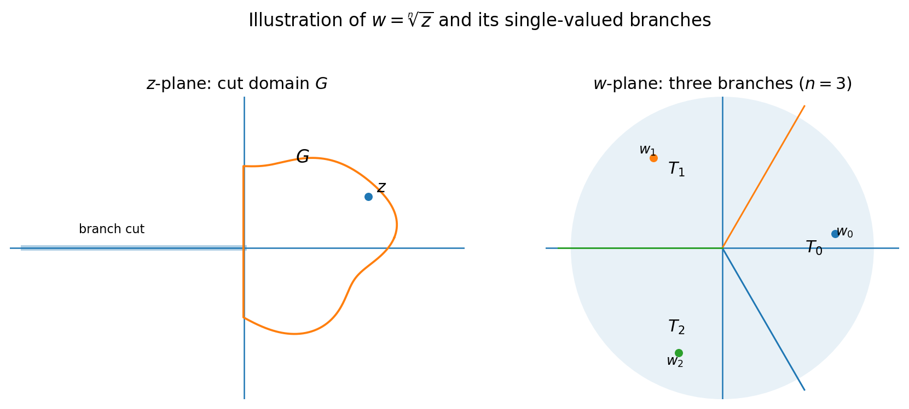
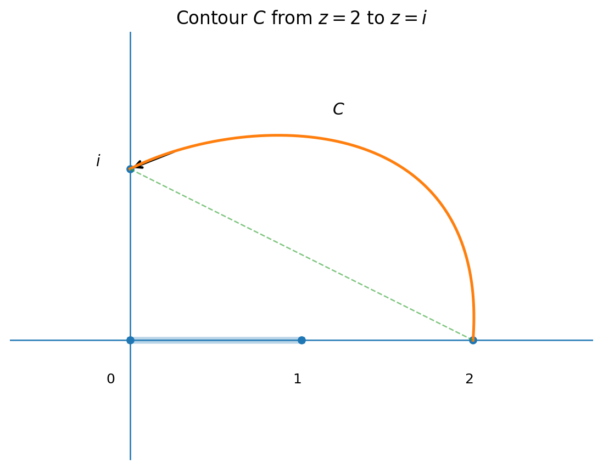
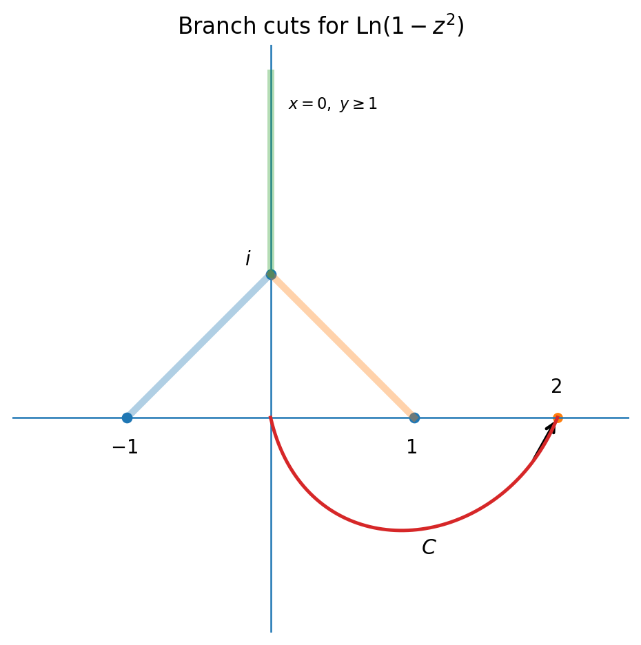

## 单叶性

> **定义：**设 $f(z)$ 在区域 $D$ 内有定义，且对任意 $z_1\neq z_2$，$z_1,z_2\in D$，都有 $f(z_1)\neq f(z_2)$，则称 $f(z)$ 在 $D$ 内是**单叶的**，并称 $D$ 为 $f(z)$ 的**单叶性区域**。

## 辐角函数与辐角改变量

$w=\operatorname{Arg}z$ 是辐角函数，其定义域为 $\mathbb C\setminus\{0\}$。

沿曲线 $L$ 的辐角改变量记为 $\Delta_L\operatorname{Arg}z$，约定**逆时针为正**。

尽管曲线的起点、终点相同，但若曲线不同、绕原点的圈数不同，则 $\Delta_L\operatorname{Arg}z$ 也不同，彼此可相差 $2k\pi$（其中 $k\in\mathbb Z$）。

若曲线 $L_0$ 不通过原点，并可在 $\mathbb C\setminus\{0\}$ 内连续变形为曲线 $L_1$，则在连续变化的过程中，辐角改变量不能发生 $2k\pi$ 的跳跃，只能保持原值。因此

$$
\Delta_{L_0}\operatorname{Arg}z=\Delta_{L_1}\operatorname{Arg}z
$$

若 $L_0,L_1$ 在 $\mathbb C\setminus\{0\}$ 内可连续变形，则称它们**同伦**，记为 $L_0\sim L_1$。

+ 特别地，若 $L_0$ 为一个点，则 $\Delta_{L_0}\operatorname{Arg}z=0$。

由于 $\mathbb C\setminus\{0\}$ 上任一不绕原点的简单闭曲线都能连续收缩到一点 $P$，即 $L_0\sim P$。

因此，$\forall L\subset \mathbb C\setminus\{0\}$，有
$$
\Delta_L\operatorname{Arg}z=
\begin{cases}
0, & 0\text{ 在 }L\text{ 外部},\\[4pt]
2\pi, & 0\text{ 在 }L\text{ 内部}
\end{cases}
$$

> **拓扑前置知识**
>
> - **道路（路径）：**区域 $D$ 中的道路是连续映射 $\gamma:[0,1]\to D$。若 $\gamma(0)=\gamma(1)$，则称为**闭路**。
> - **同伦：**两条道路 $\gamma_0,\gamma_1:[0,1]\to D$ 若存在连续映射 $H:[0,1]\times[0,1]\to D$，满足 $H(0,t)=\gamma_0(t)$、$H(1,t)=\gamma_1(t)$，则称二者在 $D$ 内同伦。讨论固定端点的道路时，还要求 $H(s,0)$ 与 $H(s,1)$ 在变形中保持不动。
> - **收缩（零伦）：**闭路 $\gamma$ 若与某个常值道路 $\gamma_*(t)\equiv z_*$ 同伦，则称 $\gamma$ 在 $D$ 内**可收缩到一点**，也称 $\gamma$ 是**零伦的**。即存在连续映射 $H:[0,1]^2\to D$，使 $H(0,t)=\gamma(t)$、$H(1,t)=z_*$，且每个 $s$ 下都有 $H(s,0)=H(s,1)$。
> - **单连通：**道路连通区域 $D$ 中的每一条闭路都能在 $D$ 内收缩到一点时，称 $D$ 为单连通区域。
> - 在 $\mathbb C\setminus\{0\}$ 中，绕原点非零圈的闭路不能收缩到一点；辐角改变量为 $0$ 的闭路才可能与常值道路同伦。

## 辐角的单值连续分支

设 $L$ 是 $\mathbb C\setminus\{0\}$ 内的一条简单曲线，$z_0$ 是 $L$ 的起点，$z$ 是终点。在 $z_0$ 处取定 $\arg z_0$ 的一个值，作为 $\operatorname{Arg}z$ 在 $z_0$ 处的初值，则终点处的值为

$$
\operatorname{Arg}z=\arg z_0+\Delta_L\operatorname{Arg}z
$$

记 $G=\mathbb C\setminus(-\infty,0]$，即从 $z$ 平面中去掉负实轴。对 $G$ 内任一简单闭曲线 $L$，有 $L\sim P$，从而有 $\Delta_L\operatorname{Arg}z=0$。

因此，在 $G$ 内沿任意简单曲线的辐角改变量只与起点、终点有关。由此可在 $G$ 内定义无穷多个单值连续函数

$$
\boxed{\arg_k z=\arg_0 z+2k\pi,\quad z\in G,\quad k\in\mathbb Z}
$$

例如可取 $\arg_0z\in(-\pi,\pi)$，并令 $\arg_0(1)=0$，$\arg_0(i)=\dfrac\pi2$。于是 $\{\arg_k z\}$ 是一单值连续函数簇。

+ 简单证明一下 $L\sim P$。

设 $z=re^{i\theta}$，并将曲线参数化为 $z(t)=r(t)e^{i\theta(t)}$。令
$$
H(s,t)=r(t)^{1-s}e^{i(1-s)\theta(t)},\qquad 0\leq s\leq1
$$

则 $H(0,t)=z(t)$，$H(1,t)=1$。又因为 $|H(s,t)|=|r(t)|^{1-s}>0$，所以变形过程中不通过原点。因此 $L\sim1$，即 $L$ 在该区域内可以收缩成一个点。

## 根式函数

$w=\sqrt[n]{z}$ 是映射 $z=w^n$ 的反函数，其中 $n>1$、$n\in\mathbb N$，并可写为

$$
w=\sqrt[n]{|z|}\,e^{i\frac{\operatorname{Arg}z}{n}}
$$

对于每一个 $z\neq0,\infty$，在 $w$ 平面上有 $n$ 个像，它们是以原点为中心的正 $n$ 边形的顶点。

因此 $w=\sqrt[n]{z}$ 是 $n$ 值函数。

设 $z=re^{i\theta}$，$w=\rho e^{i\varphi}$，则 $r=\rho^n$，$\theta=n\varphi$。

将 $w$ 平面分成 $n$ 个角形区域

$$
T_k:\quad \frac{2k\pi}{n}-\frac\pi n<\varphi<\frac{2k\pi}{n}+\frac\pi n,
\qquad k=0,1,\ldots,n-1,
$$

各区域可映到割去负实轴的 $z$ 平面区域 $G$。

在 $G$ 内可定义

$$
\boxed{w_k(z)=\sqrt[n]{r(z)}\,e^{i\frac{\theta(z)+2k\pi}{n}},
\qquad z\in G,\quad k=0,1,\ldots,n-1}
$$

这 $n$ 个函数称为 $\sqrt[n]{z}$ 的 $n$ 个**单值连续分支**。

> 设 $F(z)$ 是区域 $G$ 内的多值函数，$f(z)$ 是 $G$ 内的单值连续解析函数。若对 $G$ 内任一点 $z$ 都有 $f(z)\in F(z)$，则称 $f(z)$ 为 $F(z)$ 在 $G$ 内的一个**单值连续解析分支**。

## 支点与支割线

> 当 $z$ 绕某点一整圈回到原来的位置，而函数值没有回到原来的值时，称该点为多值函数的**支点**。

例如，$w=\sqrt[n]{z}$ 的支点为 $z=0$ 与 $z=\infty$。

> 用来割开 $z$ 平面、分出根式函数单值解析分支的曲线称为**支割线**。

支割线不唯一。通常取负实轴为支割线，并把在正实轴上取正实值的分支称为**主值支**。

> **例 2.18**　设 $w=\sqrt[3]{z}$ 定义在从原点沿负实轴割开的 $z$ 平面上，且 $w(i)=-i$，求 $w(-i)$。

**解**　$r(i)=1$，$\theta(i)=\dfrac\pi2$。

由 $-i=e^{i(\frac\pi2+2k\pi)/3}$ 得 $k=2$。

又 $r(-i)=1$，$\theta(-i)=-\dfrac\pi2$，所以在同一分支上

$$
w(-i)=e^{i\frac{-\frac\pi2+4\pi}{3}}=e^{i\frac{7\pi}{6}}
$$

## 复对数函数

由 $e^w=z$ 得到 $w=\operatorname{Ln}z$。若 $z=re^{i\theta}$，则

$$
\operatorname{Ln}(re^{i\theta})
=\ln r+i(\theta+2k\pi)
=\ln|z|+i\operatorname{Arg}z
=\ln|z|+i(\arg z+2k\pi),\qquad k\in\mathbb Z
$$

当 $-\pi<\arg z\leq\pi$ 时，记主值为

$$
\boxed{\ln z=\ln|z|+i\arg z}
$$

> **例 2.19**　设 $a>0$，写出 $\operatorname{Ln}a$、$\operatorname{Ln}(-a)$ 及其主值。

**解**　$\operatorname{Ln}a=\ln a+i2k\pi$，其主值为 $\ln a$；而 $\operatorname{Ln}(-a)=\ln a+i(2k+1)\pi$，其主值为 $\ln(-a)=\ln a+\pi i$。因此
$$
\operatorname{Ln}(-1)=(2k+1)\pi i,\quad
\operatorname{ln}(-1)=\pi i,\\
\operatorname{Ln}(-e)=1+(2k+1)\pi i,\quad
\ln(-e)=1+\pi i
$$

### $z=e^w$ 的变换性质

设 $z=re^{i\theta}$，$w=u+iv$，则 $r=e^u$，$\theta=v$。

- 把 $v=v_0$ 固定，得到射线 $\theta=v_0$；
- 把 $u=u_0$ 固定，在 $-\pi<v\leq\pi$ 内得到圆 $r=e^{u_0}$。

因此，映射 $z=e^w$ 把带形区域 $-\pi<v\leq\pi$ 映到割去负实轴的区域 $G$。更一般地，将带形区域

$$
B_k:\quad (2k-1)\pi<v\leq(2k+1)\pi
$$

映到同一割平面 $G$。

+ $w=\operatorname{Ln}z$ 的支点为 $z=0$ 与 $z=\infty$。

## 幂函数与指数函数

### 幂函数

$$
\boxed{w=z^\alpha=e^{\alpha\operatorname{Ln}z}},
\qquad z\neq0,\infty,\quad \alpha\in\mathbb C
$$

设 $\operatorname{Ln}z$ 的任一值为 $(\operatorname{Ln}z)_0$，并记 $w_0=e^{\alpha(\operatorname{Ln}z)_0}$，则 $w=w_0e^{2k\pi\alpha i}$。

1. 若 $\alpha\in\mathbb Z$，则 $w=w_0$，为单值函数。
2. 若 $\alpha=\dfrac qp$ 且 $(p,q)=1$，则 $w=w_0e^{2k\pi i q/p}$，$k=0,1,\ldots,p-1$，共有 $p$ 个值。
3. 若 $\alpha\notin\mathbb Q$，则 $w$ 是多值函数，并有无穷多个值。

### 指数函数

$$
\boxed{w=\alpha^z=e^{z\operatorname{Ln}\alpha}},
\qquad \alpha\neq0,\infty,\quad \alpha\in\mathbb C
$$

> **例 2.22**　求 $i^i$。

**解**　
$$
i^i=e^{i\operatorname{Ln}i}
=e^{i(\frac\pi2 i+2k\pi i)}
=e^{-\frac\pi2-2k\pi},\qquad k=0,\pm1,\pm2,\ldots
$$

其主值为 $\boxed{e^{-\pi/2}}$。

> **例 2.23**　求 $2^{1+i}$。

**解**　
$$
\begin{aligned}
2^{1+i}
&=e^{(1+i)\operatorname{Ln}2}
=e^{(1+i)(\ln2+2k\pi i)}\\
&=e^{(\ln2-2k\pi)+(\ln2+2k\pi)i}
=e^{\ln2-2k\pi}\bigl(\cos\ln2+i\sin\ln2\bigr),
\end{aligned}
$$

其中 $k=0,\pm1,\pm2,\ldots$。其主值为 $e^{\ln2}(\cos\ln2+i\sin\ln2)$。

## 代数函数的支点

以 $w=\sqrt[n]{P(z)}$ 为例，设

$$
P(z)=A(z-a_1)^{\alpha_1}(z-a_2)^{\alpha_2}\cdots(z-a_m)^{\alpha_m},
$$

且 $P(z)$ 是 $z$ 的 $N$ 次多项式，其中 $\alpha_1+\alpha_2+\cdots+\alpha_m=N$。

1. 可能的支点为 $a_1,a_2,\ldots,a_m,\infty$；
2. 若 $n\nmid\alpha_i$，则 $a_i$ 是支点；
3. 若 $n\nmid N$，则 $\infty$ 是支点；
4. 若某些支点对应的指数之和可被 $n$ 整除，则这些支点可以连接成一条割线。

连接规则：

- 每 $n$ 个点连成一条割线；
- 每一组支点绕一圈之后，函数回到原值，即这一组支点的指数之和为 $n$ 的倍数。（$n\mid\left(\alpha_{j_1}+\alpha_{j_2}+\cdots+\alpha_{j_m}\right)$）

> **例**　判断 $w=\sqrt{z(z-1)(z-2)(z-3)(z-4)}$ 与 $w=\sqrt[4]{z(z-1)(z-2)(z-3)(z-4)}$ 的支点。

**解**　两者的支点均为 $0,1,2,3,4,\infty$。

第一个函数可以构造如下割线：从 $0$ 到 $1$ 割开，从 $2$ 到 $3$ 割开，从 $4$ 沿正实轴割开。

第二个函数可以构造如下割线：从 $0$ 到 $1$ 到 $2$ 割开，从 $3$ 到 $4$ 再沿正实轴割开。

## 计算终值问题

若沿曲线 $C$ 从 $z_1$ 延拓到 $z_2$，则

$$
f(z_2)=|f(z_2)|e^{i\arg f(z_2)}
=|f(z_2)|e^{i\Delta_C\arg f(z)}e^{i\arg f(z_1)}
$$

> **例 2.25**　设 $f(z)=\sqrt[3]{z(1-z)}$。证明 将 $z$ 平面适当割开后，能分出三个单值解析分支；并求在 $z=2$ 取负值的那个分支在 $z=i$ 的值。

**解**　$f(z)$ 的支点为 $0,1,\infty$。

对每一个 $z$，方程 $w^3=z(1-z)$ 有三个根。

因此将 $z$ 平面从 $0$ 到 $1$ 割开，再沿负虚轴割开，能分出三个单值解析函数。

在 $z=2$ 取负值，即 $f(2)=-\sqrt[3]{2}$，$\arg f(2)=\pi$。

有 $\Delta_C\arg z=\dfrac\pi2$，$\Delta_C\arg(1-z)=\dfrac{3\pi}{4}$。因此
$$
\Delta_C\arg f(z)^3
=\Delta_C\arg z+\Delta_C\arg(1-z)=\frac{5\pi}{4},
$$

从而 $\Delta_C\arg f(z)=\dfrac{5\pi}{12}$。又 $|f(i)|=\sqrt[3]{|i|\,|1-i|}=\sqrt[6]{2}$，所以

$$
f(i)=-\sqrt[6]{2}\,e^{i\frac{5\pi}{12}}
$$

相应地，沿曲线延拓对数时可写为

$$
\operatorname{Ln}f(z_2)=\ln|f(z_2)|+i\Delta_C\arg f(z)+i\arg f(z_1)
$$

> **例 2.26**　证明 $\operatorname{Ln}(1-z^2)$ 在割去下列曲线的 $z$ 平面内能分出单值解析分支：从 $-1$ 到 $i$ 的直线段、从 $i$ 到 $1$ 的直线段，以及射线 $x=0$ 且 $y\geq1$。并求在 $z=0$ 时等于 $0$ 的那一支在 $z=2$ 的值。

**解**　因为 $\operatorname{Ln}(1-z^2)=\operatorname{Ln}(1-z)+\operatorname{Ln}(1+z)$，所以其支点为 $z=\pm1$ 与 $z=\infty$。

当 $z$ 绕 $+1$ 或 $-1$ 一周时，$\operatorname{Ln}(1-z^2)$ 的值改变 $2\pi i$；

当 $z$ 同时绕 $\pm1$ 一周时，其值改变 $4\pi i$。

将平面按题设曲线割开后，不可能再单独绕某个支点一周或同时绕 $\pm1$ 一周，因此在割破后的 $z$ 平面内可分出无穷多个单值解析分支。

沿图中从 $0$ 到 $2$ 的路径 $C$，有

$$
\Delta_C\arg(1-z^2)
=\Delta_C\arg(1+z)+\Delta_C\arg(1-z)=0+\pi=\pi
$$

因为 $\operatorname{Ln}(1-z^2)=\ln|1-z^2|+2k\pi i+i\arg(1-z^2)$。在 $z=0$ 时，该分支取值为 $0$，故 $k=0$。

因此在 $z=2$ 时，
$$
\operatorname{Ln}(1-2^2)=\ln|1-2^2|+\pi i=\ln3+\pi i
$$

## 反三角函数与反双曲函数

由 $w=\arctan z$ 得

$$
z=\tan w=\frac{e^{iw}-e^{-iw}}{e^{iw}+e^{-iw}}\cdot\frac1i,
$$

因此 $e^{2iw}=\dfrac{1+iz}{1-iz}$，从而

$$
\boxed{\operatorname{Arctan}z=\frac1{2i}\operatorname{Ln}\frac{1+iz}{1-iz}}
$$

类似地，

$$
\boxed{
\begin{aligned}
\operatorname{Arctanh}z&=\frac12\operatorname{Ln}\frac{1+z}{1-z},\\
\operatorname{Arcsin}z&=-i\operatorname{Ln}\left(iz+\sqrt{1-z^2}\right),\\
\operatorname{Arcsinh}z&=\operatorname{Ln}\left(z+\sqrt{z^2+1}\right),\\
\operatorname{Arccos}z&=\frac1i\operatorname{Ln}\left(z+\sqrt{z^2-1}\right),\\
\operatorname{Arccosh}z&=\operatorname{Ln}\left(z\pm\sqrt{z^2-1}\right)
\end{aligned}}
$$

> **例 2.27**　求 $\operatorname{Arcsin}2$。

$$
\operatorname{Arcsin}2
=-i\operatorname{Ln}(2i\pm\sqrt3\,i) \\
=-i(\operatorname{ln}(2\pm\sqrt3)+\operatorname{ln}i) \\
=\frac\pi2+2k\pi-i\ln(2\pm\sqrt3)\\
k=0,\pm1,\pm2,\ldots
$$

因此

$$
\operatorname{Arcsin}2=\frac\pi2+2k\pi-i\ln(2\pm\sqrt3)\quad k=0,\pm1,\pm2,\ldots
$$

> **例 2.28**　求 $\operatorname{Arctan}(2i)$。

$$
\begin{aligned}
\operatorname{Arctan}(2i)
&=\frac1{2i}\operatorname{Ln}\frac{1+i(2i)}{1-i(2i)}
=\frac1{2i}\operatorname{Ln}\left(-\frac13\right)\\
&=\left(k+\frac12\right)\pi+\frac{i\ln3}{2},
\qquad k=0,\pm1,\pm2,\ldots
\end{aligned}
$$

即

$$
\operatorname{Arctan}(2i)=\left(k+\frac12\right)\pi+\frac{i\ln3}{2} \quad k=0,\pm1,\pm2,\ldots
$$

